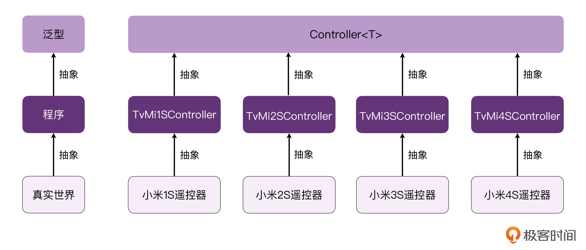
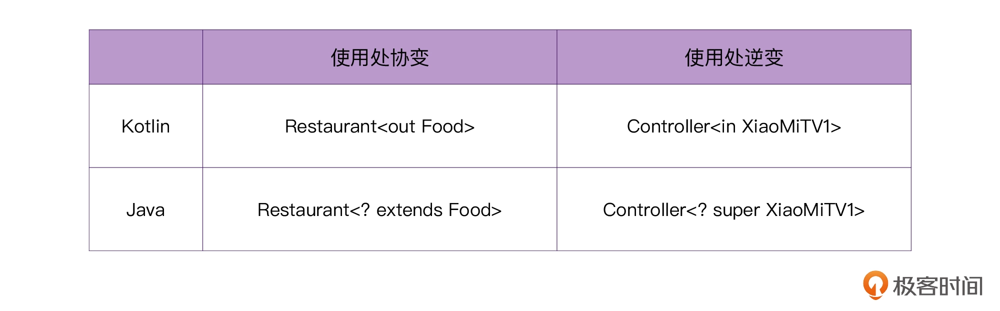
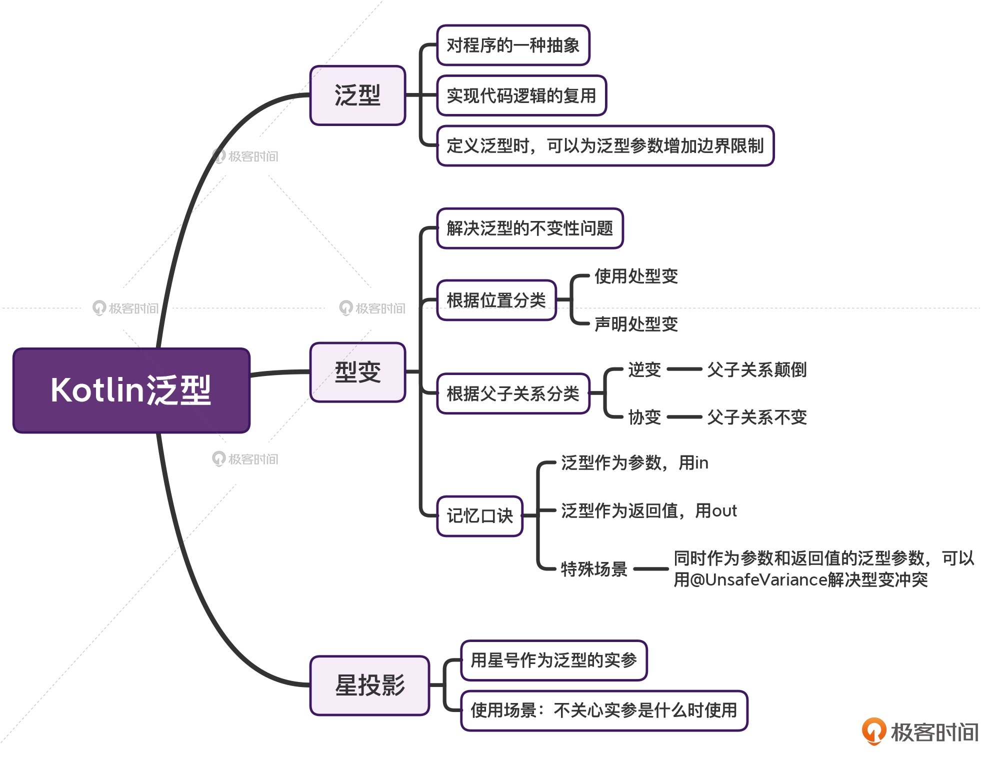
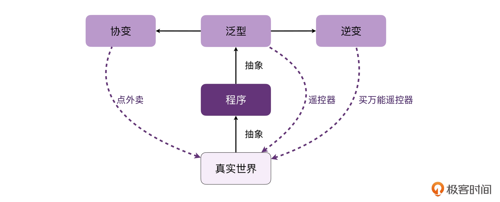

# 10-泛型：逆变or协变，傻傻分不清？

你好，我是朱涛。这节课我们来学习 Kotlin 的泛型（Generics），包括泛型基础、使用处型变、声明处型变以及星投影。

泛型，这个概念在很多编程语言里面都存在。在中大型软件开发当中，我们对泛型的使用也十分频繁，因为它可以让我们在不同类型之间复用相似的逻辑代码。

不管是 Android 领域，还是后端领域，泛型在软件的架构当中都有着举足轻重的地位。只有透彻理解了泛型，我们才能理解各种设计模式，进而才可能设计出合理的软件架构。

然而，想要学好泛型却不是一件容易的事情。这是因为，泛型实在太抽象了。

我们都知道，程序其实是对真实世界的抽象，比如我们在前面实战课里写的计算器程序，现实生活当中就有计算器这个东西，我们想要在电脑里写一个抽象的计算器程序，也不会那么难理解，因为它和现实生活相关。可是泛型，它是对程序的抽象。程序本来就已经够抽象了，我们还要在它的基础上再做一次抽象。

这样一来，泛型和我们真实的物理世界差了两层抽象，因此，泛型对于我们人类来说，会显得尤为虚无缥缈。


不过，程序其实也是源自于生活的。所以在这节课里，我会尽量用生活中的例子来给你解释下Kotlin 的泛型概念，让你能更直观、更立体地感知到泛型与现实生活的联系，然后，你也能够从这些生活的场景中，更深刻地理解并掌握 Kotlin 的泛型，从而为你将来构建大型软件打好基础。

好，那么下面，我们就拿“遥控器”这个生活中常见的物件儿，来聊聊它跟“泛型”之间，都能产生哪些联系。

## 掌握泛型基础

在现实生活中，我们能看到各式各样的电视机遥控器，比如小米就有 1S、2S、3S、4S 电视遥控器。

那么，如果我们将遥控器的概念迁移到程序的世界，我们就需要定义各种各样的“遥控器类”，比如说：

```python
// 小米1S电视机遥控
class TvMi1SController {
   fun turnOn() {}
   fun turnOff() {}
}
// 小米2S电视机遥控
class TvMi2SController {
   fun turnOn() {}
   fun turnOff() {}
}
// 小米3S电视机遥控
class TvMi3SController {
   fun turnOn() {}
   fun turnOff() {}
}
// 小米4S电视机遥控
class TvMi4SController {
   fun turnOn() {}
   fun turnOff() {}
}
...
```

- 省略几千种不同的遥控器

从上面的代码我们可以看到，如果我们为每一个型号的电视机都创建一个对应的遥控器类，然后在里面重复编写“开机”“关机”的方法，我们的工作量会很大，而且没有意义。

这个时候，我们其实需要一个万能遥控器，而借助 Kotlin 的泛型，我们就可以很容易地实现了。

```python
//          T代表泛型的形参
//               ↓
class Controller<T> {
   fun turnOn(tv: T) {}
   fun turnOff(tv: T) {}
}
fun main() {
//                                泛型的实参
//                                   ↓
   val mi1Controller = Controller<XiaoMiTV1>()
   mi1Controller.turnOn()
//                                  泛型的实参
//                                     ↓
   val mi2Controller = Controller<XiaoMiTV2>()
   mi2Controller.turnOn()
}
在这段代码里，我们定义了一个“万能遥控器类”Controller<T>，它当中的字母 T 代表了，
```

这个遥控器可以控制很多种型号的电视，至于我们到底想要控制哪种型号，在使用的时候，只需要把 T 替换成实际的电视机型号即可。在上面的 main 函数当中，我们是传入了“XiaoMi1S”“XiaoMi2S”这两个型号。

可见，使用泛型的好处就在于，我们可以复用程序代码的逻辑，借助这个特性，我们可以在程

```
序的基础上再做一次抽象。这样，通过这个Controller<T>，不管将来有多少型号的电视
```

机，我们都可以用这一个类来搞定。



另外，我们在定义泛型的时候，其实还可以为它的泛型参数增加一些边界限制，比如说，强制要求传入的泛型参数，必须是 TV 或者是它的子类。这叫做泛型的上界。

```python
//               差别在这里
//                   ↓
class Controller<T: TV> {
   fun turnOn(tv: T) {}
   fun turnOff(tv: T) {}
}
```

和 Kotlin 的继承语法一样，我们是使用冒号来表示泛型的边界。注意，当我们定义了边界之后，如果我们传入 Controller 的类型不是 TV 的子类，那么编译器是会报错的。

```
fun main() {
   // 报错，因为Car不是TV的子类
   val controller = Controller<Car>()
}
```

还有一点你也需要注意，由于函数是 Kotlin 当中的一等公民，所以你也可以用两个简单的函数turnOn() 和 turnOff()，来解决前面所说的“遥控器的问题”：

```
//     函数的泛型参数
//   ↓             ↓
fun <T> turnOn(tv: T){ ... }
fun <T> turnOff(tv: T){ ... }
fun turnOnAll(mi1: XiaoMiTV1, mi2: XiaoMiTV2) {
//      泛型实参自动推导
//          ↓
   turnOn(mi1)
   turnOn(mi2)
}
```

从上面的代码里我们可以看到，我们直接在 fun 关键字的后面加上用尖括号包起来的 T，就可以为函数增加泛型支持。这里我们选择用字母“T”，完全是因为约定俗成，你将 T 改为其他英文字母也是不会影响编译的。

好了，泛型是什么、使用的好处、如何表示等问题，现在我们就都搞清楚了。下面我们再来看看学习泛型的一大难点：型变。

## 型变（Variance）

首先，型变是什么呢？

简单来说，它就是为了解决泛型的不变性问题。事实上，型变讨论的是：在已知 Cat 是

```
Animal 的子类的情况下，MutableList<Cat>与MutableList<Animal>之间是什么关
```

系。

在正常情况下，编译器会认为它们两者是没有任何关系的。换句话，也就是说，泛型是不变的。Kotlin 编译器会这样处理的原因也很简单，这里我们可以先来假设一下：如果编译器不阻

```
止我们用MutableList<Cat>来替代MutableList<Animal>，代码会出什么问题呢？
// 需要父类集合，传入子类集合
foo(list: MutableList<Animal>) {
   // 出错，Cat集合不能存Dog对象
   list.add(Dog())
   // 通过
   val animal: Animal = list[0] // 取出的Cat对象
}
fun main() {
   // 需要MutableList<Animal>，实际传MutableList<Cat>
   foo(mutableListOf<Cat>(Cat()))
   // 实际上，编译器在这里就会提示错误，我们现在假设编译器不阻止我们，会出什么问题
}
```

从这段代码的注释中，我们能看到，当程序需要 Animal 的集合时，如果我们传入的是 Cat 的集合，我们就可以往 list 里添加其他类型的动物，比如 Dog。然而，Dog 是无法存入 Cat 的集合的。

那么如果我们反过来呢？

```
// 需要子类集合，传入父类集合
foo(list: MutableList<Cat>) {
   // 通过
   list.add(Cat())
   // 出错
   val cat: Cat = list[0] // 实际取出来的是Animal对象
}
fun main() {
   // 需要MutableList<Cat>，实际传MutableList<Animal>
   foo(mutableListOf(Animal()))
   // 实际上，编译器在这里就会提示错误，我们现在假设编译器不阻止我们，会出什么问题
}
```

我们会发现，反过来之后，当需要子类集合传入父类集合的时候，我们在函数体内部存储的行为是不会受到影响的，存储 Cat、Animal 类型都没问题。可是，一旦我们想从集合当中取出Cat 对象的时候，会发现取出来的是 Animal 对象，这时候又错了。

```
所以，在默认情况下，编译器会认为MutableList<Cat>与MutableList<Animal>之间
```

不存在任何继承关系，它们也无法互相替代，这样就不会出现前面提到的两种问题。这就是泛型的不变性。

但是啊，在某些特定场景下，编译器这种行为还是会给我们带来麻烦的。而这个时候，就需要泛型的逆变与协变了。具体是什么特定场景呢？别着急，下面我带你来看个例子。

### 逆变（Contravariant）

让我们继续以前面的遥控器为例：

```python
open class TV {
   open fun turnOn() {}
}
class XiaoMiTV1: TV() {
   override fun turnOn() {}
}
class Controller<T> {
   fun turnOn(tv: T)
}
```

在这里，我们有一个电视机的父类，叫做 TV，另外还有一个子类，叫做 XiaoMiTV1。它们两者是继承关系。由于它们是父子的关系，当函数的参数需要 TV 这个父类的时候，我们是可以传入子类作为参数的。这很好理解，我们接着往下看：

```
fun foo(tv: TV) {}
fun main() {
// 要求父类，可以传入子类
   foo(XiaoMiTV1())
}
现在问题来了，Controller<XiaoMiTV1>和Controller<TV>之间是什么关系呢？让我
```

们来设想一个买遥控器的场景：

```
//                      需要一个小米电视1的遥控器
//                                ↓
fun buy(controller: Controller<XiaoMiTV1>) {
   val xiaoMiTV1 = XiaoMiTV1()
   // 打开小米电视1
   controller.turnOn(xiaoMiTV1)
}
```

在上面的代码中，我们的函数需要一个“小米电视 1 的遥控器”，在函数的内部，我们需要打开一台小米电视机。那么，当我们需要打开一台小米电视机的时候，我们是否可以用一个“万能的遥控器”呢？当然可以！所以，我们可以写出下面这样的代码：

```
fun main() {
//                             实参
//                              ↓
   val controller = Controller<TV>()
   // 传入万能遥控器，报错
   buy(controller)
}
```

在这段代码中，由于我们传入的泛型实参是 TV，它是所有电视机的父类。因此，Controller 内部将会处理所有电视机型号的开机、关机。这时候，它就相当于一个万能遥控器，万能遥控器当然也可以打开小米电视 1。

从道理上来讲，我们的推理是没有错的，不过 Kotlin 编译器会报错，报错的内容是说“类型不

```
匹配”，需要的是小米遥控器Controller<XiaoMiTV1>，你却买了个万能遥控器
Controller<TV>。在默认情况下，Kotlin 编译器就是这么认死理。
```

所以，为了让我们的代码通过编译，我们需要主动告诉编译器一些额外的信息，具体的做法有两种。

第一种做法，是修改泛型参数的使用处代码，它叫做使用处型变。具体做法就是修改 buy 函数的声明，在 XiaoMiTV1 的前面增加一个 in 关键字：

```
//                         变化在这里
//                             ↓
fun buy(controller: Controller<in XiaoMiTV1>) {
   val xiaoMiTV1 = XiaoMiTV1()
   // 打开小米电视1
   controller.turnOn(xiaoMiTV1)
}
```

第二种做法，是修改 Controller 的源代码，这叫声明处型变。具体做法就是，在泛型形参 T 的前面增加一个关键字 in：

```python
//            变化在这里
//               ↓
class Controller<in T> {
   fun turnOn(tv: T)
}
```

我们使用以上任意一种方式修改后，代码就能够通过 Kotlin 编译了。这样修改之后，我们就可

```
以使用Controller<TV>来替代Controller<XiaoMiTV1>，也就是说，
Controller<TV>是Controller<XiaoMiTV1>的子类。
```


如果你足够细心，你会发现：在这个场景下，遥控器与电视机之间的父子关系颠倒了。“小米电视”是“电视”的子类，但是，“万能遥控”成了“小米遥控”的子类。这种父子关系颠倒的现象，我们就叫做“泛型的逆变”。上面这两种修改方式，就分别叫做使用处逆变和声明处逆变。

而除了父子关系颠倒的现象，泛型当中还存在一种父子关系一致的现象，也就是泛型的协变。

### 协变（Covariant）

这次，我们仍然以一个生活中的场景来做分析。现在，请你想象一个点外卖的场景。


为了模拟这个场景，我们需要用代码来描述其中的几个角色：普通的食物、肯德基的食物，它们两者之间是父子关系。

```python
open class Food {}
class KFC: Food() {}
```

除此之外呢，我们还有一个饭店的角色：

```python
class Restaurant<T> {
   fun orderFood(): T { /*..*/ }
}
```

在上面的 Restaurant 泛型参数处，我们传入不同的食物类型，就代表了不同类型的饭店。接下来，就是我们的点外卖方法了：

```
//                      这里需要一家普通的饭店，随便什么饭店都行
//                                     ↓
fun orderFood(restaurant: Restaurant<Food>) {
   // 从这家饭店，点一份外卖
   val food = restaurant.orderFood()
}
fun main() {
//                  找到一家肯德基
//                        ↓
   val kfc = Restaurant<KFC>()
// 需要普通饭店，传入了肯德基，编译器报错
   orderFood(kfc)
}
```

如果我们直接运行上面的代码，会发现编译器提示最后一行代码报错，报错的原因同样是：

```
“类型不匹配”，我们需要的是一家随便类型的饭店Restaurant<Food>，而传入的是肯德基
Restaurant<KFC>，不匹配。
```

是不是觉得很荒谬？既然随便找一家饭店就能点外卖，为什么肯德基不可以呢？

不过，有了上次的经验，这次我们就轻车熟路了，由于编译器认死理，我们必须额外提供一些信息给编译器，让它知道我们是在特殊场景使用泛型。具体的做法呢，还是有两种。

第一种做法，还是修改泛型参数的使用处，也就是使用处型变。具体的做法就是修改orderFood() 函数的声明，在 Food 的前面增加一个 out 关键字：

```
//                                变化在这里
//                                    ↓
fun orderFood(restaurant: Restaurant<out Food>) {
   // 从这家饭店，点一份外卖
   val food = restaurant.orderFood()
}
```

第二种做法，是修改 Restaurant 的源代码，也就是声明处型变。具体做法就是，在它泛型形参 T 的前面增加一个关键字 out：

```python
//            变化在这里
//                ↓
class Restaurant<out T> {
   fun orderFood(): T { /*..*/ }
}
```

在做完以上任意一种修改以后，代码就可以通过编译了。这也就意味着，在这种情况下，我们

```
可以使用Restaurant<KFC>替代Restaurant<Food>，也就意味着Restaurant<KFC>可
以看作是Restaurant<Food>的子类。
```


到了这时候，你会发现，食物与饭店它们之间的父子关系一致了。这种现象，我们称之为“泛型的协变”。上面两种修改的方式，就分别叫做使用处协变和声明处协变。

需要特别注意的是，虽然 Java 当中也有型变的概念，但是呢，Java 当中是没有声明处型变的。Java 里面只有使用处型变，下面是它们的语法对比：



而通过对比，你也会发现，Java 的型变语法十分抽象，远不如 Kotlin 来得简洁。

好了，到这里，我们就差不多把 Kotlin 的泛型这个特性理解清楚了，那么是不是就说明，我们可以开始实战了呢？其实还不行，我们还需要了解另一个跟泛型相关的概念，也就是星投影。

## 星投影（Star-Projections）

Kotlin 当中还有一个概念叫做“星投影”。虽然你听起来可能会觉得这个词很吓人，但其实它的概念很简单。所谓的星投影，其实就是用“星号”作为泛型的实参。

那么，什么情况下，我们需要用星号作为泛型实参呢？答案其实也很简单，当我们不关心实参到底是什么的时候。

举个例子，我们现在需要开发一个“找饭店”的功能，借助泛型，我们可以写出这样的代码：

```
fun <T> findRestaurant(): Restaurant<T> {}
```

不过，如果我们并不关心找到的饭店到底是什么类型，不管它是肯德基还是麦当劳的话，那么，我们就完全可以把“星号”作为泛型的实参，比如这样：

```python
class Restaurant<out T> {
   fun orderFood(): T {}
}
//                        把星号作为泛型实参
//                               ↓
fun findRestaurant(): Restaurant<*> {}
fun main() {
   val restaurant = findRestaurant()
   // 注意这里
   val food: Any? = restaurant.orderFood() // 返回值可能是：任意类型
}
```

在上面的代码当中，我们没有传递任何具体的类型给 Restaurant，而是使用了“星号”作为Restaurant 的泛型实参，因此，我们就无法知道饭店到底是什么类型。

相应的，当我们调用 restaurant.orderFood() 的时候，就无法确定它返回的值到底是什么类型。这时候，变量 food 的实际类型可能是任意的，比如 String、Int、Food、KFC，甚至可能是 null，因此，在这里我们只能将其看作是“Any?”类型。

那么，对于上面的这种 food 可能是任意类型的情况，我们有没有办法让 food 的类型更加精确一些呢？当然是有的。如果我们为 Restaurant 的泛型类型加上边界的话，food 的类型就可以更精确一些。

```python
//                   区别在这里
//                       ↓
class Restaurant<out T: Food> {
   fun orderFood(): T {}
}
fun findRestaurant(): Restaurant<*> {}
fun main() {
   val restaurant = findRestaurant()
   //       注意这里
   //          ↓
   val food: Food = restaurant.orderFood() // 返回值是：Food或其子类
}
```

从这个例子我们能看到，当我们为 Restaurant 泛型类型增加了上界 Food 以后，即使我们使用了“星投影”，也仍然可以通过调用 restaurant.orderFood()，来拿到 Food 类型的变量。在这里，food 的实际类型肯定是 Food 或者是 Food 的子类，因此我们可以将其看作是 Food 类型。

泛型虽然很抽象，但它存在的目的，仍然是为了解决我们生活的实际问题。所以，当我们将泛型应用到实际的生活场景时，它就显得不是那么抽象了。

## 实战与思考

在学完型变以后，也许你会有点迷惑：到底什么时候用逆变，什么时候用协变？如果你看过Kotlin 的官方文档，你会看到一句这样的话：

- Consumer in, Producer out !

直译的话，大概意思就是：消费者 in，生产者 out。不过，这个对我们中国人的说话语境而言，不是那么好理解。让我们继续根据前面的遥控器、点外卖两个场景，来做个说明。

```python
//              逆变
//               ↓
class Controller<in T> {
//                 ①
//                 ↓
   fun turnOn(tv: T)
}
//               协变
//                ↓
class Restaurant<out T> {
//                   ②
//                   ↓
   fun orderFood(): T { /*..*/ }
}
```

在这段代码中，分别是我们前面提到的逆变、协变的例子。把它们两个放到一起后，你应该就能很容易地发现它们两个的差别了。需要特别留意的地方，我都在注释当中标记出来了，让我来解释给你听：

- 对于逆变的情况，我们模拟的是买遥控器的场景。请注意注释①的地方，我们的泛型 T，它最终会以函数的参数的形式，被传入函数的里面，这往往是一种写入行为，这时候，我们使用关键字 in。

- 对于协变的情况，我们模拟的是点外卖的场景。请注意注释②的地方，我们的泛型 T，它最终会以返回值的形式，被传出函数的外面，这往往是一种读取行为，这时候，我们使用关键字 out。

所以，如果要以更加通俗的语言来解释逆变与协变的使用场景的话，我们可以将其总结为：传入 in，传出 out。或者，我们也可以说：泛型作为参数的时候，用 in，泛型作为返回值的时候，用 out。

我们再来看一下 Kotlin 源码当中型变的应用。首先，是逆变的应用。

```java
//                          逆变
//                           ↓
public interface Comparable<in T> {
//                                   泛型作为参数
//                                       ↓
   public operator fun compareTo(other: T): Int
}
```

在以上代码中，由于泛型是作为了 compareTo 方法的参数传入的，因此，对于 Comparable的泛型 T，我们应该使用 in 来修饰，这就是逆变的实际应用。

我们再来看看协变在 Kotlin 源码当中的应用。

```java
//                        协变
//                         ↓
public interface Iterator<out T> {
//                         泛型作为返回值
//                              ↓
   public operator fun next(): T
   public operator fun hasNext(): Boolean
}
```

从上面的代码里我们可以看到，由于泛型是作为 next 方法的返回值的，因此，对于 Iterator 的泛型 T，我们应该使用 out 来修饰，这就是协变的应用。

我们再来看看第 2 讲当中密封类的代码案例，一起回顾下当中的泛型细节：

```
sealed class Result<out R> {
//                     协变    ①
//                      ↓      ↓
   data class Success<out T>(val data: T, val message: String = "") : Result<T>(
   data class Error(val exception: Exception) : Result<Nothing>()
   data class Loading(val time: Long = System.currentTimeMillis()) : Result<Noth
}
```

这段代码里，我们对 Success 这个数据类的泛型参数使用了 out 来修饰，这就代表了协变。看到这里，如果你足够细心，就会觉得奇怪：这里为什么可以使用协变呢？前面我们不是说过：“泛型作为参数，用 in；泛型作为返回值，用 out”吗？这里并没有任何函数参数或者返回值啊？

其实，这里就又体现出了我们对 Kotlin 底层理解的重要性了。请注意我在上面标记的注释①，val 在 Kotlin 当中，代表不可变的变量，当它修饰类成员属性的时候，代表它只有getter，没有 setter。当我们看到这样的代码时，我们要能自动脑补出 Success 反编译后的Java 结构：

```java
public static final class Success extends Result {
  private final Object data;
// Success 这个类当中，是会有getter方法的
  public final Object getData() {
     return this.data;
  }
// 省略其他代码
}
```

所以，我们可以用 out 修饰 Success 泛型的原因，是因为 data 的 getter 方法，它本质上是一个返回 T 类型的方法。这时候，如果我们将注释①处的 val 改为 var，那么代码就会立马报错。

```javascript
sealed class Result<out R> {
//                 改为var后，编译器就会立马报错
//                             ↓
   data class Success<out T>(var data: T, val message: String = "") : Result<T>(
   data class Error(val exception: Exception) : Result<Nothing>()
   data class Loading(val time: Long = System.currentTimeMillis()) : Result<Noth
}
```

到这里，有了前面的铺垫，我想你应该很快就能反应过来，编译器报错的原因是由于 var 修饰的成员属性，Kotlin 编译器会在背后生成对应 getter 和 setter，这个时候泛型参数既是“参数”也是“返回值”。所以，如果此时我们还用 out 修饰泛型 T，编译器就会报错了。

也就是说，如果泛型的 T，既是函数的参数类型，又是函数的返回值类型，那么，我们就无法直接使用 in 或者 out 来修饰泛型 T。

不过，函数传入参数的时候，并不一定就意味着写入，这时候，即使泛型 T 是作为参数类型，我们也仍然要想一些办法来用 out 修饰泛型。让我们拿一段官方源码来举例说明一下：

```java
//                   协变
//                    ↓
public interface List<out E> : Collection<E> {
//                                泛型作为返回值
//                                       ↓
   public operator fun get(index: Int): E
//                                           泛型作为参数
//                                                 ↓
   override fun contains(element: @UnsafeVariance E): Boolean
//                                        泛型作为参数
//                                              ↓
   public fun indexOf(element: @UnsafeVariance E): Int
}
```

Kotlin 官方源码当中的 List，也就是这里的泛型 E，它既作为了返回值类型，又作为了参数类型。在正常情况下，如果我们用 out 修饰 E，那编译器是会报错的。但我们其实很清楚，对于contains、indexOf 这样的方法，它们虽然以 E 作为参数类型，但本质上并没有产生写入的行为。所以，我们用 out 修饰 E 并不会带来实际的问题。

所以这个时候，我们就可以通过 @UnsafeVariance 这样的注解，来让编译器忽略这个型变冲突的问题。

另外，让我们再来看看第 5 讲当中提到过的单例抽象模板，一起回顾下当中的泛型细节：

```javascript
//                           逆变   协变
//                            ↓     ↓
abstract class BaseSingleton<in P, out T> {
//                        ①
   @Volatile//           ↓
   private var instance: T? = null
   //                              参数  返回值
   //                               ↓    ↓
   protected abstract val creator: (P)-> T
   //                    参数 返回值
   //                     ↓   ↓
   fun getInstance(param: P): T =
       instance ?: synchronized(this) {
           instance ?: creator(param).also { instance = it }
   }
}
```

在这个单例模板的例子当中，P 一直作为参数，而 T 则是作为返回值。因此我们用 in 来修饰P，这就是逆变；对应的我们用 out 修饰 T，这就是协变。

不过，如果你足够细心的话，会发现注释①处还有一个 instance 是用泛型 T 修饰的。而它是var 定义的成员变量，这就意味着，它既有 getter，又有 setter。那它为什么可以用协变的泛型 T 呢？其实，这是因为它是 private 的，如果你把 private 关键字删掉的话，上面的代码就会报错了。

## 小结

最后，让我们来做一个总结吧。

- 泛型，是对程序的一种抽象。通过泛型，我们可以实现代码逻辑复用的目的，Kotlin 标准库当中很多源代码也都是借助泛型来实现的。

- 从型变的位置来分类的话，分为使用处型变和声明处型变。

- 从型变的父子关系来分类的话，分为逆变和协变。逆变表示父子关系颠倒了，而协变表示父子关系和原来一致。

- 型变的口诀：泛型作为参数，用 in；泛型作为返回值，用 out。在特殊场景下，同时作为参数和返回值的泛型参数，我们可以用 @UnsafeVariance 来解决型变冲突。

- 星投影，就是当我们对泛型的具体类型不感兴趣的时候，直接传入一个“星号”作为泛型的实参。



最后，我还想和你分享一下我学习 Kotlin 泛型的方法论。正如开头我提到的：程序是对真实世界的抽象，而泛型是对程序的抽象。由于泛型与我们真实世界差了两层抽象，这就导致我们很难理解泛型的本质。

所以，为了让泛型更加易懂，我的思路就是让泛型与我们的真实世界建立一种关联：直接拿泛型来模拟真实世界的场景，建立类比的关系。就比如我们今天所讲的：

- 用万能遥控器，类比泛型；

- 用买遥控器的场景，类比逆变；

- 用点外卖的场景，类比协变、星投影。



希望我的学习方法可以对你有所启发。

## 思考题

请你思考一下，“使用处型变”和“声明处型变”，它们有什么区别呢？ 欢迎在留言区分享你的答案，也欢迎你把今天的内容分享给更多的朋友。
