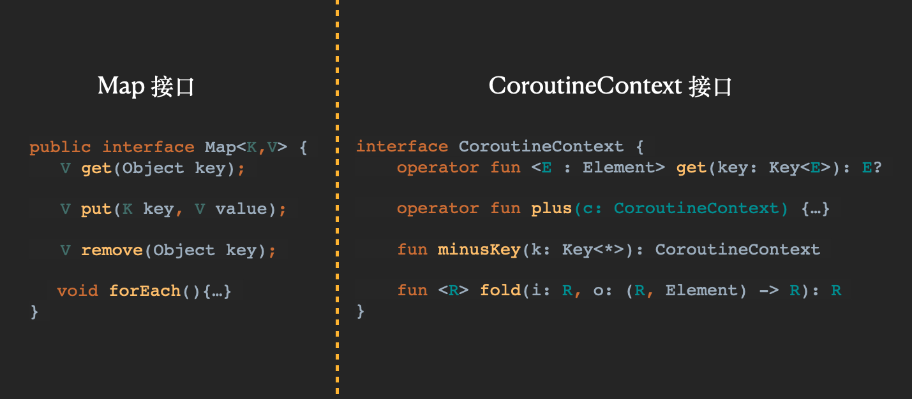
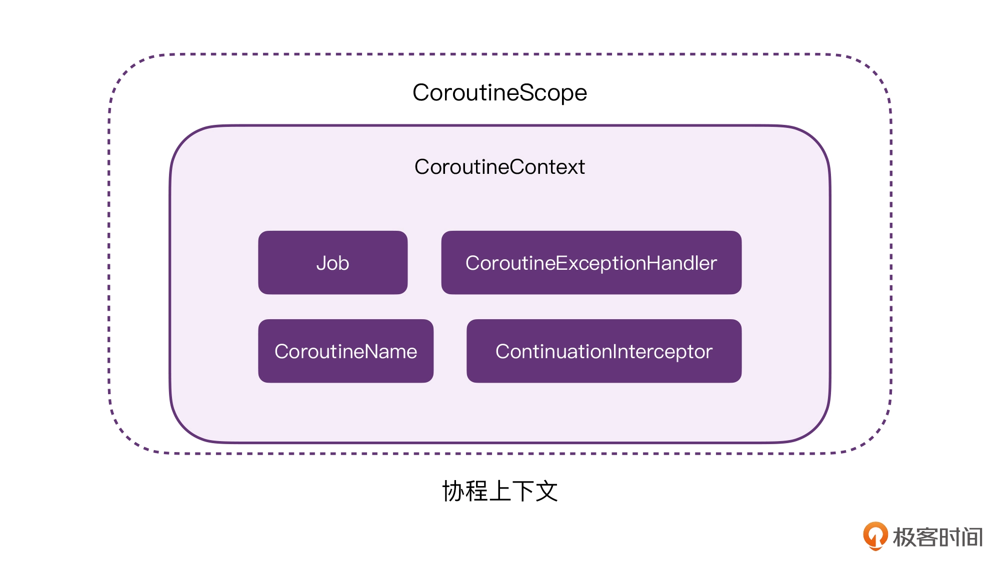

# 17-Context：万物皆为Context？

你好，我是朱涛。今天我们来学习 Kotlin 协程的 Context。

协程的 Context，在 Kotlin 当中有一个具体的名字，叫做 CoroutineContext。它是我们理解Kotlin 协程非常关键的一环。

从概念上讲，CoroutineContext 很容易理解，它只是个上下文而已，实际开发中它最常见的用处就是切换线程池。不过，CoroutineContext 背后的代码设计其实比较复杂，如果不能深入理解它的设计思想，那我们在后面阅读协程源码，并进一步建立复杂并发结构的时候，都将会困难重重。

所以这节课，我将会从应用的角度出发，带你了解 CoroutineContext 的使用场景，并会对照源码带你理解它的设计思路。另外，知识点之间的串联也是很重要的，所以我还会带你分析它跟我们前面学的 Job、Deferred、launch、async 有什么联系，让你能真正理解和掌握协程的上下文，并建立一个基于 CoroutineContext 的协程知识体系。

## Context 的应用

前面说过，CoroutineContext 就是协程的上下文。你在前面的第 14~16 讲里其实就已经见过它了。在第 14 讲我介绍 launch 源码的时候，CoroutineContext 其实就是函数的第一个参数：

```
// 代码段1
public fun CoroutineScope.launch(
//                这里
//                 ↓
   context: CoroutineContext = EmptyCoroutineContext,
   start: CoroutineStart = CoroutineStart.DEFAULT,
   block: suspend CoroutineScope.() -> Unit
): Job {}
```

这里我先说一下，之前我们在调用 launch 的时候，都没有传 context 这个参数，因此它会使用默认值 EmptyCoroutineContext，顾名思义，这就是一个空的上下文对象。而如果我们想要指定 launch 工作的线程池的话，就需要自己传 context 这个参数了。

另外，在第 15 讲里，我们在挂起函数 getUserInfo() 当中，也用到了 withContext() 这个函数，当时我们传入的是“Dispatchers.IO”，这就是 Kotlin 官方提供的一个 CoroutineContext 对象。让我们来回顾一下：

```
// 代码段2
fun main() = runBlocking {
   val user = getUserInfo()
   logX(user)
}
suspend fun getUserInfo(): String {
   logX("Before IO Context.")
   withContext(Dispatchers.IO) {
       logX("In IO Context.")
       delay(1000L)
   }
   logX("After IO Context.")
   return "BoyCoder"
}
/*
```

- 输出结果：

```
================================
Before IO Context.
Thread:main @coroutine#1
================================
================================
In IO Context.
Thread:DefaultDispatcher-worker-1 @coroutine#1
================================
================================
After IO Context.
Thread:main @coroutine#1
================================
================================
BoyCoder
Thread:main @coroutine#1
================================
*/
```

可以看到，当我们在 withContext() 这里指定线程池以后，Lambda 当中的代码就会被分发到DefaultDispatcher 线程池中去执行，而它外部的所有代码仍然还是运行在 main 之上。

其实，Kotlin 官方还提供了挂起函数版本的 main() 函数，所以我们的代码也可以改成这样：

```
// 代码段3
suspend fun main() {
   val user = getUserInfo()
   logX(user)
}
```

不过，你要注意的是：挂起函数版本的 main() 的底层做了很多封装，虽然它可以帮我们省去写 runBlocking 的麻烦，但不利于我们学习阶段的探索和研究。因此，后续的 Demo 我们仍然以 runBlocking 为主，你只需要知道 Kotlin 有这么一个东西，等到你深入理解协程以后，就可以直接用“suspend main()”写 Demo 了。

我们说回 runBlocking 这个函数，第 14 讲里我们介绍过，它的第一个参数也是CoroutineContext，所以，我们也可以传入一个 Dispatcher 对象作为参数：

```
// 代码段4
//                          变化在这里
//                             ↓
fun main() = runBlocking(Dispatchers.IO) {
   val user = getUserInfo()
   logX(user)
}
/*
```

- 输出结果：

```
================================
Before IO Context.
Thread:DefaultDispatcher-worker-1 @coroutine#1
================================
================================
In IO Context.
Thread:DefaultDispatcher-worker-1 @coroutine#1
================================
================================
After IO Context.
Thread:DefaultDispatcher-worker-1 @coroutine#1
================================
================================
BoyCoder
Thread:DefaultDispatcher-worker-1 @coroutine#1
================================
*/
```

这时候，我们会发现，所有的代码都运行在 DefaultDispatcher 这个线程池当中了。而 Kotlin官方除了提供了 Dispatchers.IO 以外，还提供了 Dispatchers.Main、Dispatchers.Unconfined、Dispatchers.Default 这几种内置 Dispatcher。我来分别给你介绍一下：

- Dispatchers.Main，它只在 UI 编程平台才有意义，在 Android、Swing 之类的平台上，一般只有 Main 线程才能用于 UI 绘制。这个 Dispatcher 在普通的 JVM 工程当中，是无法直接使用的。

- Dispatchers.Unconfined，代表无所谓，当前协程可能运行在任意线程之上。

- Dispatchers.Default，它是用于 CPU 密集型任务的线程池。一般来说，它内部的线程个数是与机器 CPU 核心数量保持一致的，不过它有一个最小限制 2。

- Dispatchers.IO，它是用于 IO 密集型任务的线程池。它内部的线程数量一般会更多一些（比如 64 个），具体线程的数量我们可以通过参数来配置：kotlinx.coroutines.io.parallelism。

需要特别注意的是，Dispatchers.IO 底层是可能复用 Dispatchers.Default 当中的线程的。如果你足够细心的话，会发现前面我们用的都是 Dispatchers.IO，但实际运行的线程却是DefaultDispatcher 这个线程池。

为了让这个问题更加清晰，我们可以把上面的例子再改一下：

```
// 代码段5
//                          变化在这里
//                             ↓
fun main() = runBlocking(Dispatchers.Default) {
   val user = getUserInfo()
   logX(user)
}
/*
```

- 输出结果：

```
================================
Before IO Context.
Thread:DefaultDispatcher-worker-1 @coroutine#1
================================
================================
In IO Context.
Thread:DefaultDispatcher-worker-2 @coroutine#1
================================
================================
After IO Context.
Thread:DefaultDispatcher-worker-2 @coroutine#1
================================
================================
BoyCoder
Thread:DefaultDispatcher-worker-2 @coroutine#1
================================
*/
```

当 Dispatchers.Default 线程池当中有富余线程的时候，它是可以被 IO 线程池复用的。可以看到，后面三个结果的输出都是在同一个线程之上的，这就是因为 Dispatchers.Default 被Dispatchers.IO 复用线程导致的。如果我们换成自定义的 Dispatcher，结果就会不一样了。

```
// 代码段6
val mySingleDispatcher = Executors.newSingleThreadExecutor {
   Thread(it, "MySingleThread").apply { isDaemon = true }
}.asCoroutineDispatcher()
//                          变化在这里
//                             ↓
fun main() = runBlocking(mySingleDispatcher) {
   val user = getUserInfo()
   logX(user)
}
public fun ExecutorService.asCoroutineDispatcher(): ExecutorCoroutineDispatcher =
   ExecutorCoroutineDispatcherImpl(this)
/*
```

- 输出结果：

```
================================
Before IO Context.
Thread:MySingleThread @coroutine#1
================================
================================
In IO Context.
Thread:DefaultDispatcher-worker-1 @coroutine#1
================================
================================
After IO Context.
Thread:MySingleThread @coroutine#1
================================
================================
BoyCoder
Thread:MySingleThread @coroutine#1
================================
*/
```

在上面的代码中，我们是通过 asCoroutineDispatcher() 这个扩展函数，创建了一个Dispatcher。从这里我们也能看到，Dispatcher 的本质仍然还是线程。这也再次验证了我们之前的说法：协程运行在线程之上。

然后在这里，当我们为 runBlocking 传入自定义的 mySingleDispatcher 以后，程序运行的结果就不一样了，由于它底层并没有复用线程，因此只有“In IO Context”是运行在DefaultDispatcher 这个线程池的，其他代码都运行在 mySingleDispatcher 之上。

另外，前面提到的 Dispatchers.Unconfined，我们也要额外注意。还记得之前学习 launch的时候，我们遇到的例子吗？请问下面 4 行代码，它们的执行顺序是怎样的？

```
// 代码段7
fun main() = runBlocking {
   logX("Before launch.") // 1
   launch {
       logX("In launch.") // 2
       delay(1000L)
       logX("End launch.") // 3
   }
   logX("After launch")   // 4
}
```

如果你理解了第 14 讲的内容，那你一定能分析出它们的运行顺序应该是：1、4、2、3。

但你要注意，同样的代码模式在特殊的环境下，结果可能会不一样。比如在 Android 平台，或者是如果我们指定了 Dispatchers.Unconfined 这个特殊的 Dispatcher，它的这种行为模式也会被打破。比如像这样：

```
// 代码段8
fun main() = runBlocking {
   logX("Before launch.")  // 1
//               变化在这里
//                  ↓
   launch(Dispatchers.Unconfined) {
       logX("In launch.")  // 2
       delay(1000L)
       logX("End launch.") // 3
   }
   logX("After launch")    // 4
}
/*
```

- 输出结果：

```
================================
Before launch.
Thread:main @coroutine#1
================================
================================
In launch.
Thread:main @coroutine#2
================================
================================
After launch
Thread:main @coroutine#1
================================
================================
End launch.
Thread:kotlinx.coroutines.DefaultExecutor @coroutine#2
================================
*/
```

以上代码的运行顺序就变成了：1、2、4、3。这一点，就再一次说明了 Kotlin 协程的难学。传了一个不同的参数进来，整个代码的执行顺序都变了，这谁不头疼呢？最要命的是，Dispatchers.Unconfined 设计的本意，也并不是用来改变代码执行顺序的。

请你留意“End launch”运行的线程“DefaultExecutor”，是不是觉得很乱？其实 Unconfined 代表的意思就是，当前协程可能运行在任何线程之上，不作强制要求。

由此可见，Dispatchers.Unconfined 其实是很危险的。所以，我们不应该随意使用Dispatchers.Unconfined。

好，现在我们也了解了 CoroutineContext 的常见应用场景。不过，我们还没解释这节课的标题，什么是“万物皆为 Context”？

## 万物皆有 Context

所谓的“万物皆为 Context”，当然是一种夸张的说法，我们换成“万物皆有 Context”可能更加准确。

在 Kotlin 协程当中，但凡是重要的概念，都或多或少跟 CoroutineContext 有关系：Job、Dispatcher、CoroutineExceptionHandler、CoroutineScope，甚至挂起函数，它们都跟CoroutineContext 有着密切的联系。甚至，它们之中的 Job、Dispatcher、CoroutineExceptionHandler 本身，就是 Context。

我这么一股脑地告诉你，你肯定觉得晕乎乎，所以下面我们就一个个来看。

### CoroutineScope

在学习 launch 的时候，我提到过如果要调用 launch，就必须先有“协程作用域”，也就是CoroutineScope。

```java
// 代码段9
//            注意这里
//               ↓
public fun CoroutineScope.launch(
   context: CoroutineContext = EmptyCoroutineContext,
   start: CoroutineStart = CoroutineStart.DEFAULT,
   block: suspend CoroutineScope.() -> Unit
): Job {}
// CoroutineScope 源码
public interface CoroutineScope {
   public val coroutineContext: CoroutineContext
}
```

如果你去看 CoroutineScope 的源码，你会发现，它其实就是一个简单的接口，而这个接口只有唯一的成员，就是 CoroutineContext。所以，CoroutineScope 只是对 CoroutineContext 做了一层封装而已，它的核心能力其实都来自于 CoroutineContext。

而 CoroutineScope 最大的作用，就是可以方便我们批量控制协程。

```
// 代码段10
fun main() = runBlocking {
   // 仅用于测试，生成环境不要使用这么简易的CoroutineScope
   val scope = CoroutineScope(Job())
   scope.launch {
       logX("First start!")
       delay(1000L)
       logX("First end!") // 不会执行
   }
   scope.launch {
       logX("Second start!")
       delay(1000L)
       logX("Second end!") // 不会执行
   }
   scope.launch {
       logX("Third start!")
       delay(1000L)
       logX("Third end!") // 不会执行
   }
   delay(500L)
   scope.cancel()
   delay(1000L)
}
/*
```

- 输出结果：

```
================================
First start!
Thread:DefaultDispatcher-worker-1 @coroutine#2
================================
================================
Third start!
Thread:DefaultDispatcher-worker-3 @coroutine#4
================================
================================
Second start!
Thread:DefaultDispatcher-worker-2 @coroutine#3
================================
*/
```

在上面的代码中，我们自己创建了一个简单的 CoroutineScope，接着，我们使用这个 scope连续创建了三个协程，在 500 毫秒以后，我们就调用了 scope.cancel()，这样一来，代码中每个协程的“end”日志就不会输出了。

这同样体现了协程结构化并发的理念，相同的功能，我们借助 Job 也同样可以实现。关于CoroutineScope 更多的底层细节，我们会在源码篇的时候深入学习。

那么接下来，我们就看看 Job 跟 CoroutineContext 的关系。

### Job 和 Dispatcher

如果说 CoroutineScope 是封装了 CoroutineContext，那么 Job 就是一个真正的CoroutineContext 了。

```java
// 代码段11
public interface Job : CoroutineContext.Element {}
public interface CoroutineContext {
   public interface Element : CoroutineContext {}
}
```

上面这段代码很有意思，Job 继承自 CoroutineContext.Element，而CoroutineContext.Element 仍然继承自 CoroutineContext，这就意味着 Job 是间接继承自CoroutineContext 的。所以说，Job 确实是一个真正的 CoroutineContext。

所以，我们写这样的代码也完全没问题：

```
// 代码段12
fun main() = runBlocking {
   val job: CoroutineContext = Job()
}
```

不过，更有趣的是 CoroutineContext 本身的接口设计。

```java
// 代码段13
public interface CoroutineContext {
   public operator fun <E : Element> get(key: Key<E>): E?
   public operator fun plus(context: CoroutineContext): CoroutineContext {}
   public fun minusKey(key: Key<*>): CoroutineContext
   public fun <R> fold(initial: R, operation: (R, Element) -> R): R
   public interface Key<E : Element>
}
```

从上面代码中的 get()、plus()、minusKey()、fold() 这几个方法，我们可以看到CoroutineContext 的接口设计，就跟集合 API 一样。准确来说，它的 API 设计和 Map 十分类似。



所以，我们完全可以把 CoroutineContext 当作 Map 来用。

```
// 代码段14
@OptIn(ExperimentalStdlibApi::class)
fun main() = runBlocking {
   // 注意这里
   val scope = CoroutineScope(Job() + mySingleDispatcher)
   scope.launch {
       // 注意这里
       logX(coroutineContext[CoroutineDispatcher] == mySingleDispatcher)
       delay(1000L)
       logX("First end!")  // 不会执行
   }
   delay(500L)
   scope.cancel()
   delay(1000L)
}
/*
```

- 输出结果：

```
================================
true
Thread:MySingleThread @coroutine#2
================================
*/
```

在上面的代码中，我们使用了“Job() + mySingleDispatcher”这样的方式创建CoroutineScope，代码之所以这么写，是因为 CoroutineContext 的 plus() 进行了操作符重载。

```
// 代码段15
//     操作符重载
//        ↓
public operator fun <E : Element> plus(key: Key<E>): E?
```

你注意这里代码中的 operator 关键字，如果少了它，我们就得换一种方式了：mySingleDispatcher.plus(Job())。因为，当我们用 operator 修饰 plus() 方法以后，就可以用“+”来重载这个方法，类似的，List 和 Map 都支持这样的写法：list3 = list1+list2、map3 =map1 + map2，这代表集合之间的合并。

另外，我们还使用了“coroutineContext[CoroutineDispatcher]”这样的方式，访问当前协程所对应的 Dispatcher。这也是因为 CoroutineContext 的 get()，支持了操作符重载。

```
// 代码段16
//     操作符重载
//        ↓
public operator fun <E : Element> get(key: Key<E>): E?
```

实际上，在 Kotlin 当中很多集合也是支持 get() 方法重载的，比如 List、Map，我们都可以使用这样的语法：list[0]、map[key]，以数组下标的方式来访问集合元素。

还记得我们在第 1 讲提到的“集合与数组的访问方式一致”这个知识点吗？现在我们知道了，这都要归功于操作符重载。实际上，Kotlin 官方的源代码当中大量使用了操作符重载来简化代码逻辑，而 CoroutineContext 就是一个最典型的例子。

如果你足够细心的话，这时候你应该也发现了：Dispatcher 本身也是 CoroutineContext，不然它怎么可以实现“Job() + mySingleDispatcher”这样的写法呢？最重要的是，当我们以这样的方式创建出 scope 以后，后续创建的协程就全部都运行在 mySingleDispatcher 这个线程之上了。

那么，Dispatcher 到底是如何跟 CoroutineContext 建立关系的呢？让我们来看看它的源码吧。

```java
// 代码段17
public actual object Dispatchers {
   public actual val Default: CoroutineDispatcher = DefaultScheduler
   public actual val Main: MainCoroutineDispatcher get() = MainDispatcherLoader.
   public actual val Unconfined: CoroutineDispatcher = kotlinx.coroutines.Unconf
   public val IO: CoroutineDispatcher = DefaultIoScheduler
   public fun shutdown() {    }
}
public abstract class CoroutineDispatcher :
   AbstractCoroutineContextElement(ContinuationInterceptor), ContinuationInterce
public interface ContinuationInterceptor : CoroutineContext.Element {}
```

可以看到，Dispatchers 其实是一个 object 单例，它的内部成员的类型是CoroutineDispatcher，而它又是继承自 ContinuationInterceptor，这个类则是实现了CoroutineContext.Element 接口。由此可见，Dispatcher 确实就是 CoroutineContext。

### 其他 CoroutineContext

除了上面几个重要的 CoroutineContext 之外，协程其实还有一些上下文是我们还没提到的。比如 CoroutineName，当我们创建协程的时候，可以传入指定的名称。比如：

```
// 代码段18
@OptIn(ExperimentalStdlibApi::class)
fun main() = runBlocking {
   val scope = CoroutineScope(Job() + mySingleDispatcher)
   // 注意这里
   scope.launch(CoroutineName("MyFirstCoroutine!")) {
       logX(coroutineContext[CoroutineDispatcher] == mySingleDispatcher)
       delay(1000L)
       logX("First end!")
   }
   delay(500L)
   scope.cancel()
   delay(1000L)
}
/*
```

- 输出结果：

```
================================
true
Thread:MySingleThread @MyFirstCoroutine!#2  // 注意这里
================================
*/
```

在上面的代码中，我们调用 launch 的时候，传入了“CoroutineName(“MyFirstCoroutine!”)”作为协程的名字。在后面输出的结果中，我们得到了“@MyFirstCoroutine!#2”这样的输出。由此可见，其中的数字“2”，其实是一个自增的唯一 ID。

CoroutineContext 当中，还有一个重要成员是 CoroutineExceptionHandler，它主要负责处理协程当中的异常。

```java
// 代码段19
public interface CoroutineExceptionHandler : CoroutineContext.Element {
   public companion object Key : CoroutineContext.Key<CoroutineExceptionHandler>
   public fun handleException(context: CoroutineContext, exception: Throwable)
}
```

可以看到，CoroutineExceptionHandler 的接口定义其实很简单，我们基本上一眼就能看懂。CoroutineExceptionHandler 真正重要的，其实只有 handleException() 这个方法，如果我们要自定义异常处理器，我们就只需要实现该方法即可。

```
// 代码段20
//  这里使用了挂起函数版本的main()
suspend fun main() {
   val myExceptionHandler = CoroutineExceptionHandler { _, throwable ->
       println("Catch exception: $throwable")
   }
   val scope = CoroutineScope(Job() + mySingleDispatcher)
   val job = scope.launch(myExceptionHandler) {
       val s: String? = null
       s!!.length // 空指针异常
   }
   job.join()
}
/*
```

- 输出结果：

```
Catch exception: java.lang.NullPointerException
*/
```

不过，虽然 CoroutineExceptionHandler 的用法看起来很简单，但当它跟协程“结构化并发”理念相结合以后，内部的异常处理逻辑是很复杂的。关于协程异常处理的机制，我们会在第 23讲详细介绍。

## 小结

这节课的内容到这里就结束了，我们来总结一下吧。

- CoroutineContext，是 Kotlin 协程当中非常关键的一个概念。它本身是一个接口，但它的接口设计与 Map 的 API 极为相似，我们在使用的过程中，也可以把它当作 Map 来用。

- 协程里很多重要的类，它们本身都是 CoroutineContext。比如 Job、Deferred、Dispatcher、ContinuationInterceptor、CoroutineName、CoroutineExceptionHandler，它们都继承自 CoroutineContext 这个接口。也正因为它们都继承了 CoroutineContext 接口，所以我们可以通过操作符重载的方式，写出更加灵活的代码，比如“Job() +mySingleDispatcher+CoroutineName(“MyFirstCoroutine!”)”。

- 协程当中的 CoroutineScope，本质上也是 CoroutineContext 的一层简单封装。

- 另外，协程里极其重要的“挂起函数”，它与 CoroutineContext 之间也有着非常紧密的联系。

另外我也画了一张结构图，来描述 CoroutineContext 元素之间的关系，方便你建立完整的知识体系。



所以总的来说，我们前面学习的 Job、Dispatcher、CoroutineName，它们本质上只是CoroutieContext 这个集合当中的一种数据类型，只是恰好 Kotlin 官方让它们都继承了CoroutineContext 这个接口。而 CoroutineScope 则是对 CoroutineContext 的进一步封装，它的核心能力，全部都是源自于 CoroutineContext。

## 思考题

课程里，我提到了“挂起函数”与 CoroutineContext 也有着紧密的联系，请问，你能找到具体的证据吗？或者，你觉得下面的代码能成功运行吗？为什么？

```python
// 代码段21
import kotlinx.coroutines.*
import kotlin.coroutines.coroutineContext
//                        挂起函数能可以访问协程上下文吗？
//                                 ↓
suspend fun testContext() = coroutineContext
fun main() = runBlocking {
   println(testContext())
}
```

欢迎在留言区分享你的答案，也欢迎你把今天的内容分享给更多的朋友。
