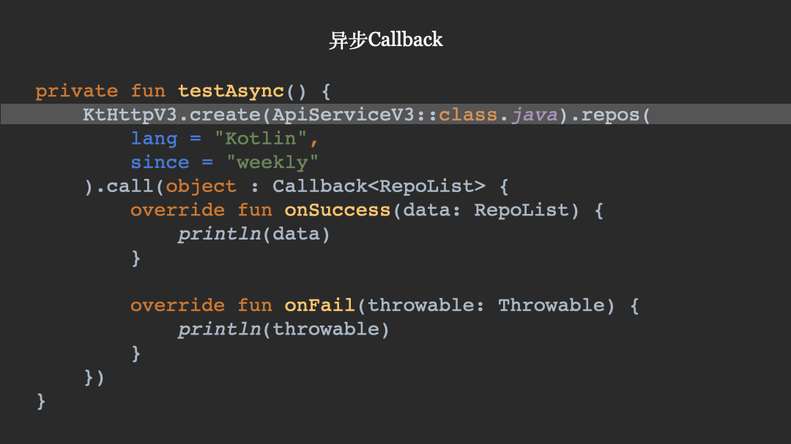

# 18-实战：让KtHttp支持挂起函数

你好，我是朱涛。今天这节实战课，我们接着前面第 12 讲里实现的网络请求框架，来进一步完善这个 KtHttp，让它支持挂起函数。

在上一次实战课当中，我们已经开发出了两个版本的 KtHttp，1.0 版本的是基于命令式风格的，2.0 版本的是基于函数式风格的。其中 2.0 版本的代码风格，跟我们平时工作写的代码风格很不一样，之前我也说了，这主要是因为业界对 Kotlin 函数式编程接纳度并不高，所以这节课的代码，我们将基于 1.0 版本的代码继续改造。这样，也能让课程的内容更接地气一些，甚至你都可以借鉴今天写代码的思路，复用到实际的 Android 或者后端开发中去。

跟往常一样，这节课的代码还是会分为两个版本：

- 3.0 版本，在之前 1.0 版本的基础上，扩展出异步请求的能力。

- 4.0 版本，进一步扩展异步请求的能力，让它支持挂起函数。

好，接下来就正式开始吧！

## 3.0 版本：支持异步（Call）

有了上一次实战课的基础，这节课就会轻松一些了。关于动态代理、注解、反射之类的知识不会牵涉太多，我们今天主要把精力都集中在协程上来。不过，在正式开始写协程代码之前，我们需要先让 KtHttp 支持异步请求，也就是 Callback 请求。

这是为什么呢？别忘了第 15 讲的内容：挂起函数本质就是 Callback！所以，为了让 KtHttp支持挂起函数，我们可以采用迂回的策略，让它先支持 Callback。在之前 1.0、2.0 版本的代码中，KtHttp 是只支持同步请求的，你可能对异步同步还有些懵，我带你来看个例子吧。

首先，这个是同步代码：

```
fun main() {
   // 同步代码
   val api: ApiService = KtHttpV1.create(ApiService::class.java)
   val data: RepoList = api.repos(lang = "Kotlin", since = "weekly")
   println(data)
}
```

可以看到，在 main 函数当中，我们调用了 KtHttp 1.0 的代码，其中 3 行代码的运行顺序是1、2、3，这就是典型的同步代码。它的另一个特点就是：所有代码都会在一个线程中执行，因此这样的代码如果运行在 Android、Swing 之类的 UI 编程平台上，是会导致主线程卡死的。

那么，异步代码又是长什么样的呢？

```
private fun testAsync() {
   // 异步代码
   KtHttpV3.create(ApiServiceV3::class.java).repos(
       lang = "Kotlin",
       since = "weekly"
   ).call(object : Callback<RepoList> {
       override fun onSuccess(data: RepoList) {
           println(data)
       }
       override fun onFail(throwable: Throwable) {
           println(throwable)
       }
   })
}
```

上面的 testAsync() 方法当中的代码，就是典型的异步代码，它跟同步代码最大的差异就是，有了一个 Callback，而且代码不再是按照顺序执行的了。你可以参考下面这个动图：



所以，在 3.0 版本的开发中，我们就是要实现类似上面 testAsync() 的请求方式。为此，我们首先需要创建一个 Callback 接口，在这个 Callback 当中，我们可以拿到 API 请求的结果。

```
interface Callback<T: Any> {
   fun onSuccess(data: T)
   fun onFail(throwable: Throwable)
}
```

在 Callback 这个接口里，有一个泛型参数 T，还有两个回调，分别是 onSuccess 代表接口请求成功、onFail 代表接口请求失败。需要特别注意的是，这里我们运用了空安全思维当中的泛型边界“T: Any”，这样一来，我们就可以保证 T 类型一定是非空的。

除此之外，我们还需要一个 KtCall 类，它的作用是承载 Callback，或者说，它是用来调用Callback 的。

```python
class KtCall<T: Any>(
   private val call: Call,
   private val gson: Gson,
   private val type: Type
) {
   fun call(callback: Callback<T>): Call {
       // TODO
   }
}
```

KtCall 这个类仍然使用了泛型边界“T: Any”，另外，它还有几个关键的成员分别是：OkHttp 的Call 对象、JSON 解析的 Gson 对象，以及反射类型 Type。然后还有一个 call() 方法，它接收的是前面我们定义的 Callback 对象，返回的是 OkHttp 的 Call 对象。所以总的来说，call() 方法当中的逻辑会分为三个步骤。

```python
class KtCall<T: Any>(
   private val call: Call,
   private val gson: Gson,
   private val type: Type
) {
   fun call(callback: Callback<T>): Call {
       // 步骤1， 使用call请求API
       // 步骤2， 根据请求结果，调用callback.onSuccess()或者是callback.onFail()
       // 步骤3， 返回OkHttp的Call对象
   }
}
```

我们一步步来分析这三个步骤：

- 步骤 1，使用 OkHttp 的 call 对象请求 API，这里需要注意的是，为了将请求任务派发到异步线程，我们需要使用 OkHttp 的异步请求方法 enqueue()。

- 步骤 2，根据请求结果，调用 callback.onSuccess() 或者是 callback.onFail()。如果请求成功了，我们在调用 onSuccess() 之前，还需要用 Gson 将请求结果进行解析，然后才返回。

- 步骤 3，返回 OkHttp 的 Call 对象。

接下来，我们看看具体代码是怎么样的：

```python
class KtCall<T: Any>(
   private val call: Call,
   private val gson: Gson,
   private val type: Type
) {
   fun call(callback: Callback<T>): Call {
       call.enqueue(object : okhttp3.Callback {
           override fun onFailure(call: Call, e: IOException) {
               callback.onFail(e)
           }
           override fun onResponse(call: Call, response: Response) {
               try { // ①
                   val t = gson.fromJson<T>(response.body?.string(), type)
                   callback.onSuccess(t)
               } catch (e: Exception) {
                   callback.onFail(e)
               }
           }
       })
       return call
   }
}
```

经过前面的解释，这段代码就很好理解了，唯一需要注意的是注释①处，由于 API 返回的结果并不可靠，即使请求成功了，其中的 JSON 数据也不一定合法，所以这里我们一般还需要进行额外的判断。在实际的商业项目当中，我们可能还需要根据当中的状态码，进行进一步区分和封装，这里为了便于理解，我就简单处理了。

那么在实现了 KtCall 以后，我们就只差 ApiService 这个接口了，这里我们定义ApiServiceV3，以作区分。

```
interface ApiServiceV3 {
   @GET("/repo")
   fun repos(
       @Field("lang") lang: String,
       @Field("since") since: String
   ): KtCall<RepoList> // ①
}
```

我们需要格外留意以上代码中的注释①，这其实就是 3.0 和 1.0 之间的最大区别。由于 repo()方法的返回值类型是 KtCall，为了支持这种写法，我们的 invoke 方法就需要跟着做一些小的改动：

```javascript
// 这里也同样使用了泛型边界
private fun <T: Any> invoke(path: String, method: Method, args: Array<Any>): Any?
   if (method.parameterAnnotations.size != args.size) return null
   var url = path
   val parameterAnnotations = method.parameterAnnotations
   for (i in parameterAnnotations.indices) {
       for (parameterAnnotation in parameterAnnotations[i]) {
           if (parameterAnnotation is Field) {
               val key = parameterAnnotation.value
               val value = args[i].toString()
               if (!url.contains("?")) {
                   url += "?$key=$value"
               } else {
                   url += "&$key=$value"
               }
           }
       }
   }
   val request = Request.Builder()
       .url(url)
       .build()
   val call = okHttpClient.newCall(request)
   val genericReturnType = getTypeArgument(method)
   // 变化在这里
   return KtCall<T>(call, gson, genericReturnType)
}
// 拿到 KtCall<RepoList> 当中的 RepoList类型
private fun getTypeArgument(method: Method) =
   (method.genericReturnType as ParameterizedType).actualTypeArguments[0]
```

在上面的代码中，大部分代码和 1.0 版本的一样的，只是在最后封装了一个 KtCall 对象，直接返回。所以在后续调用它的时候，我们就可以这么写了：ktCall.call()。

```
private fun testAsync() {
   // 创建api对象
   val api: ApiServiceV3 = KtHttpV3.create(ApiServiceV3::class.java)
   // 获取ktCall
   val ktCall: KtCall<RepoList> = api.repos(
       lang = "Kotlin",
       since = "weekly"
   )
   // 发起call异步请求
   ktCall.call(object : Callback<RepoList> {
       override fun onSuccess(data: RepoList) {
           println(data)
       }
       override fun onFail(throwable: Throwable) {
           println(throwable)
       }
   })
}
```

以上代码很好理解，我们一步步创建 API 对象、ktCall 对象，最后发起请求。不过，在工作中一般是不会这么写代码的，因为创建太多一次性临时对象了。我们完全可以用链式调用的方式来做：

```
private fun testAsync() {
   KtHttpV3.create(ApiServiceV3::class.java)
   .repos(
       lang = "Kotlin",
       since = "weekly"
   ).call(object : Callback<RepoList> {
       override fun onSuccess(data: RepoList) {
           println(data)
       }
       override fun onFail(throwable: Throwable) {
           println(throwable)
       }
   })
}
```

如果你没有很多编程经验，那你可能会对这种方式不太适应，但在实际写代码的过程中，你会发现这种模式写起来会比上一种舒服很多，因为你再也不用为临时变量取名字伤脑筋了。

总的来说，到这里的话，我们的异步请求接口就已经完成了。而且，由于我们的实际请求已经通过 OkHttp 派发（enqueue）到统一的线程池当中去了，并不会阻塞主线程，所以这样的代码模式执行在 Android、Swing 之类的 UI 编程平台，也不会引起 UI 界面卡死的问题。

那么，3.0 版本是不是到这里就结束了呢？其实并没有，因为我们还有一种情况没有考虑。我们来看看下面这段代码示例：

```
interface ApiServiceV3 {
   @GET("/repo")
   fun repos(
       @Field("lang") lang: String,
       @Field("since") since: String
   ): KtCall<RepoList>
   @GET("/repo")
   fun reposSync(
       @Field("lang") lang: String,
       @Field("since") since: String
   ): RepoList // 注意这里
}
private fun testSync() {
   val api: ApiServiceV3 = KtHttpV3.create(ApiServiceV3::class.java)
   val data: RepoList = api.reposSync(lang = "Kotlin", since = "weekly")
   println(data)
}
```

请留意注释的地方，repoSync() 的返回值类型是 RepoList，而不是 KtCall 类型，这其实是我们 1.0 版本的写法。看到这，你是不是发现问题了？虽然 KtHttp 支持了异步请求，但原本的同步请求反而不支持了。

所以，为了让 KtHttp 同时支持两种请求方式，我们只需要增加一个 if 判断即可：

```
private fun <T: Any> invoke(path: String, method: Method, args: Array<Any>): Any?
   // 省略其他代码
   return if (isKtCallReturn(method)) {
       val genericReturnType = getTypeArgument(method)
       KtCall<T>(call, gson, genericReturnType)
   } else {
       // 注意这里
       val response = okHttpClient.newCall(request).execute()
       val genericReturnType = method.genericReturnType
       val json = response.body?.string()
       gson.fromJson<Any?>(json, genericReturnType)
   }
}
// 判断当前接口的返回值类型是不是KtCall
private fun isKtCallReturn(method: Method) =
getRawType(method.genericReturnType) == KtCall::class.java
```

在上面的代码中，我们定义了一个方法 isKtCallReturn()，它的作用是判断当前接口方法的返回值类型是不是 KtCall，如果是的话，我们就认为它是一个异步接口，这时候返回 KtCall 对象；如果不是，我们就认为它是同步接口。这样我们只需要将 1.0 的逻辑挪到 else 分支，就可以实现兼容了。

那么到这里，我们 3.0 版本的开发就算是完成了。接下来，我们进入 4.0 版本的开发。

## 4.0 版本：支持挂起函数

终于来到协程实战的部分了。在日常的开发工作当中，你也许经常会面临这样的一个问题：虽然很想用 Kotlin 的协程来简化异步开发，但公司的底层框架全部都是 Callback 写的，根本不支持挂起函数，我一个上层的业务开发工程师，能有什么办法呢？

其实，我们当前的 KtHttp 就面临着类似的问题：3.0 版本只支持 Callback 异步调用，现在我们想要扩展出挂起函数的功能。这其实就是大部分 Kotlin 开发者会遇到的场景。

就我这几年架构迁移的实践经验来看，针对这个问题，我们主要有两种解法：

- 第一种解法，不改动 SDK 内部的实现，直接在 SDK 的基础上扩展出协程的能力。

- 第二种解法，改动 SDK 内部，让 SDK 直接支持挂起函数。

下面我们先来看看第一种解法。至于第二种解法，其实还可以细分出好几种思路，由于它涉及到挂起函数更底层的一些知识，具体方案我会在源码篇的第 27 讲介绍。

### 解法一：扩展 KtCall

这种方式有一个优势，那就是我们不需要改动 3.0 版本的任何代码。这种场景在工作中也是十分常见的，比如说，项目中用到的 SDK 是开源的，或者 SDK 是公司其他部门开发的，我们无法改动 SDK。

具体的做法，就是为 KtCall 这个类扩展出一个挂起函数。

```
/*
注意这里                   函数名称
  ↓                        ↓        */
suspend fun <T: Any> KtCall<T>.await(): T = TODO()
```

在上面的代码中，我们定义了一个扩展函数 await()。首先，它是一个挂起函数，其次，它的扩展接收者类型是 KtCall，其中带着一个泛型 T，挂起函数的返回值也是泛型 T。

而由于它是一个挂起函数，所以，我们的代码就可以换成这样的方式来写了。

```
fun main() = runBlocking {
   val ktCall = KtHttpV3.create(ApiServiceV3::class.java)
       .repos(lang = "Kotlin", since = "weekly")
   val result = ktCall.await() // 调用挂起函数
   println(result)
}
```

那么，现在我们就只剩下一个问题了：await() 具体该如何实现？

在这里，我们需要用到 Kotlin 官方提供的一个顶层函数：suspendCoroutine{}，它的函数签名是这样的：

```
public suspend inline fun <T> suspendCoroutine(crossinline block: (Continuation<T
   // 省略细节
}
```

从它的函数签名，我们可以发现，它是一个挂起函数，也是一个高阶函数，参数类型是“(Continuation) -> Unit”，如果你还记得第 15 讲当中的内容，你应该就已经发现了，它其实就等价于挂起函数类型！

所以，我们可以使用 suspendCoroutine{} 来实现 await() 方法：

```
/*
注意这里
  ↓                                */
suspend fun <T: Any> KtCall<T>.await(): T = suspendCoroutine{
   continuation ->
   //   ↑
   // 注意这里
}
```

如果你仔细分析这段代码的话，会发现 suspendCoroutine{} 的作用，其实就是将挂起函数当中的 continuation 暴露出来。

那么，suspendCoroutine{} 当中的代码具体该怎么写呢？答案应该也很明显了，当然是要用这个被暴露出来的 continuation 来做文章啦！

这里我们再来回顾一下 Continuation 这个接口：

```java
public interface Continuation<in T> {
   public val context: CoroutineContext
   // 关键在于这个方法
   public fun resumeWith(result: Result<T>)
}
```

通过定义可以看到，整个 Continuation 只有一个方法，那就是 resumeWith()，根据它的名字我们就可以推测出，它是用于“恢复”的，参数类型是 Result。所以很明显，这就是一个带有泛型的“结果”，它的作用就是承载协程执行的结果。

所以，综合来看，我们就可以进一步写出这样的代码了：

```
suspend fun <T: Any> KtCall<T>.await(): T =
   suspendCoroutine { continuation ->
       call(object : Callback<T> {
           override fun onSuccess(data: T) {
               continuation.resumeWith(Result.success(data))
           }
           override fun onFail(throwable: Throwable) {
               continuation.resumeWith(Result.failure(throwable))
           }
       })
   }
```

以上代码也很容易理解，当网络请求执行成功以后，我们就调用 resumeWith()，同时传入Result.success(data)；如果请求失败，我们就传入 Result.failure(throwable)，将对应的异常信息传进去。

不过，也许你会觉得创建 Result 的写法太繁琐了，没关系，你可以借助 Kotlin 官方提供的扩展函数提升代码可读性。

```
suspend fun <T : Any> KtCall<T>.await(): T =
   suspendCoroutine { continuation ->
       call(object : Callback<T> {
           override fun onSuccess(data: T) {
               continuation.resume(data)
           }
           override fun onFail(throwable: Throwable) {
               continuation.resumeWithException(throwable)
           }
       })
   }
```

到目前为止，await() 这个扩展函数其实就已经实现了。这时候，如果我们在协程当中调用await() 方法的话，代码是可以正常执行的。不过，这种做法其实还有一点瑕疵，那就是不支持取消。

让我们来写一个简单的例子：

```
fun main() = runBlocking {
   val start = System.currentTimeMillis()
   val deferred = async {
       KtHttpV3.create(ApiServiceV3::class.java)
           .repos(lang = "Kotlin", since = "weekly")
           .await()
   }
   deferred.invokeOnCompletion {
       println("invokeOnCompletion!")
   }
   delay(50L)
   deferred.cancel()
   println("Time cancel: ${System.currentTimeMillis() - start}")
   try {
       println(deferred.await())
   } catch (e: Exception) {
       println("Time exception: ${System.currentTimeMillis() - start}")
       println("Catch exception:$e")
   } finally {
       println("Time total: ${System.currentTimeMillis() - start}")
   }
}
suspend fun <T : Any> KtCall<T>.await(): T =
   suspendCoroutine { continuation ->
       call(object : Callback<T> {
           override fun onSuccess(data: T) {
               println("Request success!") // ①
               continuation.resume(data)
           }
           override fun onFail(throwable: Throwable) {
               println("Request fail!：$throwable")
               continuation.resumeWithException(throwable)
           }
       })
   }
/*
```

- 输出结果：

```
Time cancel: 536   // ②
Request success!   // ③
invokeOnCompletion!
Time exception: 3612  // ④
Catch exception:kotlinx.coroutines.JobCancellationException: DeferredCoroutine wa
Time total: 3612
*/
```

在 main 函数当中，我们在 async 里调用了挂起函数，接着 50ms 过去后，我们就去尝试取消协程。这段代码中一共有三处地方需要注意，我们来分析一下：

- 结合注释①、③一起分析，我们发现，即使调用了 deferred.cancel()，网络请求仍然会继续执行。根据“Catch exception:”输出的异常信息，我们也发现，当 deferred 被取消以后我们还去调用 await() 的时候，会抛出异常。

- 对比注释②、④，我们还能发现，deferred.await() 虽然会抛出异常，但是它却耗时3000ms。虽然 deferred 被取消了，但是当我们调用 await() 的时候，它并不会马上就抛出异常，而是会等到内部的网络请求执行结束以后，才抛出异常，在此之前都会被挂起。

综上所述，当我们使用 suspendCoroutine{} 来实现挂起函数的时候，默认情况下是不支持取消的。那么，具体该怎么做呢？其实也很简单，就是使用 Kotlin 官方提供的另一个 API：suspendCancellableCoroutine{}。

```
suspend fun <T : Any> KtCall<T>.await(): T =
//            变化1
//              ↓
   suspendCancellableCoroutine { continuation ->
       val call = call(object : Callback<T> {
           override fun onSuccess(data: T) {
               println("Request success!")
               continuation.resume(data)
           }
           override fun onFail(throwable: Throwable) {
               println("Request fail!：$throwable")
               continuation.resumeWithException(throwable)
           }
       })
//            变化2
//              ↓
       continuation.invokeOnCancellation {
           println("Call cancelled!")
           call.cancel()
       }
   }
```

当我们使用 suspendCancellableCoroutine{} 的时候，可以往 continuation 对象上面设置一个监听：invokeOnCancellation{}，它代表当前的协程被取消了，这时候，我们只需要将 OkHttp的 call 取消即可。

这样一来，main() 函数就能保持不变，得到的输出结果却大不相同。

```
/*
suspendCoroutine结果：
Time cancel: 536
Request success!
invokeOnCompletion!
Time exception: 3612  // ①
Catch exception:kotlinx.coroutines.JobCancellationException: DeferredCoroutine wa
Time total: 3612
*/
/*
suspendCancellableCoroutine结果：
Call cancelled!
Time cancel: 464
invokeOnCompletion!
Time exception: 466  // ②
Catch exception:kotlinx.coroutines.JobCancellationException: DeferredCoroutine wa
Time total: 466
Request fail!：java.io.IOException: Canceled  // ③
*/
```

对比注释①、②，可以发现，后者是会立即响应协程取消事件的，所以当代码执行到deferred.await() 的时候，会立即抛出异常，而不会挂起很长时间。另外，通过注释③这里的结果，我们也可以发现，OkHttp 的网络请求确实被取消了。

所以，我们可以得出一个结论，使用 suspendCancellableCoroutine{}，我们可以避免不必要的挂起，比如例子中的 deferred.await()；另外也可以节省计算机资源，因为这样可以避免不必要的协程任务，比如这里被成功取消的网络请求。

到这里，我们的解法一就已经完成了。这种方式并没有改动 KtHttp 的源代码，而是以扩展函数来实现的。所以，从严格意义上来讲，KtHttp 4.0 版本并没有开发完毕，等到第 27 讲我们深入理解了挂起函数的底层原理后，我们再来完成解法二的代码。

## 小结

这节课，我们在 KtHttp 1.0 版本的基础上，扩展出了异步请求的功能，完成了 3.0 版本的开发；接着，我们又在 3.0 版本的基础上，让 KtHttp 支持了挂起函数，这里我们是用的外部扩展的思路，并没有碰 KtHttp 内部的代码。

这里主要涉及以下几个知识点：

- 在 3.0 版本开发中，我们运用了泛型边界“T: Any”，落实对泛型的非空限制，同时通过封装KtCall，为下一个版本打下了基础。

- 接着，在 4.0 版本中，我们借助扩展函数的特性，为 KtCall 扩展了 await() 方法。

- 在实现 await() 的过程中，我们使用了两个协程 API，分别是 suspendCoroutine{}、suspendCancellableCoroutine{}，在 Kotlin 协程当中，我们永远都要优先使用后者。

- suspendCancellableCoroutine{} 主要有两大优势：第一，它可以避免不必要的挂起，提升运行效率；第二，它可以避免不必要的资源浪费，改善软件的综合指标。

## 思考题

你能分析出下面的代码执行结果吗？为什么会是这样的结果？它能给你带来什么启发？欢迎给我留言，也欢迎你把今天的内容分享给更多的朋友。

```
fun main() = runBlocking {
   val start = System.currentTimeMillis()
   val deferred = async {
       KtHttpV3.create(ApiServiceV3::class.java)
           .repos(lang = "Kotlin", since = "weekly")
           .await()
   }
   deferred.invokeOnCompletion {
       println("invokeOnCompletion!")
   }
   delay(50L)
   deferred.cancel()
   println("Time cancel: ${System.currentTimeMillis() - start}")
   try {
       println(deferred.await())
   } catch (e: Exception) {
       println("Time exception: ${System.currentTimeMillis() - start}")
       println("Catch exception:$e")
   } finally {
       println("Time total: ${System.currentTimeMillis() - start}")
   }
}
suspend fun <T : Any> KtCall<T>.await(): T =
   suspendCancellableCoroutine { continuation ->
       val call = call(object : Callback<T> {
           override fun onSuccess(data: T) {
               println("Request success!")
               continuation.resume(data)
           }
           override fun onFail(throwable: Throwable) {
               println("Request fail!：$throwable")
               continuation.resumeWithException(throwable)
           }
       })
// 注意这里
//        continuation.invokeOnCancellation {
//            println("Call cancelled!")
//            call.cancel()
//        }
   }
```
