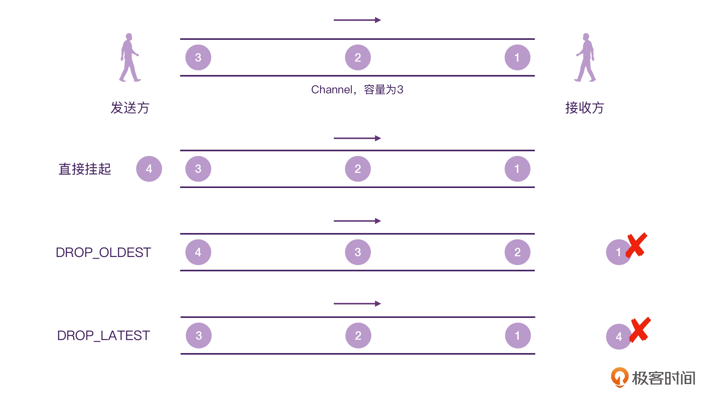
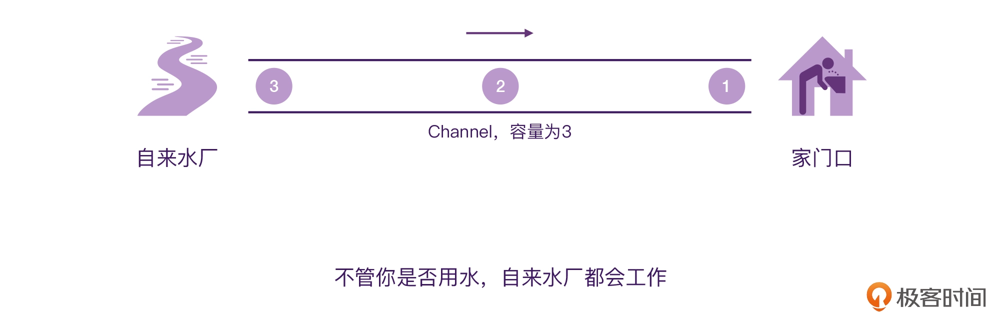
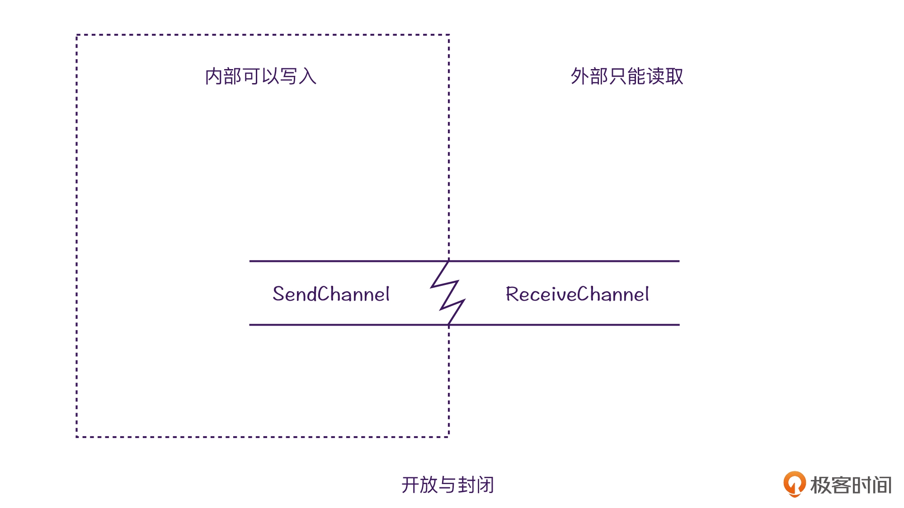
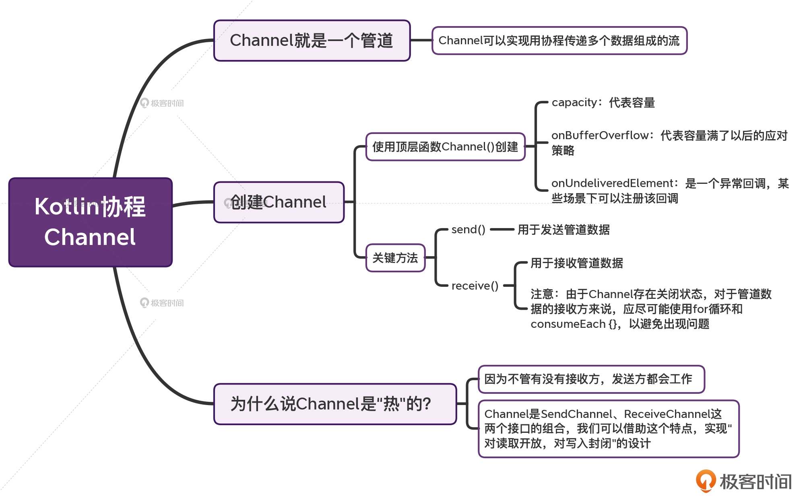

# 19-Channel：为什么说Channel是“热”的？

你好，我是朱涛。

前面我们学习的挂起函数、async，它们一次都只能返回一个结果。但在某些业务场景下，我们往往需要协程返回多个结果，比如微信等软件的 IM 通道接收的消息，或者是手机 GPS 定位返回的经纬度坐标需要实时更新。那么，在这些场景下，我们之前学习的协程知识就无法直接解决了。

而今天我要讲解的 Kotlin 协程中的 Channel，就是专门用来做这种事情的。类似的需求，如果我们不使用 Channel 而是用其他的并发手段配合集合来做的话，其实也能实现，但复杂度会大大增加。那么接下来，我们就一起来学习下 Channel。

## Channel 就是管道

顾名思义，Channel 就是一个管道。我们可以用这个概念，先来建立一个思维模型：


Channel 这个管道的其中一端，是发送方；管道的另一端是接收方。而管道本身，则可以用来传输数据。

所以，我们根据上面的思维模型，很容易就能写出下面的代码。

```
// 代码段1
fun main() = runBlocking {
   // 1，创建管道
   val channel = Channel<Int>()
   launch {
       // 2，在一个单独的协程当中发送管道消息
       (1..3).forEach {
           channel.send(it) // 挂起函数
           logX("Send: $it")
       }
   }
   launch {
       // 3，在一个单独的协程当中接收管道消息
       for (i in channel) {  // 挂起函数
           logX("Receive: $i")
       }
   }
   logX("end")
}
/*
================================
end
Thread:main @coroutine#1
================================
================================
Receive: 1
Thread:main @coroutine#3
================================
================================
Send: 1
Thread:main @coroutine#2
================================
================================
Send: 2
Thread:main @coroutine#2
================================
================================
Receive: 2
Thread:main @coroutine#3
================================
================================
Receive: 3
Thread:main @coroutine#3
================================
================================
Send: 3
Thread:main @coroutine#2
================================
// 4，程序不会退出
*/
```

通过运行的结果，我们首先可以看到的就是：coroutine#2、coroutine#3，这两个协程是交替执行的。这段代码，其实和我们第 13 讲当中提到的“互相协作”的模式是类似的，两个协程会轮流执行。

我们还可以看出来，Channel 可以跨越不同的协程进行通信。我们是在“coroutine#1”当中创建的 Channel，然后分别在 coroutine#2、coroutine#3 当中使用 Channel 来传递数据。

另外在代码中，还有四个注释，我们一个个来看：

- 注释 1，我们通过“Channel()”这样的方式，就可以创建一个管道。其中传入的泛型 Int，就代表了这个管道里面传递的数据类型。也就是说这里创建的 Channel，就是用于传递 Int 数

- 据的。

- 注释 2，我们创建了一个新的协程，然后在协程当中调用了 send() 方法，发送数据到管道里。其中的 send() 方法是一个挂起函数。

- 注释 3，在另一个协程当中，我们通过遍历 channel，将管道当中的数据都取了出来。这里，我们使用的是 for 循环。

- 注释 4，通过运行结果，我们还可以发现一个细节，那就是程序在输出完所有的结果以后，并不会退出。主线程不会结束，整个程序还会处于运行状态。

而如果要解决上面的问题，其实也不难，只需要加上一行代码即可：

```
// 代码段2
fun main() = runBlocking {
   val channel = Channel<Int>()
   launch {
       (1..3).forEach {
           channel.send(it)
           logX("Send: $it")
       }
       channel.close() // 变化在这里
   }
   launch {
       for (i in channel) {
           logX("Receive: $i")
       }
   }
   logX("end")
}
```

所以，channel 其实也是一种协程资源，在用完 channel 以后，如果我们不去主动关闭它的话，是会造成不必要的资源浪费的。在上面的案例中，如果我们忘记调用“channel.close()”，程序将永远不会停下来。

现在，我们来看看创建 Channel 的源代码。

```
// 代码段3
public fun <E> Channel(
   capacity: Int = RENDEZVOUS,
   onBufferOverflow: BufferOverflow = BufferOverflow.SUSPEND,
   onUndeliveredElement: ((E) -> Unit)? = null
): Channel<E> {}
```

可以看到，当我们调用“Channel()”的时候，感觉像是在调用一个构造函数，但实际上它却只是一个普通的顶层函数。这个函数带有一个泛型参数 E，另外还有三个参数。

第一个参数，capacity，代表了管道的容量。这个也很好理解，我们日常生活中的管道，自身也是有容量的，即使接收方不将数据取走，管道本身也可以存储一些数据。而 Kotlin 的Channel，在默认情况下是“RENDEZVOUS”，也就代表了 Channel 的容量为 0。

- 题外话：RENDEZVOUS 这个单词源自法语。它有约会、碰面的意思，我们可以理解为“发送方、接收方，不见不散”。

除此之外，capacity 还有其他几种情况，比如说：

- UNLIMITED，代表了无限容量；

- CONFLATED，代表了容量为 1，新的数据会替代旧的数据；

- BUFFERED，代表了具备一定的缓存容量，默认情况下是 64，具体容量由这个 VM 参数决

```
定 "kotlinx.coroutines.channels.defaultBuffer"。
```

第二个参数，onBufferOverflow，也就是指当我们指定了 capacity 的容量，等管道的容量满了时，Channel 的应对策略是怎么样的。这里，它主要有三种做法：

- SUSPEND，当管道的容量满了以后，如果发送方还要继续发送，我们就会挂起当前的send() 方法。由于它是一个挂起函数，所以我们可以以非阻塞的方式，将发送方的执行流

- 程挂起，等管道中有了空闲位置以后再恢复。

- DROP_OLDEST，顾名思义，就是丢弃最旧的那条数据，然后发送新的数据；

- DROP_LATEST，丢弃最新的那条数据。这里要注意，这个动作的含义是丢弃当前正准备发送的那条数据，而管道中的内容将维持不变。

由于这部分有点抽象，我画了一张图，来描述上面的几种模式，你可以看看。



在创建 Channel 的方法中，还有第三个参数，onUndeliveredElement，它其实相当于一个异常处理回调。当管道中的某些数据没有被成功接收的时候，这个回调就会被调用。

这里，为了让你对这三个参数有个更具体的认识，我们来看几个代码的案例。

案例 1：capacity = UNLIMITED

```
// 代码段4
fun main() = runBlocking {
   // 变化在这里
   val channel = Channel<Int>(capacity = Channel.Factory.UNLIMITED)
   launch {
       (1..3).forEach {
           channel.send(it)
           println("Send: $it")
       }
       channel.close() // 变化在这里
   }
   launch {
       for (i in channel) {
           println("Receive: $i")
       }
   }
   println("end")
}}
/*
```

- 输出结果：

```
end
Send: 1
Send: 2
Send: 3
Receive: 1
Receive: 2
Receive: 3
*/
```

以上代码对比代码段 1，其实只改动了一点点。我们在创建 Channel 的时候，设置了

```
capacity = Channel.Factory.UNLIMITED。不过，通过分析运行的结果，可以发现代
```

码的运行顺序就跟之前完全不一样了。

对于发送方来说，由于 Channel 的容量是无限大的，所以发送方可以一直往管道当中塞入数据，等数据都塞完以后，接收方才开始接收。这跟之前的交替执行是不一样的。

好，接下来我们看看 capacity = CONFLATED 的情况。

```
// 代码段5
fun main() = runBlocking {
   // 变化在这里
   val channel = Channel<Int>(capacity = Channel.Factory.CONFLATED)
   launch {
       (1..3).forEach {
           channel.send(it)
           println("Send: $it")
       }
       channel.close()
   }
   launch {
       for (i in channel) {
           println("Receive: $i")
       }
   }
   println("end")
}
/*
```

- 输出结果：

```
end
Send: 1
Send: 2
Send: 3
Receive: 3
*/
```

可以看到，当设置 capacity = CONFLATED 的时候，发送方也会一直发送数据，而且，对于接收方来说，它永远只能接收到最后一条数据。

我们再来看看 onBufferOverflow 的用法。其实，我们可以运用 onBufferOverflow 与capacity，来实现 CONFLATED 的效果。

```
// 代码段6
fun main() = runBlocking {
   // 变化在这里
   val channel = Channel<Int>(
       capacity = 1,
       onBufferOverflow = BufferOverflow.DROP_OLDEST
   )
   launch {
       (1..3).forEach {
           channel.send(it)
           println("Send: $it")
       }
       channel.close()
   }
   launch {
       for (i in channel) {
           println("Receive: $i")
       }
   }
   println("end")
}
/*
```

- 输出结果：

```
end
Send: 1
Send: 2
Send: 3
Receive: 3
*/
从这个运行结果里，我们就可以看出来，其实 capacity = 1, onBufferOverflow =
BufferOverflow.DROP_OLDEST，就代表了 capacity = CONFLATED。
对应的，我们再来看看 onBufferOverflow = BufferOverflow.DROP_LATEST 的情
```

况。

```
// 代码段7
fun main() = runBlocking {
   // 变化在这里
   val channel = Channel<Int>(
       capacity = 3,
       onBufferOverflow = BufferOverflow.DROP_LATEST
   )
   launch {
       (1..3).forEach {
           channel.send(it)
           println("Send: $it")
       }
       channel.send(4) // 被丢弃
       println("Send: 4")
       channel.send(5) // 被丢弃
       println("Send: 5")
       channel.close()
   }
   launch {
       for (i in channel) {
           println("Receive: $i")
       }
   }
   println("end")
}
/*
```

- 输出结果：

```
end
Send: 1
Send: 2
Send: 3
Send: 4
Send: 5
Receive: 1
Receive: 2
Receive: 3
*/
由此可见，onBufferOverflow = BufferOverflow.DROP_LATEST 就意味着，当
```

Channel 容量满了以后，之后再继续发送的内容，就会直接被丢弃。

最后，我们来看看 onUndeliveredElement 这个参数的作用。

```
// 代码段8
fun main() = runBlocking {
   // 无限容量的管道
   val channel = Channel<Int>(Channel.UNLIMITED) {
       println("onUndeliveredElement = $it")
   }
   // 等价这种写法
//    val channel = Channel<Int>(Channel.UNLIMITED, onUndeliveredElement = { prin
   // 放入三个数据
   (1..3).forEach {
       channel.send(it)
   }
   // 取出一个，剩下两个
   channel.receive()
   // 取消当前channel
   channel.cancel()
}
/*
```

- 输出结果：

```
onUndeliveredElement = 2
onUndeliveredElement = 3
*/
```

可以看到，onUndeliveredElement 的作用，就是一个回调，当我们发送出去的 Channel 数据无法被接收方处理的时候，就可以通过 onUndeliveredElement 这个回调，来进行监听。

它的使用场景一般都是用于“接收方对数据是否被消费特别关心的场景”。比如说，我发送出去的消息，接收方是不是真的收到了？对于接收方没收到的信息，发送方就可以灵活处理了，比如针对这些没收到的消息，发送方可以先记录下来，等下次重新发送。

## Channel 关闭引发的问题

在前面提到的代码段 1 里，由于我们忘记调用了 close()，所以会导致程序一直运行无法终止。这个问题其实是很严重的。我们有没有办法避免这个问题呢？

当然是有的。Kotlin 官方其实还为我们提供了另一种创建 Channel 的方式，也就是 produce{}高阶函数。

```
// 代码段9
fun main() = runBlocking {
   // 变化在这里
   val channel: ReceiveChannel<Int> = produce {
       (1..3).forEach {
           send(it)
           logX("Send: $it")
       }
   }
   launch {
       // 3，接收数据
       for (i in channel) {
           logX("Receive: $i")
       }
   }
   logX("end")
}
```

以上代码中，我们使用 produce{} 以后，就不用再去调用 close() 方法了，因为 produce{} 会自动帮我们去调用 close() 方法。具体的源码，我们会在源码篇的时候再去深入分析。不过，现在我们也可以通过代码来验证这一点。

```
// 代码段10
fun main() = runBlocking {
   // 1，创建管道
   val channel: ReceiveChannel<Int> = produce {
       // 发送3条数据
       (1..3).forEach {
           send(it)
       }
   }
   // 调用4次receive()
   channel.receive() // 1
   channel.receive() // 2
   channel.receive() // 3
   channel.receive() // 异常
   logX("end")
}
/*
```

- 输出结果：

```
ClosedReceiveChannelException: Channel was closed
*/
```

在前面所有的代码当中，我们都是以 for 循环来迭代 channel 当中的元素的，但实际上，channel 还有一个 receive() 方法，它是与 send(it) 对应的。在上面代码中，我们只调用了 3次 send()，却调用 4 次 receive()。

当我们第 4 次调用 receive() 的时候，代码会抛出异常“ClosedReceiveChannelException”，这其实也代表：我们的 Channel 已经被关闭了。所以这也就说明了，produce {}确实会帮我们调用 close() 方法。不然的话，第 4 次 receive() 会被挂起，而不是抛出异常。

我们可以再写一段代码来验证下：

```
// 代码段11
fun main() = runBlocking {
   val channel: Channel<Int> = Channel()
   launch {
       (1..3).forEach {
           channel.send(it)
       }
   }
   // 调用4次receive()
   channel.receive()       // 1
   println("Receive: 1")
   channel.receive()       // 2
   println("Receive: 2")
   channel.receive()       // 3
   println("Receive: 3")
   channel.receive()       // 永远挂起
   logX("end")
}
/*
```

- 输出结果

```
Receive: 1
Receive: 2
Receive: 3
*/
可见，第 4 次调用 receive()，就会导致程序被永久挂起，后面的 logX("end") 是没有机会
```

继续执行的。也就是说，我们直接使用 receive() 是很容易出问题的。这也是我在前面的代码中一直使用 for 循环，而没有用 receive() 的原因。

那么，有没有办法解决这个问题呢？如果你足够细心的话，你会发现 Channel 其实还有两个属性：isClosedForReceive、isClosedForSend。

这两个属性，就可以用来判断当前的 Channel 是否已经被关闭。由于 Channel 分为发送方和接收方，所以这两个参数也是针对这两者的。也就是说，对于发送方，我们可以使用“isClosedForSend”来判断当前的 Channel 是否关闭；对于接收方来说，我们可以用“isClosedForReceive”来判断当前的 Channel 是否关闭。

这时候，你也许就会想到用它们来改造前面的代码段 10。

```
// 代码段12
fun main() = runBlocking {
   // 1，创建管道
   val channel: ReceiveChannel<Int> = produce {
       // 发送3条数据
       (1..3).forEach {
           send(it)
           println("Send $it")
       }
   }
   // 使用while循环判断isClosedForReceive
   while (!channel.isClosedForReceive) {
       val i = channel.receive()
       println("Receive $i")
   }
   println("end")
}
/*
```

- 输出结果

```
Send 1
Receive 1
Receive 2
Send 2
Send 3
Receive 3
end
*/
```

以上代码看起来是可以正常工作了。但是，我仍然不建议你用这种方式。因为，当你为管道指定了 capacity 以后，以上的判断方式将会变得不可靠！原因是目前的 1.6.0 版本的协程库，运行这样的代码会崩溃，如下所示：

```
// 代码段13
fun main() = runBlocking {
   // 变化在这里
   val channel: ReceiveChannel<Int> = produce(capacity = 3) {
       // 变化在这里
       (1..300).forEach {
           send(it)
           println("Send $it")
       }
   }
   while (!channel.isClosedForReceive) {
       val i = channel.receive()
       println("Receive $i")
   }
   logX("end")
}
/*
```

- 输出结果

```
// 省略部分
Receive 300
Send 300
ClosedReceiveChannelException: Channel was closed
*/
```

所以，最好不要用 channel.receive()。即使配合 isClosedForReceive 这个判断条件，我们直接调用 channel.receive() 仍然是一件非常危险的事情！

实际上，以上代码除了可以使用 for 循环以外，还可以使用 Kotlin 为我们提供的另一个高阶函数：channel.consumeEach {}。我们再来看一个例子：

```
// 代码段14
fun main() = runBlocking {
   val channel: ReceiveChannel<Int> = produce(capacity = 3) {
       (1..300).forEach {
           send(it)
           println("Send $it")
       }
   }
   // 变化在这里
   channel.consumeEach {
       println("Receive $it")
   }
   logX("end")
}
/*
```

- 输出结果：

- 正常

```
*/
```

所以，当我们想要读取 Channel 当中的数据时，我们一定要使用 for 循环，或者是channel.consumeEach {}，千万不要直接调用 channel.receive()。

- 补充：在某些特殊场景下，如果我们必须要自己来调用 channel.receive()，那么可以考虑使用 receiveCatching()，它可以防止异常发生。

## 为什么说 Channel 是“热”的？

我们现在已经知道了，Channel 其实就是用来传递“数据流”的。注意，这里的数据流，指的是多个数据组合形成的流。前面挂起函数、async 返回的数据，就像是水滴一样，而 Channel 则像是自来水管当中的水流一样。

在业界一直有一种说法：Channel 是“热”的。也是因为这句话，在 Kotlin 当中，我们也经常把Channel 称为“热数据流”。

这话我们乍一听，可能会有点懵。我们能直接把 Channel 想象成“热的自来水”吗？当然不能了。所以，为了对 Channel 的“热”有一个更具体的概念，我们可以来看一段代码：

```
// 代码段15
fun main() = runBlocking {
   // 只发送不接受
   val channel = produce<Int>(capacity = 10) {
       (1..3).forEach {
           send(it)
           println("Send $it")
       }
   }
   println("end")
}
/*
```

- 输出结果：

```
end
Send 1
Send 2
Send 3
```

- 程序结束

```
*/
```

在上面的代码中，我们定义了一个 Channel，管道的容量是 10，然后我们发送了 3 个数据。但你是否注意到了，在代码中并没有消费 Channel 当中的数据。所以，这种“不管有没有接收方，发送方都会工作”的模式，就是我们将其认定为“热”的原因。

这就有点像是一个热心的饭店服务员，不管你有没有提要求，服务员都会给你端茶送水，把茶水摆在你的饭桌上。当你想要喝水的时候，就可以直接从饭桌上拿了（当你想要数据的时候，就可以直接从管道里取出来了）。

又或者，你可以接着前面的水龙头的思维模型去思考，Channel 的发送方，其实就像是“自来水厂”，不管你是不是要用水，自来水厂都会把水送到你家门口的管道当中来。这样当你想要用水的时候，打开水龙头就会马上有水了。



不过，也许你会想，是不是因为前面的代码中，设置了“capacity = 10”的原因？如果设置成“capacity = 0”，那 Channel 的发送方是不是就不会主动工作了？让我们来试试。

```
// 代码段16
fun main() = runBlocking {
   val channel = produce<Int>(capacity = 0) {
       (1..3).forEach {
           println("Before send $it")
           send(it)
           println("Send $it")
       }
   }
   println("end")
}
/*
```

- 输出结果：

```
end
Before send 1
```

- 程序将无法退出

```
*/
```

当我们把 capacity 改成 0 以后，可以看到 Channel 的发送方仍然是会工作的，只是说，在它调用 send() 方法的时候，由于接收方还未就绪，且管道容量为 0，所以它会被挂起。所以，它仍然还是有在工作的。最直接的证据就是：这个程序将无法退出，一直运行下去。这个后果是不是更加严重？

但是，总的来说，不管接收方是否存在，Channel 的发送方一定会工作。对应的，你可以想象成：虽然你的饭桌已经没有空间了，但服务员还是端来了茶水站在了你旁边，只是没有把茶水放在你桌上，等饭桌有了空间，或者你想喝水了，你就能马上喝到。

至于自来水的那个场景，你可以想象成，你家就在自来水厂的门口，你们之间的管道容量为0，但这并不意味着自来水厂没有工作。

## 思考与实战

其实，如果你去看 Channel 的源代码定义，你会发现，Channel 本身只是一个接口。

```java
// 代码段17
public interface Channel<E> : SendChannel<E>, ReceiveChannel<E> {}
```

而且，Channel 本身并没有什么方法和属性，它其实只是 SendChannel、ReceiveChannel 这两个接口的组合。也就是说，Channel 的所有能力，都是来自于 SendChannel、ReceiveChannel 这两个接口。

```java
// 代码段18
public interface SendChannel<in E>
   public val isClosedForSend: Boolean
   public suspend fun send(element: E)
   // 1，select相关
   public val onSend: SelectClause2<E, SendChannel<E>>
   // 2，非挂起函数的接收
   public fun trySend(element: E): ChannelResult<Unit>
   public fun close(cause: Throwable? = null): Boolean
   public fun invokeOnClose(handler: (cause: Throwable?) -> Unit)
}
public interface ReceiveChannel<out E> {
   public val isClosedForReceive: Boolean
   public val isEmpty: Boolean
   public suspend fun receive(): E
   public suspend fun receiveCatching(): ChannelResult<E>
   // 3，select相关
   public val onReceive: SelectClause1<E>
   // 4，select相关
   public val onReceiveCatching: SelectClause1<ChannelResult<E>>
   // 5，非挂起函数的接收
   public fun tryReceive(): ChannelResult<E>
   public operator fun iterator(): ChannelIterator<E>
   public fun cancel(cause: CancellationException? = null)
}
```

在上面的源码中，大部分的接口我们其实已经见过了。只有 5 个我们还没见过：

- 注释 1、3、4，它们是跟 select 相关的，我们会在第 21 讲介绍。

- 注释 2、5，是专门为非协程环境提供的 API，也就是说，当我们不在协程作用域的时候，也可以调用这两个方法来操作 Channel。不过大部分情况下，我们都应该优先使用挂起函数版本的 API。

所以，如果说 Channel 是一个管道，那么 SendChannel、ReceiveChannel 就是组成这个管道的两个零件。


还记得我们在之前不变性思维当中提到的，对外暴露不变性集合的思路吗？其实对于Channel 来说，我们也可以做到类似的事情。

```python
// 代码段19
class ChannelModel {
   // 对外只提供读取功能
   val channel: ReceiveChannel<Int> by ::_channel
   private val _channel: Channel<Int> = Channel()
   suspend fun init() {
       (1..3).forEach {
           _channel.send(it)
       }
   }
}
fun main() = runBlocking {
   val model = ChannelModel()
   launch {
       model.init()
   }
   model.channel.consumeEach {
       println(it)
   }
}
```

也就是对于 Channel 来说，它的 send() 就相当于集合的写入 API，当我们想要做到“对写入封闭，对读取开放”的时候，就可以用之前学过的知识轻松做到。



而这一切，都得益于 Channel 的能力都是通过“组合”得来的。

## 小结

这节课的内容就到这里，我们来总结一下。

- Channel 是一个管道，当我们想要用协程传递多个数据组成的流的话，就没办法通过挂起函数、async 来实现了。这时候，Channel 是一个不错的选择。

- 我们可以通过 Channel() 这个顶层函数来创建 Channel 管道。在创建 Channel 的时候，有三个重要参数：capacity 代表了容量；onBufferOverflow 代表容量满了以后的应对策略；onUndeliveredElement 则是一个异常回调。在某些场景下，比如“发送方对于数据是否被接收方十分关心”的情况下，可以注册这个回调。

- Channel 有两个关键的方法：send()、receive()，前者用于发送管道数据，后者用于接收管道数据。但是，由于 Channel 是存在关闭状态的，如果我们直接使用 receive()，就会导致各种问题。因此，对于管道数据的接收方来说，我们应该尽可能地使用 for 循环、consumeEach {}。

- Channel 是“热”的。这是因为“不管有没有接收方，发送方都会工作”。

- 最后，我们也分析了 Channel 的源码定义，发现它其实是 SendChannel、ReceiveChannel这两个接口的组合。而我们也可以借助它的这个特点，实现“对读取开放，对写入封闭”的设计。



其实 Channel 也不是 Kotlin 独创的概念，在某些其他编程语言当中，也有这样的组件，最典型的就是 Go 语言。所以，当你学会 Kotlin 的 Channel，以后在别的语言中再遇到 Channel，或者是基于 Channel 的 Actor，你也就能快速地把 Kotlin 的知识迁移过去。

另外，学到这里相信你也发现了：编程语言里面的概念都是互通的。为什么有些人学习一门新的编程语言，可以特别快，还学得特别好？

原因往往就是，人家早已掌握了编程语言当中所有互通的概念。这就是所谓的触类旁通。学完这门课程以后，我相信，你也可以做到。

## 思考题

请问，Channel 是“热”的，这一特点有什么坏处吗？为什么？ 欢迎在留言区分享你的答案，也欢迎你把今天的内容分享给更多的朋友。
