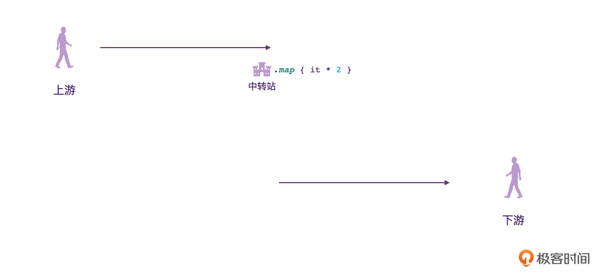
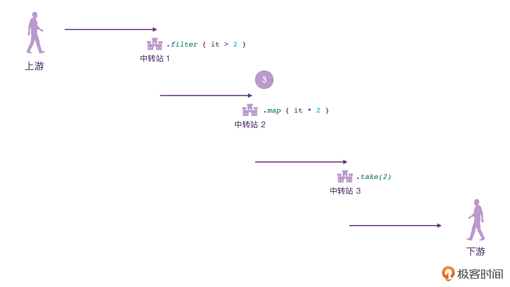
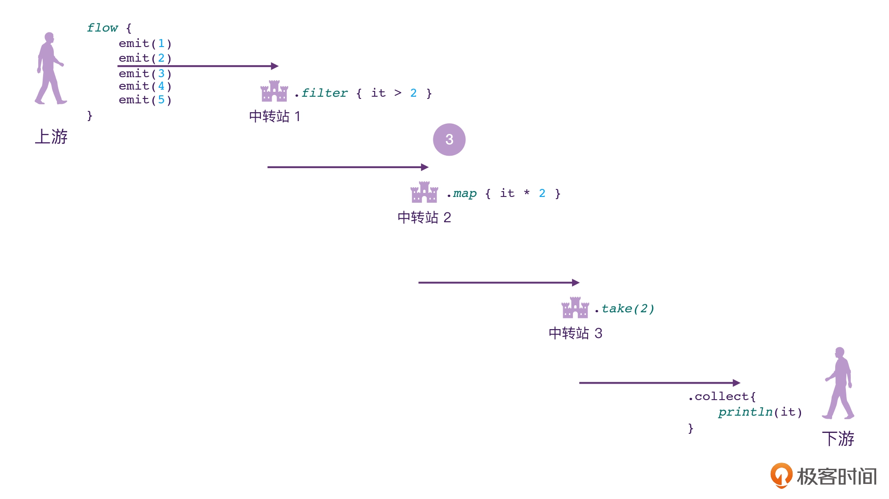
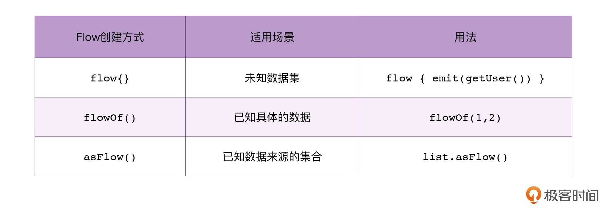
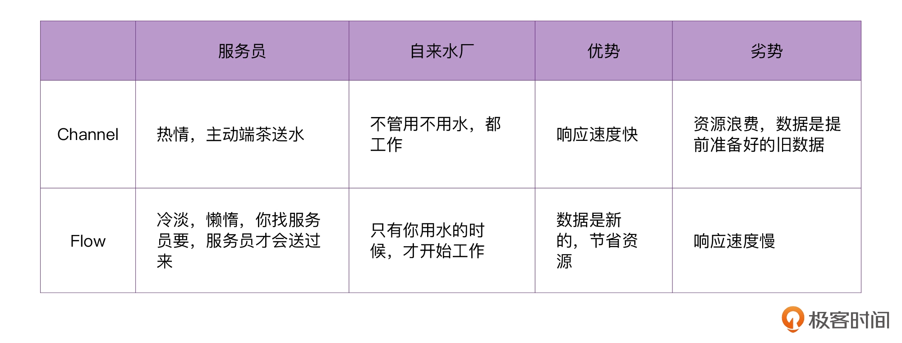
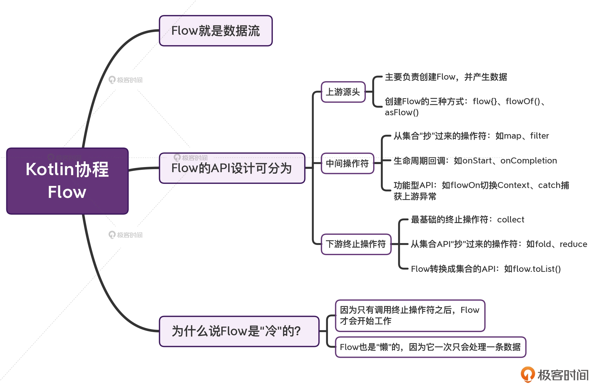

# 20-Flow：为什么说Flow是“冷”的？

你好，我是朱涛。今天我们来学习 Kotlin 协程 Flow 的基础知识。

Flow，可以说是在 Kotlin 协程当中自成体系的知识点。Flow 极其强大、极其灵活，在它出现之前，业界还有很多质疑 Kotlin 协程的声音，认为 Kotlin 的挂起函数、结构化并发，并不足以形成核心竞争力，在异步、并发任务的领域，RxJava 可以做得更好。

但是，随着 2019 年 Kotlin 推出 Flow 以后，这样的质疑声就渐渐没有了。有了 Flow 以后，Kotlin 的协程已经没有明显的短板了。简单的异步场景，我们可以直接使用挂起函数、launch、async；至于复杂的异步场景，我们就可以使用 Flow。

实际上，在很多技术领域，Flow 已经开始占领 RxJava 原本的领地，在 Android 领域，Flow甚至还要取代原本 LiveData 的地位。因为，Flow 是真的香啊！

接下来，我们就一起来学习 Flow。

## Flow 就是“数据流”

Flow 这个单词有“流”的意思，比如 Cash Flow 代表了“现金流”；Traffic Flow 代表了“车流”；Flow 在 Kotlin 协程当中，其实就是“数据流”的意思。因为 Flow 当中“流淌”的，都是数据。

为了帮你建立思维模型，我做了一个动图，来描述 Flow 的行为模式。



可以看到，Flow 和我们上节课学习的 Channel 不一样，Flow 并不是只有“发送”“接收”两个行为，它当中流淌的数据是可以在中途改变的。

Flow 的数据发送方，我们称之为“上游”；数据接收方称之为“下游”。跟现实生活中一样，上下游其实也是相对的概念。比如我们可以看到下面的图，对于中转站 2 来说，中转站 1 就相当于它的上游。



另外我们也可以看到，在发送方、接收方的中间，是可以有多个“中转站”的。在这些中转站里，我们就可以对数据进行一些处理了。

其实，Flow 这样的数据模型，在现实生活中也存在，比如说长江，它有发源地和下游，中间还有很多大坝、水电站，甚至还有一些污水净化厂。

好，相信你现在对 Flow 已经有比较清晰的概念了。下面我们来看一段代码：

```
// 代码段1
fun main() = runBlocking {
   flow {                  // 上游，发源地
       emit(1)             // 挂起函数
       emit(2)
       emit(3)
       emit(4)
       emit(5)
   }.filter { it > 2 }     // 中转站1
       .map { it * 2 }     // 中转站2
       .take(2)            // 中转站3
       .collect{           // 下游
           println(it)
       }
}
/*
输出结果：
6
8
*/
```

如果你结合着之前的图片来分析这段代码的话，相信马上就能分析出它的执行结果。因为Flow 的这种链式调用的 API，本身就非常符合人的阅读习惯。

而且，Flow 写出来的代码非常清晰易懂，我们可以对照前面的示意图来看一下：



说实话，Flow 这样代码模式，谁不爱呢？我们可以来简单分析一下：

- flow{}，是一个高阶函数，它的作用就是创建一个新的 Flow。在它的 Lambda 当中，我们可以使用 emit() 这个挂起函数往下游发送数据，这里的 emit 其实就是“发射”“发送”的意思。上游创建了一个“数据流”，同时也要负责发送数据。这跟现实生活也是一样的：长江里

- 的水从上游产生，这是天经地义的。所以，对于上游而言，只需要创建 Flow，然后发送数据即可，其他的都交给中转站和下游。

- filter{}、map{}、take(2)，它们是中间操作符，就像中转站一样，它们的作用就是对数据进行处理，这很好理解。Flow 最大的优势，就是它的操作符跟集合操作符高度一致。只要你会用 List、Sequence，那你就可以快速上手 Flow 的操作符，这中间几乎没有额外的学习成本。

- collect{}，也被称为终止操作符或者末端操作符，它的作用其实只有一个：终止 Flow 数据流，并且接收这些数据。

除了使用 flow{} 创建 Flow 以外，我们还可以使用 flowOf() 这个函数。所以，从某种程度上讲，Flow 跟 Kotlin 的集合其实也是有一些相似之处的。

```
// 代码段2
fun main() = runBlocking {
   flowOf(1, 2, 3, 4, 5).filter { it > 2 }
       .map { it * 2 }
       .take(2)
       .collect {
           println(it)
       }
   listOf(1, 2, 3, 4, 5).filter { it > 2 }
       .map { it * 2 }
       .take(2)
       .forEach {
           println(it)
       }
}
/*
```

- 输出结果

```
6
8
6
8
*/
```

从上面的代码中，我们可以看到 Flow API 与集合 API 之间的共性。listOf 创建 List，flowOf 创建 Flow。遍历 List，我们使用 forEach{}；遍历 Flow，我们使用 collect{}。

在某些场景下，我们甚至可以把 Flow 当做集合来使用，或者反过来，把集合当做 Flow 来用。

```
// 代码段3
fun main() = runBlocking {
   // Flow转List
   flowOf(1, 2, 3, 4, 5)
       .toList()
       .filter { it > 2 }
       .map { it * 2 }
       .take(2)
       .forEach {
           println(it)
       }
   // List转Flow
   listOf(1, 2, 3, 4, 5)
       .asFlow()
       .filter { it > 2 }
       .map { it * 2 }
       .take(2)
       .collect {
           println(it)
       }
}
/*
```

- 输出结果

```
6
8
6
8
*/
```

在这段代码中，我们使用了 Flow.toList()、List.asFlow() 这两个扩展函数，让数据在 List、Flow 之间来回转换，而其中的代码甚至不需要做多少改变。

到这里，我其实已经给你介绍了三种创建 Flow 的方式，我来帮你总结一下。



好，现在我们就对 Flow 有一个整体的认识了，我们知道它的 API 总体分为三个部分：上游、中间操作、下游。其中对于上游来说，一般有三种创建方式，这些我们也都需要好好掌握。

那么接下来，我们重点看看中间操作符。

## 中间操作符

中间操作符（Intermediate Operators），除了之前提到的 map、filter、take 这种从集合那边“抄”来的操作符之外，还有一些特殊的操作符需要我们特别注意。这些操作符跟 Kotlin 集合API 是没关系的，它们是专门为 Flow 设计的。我们一个个来看。

### Flow 生命周期

在 Flow 的中间操作符当中，onStart、onCompletion 这两个是比较特殊的。它们是以操作符的形式存在，但实际上的作用，是监听生命周期回调。

onStart，它的作用是注册一个监听事件：当 flow 启动以后，它就会被回调。具体我们可以看下面这个例子：

```
// 代码段4
fun main() = runBlocking {
   flowOf(1, 2, 3, 4, 5)
       .filter {
           println("filter: $it")
           it > 2
       }
       .map {
           println("map: $it")
           it * 2
       }
       .take(2)
       .onStart { println("onStart") } // 注意这里
       .collect {
           println("collect: $it")
       }
}
/*
```

- 输出结果

```
onStart
filter: 1
filter: 2
filter: 3
map: 3
collect: 6
filter: 4
map: 4
collect: 8
*/
```

可以看到，onStart 的执行顺序，并不是严格按照上下游来执行的。虽然 onStart 的位置是处于下游，而 filter、map、take 是上游，但 onStart 是最先执行的。因为它本质上是一个回调，不是一个数据处理的中间站。

相应的，filter、map、take 这类操作符，它们的执行顺序是跟它们的位置相关的。最终的执行结果，也会受到位置变化的影响。

```
// 代码段5
fun main() = runBlocking {
   flowOf(1, 2, 3, 4, 5)
       .take(2) // 注意这里
       .filter {
           println("filter: $it")
           it > 2
       }
       .map {
           println("map: $it")
           it * 2
       }
       .onStart { println("onStart") }
       .collect {
           println("collect: $it")
       }
}
/*
```

- 输出结果

```
onStart
filter: 1
filter: 2
*/
```

可见，在以上代码中，我们将 take(2) 的位置挪到了上游的起始位置，这时候程序的执行结果就完全变了。

OK，理解了 onStart 以后，onCompletion 也就很好理解了。

```
// 代码段6
fun main() = runBlocking {
   flowOf(1, 2, 3, 4, 5)
       .onCompletion { println("onCompletion") } // 注意这里
       .filter {
           println("filter: $it")
           it > 2
       }
       .take(2)
       .collect {
           println("collect: $it")
       }
}
/*
```

- 输出结果

```
filter: 1
filter: 2
filter: 3
collect: 3
filter: 4
collect: 4
onCompletion
*/
```

和 onStart 类似，onCompletion 的执行顺序，跟它在 Flow 当中的位置无关。onCompletion只会在 Flow 数据流执行完毕以后，才会回调。

还记得在第 16 讲里，我们提到的 Job.invokeOnCompletion{} 这个生命周期回调吗？在这里，Flow.onCompletion{} 也是类似的，onCompletion{} 在面对以下三种情况时都会进行回调：

- 情况 1，Flow 正常执行完毕；

- 情况 2，Flow 当中出现异常；

- 情况 3，Flow 被取消。

对于情况 1，我们已经在上面的代码中验证过了。接下来，我们看看后面两种情况：

```
// 代码段7
fun main() = runBlocking {
   launch {
       flow {
           emit(1)
           emit(2)
           emit(3)
       }.onCompletion { println("onCompletion first: $it") }
           .collect {
               println("collect: $it")
               if (it == 2) {
                   cancel()            // 1
                   println("cancel")
               }
           }
   }
   delay(100L)
   flowOf(4, 5, 6)
       .onCompletion { println("onCompletion second: $it") }
       .collect {
           println("collect: $it")
           // 仅用于测试，生产环境不应该这么创建异常
           throw IllegalStateException() // 2
       }
}
/*
collect: 1
collect: 2
cancel
onCompletion first: JobCancellationException: // 3
collect: 4
onCompletion second: IllegalStateException    // 4
*/
```

在上面的注释 1 当中，我们在 collect{} 里调用了 cancel 方法，这会取消掉整个 Flow，这时候，flow{} 当中剩下的代码将不会再被执行。最后，onCompletion 也会被调用，同时，请你留意注释 3，这里还会带上对应的异常信息 JobCancellationException。

同样的，根据注释 2、4，我们也能分析出一样的结果。

而且从上面的代码里，我们也可以看到，当 Flow 当中发生异常以后，Flow 就会终止。那么对于这样的问题，我们该如何处理呢？

下面我就带你来看看，Flow 当中如何处理异常。

### catch 异常处理

前面我已经介绍过，Flow 主要有三个部分：上游、中间操作、下游。那么，Flow 当中的异常，也可以根据这个标准来进行分类，也就是异常发生的位置。

对于发生在上游、中间操作这两个阶段的异常，我们可以直接使用 catch 这个操作符来进行捕获和进一步处理。如下所示：

```
// 代码段8
fun main() = runBlocking {
   val flow = flow {
       emit(1)
       emit(2)
       throw IllegalStateException()
       emit(3)
   }
   flow.map { it * 2 }
       .catch { println("catch: $it") } // 注意这里
       .collect {
           println(it)
       }
}
/*
```

- 输出结果：

```bash
2
4
catch: java.lang.IllegalStateException
*/
```

所以，catch 这个操作符，其实就相当于我们平时使用的 try-catch 的意思。只是说，后者是用于普通的代码，而前者是用于 Flow 数据流的，两者的核心理念是一样的。不过，考虑到 Flow具有上下游的特性，catch 这个操作符的作用是和它的位置强相关的。

catch 的作用域，仅限于 catch 的上游。换句话说，发生在 catch 上游的异常，才会被捕获，发生在 catch 下游的异常，则不会被捕获。为此，我们可以换一个写法：

```
// 代码段9
fun main() = runBlocking {
   val flow = flow {
       emit(1)
       emit(2)
       emit(3)
   }
   flow.map { it * 2 }
       .catch { println("catch: $it") }
       .filter { it / 0 > 1}  // 故意制造异常
       .collect {
           println(it)
       }
}
/*
```

- 输出结果

```
Exception in thread "main" ArithmeticException: / by zero
*/
```

从上面代码的执行结果里，我们可以看到，catch 对于发生在它下游的异常是无能为力的。这一点，借助我们之前的思维模型来思考，也是非常符合直觉的。比如说，长江上面的污水处理厂，当然只能处理它上游的水，而对于发生在下游的污染，是无能为力的。

那么，发生在上游源头，还有发生在中间操作的异常，处理起来其实很容易，我们只需要留意catch 的作用域即可。最后就是发生在下游末尾处的异常了。

如果你回过头去看代码段 7 当中的异常，会发现它也是一个典型的“发生在下游的异常”，所以对于这种情况，我们就不能用 catch 操作符了。那么最简单的办法，其实是使用 try-catch，把 collect{} 当中可能出现问题的代码包裹起来。比如像下面这样：

```
// 代码段10
fun main() = runBlocking {
   flowOf(4, 5, 6)
       .onCompletion { println("onCompletion second: $it") }
       .collect {
           try {
               println("collect: $it")
               throw IllegalStateException()
           } catch (e: Exception) {
               println("Catch $e")
           }
       }
}
```

所以，针对 Flow 当中的异常处理，我们主要有两种手段：一个是 catch 操作符，它主要用于上游异常的捕获；而 try-catch 这种传统的方式，更多的是应用于下游异常的捕获。

- 提示：关于更多协程异常处理的话题，我们会在第 23 讲深入介绍。

### 切换 Context：flowOn、launchIn

前面我们介绍过，Flow 非常适合复杂的异步任务。在大部分的异步任务当中，我们都需要频繁切换工作的线程。对于耗时任务，我们需要线程池当中执行，对于 UI 任务，我们需要在主线程执行。

而在 Flow 当中，我们借助 flowOn 这一个操作符，就可以灵活实现以上的需求。

```
// 代码段11
fun main() = runBlocking {
   val flow = flow {
       logX("Start")
       emit(1)
       logX("Emit: 1")
       emit(2)
       logX("Emit: 2")
       emit(3)
       logX("Emit: 3")
   }
   flow.filter {
           logX("Filter: $it")
           it > 2
       }
       .flowOn(Dispatchers.IO)  // 注意这里
       .collect {
           logX("Collect $it")
       }
}
/*
```

- 输出结果

```
================================
Start
Thread:DefaultDispatcher-worker-1 @coroutine#2
================================
================================
Filter: 1
Thread:DefaultDispatcher-worker-1 @coroutine#2
================================
================================
Emit: 1
Thread:DefaultDispatcher-worker-1 @coroutine#2
================================
================================
Filter: 2
Thread:DefaultDispatcher-worker-1 @coroutine#2
================================
================================
Emit: 2
Thread:DefaultDispatcher-worker-1 @coroutine#2
================================
================================
Filter: 3
Thread:DefaultDispatcher-worker-1 @coroutine#2
================================
================================
Emit: 3
Thread:DefaultDispatcher-worker-1 @coroutine#2
================================
================================
Collect 3
Thread:main @coroutine#1
================================
```

flowOn 操作符也是和它的位置强相关的。它的作用域跟前面的 catch 类似：flowOn 仅限于它的上游。

在上面的代码中，flowOn 的上游，就是 flow{}、filter{} 当中的代码，所以，它们的代码全都运行在 DefaultDispatcher 这个线程池当中。只有 collect{} 当中的代码是运行在 main 线程当中的。

对应的，如果你挪动一下上面代码中 flowOn 的位置，会发现执行结果就会不一样，比如这样：

```
// 代码段12
flow.flowOn(Dispatchers.IO) // 注意这里
   .filter {
       logX("Filter: $it")
       it > 2
   }
   .collect {
       logX("Collect $it")
   }
/*
```

- 输出结果：

```
filter当中的代码会执行在main线程
*/
```

这里的代码执行结果，我们很容易就能推测出来，因为 flowOn 的作用域仅限于上游，所以它只会让 flow{} 当中的代码运行在 DefaultDispatcher 当中，剩下的代码则执行在 main 线程。

但是到这里，我们就会遇到一个类似 catch 的困境：如果想要指定 collect 当中的 Context，该怎么办呢？

我们能想到的最简单的办法，就是用前面学过的：withContext{}。

```
// 代码段13
// 不推荐
flow.flowOn(Dispatchers.IO)
   .filter {
       logX("Filter: $it")
       it > 2
   }
   .collect {
       withContext(mySingleDispatcher) {
           logX("Collect $it")
       }
   }
/*
```

- 输出结果：

```
collect{}将运行在MySingleThread
filter{}运行在main
flow{}运行在DefaultDispatcher
*/
```

在上面的代码中，我们直接在 collect{} 里使用了 withContext{}，所以它的执行就交给了MySingleThread。不过，有的时候，我们想要改变除了 flowOn 以外所有代码的 Context。比如，我们希望 collect{}、filter{} 都运行在 MySingleThread。

那么这时候，我们可以考虑使用 withContext{} 进一步扩大包裹的范围，就像下面这样：

```
// 代码段14
// 不推荐
withContext(mySingleDispatcher) {
   flow.flowOn(Dispatchers.IO)
       .filter {
           logX("Filter: $it")
           it > 2
       }
       .collect{
           logX("Collect $it")
       }
}
/*
```

- 输出结果：

```
collect{}将运行在MySingleThread
filter{}运行在MySingleThread
flow{}运行在DefaultDispatcher
*/
```

不过，这种写法终归是有些丑陋，因此，Kotlin 官方还为我们提供了另一个操作符，launchIn。

我们来看看这个操作符是怎么用的：

```
// 代码段15
val scope = CoroutineScope(mySingleDispatcher)
flow.flowOn(Dispatchers.IO)
   .filter {
       logX("Filter: $it")
       it > 2
   }
   .onEach {
       logX("onEach $it")
   }
   .launchIn(scope)
/*
```

- 输出结果：

```
onEach{}将运行在MySingleThread
filter{}运行在MySingleThread
flow{}运行在DefaultDispatcher
*/
```

可以看到，在这段代码中，我们不再直接使用 collect{}，而是借助了 onEach{} 来实现类似collect{} 的功能。同时我们在最后使用了 launchIn(scope)，把它上游的代码都分发到指定的线程当中。

如果你去看 launchIn 的源代码的话，你会发现它的定义极其简单：

```
// 代码段16
public fun <T> Flow<T>.launchIn(scope: CoroutineScope): Job = scope.launch {
   collect() // tail-call
}
```

由此可见，launchIn 从严格意义来讲，应该算是一个下游的终止操作符，因为它本质上是调用了 collect()。

因此，上面的代码段 16，也会等价于下面的写法：

```
// 代码段17
fun main() = runBlocking {
   val scope = CoroutineScope(mySingleDispatcher)
   val flow = flow {
       logX("Start")
       emit(1)
       logX("Emit: 1")
       emit(2)
       logX("Emit: 2")
       emit(3)
       logX("Emit: 3")
   }
       .flowOn(Dispatchers.IO)
       .filter {
           logX("Filter: $it")
           it > 2
       }
       .onEach {
           logX("onEach $it")
       }
   scope.launch { // 注意这里
       flow.collect()
   }
   delay(100L)
}
```

所以，总的来说，对于 Flow 当中的线程切换，我们可以使用 flowOn、launchIn、withContext，但其实，flowOn、launchIn 就已经可以满足需求了。

另外，由于 Flow 当中直接使用 withContext 是很容易引发其他问题的，因此，withContext在 Flow 当中是不被推荐的，即使要用，也应该谨慎再谨慎。

- 提示：针对 Flow 当中 withContext 引发的问题，我会在这节课的思考题里给出具体案例。

## 下游：终止操作符

最后，我们就到了下游阶段，我们来看看终止操作符（Terminal Operators）的含义和使用。

- 这里的 Terminal，其实有终止、末尾、终点的意思。

在 Flow 当中，终止操作符的意思就是终止整个 Flow 流程的操作符。这里的“终止”，其实是跟前面的“中间”操作符对应的。

具体来说，就是在 filter 操作符的后面，还可以继续添加其他的操作符，比如说 map，因为filter 本身就是一个“中间”操作符。但是，collect 操作符之后，我们无法继续使用 map 之类的操作，因为 collect 是一个“终止”操作符，代表 Flow 数据流的终止。

Flow 里面，最常见的终止操作符就是 collect。除此之外，还有一些从集合当中“抄”过来的操作符，也是 Flow 的终止操作符。比如 first()、single()、fold{}、reduce{}。

另外，当我们尝试将 Flow 转换成集合的时候，它本身也就意味着 Flow 数据流的终止。比如说，我们前面用过的 toList：

```
// 代码段18
fun main() = runBlocking {
   // Flow转List
   flowOf(1, 2, 3, 4, 5)
       .toList()           // 注意这里
       .filter { it > 2 }
       .map { it * 2 }
       .take(2)
       .forEach {
           println(it)
       }
}
```

在上面的代码中，当我们调用了 toList() 以后，往后所有的操作符，都不再是 Flow 的 API 调用了，虽然它们的名字没有变，filter、map，这些都只是集合的 API。所以，严格意义上讲，toList 也算是一个终止操作符。

## 为什么说 Flow 是“冷”的？

现在我们就算是把 Flow 这个 API 给搞清楚了，但还有一个疑问我们没解决，就是这节课的标题：为什么说 Flow 是“冷”的？

实际上，如果你理解了上节课 Channel 为什么是“热”的，那你就一定可以理解 Flow 为什么是“冷”的。我们可以模仿上节课的 Channel 代码，写一段 Flow 的代码，两相对比之下其实马上就能发现它们之间的差异了。

```
// 代码段19
fun main() = runBlocking {
   // 冷数据流
   val flow = flow {
       (1..3).forEach {
           println("Before send $it")
           emit(it)
           println("Send $it")
       }
   }
   // 热数据流
   val channel = produce<Int>(capacity = 0) {
       (1..3).forEach {
           println("Before send $it")
           send(it)
           println("Send $it")
       }
   }
   println("end")
}
/*
```

- 输出结果：

```
end
Before send 1
// Flow 当中的代码并未执行
*/
```

我们知道，Channel 之所以被认为是“热”的原因，是因为不管有没有接收方，发送方都会工作。那么对应的，Flow 被认为是“冷”的原因，就是因为只有调用终止操作符之后，Flow 才会开始工作。

### Flow 还是“懒”的

其实，如果你去仔细调试过代码段 1 的话，应该就已经发现了，Flow 不仅是“冷”的，它还是“懒”的。为了暴露出它的这个特点，我们稍微改造一下代码段 1，然后加一些日志进来。

```
// 代码段20
fun main() = runBlocking {
   flow {
       println("emit: 3")
       emit(3)
       println("emit: 4")
       emit(4)
       println("emit: 5")
       emit(5)
   }.filter {
       println("filter: $it")
       it > 2
   }.map {
       println("map: $it")
       it * 2
   }.collect {
       println("collect: $it")
   }
}
/*
```

- 输出结果：

```
emit: 3
filter: 3
map: 3
collect: 6
emit: 4
filter: 4
map: 4
collect: 8
emit: 5
filter: 5
map: 5
collect: 10
*/
```

通过上面的运行结果，我们可以发现，Flow 一次只会处理一条数据。虽然它也是 Flow“冷”的一种表现，但这个特性准确来说是“懒”。

如果你结合上节课“服务员端茶送水”的场景来思考的话，Flow 不仅是一个“冷淡”的服务员，还是一个“懒惰”的服务员：明明饭桌上有 3 个人需要喝水，但服务员偏偏不一次性上 3 杯水，而是要这 3 个人，每个人都叫服务员一次，服务员才会一杯一杯地送 3 杯水过来。

对比 Channel 的思维模型来看的话：



- 提示：Flow 默认情况下是“懒惰”的，但也可以通过配置让它“勤快”起来。

## 思考与实战

我们都知道，Flow 非常适合复杂的异步任务场景。借助它的 flowOn、launchIn，我们可以写出非常灵活的代码。比如说，在 Android、Swing 之类的 UI 平台之上，我们可以这样写：

```
// 代码段21
fun main() = runBlocking {
   fun loadData() = flow {
       repeat(3){
           delay(100L)
           emit(it)
           logX("emit $it")
       }
   }
   // 模拟Android、Swing的UI
   val uiScope = CoroutineScope(mySingleDispatcher)
   loadData()
       .map { it * 2 }
       .flowOn(Dispatchers.IO) // 1，耗时任务
       .onEach {
           logX("onEach $it")
       }
       .launchIn(uiScope)      // 2，UI任务
   delay(1000L)
}
```

这段代码很容易理解，我们让耗时任务在 IO 线程池执行，更新 UI 则在 UI 线程。

如果结合我们前面学过的 Flow 操作符，我们还可以设计出更加有意思的代码：

```
// 代码段22
fun main() = runBlocking {
   fun loadData() = flow {
       repeat(3) {
           delay(100L)
           emit(it)
           logX("emit $it")
       }
   }
   fun updateUI(it: Int) {}
   fun showLoading() { println("Show loading") }
   fun hideLoading() { println("Hide loading") }
   val uiScope = CoroutineScope(mySingleDispatcher)
   loadData()
       .onStart { showLoading() }          // 显示加载弹窗
       .map { it * 2 }
       .flowOn(Dispatchers.IO)
       .catch { throwable ->
           println(throwable)
           hideLoading()                   // 隐藏加载弹窗
           emit(-1)                   // 发生异常以后，指定默认值
       }
       .onEach { updateUI(it) }            // 更新UI界面
       .onCompletion { hideLoading() }     // 隐藏加载弹窗
       .launchIn(uiScope)
   delay(10000L)
}
```

在以上代码中，我们通过监听 onStart、onCompletion 的回调事件，就可以实现 Loading 弹窗的显示和隐藏。而对于出现异常的情况，我们也可以在 catch{} 当中调用 emit()，给出一个默认值，这样就可以有效防止 UI 界面出现空白。

不得不说，以上代码的可读性是非常好的。

## 小结

这节课的内容到这里就差不多结束了，我们来做一个简单的总结。

- Flow，就是数据流。整个 Flow 的 API 设计，可以大致分为三个部分，上游的源头、中间操作符、下游终止操作符。

- 对于上游源头来说，它主要负责：创建 Flow，并且产生数据。而创建 Flow，主要有三种方式：flow{}、flowOf()、asFlow()。

- 对于中间操作符来说，它也分为几大类。第一类是从集合“抄”过来的操作符，比如 map、filter；第二类是生命周期回调，比如 onStart、onCompletion；第三类是功能型 API，比如说 flowOn 切换 Context、catch 捕获上游的异常。

- 对于下游的终止操作符，也是分为三大类。首先，就是 collect 这个最基础的终止操作符；其次，就是从集合 API“抄”过来的操作符，比如 fold、reduce；最后，就是 Flow 转换成集合的 API，比如说 flow.toList()。

你也要清楚为什么我们说“Flow 是冷的”的原因，以及它对比 Channel 的优势和劣势。另外在课程里，我们还探索了 Flow 在 Android 里的实际应用场景，当我们将 Flow 与它的操作符灵活组合到一起的时候，就可以设计出可读性非常好的代码。



其实，Flow 本身就是一个非常大的话题，能讲的知识点实在太多了。但考虑到咱们课程学习需要循序渐进，现阶段我只是从中挑选一些最重要、最关键的知识点来讲。更多 Flow 的高阶用法，等我们学完协程篇、源码篇之后，我会再考虑增加一些更高阶的内容进来。

## 思考题

前面我曾提到过，Flow 当中直接使用 withContext{}，是很容易出现问题的，下面代码是其中的一种。请问你能解释其中的缘由吗？Kotlin 官方为什么要这么设计？

```
// 代码段23
fun main() = runBlocking {
   flow {
       withContext(Dispatchers.IO) {
           emit(1)
       }
   }.map { it * 2 }
       .collect()
}
/*
```

- 输出结果

```
IllegalStateException: Flow invariant is violated
*/
```

这个问题的答案，我会在第 32 讲介绍 Flow 源码的时候给出详细的解释。
