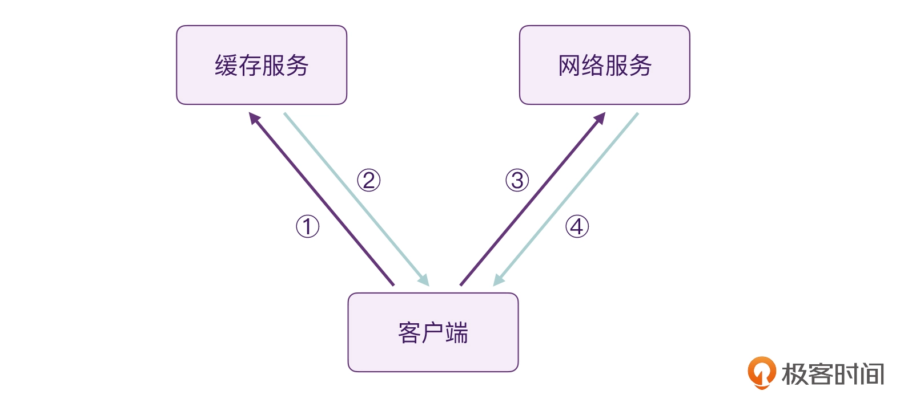
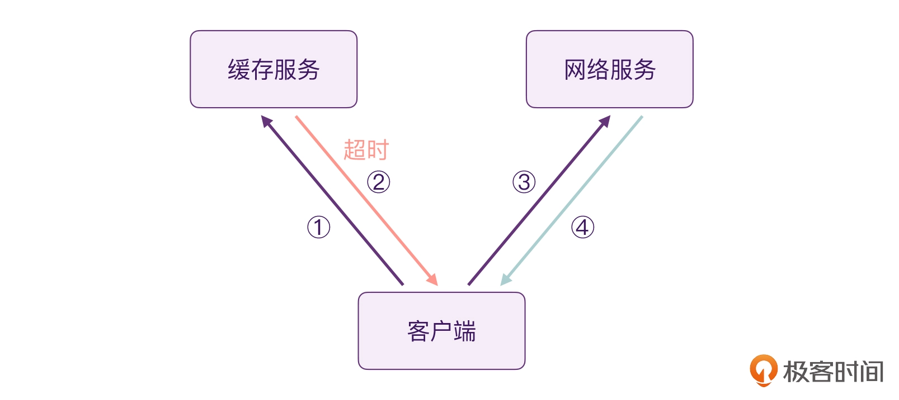
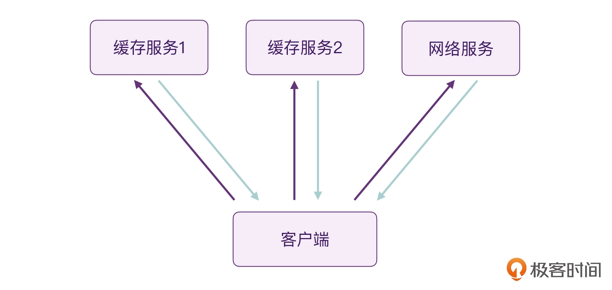
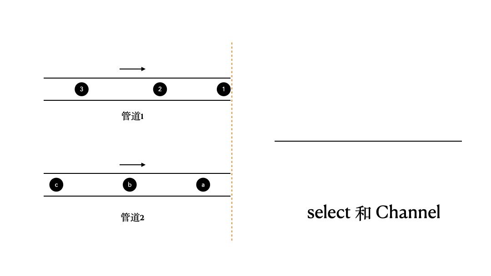
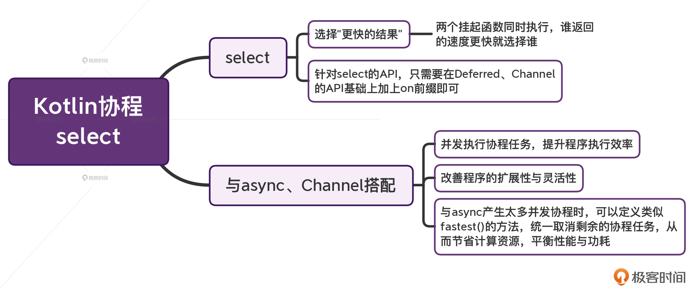

# 21-select：到底是在选择什么？

你好，我是朱涛。今天我们来学习 Kotlin 协程的 select。

select，在目前的 Kotlin 1.6 当中，仍然是一个实验性的特性（Experimental）。但是，考虑到select 具有较强的实用性，我决定还是来给你介绍一下它。

select 可以说是软件架构当中非常重要的一个组件，在很多业务场景下，select 与 Deferred、Channel 结合以后，在大大提升程序的响应速度的同时，还可以提高程序的灵活性、扩展性。

今天这节课，我会从 select 的使用角度着手，带你理解 select 的核心使用场景，之后也会通过源码帮你进一步分析 select API 的底层规律。学完这节课以后，你完全可以将 select 应用到自己的工作当中去。

好，接下来，我们就一起来学习 select 吧！

## select 就是选择“更快的结果”

由于 select 的工作机制比较抽象，我们先来假设一个场景，看看 select 适用于什么样的场景。

客户端，想要查询一个商品的详情。目前有两个服务：缓存服务，速度快但信息可能是旧的；网络服务，速度慢但信息一定是最新的。



对于这个场景，如果让我们来实现其中的逻辑的话，我们非常轻松地就能实现类似这样的代码逻辑：

```
// 代码段1
fun main() = runBlocking {
   suspend fun getCacheInfo(productId: String): Product? {
       delay(100L)
       return Product(productId, 9.9)
   }
   suspend fun getNetworkInfo(productId: String): Product? {
       delay(200L)
       return Product(productId, 9.8)
   }
   fun updateUI(product: Product) {
       println("${product.productId}==${product.price}")
   }
   val startTime = System.currentTimeMillis()
   val productId = "xxxId"
   // 查询缓存
   val cacheInfo = getCacheInfo(productId)
   if (cacheInfo != null) {
       updateUI(cacheInfo)
       println("Time cost: ${System.currentTimeMillis() - startTime}")
   }
   // 查询网络
   val latestInfo = getNetworkInfo(productId)
   if (latestInfo != null) {
       updateUI(latestInfo)
       println("Time cost: ${System.currentTimeMillis() - startTime}")
   }
}
data class Product(
   val productId: String,
   val price: Double
)
/*
```

- 输出结果

```
xxxId==9.9
Time cost: 112
xxxId==9.8
Time cost: 314
*/
```

考虑到缓存服务速度更快，我们自然而然会这么写，先去查询缓存服务，如果查询到了信息，我们就会去更新 UI 界面。之后去查询网络服务，拿到最新的信息之后，我们再来更新 UI 界面。也就是这样：

- 第一步：查询缓存信息；

- 第二步：缓存服务返回信息，更新 UI；

- 第三步：查询网络服务；

- 第四步：网络服务返回信息，更新 UI。

这种做法的好处在于，用户可以第一时间看到商品的信息，虽然它暂时会展示旧的信息，但由于我们同时查询了网络服务，旧缓存信息也马上会被替代成新的信息。这样的做法，可以最大程度保证用户体验。

不过，以上整个流程都是建立在“缓存服务一定更快”的前提下的，万一我们的缓存服务出了问题，它的速度变慢了，甚至是超时、无响应呢？



这时候，如果你回过头来分析代码段 1 的话，你就会发现：程序执行流程会卡在第二步，迟迟无法进行第三步。具体来说，是因为 getCacheInfo() 它是一个挂起函数，只有这个程序执行成功以后，才可以继续执行后面的任务。你也可以把 getCacheInfo() 当中的 delay 时间修改成2000 毫秒，去验证一下。

```
/*
```

- 执行结果：

```
xxxId==9.9
Time cost: 2013
xxxId==9.8
Time cost: 2214
*/
```

那么，面对这样的场景，我们其实需要一个可以灵活选择的语法：“两个挂起函数同时执行，谁返回的速度更快，我们就选择谁”。这其实就是 select 的典型使用场景。

## select 和 async

上面的这个场景，我们可以用 async 搭配 select 来使用。async 可以实现并发，select 则可以选择最快的结果。

让我们来看看，代码具体该怎么写。

```sql
// 代码段2
fun main() = runBlocking {
   val startTime = System.currentTimeMillis()
   val productId = "xxxId"
   //          1，注意这里
   //               ↓
   val product = select<Product?> {
       // 2，注意这里
       async { getCacheInfo(productId) }
           .onAwait { // 3，注意这里
               it
           }
       // 4，注意这里
       async { getNetworkInfo(productId) }
           .onAwait {  // 5，注意这里
               it
           }
   }
   if (product != null) {
       updateUI(product)
       println("Time cost: ${System.currentTimeMillis() - startTime}")
   }
}
/*
```

- 输出结果

```
xxxId==9.9
Time cost: 127
*/
```

从上面的执行结果，我们可以看到，由于缓存的服务更快，所以，select 确实帮我们选择了更快的那个结果。代码中一共有四个注释，我们一起来看看：

- 注释 1，我们使用 select 这个高阶函数包裹了两次查询的服务，同时传入了泛型参数Product，代表我们要选择的数据类型是 Product。

- 注释 2，4 中，我们使用了 async 包裹了 getCacheInfo()、getNetworkInfo() 这两个挂起函数，这是为了让这两个查询实现并发执行。

- 注释 3，5 中，我们使用 onAwait{} 将执行结果传给了 select{}，而 select 才能进一步将数据返回给 product 局部变量。注意了，这里我们用的 onAwait{}，而不是 await()。

现在，假设，我们的缓存服务出现了问题，需要 2000 毫秒才能返回：

```
// 代码段3
suspend fun getCacheInfo(productId: String): Product? {
   // 注意这里
   delay(2000L)
   return Product(productId, 9.9)
}
/*
```

- 输出结果

```
xxxId==9.8
Time cost: 226
*/
```

这时候，通过执行结果，我们可以发现，我们的 select 可以在缓存服务出现问题的时候，灵活选择网络服务的结果。从而避免用户等待太长的时间，得到糟糕的体验。

不过，你也许发现了，“代码段 1”和“代码段 2”其实并不是完全等价的。因为在代码段 2 当中，用户大概率是会展示旧的缓存信息。但实际场景下，我们是需要进一步更新最新信息的。

其实，在代码段 2 的基础上，我们也可以轻松实现，只是说，这里我们需要为 Product 这个数据类增加一个标记。

```
// 代码段4
data class Product(
   val productId: String,
   val price: Double,
   // 是不是缓存信息
   val isCache: Boolean = false
)
```

然后，我们还需要对代码段 2 的逻辑进行一些提取：

```sql
// 代码段5
fun main() = runBlocking {
   suspend fun getCacheInfo(productId: String): Product? {
       delay(100L)
       return Product(productId, 9.9)
   }
   suspend fun getNetworkInfo(productId: String): Product? {
       delay(200L)
       return Product(productId, 9.8)
   }
   fun updateUI(product: Product) {
       println("${product.productId}==${product.price}")
   }
   val startTime = System.currentTimeMillis()
   val productId = "xxxId"
   // 1，缓存和网络，并发执行
   val cacheDeferred = async { getCacheInfo(productId) }
   val latestDeferred = async { getNetworkInfo(productId) }
   // 2，在缓存和网络中间，选择最快的结果
   val product = select<Product?> {
       cacheDeferred.onAwait {
               it?.copy(isCache = true)
           }
       latestDeferred.onAwait {
               it?.copy(isCache = false)
           }
   }
   // 3，更新UI
   if (product != null) {
       updateUI(product)
       println("Time cost: ${System.currentTimeMillis() - startTime}")
   }
   // 4，如果当前结果是缓存，那么再取最新的网络服务结果
   if (product != null && product.isCache) {
       val latest = latestDeferred.await()?: return@runBlocking
       updateUI(latest)
       println("Time cost: ${System.currentTimeMillis() - startTime}")
   }
}
/*
```

- 输出结果：

```
xxxId==9.9
Time cost: 120
xxxId==9.8
Time cost: 220
*/
```

如果你对比代码段 1 和代码段 5 的执行结果，会发现代码段 5 的总体耗时更短。

另外在上面的代码中，还有几个注释，我们一个个看：

- 首先看注释 1，我们将 getCacheInfo()、getNetworkInfo() 提取到了 select 的外部，让它们通过 async 并发执行。如果你还记得第 16 讲思考题当中的逻辑，你一定可以理解这里的async 并发。（如果你忘了，可以回过头去看看。）

- 注释 2，我们仍然是通过 select 选择最快的那个结果，接着在注释 3 这里我们第一时间更新 UI 界面。

- 注释 4，我们判断当前的 product 是不是来自于缓存，如果是的话，我们还需要用最新的信息更新 UI。

然后在这里，假设我们的缓存服务出现了问题，需要 2000 毫秒才能返回：

```
// 代码段6
suspend fun getCacheInfo(productId: String): Product? {
   // 注意这里
   delay(2000L)
   return Product(productId, 9.9)
}
/*
```

- 输出结果

```
xxxId==9.8
Time cost: 224
*/
```

可以看到，代码仍然可以正常执行。其实，当前的这个例子很简单，不使用 select 同样也可以实现。不过，select 这样的代码模式的优势在于，扩展性非常好。

下面，我们可以再来假设一下，现在我们有了多个缓存服务。



对于这个问题，我们其实只需要稍微改动一下代码段 3 就行了。

```sql
// 代码段7
fun main() = runBlocking {
   val startTime = System.currentTimeMillis()
   val productId = "xxxId"
   val cacheDeferred = async { getCacheInfo(productId) }
   // 变化在这里
   val cacheDeferred2 = async { getCacheInfo2(productId) }
   val latestDeferred = async { getNetworkInfo(productId) }
   val product = select<Product?> {
       cacheDeferred.onAwait {
           it?.copy(isCache = true)
       }
       // 变化在这里
       cacheDeferred2.onAwait {
           it?.copy(isCache = true)
       }
       latestDeferred.onAwait {
           it?.copy(isCache = false)
       }
   }
   if (product != null) {
       updateUI(product)
       println("Time cost: ${System.currentTimeMillis() - startTime}")
   }
   if (product != null && product.isCache) {
       val latest = latestDeferred.await() ?: return@runBlocking
       updateUI(latest)
       println("Time cost: ${System.currentTimeMillis() - startTime}")
   }
}
/*
```

- 输出结果

```
xxxId==9.9
Time cost: 125
xxxId==9.8
Time cost: 232
*/
```

可以看到，当增加一个缓存服务进来的时候，我们的代码只需要做很小的改动，就可以实现。

所以，总的来说，对比传统的挂起函数串行的执行流程，select 这样的代码模式，不仅可以提升程序的整体响应速度，还可以大大提升程序的灵活性、扩展性。

## select 和 Channel

在前面的课程我们提到过，在协程中返回一个内容的时候，我们可以使用挂起函数、async，但如果要返回多个结果的话，就要用 Channel 和 Flow。

那么，这里我们来看看 select 和 Channel 的搭配使用。这里，我们有两个管道，channel1、channel2，它们里面的内容分别是 1、2、3；a、b、c，我们通过 select，将它们当中的数据收集出来并打印。



对于这个问题，如果我们不借助 select 来实现的话，其实可以大致做到，但结果不会令人满意。

```
// 代码段8
fun main() = runBlocking {
   val startTime = System.currentTimeMillis()
   val channel1 = produce {
       send(1)
       delay(200L)
       send(2)
       delay(200L)
       send(3)
       delay(150L)
   }
   val channel2 = produce {
       delay(100L)
       send("a")
       delay(200L)
       send("b")
       delay(200L)
       send("c")
   }
   channel1.consumeEach {
       println(it)
   }
   channel2.consumeEach {
       println(it)
   }
   println("Time cost: ${System.currentTimeMillis() - startTime}")
}
/*
```

- 输出结果

```
1
2
3
a
b
c
Time cost: 989
*/
```

可以看到，通过普通的方式，我们的代码是串行执行的，执行结果并不符合预期。channel1执行完毕以后，才会执行 channel2，程序总体的执行时间，也是两者的总和。最关键的是，如果 channel1 当中如果迟迟没有数据的话，我们的程序会一直卡着不执行。

当然，以上的问题，我们通过其他方式也可以解决，但最方便的解决方案，还是 select。让我们来看看 select 与 Channel 搭配后，会带来什么样的好处。

```
// 代码段9
fun main() = runBlocking {
   val startTime = System.currentTimeMillis()
   val channel1 = produce {
       send("1")
       delay(200L)
       send("2")
       delay(200L)
       send("3")
       delay(150L)
   }
   val channel2 = produce {
       delay(100L)
       send("a")
       delay(200L)
       send("b")
       delay(200L)
       send("c")
   }
   suspend fun selectChannel(channel1: ReceiveChannel<String>, channel2: Receive
       // 1， 选择channel1
       channel1.onReceive{
           it.also { println(it) }
       }
       // 2， 选择channel1
       channel2.onReceive{
           it.also { println(it) }
       }
   }
   repeat(6){// 3， 选择6次结果
       selectChannel(channel1, channel2)
   }
   println("Time cost: ${System.currentTimeMillis() - startTime}")
}
/*
```

- 输出结果

```
1
a
2
b
3
c
Time cost: 540
*/
```

从程序的执行结果中，我们可以看到，程序的输出结果符合预期，同时它的执行耗时，也比代码段 8 要少很多。上面的代码中有几个注释，我们来看看：

- 注释 1 和 2，onReceive{} 是 Channel 在 select 当中的语法，当 Channel 当中有数据以后，它就会被回调，通过这个 Lambda，我们也可以将结果传出去。

- 注释 3，这里我们执行了 6 次 select，目的是要把两个管道中的所有数据都消耗掉。管道 1有 3 个数据、管道 2 有 3 个数据，所以加起来，我们需要选择 6 次。

这时候，假设 channel1 出了问题，它不再产生数据了，我们看看程序会怎么样执行。

```
// 代码段10
fun main() = runBlocking {
   val startTime = System.currentTimeMillis()
   val channel1 = produce<String> {
       // 变化在这里
       delay(15000L)
   }
   val channel2 = produce {
       delay(100L)
       send("a")
       delay(200L)
       send("b")
       delay(200L)
       send("c")
   }
   suspend fun selectChannel(channel1: ReceiveChannel<String>, channel2: Receive
       channel1.onReceive{
           it.also { println(it) }
       }
       channel2.onReceive{
           it.also { println(it) }
       }
   }
   // 变化在这里
   repeat(3){
       selectChannel(channel1, channel2)
   }
   println("Time cost: ${System.currentTimeMillis() - startTime}")
}
/*
```

- 输出结果

```
a
b
c
Time cost: 533
*/
```

在上面的代码中，我们将 channel1 当中的 send() 都删除了，并且，repeat() 的次数变成了 3次，因为管道里只有三个数据了。

这时候，我们发现，select 也是可以正常执行的。

不过，我们有时候可能并不清楚每个 Channel 当中有多少个数据，比如说，这里如果我们还是写 repeat(6) 的话，程序就会出问题了。

```
// 代码段11
// 仅改动这里
repeat(6){
   selectChannel(channel1, channel2)
}
/*
```

- 崩溃：

```
Exception in thread "main" ClosedReceiveChannelException: Channel was closed
*/
```

这时候，你应该就能反应过来了，由于我们的 channel2 当中只有 3 个数据，它发送完数据以后就会被关闭，而我们的 select 是会被调用 6 次的，所以就会触发上面的ClosedReceiveChannelException 异常。

在 19 讲当中，我们学过 receiveCatching() 这个方法，它可以封装 Channel 的结果，防止出现 ClosedReceiveChannelException。类似的，当 Channel 与 select 配合的时候，我们可以使用 onReceiveCatching{} 这个高阶函数。

```sql
// 代码段12
fun main() = runBlocking {
   val startTime = System.currentTimeMillis()
   val channel1 = produce<String> {
       delay(15000L)
   }
   val channel2 = produce {
       delay(100L)
       send("a")
       delay(200L)
       send("b")
       delay(200L)
       send("c")
   }
   suspend fun selectChannel(channel1: ReceiveChannel<String>, channel2: Receive
       select<String> {
           channel1.onReceiveCatching {
               it.getOrNull() ?: "channel1 is closed!"
           }
           channel2.onReceiveCatching {
               it.getOrNull() ?: "channel2 is closed!"
           }
       }
   repeat(6) {
       val result = selectChannel(channel1, channel2)
       println(result)
   }
   println("Time cost: ${System.currentTimeMillis() - startTime}")
}
/*
```

- 输出结果

```
a
b
c
channel2 is closed!
channel2 is closed!
channel2 is closed!
Time cost: 541
```

- 程序不会立即退出

```
*/
```

这时候，即使我们不知道管道里有多少个数据，我们也不用担心崩溃的问题了。在onReceiveCatching{} 这个高阶函数当中，我们可以使用 it.getOrNull() 来获取管道里的数据，如果获取的结果是 null，就代表管道已经被关闭了。

不过，上面的代码仍然还有一个问题，那就是，当我们得到所有结果以后，程序不会立即退出，因为我们的 channel1 一直在 delay()。这时候，当我们完成 6 次 repeat() 调用以后，我们将 channel1、channel2 取消即可。

```sql
// 代码段13
fun main() = runBlocking {
   val startTime = System.currentTimeMillis()
   val channel1 = produce<String> {
       delay(15000L)
   }
   val channel2 = produce {
       delay(100L)
       send("a")
       delay(200L)
       send("b")
       delay(200L)
       send("c")
   }
   suspend fun selectChannel(channel1: ReceiveChannel<String>, channel2: Receive
       select<String> {
           channel1.onReceiveCatching {
               it.getOrNull() ?: "channel1 is closed!"
           }
           channel2.onReceiveCatching {
               it.getOrNull() ?: "channel2 is closed!"
           }
       }
   repeat(6) {
       val result = selectChannel(channel1, channel2)
       println(result)
   }
   // 变化在这里
   channel1.cancel()
   channel2.cancel()
   println("Time cost: ${System.currentTimeMillis() - startTime}")
}
```

这时候，我们对比一下代码段 13 和代码段 10 的话，就会发现程序的执行效率提升的同时，扩展性和灵活性也更好了。

- 提示：这种将多路数据以非阻塞的方式合并成一路数据的模式，在其他领域也有广泛的应用，比如说操作系统、Java NIO（Non-blocking I/O），等等。如果你能理解这个案例中的代码，相信你对操作系统、NIO 之类的技术也会有一个新的认识。

## 思考与实战

如果你足够细心的话，你会发现，当我们的 Deferred、Channel 与 select 配合的时候，它们原本的 API 会多一个 on 前缀。

```java
public interface Deferred : CoroutineContext.Element {
   public suspend fun join()
   public suspend fun await(): T
   // select相关
   public val onJoin: SelectClause0
   public val onAwait: SelectClause1<T>
}
public interface SendChannel<in E>
   public suspend fun send(element: E)
   // select相关
   public val onSend: SelectClause2<E, SendChannel<E>>
}
public interface ReceiveChannel<out E> {
   public suspend fun receive(): E
   public suspend fun receiveCatching(): ChannelResult<E>
   // select相关
   public val onReceive: SelectClause1<E>
   public val onReceiveCatching: SelectClause1<ChannelResult<E>>
}
```

所以，只要你记住了 Deferred、Channel 的 API，你是不需要额外记忆 select 的 API 的，只需要在原本的 API 的前面加上一个 on 就行了。

另外你要注意，当 select 与 Deferred 结合使用的时候，当并行的 Deferred 比较多的时候，你往往需要在得到一个最快的结果以后，去取消其他的 Deferred。

比如说，对于 Deferred1、Deferred2、Deferred3、Deferred4、Deferred5，其中 Deferred2返回的结果最快，这时候，我们往往会希望取消其他的 Deferred，以节省资源。那么在这个时候，我们可以使用类似这样的方式：

```sql
fun main() = runBlocking {
   suspend fun <T> fastest(vararg deferreds: Deferred<T>): T = select {
       fun cancelAll() = deferreds.forEach { it.cancel() }
       for (deferred in deferreds) {
           deferred.onAwait {
               cancelAll()
               it
           }
       }
   }
   val deferred1 = async {
       delay(100L)
       println("done1")    // 没机会执行
       "result1"
   }
   val deferred2 = async {
       delay(50L)
       println("done2")
       "result2"
   }
   val deferred3 = async {
       delay(10000L)
       println("done3")    // 没机会执行
       "result3"
   }
   val deferred4 = async {
       delay(2000L)
       println("done4")    // 没机会执行
       "result4"
   }
   val deferred5 = async {
       delay(14000L)
       println("done5")    // 没机会执行
       "result5"
   }
   val result = fastest(deferred1, deferred2, deferred3, deferred4, deferred5)
   println(result)
}
/*
```

- 输出结果

```
done2
result2
*/
```

所以，借助这样的方式，我们不仅可以通过 async 并发执行协程，也可以借助 select 得到最快的结果，而且，还可以避免不必要的资源浪费。

## 小结

好，这节课的内容就到这儿了，我们来做一个简单的总结。

- select，就是选择“更快的结果”。

- 当 select 与 async、Channel 搭配以后，我们可以并发执行协程任务，以此大大提升程序的执行效率甚至用户体验，并且还可以改善程序的扩展性、灵活性。

- 关于 select 的 API，我们完全不需要去刻意记忆，只需要在 Deferred、Channel 的 API 基础上加上 on 这个前缀即可。

- 最后，我们还结合实战，分析了 select 与 async 产生太多并发协程的时候，还可以定义一个类似 fastest() 的方法，去统一取消剩余的协程任务。这样的做法，就可以大大节省计算资源，从而平衡性能与功耗。



其实，和 Kotlin 的 Channel 一样，select 并不是 Kotlin 独创的概念。select 在很多编程语言当中都有类似的实现，比如 Go、Rust，等等。在这些计算机语言当中，select 的语法可能与Kotlin 的不太一样，但背后的核心理念都是“选择更快的结果”。

所以，只要你掌握了 Kotlin 的 select，今后学习其他编程语言的 select，都不再是问题。

## 思考题

前面我们已经说过，select 的 API，只需要在 Deferred、Channel 原本 API 的基础上加一个on 前缀即可。比如 onAwait{}。那么，你有没有觉得它跟我们前面学的 onStart{}、onCompletion{} 之类的回调 API 很像？

你能从中悟出 select 的实现原理吗？ 欢迎在留言区说说你的想法，也欢迎你把今天的内容分享给更多的朋友。
