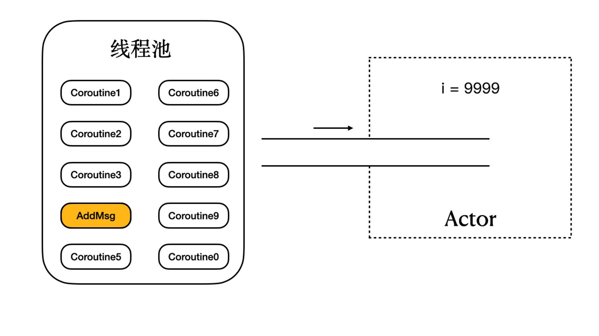
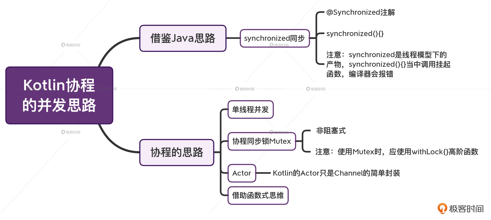

# 22-并发：协程不需要处理同步吗？

你好，我是朱涛。今天我们来讲讲协程的并发。

在大型软件的架构当中，并发也是一个不可避免的问题。然而，在传统的 Java 编程当中，并发却是个令人生畏的话题。因为 Java 的线程模型、内存模型、同步机制太复杂了，而当复杂的业务逻辑与复杂的并发模型混合在一起的时候，情况就更糟糕了！如果你用 Java 做过中大型软件，对此一定会深有体会。

我们都知道，Kotlin 的协程仍然是基于线程运行的。但是，经过一层封装以后，Kotlin 协程面对并发问题的时候，它的处理手段其实跟 Java 就大不一样。所以这节课，我们就来看看协程在并发问题上的处理，一起来探究下 Kotlin 协程的并发思路，从而真正解决并发的难题。

## 协程与并发

在 Java 世界里，并发往往需要多个线程一起工作，而多线程往往就会有共享的状态，这时候程序就要处理同步问题了。很多初学者在这一步，都会把协程与线程的概念混淆在一起。比如你可以来看看下面这段代码，你觉得有多线程同步的问题吗？

```javascript
// 代码段1
fun main() = runBlocking {
   var i = 0
   // Default 线程池
   launch(Dispatchers.Default) {
       repeat(1000) {
           i++
       }
   }
   delay(1000L)
   println("i = $i")
}
```

在这段代码里，我是在 Default 线程池上创建了一个协程，然后对变量 i 进行了 1000 次自增操作，接着我又 delay 了一小会儿，防止程序退出，最后输出结果。

那么，在面对这段代码的时候，你也许会觉得，Default 线程池内部是多个线程，因此就需要考虑多线程同步的问题。其实，这就是典型的把协程、线程混淆的例子。

如果你仔细分析上面的代码，会发现代码中压根就没有并发执行的任务，除了 runBlocking，我只在 launch 当中创建了一个协程，所有的计算都发生在一个协程当中。所以，在这种情况下你根本就不需要考虑同步的问题。

我们再来看看多个协程并发执行的例子。

```javascript
// 代码段2
fun main() = runBlocking {
   var i = 0
   val jobs = mutableListOf<Job>()
   // 重复十次
   repeat(10){
       val job = launch(Dispatchers.Default) {
           repeat(1000) {
               i++
           }
       }
       jobs.add(job)
   }
   // 等待计算完成
   jobs.joinAll()
   println("i = $i")
}
/*
```

- 输出结果

```
i = 9972
*/
```

在上面的代码中，我创建了 10 个协程任务，每个协程任务都会工作在 Default 线程池，这 10个协程任务，都会分别对 i 进行 1000 次自增操作。如果一切正常的话，代码的输出结果应该是 10000。但如果你实际运行这段代码，你会发现结果大概率不会是 10000。

出现这个问题的原因也很简单，这 10 个协程分别运行在不同的线程之上，与此同时，这 10个协程之间还共享着 i 这个变量，并且它们还会以并发的形式对 i 进行自增，所以自然就会产生同步的问题。

- 补充：为了不偏离主题，这里我们不去深究出现这个问题的底层原因。这涉及到 Java 内存模型之类的底层细节，如果你不熟悉 Java 并发相关的知识点，可以自行去做一些了解。

所以在这里，我们就可以回答这节课标题里的问题了：Kotlin 协程也需要处理多线程同步的问题。

那么下面，我们就以这个简单的代码为例，一起来分析下 Kotlin 协程面对并发时，都有哪些可用的手段。

## 借鉴 Java 的并发思路

首先，由于 Kotlin 协程也是基于 JVM 的，所以，当我们面对并发问题的时候，脑子里第一时间想到的肯定是 Java 当中的同步手段，比如 synchronized、Atomic、Lock，等等。

在 Java 当中，最简单的同步方式就是 synchronized 同步了。那么换到 Kotlin 里，我们就可以使用 @Synchronized 注解来修饰函数，也可以使用 synchronized(){} 的方式来实现同步代码块。

让我们用 synchronized 来改造一下上面的代码段 2：

```javascript
// 代码段3
fun main() = runBlocking {
   var i = 0
   val lock = Any() // 变化在这里
   val jobs = mutableListOf<Job>()
   repeat(10){
       val job = launch(Dispatchers.Default) {
           repeat(1000) {
               // 变化在这里
               synchronized(lock) {
                   i++
               }
           }
       }
       jobs.add(job)
   }
   jobs.joinAll()
   println("i = $i")
}
/*
```

- 输出结果

```
i = 10000
*/
```

以上代码中，我们创建了一个 lock 对象，然后使用 synchronized(){} 将“i++”包裹了起来。这样就可以确保在自增的过程中不会出现同步问题。这时候，如果你再来运行代码，就会发现结果已经是 10000 了。

不过，如果你在实际生产环境使用过协程的话，应该会感觉 synchronized 在协程当中也不是一直都很好用的。毕竟，synchronized 是线程模型下的产物。

就比如说，假设我们这里的自增操作需要一些额外的操作，需要用到挂起函数 prepare()。

```javascript
// 代码段4
fun main() = runBlocking {
   suspend fun prepare(){
       // 模拟准备工作
   }
   var i = 0
   val lock = Any()
   val jobs = mutableListOf<Job>()
   repeat(10){
       val job = launch(Dispatchers.Default) {
           repeat(1000) {
               synchronized(lock) {
                   // 编译器报错！
                   prepare()
                   i++
               }
           }
       }
       jobs.add(job)
   }
   jobs.joinAll()
   println("i = $i")
}
```

这时候，你就不能天真地把协程看作是“Java 线程池的封装”，然后继续照搬 Java 的同步手段了。你会发现：synchronized(){} 当中调用挂起函数，编译器会给你报错！

这是为什么呢？其实，如果你理解了第 15 讲当中“协程挂起恢复”的思维模型的话，那么编译器报错的原因你一定可以轻松理解。因为这里的挂起函数会被翻译成带有 Continuation 的异步函数，从而就造成了 synchronid 代码块无法正确处理同步。

另外从这个例子里，我们也可以看出：即使 Kotlin 协程是基于 Java 线程的，但它其实已经脱离 Java 原本的范畴了。所以，单纯使用 Java 的同步手段，是无法解决 Kotlin 协程里所有问题的。

那么接下来，我们就来看看 Kotlin 协程当中的并发思路。

## 协程的并发思路

前面我也提到过，由于 Java 的线程模型是阻塞式的，比如说 Thread.sleep()，所以在 Java 当中，并发往往就意味着多线程，而多线程则往往会有状态共享，而状态共享就意味着要处理同步问题。

但是，因为 Kotlin 协程具备挂起、恢复的能力，而且还有非阻塞的特点，所以在使用协程处理并发问题的时候，我们的思路其实可以更宽。比如，我们可以使用单线程并发。

### 单线程并发

在 Kotlin 当中，单线程并发的实现其实非常轻松。不过如果你有 Java 经验的话，也许会对这个说法产生疑问，因为在 Java 当中，并发往往就意味着多线程。

实际上，在第 16 讲里我们就涉及到“单线程并发”这个概念了。让我们回过头，重新看看那段并发的代码。

```
// 代码段5
fun main() = runBlocking {
   suspend fun getResult1(): String {
       logX("Start getResult1")
       delay(1000L) // 模拟耗时操作
       logX("End getResult1")
       return "Result1"
   }
   suspend fun getResult2(): String {
       logX("Start getResult2")
       delay(1000L) // 模拟耗时操作
       logX("End getResult2")
       return "Result2"
   }
   suspend fun getResult3(): String {
       logX("Start getResult3")
       delay(1000L) // 模拟耗时操作
       logX("End getResult3")
       return "Result3"
   }
   val results: List<String>
   val time = measureTimeMillis {
       val result1 = async { getResult1() }
       val result2 = async { getResult2() }
       val result3 = async { getResult3() }
       results = listOf(result1.await(), result2.await(), result3.await())
   }
   println("Time: $time")
   println(results)
}
/*
```

- 输出结果

```
================================
Start getResult1
Thread:main
================================
================================
Start getResult2
Thread:main
================================
================================
Start getResult3
Thread:main
================================
================================
End getResult1
Thread:main
================================
================================
End getResult2
Thread:main
================================
================================
End getResult3
Thread:main
================================
Time: 1066
[Result1, Result2, Result3]
*/
```

在上面的代码中启动了三个协程，它们之间是并发执行的，每个协程执行耗时是 1000 毫秒，程序总耗时也是接近 1000 毫秒。而且，这几个协程是运行在同一个线程 main 之上的。

所以，当我们在协程中面临并发问题的时候，首先可以考虑：是否真的需要多线程？如果不需要的话，其实是可以不考虑多线程同步问题的。

那么，对于前面代码段 2 的例子来说，我们则可以把计算的逻辑分发到单一的线程之上。

```javascript
// 代码段6
fun main() = runBlocking {
   val mySingleDispatcher = Executors.newSingleThreadExecutor {
       Thread(it, "MySingleThread").apply { isDaemon = true }
   }.asCoroutineDispatcher()
   var i = 0
   val jobs = mutableListOf<Job>()
   repeat(10) {
       val job = launch(mySingleDispatcher) {
           repeat(1000) {
               i++
           }
       }
       jobs.add(job)
   }
   jobs.joinAll()
   println("i = $i")
}
/*
```

- 输出结果

```
i = 10000
*/
```

可见，在这段代码中，我们使用“launch(mySingleDispatcher)”，把所有的协程任务都分发到了单线程的 Dispatcher 当中，这样一来，我们就不必担心同步问题了。另外，如果仔细分析的话，上面创建的 10 个协程之间，其实仍然是并发执行的。

所以这时候，如果你运行上面的代码，就一定可以得到正确的结果了：i = 10000。

### Mutex

在 Java 当中，其实还有 Lock 之类的同步锁。但由于 Java 的锁是阻塞式的，会大大影响协程的非阻塞式的特性。所以，在 Kotlin 协程当中，我们也是不推荐直接使用传统的同步锁的，甚至在某些场景下，在协程中使用 Java 的锁也会遇到意想不到的问题。

为此，Kotlin 官方提供了“非阻塞式”的锁：Mutex。下面我们就来看看，如何用 Mutex 来改造代码段 2。

```javascript
// 代码段7
fun main() = runBlocking {
   val mutex = Mutex()
   var i = 0
   val jobs = mutableListOf<Job>()
   repeat(10) {
       val job = launch(Dispatchers.Default) {
           repeat(1000) {
               // 变化在这里
               mutex.lock()
               i++
               mutex.unlock()
           }
       }
       jobs.add(job)
   }
   jobs.joinAll()
   println("i = $i")
}
```

在上面的代码中，我们使用 mutex.lock()、mutex.unlock() 包裹了需要同步的计算逻辑，这样一来，代码就可以实现多线程同步了，程序的输出结果也会是 10000。

实际上，Mutex 对比 JDK 当中的锁，最大的优势就在于支持挂起和恢复。让我们来看看它的源码定义：

```java
// 代码段8
public interface Mutex {
   public val isLocked: Boolean
   //     注意这里
   //        ↓
   public suspend fun lock(owner: Any? = null)
   public fun unlock(owner: Any? = null)
}
```

可以看到，Mutex 是一个接口，它的 lock() 方法其实是一个挂起函数。而这就是实现非阻塞式同步锁的根本原因。

不过，在代码段 7 当中，我们对于 Mutex 的使用其实是错误的。因为这样的做法并不安全，我们可以来看一个场景：

```javascript
// 代码段9
fun main() = runBlocking {
   val mutex = Mutex()
   var i = 0
   val jobs = mutableListOf<Job>()
   repeat(10) {
       val job = launch(Dispatchers.Default) {
           repeat(1000) {
               try {
                   mutex.lock()
                   i++
                   i/0 // 故意制造异常
                   mutex.unlock()
               } catch (e: Exception) {
                   println(e)
               }
           }
       }
       jobs.add(job)
   }
   jobs.joinAll()
   println("i = $i")
}
// 程序无法退出
```

以上代码会在 mutex.lock()、mutex.unlock() 之间发生异常，从而导致 mutex.unlock() 无法被调用。这个时候，整个程序的执行流程就会一直卡住，无法结束。

所以，为了避免出现这样的问题，我们应该使用 Kotlin 提供的一个扩展函数：mutex.withLock{}。

```javascript
// 代码段10
fun main() = runBlocking {
   val mutex = Mutex()
   var i = 0
   val jobs = mutableListOf<Job>()
   repeat(10) {
       val job = launch(Dispatchers.Default) {
           repeat(1000) {
               // 变化在这里
               mutex.withLock {
                   i++
               }
           }
       }
       jobs.add(job)
   }
   jobs.joinAll()
   println("i = $i")
}
// withLock的定义
public suspend inline fun <T> Mutex.withLock(owner: Any? = null, action: () -> T)
   lock(owner)
   try {
       return action()
   } finally {
       unlock(owner)
   }
}
```

可以看到，withLock{} 的本质，其实是在 finally{} 当中调用了 unlock()。这样一来，我们就再也不必担心因为异常导致 unlock() 无法执行的问题了。

### Actor

Actor，其实是在很多编程语言当中都存在的一个并发同步模型。在 Kotlin 当中，也同样存在这样的模型，它本质上是基于 Channel 管道消息实现的。下面我们还是来看一个例子：

```python
// 代码段11
sealed class Msg
object AddMsg : Msg()
class ResultMsg(
   val result: CompletableDeferred<Int>
) : Msg()
fun main() = runBlocking {
   suspend fun addActor() = actor<Msg> {
       var counter = 0
       for (msg in channel) {
           when (msg) {
               is AddMsg -> counter++
               is ResultMsg -> msg.result.complete(counter)
           }
       }
   }
   val actor = addActor()
   val jobs = mutableListOf<Job>()
   repeat(10) {
       val job = launch(Dispatchers.Default) {
           repeat(1000) {
               actor.send(AddMsg)
           }
       }
       jobs.add(job)
   }
   jobs.joinAll()
   val deferred = CompletableDeferred<Int>()
   actor.send(ResultMsg(deferred))
   val result = deferred.await()
   actor.close()
   println("i = ${result}")
}
```

在这段代码中，我们定义了 addActor() 这个挂起函数，而它其实调用了 actor() 这个高阶函数。而这个函数的返回值类型其实是 SendChannel。由此可见，Kotlin 当中的 Actor 其实就是 Channel 的简单封装。Actor 的多线程同步能力都源自于 Channel。

这里，我们借助密封类定义了两种消息类型，AddMsg、ResultMsg，然后在 actor{} 内部，我们处理这两种消息类型，如果我们收到了 AddMsg，则计算“i++”；如果收到了 ResultMsg，则返回计算结果。

而在 actor{} 的外部，我们则只需要发送 10000 次的 AddMsg 消息，最后再发送一次ResultMsg，取回计算结果即可。

由于 Actor 的结构比较抽象，这里我做了一个小视频，帮你更好地理解它。



需要注意的是，虽然在上面的演示视频中，AddMsg、ResultMsg 是串行发送的，但实际上，它们是在多线程并行发送的，而 Channel 可以保证接收到的消息可以同步接收并处理。

这也就证明了我们前面的说法：Actor 本质上是基于 Channel 管道消息实现的。

- 补充：Kotlin 目前的 Actor 实现其实还比较简陋，在不远的将来，Kotlin 官方会对 Actor API进行重构，具体可以参考这个链接。虽然它的 API 可能会改变，但我相信它的核心理念是不会变的。

好，到现在为止，我们已经学习了三种协程并发的思路。不过我们还要反思一个问题：多线程并发，一定需要同步机制吗？

## 反思：可变状态

前面我们提到过，多线程并发，往往会有共享的可变状态，而共享可变状态的时候，就需要考虑同步问题。

弄清楚这一点后，我们其实会找到一个新的思路：避免共享可变状态。有了这个思路以后，我们的代码其实就非常容易实现了：

```javascript
// 代码段12
fun main() = runBlocking {
   val deferreds = mutableListOf<Deferred<Int>>()
   repeat(10) {
       val deferred = async (Dispatchers.Default) {
           var i = 0
           repeat(1000) {
                   i++
           }
           return@async i
       }
       deferreds.add(deferred)
   }
   var result = 0
   deferreds.forEach {
       result += it.await()
   }
   println("i = $result")
}
```

在上面的代码中，我们不再共享可变状态 i，对应的，在每一个协程当中，都有一个局部的变量 i，同时将 launch 都改为了 async，让每一个协程都可以返回计算结果。

这种方式，相当于将 10000 次计算，平均分配给了 10 个协程，让它们各自计算 1000 次。这样一来，每个协程都可以进行独立的计算，然后我们将 10 个协程的结果汇总起来，最后累加在一起。

其实，我们上面的思路，也是借鉴自函数式编程的思想，因为在函数式编程当中，就是追求不变性、无副作用。不过，以上代码其实还是命令式的代码，如果我们用函数式风格来重构的话，代码会更加简洁。

```javascript
// 代码段13
fun main() = runBlocking {
   val result = (1..10).map {
       async (Dispatchers.Default) {
           var i = 0
           repeat(1000) {
               i++
           }
           return@async i
       }
   }.awaitAll()
       .sum()
   println("i = $result")
}
```

上面的代码中，我们使用函数式风格代码重构了代码段 12，我们仍然创建了 10 个协程，并发了计算了 10000 次自增操作。

在加餐一当中，我曾提到过，函数式编程的一大优势就在于，它具有不变性、无副作用的特点，所以无惧并发编程。上面的这个代码案例，其实就体现出了 Kotlin 函数式编程的这个优势。

## 小结

这节课，我们学习了 Kotlin 协程解决并发的两大思路，分别是 Java 思路、协程思路。要注意，对于 Java 当中的同步手段，我们并不能直接照搬到 Kotlin 协程当中来，其中最大的问题，就是 synchronized 不支持挂起函数。

而对于协程并发手段，我也给你介绍了 4 种手段，这些你都需要掌握好。

- 第一种手段，单线程并发，在 Java 世界里，并发往往意味着多线程，但在 Kotlin 协程当中，我们可以轻松实现单线程并发，这时候我们就不用担心多线程同步的问题了。

- 第二种手段，Kotlin 官方提供的协程同步锁，Mutex，由于它的 lock 方法是挂起函数，所以它跟 JDK 当中的锁不一样，Mutex 是非阻塞的。需要注意的是，我们在使用 Mutex 的时候，应该使用 withLock{} 这个高阶函数，而不是直接使用 lock()、unlock()。

- 第三种手段，Kotlin 官方提供的 Actor，这是一种普遍存在的并发模型。在目前的版本当中，Kotlin 的 Actor 只是 Channel 的简单封装，它的 API 会在未来的版本发生改变。

- 第四种手段，借助函数式思维。我们之所以需要处理多线程同步问题，主要还是因为存在共享的可变状态。其实，共享可变状态，既不符合无副作用的特性，也不符合不变性的特性。当我们借助函数式编程思维，实现无副作用和不变性以后，并发代码也会随之变得安全。



## 思考题

Kotlin 提供的 Mutex，它会比 JDK 的锁性能更好吗？为什么？欢迎在留言区分享你的答案，也欢迎你把今天的内容分享给更多的朋友。
