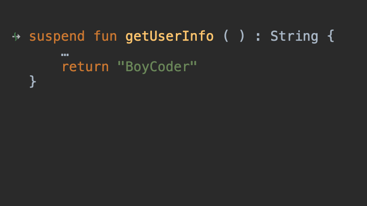
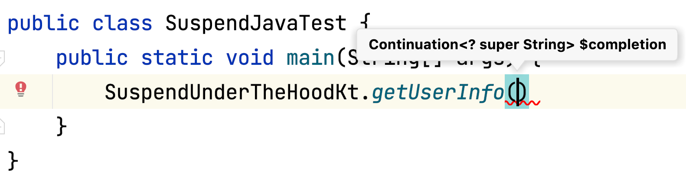
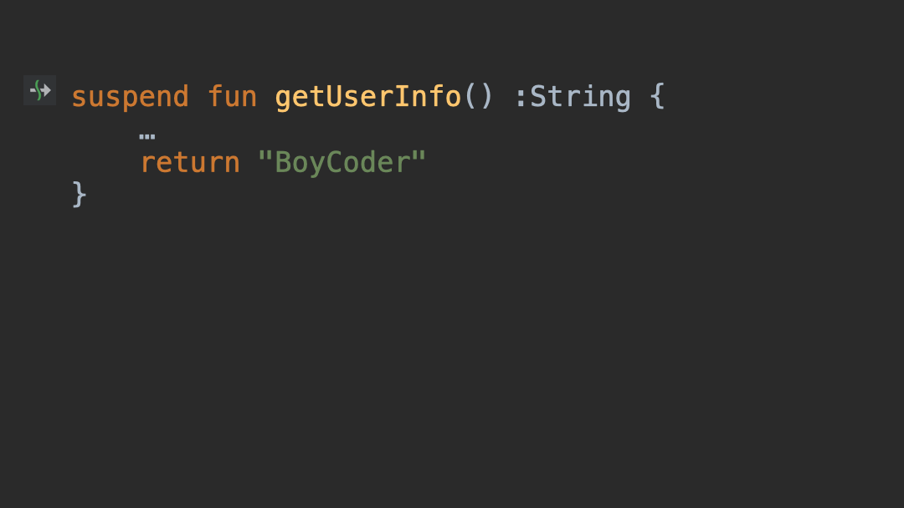
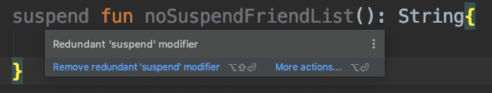
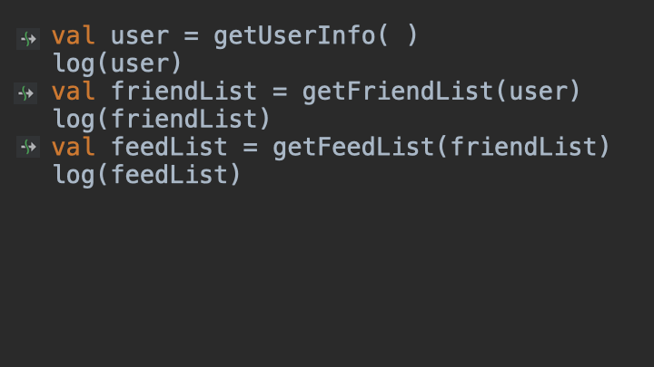
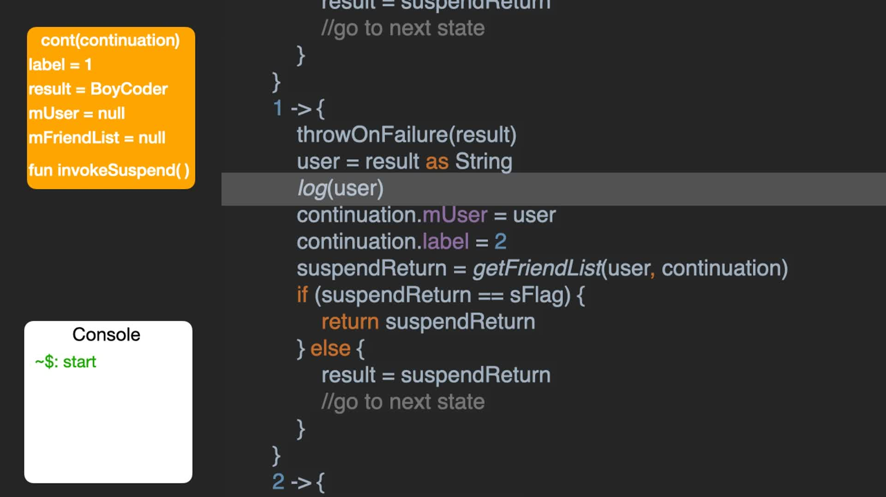
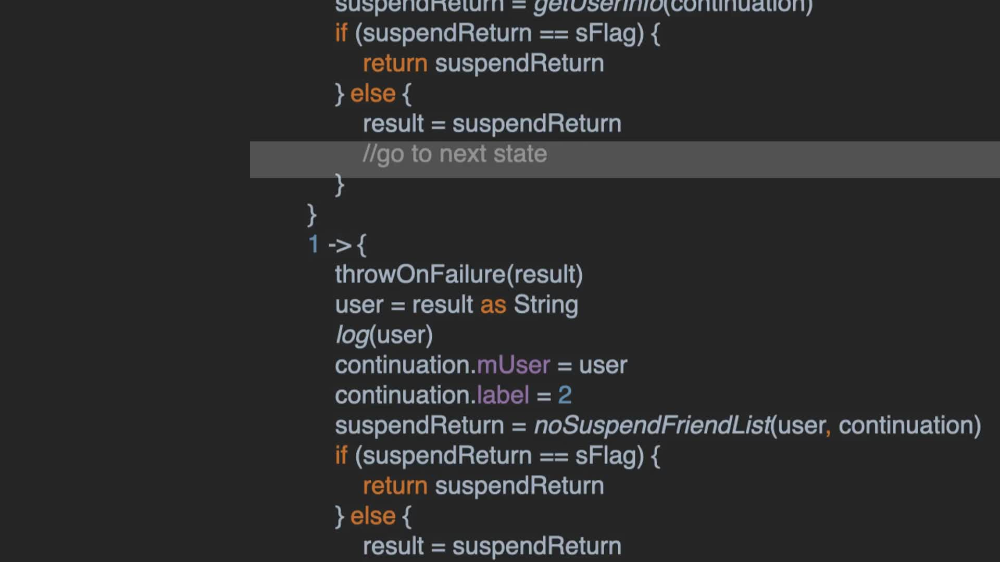

# 27-图解挂起函数：原来你就是个状态机？

你好，我是朱涛。今天我们来研究 Kotlin 挂起函数的实现原理。

挂起函数，是整个 Kotlin 协程的核心，它的重要性不言而喻。几乎所有协程里的知识点，都离不开挂起函数。而且也正是因为挂起函数的原因，我们才可以使用协程简化异步任务。

今天这节课，我会从这个 CPS 转换开始说起，带你进一步挖掘它背后的细节。在这个过程中，我们还会接触到 Kotlin 库当中的协程基础元素：Continuation、CoroutineContext 与挂起函数的底层联系。最后，我会带你灵活运用下这些知识点，以此进一步完善我们的 KtHttp，让它可以直接支持挂起函数。

好，接下来，我们就正式开始吧！

## CPS 转换背后的细节

在第 15 讲当中，我们已经初步介绍过挂起函数的用法了：挂起函数，只是比普通的函数多了 suspend 关键字。有了这个 suspend 关键字以后，Kotlin 编译器就会特殊对待这个函数，将其转换成一个带有 Callback 的函数，这里的 Callback 就是 Continuation 接口。

而这个过程，我们称之为 CPS 转换：



```
以上的 CPS 转换过程中，函数的类型发生了变化：suspend ()->String  变成了
(Continuation)-> Any?。这意味着，如果你在 Java 里访问一个 Kotlin 挂起函数
getUserInfo()，会看到 getUserInfo() 的类型是 (Continuation)-> Object，也就是：接
```

收 Continuation 为参数，返回值是 Object。

而在这里，函数签名的变化可以分为两个部分：函数参数的变化和函数返回值的变化。

### CPS 参数变化

我们先来看函数参数的变化，suspend() 变成 (Continuation) 的情况，这里我们以第 15 讲当中的代码为例：

```
// 代码段1
suspend fun testCoroutine() {
   val user = getUserInfo()
   val friendList = getFriendList(user)
   val feedList = getFeedList(user, friendList)
   log(feedList)
}
//挂起函数
// ↓
suspend fun getUserInfo(): String {
   withContext(Dispatchers.IO) {
       delay(1000L)
   }
   return "BoyCoder"
}
//挂起函数
// ↓
suspend fun getFriendList(user: String): String {
   withContext(Dispatchers.IO) {
       delay(1000L)
   }
   return "Tom, Jack"
}
//挂起函数
// ↓
suspend fun getFeedList(user: String, list: String): String {
   withContext(Dispatchers.IO) {
       delay(1000L)
   }
   return "{FeedList..}"
}
```

上面这段代码，testCoroutine() 是一个挂起函数，它的内部依次调用了三个挂起函数。而如果我们从 Java 的角度来看待 testCoroutine() 的话，代码中所有的参数都会发生变化。如下所示：

```
// 代码段2
//                 变化在这里
//                     ↓
fun testCoroutine(continuation: Continuation): Any? {
//                          变化在这里
//                              ↓
   val user = getUserInfo(continuation)
//                                        变化在这里
//                                            ↓
   val friendList = getFriendList(user, continuation)
//                                          变化在这里
//                                              ↓
   val feedList = getFeedList(friendList, continuation)
   log(feedList)
}
```

可见，在这里的 testCoroutine() 当中，每一次函数调用的时候，continuation 都会作为最后一个参数传到挂起函数里。不过这一步是 Kotlin 编译器帮我们做的，我们开发者是无感知的。还记得第 15 讲我留下的思考题吗：为什么挂起函数可以调用挂起函数，普通函数则不能？

其实，这个问题的答案，我们从代码段 2 就可以看出来。请想象一下，如果 testCoroutine()只是一个普通函数，那它就不会有 continuation 这个参数了，这样 getUserInfo()、getFriendList()、getFeedList() 这几个挂起函数自然也就无法被调用了。

### CPS 返回值变化

好，接下来我们看看 getUserInfo() 的返回值类型的变化：

```
// 代码段3
suspend fun getUserInfo(): String {}
//                                  变化在这里
//                                     ↓
fun getUserInfo(cont: Continuation): Any? {}
```

从上面的代码里，可以看到 getUserInfo() 的返回值类型从 String 变成“Any?”。你肯定会好奇，函数原本的 String 返回值难道丢失了吗？如果原本的返回值类型丢失了，那么程序执行难道不会出问题吗？

其实并不是这样。Kotlin 官方之所以要弄这一套 CPS 转换规则，它必然是“等价转换”。也就是说，String 这个原本的返回值类型肯定不会消失，而是会换一种形式存在。只是 String 存在的形式，经过 Kotlin反编译成 Java 之后会丢失。如果你直接在 Java 当中调用 getUserInfo() 的话，就会发现 String 这个返回值类型成为了 Continuation 的泛型类型。



所以，对于 getUserInfo() 这个方法，经过 CPS 转换后，它完整的函数签名应该是这样的：

```
// 代码段4
suspend fun getUserInfo(): String {}
//                                变化在这里
//                                    ↓
fun getUserInfo(cont: Continuation<String>): Any? {}
```

这时候，我们就可以更新第 15 讲当中的那个 CPS 动图了：



好，现在我们知道了，挂起函数原本的返回值类型 String 只是挪了个地方，所以，Kotlin 编译

```
器的 CPS 转换仍然是等价的转换。也就是：suspend () -> String 转换成
(Continuation<String>) -> Any?。不过，这里的“Any?”又是干什么的呢？
```

其实，挂起函数经过 CPS 转换后，它的返回值有一个重要作用：标志该挂起函数有没有被挂起。这听起来有点绕：挂起函数，就是可以被挂起的函数，它还能不被挂起吗？

是的，挂起函数也能不被挂起。

让我们来理清几个概念。只要有 suspend 修饰的函数，它就是挂起函数，比如我们前面的例子：

```
// 代码段5
suspend fun getUserInfo(): String {
   withContext(Dispatchers.IO) {
       delay(1000L)
   }
   return "BoyCoder"
}
```

当 getUserInfo() 执行到 withContext{} 的时候，就会返回

```
CoroutineSingletons.COROUTINE_SUSPENDED 表示函数被挂起了。
```

现在问题来了，请问下面这个函数是挂起函数吗？

```
// 代码段6
// suspend 修饰
// ↓
suspend fun noSuspendFriendList(user: String): String{
   // 函数体跟普通函数一样
   return "Tom, Jack"
}
```

这个其实是 noSuspendFriendList() 方法，它的方法体跟普通函数一样。它跟一般的挂起函数有个区别：在执行的时候，它并不会被挂起，因为它就是个普通函数。当你写出以下这样的代码后，IDE 也会提示你，suspend 是多余的：



也就是，当我们调用 noSuspendFriendList() 这个挂起函数的时候，它不会真正挂起，而是会

```
直接返回 String 类型："no suspend"。针对这样的挂起函数，你可以把它看作是伪挂起函
```

数。

所以到这里，挂起函数经过 CPS 转换后，返回值变成“Any?”的原因也就清晰了：

由于 suspend 修饰的函数，既可能返回

```
CoroutineSingletons.COROUTINE_SUSPENDED，也可能返回实际结果 "no
suspend"，甚至可能返回 null，为了适配所有的可能性，CPS 转换后的函数返回值类型就只
能是 Any? 了。
```

可见我在第 15 讲当中给出的这个 CPS 动图，仅仅只是粗略模拟了协程的 CPS 流程，其中还有很多细节没有体现出来。



那么，为了让你对挂起函数的底层实现原理有一个更加清晰的认识，接下来，我们来看看挂起函数反编译之后会变成什么样。

## 挂起函数的反编译

我们知道，通过查看 Kotlin 反编译后的字节码，可以帮助我们理解 Kotlin 的底层原理。不过，和往常不一样的是，这次我不会直接贴反编译后的代码，因为它的逻辑比较复杂。

所以，为了方便你理解，接下来我贴出的代码是我用 Kotlin 翻译后大致等价的代码，改善了可读性，抹掉了不必要的细节。当你理解其中的思想后，再去看反编译后的 Java 代码，会更轻松一些。

好，我们进入正题，这是我们即将研究的对象，testCoroutine() 反编译前的代码：

```
// 代码段7
suspend fun testCoroutine() {
   log("start")
   val user = getUserInfo()
   log(user)
   val friendList = getFriendList(user)
   log(friendList)
   val feedList = getFeedList(friendList)
   log(feedList)
}
```

接下来我们来分析 testCoroutine() 的函数体，它相当复杂，涉及到三个挂起函数的调用。

首先，在 testCoroutine() 函数里，会多出一个 ContinuationImpl 的子类，它是整个协程挂起函数的核心。

```python
// 代码段8
fun testCoroutine(completion: Continuation<Any?>): Any? {
   // TestContinuation本质上是匿名内部类
   class TestContinuation(completion: Continuation<Any?>?) : ContinuationImpl(co
       // 表示协程状态机当前的状态
       var label: Int = 0
       // 协程返回结果
       var result: Any? = null
       // 用于保存之前协程的计算结果
       var mUser: Any? = null
       var mFriendList: Any? = null
       // invokeSuspend 是协程的关键
       // 它最终会调用 testCoroutine(this) 开启协程状态机
       // 状态机相关代码就是后面的 when 语句
       // 协程的本质，可以说就是 CPS + 状态机
       override fun invokeSuspend(_result: Result<Any?>): Any? {
           result = _result
           label = label or Int.Companion.MIN_VALUE
           return testCoroutine(this)
       }
   }
}
```

代码中的这个 TestContinuation 类，是 Kotlin 编译器帮我们创建的匿名内部类，这里为了方便才用的 TestContinuation 这个名称。在这个类当中定义了几个成员变量：

- label 是用来代表协程状态机当中状态的；

- result 是用来存储当前挂起函数执行结果的；

- mUser、mFriendList 则是用来存储历史挂起函数执行结果的；

- invokeSuspend 这个函数，是整个状态机的入口，它会将执行流程转交给 testCoroutine()进行再次调用。

接下来是要判断 testCoroutine 是不是初次运行，如果是初次运行，我们就要创建一个TestContinuation 的实例对象。

```
// 代码段9
//                    ↓
fun testCoroutine(completion: Continuation<Any?>): Any? {
   ...
   val continuation = if (completion is TestContinuation) {
       completion
   } else {
       //                作为参数
       //                   ↓
       TestContinuation(completion)
   }
}
```

也就是：

- invokeSuspend 最终会调用 testCoroutine，然后走到这个判断语句；

- 如果是初次运行，会创建一个 TestContinuation 对象，completion 作为参数；

- 这相当于用一个新的 Continuation 包装了旧的 Continuation；

- 如果不是初次运行，直接将 completion 赋值给 continuation；

- 这说明 continuation 在整个运行期间，只会产生一个实例，这能极大地节省内存开销（对比CallBack）。

接下来是几个变量的定义：

```javascript
// 代码段10
// 三个变量，对应原函数的三个变量
lateinit var user: String
lateinit var friendList: String
lateinit var feedList: String
// result 接收协程的运行结果
var result = continuation.result
// suspendReturn 接收挂起函数的返回值
var suspendReturn: Any? = null
// CoroutineSingletons 是个枚举类
// COROUTINE_SUSPENDED 代表当前函数被挂起了
val sFlag = CoroutineSingletons.COROUTINE_SUSPENDED
```

上面的代码，分别代表了函数当中的临时变量、挂起函数执行结果，以及是否挂起的标志位。接着，我们来看看协程状态机的核心逻辑：

```
// 代码段11
when (continuation.label) {
   0 -> {
       // 检测异常
       throwOnFailure(result)
       log("start")
       // 将 label 置为 1，准备进入下一次状态
       continuation.label = 1
       // 执行 getUserInfo
       suspendReturn = getUserInfo(continuation)
       // 判断是否挂起
       if (suspendReturn == sFlag) {
           return suspendReturn
       } else {
           result = suspendReturn
           //go to next state
       }
   }
   1 -> {
       throwOnFailure(result)
       // 获取 user 值
       user = result as String
       log(user)
       // 将协程结果存到 continuation 里
       continuation.mUser = user
       // 准备进入下一个状态
       continuation.label = 2
       // 执行 getFriendList
       suspendReturn = getFriendList(user, continuation)
       // 判断是否挂起
       if (suspendReturn == sFlag) {
           return suspendReturn
       } else {
           result = suspendReturn
           //go to next state
       }
   }
   2 -> {
       throwOnFailure(result)
       user = continuation.mUser as String
       // 获取 friendList 的值
       friendList = result as String
       log(friendList)
       // 将协程结果存到 continuation 里
       continuation.mUser = user
       continuation.mFriendList = friendList
       // 准备进入下一个状态
       continuation.label = 3
       // 执行 getFeedList
       suspendReturn = getFeedList(user, friendList, continuation)
       // 判断是否挂起
       if (suspendReturn == sFlag) {
           return suspendReturn
       } else {
           result = suspendReturn
           //go to next state
       }
   }
   3 -> {
       throwOnFailure(result)
       user = continuation.mUser as String
       friendList = continuation.mFriendList as String
       feedList = continuation.result as String
       log(feedList)
       loop = false
   }
}
```

在 testCoroutine() 这个方法体当中，一共调用了三个挂起函数，这三个挂起函数把整个方法体分割成了 4 个部分，这四个部分就是上面 when 表达式当中的 4 种情况。

- when 表达式实现了协程状态机；

- continuation.label 是状态流转的关键，continuation.label 改变一次，就代表了挂起函数被调用了一次；

- 每次挂起函数执行完后，都会检查是否发生异常；

- testCoroutine 里的原本的代码，被拆分到状态机里各个状态中，分开执行；

- getUserInfo(continuation)、getFriendList(user, continuation)、getFeedList(friendList,continuation) 三个函数调用的是同一个 continuation 实例；

- 如果一个函数被挂起了，它的返回值会是

```
CoroutineSingletons.COROUTINE_SUSPENDED；
```

- 在挂起函数执行的过程中，状态机会把之前的结果以成员变量的方式保存在 continuation中。

上面这一大串文字和代码看着是不是有点晕？你可以再结合着来看看这个视频演示。



那到这里是不是就结束了呢？并不，因为这个动画仅演示了每个协程正常挂起的情况。如果协程并没有真正挂起呢？协程状态机会怎么运行？

### 协程未挂起的情况

要验证也很简单，我们将其中一个挂起函数改成伪挂起函数即可。

```
// 代码段12
// “伪”挂起函数
// 虽然它有 suspend 修饰，但执行的时候并不会真正挂起，因为它函数体里没有其他挂起函数
//  ↓
suspend fun noSuspendFriendList(user: String): String{
   return "Tom, Jack"
}
suspend fun testNoSuspend() {
   log("start")
   val user = getUserInfo()
   log(user)
   //                  变化在这里
   //                      ↓
   val friendList = noSuspendFriendList(user)
   log(friendList)
   val feedList = getFeedList(friendList)
   log(feedList)
}
```

testNoSuspend() 这样的一个函数体，它反编译后的代码逻辑是怎么样的？

答案其实很简单，它的结构跟前面的 testCoroutine() 是一致的，只是函数名字变了而已，Kotlin 编译器 CPS 转换的逻辑只认 suspend 关键字。就算挂起函数内部并没有挂起的逻辑，Kotlin 编译器也照样会进行 CPS 转换。

```
// 代码段13
when (continuation.label) {
   0 -> {
       ...
   }
   1 -> {
       ...
       //               变化在这里
       //                   ↓
       suspendReturn = noSuspendFriendList(user, continuation)
       // 判断是否挂起
       if (suspendReturn == sFlag) {
           return suspendReturn
       } else {
           result = suspendReturn
           //go to next state
       }
   }
   2 -> {
       ...
   }
   3 -> {
       ...
   }
}
```

那 testNoSuspend() 的协程状态机是怎么运行的呢？

其实我们也很容易能想到，continuation.label = 0, 2, 3 的情况都是不变的，唯独在 label = 1

```
的时候，suspendReturn == sFlag 这里会有区别。
```

具体区别我们还是通过动画来看吧：



```
通过动画我们很清楚地看到了，对于“伪挂起函数”，suspendReturn == sFlag 是会走
```

else 分支的，在 else 分支里，协程状态机会直接进入下一个状态。

现在只剩最后一个问题了：

```
// 代码段14
if (suspendReturn == sFlag) {
} else {
   // 具体代码是如何实现的？
   //       ↓
   //go to next state
}
```

答案其实也很简单：如果你去看协程状态机的字节码反编译后的 Java，会看到很多 label。协

```
程状态机底层字节码，是通过 label 来实现这个 go to next state 的。由于 Kotlin 没有类
似 goto 的语法，下面我用伪代码来表示 go to next state 的逻辑。
// 代码段15
// 伪代码
// Kotlin 没有这样的语法
// ↓      ↓
label: whenStart
when (continuation.label) {
   0 -> {
       ...
   }
   1 -> {
       ...
       suspendReturn = noSuspendFriendList(user, continuation)
       if (suspendReturn == sFlag) {
           return suspendReturn
       } else {
           result = suspendReturn
           // 让程序跳转到 label 标记的地方
           // 从而再执行一次 when 表达式
           goto: whenStart
       }
   }
   2 -> {
       ...
   }
   3 -> {
       ...
   }
}
```

需要注意的是：以上只是伪代码，它只是跟协程状态机字节码逻辑上“大致等价”。真实的字节码反编译出来的 Java 代码，它的可读性要差很多，也更难理解。

```java
// 代码段16
// 看不懂也没关系，有个印象即可
@Nullable
public static final Object testCoroutine(@NotNull Continuation $completion) {
   Object $continuation;
   label37: {
       if ($completion instanceof <TestSuspendKt$testCoroutine$1>) {
           $continuation = (<TestSuspendKt$testCoroutine$1>)$completion;
           if ((((<TestSuspendKt$testCoroutine$1>)$continuation).label & Integer
               ((<TestSuspendKt$testCoroutine$1>)$continuation).label -= Integer
               break label37;
           }
       }
       $continuation = new ContinuationImpl($completion) {
           // $FF: synthetic field
           Object result;
           int label;
           Object L$0;
           Object L$1;
           @Nullable
           public final Object invokeSuspend(@NotNull Object $result) {
               this.result = $result;
               this.label |= Integer.MIN_VALUE;
               return TestSuspendKt.testCoroutine(this);
           }
       };
   }
   Object var10000;
   label31: {
       String user;
       String friendList;
       Object var6;
       label30: {
           Object $result = ((<TestSuspendKt$testCoroutine$1>)$continuation).res
           var6 = IntrinsicsKt.getCOROUTINE_SUSPENDED();
           switch(((<TestSuspendKt$testCoroutine$1>)$continuation).label) {
               case 0:
                   ResultKt.throwOnFailure($result);
                   log("start");
                   ((<TestSuspendKt$testCoroutine$1>)$continuation).label = 1;
                   var10000 = getUserInfo((Continuation)$continuation);
                   if (var10000 == var6) {
                       return var6;
                   }
                   break;
               case 1:
                   ResultKt.throwOnFailure($result);
                   var10000 = $result;
                   break;
               case 2:
                   user = (String)((<TestSuspendKt$testCoroutine$1>)$continuatio
                   ResultKt.throwOnFailure($result);
                   var10000 = $result;
                   break label30;
               case 3:
                   friendList = (String)((<TestSuspendKt$testCoroutine$1>)$conti
                   user = (String)((<TestSuspendKt$testCoroutine$1>)$continuatio
                   ResultKt.throwOnFailure($result);
                   var10000 = $result;
                   break label31;
               default:
                   throw new IllegalStateException("call to 'resume' before 'inv
           }
           user = (String)var10000;
           log(user);
           ((<TestSuspendKt$testCoroutine$1>)$continuation).L$0 = user;
           ((<TestSuspendKt$testCoroutine$1>)$continuation).label = 2;
           var10000 = getFriendList(user, (Continuation)$continuation);
           if (var10000 == var6) {
               return var6;
           }
       }
       friendList = (String)var10000;
       log(friendList);
       ((<TestSuspendKt$testCoroutine$1>)$continuation).L$0 = user;
       ((<TestSuspendKt$testCoroutine$1>)$continuation).L$1 = friendList;
       ((<TestSuspendKt$testCoroutine$1>)$continuation).label = 3;
       var10000 = getFeedList(friendList, (Continuation)$continuation);
       if (var10000 == var6) {
           return var6;
       }
   }
   String feedList = (String)var10000;
   log(feedList);
   return Unit.INSTANCE;
}
```

当然，对于上面反编译出来的 Java 代码，即使你看不懂也没关系，你只需要理解我们前面讲解的逻辑即可。本质上来说，Kotlin 协程就是通过 label 代码段嵌套，配合 switch 巧妙构造出一个状态机结构，这种逻辑比较复杂，相对难懂一些。毕竟 Java 的 label 在实际开发中用的很少。

- 注意：Kotlin 挂起函数反编译出来的 Java 代码，会因为实际开发环境的不同出现细微差异。随着 Kotlin 编译器的发展，将来可能会对这部分逻辑进一步优化，但它的核心状态机思想是不会轻易改变的。

好，到现在，我们就已经彻底弄懂挂起函数的实现原理了。接下来，我们就结合刚刚学习的内容，来进一步思考实战一下。

## 思考与实战

在上节课我曾提到过，Kotlin 协程的源代码其实分为三层，其中基础层当中的“基础概念”尤为重要。那么，Kotlin 官方为我们提供了哪些与挂起函数相关的基础元素呢？

我们首先想到的，肯定就是Continuation.kt，在这里面，确实也可以找到一些跟挂起函数相关的基础元素。

```java
// 代码段17
public interface Continuation<in T> {
   public val context: CoroutineContext
   public fun resumeWith(result: Result<T>)
}
@Suppress("WRONG_MODIFIER_TARGET")
public suspend inline val coroutineContext: CoroutineContext
   get() {
       throw NotImplementedError("Implemented as intrinsic")
   }
```

在上面的代码中，我们最熟悉的就是 Continuation 这个接口了，除此之外，还有一个顶层的变量值得我们注意：suspend inline val coroutineContext。要知道，我们从来都是用suspend 修饰函数的，从未见过 suspend 修饰变量的情况。

如果我们依葫芦画瓢，创建一个类似的顶层变量的话，编译器甚至会报错：

```
// 代码段18
// 报错
public suspend inline val test: CoroutineContext
   get() = TODO()
```

由此可见，suspend 的这种用法只是一种特殊用法。结合“public suspend inline val”这几个关键字来看，我们其实可以大致推测出它的作用：它是一个只有在挂起函数作用域下，才能访问的顶层的不可变的变量。这里的 inline，意味着它的具体实现会被直接复制到代码的调用处。

### 17 讲思考题解答

为了验证我们前面的猜测，我们可以回过头来看看第 17 讲的思考题：

```python
// 代码段19
import kotlinx.coroutines.*
import kotlin.coroutines.coroutineContext
//                        挂起函数能可以访问协程上下文吗？
//                                 ↓
suspend fun testContext() = coroutineContext
```

如果你将上面的代码反编译成 Java 的话，它就会变成这样：

```java
// 代码段20
public static final Object testContext(Continuation $completion) {
 return $completion.getContext();
}
```

由此可见，代码段 17 当中的“suspend inline val coroutineContext”，本质上就是 Kotlin 官方提供的一种方便开发者在挂起函数当中，获取协程上下文的手段。它的具体实现，其实是Kotlin 编译器来完成的。

```python
// 代码段19
import kotlinx.coroutines.*
import kotlin.coroutines.coroutineContext
//                  Continuation当中的coroutineContext
//                                 ↓
suspend fun testContext() = coroutineContext
```

到这里，你就会发现一个有趣的现象：我们在挂起函数当中无法直接访问 Continuation 对象，但可以访问到 Continuation 当中的 coroutineContext。要知道，正常情况下，我们想要访问 Continuation.coroutineContext，首先是要拿到 Continuation 对象的。

但是，Kotlin 官方通过“suspend inline val coroutineContext”这个顶层变量，让我们开发者能直接拿到 coroutineContext，却对 Continuation 毫无感知。

所以到这里，我们其实也就可以回答第 17 节课思考题的问题了。

- 课程里，我提到了“挂起函数”与 CoroutineContext 也有着紧密的联系，请问，你能找到具体的证据吗？

解答：挂起函数与 CoroutineContext 确实有着紧密的联系。每个挂起函数当中都会有Continuation，而每个 Continuation 当中都会有 coroutineContext。并且，我们在挂起函数当中，就可以直接访问当前的 coroutineContext。

### KtHttp 支持挂起函数

在第 18 讲当中，我们并没有让 KtHttp 直接支持挂起函数，当时我们的做法是给 KtCall 扩展了一个 await() 方法，从而实现挂起函数调用的。

那么，经过这节课的学习，我们就可以来尝试让 KtHttp 直接支持挂起函数了，也就是我们可以这样来写代码：

```
interface ApiServiceV7 {
   @GET("/repo")
   // 1，挂起函数
   suspend fun reposSuspend(
       @Field("lang") lang: String,
       @Field("since") since: String
   ): RepoList
}
private fun <T : Any> invoke(path: String, method: Method, args: Array<Any>): Any
       // 省略
       return when {
       isSuspend(method) -> {
           // 2，支持挂起函数
       }
       isKtCallReturn(method) -> {
           // 省略
       }
       isFlowReturn(method) -> {
           // 省略
       }
       else -> {
           // 省略
       }
   }
}
// 3，判断是不是挂起函数
private fun isSuspend(method: Method) = method.kotlinFunction?.isSuspend ?: false
// 4，真正执行网络请求的方法
suspend fun <T: Any> realCall(call: Call, gson: Gson, type: Type): T = suspendCan
   call.enqueue(object : Callback {
       override fun onFailure(call: Call, e: IOException) {
           continuation.resumeWithException(e)
       }
       override fun onResponse(call: Call, response: okhttp3.Response) {
           try {
               val t = gson.fromJson<T>(response.body?.string(), type)
               continuation.resume(t)
           } catch (e: Exception) {
               continuation.resumeWithException(e)
           }
       }
   })
   continuation.invokeOnCancellation {
       call.cancel()
   }
}
```

这段代码一共有 4 个注释，我们一个个看：

- 注释 1，这其实就是我们希望达到的效果，可以在 ApiServiceV 接口当中直接定义挂起函数。

- 注释 2，在 KtHttp 6.0 版本的基础上，我们在 invoke() 的 when 表达式里增加了一个分支：isSuspend()。

- 注释 3，isSuspend() 的实现有一个细节，这里我们使用了“method.kotlinFunction”，将Java 的 method 转换成了 kotlinFunction，这样一来，它就变成了一个 Kotlin 反射的对象了。因此，我们就可以查询到一些 Kotlin 相关的信息，比如说，它是不是一个挂起函数。

- 注释 4，为了直接在挂起函数里执行网络请求，我们将 KtCall 当中的部分代码逻辑挪了进来。这个 realCall() 方法，它被定义成了一个挂起函数。

基于以上的分析，我们其实只需要借助反射，完成注释 2 处的代码逻辑，然后调用 realCall()这个挂起函数就行了。

```
private fun <T : Any> invoke(path: String, method: Method, args: Array<Any>): Any
       // 省略
   return when {
       isSuspend(method) -> {
           // 1，反射获取类型信息
           // 2，调用realCall()
       }
       isKtCallReturn(method) -> {
           // 省略
       }
       isFlowReturn(method) -> {
           // 省略
       }
       else -> {
           // 省略
       }
   }
}
```

所以，接下来我们要做的事情大致可以分为两个部分。

第一个部分，获取类型信息，准备请求网络，这个部分其实很简单。但在第二个部分“支持挂起函数”这里会遇到问题：

```
private fun <T : Any> invoke(path: String, method: Method, args: Array<Any>): Any
       // 省略
   return when {
       isSuspend(method) -> {
           // 支持挂起函数
           val genericReturnType = method.kotlinFunction?.returnType?.javaType ?
           val call = okHttpClient!!.newCall(request)
           // 报错！！
           realCall<T>()
       }
       isKtCallReturn(method) -> {
           // 省略
       }
       isFlowReturn(method) -> {
           // 省略
       }
       else -> {
           // 省略
       }
   }
}
```

以上代码报错的原因也很容易理解，realCall() 是一个挂起函数，它无法在普通函数里被调用！所以这里我们就面临了一个问题：如何在普通 Kotlin 函数当中调用挂起函数？

那么，我们首先可以想到的解决办法，就是强制类型转换：

```
private fun <T : Any> invoke(path: String, method: Method, args: Array<Any>): Any
       // 省略
   return when {
       isSuspend(method) -> {
           // 支持挂起函数
           val genericReturnType = method.kotlinFunction?.returnType?.javaType ?
           val call = okHttpClient!!.newCall(request)
           val continuation = args.last() as? Continuation<T>
           // 1，将挂起函数类型转换成，带Continuation的类型，报错
           val func = ::realCall as (Call, Gson, Type, Continuation<T>?) -> Any?
           func.invoke(call, gson, genericReturnType, continuation)
       }
       isKtCallReturn(method) -> {
           // 省略
       }
       isFlowReturn(method) -> {
           // 省略
       }
       else -> {
           // 省略
       }
   }
}
```

请留意代码中的注释 1，我们尝试使用“函数引用”的方式，将 realCall() 转换成了带有Continuation 的函数类型，这样我们就可以通过传入 Continuation，来调用 realCall() 这个挂起函数了。

不过，事与愿违，我们的方法并不能奏效，因为这行代码会报错，原因是 realCall() 带有泛型，而 Kotlin 暂时不支持“函数引用带泛型”的语法。

所以在这里，为了让这个 Demo 能运行起来，我们可以定义一个临时方法：

```
private fun <T : Any> invoke(path: String, method: Method, args: Array<Any>): Any
       // 省略
   return when {
       isSuspend(method) -> {
           // 支持挂起函数
           val genericReturnType = method.kotlinFunction?.returnType?.javaType ?
           val call = okHttpClient!!.newCall(request)
           val continuation = args.last() as? Continuation<T>
           // 1，使用临时方法消除泛型
           val func = ::temp as (Call, Gson, Type, Continuation<T>?) -> Any?
           func.invoke(call, gson, genericReturnType, continuation)
       }
       isKtCallReturn(method) -> {
           // 省略
       }
       isFlowReturn(method) -> {
           // 省略
       }
       else -> {
           // 省略
       }
   }
}
suspend fun temp(call: Call, gson: Gson, type: Type) = realCall<RepoList>(call, g
```

在上面的代码中，我们使用了一个临时方法消除了泛型 T，写死了返回值类型 RepoList。这样的代码，在 Demo 当中是可以运行的，这从侧面也能印证我们上面代码中的类型转换是成功的。

```
fun main() = runBlocking {
   val data: RepoList = KtHttpV7.create(ApiServiceV7::class.java).reposSuspend(
       lang = "Kotlin",
       since = "weekly"
   )
   println(data)
}
/*
```

- 输出结果正常

```
*/
```

不过，这种做法明显不具备普适性，为了让 KtHttp 支持所有类型的 API 请求，我们必须要想其他的办法。具体来说，我们可以这样做：

```
private fun <T : Any> invoke(path: String, method: Method, args: Array<Any>): Any
       // 省略
   return when {
       isSuspend(method) -> {
           // 支持挂起函数
           val genericReturnType = method.kotlinFunction?.returnType?.javaType ?
           val call = okHttpClient!!.newCall(request)
           val continuation = args.last() as? Continuation<T>
           val func = KtHttpV7::class.getGenericFunction("realCall")
           // 反射调用realCall()
           func.call(this, call, gson, genericReturnType, continuation)
       }
       isKtCallReturn(method) -> {
           // 省略
       }
       isFlowReturn(method) -> {
           // 省略
       }
       else -> {
           // 省略
       }
   }
}
// 2，获取方法的反射对象
fun KClass<*>.getGenericFunction(name: String): KFunction<*> {
       return members.single { it.name == name } as KFunction<*>
   }
```

其实，这种思路跟前面的思路是类似的，我们仍然是对 realCall() 的类型进行了转换，只不过是通过反射来实现的而已。所以最重要的，我们还是要弄清楚 Kotlin 挂起函数 CPS 转换的细节。

## 小结

这节课，我们通过研究挂起函数的反编译代码，发现了 Kotlin 的挂起函数，本质上就是一个状态机。其中主要涉及到下面几个知识点，我们需要重点掌握好。

- Kotlin 挂起函数的 CPS 转换，它的函数签名变化主要分为两个部分，第一部分是参数的变化，挂起函数经过 Kotlin 编译器转换以后，它会多出一个 Continuation 类型的参数。第二部分是返回值类型的变化，挂起函数原本的返回值类型，会被挪到 Continuation 当中作为

```
泛型参数，比如 Continuation<String>，而转换过后的函数返回值类型会变
```

- 成“Any?”类型。

- 当挂起函数经过反编译以后，它会变成由 switch 和 label 组成的状态机结构。

- 为了便于研究，课程里提供了大致等价的协程状态机代码：其中，when 表达式实现了协程状态机，而 continuation.label 则代表了当前状态机的具体状态，continuation.label 改变一

- 次，就代表了挂起函数被调用了一次；

- 在一个挂起函数被调用的时候，它的返回值可能是具体的结果，也可能会是

```
CoroutineSingletons.COROUTINE_SUSPENDED，这时候就代表了这个函数被挂起
```

- 了。

另外在这节课里，我们还进行了一次反思和实战，通过研究协程基础层当中的“suspend inlineval coroutineContext”这个顶层变量，我们发现了挂起函数与协程上下文之间的紧密联系。并且，我们还灵活运用了这节课学到的知识，进一步改进了 KtHttp，让它可以直接支持挂起函数。

你在自己的工作场景当中，其实也可以通过这样思考与实战的方式，来进一步强化所学和所得，甚至可以把输入转化成输出，把知识真正沉淀成你自己的东西。

## 思考题

我们都知道挂起函数是 Kotlin 协程里才有的概念，请问，Java 代码中可以调用 Kotlin 的挂起函数吗？比如，下面这个函数，我们可以在 Java 当中调用吗？

```
object SuspendFromJavaExample {
   // 在Java当中如何调用这个方法？
   suspend fun getUserInfo(id: Long):String {
       delay(1000L)
       return "Kotlin"
   }
}
```
