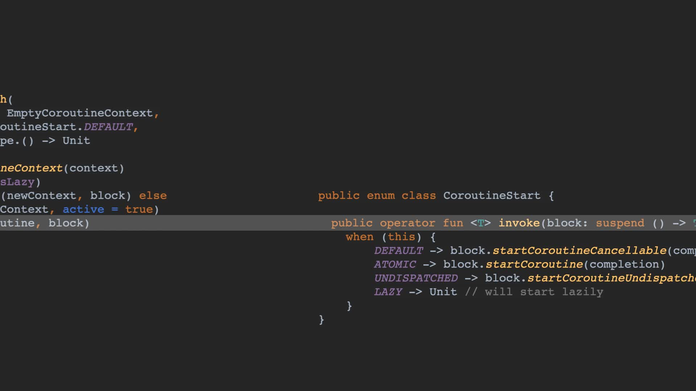

# 28-launch的背后到底发生了什么？

你好，我是朱涛。

在前面的课程里，我们一直在研究如何使用 Kotlin 协程，比如，如何启动协程，如何使用挂起函数，如何使用 Channel、Flow 等 API。但到目前为止，我们只知道该怎么用协程，对它内部的运行机制并没有深究。

现在我们都知道，launch、async 可以创建、启动新的协程，但我们只能通过调试参数，通过log 看到协程。比如我们可以回过头来看下第 13 讲当中的代码：

```
// 代码段1
// 代码中一共启动了两个协程
fun main() = runBlocking {
   println(Thread.currentThread().name)
   launch {
       println(Thread.currentThread().name)
       delay(100L)
   }
   Thread.sleep(1000L)
}
/*
```

- 输出结果：

```
main @coroutine#1
main @coroutine#2
*/
```

现在回过头来看，这段代码无疑是非常简单的，runBlocking{} 启动了第一个协程，launch{} 启动了第二个协程。可是，有一个问题，我们一直都没有找到答案：协程到底是如何创建的？它对应的源代码，到底在哪个类？具体在哪一行？

我们常说 Java 线程的源代码是 Thread.java，这样说虽然不一定准确，但我们起码能看到几个暴露出来的方法。那么，在 Kotlin 协程当中，有没有类似 Coroutine.kt 的类呢？对于这些问题，我们唯有去阅读 Kotlin 协程的源码、去分析 launch 的启动流程，才能找到答案。

这节课，我就将从第 26 讲当中提到的 createCoroutine{}、startCoroutine{} 这两个函数开始说起，在认识了这两个协程基础元素以后，我们就会进入协程的“中间层”，开始分析 launch 的源代码。我相信，学完这节课以后，你一定会对 Kotlin 协程有一个更加透彻的认识。

## 协程启动的基础 API

在第 26 讲里，我给你留了一个思考题，在Continuation.kt这个文件当中，还有两个重要的扩展函数：

```
// 代码段2
public fun <T> (suspend () -> T).createCoroutine(
   completion: Continuation<T>
): Continuation<Unit> =
   SafeContinuation(createCoroutineUnintercepted(completion).intercepted(), CORO
public fun <T> (suspend () -> T).startCoroutine(
   completion: Continuation<T>
) {
   createCoroutineUnintercepted(completion).intercepted().resume(Unit)
}
```

其实，createCoroutine{}、startCoroutine{}这两个函数，就是 Kotlin 协程当中最基础的两个创建协程的 API。

我们在第 14 讲里曾经提到过，启动协程有三种常见的方式：launch、runBlocking、async。它们其实属于协程中间层提供的 API，而它们的底层都在某种程度上调用了“基础层”的协程 API。

那么，这是不是就意味着：我们使用协程的基础层 API，也可以创建协程呢？

答案当然是肯定的。我们可以来分析一下代码段 2 当中的函数签名。

createCoroutine{}、startCoroutine{}，它们都是扩展函数，其扩展接收者类型是一个函数类

```
型：suspend () -> T，代表了“无参数，返回值为 T 的挂起函数或者 Lambda”。而对于函
数本身，它们两个都接收一个 Continuation<T> 类型的参数，其中一个函数，还会返回一
个 Continuation<Unit> 类型的返回值。
```

也许你对于“给函数类型增加扩展”这样的行为会感到不太适应。不过，在 Kotlin 当中，函数就是一等公民，普通的类型可以有扩展，那么，函数类型自然也可以有扩展。因此，我们完全可以写出像下面这样的代码：

```
// 代码段3
fun main() {
   testStartCoroutine()
   Thread.sleep(2000L)
}
val block = suspend {
   println("Hello!")
   delay(1000L)
   println("World!")
   "Result"
}
private fun testStartCoroutine() {
   val continuation = object : Continuation<String> {
       override val context: CoroutineContext
           get() = EmptyCoroutineContext
       override fun resumeWith(result: Result<String>) {
           println("Result is: ${result.getOrNull()}")
       }
   }
   block.startCoroutine(continuation)
}
/*
```

- 输出结果

```
Hello!
World!
Result is: Result
*/
在这段代码中，我们定义了一个 Lambda 表达式 block，它的类型就是 suspend () -> T。
```

这样一来，我们就可以用 block.startCoroutine() 来启动协程了。这里，我们还创建了一个匿名内部类对象 continuation，作为 startCoroutine() 的参数。

在加餐里，我们提到过 Continuation 主要有两种用法，一种是在实现挂起函数的时候，用于传递挂起函数的执行结果；另一种是在调用挂起函数的时候，以匿名内部类的方式，用于接收挂起函数的执行结果。而代码段 3 中 Continuation 的作用，则明显属于后者。

从代码段 3 的执行结果中，我们可以看出来，startCoroutine() 的作用其实就是创建一个新的协程，并且执行 block 当中的逻辑，等协程执行完毕以后，将结果返回给 Continuation 对象。而这个逻辑，我们使用 createCoroutine() 这个方法其实也可以实现。

```
代码段4
private fun testCreateCoroutine() {
   val continuation = object : Continuation<String> {
       override val context: CoroutineContext
           get() = EmptyCoroutineContext
       override fun resumeWith(result: Result<String>) {
           println("Result is: ${result.getOrNull()}")
       }
   }
   val coroutine = block.createCoroutine(continuation)
   coroutine.resume(Unit)
}
/*
```

- 输出结果

```
Hello!
World!
Result is: Result
*/
```

根据以上代码，我们可以看到，createCoroutine() 的作用其实就是创建一个协程，并暂时先不启动它。等我们想要启动它的时候，直接调用 resume() 即可。如果我们再进一步分析代码段2 当中的源代码，会发现 createCoroutine()、startCoroutine() 的源代码差别也并不大，只是前者没有调用 resume()，而后者调用了 resume()。

换句话说，startCoroutine() 之所以可以创建并同时启动协程的原因就在于，它在源码中直接调用了 resume(Unit)，所以，我们在代码段 3 当中就不需要自己调用 resume() 方法了。

那么下面，我们就以 startCoroutine() 为例，来研究下它的实现原理。我们把代码段 3 反编译成 Java，看看它会变成什么样子：

```java
// 代码段5
public final class LaunchUnderTheHoodKt {
   // 1
   public static final void main() {
       testStartCoroutine();
       Thread.sleep(2000L);
   }
   // 2
   private static final Function1<Continuation<? super String>, Object> block =
   // 3
   public static final Function1<Continuation<? super String>, Object> getBlock(
       return block;
   }
   // 4
   static final class LaunchUnderTheHoodKt$block$1 extends SuspendLambda impleme
       int label;
       LaunchUnderTheHoodKt$block$1(Continuation $completion) {
         super(1, $completion);
       }
       @Nullable
       public final Object invokeSuspend(@NotNull Object $result) {
         Object object = IntrinsicsKt.getCOROUTINE_SUSPENDED();
         switch (this.label) {
           case 0:
             ResultKt.throwOnFailure(SYNTHETIC_LOCAL_VARIABLE_1);
             System.out
               .println("Hello!");
             this.label = 1;
             if (DelayKt.delay(1000L, (Continuation)this) == object)
               return object;
             DelayKt.delay(1000L, (Continuation)this);
             System.out
               .println("World!");
             return "Result";
           case 1:
             ResultKt.throwOnFailure(SYNTHETIC_LOCAL_VARIABLE_1);
             System.out.println("World!");
             return "Result";
         }
         throw new IllegalStateException("call to 'resume' before 'invoke' with
       }
       @NotNull
       public final Continuation<Unit> create(@NotNull Continuation<? super Laun
         return (Continuation<Unit>)new LaunchUnderTheHoodKt$block$1($completion
       }
       @Nullable
       public final Object invoke(@Nullable Continuation<?> p1) {
         return ((LaunchUnderTheHoodKt$block$1)create(p1)).invokeSuspend(Unit.IN
       }
   }
   // 5
   private static final void testStartCoroutine() {
       LaunchUnderTheHoodKt$testStartCoroutine$continuation$1 continuation = new
       ContinuationKt.startCoroutine(block, continuation);
   }
   // 6
   public static final class LaunchUnderTheHoodKt$testStartCoroutine$continuatio
       @NotNull
       public CoroutineContext getContext() {
         return (CoroutineContext)EmptyCoroutineContext.INSTANCE;
       }
       public void resumeWith(@NotNull Object result) {
         System.out.println(Intrinsics.stringPlus("Result is: ", Result.isFailur
       }
   }
}
internal abstract class SuspendLambda(
   public override val arity: Int,
   completion: Continuation<Any?>?
) : ContinuationImpl(completion), FunctionBase<Any?>, SuspendFunction {}
```

上面的反编译代码中，一共有 6 个注释，我们一个个来看：

- 注释 1，是我们的 main() 函数。由于它本身只是一个普通的函数，因此反编译之后，逻辑并没有什么变化。

- 注释 2、3，它们是 Kotlin 为 block 变量生成的静态变量以及方法。

```
注释 4，LaunchUnderTheHoodKt$block$1，其实就是 block 具体的实现类。这个类继
```

- 承自 SuspendLambda，而 SuspendLambda 是 ContinuationImpl 的子类，因此它也间接实现了 Continuation 接口。其中的 invokeSuspend()，也就是我们在上节课分析过的协程状态机逻辑。除此之外，它还有一个 create() 方法，我们在后面会来分析它。

- 注释 5，它对应了 testStartCoroutine() 这个方法，原本的

```
block.startCoroutine(continuation) 变成
了“ContinuationKt.startCoroutine(block, continuation)”，这其实就体现出
```

- 了扩展函数的原理。

- 注释 6，其实就是 continuation 变量对应的匿名内部类。

那么接下来，我们就可以对照着反编译代码，来分析整个代码的执行流程了。

首先，main() 函数会调用 testStartCoroutine() 函数，接着，就会调用 startCoroutine() 方法。

```
// 代码段6
public fun <T> (suspend () -> T).startCoroutine(
   completion: Continuation<T>
) {
//        注意这里
//           ↓
createCoroutineUnintercepted(completion).intercepted().resume(Unit)
}
```

从代码段 6 里，我们可以看到，在 startCoroutine() 当中，首先会调用createCoroutineUnintercepted() 方法。如果我们直接去看它的源代码，会发现它只存在一个声明，并没有具体实现：

```
// 代码段7
//    注意这里
//       ↓
public expect fun <T> (suspend () -> T).createCoroutineUnintercepted(
   completion: Continuation<T>
): Continuation<Unit>
```

上面代码中的 expect，我们可以把它理解为一种声明，由于 Kotlin 是面向多个平台的，具体的实现，就需要在特定的平台实现。所以在这里，我们就需要打开 Kotlin 的源代码，找到JVM 平台对应的实现：

```
// 代码段8
//    1，注意这里
//       ↓
public actual fun <T> (suspend () -> T).createCoroutineUnintercepted(
   completion: Continuation<T>
): Continuation<Unit> {
   val probeCompletion = probeCoroutineCreated(completion)
   //             2，注意这里
   //               ↓
   return if (this is BaseContinuationImpl)
       create(probeCompletion)
   else
       createCoroutineFromSuspendFunction(probeCompletion) {
           (this as Function1<Continuation<T>, Any?>).invoke(it)
       }
}
```

请留意这里的注释 1，这个 actual，代表了 createCoroutineUnintercepted() 在 JVM 平台的实现。

另外，我们可以看到，createCoroutineUnintercepted() 仍然还是一个扩展函数，注释 2 处的this，其实就代表了前面代码段 3 当中的 block 变量。我们结合代码段 5 反编译出来的

```
LaunchUnderTheHoodKt$block$1，可以知道 block 其实就是 SuspendLambda 的子类，
```

而 SuspendLambda 则是 ContinuationImpl 的子类。

```
因此，注释 2 处的 (this is BaseContinuationImpl) 条件一定是为 true 的。这时
候，它就会调用 create(probeCompletion)。
```

然后，如果你去查看 create() 的源代码，会看到这样的代码：

```
// 代码段9
public open fun create(completion: Continuation<*>): Continuation<Unit> {
   throw UnsupportedOperationException("create(Continuation) has not been overri
}
```

可以看到，在默认情况下，这个 create() 方法是会抛出异常的，它的提示信息是：create() 方法没有被重写！潜台词就是，create() 方法应该被重写！如果不被重写，就会抛出异常。

那么，create() 方法是在哪里被重写的呢？答案其实就在代码段 5

```java
的“LaunchUnderTheHoodKt$block$1”这个 block 的实现类当中。
// 代码段10
static final class LaunchUnderTheHoodKt$block$1 extends SuspendLambda implements
   int label;
   LaunchUnderTheHoodKt$block$1(Continuation $completion) {
     super(1, $completion);
   }
   @Nullable
   public final Object invokeSuspend(@NotNull Object $result) {
     Object object = IntrinsicsKt.getCOROUTINE_SUSPENDED();
     switch (this.label) {
       case 0:
         ResultKt.throwOnFailure(SYNTHETIC_LOCAL_VARIABLE_1);
         System.out
           .println("Hello!");
         this.label = 1;
         if (DelayKt.delay(1000L, (Continuation)this) == object)
           return object;
         DelayKt.delay(1000L, (Continuation)this);
         System.out
           .println("World!");
         return "Result";
       case 1:
         ResultKt.throwOnFailure(SYNTHETIC_LOCAL_VARIABLE_1);
         System.out.println("World!");
         return "Result";
     }
     throw new IllegalStateException("call to 'resume' before 'invoke' with coro
   }
   // 1，注意这里
   public final Continuation<Unit> create(@NotNull Continuation<? super LaunchUn
     return (Continuation<Unit>)new LaunchUnderTheHoodKt$block$1($completion);
   }
   @Nullable
   public final Object invoke(@Nullable Continuation<?> p1) {
     return ((LaunchUnderTheHoodKt$block$1)create(p1)).invokeSuspend(Unit.INSTAN
   }
}
```

这里，你可以留意下代码里的注释 1，这个其实就是重写之后的 create() 方法。换句话说，代

```
码段 8 当中的 create(probeCompletion)，最终会调用代码段 10 的 create() 方法，它最
终会返回“LaunchUnderTheHoodKt$block$1”这个 block 实现类，对应的 Continuation 对
```

象。

这行代码，其实就对应着协程被创建的时刻。

好，到这里，协程创建的逻辑就分析完了，我们再回到 startCoroutine() 的源码，看看它后续的逻辑。

```
// 代码段11
public fun <T> (suspend () -> T).startCoroutine(
   completion: Continuation<T>
) {
//                                           注意这里
//                                             ↓
createCoroutineUnintercepted(completion).intercepted().resume(Unit)
}
```

类似的，intercepted() 这个方法的源代码，我们也需要去 Kotlin 的源代码当中找到对应的JVM 实现。

```
// 代码段12
public actual fun <T> Continuation<T>.intercepted(): Continuation<T> =
   (this as? ContinuationImpl)?.intercepted() ?: this
```

它的逻辑很简单，只是将 Continuation 强转成了 ContinuationImpl，调用了它的

```
intercepted()。这里有个细节，由于 this 的类型是“LaunchUnderTheHoodKt$block$1”，
```

它是 ContinuationImpl 的子类，所以这个类型转换一定可以成功。

接下来，我们看看 ContinuationImpl 的源代码。

```javascript
// 代码段13
internal abstract class ContinuationImpl(
   completion: Continuation<Any?>?,
   private val _context: CoroutineContext?
) : BaseContinuationImpl(completion) {
   @Transient
   private var intercepted: Continuation<Any?>? = null
   public fun intercepted(): Continuation<Any?> =
       intercepted
           ?: (context[ContinuationInterceptor]?.interceptContinuation(this) ?:
               .also { intercepted = it }
}
```

这里其实就是通过 ContinuationInterceptor，对 Continuation 进行拦截，从而将程序的执行逻辑派发到特定的线程之上，这部分的逻辑我们在下一讲会再展开。

让我们回到 startCoroutine() 的源码，看看它的最后一步 resume(Unit)。

```
// 代码段14
public fun <T> (suspend () -> T).startCoroutine(
   completion: Continuation<T>
) {
//                                                   注意这里
//                                                      ↓
createCoroutineUnintercepted(completion).intercepted().resume(Unit)
}
这里的 resume(Unit)，作用其实就相当于启动了协程。
```

好，现在我们已经弄清楚了 startCoroutine() 这个协程的基础 API 是如何启动协程的了。接下来，我们来看看中间层的 launch{} 函数是如何启动协程的。

## launch 是如何启动协程的？

在研究 launch 的源代码之前，我们先来写一个简单的 Demo：

```
// 代码段15
fun main() {
   testLaunch()
   Thread.sleep(2000L)
}
private fun testLaunch() {
   val scope = CoroutineScope(Job())
   scope.launch {
       println("Hello!")
       delay(1000L)
       println("World!")
   }
}
/*
```

- 输出结果：

```
Hello!
World!
*/
```

然后，我们还是通过反编译，来看看它对应的 Java 代码长什么样：

```java
// 代码段16
public final class LaunchUnderTheHoodKt {
 public static final void main() {
   testLaunch();
   Thread.sleep(2000L);
 }
 private static final void testLaunch() {
   CoroutineScope scope = CoroutineScopeKt.CoroutineScope((CoroutineContext)JobK
   BuildersKt.launch$default(scope, null, null, new LaunchUnderTheHoodKt$testLau
 }
 static final class LaunchUnderTheHoodKt$testLaunch$1 extends SuspendLambda impl
   int label;
   LaunchUnderTheHoodKt$testLaunch$1(Continuation $completion) {
     super(2, $completion);
   }
   @Nullable
   public final Object invokeSuspend(@NotNull Object $result) {
     Object object = IntrinsicsKt.getCOROUTINE_SUSPENDED();
     switch (this.label) {
       case 0:
         ResultKt.throwOnFailure(SYNTHETIC_LOCAL_VARIABLE_1);
         System.out
           .println("Hello!");
         this.label = 1;
         if (DelayKt.delay(1000L, (Continuation)this) == object)
           return object;
         DelayKt.delay(1000L, (Continuation)this);
         System.out
           .println("World!");
         return Unit.INSTANCE;
       case 1:
         ResultKt.throwOnFailure(SYNTHETIC_LOCAL_VARIABLE_1);
         System.out.println("World!");
         return Unit.INSTANCE;
     }
     throw new IllegalStateException("call to 'resume' before 'invoke' with coro
   }
   @NotNull
   public final Continuation<Unit> create(@Nullable Object value, @NotNull Conti
     return (Continuation<Unit>)new LaunchUnderTheHoodKt$testLaunch$1($completio
   }
   @Nullable
   public final Object invoke(@NotNull CoroutineScope p1, @Nullable Continuation
     return ((LaunchUnderTheHoodKt$testLaunch$1)create(p1, p2)).invokeSuspend(Un
   }
 }
}
```

有了前面的经验，上面的代码对我们来说就很简单了。唯一需要注意的

```
是“LaunchUnderTheHoodKt$testLaunch$1”这个类，它其实对应的就是我们 launch 当中
```

的 Lambda。

为了让它们之间的对应关系更加明显，我们可以换一种写法：

```
// 代码段17
private fun testLaunch() {
   val scope = CoroutineScope(Job())
   val block: suspend CoroutineScope.() -> Unit = {
       println("Hello!")
       delay(1000L)
       println("World!")
   }
   scope.launch(block = block)
}
这段代码中的 block，其实就对应着“LaunchUnderTheHoodKt$testLaunch$1”这个类。
```

这里的 block，本质上仍然是一个 Continuation。

好，接下来，我们来看看 launch{} 的源代码。

```
public fun CoroutineScope.launch(
   context: CoroutineContext = EmptyCoroutineContext,
   start: CoroutineStart = CoroutineStart.DEFAULT,
   block: suspend CoroutineScope.() -> Unit
): Job {
   // 1
   val newContext = newCoroutineContext(context)
   // 2
   val coroutine = if (start.isLazy)
       LazyStandaloneCoroutine(newContext, block) else
       StandaloneCoroutine(newContext, active = true)
   // 3
   coroutine.start(start, coroutine, block)
   return coroutine
}
```

上面的代码一共有三个注释，我们也来分析一下：

- 注释 1，launch 会根据传入的 CoroutineContext 创建出新的 Context。

- 注释 2，launch 会根据传入的启动模式来创建对应的协程对象。这里有两种，一种是标准的，一种是懒加载的。

- 注释 3，尝试启动协程。

我们跟进 coroutine.start() 这个方法，会进入 AbstractCoroutine 这个抽象类：

```
public abstract class AbstractCoroutine<in T>(
   parentContext: CoroutineContext,
   initParentJob: Boolean,
   active: Boolean
) : JobSupport(active), Job, Continuation<T>, CoroutineScope {
   // 省略
   public fun <R> start(start: CoroutineStart, receiver: R, block: suspend R.()
       start(block, receiver, this)
   }
}
```

到这里，我们其实就能看到，Java 当中有 Thread.java 对应线程的逻辑，而 Kotlin 协程当中，也有 AbstractCoroutine.kt 这个类对应协程的抽象逻辑。AbstractCoroutine 有一个 start()方法，专门用于启动协程。

```java
我们继续跟进 start(block, receiver, this)，就会进入 CoroutineStart.invoke()。
public enum class CoroutineStart {
   public operator fun <T> invoke(block: suspend () -> T, completion: Continuati
       when (this) {
           DEFAULT -> block.startCoroutineCancellable(completion)
           ATOMIC -> block.startCoroutine(completion)
           UNDISPATCHED -> block.startCoroutineUndispatched(completion)
           LAZY -> Unit // will start lazily
       }
}
```

在这个 invoke() 方法当中，它会根据 launch 传入的启动模式，以不同的方式启动协程。当我

```
们的启动模式是 ATOMIC 的时候，就会调用 block.startCoroutine(completion)。而
```

这个，其实就是我们在课程最开始研究过的 startCoroutine() 这个协程基础 API。

```
而另外两个方法，startCoroutineUndispatched(completion) 和
startCoroutineCancellable(completion)，我们从名字上也能判断出，它们只是在
```

startCoroutine() 的基础上增加了一些额外的功能而已。前者代表启动协程以后就不会被分发，后者代表启动以后可以响应取消。

然后，对于代码段 15 的 launch 逻辑而言，由于我们没有传入特定的启动模式，因此，这里会

```
执行默认的模式，也就是调用“startCoroutineCancellable(completion)”这个方法。
public fun <T> (suspend () -> T).startCoroutineCancellable(completion: Continuati
   // 1
   createCoroutineUnintercepted(completion).intercepted().resumeCancellableWith(
}
public actual fun <T> (suspend () -> T).createCoroutineUnintercepted(
   completion: Continuation<T>
): Continuation<Unit> {
   val probeCompletion = probeCoroutineCreated(completion)
   return if (this is BaseContinuationImpl)
       // 2
       create(probeCompletion)
   else
       createCoroutineFromSuspendFunction(probeCompletion) {
           (this as Function1<Continuation<T>, Any?>).invoke(it)
       }
}
```

那么，通过查看 startCoroutineCancellable() 的源代码，我们能发现，它最终还是会调用我们之前分析过的 createCoroutineUnintercepted()，而在它的内部，仍然会像我们之前分析过的，去调用 create(probeCompletion)，然后最终会调用代码段 16 当

```
中“LaunchUnderTheHoodKt$testLaunch$1”的 create() 方法。
```

至此，launch 启动协程的整个过程，我们就已经分析完了。其实，launch 这个 API，只是对协程的基础元素 startCoroutine() 等方法进行了一些封装而已。

看完这么多的代码和文字，相信你可能已经有一些感觉了，不过可能对整个流程还是有些模糊。这里我做了一个视频，描述了 launch 的执行流程。



## 小结

createCoroutine{}、startCoroutine{}，它们是 Kotlin 提供的两个底层 API，前者是用来创建协程的，后者是用来创建并同时启动协程的。

通过反编译，我们发现，startCoroutine{} 最终会调用 createCoroutineUnintercepted() 这个函数，而它在 JVM 平台的实现，就是调用 Lambda 对应的实现

```
类“LaunchUnderTheHoodKt$block$1”当中的 create() 方法。
```

另外，Kotlin 协程框架在中间层实现了 launch、async 之类的协程构建器（Builder），你要知道，它们只是对协程底层 API 进行了更好的封装而已。它们除了拥有启动协程的基础能力，还支持传入 CoroutineContext、CoroutineStart 等参数，前者可以帮我们实现结构化并发，后者可以支持更灵活的启动模式。

## 思考题

```
在代码段 3 当中，我们使用的是 suspend {} 启动的协程，它的类型是 suspend () ->
String。那么，我们是否可以使用挂起函数启动协程呢？就像下面这样：
private suspend fun func(): String {
   println("Hello!")
   delay(1000L)
   println("World!")
   return "Result"
}
private fun testStartCoroutineForSuspend() {
   val block = ::func
   val continuation = object : Continuation<String> {
       override val context: CoroutineContext
           get() = EmptyCoroutineContext
       override fun resumeWith(result: Result<String>) {
           println("Result is: ${result.getOrNull()}")
       }
   }
   block.startCoroutine(continuation)
}
```

如果使用这种方式启动协程，它的整体执行流程和代码段 3 会有什么不一样吗？欢迎在留言区分享你的答案，也欢迎你把今天的内容分享给更多的朋友。
