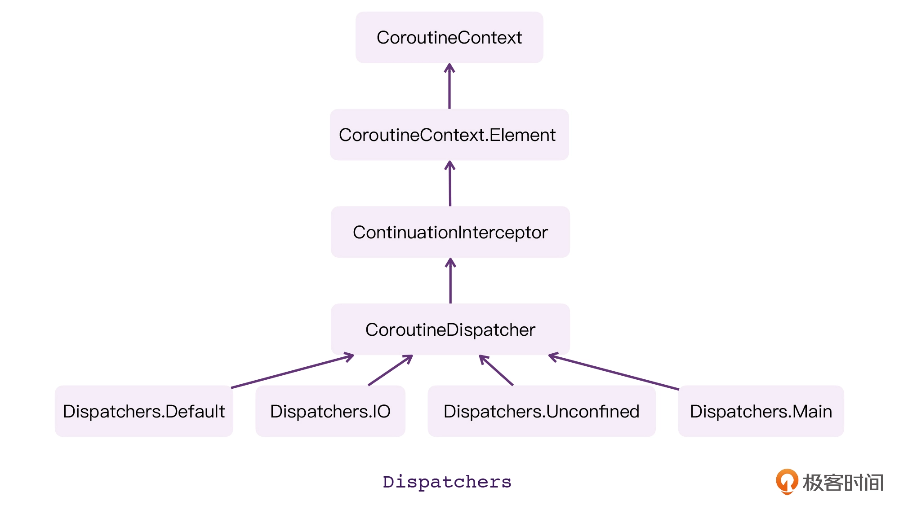
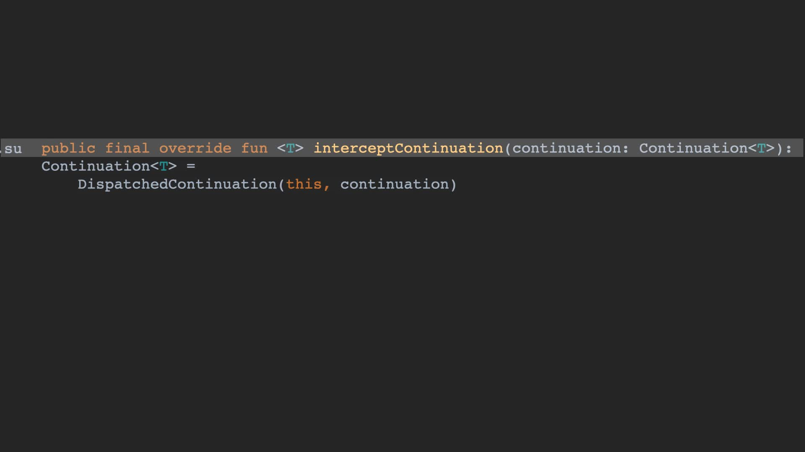

# 29-Dispatchers是如何工作的？

你好，我是朱涛。今天，我们来分析 Kotlin 协程当中的 Dispatchers。

上节课里，我们分析了 launch 的源代码，从中我们知道，Kotlin 的 launch 会调用startCoroutineCancellable()，接着又会调用 createCoroutineUnintercepted()，最终会调用编译器帮我们生成 SuspendLambda 实现类当中的 create() 方法。这样，协程就创建出来了。不过，协程是创建出来了，可它是如何运行的呢？

另外我们也都知道，协程无法脱离线程运行，Kotlin 当中所有的协程，最终都是运行在线程之上的。那么，协程创建出来以后，它又是如何跟线程产生关联的？这节课，我们将进一步分析launch 的启动流程，去发掘上节课我们忽略掉的代码分支。

我相信，经过这节课的学习，你会对协程与线程之间的关系有一个更加透彻的认识。

## Dispatchers

在上节课里我们学习过，launch{}本质上是调用了 startCoroutineCancellable() 当中的createCoroutineUnintercepted() 方法创建了协程。

```
// 代码段1
public fun <T> (suspend () -> T).startCoroutineCancellable(completion: Continuati
   //                                        注意这里
   //                                           ↓
   createCoroutineUnintercepted(completion).intercepted().resumeCancellableWith(
}
```

那么下面，我们就接着上节课的流程，继续分析 createCoroutineUnintercepted(completion)之后的 intercepted() 方法。

不过，在正式分析 intercepted() 之前，我们还需要弄清楚 Dispatchers、CoroutineDispatcher、ContinuationInterceptor、CoroutineContext 之间的关系。

```java
// 代码段2
public actual object Dispatchers {
   public actual val Default: CoroutineDispatcher = DefaultScheduler
   public actual val Main: MainCoroutineDispatcher get() = MainDispatcherLoader.
   public actual val Unconfined: CoroutineDispatcher = kotlinx.coroutines.Unconf
   public val IO: CoroutineDispatcher = DefaultIoScheduler
   public fun shutdown() {    }
}
public abstract class CoroutineDispatcher :
   AbstractCoroutineContextElement(ContinuationInterceptor), ContinuationInterce
public interface ContinuationInterceptor : CoroutineContext.Element {}
public interface Element : CoroutineContext {}
```

在第 17 讲当中，我们曾经分析过它们之间的继承关系。Dispatchers 是一个单例对象，它当中的 Default、Main、Unconfined、IO，类型都是 CoroutineDispatcher，而它本身就是CoroutineContext。所以，它们之间的关系就可以用下面这个图来描述。



让我们结合这张图，来看看下面这段代码：

```
// 代码段3
fun main() {
   testLaunch()
   Thread.sleep(2000L)
}
private fun testLaunch() {
   val scope = CoroutineScope(Job())
   scope.launch{
       logX("Hello!")
       delay(1000L)
       logX("World!")
   }
}
/**
* 控制台输出带协程信息的log
*/
fun logX(any: Any?) {
   println(
       """
================================
$any
Thread:${Thread.currentThread().name}
================================""".trimIndent()
   )
}
/*
```

- 输出结果

```
================================
Hello!
Thread:DefaultDispatcher-worker-1 @coroutine#1
================================
================================
World!
Thread:DefaultDispatcher-worker-1 @coroutine#1
================================
*/
```

在这段代码中，我们没有为 launch() 传入任何 CoroutineContext 参数，但通过执行结果，我们发现协程代码居然执行在 DefaultDispatcher，并没有运行在 main 线程之上。这是为什么呢？

我们可以回过头来分析下 launch 的源代码，去看看上节课中我们刻意忽略的地方。

```
// 代码段4
public fun CoroutineScope.launch(
   context: CoroutineContext = EmptyCoroutineContext,
   start: CoroutineStart = CoroutineStart.DEFAULT,
   block: suspend CoroutineScope.() -> Unit
): Job {
   // 1
   val newContext = newCoroutineContext(context)
   val coroutine = if (start.isLazy)
       LazyStandaloneCoroutine(newContext, block) else
       StandaloneCoroutine(newContext, active = true)
   coroutine.start(start, coroutine, block)
   return coroutine
}
```

首先，请留意 launch 的第一个参数，context，它的默认值是 EmptyCoroutineContext。在第17 讲里，我曾提到过，CoroutineContext 就相当于 Map，而 EmptyCoroutineContext 则相当于一个空的 Map。所以，我们可以认为，这里的 EmptyCoroutineContext 传了也相当于没有传，它的目的只是为了让 context 参数不为空而已。这其实也体现出了 Kotlin 的空安全思维，Kotlin 官方用 EmptyCoroutineContext 替代了 null。

接着，请留意上面代码的注释 1，这行代码会调用 newCoroutineContext(context)，将传入的context 参数重新包装一下，然后返回。让我们看看它具体的逻辑：

```
// 代码段5
public actual fun CoroutineScope.newCoroutineContext(context: CoroutineContext):
   // 1
   val combined = coroutineContext.foldCopiesForChildCoroutine() + context
   // 2
   val debug = if (DEBUG) combined + CoroutineId(COROUTINE_ID.incrementAndGet())
   // 3
   return if (combined !== Dispatchers.Default && combined[ContinuationIntercept
       debug + Dispatchers.Default else debug
}
```

这段代码一共有三个注释，我们来分析一下：

- 注释 1，由于 newCoroutineContext() 是 CoroutineScope 的扩展函数，因此，我们可以直接访问 CoroutineScope 的 coroutineContext 对象，它其实就是 CoroutineScope 对应的上下文。foldCopiesForChildCoroutine() 的作用，其实就是将 CoroutineScope 当中的所有上

- 下文元素都拷贝出来，然后跟传入的 context 参数进行合并。这行代码，可以让子协程继承父协程的上下文元素。

- 注释 2，它的作用是在调试模式下，为我们的协程对象增加唯一的 ID。我们在代码段 3 的输出结果中看到的“@coroutine#1”，其中的数字“1”就是在这个阶段生成的。

- 注释 3，如果合并过后的 combined 当中没有 CoroutineDispatcher，那么，就会默认使用Dispatchers.Default。

看到这里，你也许会有一个疑问，为什么协程默认的线程池是 Dispatchers.Default，而不是Main 呢？答案其实也很简单，因为 Kotlin 协程是支持多平台的，Main 线程只在 UI 编程平台才有可用。因此，当我们的协程没有指定 Dispatcher 的时候，就只能使用Dispatchers.Default 了。毕竟，协程是无法脱离线程执行的。

那么现在，代码段 3 当中的协程执行在 Dispatchers.Default 的原因也就找到了：由于我们定义的 scope 没有指定 Dispatcher，同时 launch 的参数也没有传入 Dispatcher，最终在newCoroutineContext() 的时候，会被默认指定为 Default 线程池。

好，有了前面的基础以后，接下来，我们就可以开始 intercepted() 的逻辑了。

## CoroutineDispatcher 拦截器

让我们回到课程开头提到过的 startCoroutineCancellable() 方法的源代码，其中的createCoroutineUnintercepted() 方法，我们在上节课已经分析过了，它的返回值类型就是Continuation。而 intercepted() 方法，其实就是 Continuation 的扩展函数。

```javascript
// 代码段6
public fun <T> (suspend () -> T).startCoroutineCancellable(completion: Continuati
   //                                        注意这里
   //                                           ↓
   createCoroutineUnintercepted(completion).intercepted().resumeCancellableWith(
}
public actual fun <T> Continuation<T>.intercepted(): Continuation<T> =
   (this as? ContinuationImpl)?.intercepted() ?: this
internal abstract class ContinuationImpl(
   completion: Continuation<Any?>?,
   private val _context: CoroutineContext?
) : BaseContinuationImpl(completion) {
   constructor(completion: Continuation<Any?>?) : this(completion, completion?.c
   @Transient
   private var intercepted: Continuation<Any?>? = null
   // 1
   public fun intercepted(): Continuation<Any?> =
       intercepted
           ?: (context[ContinuationInterceptor]?.interceptContinuation(this) ?:
               .also { intercepted = it }
}
```

从上面的代码中，我们可以看到，startCoroutineCancellable() 当中的 intercepted() 最终会调用 BaseContinuationImpl 的 intercepted() 方法。

这里，请你留意代码中我标记出的注释，intercepted() 方法首先会判断它的成员变量intercepted 是否为空，如果为空，就会调用 context[ContinuationInterceptor]，获取上下文当中的 Dispatcher 对象。以代码段 3 当中的逻辑为例，这时候的 Dispatcher 肯定是 Default 线程池。

然后，如果我们继续跟进 interceptContinuation(this) 方法的话，会发现程序最终会调用CoroutineDispatcher 的 interceptContinuation() 方法。

```java
// 代码段7
public abstract class CoroutineDispatcher :
   AbstractCoroutineContextElement(ContinuationInterceptor), ContinuationInterce
   // 1
   public final override fun <T> interceptContinuation(continuation: Continuatio
       DispatchedContinuation(this, continuation)
}
```

同样留意下这里的注释 1，interceptContinuation() 直接返回了一个 DispatchedContinuation对象，并且将 this、continuation 作为参数传了进去。这里的 this，其实就是Dispatchers.Default。

所以，如果我们把 startCoroutineCancellable() 改写一下，它实际上会变成下面这样：

```
// 代码段8
public fun <T> (suspend () -> T).startCoroutineCancellable(completion: Continuati
   createCoroutineUnintercepted(completion).intercepted().resumeCancellableWith(
}
// 等价
//  ↓
public fun <T> (suspend () -> T).startCoroutineCancellable(completion: Continuati
   // 1
   val continuation = createCoroutineUnintercepted(completion)
   // 2
   val dispatchedContinuation = continuation.intercepted()
   // 3
   dispatchedContinuation.resumeCancellableWith(Result.success(Unit))
}
```

在上面的代码中，注释 1，2 我们都已经分析完了，现在只剩下注释 3 了。这里的resumeCancellableWith()，其实就是真正将协程任务分发到线程上的逻辑。让我们继续跟进分析源代码：

```
// 代码段9
internal class DispatchedContinuation<in T>(
   @JvmField val dispatcher: CoroutineDispatcher,
   @JvmField val continuation: Continuation<T>
) : DispatchedTask<T>(MODE_UNINITIALIZED), CoroutineStackFrame, Continuation<T> b
   inline fun resumeCancellableWith(
       result: Result<T>,
       noinline onCancellation: ((cause: Throwable) -> Unit)?
   ) {
       // 省略，留到后面分析
   }
}
```

也就是，DispatchedContinuation 是实现了 Continuation 接口，同时，它使用了“类委托”的语法，将接口的具体实现委托给了它的成员属性 continuation。通过之前代码段 7 的分析，我们知道它的成员属性 dispatcher 对应的就是 Dispatcher.Default，而成员属性 continuation对应的则是 launch 当中传入的 SuspendLambda 实现类。

另外，DispatchedContinuation 还继承自 DispatchedTask，我们来看看 DispatchedTask 到底是什么。

```javascript
internal abstract class DispatchedTask<in T>(
   @JvmField public var resumeMode: Int
) : SchedulerTask() {
}
internal actual typealias SchedulerTask = Task
internal abstract class Task(
   @JvmField var submissionTime: Long,
   @JvmField var taskContext: TaskContext
) : Runnable {
   constructor() : this(0, NonBlockingContext)
   inline val mode: Int get() = taskContext.taskMode // TASK_XXX
}
```

可以看到，DispatchedContinuation 继承自 DispatchedTask，而它则是 SchedulerTask 的子类，SchedulerTask 是 Task 的类型别名，而 Task 实现了 Runnable 接口。因此，DispatchedContinuation 不仅是一个 Continuation，同时还是一个 Runnable。

那么，既然它是 Runnable，也就意味着它可以被分发到 Java 的线程当中去执行了。所以接下来，我们就来看看 resumeCancellableWith() 当中具体的逻辑：

```
// 代码段9
internal class DispatchedContinuation<in T>(
   @JvmField val dispatcher: CoroutineDispatcher,
   @JvmField val continuation: Continuation<T>
) : DispatchedTask<T>(MODE_UNINITIALIZED), CoroutineStackFrame, Continuation<T> b
   inline fun resumeCancellableWith(
       result: Result<T>,
       noinline onCancellation: ((cause: Throwable) -> Unit)?
   ) {
       val state = result.toState(onCancellation)
       // 1
       if (dispatcher.isDispatchNeeded(context)) {
           _state = state
           resumeMode = MODE_CANCELLABLE
           // 2
           dispatcher.dispatch(context, this)
       } else {
           // 3
           executeUnconfined(state, MODE_CANCELLABLE) {
               if (!resumeCancelled(state)) {
                   resumeUndispatchedWith(result)
               }
           }
       }
   }
}
public abstract class CoroutineDispatcher :
   AbstractCoroutineContextElement(ContinuationInterceptor), ContinuationInterce
   // 默认是true
   public open fun isDispatchNeeded(context: CoroutineContext): Boolean = true
   public abstract fun dispatch(context: CoroutineContext, block: Runnable)
}
internal object Unconfined : CoroutineDispatcher() {
   // 只有Unconfined会重写成false
   override fun isDispatchNeeded(context: CoroutineContext): Boolean = false
}
```

这段代码里也有三个注释，我们来分析一下：

- 注释 1，dispatcher.isDispatchNeeded()，通过查看 CoroutineDispatcher 的源代码，我们发现它的返回值始终都是 true。在它的子类当中，只有 Dispatchers.Unconfined 会将其重写成 false。这也就意味着，除了 Unconfined 以外，其他的 Dispatcher 都会返回 true。对于我们代码段 3 当中的代码而言，我们的 Dispatcher 是默认的 Default，所以，代码将会进入注释 2 对应的分支。

- 注释 2，dispatcher.dispatch(context, this)，这里其实就相当于将代码的执行流程分发到Default 线程池。dispatch() 的第二个参数要求是 Runnable，这里我们传入的是 this，这是因为 DispatchedContinuation 本身就间接实现了 Runnable 接口。

- 注释 3，executeUnconfined{}，它其实就对应着 Dispather 是 Unconfined 的情况，这时候，协程的执行不会被分发到别的线程，而是直接在当前线程执行。

接下来，让我们继续沿着注释 2 进行分析，这里的 dispatcher.dispatch() 其实就相当于调用了Dispatchers.Default.dispatch()。让我们看看它的逻辑：

```
public actual object Dispatchers {
   @JvmStatic
   public actual val Default: CoroutineDispatcher = DefaultScheduler
}
internal object DefaultScheduler : SchedulerCoroutineDispatcher(
   CORE_POOL_SIZE, MAX_POOL_SIZE,
   IDLE_WORKER_KEEP_ALIVE_NS, DEFAULT_SCHEDULER_NAME
) {}
```

那么，从上面的代码中，我们可以看到，Dispatchers.Default 本质上是一个单例对象DefaultScheduler，它是 SchedulerCoroutineDispatcher 的子类。

我们也来看看 SchedulerCoroutineDispatcher 的源代码：

```javascript
internal open class SchedulerCoroutineDispatcher(
   private val corePoolSize: Int = CORE_POOL_SIZE,
   private val maxPoolSize: Int = MAX_POOL_SIZE,
   private val idleWorkerKeepAliveNs: Long = IDLE_WORKER_KEEP_ALIVE_NS,
   private val schedulerName: String = "CoroutineScheduler",
) : ExecutorCoroutineDispatcher() {
   private var coroutineScheduler = createScheduler()
   override fun dispatch(context: CoroutineContext, block: Runnable): Unit = cor
}
```

根据以上代码，我们可以看到 Dispatchers.Default.dispatch() 最终会调用SchedulerCoroutineDispatcher 的 dispatch() 方法，而它实际上调用的是coroutineScheduler.dispatch()。

这里，我们同样再来看看 CoroutineScheduler 的源代码：

```
internal class CoroutineScheduler(
   @JvmField val corePoolSize: Int,
   @JvmField val maxPoolSize: Int,
   @JvmField val idleWorkerKeepAliveNs: Long = IDLE_WORKER_KEEP_ALIVE_NS,
   @JvmField val schedulerName: String = DEFAULT_SCHEDULER_NAME
) : Executor, Closeable {
   override fun execute(command: Runnable) = dispatch(command)
   fun dispatch(block: Runnable, taskContext: TaskContext = NonBlockingContext,
       trackTask()
       // 1
       val task = createTask(block, taskContext)
       // 2
       val currentWorker = currentWorker()
       // 3
       val notAdded = currentWorker.submitToLocalQueue(task, tailDispatch)
       if (notAdded != null) {
           if (!addToGlobalQueue(notAdded)) {
               throw RejectedExecutionException("$schedulerName was terminated")
           }
       }
       val skipUnpark = tailDispatch && currentWorker != null
       if (task.mode == TASK_NON_BLOCKING) {
           if (skipUnpark) return
           signalCpuWork()
       } else {
           signalBlockingWork(skipUnpark = skipUnpark)
       }
   }
   private fun currentWorker(): Worker? = (Thread.currentThread() as? Worker)?.t
   // 内部类 Worker
   internal inner class Worker private constructor() : Thread() {
   }
}
```

你发现了吗？CoroutineScheduler 其实是 Java 并发包下的 Executor 的子类，它的 execute()方法也被转发到了 dispatch()。

上面的代码里也有三个注释，我们分别来看看：

- 注释 1，将传入的 Runnable 类型的 block（也就是 DispatchedContinuation），包装成Task。

- 注释 2，currentWorker()，拿到当前执行的线程。这里的 Worker 其实是一个内部类，它本质上仍然是 Java 的 Thread。

- 注释 3，currentWorker.submitToLocalQueue()，将当前的 Task 添加到 Worker 线程的本地队列，等待执行。

那么接下来，我们就来分析下 Worker 是如何执行 Task 的。

```javascript
internal inner class Worker private constructor() : Thread() {
   override fun run() = runWorker()
   @JvmField
   var mayHaveLocalTasks = false
   private fun runWorker() {
       var rescanned = false
       while (!isTerminated && state != WorkerState.TERMINATED) {
           // 1
           val task = findTask(mayHaveLocalTasks)
           if (task != null) {
               rescanned = false
               minDelayUntilStealableTaskNs = 0L
               // 2
               executeTask(task)
               continue
           } else {
               mayHaveLocalTasks = false
           }
           if (minDelayUntilStealableTaskNs != 0L) {
               if (!rescanned) {
                   rescanned = true
               } else {
                   rescanned = false
                   tryReleaseCpu(WorkerState.PARKING)
                   interrupted()
                   LockSupport.parkNanos(minDelayUntilStealableTaskNs)
                   minDelayUntilStealableTaskNs = 0L
               }
               continue
           }
           tryPark()
       }
       tryReleaseCpu(WorkerState.TERMINATED)
   }
}
```

实际上，Worker 会重写 Thread 的 run() 方法，然后把执行流程交给 runWorker()，以上代码里有两个关键的地方，我也用注释标记了。

- 注释 1，在 while 循环当中，会一直尝试从 Worker 的本地队列取 Task 出来，如果存在需要执行的 Task，就会进入下一步。

- 注释 2，executeTask(task)，其实就是执行对应的 Task。

而接下来的逻辑，就是最关键的部分了：

```javascript
internal inner class Worker private constructor() : Thread() {
   private fun executeTask(task: Task) {
       val taskMode = task.mode
       idleReset(taskMode)
       beforeTask(taskMode)
       // 1
       runSafely(task)
       afterTask(taskMode)
   }
}
fun runSafely(task: Task) {
   try {
       // 2
       task.run()
   } catch (e: Throwable) {
       val thread = Thread.currentThread()
       thread.uncaughtExceptionHandler.uncaughtException(thread, e)
   } finally {
       unTrackTask()
   }
}
internal abstract class Task(
   @JvmField var submissionTime: Long,
   @JvmField var taskContext: TaskContext
) : Runnable {
   constructor() : this(0, NonBlockingContext)
   inline val mode: Int get() = taskContext.taskMode // TASK_XXX
}
```

在 Worker 的 executeTask() 方法当中，会调用 runSafely() 方法，而在这个方法当中，最终会调用 task.run()。前面我们就提到过 Task 本质上就是 Runnable，而 Runnable.run() 其实就代表了我们的协程任务真正执行了！

那么，task.run() 具体执行的代码是什么呢？其实它是执行的 DispatchedTask.run()。这里的DispatchedTask 实际上是 DispatchedContinuation 的父类。

```java
internal class DispatchedContinuation<in T>(
   @JvmField val dispatcher: CoroutineDispatcher,
   @JvmField val continuation: Continuation<T>
) : DispatchedTask<T>(MODE_UNINITIALIZED), CoroutineStackFrame, Continuation<T> b
   public final override fun run() {
       val taskContext = this.taskContext
       var fatalException: Throwable? = null
       try {
           val delegate = delegate as DispatchedContinuation<T>
           val continuation = delegate.continuation
           withContinuationContext(continuation, delegate.countOrElement) {
               val context = continuation.context
               val state = takeState()
               val exception = getExceptionalResult(state)
               val job = if (exception == null && resumeMode.isCancellableMode)
               if (job != null && !job.isActive) {
                   // 1
                   val cause = job.getCancellationException()
                   cancelCompletedResult(state, cause)
                   continuation.resumeWithStackTrace(cause)
               } else {
                   if (exception != null) {
                       // 2
                       continuation.resumeWithException(exception)
                   } else {
                       // 3
                       continuation.resume(getSuccessfulResult(state))
                   }
               }
           }
       } catch (e: Throwable) {
           fatalException = e
       } finally {
           val result = runCatching { taskContext.afterTask() }
           handleFatalException(fatalException, result.exceptionOrNull())
       }
   }
}
```

上面的代码有三个关键的注释，我们一起来分析：

- 注释 1，在协程代码执行之前，它首先会判断当前协程是否已经取消。如果已经取消的话，就会调用 continuation.resumeWithStackTrace(cause) 将具体的原因传出去。

- 注释 2，判断协程是否发生了异常，如果已经发生了异常，则需要调用continuation.resumeWithException(exception) 将异常传递出去。

- 注释 3，如果一切正常，则会调用 continuation.resume(getSuccessfulResult(state))，这时候，协程才会正式启动，并且执行 launch 当中传入的 Lambda 表达式。

最后，按照惯例，我还是制作了一个视频，来向你展示整个 Dispather 的代码执行流程。



## 小结

这节课，我们围绕着 launch，着重分析了它的 Dispatchers 执行流程。Dispatchers 是协程框架中与线程交互的关键，这里面主要涉及以下几个步骤：

- 第一步，createCoroutineUnintercepted(completion) 创建了协程的 Continuation 实例，紧接着就会调用它的 intercepted() 方法，将其封装成 DispatchedContinuation 对象。

- 第二步，DispatchedContinuation 会持有 CoroutineDispatcher、以及前面创建的Continuation 对象。课程中的 CoroutineDispatcher 实际上就是 Default 线程池。

- 第三步，执行 DispatchedContinuation 的 resumeCancellableWith() 方法，这时候，就会执行 dispatcher.dispatch()，这就会将协程的 Continuation 封装成 Task 添加到 Worker 的本地任务队列，等待执行。这里的 Worker 本质上就是 Java 的 Thread。在这一步，协程就已经完成了线程的切换。

- 第四步，Worker 的 run() 方法会调用 runWork()，它会从本地的任务队列当中取出 Task，并且调用 task.run()。而它实际上调用的是 DispatchedContinuation 的 run() 方法，在这里，会调用 continuation.resume()，它将执行原本 launch 当中生成的 SuspendLambda 子类。这时候，launch 协程体当中的代码，就在线程上执行了。

## 思考题

经过这节课的学习以后，请问你是否对协程的本质有了更深入的认识？请讲讲你的心得体会吧！
