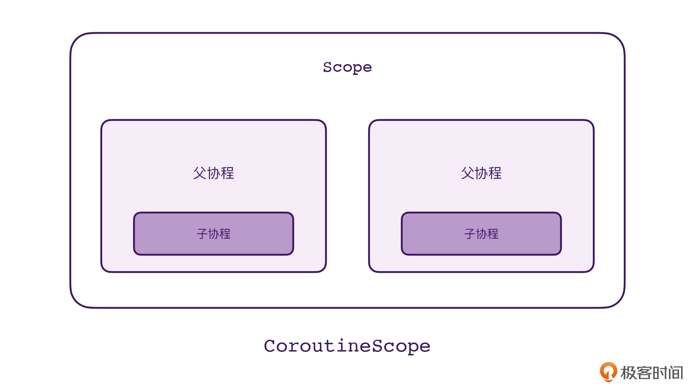
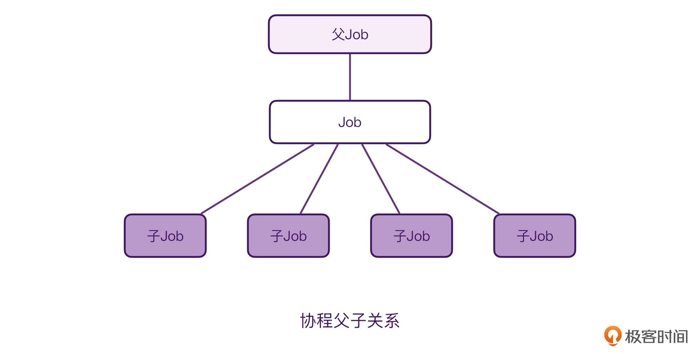
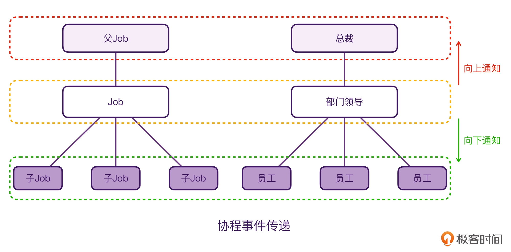
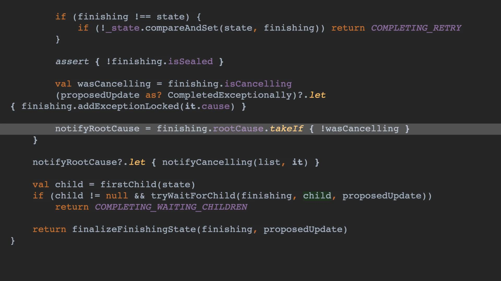
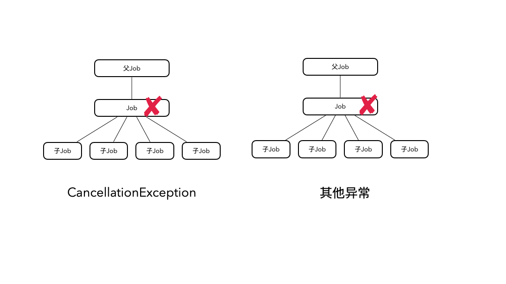

# 30-CoroutineScope是如何管理协程的？

你好，我是朱涛。

通过前面课程的学习，我们知道 CoroutineScope 是实现协程结构化并发的关键。使用CoroutineScope，我们可以批量管理同一个作用域下面所有的协程。那么，今天这节课，我们就来研究一下 CoroutineScope 是如何管理协程的。

## CoroutineScope VS 结构化并发

在前面的课程中，我们学习过 CoroutineScope 的用法。由于 launch、async 被定义成了CoroutineScope 的扩展函数，这就意味着：在调用 launch 之前，我们必须先获取CoroutineScope。

```
// 代码段1
public fun CoroutineScope.launch(
   context: CoroutineContext = EmptyCoroutineContext,
   start: CoroutineStart = CoroutineStart.DEFAULT,
   block: suspend CoroutineScope.() -> Unit
): Job {}
public fun <T> CoroutineScope.async(
   context: CoroutineContext = EmptyCoroutineContext,
   start: CoroutineStart = CoroutineStart.DEFAULT,
   block: suspend CoroutineScope.() -> T
): Deferred<T> {}
private fun testScope() {
   val scope = CoroutineScope(Job())
   scope.launch{
       // 省略
   }
}
```

不过，很多初学者可能不知道，协程早期的 API 并不是这么设计的，最初的 launch、async只是普通的顶层函数，我们不需要 scope 就可以直接创建协程，就像这样：

```
// 代码段2
private fun testScope() {
   // 早期协程API的写法
   launch{
       // 省略
   }
}
```

很明显，代码段 2 的写法要比代码段 1 的简单很多，那么 Kotlin 官方为什么要舍近求远，专门设计一个更加复杂的 API 呢？这一切，都是因为结构化并发。

让我们来看一段代码：

```
// 代码段3
private fun testScope() {
   val scope = CoroutineScope(Job())
   scope.launch{
       launch {
           delay(1000000L)
           logX("Inner")
       }
       logX("Hello!")
       delay(1000000L)
       logX("World!")  // 不会执行
   }
   scope.launch{
       launch {
           delay(1000000L)
           logX("Inner！！！")
       }
       logX("Hello！！!")
       delay(1000000L)
       logX("World1!！！")  // 不会执行
   }
   Thread.sleep(500L)
   scope.cancel()
}
```

上面这段代码很简单，我们使用 scope 创建了两个顶层的协程，接着，在协程的内部我们使用 launch 又创建了一个子协程。最后，我们在协程的外部等待了 500 毫秒，并且调用了scope.cancel()。这样一来，我们前面创建的 4 个协程就全部都取消了。



通过前面第 17 讲的学习，我们知道上面的代码其实可以用这样的关系图来表示。父协程是属于 Scope 的，子协程是属于父协程的，因此，只要调用了 scope.cancel()，这 4 个协程都会被取消。

想象一下，如果我们将上面的代码用协程最初的 API 改写的话，这一切就完全不一样了：

```
// 代码段4
// 使用协程最初的API，只是伪代码
private fun testScopeJob() {
   val job = Job()
   launch(job){
       launch {
           delay(1000000L)
           logX("Inner")
       }
       logX("Hello!")
       delay(1000000L)
       logX("World!")  // 不会执行
   }
   launch(job){
       launch {
           delay(1000000L)
           logX("Inner！！！")
       }
       logX("Hello！！!")
       delay(1000000L)
       logX("World1!！！")  // 不会执行
   }
   Thread.sleep(500L)
   job.cancel()
}
```

在上面的代码中，为了实现结构化并发，我们不得不创建一个 Job 对象，然后将其传入launch 当中作为参数。

你能感受到其中的差别吗？如果使用原始的协程 API，结构化并发是需要开发者自觉往 launch当中传 job 参数才能实现，它是可选的，开发者也可能疏忽大意，忘记传参数。而 launch 成为 CoroutineScope 的扩展函数以后，这一切就成为必须的了，我们开发者不可能忘记。

而且，通过对比代码段 3 和 4 以后，我们也可以发现：CoroutineScope 管理协程的能力，其实也是源自于 Job。

那么，CoroutineScope 与 Job 到底是如何实现结构化并发的呢？接下来，让我们从源码中寻找答案吧！

## 父子关系在哪里建立的？

在分析源码之前，我们先来写一个简单的 Demo。接下来，我们就以这个 Demo 为例，来研究一下 CoroutineScope 是如何通过 Job 来管理协程的。

```java
// 代码段5
private fun testScope() {
   // 1
   val scope = CoroutineScope(Job())
   scope.launch{
       launch {
           delay(1000000L)
           logX("Inner")  // 不会执行
       }
       logX("Hello!")
       delay(1000000L)
       logX("World!")  // 不会执行
   }
   Thread.sleep(500L)
   // 2
   scope.cancel()
}
public interface CoroutineScope {
   public val coroutineContext: CoroutineContext
}
public interface Job : CoroutineContext.Element {}
```

以上代码的逻辑很简单，我们先来看看注释 1 对应的地方。我们都知道，CoroutineScope 是一个接口，那么我们为什么可以调用它的构造函数，来创建 CoroutineScope 对象呢？不应该使用 object 关键字创建匿名内部类吗？

其实，代码段 5 当中调用 CoroutineScope() 并不是构造函数，而是一个顶层函数：

```
// 代码段6
// 顶层函数
public fun CoroutineScope(context: CoroutineContext): CoroutineScope =
   // 1
   ContextScope(if (context[Job] != null) context else context + Job())
// 顶层函数
public fun Job(parent: Job? = null): CompletableJob = JobImpl(parent)
```

在第 1 讲当中，我曾提到过，Kotlin 当中的函数名称，在大部分情况下都是遵循“驼峰命名法”的，而在一些特殊情况下则不遵循这种命名法。上面的顶层函数 CoroutineScope()，其实就属于特殊的情况，因为它虽然是一个普通的顶层函数，但它发挥的作用却是“构造函数”。类似的用法，还有 Job() 这个顶层函数。

因此，在 Kotlin 当中，当顶层函数作为构造函数使用的时候，它的首字母是要大写的。

让我们回到代码段 6，看看其中注释 1 的地方。这行代码的意思是，当我们创建CoroutineScope 的时候，如果传入的 Context 是包含 Job 的，那就直接用；如果是不包含Job 的，就会创建一个新的 Job。这就意味着，每一个 CoroutineScope 对象，它的 Context当中必定存在一个 Job 对象。而代码段 5 当中的 CoroutineScope(Job())，改成CoroutineScope() 也是完全没问题的。

接下来，我们再来看看 launch 的源代码：

```
// 代码段7
public fun CoroutineScope.launch(
   context: CoroutineContext = EmptyCoroutineContext,
   start: CoroutineStart = CoroutineStart.DEFAULT,
   block: suspend CoroutineScope.() -> Unit
): Job {
   // 1
   val newContext = newCoroutineContext(context)
   // 2
   val coroutine = if (start.isLazy)
       LazyStandaloneCoroutine(newContext, block) else
       StandaloneCoroutine(newContext, active = true)
   // 3
   coroutine.start(start, coroutine, block)
   return coroutine
}
```

在前面两节课里，我们已经分析过注释 1 和注释 3 当中的逻辑了，这节课呢，我们来分析注释 2 处的逻辑。

```java
// 代码段8
private open class StandaloneCoroutine(
   parentContext: CoroutineContext,
   active: Boolean
) : AbstractCoroutine<Unit>(parentContext, initParentJob = true, active = active)
   override fun handleJobException(exception: Throwable): Boolean {
       handleCoroutineException(context, exception)
       return true
   }
}
private class LazyStandaloneCoroutine(
   parentContext: CoroutineContext,
   block: suspend CoroutineScope.() -> Unit
) : StandaloneCoroutine(parentContext, active = false) {
   private val continuation = block.createCoroutineUnintercepted(this, this)
   override fun onStart() {
       continuation.startCoroutineCancellable(this)
   }
}
```

可以看到，StandaloneCoroutine 是 AbstractCoroutine 的子类，而在第 28 讲当中，我们就已经遇到过 AbstractCoroutine，它其实就是代表了协程的抽象类。另外这里有一个initParentJob 参数，它是 true，代表了协程创建了以后，需要初始化协程的父子关系。而LazyStandaloneCoroutine 则是 StandaloneCoroutine 的子类，它的 active 参数是 false，代表了以懒加载的方式创建协程。

接下来，我们就看看它们的父类 AbstractCoroutine：

```
// 代码段9
public abstract class AbstractCoroutine<in T>(
   parentContext: CoroutineContext,
   initParentJob: Boolean,
   active: Boolean
) : JobSupport(active), Job, Continuation<T>, CoroutineScope {
   init {
       if (initParentJob) initParentJob(parentContext[Job])
   }
}
```

可以看到，AbstractCoroutine 其实是 JobSupport 的子类，在它的 init{} 代码块当中，会根据 initParentJob 参数，判断是否需要初始化协程的父子关系。这个参数我们在代码段 8 当中已经分析过了，它一定是 true，所以这里的 initParentJob() 方法一定会执行，而它的参数parentContext[Job]取出来的 Job，其实就是我们在 Scope 当中的 Job。

另外，这里的 initParentJob() 方法，是它的父类 JobSupport 当中的方法，我们来看看：

```java
// 代码段10
public open class JobSupport constructor(active: Boolean) : Job, ChildJob, Parent
   final override val key: CoroutineContext.Key<*> get() = Job
   protected fun initParentJob(parent: Job?) {
       assert { parentHandle == null }
       // 1
       if (parent == null) {
           parentHandle = NonDisposableHandle
           return
       }
       // 2
       parent.start()
       @Suppress("DEPRECATION")
       // 3
       val handle = parent.attachChild(this)
       parentHandle = handle
       if (isCompleted) {
           handle.dispose()
           parentHandle = NonDisposableHandle
       }
   }
}
// Job源码
public interface Job : CoroutineContext.Element {
   public val children: Sequence<Job>
   public fun attachChild(child: ChildJob): ChildHandle
}
```

上面的代码一共有三个地方需要注意，我们来分析一下：

- 注释 1，判断传入的 parent 是否为空，如果 parent 为空，说明当前的协程不存在父 Job，这时候就谈不上创建协程父子关系了。不过，如果按照代码段 5 的逻辑来分析的话，此处的 parent 则是 scope 当中的 Job，因此，代码会继续执行到注释 2。

- 注释 2，这里是确保 parent 对应的 Job 启动了。

- 注释 3，parent.attachChild(this)，这个方法我们在第 16 讲当中提到过，它会将当前的Job，添加为 parent 的子 Job。这里其实就是建立协程父子关系的关键代码。

所以，我们可以将协程的结构当作一颗 N 叉树。每一个协程，都对应着一个 Job 的对象，而每一个 Job 可以有一个父 Job，也可以有多个子 Job。



这样，当我们知道协程的父子关系是如何建立的了以后，父协程如何取消子协程也就很容易理解了。

## 协程是如何“结构化取消”的？

其实，协程的结构化取消，本质上是事件的传递，它跟我们平时生活中的场景都是类似的：



就比如，当我们在学校、公司内部，有消息或任务需要传递的时候，总是遵循这样的规则：处理好分内的事情，剩下的部分交给上级和下级。协程的结构化取消，也是通过这样的事件消息模型来实现的。

甚至，如果让我们来实现协程 API 的话，都能想象到它的代码该怎么写：

```
// 代码段11
fun Job.cancelJob() {
   // 通知子Job
   children.forEach {
       cancelJob()
   }
   // 通知父Job
   notifyParentCancel()
}
```

当然，以上只是简化后的伪代码，真实的协程代码一定比这个复杂很多，但只要你能理解这一点，我们后面的分析就很简单了。让我们接着代码段 5 当中的注释 2，继续分析scope.cancel() 后续的流程。

```
// 代码段12
public fun CoroutineScope.cancel(cause: CancellationException? = null) {
   val job = coroutineContext[Job] ?: error("Scope cannot be cancelled because i
   job.cancel(cause)
}
```

可以看到，CoroutineScope 的 cancel() 方法，本质上是调用了它当中的 Job.cancel()。而这个方法的具体实现在 JobSupport 当中：

```javascript
// 代码段13
public override fun cancel(cause: CancellationException?) {
   cancelInternal(cause ?: defaultCancellationException())
}
public open fun cancelInternal(cause: Throwable) {
   cancelImpl(cause)
}
internal fun cancelImpl(cause: Any?): Boolean {
   var finalState: Any? = COMPLETING_ALREADY
   if (onCancelComplete) {
       // 1
       finalState = cancelMakeCompleting(cause)
       if (finalState === COMPLETING_WAITING_CHILDREN) return true
   }
   if (finalState === COMPLETING_ALREADY) {
       // 2
       finalState = makeCancelling(cause)
   }
   return when {
       finalState === COMPLETING_ALREADY -> true
       finalState === COMPLETING_WAITING_CHILDREN -> true
       finalState === TOO_LATE_TO_CANCEL -> false
       else -> {
           afterCompletion(finalState)
           true
       }
   }
}
```

可见，job.cancel() 最终会调用 JobSupport 的 cancelImpl() 方法。其中有两个注释，代表了两个分支，它的判断依据是 onCancelComplete 这个 Boolean 类型的成员属性。这个其实就代表了当前的 Job，是否有协程体需要执行。

另外，由于 CoroutineScope 当中的 Job 是我们手动创建的，并不需要执行任何协程代码，所以，它会是 true。也就是说，这里会执行注释 1 对应的代码。

让我们继续分析 cancelMakeCompleting() 方法：

```javascript
// 代码段14
private fun cancelMakeCompleting(cause: Any?): Any? {
   loopOnState { state ->
       // 省略部分
       val finalState = tryMakeCompleting(state, proposedUpdate)
       if (finalState !== COMPLETING_RETRY) return finalState
   }
}
private fun tryMakeCompleting(state: Any?, proposedUpdate: Any?): Any? {
   if (state !is Incomplete)
       return COMPLETING_ALREADY
       // 省略部分
       return COMPLETING_RETRY
   }
   return tryMakeCompletingSlowPath(state, proposedUpdate)
}
private fun tryMakeCompletingSlowPath(state: Incomplete, proposedUpdate: Any?): A
   // 省略部分
   notifyRootCause?.let { notifyCancelling(list, it) }
   return finalizeFinishingState(finishing, proposedUpdate)
}
```

从上面的代码中，我们可以看到 cancelMakeCompleting() 会调用 tryMakeCompleting() 方法，最终则会调用 tryMakeCompletingSlowPath() 当中的 notifyCancelling() 方法。所以，它才是最关键的代码。

```
// 代码段15
private fun notifyCancelling(list: NodeList, cause: Throwable) {
   onCancelling(cause)
   // 1，通知子Job
   notifyHandlers<JobCancellingNode>(list, cause)
   // 2，通知父Job
   cancelParent(cause)
}
```

可以看到，上面代码段 15 和我们前面写的代码段 11 当中的伪代码的逻辑是一致的。我们再分别来看看它们具体的逻辑：

```javascript
// 代码段16
private inline fun <reified T: JobNode> notifyHandlers(list: NodeList, cause: Thr
   var exception: Throwable? = null
   list.forEach<T> { node ->
       try {
           node.invoke(cause)
       } catch (ex: Throwable) {
           exception?.apply { addSuppressedThrowable(ex) } ?: run {
               exception =  CompletionHandlerException("Exception in completion
           }
       }
   }
   exception?.let { handleOnCompletionException(it) }
}
```

代码段 16 当中的逻辑，就是遍历当前 Job 的子 Job，并将取消的 cause 传递过去，这里的invoke() 最终会调用 ChildHandleNode 的 invoke() 方法：

```java
internal class ChildHandleNode(
   @JvmField val childJob: ChildJob
) : JobCancellingNode(), ChildHandle {
   override val parent: Job get() = job
   override fun invoke(cause: Throwable?) = childJob.parentCancelled(job)
   override fun childCancelled(cause: Throwable): Boolean = job.childCancelled(c
}
public final override fun parentCancelled(parentJob: ParentJob) {
   cancelImpl(parentJob)
}
```

然后，从以上代码中我们可以看到，ChildHandleNode 的 invoke() 方法会调用parentCancelled() 方法，而它最终会调用 cancelImpl() 方法。其实，这个就是代码段 13 当中的 cancelImpl() 方法，也就是 Job 取消的入口函数。这实际上就相当于在做递归调用。

接下来，我们看看代码段 15 当中的注释 2，通知父 Job 的流程：

```
private fun cancelParent(cause: Throwable): Boolean {
   if (isScopedCoroutine) return true
   val isCancellation = cause is CancellationException
   val parent = parentHandle
   if (parent === null || parent === NonDisposableHandle) {
       return isCancellation
   }
   // 1
   return parent.childCancelled(cause) || isCancellation
}
```

请留意上面代码段的注释 1，这个函数的返回值是有意义的，返回 true 代表父协程处理了异常，而返回 false，代表父协程没有处理异常。这种类似责任链的设计模式，在很多领域都有应用，比如 Android 的事件分发机制、OkHttp 的拦截器，等等。

```
public open fun childCancelled(cause: Throwable): Boolean {
   if (cause is CancellationException) return true
   return cancelImpl(cause) && handlesException
}
```

那么，当异常是 CancellationException 的时候，协程是会进行特殊处理的。一般来说，父协程会忽略子协程的取消异常，这一点我们在第 23 讲当中也提到过。而如果是其他的异常，那么父协程就会响应子协程的取消了。这个时候，我们的代码又会继续递归调用代码段 13 当中的 cancelImpl() 方法了。

至此，协程的“结构化取消”部分的逻辑，我们也分析完了。让我们通过视频来看看它们整体的执行流程。



## 小结

今天的内容到这里就结束了，我们来总结和回顾一下这节课里涉及到的知识点：

- 每次创建 CoroutineScope 的时候，它的内部会确保 CoroutineContext 当中一定存在 Job元素，而 CoroutineScope 就是通过这个 Job 对象来管理协程的。

- 在我们通过 launch、async 创建协程的时候，会同时创建 AbstractCoroutine 的子类，在它的 initParentJob() 方法当中，会建立协程的父子关系。每个协程都会对应一个 Job，而每个Job 都会有一个父 Job，多个子 Job。最终它们会形成一个 N 叉树的结构。

- 由于协程是一个 N 叉树的结构，因此协程的取消事件以及异常传播，也会按照这个结构进行传递。每个 Job 取消的时候，都会通知自己的子 Job 和父 Job，最终以递归的形式传递给每一个协程。另外，协程在向上取消父 Job 的时候，还利用了责任链模式，确保取消事

- 件可以一步步传播到最顶层的协程。这里还有一个细节就是，默认情况下，父协程都会忽略子协程的 CancellationException。

到这里，我们其实就可以进一步总结出协程的结构化取消的规律了。

对于 CancellationException 引起的取消，它只会向下传播，取消子协程；对于其他的异常引起的取消，它既向上传播，也向下传播，最终会导致所有协程都被取消。



## 思考题

在第 23 讲当中，我们学习过 SupervisorJob，它可以起到隔离异常传播的作用，下面是它的源代码，请问你能借助这节课学的知识点来分析下它的原理吗？

```java
public fun SupervisorJob(parent: Job? = null) : CompletableJob =
   SupervisorJobImpl(parent)
private class SupervisorJobImpl(parent: Job?) : JobImpl(parent) {
   override fun childCancelled(cause: Throwable): Boolean = false
}
```
