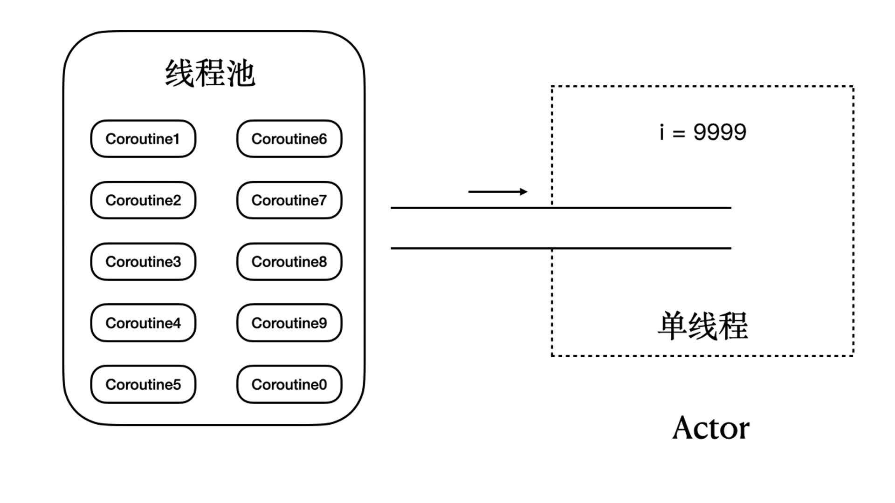
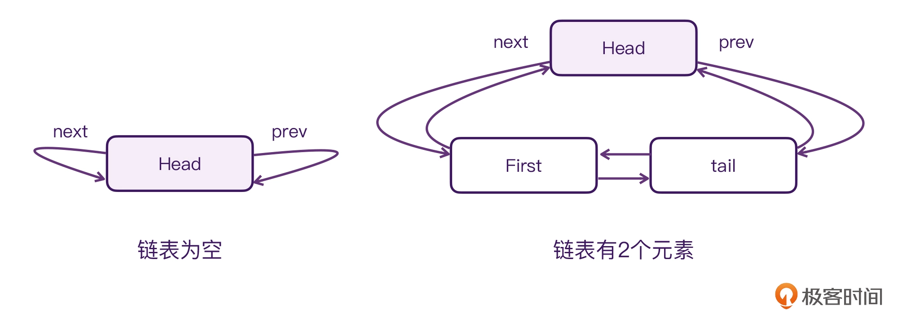
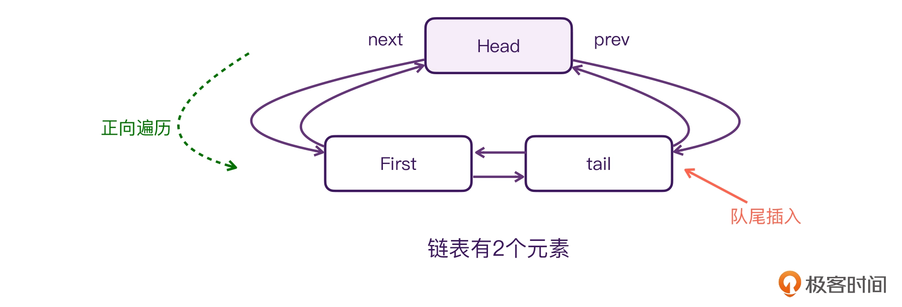
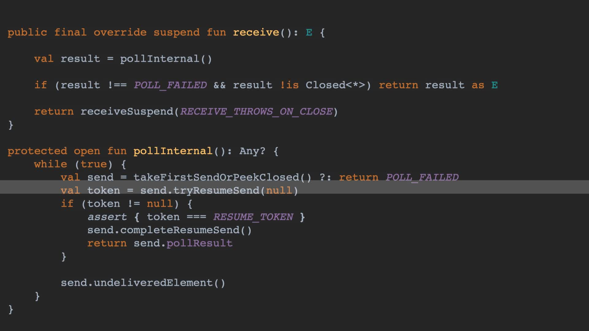

# 31-图解Channel：如何理解它的CSP通信模型？

你好，我是朱涛。今天我们来分析 Channel 的源码。

Kotlin 的 Channel 是一个非常重要的组件，在它出现之前，协程之间很难进行通信，有了它以后，协程之间的通信就轻而易举了。在第 22 讲当中，我们甚至还借助 Channel 实现的Actor 做到了并发安全。

那么总的来说，Channel 是热的，同时它还是一个线程安全的数据管道。而由于 Channel 具有线程安全的特性，因此，它最常见的用法，就是建立 CSP 通信模型（CommunicatingSequential Processes）。

不过你可能会觉得，CSP 太抽象了不好理解，但其实，这个通信模型我们在第 22 讲里就接触过了。当时我们虽然是通过 Actor 来实现的，但却是把它当作 CSP 在用，它们两者的差异其实很小。



关于CSP 的理论，它的精确定义其实比较复杂，不过它的核心理念用一句话就可以概括：不要共享内存来通信；而是要用通信来共享内存（Don’t communicate by sharing memory;share memory by communicating）。

可是，我们为什么可以通过 Channel 实现 CSP 通信模型呢？这背后的技术细节，则需要我们通过源码来发掘了。

## Channel 背后的数据结构

为了研究 Channel 的源代码，我们仍然是以一个简单的 Demo 为例，来跟踪它的代码执行流程。

```
// 代码段1
fun main()  {
   val scope = CoroutineScope(Job() + mySingleDispatcher)
   // 1，创建管道
   val channel = Channel<Int>()
   scope.launch {
       // 2，在一个单独的协程当中发送管道消息
       repeat(3)  {
           channel.send(it)
           println("Send: $it")
       }
       channel.close()
   }
   scope.launch {
       // 3，在一个单独的协程当中接收管道消息
       repeat(3) {
           val result = channel.receive()
           println("Receive ${result}")
       }
   }
   println("end")
   Thread.sleep(2000000L)
}
/*
```

- 输出结果：

```
end
Receive 0
Send: 0
Send: 1
Receive 1
Receive 2
Send: 2
*/
```

以上代码主要分为三个部分，分别是：Channel 创建、发送数据、接收数据。

我们先来分析注释 1 处的 Channel 创建逻辑。我们都知道 Channel 其实是一个接口，它是通过组合 SendChannel、ReceiveChannel 得来的。而注释 1 处调用的 Channel()，其实是一个普通的顶层函数，只是它发挥的作用是构造函数，因此它的首字母是大写的，这跟我们上节课分析的 CoroutineScope、Job 也是类似的。

```java
// 代码段2
public interface Channel<E> : SendChannel<E>, ReceiveChannel<E> {
public fun <E> Channel(
   capacity: Int = RENDEZVOUS,
   onBufferOverflow: BufferOverflow = BufferOverflow.SUSPEND,
   onUndeliveredElement: ((E) -> Unit)? = null
): Channel<E> =
   when (capacity) {
       RENDEZVOUS -> {
           if (onBufferOverflow == BufferOverflow.SUSPEND)
               RendezvousChannel(onUndeliveredElement)
           else
               ArrayChannel(1, onBufferOverflow, onUndeliveredElement)
       }
       CONFLATED -> {
           ConflatedChannel(onUndeliveredElement)
       }
       UNLIMITED -> LinkedListChannel(onUndeliveredElement)
       BUFFERED -> ArrayChannel(
           if (onBufferOverflow == BufferOverflow.SUSPEND) CHANNEL_DEFAULT_CAPAC
           onBufferOverflow, onUndeliveredElement
       )
       else -> {
           if (capacity == 1 && onBufferOverflow == BufferOverflow.DROP_OLDEST)
               ConflatedChannel(onUndeliveredElement)
           else
               ArrayChannel(capacity, onBufferOverflow, onUndeliveredElement)
       }
   }
```

然后，从上面的代码里，我们可以看到，Channel() 方法的核心逻辑就是一个 when 表达式，它根据传入的参数，会创建不同类型的 Channel 实例，包括了：RendezvousChannel、ArrayChannel、ConflatedChannel、LinkedListChannel。而这些实现类都有一个共同的父类：AbstractChannel。

```
// 代码段3
internal abstract class AbstractSendChannel<E>(
   @JvmField protected val onUndeliveredElement: OnUndeliveredElement<E>?
) : SendChannel<E> {
   protected val queue = LockFreeLinkedListHead()
   // 省略
   internal abstract class AbstractChannel<E>(
   onUndeliveredElement: OnUndeliveredElement<E>?
) : AbstractSendChannel<E>(onUndeliveredElement), Channel<E> {}
}
```

可以看到，AbstractChannel 其实是 AbstractSendChannel 的内部类，同时它也是AbstractSendChannel 的子类。而 Channel 当中的核心逻辑，都是依靠AbstractSendChannel 当中的 LockFreeLinkedListHead 实现的。我们接着来看下它的源代码：

```
// 代码段4
public actual open class LockFreeLinkedListHead : LockFreeLinkedListNode() {
   public actual val isEmpty: Boolean get() = next === this
}
public actual open class LockFreeLinkedListNode {
   // 1
   private val _next = atomic<Any>(this)
   private val _prev = atomic(this)
   private val _removedRef = atomic<Removed?>(null)
}
```

可见，LockFreeLinkedListHead 其实继承自 LockFreeLinkedListNode，而LockFreeLinkedListNode 则是实现 Channel 核心功能的关键数据结构。整个数据结构的核心思想，来自于 2004 年的一篇论文：《Lock-Free and Practical Doubly Linked List-BasedDeques Using Single-Word Compare-and-Swap》。如果你对其中的原理感兴趣，可以去看看这篇论文。这里，为了不偏离主题，我们只分析它的核心思想。

LockFreeLinkedListNode，我们可以将其区分开来看待，即 LockFree 和 LinkedList。

第一个部分：LockFree，它是通过CAS（Compare And Swap）的思想来实现的，比如JDK 提供的 java.util.concurrent.atomic。这一点，我们从上面注释 1 的 atomic 也可以看出来。

第二个部分：LinkedList，这说明 LockFreeLinkedList 本质上还是一个链表。简单来说，它其实是一个循环双向链表，而 LockFreeLinkedListHead 其实是一个哨兵节点，如果你熟悉链表这个数据结构，也可以将其看作是链表当中的虚拟头结点，这个节点本身不会用于存储任何数据，它的 next 指针会指向整个链表的头节点，而它的 prev 指针会指向整个链表的尾节点。

为了方便你理解，我画了一张图描述这个链表的结构：



请看图片左边的部分，当链表为空的时候，LockFreeLinkedListHead 的 next 指针和 prev 指针，都是指向自身的。这也就意味着，这个 Head 节点是不会存储数据，同时，也是不会被删除的。

然后再看图片右边的部分，当链表有 2 个元素的时候，这时 LockFreeLinkedListHead 节点的next 指针才是第一个节点，而 Head 的 prev 指针则是指向尾结点。

实际上，寻常的循环双向链表是可以在首尾添加元素的，同时也支持“正向遍历、逆向遍历”的。但 Channel 内部的这个数据结构只能在末尾添加，而它遍历的顺序则是从队首开始的。这样的设计，就让它的行为在变成了先进先出单向队列的同时，还实现了队尾添加操作，只需要 O(1) 的时间复杂度。



可以说，正是因为 LockFreeLinkedList 这个数据结构，我们才能使用 Channel 实现 CSP 通信模型。

好，在弄清楚 LockFreeLinkedList 这个数据结构以后，Channel 后续的源码分析就很简单了。让我们来分别分析一下 Channel 的 send()、receive() 的流程。

## 发送和接收的流程

我们回过头来看代码段 1 当中的逻辑，我们分别启动了两个协程，在这两个协程中，我们分别发送了三次数据，也接收了三次数据。程序首先会执行 send()，由于 Channel 在默认情况下容量是 0，所以，send() 首先会被挂起。让我们来看看这部分的逻辑：

```java
// 代码段5
public final override suspend fun send(element: E) {
   // 1
   if (offerInternal(element) === OFFER_SUCCESS) return
   // 2
   return sendSuspend(element)
}
protected open fun offerInternal(element: E): Any {
   while (true) {
       // 3
       val receive = takeFirstReceiveOrPeekClosed() ?: return OFFER_FAILE
       // 省略
   }
}
private suspend fun sendSuspend(element: E): Unit = suspendCancellableCoroutineRe
   loop@ while (true) {
       if (isFullImpl) {
           // 4
           val send = if (onUndeliveredElement == null)
               SendElement(element, cont) else
               SendElementWithUndeliveredHandler(element, cont, onUndeliveredEle
           val enqueueResult = enqueueSend(send)
           when {
               enqueueResult == null -> {
                   // 5
                   cont.removeOnCancellation(send)
                   return@sc
               }
               enqueueResult is Closed<*> -> {
               }
               enqueueResult === ENQUEUE_FAILED -> {}
               enqueueResult is Receive<*> -> {}
               else -> error("enqueueSend returned $enqueueResult")
           }
       }
       // 省略
   }
}
```

上面的挂起函数 send() 分为两个部分：

- 注释 1，尝试向 Channel 发送数据，如果这时候 Channel 已经有了消费者，那么 if 就会为true，send() 方法就会 return。不过，按照代码段 1 的逻辑，首次调用 send() 的时候，Channel 还不存在消费者，因此在注释 3 处，尝试从 LockFreeLinkedList 取出消费者是不可能的。所以，程序会继续执行注释 2 处的逻辑。

- 注释 2，会调用挂起函数 sendSuspend()，它是由高阶函数suspendCancellableCoroutineReusable{} 实现的。我们看它的名字就能知道，它跟suspendCancellableCoroutine{} 是类似的（如果你有些忘了，可以回过头去看看加餐五）。另外，请留意下这个方法的注释 4，它会将发送的元素封装成 SendElement 对象，然后调用 enqueueSend() 方法，将其添加到 LockFreeLinkedList 这个队列的末尾。如果enqueueSend() 执行成功了，就会执行注释 5，注册一个回调，用于将 SendElement 从队列中移除掉。

如果你足够细心的话，你会发现这整个流程并没有涉及到 resume 的调用，因此，这也意味着sendSuspend() 会一直被挂起，而这就意味着 send() 会一直被挂起！那么，问题来了，send() 会在什么时候被恢复？

答案当然是：receive() 被调用的时候！

```java
// 代码段6
public final override suspend fun receive(): E {
   // 1
   val result = pollInternal()
   @Suppress("UNCHECKED_CAST")
   if (result !== POLL_FAILED && result !is Closed<*>) return result as E
   // 2
   return receiveSuspend(RECEIVE_THROWS_ON_CLOSE)
}
protected open fun pollInternal(): Any? {
   while (true) {
       // 3
       val send = takeFirstSendOrPeekClosed() ?: return POLL_FAILED
       val token = send.tryResumeSend(null)
       if (token != null) {
           assert { token === RESUME_TOKEN }
           //4
           send.completeResumeSend()
           return send.pollResult
       }
       send.undeliveredElement()
   }
}
// CancellableContinuationImpl
private fun dispatchResume(mode: Int) {
   if (tryResume()) return
   // 5
   dispatch(mode)
}
internal fun <T> DispatchedTask<T>.dispatch(mode: Int) {
   // 省略
   if (!undispatched && delegate is DispatchedContinuation<*> && mode.isCancella
       val dispatcher = delegate.dispatcher
       val context = delegate.context
       if (dispatcher.isDispatchNeeded(context)) {
           // 6
           dispatcher.dispatch(context, this)
       } else {
           resumeUnconfined()
       }
   } else {
       // 省略
   }
}
```

可以看到，挂起函数 receive() 的逻辑，跟代码段 5 当中的 send() 是类似的。

- 注释 1，尝试从 LockFree 队列当中找出是否有正在被挂起的发送方。具体的逻辑在注释 3处，它会从队首开始遍历，寻找 Send 节点。

- 接着上面的代码段 1 的案例分析，此时我们一定是可以从队列中找到一个 Send 节点的，因此程序会继续执行注释 4 处的代码。

- 注释 4，completeResumeSend()，它最终会调用注释 5 处的 dispatch(mode)，而dispatch(mode) 其实就是 DispatchedTask 的 dispatch()，是不是觉得很熟悉？这个DispatchedTask 其实就是我们在第 29 讲当中分析过的 DispatchedTask，这里的dispatch() 就是协程体当中的代码在线程执行的时机。最终，它会执行在 Java 的 Executor之上。至此，我们之前被挂起的 send() 方法，其实就算是恢复了。

另外，你可以再留意上面的注释 2，当 LockFree 队列当中没有正在挂起的发送方时，它会执行 receiveSuspend()，而 receiveSuspend() 也同样会被挂起：

```
private suspend fun <R> receiveSuspend(receiveMode: Int): R = suspendCancellableC
   val receive = if (onUndeliveredElement == null)
       ReceiveElement(cont as CancellableContinuation<Any?>, receiveMode) else
       ReceiveElementWithUndeliveredHandler(cont as CancellableContinuation<Any?
   while (true) {
       if (enqueueReceive(receive)) {
           removeReceiveOnCancel(cont, receive)
           return@sc
       }
       val result = pollInternal()
       if (result is Closed<*>) {
           receive.resumeReceiveClosed(result)
           return@sc
       }
       if (result !== POLL_FAILED) {
           cont.resume(receive.resumeValue(result as E), receive.resumeOnCancell
           return@sc
       }
   }
}
```

所以，这里的逻辑其实跟之前的 sendSuspend() 是类似的。首先，它会封装一个ReceiveElement 对象，并且将其添加到 LockFree 队列的末尾，如果添加成功的话，这个receiveSuspend 就会继续挂起，这就意味着 receive() 也会被挂起。而 receive() 被恢复的时机，其实就对应了代码段 5 当中注释 1 的代码：offerInternal(element)。

至此，Channel 的发送和接收流程，我们就都已经分析完了。按照惯例，我们还是通过一个视频来回顾代码的整体执行流程：



## 小结

通过这节课，我们知道，Channel 其实是一个线程安全的管道。它最常见的用法，就是实现CSP 通信模型。它的核心理念是：不要共享内存来通信；而是要用通信来共享内存。而Channel 之所以可以用来实现 CSP 通信模型，主要还是因为它底层用到的数据结构：LockFreeLinkedList。

LockFreeLinkedList 虽然是一个循环双向链表，但在 Channel 的源码中，它会被当做先进先出的单向队列，它只在队列末尾插入节点，而遍历则只正向遍历。

还有 Channel 的 send()，它会分为两种情况，一种是当前的 LockFree 队列当中已经有被挂起的接收方，这时候，send() 会恢复 Receive 节点的执行，并且将数据发送给对方。第二种情况是：当前队列当中没有被挂起的接收方，这时候 send() 就会被挂起，而被发送的数据会被封装成 SendElement 对象插入到队列的末尾，等待被下次的 receive() 恢复执行。

而 Channel 的 receive()，也是分为两种情况，一种是当前的 LockFree 队列当中已经存在被挂起的发送方，这时候 receive() 会恢复 Send 节点的执行，并且取出 Send 节点当中带过来的数据。第二种情况是：当前队列没有被挂起的发送方，这时候 receive() 就会被挂起，同时它也会被封装成一个 ReceiveElement 对象插入到队列的末尾，等待被下次的 send() 恢复执行。

其实，Kotlin 推崇 CSP 模型进行并发的原因还有很多，比如门槛低、可读性高、扩展性好，还有一点是会被很多人提到的：不容易发生死锁。

不过，这里需要特别注意的是，CSP 场景下的并发模型，并非不可能发生死锁，在一些特殊场景下，它也是可能发生死锁的，比如：通信死锁（Communication Deadlock）。因此，CSP也并不是解决所有并发问题的万能解药，我们还是要具体问题具体分析。

## 思考题

在课程的开头，我们分析了 Channel 一共有四种实现方式：RendezvousChannel、ArrayChannel、ConflatedChannel、LinkedListChannel，请问你能结合今天学习的知识，分析 LinkedListChannel 的原理吗？

```java
internal open class LinkedListChannel<E>(onUndeliveredElement: OnUndeliveredEleme
   protected final override val isBufferAlwaysEmpty: Boolean get() = true
   protected final override val isBufferEmpty: Boolean get() = true
   protected final override val isBufferAlwaysFull: Boolean get() = false
   protected final override val isBufferFull: Boolean get() = false
   protected override fun offerInternal(element: E): Any {
       while (true) {
           val result = super.offerInternal(element)
           when {
               result === OFFER_SUCCESS -> return OFFER_SUCCESS
               result === OFFER_FAILED -> { // try to buffer
                   when (val sendResult = sendBuffered(element)) {
                       null -> return OFFER_SUCCESS
                       is Closed<*> -> return sendResult
                   }
                   // otherwise there was receiver in queue, retry super.offerIn
               }
               result is Closed<*> -> return result
               else -> error("Invalid offerInternal result $result")
           }
       }
   }
   protected override fun offerSelectInternal(element: E, select: SelectInstance
       while (true) {
           val result = if (hasReceiveOrClosed)
               super.offerSelectInternal(element, select) else
               (select.performAtomicTrySelect(describeSendBuffered(element)) ?:
           when {
               result === ALREADY_SELECTED -> return ALREADY_SELECTED
               result === OFFER_SUCCESS -> return OFFER_SUCCESS
               result === OFFER_FAILED -> {} // retry
               result === RETRY_ATOMIC -> {} // retry
               result is Closed<*> -> return result
               else -> error("Invalid result $result")
           }
       }
   }
}
```
