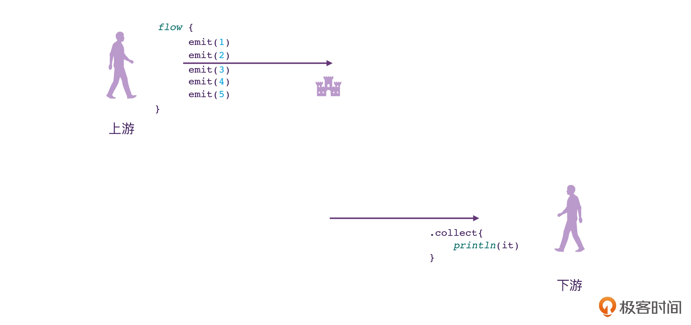
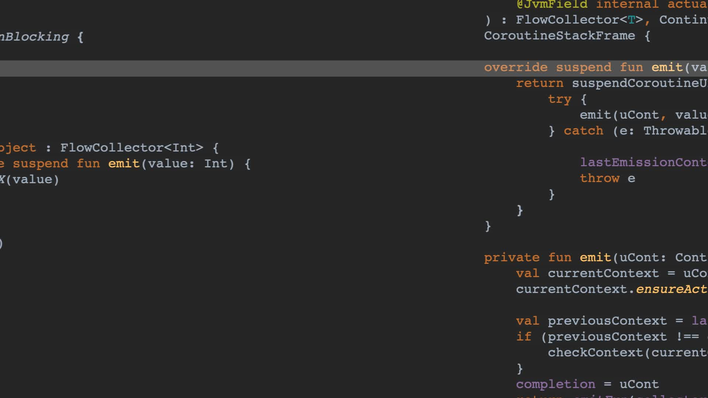
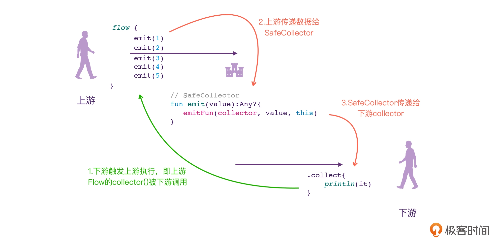
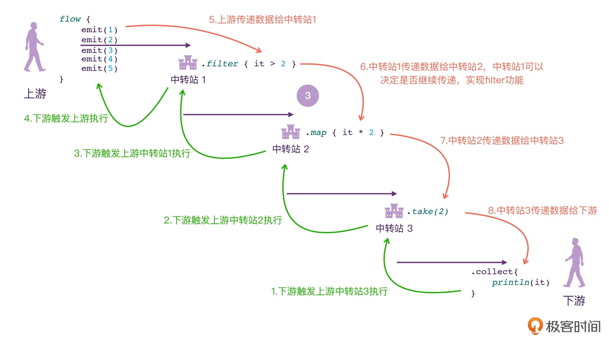
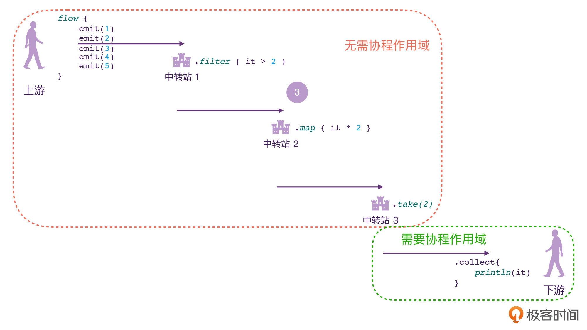

# 32-图解Flow：原来你是只纸老虎？

你好，我是朱涛。今天我们来研究 Flow 的源代码。

经过前面的学习，我们已经知道了，Channel 和 Flow 都是数据流，Channel 是“热”的，Flow则是“冷”的。这里的冷，代表着 Flow 不仅是“冷淡”的，而且还是“懒惰”的。

除了“冷”这个特性以外，Flow 从 API 的角度分类，主要分为：构造器、中间操作符、终止操作符。今天这节课，我们将会从这几个角度来分析 Flow 的源码，来看看它的这几类 API 是如何实现的。

经过这节课的学习，你会发现：虽然 Flow 的功能看起来非常高大上，然而它的原理却非常的简单，是一只名副其实的“纸老虎”。

## Flow 为什么是冷的？

在正式开始研究 Flow 源代码之前，我们首先需要确定研究的对象。这里，我写了一段 Demo代码，接下来我们就以这个 Demo 为例，来分析 Flow 的整个执行流程：

```
// 代码段1
fun main() {
   val scope = CoroutineScope(Job())
   scope.launch {
       testFlow()
   }
   Thread.sleep(1000L)
   logX("end")
}
private suspend fun testFlow() {
   // 1
   flow {
       emit(1)
       emit(2)
       emit(3)
       emit(4)
       emit(5)
   }.collect {      // 2
           logX(it)
       }
}
/**
* 控制台输出带协程信息的log
*/
fun logX(any: Any?) {
   println(
       """
================================
$any
Thread:${Thread.currentThread().name}
================================""".trimIndent()
   )
}
/*
```

- 输出结果

```
================================
1
Thread:DefaultDispatcher-worker-1
================================
================================
2
Thread:DefaultDispatcher-worker-1
================================
================================
3
Thread:DefaultDispatcher-worker-1
================================
================================
4
Thread:DefaultDispatcher-worker-1
================================
================================
5
Thread:DefaultDispatcher-worker-1
================================
================================
end
Thread:main
================================
*/
```

这段代码很简单，我们创建了一个 CoroutineScope，接着使用它创建了一个新的协程，在协程当中，我们使用 flow{} 这个高阶函数创建了 Flow 对象，接着使用了 collect{} 这个终止操作符。

我们利用第 20 讲当中学过的内容，很容易就能想象出类似这样的一个思维模型。



那么下面，我们就先来看看注释 1 处，分析一下 Flow 是怎么创建出来的。

```java
// 代码段2
public fun <T> flow(block: suspend FlowCollector<T>.() -> Unit): Flow<T> =
    SafeFlow(block)
public interface Flow<out T> {
   public suspend fun collect(collector: FlowCollector<T>)
}
可以看到，flow{} 是一个高阶函数，它接收的参数类型是函数类型FlowCollector<T>.()
-> Unit，这个类型代表了：它是 FlowCollector 的扩展或成员方法，没有参数，也没有返回
值。flow() 的返回值类型是Flow<T>，而它实际返回的类型是 SafeFlow，让我们来看看它的
```

源码定义。

```java
// 代码段3
private class SafeFlow<T>(private val block: suspend FlowCollector<T>.() -> Unit)
   // 1
   override suspend fun collectSafely(collector: FlowCollector<T>) {
       collector.block()
   }
}
public abstract class AbstractFlow<T> : Flow<T>, CancellableFlow<T> {
   // 省略
}
internal interface CancellableFlow<out T> : Flow<T>
```

从上面的代码我们可以看到，SafeFlow 其实是 AbstractFlow 的子类，而 AbstractFlow 则实现了 Flow 这个接口，所以 SafeFlow 算是间接实现了 Flow 接口。而 AbstractFlow 是协程当中所有 Flow 的抽象类，所以，它当中应该会有许多 Flow 通用的逻辑。

那么接下来，我们就来看看 AbstractFlow 当中的逻辑：

```java
// 代码段4
public abstract class AbstractFlow<T> : Flow<T>, CancellableFlow<T> {
   // 1
   public final override suspend fun collect(collector: FlowCollector<T>) {
       // 2
       val safeCollector = SafeCollector(collector, coroutineContext)
       try {
           // 3
           collectSafely(safeCollector)
       } finally {
           safeCollector.releaseIntercepted()
       }
   }
   public abstract suspend fun collectSafely(collector: FlowCollector<T>)
}
```

请留意上面代码的注释 1，看到这个挂起函数 collect()，你是不是觉得很熟悉呢？它其实就是终止操作符 collect 对应的调用处。这个 collect() 的逻辑其实也很简单，我都用注释标记出来了，我们来看看：

- 注释 2，collect() 的参数类型是 FlowCollector，这里只是将其重新封装了一遍，变成了SafeColletor 对象。从它的名称，我们也大概可以猜出来，它肯定是会对 collect 当中的逻辑做一些安全检查的，SafeCollector 的源码我们留到后面分析，我们接着看注释 3。

- 注释 3，collectSafely()，这里其实就是调用了它的抽象方法，而它的具体实现就在代码段 3里 SafeFlow 的 collectSafely() 方法，而它的逻辑也很简单，它直接调用了collector.block()，这其实就相当于触发了 flow{} 当中的 Lambda 逻辑。换句话说，collector.block() 就相当于调用了代码段 1 当中的 5 次 emit() 方法。

那么，代码分析到这里，我们其实就已经可以看出来 Flow 为什么是冷的了。我们都知道Channel 之所以是热的，是因为它不管有没有接收方，发送方都会工作。而 FLow 之所以是冷的，是因为 Flow 的构造器，真的就只会构造一个 SafeFlow 对象，完全不会触发执行它内部的 Lambda 表达式的逻辑，只有当 collect() 被调用之后，flow{} 当中的 Lambda 逻辑才会真正被触发执行。

好，现在我们已经知道 collect() 是如何触发 Flow 执行的了，接下来，我们来看看 Flow 是如何将上游的数据传递给下游的。

## FlowCollector：上游与下游之间的桥梁

经过之前的分析，我们知道 flow{} 这个高阶函数会创建一个 Flow 对象，它具体的类型是SafeFlow，它其实间接实现了 Flow 接口，因此我们可以直接调用 collect() 这个终止操作符，从而拿到 flow{} 的 Lambda 当中 emit（发射）出来的数据。

上面整个流程分析下来，给我们的感觉是这样的：下游的 collect() 会触发上游的 Lambda 执行，上游的 Lambda 当中的 emit() 会把数据传递给下游。

那么，Flow 到底是如何做到的呢？这其中的关键，还是 collect() 传入的参数类型：FlowCollector。

```java
// 代码段5
public fun interface FlowCollector<in T> {
   public suspend fun emit(value: T)
}
public interface Flow<out T> {
   public suspend fun collect(collector: FlowCollector<T>)
}
```

当我们在下游调用 collect{} 的时候，其实是在调用 Flow 接口的 collect 方法，而我们之所以可以写出花括号的形式，是因为 Lambda 简写，这一点我们在第 7 讲当中有提到过。那么，为了让它们的关系更加清晰地暴露出来，我们可以换一种写法，来实现代码段 1 当中的逻辑。

```
// 代码段6
private suspend fun testFlow() {
   flow {
       // 1
       emit(1)
       emit(2)
       emit(3)
       emit(4)
       emit(5)
   }
       // 变化在这里
       .collect(object : FlowCollector<Int>{
           // 2
           override suspend fun emit(value: Int) {
               logX(value)
           }
       })
}
```

这里代码段 6 和前面代码段 1 的逻辑其实是等价的，唯一的变化在于，这里我们使用了匿名内部类的方式，直接传入了 FlowCollector，在这个匿名内部类的 emit() 方法，其实就充当着Flow 的下游接收其中的数据流。

所以，要分析“上游与下游是如何连接的”这个问题，我们只需要看注释 2 处的 emit() 是如何被调用的即可。

那么，经过前面代码段 4 的分析，我们从它注释 2 处的代码就可以知道，collect() 方法传入的FlowCollector 参数，其实是被传入 SafeCollector 当中，被封装了起来。所以接下来，我们只要分析 SafeCollector 当中的逻辑就行。

```java
// 代码段7
internal actual class SafeCollector<T> actual constructor(
   // 1
   @JvmField internal actual val collector: FlowCollector<T>,
   @JvmField internal actual val collectContext: CoroutineContext
) : FlowCollector<T>, ContinuationImpl(NoOpContinuation, EmptyCoroutineContext),
   internal actual val collectContextSize = collectContext.fold(0) { count, _ ->
   private var lastEmissionContext: CoroutineContext? = null
   private var completion: Continuation<Unit>? = null
   // ContinuationImpl
   override val context: CoroutineContext
       get() = completion?.context ?: EmptyCoroutineContext
   // 2
   override suspend fun emit(value: T) {
       return suspendCoroutineUninterceptedOrReturn sc@{ uCont ->
           try {
               // 3
               emit(uCont, value)
           } catch (e: Throwable) {
               lastEmissionContext = DownstreamExceptionElement(e)
               throw e
           }
       }
   }
   private fun emit(uCont: Continuation<Unit>, value: T): Any? {
       val currentContext = uCont.context
       currentContext.ensureActive()
       // 4
       val previousContext = lastEmissionContext
       if (previousContext !== currentContext) {
           checkContext(currentContext, previousContext, value)
       }
       completion = uCont
       // 5
       return emitFun(collector as FlowCollector<Any?>, value, this as Continuat
   }
}
// 6
private val emitFun =
   FlowCollector<Any?>::emit as Function3<FlowCollector<Any?>, Any?, Continuatio
public interface Function3<in P1, in P2, in P3, out R> : Function<R> {
   public operator fun invoke(p1: P1, p2: P2, p3: P3): R
}
```

在这段 SafeCollector 的源码中，一共有 6 个地方需要我们注意，让我们来看看。

注释 1，collector，它是 SafeCollector 的参数，通过分析代码段 4 的注释 2 处，我们可以知道，它其实就对应着代码段 6 里，注释 1 处的匿名内部类 FlowCollector。之后我们需要特别留意这个 collector，看看它的 emit() 是在哪里被调用的，因为这就意味着代码段 6 当中的注释 2 被调用。我们可以将其看作下游的 emit()。

注释 2，emit()，通过之前代码段 4 的分析，我们知道，这个 emit() 方法，其实就是代码段 6里调用的 emit()。也就是说，Flow 上游发送的数据，最终会传递到这个 emit() 方法当中来。我们可以将其看作上游的 emit()。

注释 3，emit(uCont, value)，这里的 suspendCoroutineUninterceptedOrReturn 这个高阶函数，是把挂起函数的 Continuation 暴露了出来，并且将其作为参数传递给了另一个 emit() 方法。你需要注意的是，这行代码被 try-catch 包裹了，而且把其中的异常捕获以后，会被重新包装成 DownstreamExceptionElement，意思就是“下游的异常”，这从侧面也能说明，这个方法即将执行下游的代码。

这里还有一个细节就是，DownstreamExceptionElement 会被存储在 lastEmissionContext 当中，它的作用是：在下游发送异常以后，可以让上游感知到。

注释 4，这里会对当前的协程上下文与之前的协程上下文做对比检查，如果它们两者不一致，就会在 checkContext() 当中做进一步的判断和提示。我们第 20 讲思考题的答案就藏在这里，为了不偏离主线，这个部分的逻辑我们暂时先放着，等我们分析完 Flow 的整体流程以后再来看。

```
注释 5，emitFun(collector as FlowCollector<Any?>, value, this as
Continuation<Unit>)，这里其实就是在调用下游的 emit()，也就是代码段 6 当中的注释
```

2 对应的 emit() 方法。那么，这里的 emitFun() 是什么呢？我们可以在注释 6 处找到它的定

```
义：FlowCollector<Any?>::emit，这是函数引用的语法，代表了它就是 FlowCollector
的 emit() 方法，它的类型是Function3<FlowCollector<Any?>, Any?,
Continuation<Unit>, Any?>。
```

乍一看，你也许会觉得这个类型有点难以理解，其实，这个知识点我们在第 8 讲当中就已经

```
介绍过，我们平时写的函数类型() -> Unit其实就对应了 Function0，也就是：没有参数的
```

函数类型。所以，这里的 Function3 其实就代表了三个参数的函数类型。因此，注释 5 处，其实就代表了下游的 emit() 方法被调用了，对应的 value 也是这时候传进去的。

至此，上游传递数据给下游的整个流程，我们也分析完毕了，FlowCollector 其实就相当于上游与下游之间的桥梁，它起到了连接上游、下游的作用。

回过头去看前面分析过的代码，你会发现，Flow 的核心原理其实只牵涉到那么几十行代码，而它的核心接口也只有 Flow、FlowCollector 而已。为了方便你理解，这里我做了一个视频，描述 Flow 的整体调用流程。



所以，对比挂起函数的原理，不得不说，Flow 真的只是一只看起来吓人的“纸老虎”。

## 思考与推演

接下来，我们基于前面的结论来进行一些思考，来尝试推演和理解一下 Flow 的其他功能细节，比如：中间操作符的原理、不允许使用 withContext{} 的原因。

### 推演：中间操作符

请你想象一个问题：在已知 Flow 上游、下游传递数据的原理以后，如果让你来设计 Flow 的中间操作符，你会怎么设计？

要回答这个问题，其实我们只需要回想一下 Flow 的思维模型，让我们来更新一下代码段 1 对应的思维模型，将 Flow 的源码执行流程也融入进去：



flow{} 这个高阶函数，代表了上游，它会创建一个 Flow 对象，提供给下游调用 Flow 的 collect方法。在前面的代码段 2 当中，我们曾经分析过，flow{} 实际上返回的是 SafeFlow 对象，在这个 SafeFlow 当中，会有一个 SafeCollector 对象。而整个 Flow 的调用过程，其实就是三个步骤：

- 第一步，上游的 flow{} 创建 SafeFlow 的对象，下游调用 Flow 的 collect() 方法，触发flow{} 的 Lambda 对应的代码执行，也就是其中 emit() 被执行。

- 第二步，上游调用的 emit()，其实就是 SafeCollector 的 emit()，这时候，就相当于上游将数据传递给 SafeCollector。

- 第三步，SafeCollector 调用 emitFun()，这里的 emitFun() 其实就对应了下游的 emit() 方法（如果你忘了，可以回过头看看代码段 6 的注释 2）。

通过以上分析，我们能发现，Flow 的源码执行流程，也非常符合我们之前构想出来的思维模型。那么，对于它的中间操作符，我们是不是只需要加一个“中转站”就可以了呢？答案是肯定的。

如果让你来设计 Flow 的中间操作符，我相信你大概率会设计出类似下面这样的结构：



可以看到，当 Flow 当中出现中间操作符的时候，上游和下游之间就会多出一个个的中转站。对于每一个“中转站”来说，它都会有上游和下游，它都会被下游触发执行，它也会触发自己的上游；同时，它会接收来自上游的数据，也会传递给自己的下游。

那么，接下来，让我们来分析一下 Flow 中间操作符的源代码，看看 Kotlin 官方的设计是否符合我们的猜想：

```
// 代码段8
// 1
inline fun <T> Flow<T>.filter(
   crossinline predicate: suspend (T) -> Boolean
): Flow<T> = transform { value ->
   // 8
   if (predicate(value)) return@transform emit(value)
}
// 2
internal inline fun <T, R> Flow<T>.unsafeTransform(
   crossinline transform: suspend FlowCollector<R>.(value: T) -> Unit
): Flow<R> = unsafeFlow {
   // 6
   collect { value ->
       // 7
       return@collect transform(value)
   }
}
// 3
internal inline fun <T> unsafeFlow(
   crossinline block: suspend FlowCollector<T>.() -> Unit
): Flow<T> {
   // 4
   return object : Flow<T> {
       // 5
       override suspend fun collect(collector: FlowCollector<T>) {
           collector.block()
       }
   }
}
```

上面的代码看起来有点复杂，让我们来一步步来分析：

- 注释 1、2、3，请留意这几个方法的签名，它们的返回值类型都是 Flow，这意味着，Flow.filter{} 的返回值类型仍然是 Flow。我们站在整体的角度来分析的话，会发现：这只是一个 Flow 被封装的过程。我们都知道，flow{} 创建的是 SafeFlow 对象，当我们接着调用filter{} 之后，根据注释 4 处的逻辑，我们发现它会变成一个普通的 Flow 匿名内部类对象。

```
注释 5，对于flow{}.filter{}.collect{}这样的代码，最终的 collect{} 调用的代
```

- 码，其实就是注释 5 对应的 collect() 方法。我们看看它的方法体 collector.block()，这其实就代表了注释 6、7 会执行。

- 注释 6，collect{}，这里是在调用上游 Flow 的 collect{}，触发上游的 Lambda 执行了，也就

```
是flow{}.filter{}.collect{}里的 flow{} 当中的 Lambda，然后注释 7 就会被执
```

- 行。

- 注释 7，transform(value)，在前面代码段 7 的分析中，我们知道，这里 transform(value)当中的 value，其实就是上游传递下来的数据，让我们来看看 transform{} 当中具体的逻辑，也就是注释 8。

```
注释 8，if (predicate(value))，这其实就是我们 filter 的条件，只有符合这个条件的
```

- 情况下，我们才会继续向下游传递数据，而传递的方式，就是调用 emit()，这里的 emit() 其

- 实就代表了下游会接收到数据了。

可见，filter{} 的核心思想，完全符合我们前面思维模型推演的结果。接下来，我们来看看map{}、onEach{} 之类的源码：

```
// 代码段9
public inline fun <T, R> Flow<T>.map(crossinline transform: suspend (value: T) ->
   return@transform emit(transform(value))
}
public fun <T> Flow<T>.onEach(action: suspend (T) -> Unit): Flow<T> = transform {
   action(value)
   return@transform emit(value)
}
```

当我们理解了 filter 以后，你会发现，map、和 onEach 之类的操作符就变得很简单了。前者就是在调用下游 emit() 的时候做了一次数据转换，而后者则是在每次向下游传递数据的时候，同时调用一下传入的 Lambda 表达式 action()。

### 思考：上下文保护

在第 20 讲当中，我留过一个思考题：

- 课程里我曾提到过，Flow 当中直接使用 withContext{} 是很容易出现问题的，下面代码是其中的一种。请问你能解释其中的缘由吗？Kotlin 官方为什么要这么设计？

```
// 代码段10
fun main() = runBlocking {
   flow {
       withContext(Dispatchers.IO) {
           emit(1)
       }
   }.map { it * 2 }
       .collect()
}
/*
```

- 输出结果：

```
Exception in thread "main" java.lang.IllegalStateException: Flow invariant is vio
       Flow was collected in [BlockingCoroutine{Active}@6e58a46, BlockingEventLo
       but emission happened in [DispatchedCoroutine{Active}@500da3c0, Dispatche
       Please refer to 'flow' documentation or use 'flowOn' instead
*/
```

其实，课程进行到这里，我们就已经可以很简单地回答这个问题了。

在第 24 讲当中，我们曾经给 Flow 的三种 API 进行过分类：Flow 构建器、Flow 中间操作符，它们两个是不需要协程作用域的，只有 Flow 终止操作符需要协程作用域。



通过前面 Flow 的源码分析流程，我们其实就会发现，在默认情况下，Flow 下游的“协程上下文”最终会成为上游的执行环境，也会变成中间操作符的执行环境。也正是这个原因，才让Flow 可以天然支持协程的“结构化并发”的特性，比如说结构化取消。

```
// 代码段11
private fun testFlow2() {
   val scope = CoroutineScope(Job())
   scope.launch {
       flow {
           logX("上游")
           repeat(100) {
               emit(it)
           }
       }.filter {
           logX("中间")
           it > 2
       }
           .map { it * 2 }
           .onCompletion {
               logX(it)
           }
           .collect {
               logX(it)
               delay(1000L)
           }
   }
   Thread.sleep(2000L)
   scope.cancel()
   logX("结束")
}
/*
```

- 输出结果：

```
================================
```

- 上游

```
Thread:DefaultDispatcher-worker-1
================================
================================
```

- 中间

```
Thread:DefaultDispatcher-worker-1
================================
================================
```

- 中间

```
Thread:DefaultDispatcher-worker-1
================================
================================
```

- 中间

```
Thread:DefaultDispatcher-worker-1
================================
================================
```

- 中间

```
Thread:DefaultDispatcher-worker-1
================================
================================
6
Thread:DefaultDispatcher-worker-1
================================
================================
```

- 中间

```
Thread:DefaultDispatcher-worker-1
================================
================================
8
Thread:DefaultDispatcher-worker-1
================================
================================
```

- 结束

```
Thread:main
================================
================================
kotlinx.coroutines.JobCancellationException: Job was cancelled; job=JobImpl{Cance
Thread:DefaultDispatcher-worker-1
================================
*/
```

从上面的执行结果可以看到，虽然我们的上游要尝试 emit()100 个数据，但是由于外部的scope 在 2000 毫秒后会取消，所以整个 Flow 都会响应取消。

那么反之，如果 Kotlin 官方允许开发者在 flow{} 当中，调用 withContext{} 改变协程上下文的话，Flow 上游与下游的协程上下文就会不一致，它们整体的结构也会被破坏，从而导致“结构化并发”的特性也被破坏。

Flow 源码中对于上下文的检测，我们称之为上下文保护（Context Preservation），它对应的检测时机在代码段 7 的注释 4 处，具体的逻辑如下：

```
// 代码段12
private fun emit(uCont: Continuation<Unit>, value: T): Any? {
   // 省略
   // This check is triggered once per flow on happy path.
   val previousContext = lastEmissionContext
   if (previousContext !== currentContext) {
       checkContext(currentContext, previousContext, value)
   }
}
private fun checkContext(
   currentContext: CoroutineContext,
   previousContext: CoroutineContext?,
   value: T
) {
   if (previousContext is DownstreamExceptionElement) {
       exceptionTransparencyViolated(previousContext, value)
   }
   checkContext(currentContext)
   lastEmissionContext = currentContext
}
internal fun SafeCollector<*>.checkContext(currentContext: CoroutineContext) {
   val result = currentContext.fold(0) fold@{ count, element ->
       val key = element.key
       val collectElement = collectContext[key]
       if (key !== Job) {
           return@fold if (element !== collectElement) Int.MIN_VALUE
           else count + 1
       }
       val collectJob = collectElement as Job?
       val emissionParentJob = (element as Job).transitiveCoroutineParent(collec
       if (emissionParentJob !== collectJob) {
           error(
               "Flow invariant is violated:\n" +
                       "\t\tEmission from another coroutine is detected.\n" +
                       "\t\tChild of $emissionParentJob, expected child of $coll
                       "\t\tFlowCollector is not thread-safe and concurrent emis
                       "\t\tTo mitigate this restriction please use 'channelFlow
           )
       }
       if (collectJob == null) count else count + 1
   }
   // 判断上游、下游的Context
   if (result != collectContextSize) {
       error(
           "Flow invariant is violated:\n" +
                   "\t\tFlow was collected in $collectContext,\n" +
                   "\t\tbut emission happened in $currentContext.\n" +
                   "\t\tPlease refer to 'flow' documentation or use 'flowOn' ins
       )
   }
}
```

所以，总的来说，Flow 不允许直接使用 withContext{} 的原因，是为了“结构化并发”，它并不是不允许切换线程，而是不允许随意破坏协程的上下文。Kotlin 提供的操作符 flowOn{}，官方已经帮我们处理好了上下文的问题，所以我们可以放心地切线程。

## 小结

这节课，我们是通过分析 Flow 的源码，理解了它的几类 API 是如何实现的。我们知道，Flow是冷数据流，可以分为上游 Flow 构造器、中间操作符、下游 FlowCollector。那么可以说，理解了 Flow、FlowCollector 这两个接口，其实就理解了 Flow 的原理。

上游 Flow 构造器，它实际返回的对象是 SafeFlow，在 SafeFlow 当中有一个 SafeCollector，它会接收上游的数据，并且将数据传递给下游的 FlowCollector。

下游 FlowCollector，在下游调用 collect() 的时候，实际上是调用的 Flow 的 collect() 方法，这就会触发上游的 Lambda 被执行。在 collect() 调用的时候，它会创建一个 FlowCollector 的匿名内部类对象，专门用于接收来自上游的数据。

中间操作符，它在整个 Flow 的调用流程当中，既会充当上游，也会充当下游。它会被下游触发执行，它也会触发自己的上游；同时，它会接收来自上游的数据，也会传递给自己的下游。

上下文保护，由于 Flow 的上游与中间操作符并不需要协程作用域，因此，它们都是共用的Flow 下游的协程上下文。也正是因为 Flow 的这种设计，让 Flow 天然支持结构化并发。为此，Kotlin 官方也限制了我们开发者不能随意在上游与中转站阶段，改变 Flow 的上下文。

其实，课程进行到这里，你会发现，Flow 的原理之所以看起来很简单，完全是因为它站在了“挂起函数”“高阶函数”这两个巨人的肩膀上！如果没有它们作为基础，Flow 的 API 设计一定会更加复杂。

## 思考题

前面我提到过，“理解了 Flow、FlowCollector 这两个接口，就理解了 Flow 的原理。”那么，你能概括出 Flow、FlowCollector 这两个抽象的接口之间的内在联系吗？

```java
public interface Flow<out T> {
   public suspend fun collect(collector: FlowCollector<T>)
}
public fun interface FlowCollector<in T> {
   public suspend fun emit(value: T)
}
```
