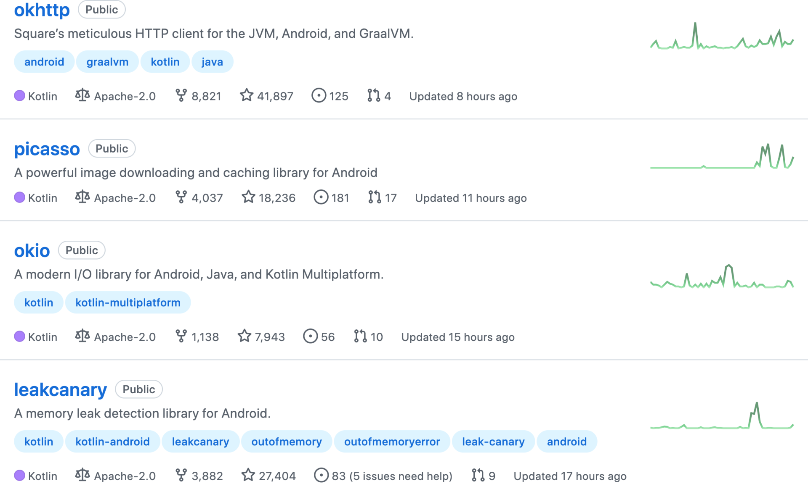
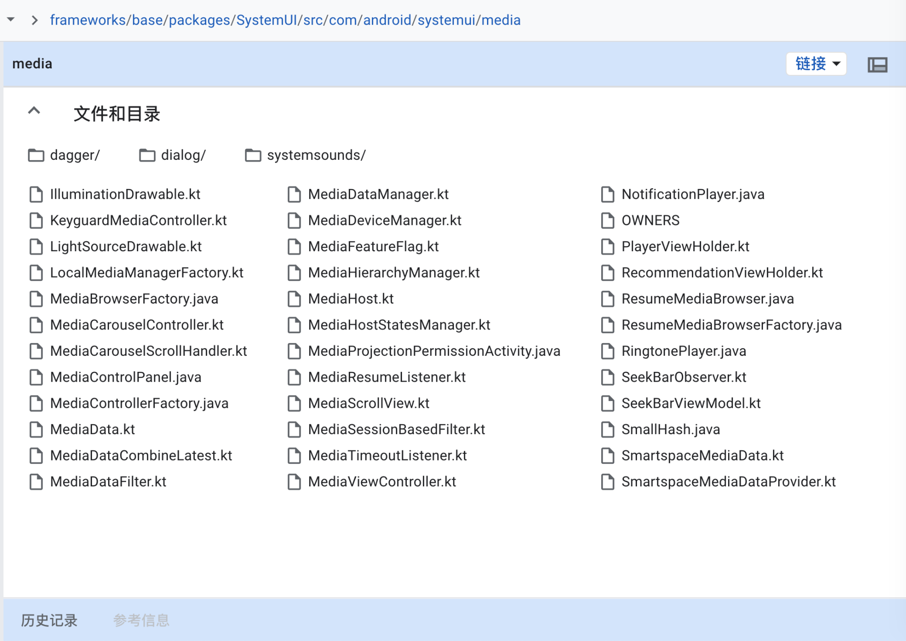
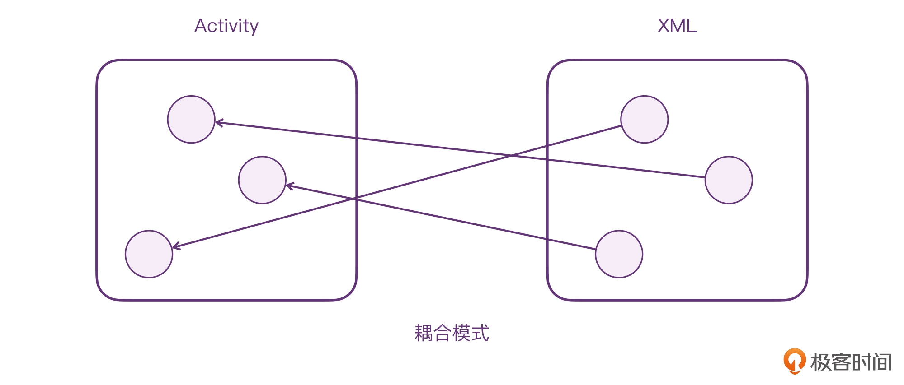
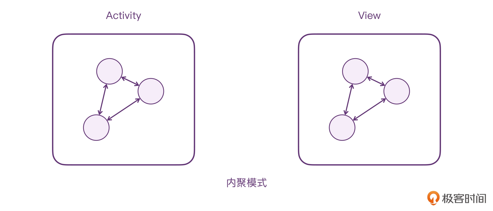

# 33-JavaAndroid开发者还会有未来吗？

你好，我是朱涛。在过去的几十讲里，我们把 Kotlin 的基础语法和核心难点协程，都全面学习了一遍，从原理到实战，从协程的核心挂起函数、launch 等，到探究它们的源码定义，可以说我们已经基本掌握了 Kotlin 的核心知识点与特性，你也应该可以在工作中使用 Kotlin 来解决实际问题了。如果你发现自己对这些知识的掌握还有不少漏洞，也别着急，可以再回头复习一下相应部分的内容，或者在留言区提问，我会给你解答。

那么，从这节课起，我会带你来看看 Kotlin 在实践场景中，应用得最普遍、最广泛的领域，Android。我们一起来学习下如何结合所学的 Kotlin 知识，来高效开发 Android 应用。

今天这节课，我们先来聊聊 Kotlin 和 Android 的关系，让你对 Android 的现状与未来的发展方向有一个清晰的认识。

虽然 Kotlin 是面向多个平台的（如 JVM、Native、JS 等），不过我们在讨论 Kotlin 的同时，难免也会讨论下 Android。甚至，很多开发者都是因为 Android 才开始接触 Kotlin 的。

说起 Kotlin 与 Android，就不得不提它俩对应的公司 JetBrains 和 Google。早在 2013 年之前，这两家公司就有过合作。最开始的时候，Android 开发者的开发工具还是 Eclipse，Google 是在 JetBrains 的 IntelliJ 的基础上，进行改造以后，才有了后来的 Android Studio。

而 Eclipse 与 Android Studio 之间的开发体验，可以说是天壤之别。这一点，在 Kotlin 与Java 的对比上其实也是类似的。Android 开发者不学 Kotlin 坚持使用 Java，就好比是不使用Android Studio 坚持使用 Eclipse 一样。

那么，对于 Android 开发者来说，Kotlin 对比 Java 的优势，可以说是全方位的，具体我们可以从下面几个维度来看。

## 语言的优势

在前面的课程当中，我曾经说过，Kotlin 与 Java 并没有绝对的好坏，但不可否认的是：在Android 平台上，Kotlin 对比 Java 是有绝对优势的。

经过前面课程的学习，我想你对 Kotlin 的语法特性已经有了充分的认识，不论是它简洁的语法，还是灵活的扩展特性，还是它的空安全特性，或者是强大的协程框架，都可以为我们Android 开发者带来更好的体验。

另外，由于 Kotlin 同时也是基于 JVM 的，它与 Java 的 100% 互操作性，也让我们开发者可以灵活地集成到现有的工程中去。

根据 Android 官方的一组统计数据，已经有超过 60% 的 Android 个人开发者在使用Kotlin；而在排名前 1000 的 Android 应用中，也已经有超过 80% 的比例在使用 Kotlin 进行开发。可见，头部互联网公司的 Android 团队都在积极在做技术转型，Kotlin 也正在成为大厂Android 研发的基本要求。

而随着 Kotlin 在 Android 当中普及率的提升，整个开发者社区产出的内容也渐渐以 Kotlin 为主，不论是 Android 官方的文档，还是其他技术社区的博客，其中的代码片段都在使用Kotlin。我们以 Google 官方在 GitHub 开源的Sample为例，其中大部分的代码都已经变成了 Kotlin。试想一下，作为一个 Android 开发者，如果看不懂 Kotlin 代码，我们又该如何跟进最新的技术呢？

## 开源库

作为 Android 开发者，我们总是难免会用到一些优秀的开源库，近几年，GitHub 上也涌现了许多纯 Kotlin 开发的开源库，比如说Kotlin 依赖注入框架 Koin、Kotlin 实现的图片加载框架 coil，等等。其实，不仅是新的开源库会用 Kotlin，许多著名的 Java 开源库也在使用 Kotlin重写，比如著名的网络请求框架 OkHttp、内存泄漏检测框架 LeakCanary、图片加载框架 Picasso等。大量开源库拥抱 Kotlin，这本身其实就说明了 Kotlin 自身的语言优势。



所以，如果我们 Android 开发者看不懂 Kotlin 代码，这些用 Kotlin 编写的开源库，我们用起来肯定会有点儿心虚，因为看不懂它们的源代码。

当然，如果仅仅是 GitHub 上面的第三方开源库在选择 Kotlin，我们也还是可以选择不用它。但如果是 Android 官方的呢？实际上，连 Android 官方团队都开始使用 Kotlin 写Android 系统的源代码（AOSP），还有 Jetpack 库（比如Paging、ViewModel）等等。可以说，Kotlin 在 Android 当中的地位已经远远超过了 Java，而且，随着时间的推移，两者的差距会越来越大。



## Jetpack Compose

在 2021 年 7 月，Android 官方团队正式发布了全新的 UI 编程框架 Jetpack Compose。它是由纯 Kotlin 实现的，想要使用它，我们就必须懂 Kotlin。

对于传统的 Android 开发来说，开发者必须先用 XML 编写 UI 布局，类似这样：

```xml
<?xml version="1.0" encoding="utf-8"?>
<androidx.constraintlayout.widget.ConstraintLayout xmlns:android="http://schemas.
   xmlns:app="http://schemas.android.com/apk/res-auto"
   xmlns:tools="http://schemas.android.com/tools"
   android:layout_width="match_parent"
   android:layout_height="match_parent"
   tools:context=".MainActivity">
   <TextView
       android:id="@+id/text"
       android:layout_width="wrap_content"
       android:layout_height="wrap_content"
       android:text="Hello World!"
       app:layout_constraintBottom_toBottomOf="parent"
       app:layout_constraintLeft_toLeftOf="parent"
       app:layout_constraintRight_toRightOf="parent"
       app:layout_constraintTop_toTopOf="parent" />
</androidx.constraintlayout.widget.ConstraintLayout>
```

这个 XML，其实就是一个最简单的 UI 布局，父布局 ConstraintLayout 里面有一个TextView。在 XML 当中，我们使用一个个的 UI 控件节点，来描述控件间的嵌套关系，最终组成一个 UI 的树。接着，开发者就需要在 Java 或 Kotlin 当中编写对应的业务逻辑。

```python
class MainActivity : AppCompatActivity() {
   override fun onCreate(savedInstanceState: Bundle?) {
       super.onCreate(savedInstanceState)
       setContentView(R.layout.activity_main)
       val textView = findViewById<TextView>(R.id.text)
       textView.setOnClickListener {
           // do something
       }
   }
}
```

这样的代码模式其实有一个特别明显的缺陷，那就是代码之间的依赖跨越了两个不同的语言模块：XML 模块、Kotlin 模块。



对于这样跨越模块的依赖，两者之间的耦合是非常严重的，维护起来非常费力，XML 发生改变了，Kotlin 当中也要发生对应的改变。虽然 Android 官方也曾推出过 DataBinding 之类的工具，帮助我们在 XML 当中编写简单的数据绑定逻辑，但这种方式并不能从根本上解决问题，因为 DataBinding 只能减少两个模块之间的耦合，并不能消灭。

而 Jetpack Compose，就为 Android 开发提供了另一种可能性：UI 和逻辑都用 Kotlin 编写。

```python
// 不需要 xml
class MainActivity : ComponentActivity() {
   override fun onCreate(savedInstanceState: Bundle?) {
       super.onCreate(savedInstanceState)
       setContent {
           Text("Hello world!")
       }
   }
}
```

在上面的代码中，我们直接使用 Text() 的方法创建了一个 TextView，然后传入了 setContent{}这个高阶函数当中。这样，我们整个 Android 的代码就写完了，根本不需要编写 XML，也不需要 findViewById、DataBinding 之类的操作了。



很明显，Jetpack Compose 这样的代码模式，就属于内聚模式。由于我们可以使用 Kotlin 编写 UI 布局，所以，我们可以同时使用 Kotlin 完成 View 相关的逻辑，比如状态管理、布局测量、触摸反馈、动画，等等。要知道，在从前 XML 的时代，View 相关的这些逻辑都是割裂开的，耦合也非常严重。

总的来说，使用 Compose 可以大大简化我们 Android 的开发，也可以提升开发者的效率。在Compose 当中，大量使用了 Kotlin 的高级特性，比如扩展、委托，甚至协程；同时它大量借鉴了函数式编程的思想，在 Compose 当中推崇“不变性”“无副作用”，为此，Compose 也为开发者提供了一系列的Effect Handlers。

总之，如果你是一名热爱 Kotlin 的 Android 工程师，那么你一定会对 Jetpack Compose 一见钟情。

当然，这里我为了让课程简单易懂，特地举了最简单的例子，如果你对 Jetpack Compose 感兴趣，也可以去看看Android 官方的 Compose 教程。

## 小结

好，到这里，我们这节课的内容就差不多结束了。这节课我们主要从三个角度分析了 Kotlin 对Android 开发的重要性。

- 语言的优势，Kotlin 因为其简洁的语法，以及灵活的语法特性，还有强大的协程框架，让它建立起了对比 Java 的语言优势，从而也让越来越多的开发者愿意使用它。业界的文档、博客也渐渐以 Kotlin 为主流。

- 开源库，不仅第三方的开源库，就连 Android 官方团队也在使用 Kotlin 编写源代码。

- Jetpack Compose，它是 Android 团队推出的全新 UI 框架，可以大大简化 Android 开发，也可以提升开发效率。它是纯 Kotlin 开发的，我们开发者如果要使用它的话，也必须使用 Kotlin。

好，现在，让我们来回答这节课的标题的问题：Java Android 开发者还会有未来吗？我认为单纯的 Android 应用开发者，如果不掌握好 Kotlin，一定是会渐渐被淘汰的。

当然，经过前面一系列课程的学习，我相信你已经对 Kotlin 的各个方面都有了透彻的认识。这节课的目的，我是想告诉你，如果你是 Android 开发者，请一定不要怀疑自己学习 Kotlin 这个决定到底正不正确；同时也不要犹豫，一定要在实际工作中用起来。

在接下来的两节课当中，我会用一些简单的案例，来向你展示 Kotlin 在 Android 开发当中的实际应用。

## 思考题

作为 Android 开发者，你最喜欢 Kotlin 的哪个语言特性？为什么？

欢迎在留言区分享你的答案，也欢迎你把今天的内容分享给更多的朋友。
