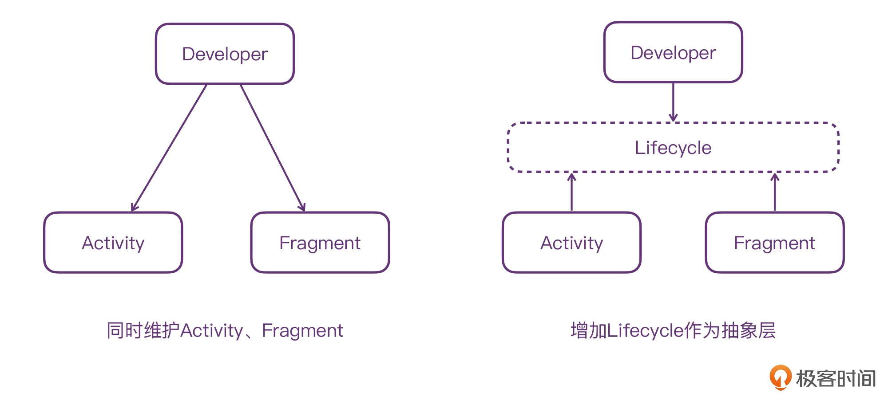
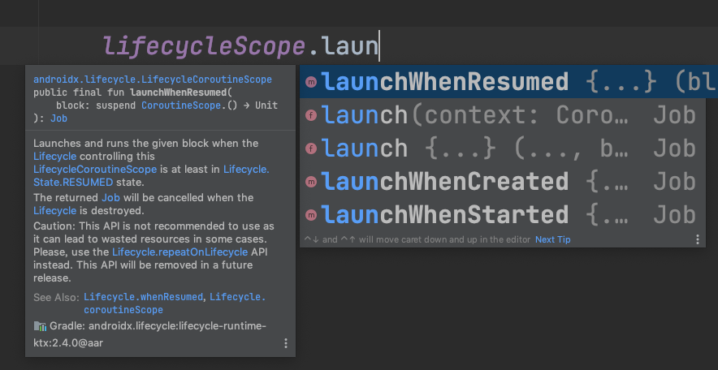

# 34-Kotlin与Jetpack简直是天生一对！

你好，我是朱涛。今天，我们来聊聊 Android 的 Jetpack。

在我看来，Kotlin 和 Jetpack，它们两个简直就是天生一对。作为 Android 开发者，如果只用Kotlin 不用 Jetpack，我们其实很难在 Android 平台充分发挥 Kotlin 的语言优势。而如果我们只用 Jetpack 而不用 Kotlin，那么，我们将只能用到 Jetpack 的小部分功能。毕竟，Jetpack当中有很多 API 和库，是专门为 Kotlin 提供的。

经过前面课程内容的学习，相信现在你已经对 Kotlin 十分熟悉了，那么，接下来就让我们来看看 Jetpack 吧！这节课里，我会为你介绍 Jetpack 核心库的基本概念、简单用法，以及它跟Kotlin 之间的关系，从而也为我们下节课的实战项目打下基础。

## Jetpack 简介

Jetpack，它有“喷气式背包”的意思。对于我们开发者来说，它其实就是 Google 官方为我们提供的一套开发套件，专门用来帮助 Android 开发者提升开发效率、提升应用稳定性的。


Android Jetpack，最初的宣传图标，就是“穿着喷气式背包的 Android 机器人”。大概意思就是：有了 Jetpack，Android 就能“起飞了”。这当然只是一种夸张的比喻，不过，从我实际的开发体验来说，Jetpack 确实可以给 Android 开发者带来极大的好处，尤其是当 Jetpack 与Kotlin 结合到一起的情况下。

我们先来了解下 KTX。

## KTX

KTX 是 Jetpack 当中最特殊的一类库，它是由 Kotlin 编写的，同时也仅为 Kotlin 开发者服务，使用 Java 语言的 Android 开发者是用不了的。KTX，它的作用其实是对当前 Android 生态当中的 API 进行额外补充。它依托 Kotlin 的扩展能力，为 Android 原有 API 增加新的：扩展函数、扩展属性、高阶函数、命名参数、参数默认值、协程支持。

如果我们想要使用 KTX 的核心功能，我们需要单独进行依赖：

```
// 代码段1
dependencies {
   implementation "androidx.core:core-ktx:1.7.0"
}
```

让我们来看一个关于 SharedPreference 的简单例子，如果我们使用 Java，我们大概率是需要写一堆模板代码的，类似这样：

```
// 代码段2
SharedPreferences sharedPreferences= getSharedPreferences("data",Context.MODE_PRI
SharedPreferences.Editor editor = sharedPreferences.edit();
editor.putString(SP_KEY_RESPONSE, response);
editor.commit();
editor.apply();
```

不过，如果我们有了 KTX，那么代码就会变得极其简单：

```
// 代码段3
preference.edit { putBoolean("key", value) }
```

上面的这个 edit() 方法，其实是一个高阶函数，它是由 KTX 提供的，如果你去看它的源代码，会发现，它其实就是一个扩展出来的高阶函数：

```
// 代码段4
inline fun SharedPreferences.edit(
       commit: Boolean = false,
       action: SharedPreferences.Editor.() -> Unit
) {
   val editor = edit()
   action(editor)
   if (commit) {
       editor.commit()
   } else {
       editor.apply()
   }
}
```

可以看到，KTX 其实就是将一些常见的模板代码封装了起来，然后以扩展函数的形式提供给开发者。虽然它自身的原理很简单，但是却可以大大提升开发者的效率。

KTX 除了能够扩展 Android SDK 的 API 以外，它还可以扩展 Jetpack 当中其他的库，比如说LiveData、Room 等等。接下来，我们就来看看 Jetpack 当中比较核心的库：Lifecycle。

## Lifecycle

Lifecycle，其实就是 Android 的生命周期组件。在整个 Jetpack 组件当中的地位非常特殊，是必学的组件。举个例子，其他的组件比如 WorkManager，如果我们实际工作中用不上，那么我们不去学它是不会有什么问题的。Lifecycle 不一样，只要我们是做 Android 开发的，我们就绕不开 Lifecycle。Activity 里面有 Lifecycle；Fragment 里面也有；LiveData 里面也有；

ViewModel 底层也用到了 Lifecycle；使用协程也离不开 Lifecycle。

那么，Lifecycle 到底是什么呢？我们平时提到生命周期，往往都是说的 Activity、Fragment，而它们两者之间却有一个很大的问题，生命周期函数不一致。

Activity 的生命周期我们肯定心里有数，不过 Fragment 生命周期函数比 Activity 多了几个：onCreateView、onViewCreated、onViewStateRestore、onDestoryView。最重要的是，Fragment 生命周期、回调函数、Fragment 内部 View 的生命周期，它们三者之间还有很复杂的对应关系。换句话说，Fragment 的生命周期函数要比 Activity 复杂一些。

加之，Activity 和 Fragment 结合的情况下，它们的生命周期行为在不同版本的 Android 系统上行为可能还会不一致。这在某些边界条件下，还会引发一些难以排查的 bug，进一步增加我们 Android 程序员的维护成本。

在计算机世界里，大部分问题都可以通过增加一个抽象层来解决。Android 团队的做法就是推出了 Lifecycle 这个架构组件，用它来统一 Activity、Fragment 的生命周期行为。



有了 LifeCycle 以后，我们开发者就可以面向 Lifecycle 编程。比如说，我们希望实现一个通用的地理位置监听的 Manager，就可以这样来做：

```python
// 代码段5
// 不关心调用方是Activity还是Fragment
class LocationManager(
   private val context: Context,
   private val callback: (Location) -> Unit
): DefaultLifecycleObserver {
   override fun onStart(owner: LifecycleOwner) {
       start()
   }
   override fun onStop(owner: LifecycleOwner) {
       stop()
   }
   private fun start() {
       // 使用高德之类的 SDK 请求地理位置
   }
   private fun stop() {
       // 停止
   }
}
class LifecycleExampleActivity : AppCompatActivity() {
   override fun onCreate(savedInstanceState: Bundle?) {
       super.onCreate(savedInstanceState)
       setContentView(R.layout.activity_life_cycle_example)
       val locationManager = LocationManager(this) {
           // 展示地理位置信息
       }
       lifecycle.addObserver(locationManager)
   }
}
```

上面代码的 LocationManager 只需要实现 DefaultLifecycleObserver 这个接口即可，外部是在Activity 还是在 Fragment 当中使用，根本不必关心。

### Lifecycle 与协程

通过前面课程的学习，我们知道，协程其实也是有生命周期的。也就是说，Android 和 Kotlin协程都是有生命周期的。这就意味着，当我们在 Android 当中使用协程的时候，就要格外小心。

作为 Android 开发者，你一定知道内存泄漏的概念：当内存变量的生命周期大于 Android 生命周期的时候，我们就认为内存发生泄漏了。类似的，当协程的生命周期大于 Android 生命周期的时候，协程也就发生泄漏了。

这一点，Android 官方早就帮我们考虑到了。Lifecycle 还可以跟我们前面提到的 KTX 结合到一起，进一步为 Kotlin 协程提供支持。



在 Activity、Fragment 当中，KTX 还提供了对应的 lifecycleScope，它本质上就是一个：与生命周期绑定的协程作用域。

```
// 代码段6
// 1
public val LifecycleOwner.lifecycleScope: LifecycleCoroutineScope
   // 2
   get() = lifecycle.coroutineScope
public abstract class LifecycleCoroutineScope internal constructor() : CoroutineS
   internal abstract val lifecycle: Lifecycle
   public fun launchWhenCreated(block: suspend CoroutineScope.() -> Unit): Job =
       lifecycle.whenCreated(block)
   }
   public fun launchWhenStarted(block: suspend CoroutineScope.() -> Unit): Job =
       lifecycle.whenStarted(block)
   }
   public fun launchWhenResumed(block: suspend CoroutineScope.() -> Unit): Job =
       lifecycle.whenResumed(block)
   }
}
```

在 Android 当中，Activity 和 Fragment 都会实现 LifecycleOwner 这个接口，代表它们都是拥有生命周期的组件。注释 1 处，这里使用了 Kotlin 的扩展属性，为 LifecycleOwner 扩展了lifecycleScope。它的类型是 LifecycleCoroutineScope，而它其实就是 CoroutineScope 的实现类。

lifecycleScope 这个属性的具体实现，其实是通过注释 2 处的自定义 getter() 实现的，也就是：Lifecycle.coroutineScope。

```
// 代码段7
public val Lifecycle.coroutineScope: LifecycleCoroutineScope
   get() {
       while (true) {
           // 1
           val existing = mInternalScopeRef.get() as LifecycleCoroutineScopeImpl
           if (existing != null) {
               return existing
           }
           // 2
           val newScope = LifecycleCoroutineScopeImpl(
               this,
               SupervisorJob() + Dispatchers.Main.immediate
           )
           //3
           if (mInternalScopeRef.compareAndSet(null, newScope)) {
               newScope.register()
               return newScope
           }
       }
   }
```

可以看到，Lifecycle.coroutineScope 仍然是一个扩展属性。它的逻辑其实也很简单，主要是分为了三个步骤：

- 第一步，检查是否存在缓存的 CoroutineScope，如果存在，那就直接返回即可。

- 第二步，如果不存在缓存，那就创建一个新的协程作用域。在创建的作用域的时候，用到了两个我们熟悉的概念：SupervisorJob、Dispatchers.Main，它们都是协程上下文的元素，前者是用来隔离协程异常传播的，后者是指定协程执行线程的。

- 第三步，更新缓存，并且调用 register() 绑定 scope 与 Lifecycle 的关系，最后返回。

接下来，我们打破砂锅问到底，看看 register() 的具体逻辑是什么：

```java
// 代码段8
internal class LifecycleCoroutineScopeImpl(
   override val lifecycle: Lifecycle,
   override val coroutineContext: CoroutineContext
   // 2
) : LifecycleCoroutineScope(), LifecycleEventObserver {
   init {
       if (lifecycle.currentState == Lifecycle.State.DESTROYED) {
           coroutineContext.cancel()
       }
   }
   // 1
   fun register() {
       launch(Dispatchers.Main.immediate) {
           if (lifecycle.currentState >= Lifecycle.State.INITIALIZED) {
               lifecycle.addObserver(this@LifecycleCoroutineScopeImpl)
           } else {
               coroutineContext.cancel()
           }
       }
   }
   // 3
   override fun onStateChanged(source: LifecycleOwner, event: Lifecycle.Event) {
       if (lifecycle.currentState <= Lifecycle.State.DESTROYED) {
           lifecycle.removeObserver(this)
           coroutineContext.cancel()
       }
   }
}
public interface LifecycleEventObserver extends LifecycleObserver {
   void onStateChanged(@NonNull LifecycleOwner source, @NonNull Lifecycle.Event
}
```

上面的代码一共有三个注释，我们一个个来看：

- 注释 1，register()，可以看到，它的逻辑其实很简单，主要就是调用了 addObserver()，将自身作为观察者传了进去。之所以可以这么做，还是因为注释 2 处的LifecycleEventObserver。

- 注释 2，LifecycleEventObserver，它其实就是一个 SAM 接口，每当 LifeCycleOwner 的生命周期发生变化的时候，这个 onStateChanged() 方法就会被调用。而这个方法的具体实现则在注释 3 处。

- 注释 3，这里的逻辑也很简单，当 LifeCycleOwner 对应的 Activity、Fragment 被销毁以后，就会调用 removeObserver(this) 移除观察者，最后，就是最关键的coroutineContext.cancel()，取消整个作用域里所有的协程任务。

这样一来，就能保证 LifeCycle 与协程的生命周期完全一致了，也就不会出现协程泄漏的问题了。

## 小结

这节课，我们主要了解了 Android 当中的 Jetpack，它是 Android 官方提供给开发者的一个开发套件，可以帮助我们开发者提升开发效率。Jetpack 当中其实有几十个库，在这节课里，我们是着重讲解了其中的 KTX 与 LifeCycle。

- KTX，主要是依托 Kotlin 的扩展能力，为 Android 原有 API 增加新的：扩展函数、扩展属性、高阶函数、命名参数、参数默认值、协程支持。

- Lifecycle，其实就是 Android 的生命周期组件。它统一封装了 Activity、Fragment 等Android 生命周期的组件。让我们开发者可以只关注 LifeCycle 的生命周期，而不用在意其

- 他细节。

- KTX 还为 LifeCycle 增加了协程支持，也就是 lifecycleScope。在它的底层，这个协程作用域和宿主的生命周期进行了绑定。当宿主被销毁以后，它可以确保 lifecycleScope 当中的协程任务，也跟着被取消。

所以，对于 Android 开发者来说，Kotlin 和 Jetpack 是一个“你中有我，我中有你”的关系，我们把它们称为“天生一对”一点儿也不为过。

## 思考题

在 Android 中使用协程的时候，除了 lifecycleScope 以外，我们还经常会使用 ViewModel 的viewModelScope。你能结合前面协程篇、源码篇的知识点，分析出 viewModelScope 的实现原理吗？

```java
class MyViewModel : ViewModel() {
   private val _persons: MutableLiveData<List<Person>> = MutableLiveData()
   val persons: LiveData<List<Person>> = _persons
   fun loadPersons() {
       viewModelScope.launch {
           delay(500L)
           _persons.value = listOf(Person("Tom"), Person("Jack"))
       }
   }
}
// 扩展属性
public val ViewModel.viewModelScope: CoroutineScope
   get() {
       val scope: CoroutineScope? = this.getTag(JOB_KEY)
       if (scope != null) {
           return scope
       }
       return setTagIfAbsent(
           JOB_KEY,
           // 实现类
           CloseableCoroutineScope(SupervisorJob() + Dispatchers.Main.immediate)
       )
   }
// 实现了Closeable的CoroutineScope
internal class CloseableCoroutineScope(context: CoroutineContext) : Closeable, Co
   override val coroutineContext: CoroutineContext = context
   override fun close() {
       // 取消
       coroutineContext.cancel()
   }
}
public abstract class ViewModel {
   @Nullable
   private final Map<String, Object> mBagOfTags = new HashMap<>();
   private volatile boolean mCleared = false;
   @SuppressWarnings("WeakerAccess")
   protected void onCleared() {
   }
   @MainThread
   final void clear() {
       mCleared = true;
       if (mBagOfTags != null) {
           synchronized (mBagOfTags) {
               for (Object value : mBagOfTags.values()) {
                   // 调用scope的close()
                   closeWithRuntimeException(value);
               }
           }
       }
       onCleared();
   }
   // scope暂存起来
   @SuppressWarnings("unchecked")
   <T> T setTagIfAbsent(String key, T newValue) {
       T previous;
       synchronized (mBagOfTags) {
           previous = (T) mBagOfTags.get(key);
           if (previous == null) {
               mBagOfTags.put(key, newValue);
           }
       }
       T result = previous == null ? newValue : previous;
       if (mCleared) {
           closeWithRuntimeException(result);
       }
       return result;
   }
   private static void closeWithRuntimeException(Object obj) {
       if (obj instanceof Closeable) {
           try {
               ((Closeable) obj).close();
           } catch (IOException e) {
               throw new RuntimeException(e);
           }
       }
   }
}
```
