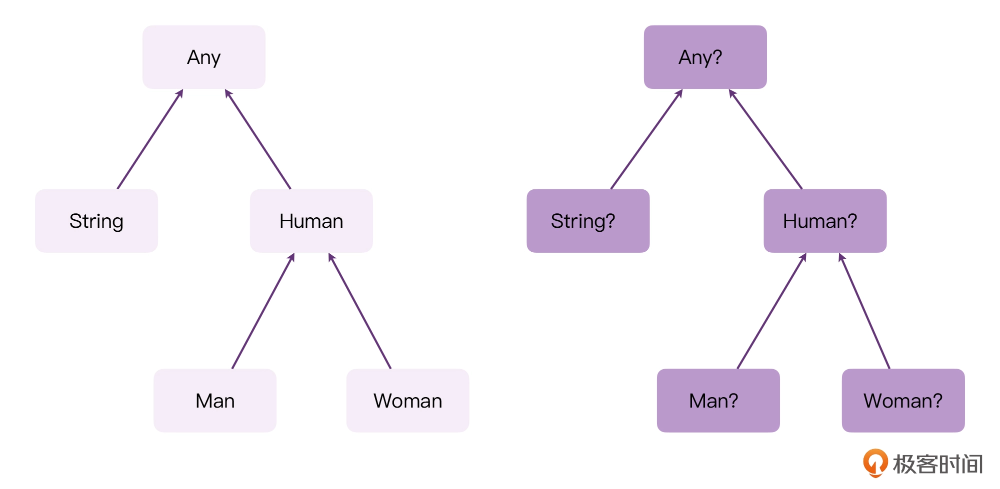
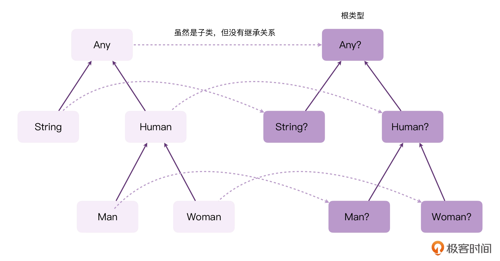
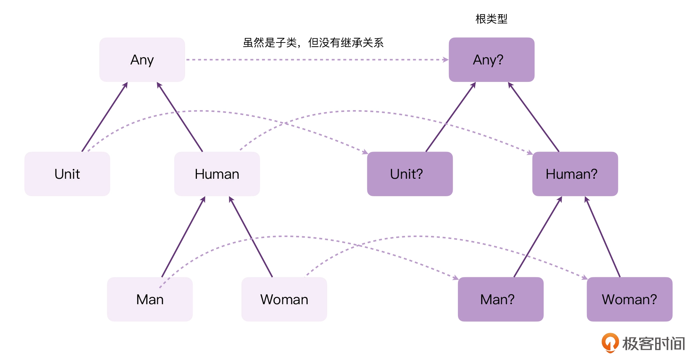
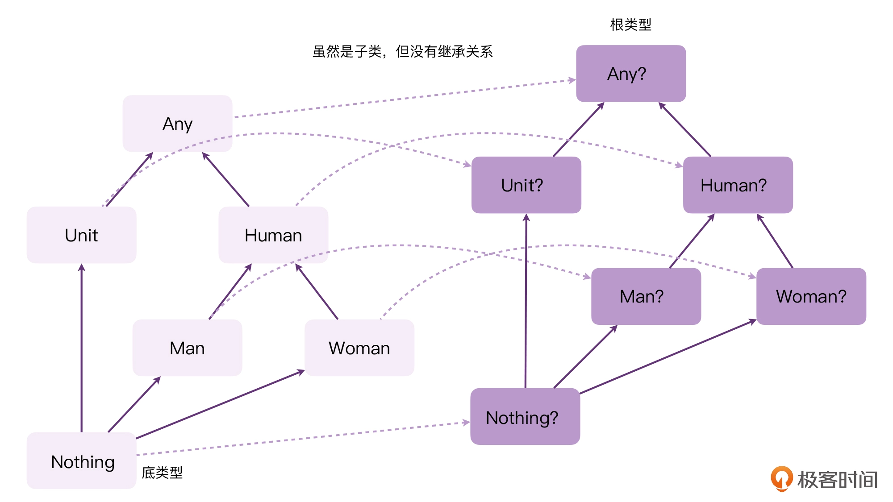
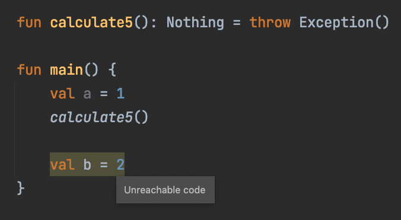

# 加餐二-什么是“表达式思维”？

你好，我是朱涛。

在开篇词当中，我曾经说过，学好 Kotlin 的关键在于思维的转变。在上一次加餐课程当中，我给你介绍了 Kotlin 的函数式编程思想，相信你对 Kotlin 的“函数思维”已经有了一定的体会。那么今天这节课，我们就来聊聊 Kotlin 的表达式思维。

所谓编程思维，其实是一种非常抽象的概念，很多时候是只可意会不可言传的。不过，从某种程度上看，学习编程思维，比学习编程语法还要重要。因为编程思维决定着我们的代码整体的架构与风格，而具体的某个语法反而没那么大的影响力。当然，如果对 Kotlin 的语法没有一个全面的认识，编程思维也只会是空中楼阁。

所以，准确地来说，掌握 Kotlin 的编程思维，是在掌握了 Kotlin 语法基础上的一次升华。这就好比是，我们学会了基础的汉字以后开始写作文一样。学了汉字以后，如果不懂得写作的技巧，是写不出优美的文章的。同理，如果学了 Kotlin 语法，却没有掌握它的编程思维，也是写不出优雅的 Kotlin 代码的。

好，那么接下来，我们就来看看 Kotlin 的表达式思维。

## 表达式思维

在正式开始学习表达式思维之前，我们先来看一段简单的 Kotlin 代码。

```javascript
var i = 0
if (data != null) {
   i = data
}
var j = 0
if (data != null) {
   j = data
} else {
   j = getDefault()
   println(j)
}
var k = 0
if (data != null) {
   k = data
} else {
   throw NullPointerException()
}
var x = 0
when (data) {
   is Int -> x = data
   else -> x = 0
}
var y = 0
try {
   y = "Kotlin".toInt()
} catch (e: NumberFormatException) {
   println(e)
   y = 0
}
```

这些代码，如果我们用 Java 的思维来分析的话，是挑不出太多毛病的。但是站在 Kotlin 的角度，就完全不一样了。

利用 Kotlin 的语法，我们完全可以将代码写得更加简洁，就像下面这样：

```
val i = data ?: 0
val j = data ?: getDefault().also { println(it) }
val k = data?: throw NullPointerException()
val x = when (data) {
   is Int -> data
   else -> 0
}
val y = try {
   "Kotlin".toInt()
} catch (e: NumberFormatException) {
   println(e)
   0
}
```

这段代码看起来就简洁了不少，但如果你有 Java 经验，你在写代码的时候，脑子里第一时间想到的一定不是这样的代码模式。这个，也是我们需要格外注意培养表达式思维的原因。

不过，现在你心里可能已经出现了一个疑问：Kotlin 凭什么就能用这样的方式写代码呢？其实这是因为：if、when、throw、try-catch 这些语法，在 Kotlin 当中都是表达式。

那么，这个“表达式”到底是什么呢？其实，与表达式（Expression）对应的，还有另一个概念，我们叫做语句（Statement）。这两者的准确定义其实很复杂，你可以点击我这里给出的链接去看看它们之间区别。

不过我们可以先简单来概括一下：表达式，是一段可以产生值的代码；而语句，则是一句不产生值的代码。这样解释还是有些抽象，我们来看一些例子：

```javascript
val a = 1    // statement
println(a)   // statement
// statement
var i = 0
if (data != null) {
   i = data
}
// 1 + 2 是一个表达式，但是对b的赋值行为是statement
val b = 1 + 2
// if else 整体是一个表达式
// a > b是一个表达式
// a - b是一个表达式
// b - a是一个表达式。
fun minus(a: Int, b: Int) = if (a > b) a - b else b - a
// throw NotImplementedError() 是一个表达式
fun calculate(): Int = throw NotImplementedError()
```

这段代码是描述了常见的 Kotlin 代码模式，从它的注释当中，我们其实可以总结出这样几个规律：

- 赋值语句，就是典型的 statement；

- if 语法，既可以作为语句，也可以作为表达式；

- 语句与表达式，它们可能会出现在同一行代码中，比如 val b = 1 + 2；

- 表达式还可能包含“子表达式”，就比如这里的 minus 方法；

- throw 语句，也可以作为表达式。

但是看到这里，你的心中应该还是有一个疑问没有解开，那就是：calculate() 这个函数难道不会引起编译器报错吗？

```
//       函数返回值类型是Int，实际上却抛出了异常，没有返回Int
//                ↓       ↓
fun calculate(): Int = throw NotImplementedError()
```

确实，在刚开始接触 Kotlin 的时候，我也无法理解这样的代码。直到我弄清楚 Kotlin 整个类型系统以后，我才真正找到答案。

所以，为了让你能真正理解 Kotlin 表达式背后的原理，接下来，我们就来系统学习一下 Kotlin的类型系统吧。

## 类型系统

在课程的第 1 讲我们就学过，在 Kotlin 当中，Any 是所有类型的父类，我们可以称之为根类型。同时，我们也学过，Kotlin 的类型还分为可空类型和不可空类型。举个例子，对于字符串类型，就有 String、String?，它们两者分别代表了不为空的字符串、可能为空的字符串。

在这个基础上，我们很容易就能推测出，Kotlin 的类型体系应该是这样的：



也就是，Any 是所有非空类型的根类型；而 Any? 是所有可空类型的根类型。那么现在，你可能会想到这样的一个问题：Any 与 Any? 之间是什么关系呢？

### Any 与 Any? 与 Object

从表面上看，这两个确实没有继承关系。不过，它们之间其实是存在一些微妙的联系的。

在 Kotlin 当中，我们可以把“子类型”赋值给“父类型”，就像下面的代码一样：

```
val s: String = ""
val any: Any = s
```

由于 String 是 Any 的子类型，因此，我们可以将 String 类型赋值给 Any 类型。而实际上，Any 和“Any?”之间也是类似的，我们可以将 Any 类型赋值给“Any？”类型，反之则不行。

```
val a: Any = ""
val b: Any? = a // 通过
val c: Any = b  // 报错
```

类似的，String 类型可以赋值给“String？”类型，反之也不行。你可能会想这是为什么呢？

其实，任何类型，当它被“?”修饰，变成可空类型以后，它就变成原本类型的父类了。所以，从某种程度上讲，我们可以认为“Any？”是所有 Kotlin 类型的根类型。它的具体关系如下图所示：



因此，我们可以说：虽然 Any 与 Any？之间没有继承的关系，但是我们可以将 Any 看作是Any？的子类；String 类型可以看作是 String？的子类。

而由于 Any 与“Any？”之间并没有明确的继承关系，但它们又存在父子类型的关系，所以在上面的示意图中，我们用虚线来表示。

所以到这里，我们就弄明白了一个问题：Kotlin 的 Any 与 Java 的 Object 之间是什么关系？

那么，答案也是显而易见的，Java 当中的 Object 类型，对应 Kotlin 的“Any？”类型。但两者并不完全等价，因为 Kotlin 的 Any 可以没有 wait()、notify() 之类的方法。因此，我们只能说Kotlin 的“Any？”与 Java 的 Object 是大致对应的。Intellij 有一个功能，可以将 Java 代码转换成 Kotlin 代码，我们可以借此印证。

这是一段 Java 代码，它有三个方法，分别是可为空的 Object 类型、不可为空的 Object 类型，以及无注解的 Object 类型。

```java
public class TestType {
   @Nullable  // 可空注解
   public Object test() { return null; }
   public Object test1() { return null; }
   @NotNull  // 不可空注解
   public Object test2() { return 1; }
}
```

上面的代码转换成 Kotlin 以后，会变成这样：

```python
class TestType {
   fun test(): Any? { return null }
   fun test1(): Any? { return null }
   fun test2(): Any { return 1 }
}
```

由此可见，在没有注解标明可空信息的时候，Object 类型是会被当作“Any？”来看待的。而在有了注解修饰以后，Kotlin 就能够识别出到底是 Any，还是“Any？”。

### Unit 与 Void 与 void

在 Kotlin 当中，除了普通的 Any、String 的类型之外，还有一个特殊的类型，叫做 Unit。而Unit 这个类型，经常会被拿来和 Java 的 Void、void 来对比。

那么在这里，你首先需要知道的是：在 Java 当中，Void 和 void 不是一回事（注意大小写），前者是一个 Java 的类，后者是一个用于修饰方法的关键字。如下所示：

```java
public final class Void {
   public static final Class<Void> TYPE = (Class<Void>) Class.getPrimitiveClass(
   private Void() {}
}
```

从语法含义上来讲，Kotlin 的 Unit 与 Java 的 void 更加接近，但 Unit 远不止于此。在 Kotlin当中，Unit 也是一个类，这点跟 Void 又有点像。比如，在下面的代码中，Unit 是一个类型的同时，还是一个单例：

```
public object Unit {
   override fun toString() = "kotlin.Unit"
}
```

所以，我们就可以用 Unit 写出很灵活的代码。就像下面这样：

```
fun funUnit(): Unit { }
fun funUnit1(): Unit { return Unit }
```

可以看到，当返回值类型是 Unit 的时候，我们既可以选择不写 return，也可以选择 return 一个 Unit 的单例对象。

另外，在使用泛型编程的时候，当 T 类型作为返回值类型的时候，我们传入 Unit 以后，就不再需要写 return 了。

```python
interface Task<T> {
   fun excute(any: Any): T
}
class PrintTask: Task<Unit> {
   override fun excute(any: Any) {
       println(any)
       // 这里写不写return都可以
   }
}
```

更重要的是，Unit 还有助于我们实现函数类型。

```
val f: () -> Unit = {}
```

所以，Kotlin 的 Unit 与 Java 的 Void 或者 void 并不存在等价的关系，但它们之间确实存在一些概念上的相似性。至此，我们也可以更新一下前面那个类型系统关系图了：



可见，Unit 其实和 String 类型一样，就是一个普通的类。只是因为 Kotlin 编译器会特殊对待它，当 Unit 作为返回值类型的时候，可以不需要 return。

好了，接着，我们再来看看 Kotlin 当中经常被提到的 Nothing 类型。

### Nothing

在有了前面的基础以后呢，Nothing 就很容易理解了。其实，Nothing 就是 Kotlin 所有类型的子类型。

Nothing 的概念与“Any?”恰好相反。“Any?”是所有的 Kotlin 类型的父类，Nothing 则是所有类型的子类。如果用一张图来概括，大概会是这样的：



事实上，像 Nothing 这样的概念，在函数式编程当中，也被叫做底类型（Bottom Type），因为它位于整个类型体系的最底部。

而了解了 Kotlin 的 Nothing 类型以后，我们其实就可以尝试着来解答前面例子中留下来的疑问了：

```
//       函数返回值类型是Int，实际上却抛出了异常，没有返回Int
//                ↓       ↓
fun calculate(): Int = throw NotImplementedError() // 不会报错
//       函数返回值类型是Any，实际上却抛出了异常，没有返回Any
//                ↓       ↓
fun calculate1(): Any = throw Exception() // 不会报错
//       函数返回值类型是Unit，实际上却抛出了异常，没有返回Unit
//                 ↓       ↓
fun calculate2(): Unit = throw Exception() // 不会报错
```

根据这段代码可以发现，不管函数的返回值类型是什么，我们都可以使用抛出异常的方式来实现它的功能。这样我们其实就可以推测出一个结论：throw 这个表达式的返回值是 Nothing类型。而既然 Nothing 是所有类型的子类型，那么它当然是可以赋值给任意其他类型的。

可是，我们如何才能印证这个结论是否正确呢？很简单，我们可以把两个函数的返回值类型都改成 Nothing，然后看看编译器会不会报错：

```java
// 不会报错
fun calculate(): Nothing = throw NotImplementedError()
// 不会报错
fun calculate1(): Nothing = throw Exception()
// Nothing构造函数是私有的，因此我们无法构造它的实例
public class Nothing private constructor()
```

可见，编译器仍然不会报错。这也就印证了我们前面的猜测：throw 表达式的返回值类型是Nothing。

另外，我们应该也注意到了 Nothing 类的构造函数是私有的，因此我们无法构造出它的实例。而当 Nothing 类型作为函数参数的时候，一个有趣的现象就出现了：

```
// 这是一个无法调用的函数，因为找不到合适的参数
fun show(msg: Nothing) {
}
show(null) // 报错
show(throw Exception()) // 虽然不报错，但方法仍然不会调用
```

这里我们定义的这个 show 方法，它的参数类型是 Nothing，而由于 Nothing 的构造函数是私有的，这就导致我们将无法调用 show 这个函数，除非我们抛出异常，但这没有意义。这个概念在泛型星投影的时候是有应用的，具体你可以点击这个链接去查看详情。

而除此之外，Nothing 还有助于编译器进行代码流程的推断。比如说，当一个表达式的返回值是 Nothing 的时候，就往往意味着它后面的语句不再有机会被执行。如下图所示：



在了解了 Unit 与 Nothing 这两个不可空的类型以后，我们再来看看它们对应的可空类型。

### Unit? 与 Nothing?

也许你也注意到了，Unit 对应的还有一个“Unit?”类型，那么这个类型有什么意义吗？

我们可以看看下面的代码：

```
fun f1(): Unit? { return null } // 通过
fun f2(): Unit? { return Unit } // 通过
fun f3(): Unit? { throw Exception() } // 通过
fun f4(): Unit? { } // 报错，缺少return
```

可见，Kotlin 编译器只会把 Unit 类型当作无需返回值的类型，而 Unit? 则不行。

所以，Unit? 这个类型其实没有什么广泛的应用场景，因为它失去了原本的编译器特权后，就只能有 3 种实现方式，即 null、Unit 单例、Nothing。也就是说，当 Unit? 作为返回值的时候，我们的函数必须要 return 一个值了，它返回值的类型可以是 null、Unit 单例、Nothing 这三种情况。

好，接下来我们再来看看“Nothing?”这个类型。

```
fun calculate1(): Nothing? = null
fun calculate2(): Nothing? = throw Exception()
```

由以上代码示例可知，当 Nothing? 作为返回值类型的时候，我们可以返回 null，或者是抛出异常。这一切都符合预期，而当它作为函数参数的时候，也会有一些有趣的变化。

```
//               变化在这里
//                   ↓
fun show(msg: Nothing?) {
}
show(null) // 通过
show(throw Exception()) // 虽然不报错，但方法仍然不会调用
```

可以看到，当参数类型是 Nothing? 的时候，我们的函数仍然是可以调用的。这其实就能进一步说明一个问题：Nothing 才是底类型，而“Nothing?”则不是底类型。

这一点其实在前面的类型关系图中就有体现，现在你就可以真正理解了：

到这里相信你也明白了，“Unit?”“Nothing?”这两个类型，其实并没有太多实际的应用场景，不过由于它们是 Kotlin 类型系统当中特殊的类型，因此我们也应该对它们有个清晰的认识。

这样，在系统学习了 Kotlin 的类型系统以后，我们对表达式理解就可以更上一层楼了。

## 表达式的本质

我们再来看看表达式的定义：表达式，是一段可以产生值的代码；而语句，则是一句不产生值的代码。

也许你听说过这样一句话：在 Kotlin 当中，一切都是表达式。注意！这句话其实是错的。因为Kotlin 当中还是存在语句的，比如 while 循环、for 循环，等等。

不过，如果我们换个说法：在 Kotlin 当中，大部分代码都是表达式。这句话就对了。Kotlin 的类型系统当中的 Unit 和 Nothing，让很多原本无法产生返回值的语句，变成了表达式。

我们来举个例子：

```
// statement
println("Hello World.")
// println("Hello World.") 变成了表达式
val a = println("Hello World.")
// statement
throw Exception()
// throw 变成了表达式
fun test1() = throw Exception()
```

从上面的代码案例中，我们可以总结出两个规律。

- 由于 Kotlin 存在 Unit 这个类型，因此 println(“Hello World.”) 这行代码也可以变成表达式，它所产生的值就是 Unit 这个单例。

- 由于 Kotlin 存在 Nothing 这个类型，因此 throw 也可以作为表达式，它所产生的值就是Nothing 类型。

注意，因为 Java 当中不存在 Unit、Nothing 这样的类型，所以 Java 里返回值为 void 的函数是无法成为表达式的，另外，throw 这样的语句也是无法成为表达式的。而也正是因为 Kotlin这样的类型系统，才让大部分的语句都摇身一变成为了表达式。因为 Unit、Nothing 在 Kotlin编译器看来，也是所有类型当中的一种。

可以说，Unit 和 Nothing 填补了原本 Java 当中的类型系统，让 Kotlin 的类型系统更加全面。也正因为如此，Kotlin 才可以拥有真正的函数类型，比如：

```
val f: (String) -> Unit = ::println
```

可以看到，如果不存在 Unit 这个类型，我们是无法描述 println 这个函数的类型的。正因为println 函数的返回值类型为 Unit，我们才可以用“(String) -> Unit”来描述它。

换句话说就是：Kotlin 的类型系统让大部分的语句都变成了表达式，同时也让无返回值的函数有了类型。

而所谓的表达式思维，其实就是要求我们开发者在编程的时候，时刻记住 Kotlin 大部分的语句都是可以作为表达式的，并且由于表达式都是有返回值的，这也就让我们可以用一种全新的思维来写代码。这在很多时候，都可以大大简化我们的代码逻辑。

那么现在，我们再回过头看之前的代码，就会觉得很顺眼了：

```
val i = data ?: 0
val j = data ?: getDefault().also { println(it) }
val k = data?: throw NullPointerException()
val x = when (data) {
   is Int -> data
   else -> 0
}
val y = try {
   "Kotlin".toInt()
} catch (e: NumberFormatException) {
   0
}
```

## 小结

好，今天这节加餐，到这里就接近尾声了，我们来做个简单的总结。

- 所谓的表达式思维，就是要时刻记住：Kotlin 大部分的语句都是表达式，它是可以产生返回值的。利用这种思维，往往可以大大简化代码逻辑。

- Any 是所有非空类型的根类型，而“Any?”才是所有类型的根类型。

- Unit 与 Java 的 void 类型，代表一个函数不需要返回值；而“Unit?”这个类型则没有太多实际的意义。

- 当 Nothing 作为函数返回值的时候，意味着这个函数永远不会返回结果，而且还会截断程序的后续流程。Kotlin 编译器也会根据这一点，进行流程分析。

- 当 Nothing 作为函数参数的时候，就意味着这个函数永远无法被正常调用。这在泛型星投影的时候是有一定应用的。

- 另外，Nothing 可以看作是“Nothing?”子类型，因此，Nothing 可以看作是 Kotlin 所有类型的底类型。

- 正是因为 Kotlin 在类型系统当中，加入了 Unit、Nothing 这两个类型，才让大部分无法产生值的语句摇身一变，成为了表达式。这也是“Kotlin 大部分的语句都是表达式”的根本原因。

## 思考题

这节课，我们学习了表达式思维，请问，你觉得它和我们前面学到的“函数式编程”有联系吗？为什么？欢迎在留言区分享你的答案和思考，也欢迎你把今天的内容分享给更多的朋友。
