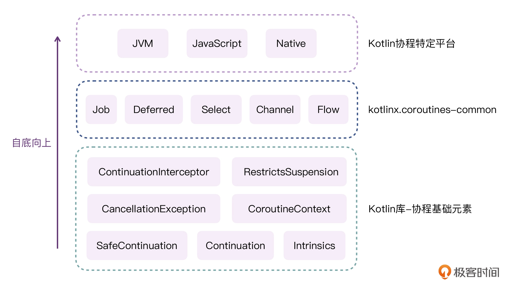

# 加餐五-深入理解协程基础元素

你好，我是朱涛。

在上一讲当中，我们深入研究了 Kotlin 挂起函数的原理，实际更多的是在了解协程的“基础层”。而接下来，我们将会开始研究协程启动的原理，探索协程的“中间层”。

在第 26 讲里，我曾提到过，Kotlin 的协程框架其实就是协程基础元素组合出来的框架。如果我们想要弄懂 Kotlin 协程，首先就要将它的“基础层”理解透彻。

所以今天，我还是决定来一次加餐，带你系统深入地认识一下 Kotlin 协程当中的基础元素。等你对协程的基础层有了深入认识以后，下节课研究协程启动原理就会轻松一些了。

## 协程基础元素

通过第 26 讲我们现在已经知道，Kotlin 协程的基础元素大致有这些：Continuation、SafeContinuation、CoroutineContext、CombinedContext、CancellationException、intrinsics。



其中的 CoroutineContext、CancellationException 我都已经介绍过了，另外的CombinedContext，其实就是 CoroutineContext 的一个实现类，而 SafeContinuation 则是Continuation 的实现类。

所以，在整个协程基础元素当中，我们最需要关心的，其实就是 Continuation 和intrinsics。

在 intrinsics 里，有一个重要的高阶函数 suspendCoroutineUninterceptedOrReturn{}，我们后面会讲到它。至于 Continuation，虽然我们在前面已经介绍过它是什么，但还没有系统了解过它的用法，所以接下来，我们就先系统了解一下 Continuation 的两种用法。

## Continuation 到底该怎么用？

实际上，在第 18 讲里，我们就已经学过 Continuation 的其中一种用法了：

```
// 代码段1
suspend fun <T : Any> KtCall<T>.await(): T =
   suspendCancellableCoroutine { continuation ->
       val call = call(object : Callback<T> {
           override fun onSuccess(data: T) {
               // 注意这里
               continuation.resume(data)
           }
           override fun onFail(throwable: Throwable) {
               // 注意这里
               continuation.resumeWithException(throwable)
           }
       })
       continuation.invokeOnCancellation {
           println("Call cancelled!")
           call.cancel()
       }
   }
```

当我们想要实现挂起函数的时候，可以使用 suspendCoroutine{}、suspendCancellableCoroutine{}这两个高阶函数，在它们的 Lambda 当中，我们可以使用它暴露出来的 continuation 对象，把程序的执行结果或异常传到外部去。

这种方式，往往是用于实现挂起函数内部逻辑的。

比如说，我们可以用 suspendCoroutine{}写一个更加简单的例子：

```
// 代码段2
fun main() = runBlocking {
   val result = getLengthSuspend("Kotlin")
   println(result)
}
suspend fun getLengthSuspend(text: String): Int = suspendCoroutine { continuation
   thread {
       // 模拟耗时
       Thread.sleep(1000L)
       continuation.resume(text.length)
   }
}
/*
```

- 输出结果：

```
等待1秒
6
*/
```

以上代码里，我们是使用 suspendCoroutine{}实现了挂起函数，然后在它的内部，我们使用continuation.resume() 的方式，传出了挂起函数的返回值。

可能你会觉得奇怪，为什么以 continuation.resume() 这样异步的方式传出结果以后，挂起函数就能接收到结果呢？其实，当我们把 main() 函数当中的调用逻辑改一下，这一切就会清晰明了。

```
// 代码段3
// 变化在这里
fun main()  {
   val func = ::getLengthSuspend as (String, Continuation<Int>) -> Any?
   func("Kotlin", object: Continuation<Int>{
       override val context: CoroutineContext
           get() = EmptyCoroutineContext
       override fun resumeWith(result: Result<Int>) {
           println(result.getOrNull())
       }
   })
   // 防止程序提前结束
   Thread.sleep(2000L)
}
suspend fun getLengthSuspend(text: String): Int = suspendCoroutine { continuation
   thread {
       // 模拟耗时
       Thread.sleep(1000L)
       continuation.resume(text.length)
   }
}
/*
```

- 输出结果：

```
等待1秒
6
*/
```

可以看到，在这段代码里，我们借助上节课的知识，把 getLengthSuspend() 这个函数强转成了带有 Continuation 的函数类型，然后通过匿名内部类的方式，创建了一个 Continuation 对象传了进去。最终，程序的执行结果和代码段 2 是一致的。

你还记得我在第 15 讲提到过的观点吗？

- 挂起函数的本质，就是 Callback!

那么现在，就让我们把 Continuation 改为 Callback，看看代码会变成什么样子。

```
// 代码段4
// 变化在这里
fun main()  {
   func("Kotlin", object: Callback<Int>{
       override fun resume(result: Int) {
           println(result)
       }
   })
   // 防止程序提前结束
   Thread.sleep(2000L)
}
fun func(text: String, callback: Callback<Int>) {
   thread {
       // 模拟耗时
       Thread.sleep(1000L)
       callback.resume(text.length)
   }
}
interface Callback<T> {
   fun resume(value: T)
}
/*
```

- 输出结果：

```
等待1秒
6
*/
```

可见，当我们把 Continuation 改成 Callback 以后，整个代码就变成了我们曾经最熟悉的异步回调代码了。调用方，可以使用匿名内部类创建 Callback 用于接收异步结果；异步函数内部，使用 callback.resume() 将结果传出去。

综上所述，Kotlin 协程当中的 Continuation，作用其实就相当于 Callback，它既可以用于实现挂起函数，往挂起函数的外部传递结果；也可以用于调用挂起函数，我们可以创建Continuation 的匿名内部类，来接收挂起函数传递出来的结果。

所以在这里，我们也就可以轻松回答上节课的思考题了：

- 我们都知道挂起函数是 Kotlin 协程里才有的概念，请问，Java 代码中可以调用 Kotlin 的挂起函数吗？比如，下面这个函数，我们可以在 Java 当中调用吗？

```
// 代码段5
// 需要在Java中调用的Kotlin挂起函数
object SuspendFromJavaExample {
   // 在Java当中如何调用这个方法？
   suspend fun getUserInfo(id: Long):String {
       delay(1000L)
       return "Kotlin"
   }
}
```

答案当然是肯定的，Java 当中调用挂起函数的方式，其实跟前面的代码段 3 是一样的：

```java
// 代码段6
public static void main(String[] args) throws InterruptedException {
   SuspendFromJavaExample.INSTANCE.getUserInfo(100L, new Continuation<String>()
       @NotNull
       @Override
       public CoroutineContext getContext() {
           return EmptyCoroutineContext.INSTANCE;
       }
       @Override
       public void resumeWith(@NotNull Object o) {
           System.out.println(o+"");
       }
   });
   // 防止程序提前结束
   Thread.sleep(2000L);
}
/*
```

- 输出结果

```
Kotlin
*/
```

在上面的代码中，我们只是把代码段 3 的思想应用到了 Java 代码中而已，唯一需要注意的，就是：在 Java 当中访问 Kotlin 的 object 单例，是需要加上 INSTANCE 后缀的。这一点，我们在第 5 讲当中就已经了解过。

看到这里，可以发现，我们在实现挂起函数逻辑的时候，总是离不开 suspendCoroutine{}、suspendCancellableCoroutine{}。其实，这两个高阶函数也是 Kotlin 协程的基础元素，让我们来进一步认识这两个高阶函数。

## suspendCoroutineUninterceptedOrReturn

实际上，suspendCoroutine{}、suspendCancellableCoroutine{}这两个高阶函数的实现原理是类似的，所以这里我们就主要解释下 suspendCoroutine{}。

如果你去看 suspendCoroutine{}的源代码，会发现它其实也在Continuation.kt这个文件当中。

```java
// 代码段7
public interface Continuation<in T> {
   public val context: CoroutineContext
   public fun resumeWith(result: Result<T>)
}
public suspend inline fun <T> suspendCoroutine(crossinline block: (Continuation<T
   // 注意这里
   return suspendCoroutineUninterceptedOrReturn { c: Continuation<T> ->
       val safe = SafeContinuation(c.intercepted())
       block(safe)
       safe.getOrThrow()
   }
}
```

在上面的代码中，我们第一眼就能看到一个名字特别长的高阶函数suspendCoroutineUninterceptedOrReturn{}。它其实就是实现 suspendCoroutine{}的关键。除了它之外，其他部分的代码都很好理解：

- SafeContinuation(c.intercepted()) 这行代码的作用，就是把原本的 Continuation 包裹一遍。

- block(safe) 这行代码，其实就是在调用 Lambda 当中的逻辑。

- safe.getOrThrow()，就是在取出 block(safe) 的运行结果，我们在上节课也提到过，Continuation 当中是可以存储 result 的。这个 Result 可能是正确的结果，也可能是异常。

下面我们重点来看看 suspendCoroutineUninterceptedOrReturn{}这个高阶函数的作用。如果你去看它的源代码，那你看到的大概率会是这样的：

```
// 代码段8
public suspend inline fun <T> suspendCoroutineUninterceptedOrReturn(crossinline b
   contract { callsInPlace(block, InvocationKind.EXACTLY_ONCE) }
   throw NotImplementedError("Implementation of suspendCoroutineUninterceptedOrR
}
```

大部分人看到这样的代码可能都会觉得奇怪：为什么这个高阶函数的源代码会是抛出异常呢？

在前面的加餐二“表达式思维”里，我其实有做过说明，如果你还有印象的话，应该就能理解这样的代码也是符合函数返回值的规范的。不过，如果它总是抛异常的话，我们用suspendCoroutine{}写代码的时候，为什么不会产生崩溃呢？这个异常信息里的提示内容又是什么意思？

- “Implementation of suspendCoroutineUninterceptedOrReturn is intrinsic.”

实际上，理解这句话的关键在于“intrinsic”这个单词，它有“固有”“本质”的意思，不过在上面这句话的语境下，这里的 intrinsic 其实是指编译器领域的一个术语，我们可以把它理解为“内建”。因此，上面我们看到的异常提示信息的意思就是：suspendCoroutineUninterceptedOrReturn 是一个编译器内建函数，它是由 Kotlin 编译器来实现的。

为了不偏离这节课的主题，这里我们就不去深究 Kotlin 编译器当中的逻辑了，感兴趣的话你可以自行研究这个链接。接下来，我们可以换一个角度，写一些 Demo 代码，通过运行调试来看看这个内建函数的功能和作用。

让我们先来看看 suspendCoroutineUninterceptedOrReturn 这个高阶函数的参数，它会接收一

```
个 Lambda，类型是(Continuation<T>) -> Any?，经过上节课的学习，你是否觉得这个
```

类型有些眼熟呢？这里的“Any?”类型，其实就能代表当前这个挂起函数是否真正挂起。

因此，我们可以写出下面这样的代码：

```
// 代码段9
fun main() = runBlocking {
   val result = testNoSuspendCoroutine()
   println(result)
}
private suspend fun testNoSuspendCoroutine() = suspendCoroutineUninterceptedOrRet
       continuation ->
   return@suspendCoroutineUninterceptedOrReturn "Hello!"
}
/*
```

- 输出结果：

```
Hello!
*/
```

在这段代码中，我们直接使用 suspendCoroutineUninterceptedOrReturn 实现了挂起函数，并且，在它的 Lambda 当中，我们并没有调用 continuation.resume()，而是直接返回了结果“Hello!”。根据程序的运行结果，我们可以看到，在挂起函数的外部确实也可以接收到这个结果。

那么这时候，如果我们把上面的代码反编译一下，会看到类似这样的代码：

```java
   // 代码段10
   private static final Object testNoSuspendCoroutine(Continuation $completion)
     int var2 = false;
     if ("Hello!" == IntrinsicsKt.getCOROUTINE_SUSPENDED()) {
        DebugProbesKt.probeCoroutineSuspended($completion);
     }
     return "Hello!";
   }
```

所以，从反编译的结果来看，testNoSuspendCoroutine() 这个函数其实就是一个伪挂起函数，它的内部并不会真正挂起。这样，当我们从外部调用这个函数的时候，这个函数会立即返回结果“Hello!”。

而这时候，我们可以再写一个真正的挂起函数：

```
// 代码段11
fun main() = runBlocking {
   val result = testSuspendCoroutine()
   println(result)
}
private suspend fun testSuspendCoroutine() = suspendCoroutineUninterceptedOrRetur
   continuation ->
   thread {
       Thread.sleep(1000L)
       continuation.resume("Hello!")
   }
   return@suspendCoroutineUninterceptedOrReturn kotlin.coroutines.intrinsics.COR
}
/*
```

- 输出结果：

```
等待1秒
Hello!
*/
```

这一次，我们并没有使用 return 返回结果，而是使用了 continuation.resume()。通过程序运行结果，我们可以看到挂起函数的外部也能接收到这个结果。然后我们也再来反编译一下，看看它对应的 Java 代码：

```java
// 代码段12
private static final Object testSuspendCoroutine(Continuation $completion) {
   int var2 = false;
   // 1
   ThreadsKt.thread$default(false, false, (ClassLoader)null, (String)null, 0, (F
   // 2
   Object var10000 = IntrinsicsKt.getCOROUTINE_SUSPENDED();
   if (var10000 == IntrinsicsKt.getCOROUTINE_SUSPENDED()) {
    DebugProbesKt.probeCoroutineSuspended($completion);
   }
   // 3
   return var10000;
}
final class CoroutineBasicElementsKt$testSuspendCoroutine$2$1 extends Lambda impl
  final Continuation $it;
  public Object invoke() {
     this.invoke();
     return Unit.INSTANCE;
  }
  public final void invoke() {
     // 4
     Thread.sleep(1000L);
     Continuation var1 = this.$it;
     String var2 = "Hello!";
     Companion var3 = Result.Companion;
     var1.resumeWith(Result.constructor-impl(var2));
  }
  CoroutineBasicElementsKt$testSuspendCoroutine$2$1(Continuation var1) {
     super(0);
     this.$it = var1;
  }
}
```

以上代码中一共有 4 个注释，我们一个个看：

- 注释 1、4，创建了一个新的线程，执行了 thread{}当中的代码。

- 注释 2，将 var10000 赋值为 COROUTINE_SUSPENDED 这个挂起标志位。

- 注释 3，返回挂起标志位，代表 testSuspendCoroutine() 这个函数会真正挂起。

所以，这两个例子其实也从侧面证明了我们在上节课当中的结论：

- 由于 suspend 修饰的函数，既可能返回CoroutineSingletons.COROUTINE_SUSPENDED，也可能返回实际结果，甚至可能返回null，为了适配所有的可能性，CPS 转换后的函数返回值类型就只能是 Any? 了。

那么现在，我们也就可以总结出 suspendCoroutineUninterceptedOrReturn{}这个高阶函数的作用了：它可以将挂起函数当中的 Continuation 以参数的形式暴露出来，在它的 Lambda当中，我们可以直接返回结果，这时候它就是一个“伪挂起函数”；或者，我们也可以返回COROUTINE_SUSPENDED 这个挂起标志位，然后使用 continuation.resume() 传递结果。

相应的，suspendCoroutine{}、suspendCancellableCoroutine{}这两个高阶函数，只是对它的一种封装而已。

## 小结

这节课，我们学习了 Kotlin 协程当中与挂起函数密切相关的两个基础元素，Continuation、suspendCoroutine{}。

Continuation 是整个协程当中最重要的基础元素，我们可以将其看做是一个 Callback。它主要有两个使用场景，一种是在实现挂起函数的时候，用于传递挂起函数的执行结果；另一种是在调用挂起函数的时候，以匿名内部类的方式，用于接收挂起函数的执行结果。借助这种思路，我们也完全可以在 Java 当中调用挂起函数。

当我们想要实现挂起函数的时候，我们往往需要使用 suspendCoroutine{}、suspendCancellableCoroutine{}这两个高阶函数。它们两个都是对suspendCoroutineUninterceptedOrReturn{}的封装，这个高阶函数的作用其实就是暴露挂起函数的 Continuation 对象。在它的 Lambda 当中，我们既可以直接返回执行结果，也可以返回COROUTINE_SUSPENDED 这个挂起标志位，然后使用 continuation.resume() 传递结果。

## 思考题

你觉得，suspendCoroutine{}、suspendCancellableCoroutine{}这两个高阶函数，它对比suspendCoroutineUninterceptedOrReturn{}的优势在哪里？Kotlin 官方为什么要进行这样的封装呢？

欢迎在留言区分享你的答案，也欢迎你把今天的内容分享给更多的朋友。
