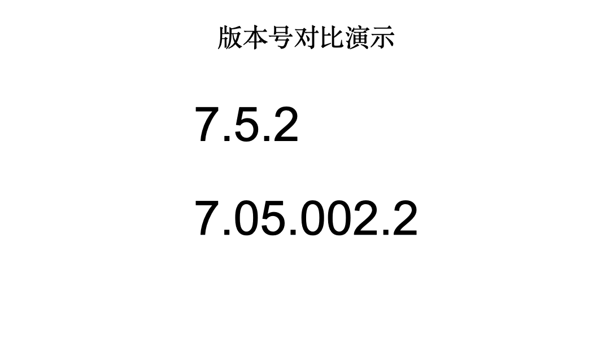
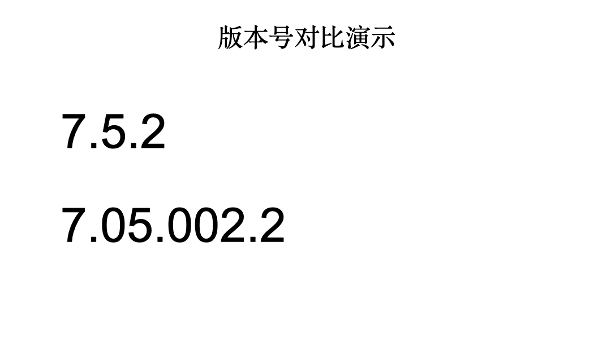

# 春节刷题计划（二）-一题三解，搞定版本号判断

你好，我是朱涛。今天是除夕夜，先祝你虎年春节快乐！

在上节刷题课中，我给你留了一个作业，那就是：用 Kotlin 来完成 LeetCode 的 165 号题《版本号判断》。那么今天这节课，我就来讲讲我的解题思路，希望能给你带来一些启发。

这道题目其实跟我们平时的工作息息相关。给你两个字符串代表的版本号，需要你判断哪个版本号是新的，哪个版本号是旧的。比如，2.0 与 1.0 对比的话，2.0 肯定是新版本，1.0 肯定是旧版本。对吧？

不过，这里面还有一些问题需要留意，这些都是我们在正式写代码之前要弄清楚的。

- 首先，版本号是可能以 0 开头的。比如 0.1、1.01，这些都是合理的版本号。

- 另外，如果是以 0 开头的话，1 个 0 和多个 0，它们是等价的，比如 1.01、1.001、1.00001 之间就是等价的，也就是说这几个版本号其实是相等的。

- 还有，1.0、1.0.0、1.0.0.0 它们之间也是等价的，也就是说这几个版本号也是相等的。

## 思路一

好了，理解了题意以后，我们就可以开始写代码了，LeetCode 上面给了我们一个待实现的方法，大致如下：

```
fun compareVersion(version1: String, version2: String): Int {
   // 待完善
}
```

分析完题目以后，也许你已经发现了，这道题目其实并不需要什么特殊的数据结构和算法基础，这是一道单纯的“模拟题”。我们脑子里是如何对比两个版本号的，我们的代码就可以怎么写。

下面我做了一个动图，展示了版本号对比的整体流程。



我们可以看到，这个对比的流程，大致可以分为以下几个步骤。

- 第一步，将版本号的字符串用“点号”进行分割，得到两个字符串的列表。

- 第二步，同时遍历这两个列表，将列表中的每一个元素转换成整数，比如，当遍历到第二位的时候，5、05 这两个字符串，都会转换成数字 5。这里有个细节，那就是当版本号的长度不一样的时候，比如，遍历到 7.05.002.2 的最后一位时，7.5.2 其实已经越界了，这时候我们需要进行补零，然后再转换成数字。

- 第三步，根据转换后的数字进行对比，如果两者相等的话，我们就继续遍历下一位。如果不相等的话，我们就能直接返回对比的结果了。

- 第四步，如果两个版本号都遍历到了末尾，仍然没有对比出大小的差异，那么我们就认为这两个版本号相等，返回 0 即可。

所以，按照上面的思路，我们可以把 compareVersion() 这个函数分为以下几个部分：

```
fun compareVersion(version1: String, version2: String): Int {
   // ① 使用“.”，分割 version1 和 version2，得到list1、list2
   // ② 同时遍历list1、list2，取出的元素v1、v2，并将其转换成整数，这里注意补零操作
   // ③ 对比v1、v2的大小，如果它们两者不一样，我们就可以终止流程，直接返回结果。
   // ④ 当遍历完list1、list2后仍然没有判断出大小话，说明两个版本号其实是相等的，这时候应该返
}
```

那么接下来，其实就很简单了。我们只需要将注释里面的自然语言，用代码写出来就行了。具体代码如下：

```javascript
fun compareVersion(version1: String, version2: String): Int {
   // ① 分割
   val list1 = version1.split(".")
   val list2 = version2.split(".")
   var i = 0
   while (i < list1.size || i < list2.size) {
       // ② 遍历元素
       val v1 = list1.getOrNull(i)?.toInt()?:0
       val v2 = list2.getOrNull(i)?.toInt()?:0
       // ③ 对比
       if (v1 != v2) {
           return v1.compareTo(v2)
       }
       i++
   }
   // ④ 相等
   return 0
}
```

在上面的代码中，有两个地方需要格外注意。

一个是 while 循环的条件。由于 list1、list2 的长度可能是不一样的，所以，我们的循环条件是：list1、list2 当中只要有一个没有遍历完的话，我们就要继续遍历。

还有一个需要注意的地方，getOrNull(i)，这是 Kotlin 独有的库函数。使用这个方法，我们不必担心越界问题，当 index 越界以后，这个方法会返回 null，在这里我们把它跟 Elvis 表达式结合起来，就实现了自动补零操作。这也体现出了 Kotlin 表达式语法的优势。

好，到这里，我们就用第一种思路实现了版本号对比的算法。下面我们再来看看第二种思路。

## 思路二

前面的思路，我们是使用的 Kotlin 的库函数 split() 进行分割，然后对列表进行遍历来判断的版本号。其实，这种思路还可以进一步优化，那就是我们自己遍历字符串，来模拟 split 的过程，然后在遍历过程中，我们顺便就把比对的工作一起做完了。

思路二的整体过程比较绕，我同样是制作了一个动图来描述这个算法的整体流程：



以上的整体算法过程，是典型的“双指针”思想。运用这样的思想，我们大致可以写出下面这样的代码：

```javascript
fun compareVersion(version1: String, version2: String): Int {
   val length1 = version1.length
   val length2 = version2.length
   // ①
   var i = 0
   var j = 0
   // ②
   while (i < length1 || j < length2) {
       // ③
       var x = 0
       while (i < length1 && version1[i] != '.') {
           x = x * 10 + version1[i].toInt() - '0'.toInt()
           i++
       }
       i++
       // ④
       var y = 0
       while (j < length2 && version2[j] != '.') {
           y = y * 10 + version2[j].toInt() - '0'.toInt()
           j++
       }
       j++
       // ⑤
       if (x != y) {
           return x.compareTo(y)
       }
   }
   // ⑥
   return 0
}
```

这段代码一共有 6 个注释，我们来一个个解释。

- 注释①，代表的就是我们遍历两个版本号的 index，双指针，指的就是它们两个。

- 注释②，最外层的 while 循环，其实就是为了确保双指针可以遍历到两个字符串的末尾。你注意下这里的循环条件，只要 version1、version2 当中有一个没到末尾，就会继续遍历。

- 注释③，这里就是在遍历 version1，一直到字符串末尾，或者遇到“点号”。在同一个循环当中，我们会对 x 的值进行累加，这个做法其实就是把字符串的数字转换成十进制的数字。

- 注释④，这里和注释③的逻辑一样，只是遍历的对象是 version2。

- 注释⑤，这里会对累加出来的 x、y 进行对比，不相同的话，我们就可以返回结果了。

- 注释⑥，如果遍历到末尾还没有结果，这就说明 version1、version2 相等。

现在，我们就已经用 Kotlin 写出了两个题解，使用的思路都是命令式的编程方式。也许你会好奇，这个问题能用函数式的思路来实现吗？

答案当然是可以的！

## 思路三

我们在前面就提到过，Kotlin 是支持多范式的，我们可以根据实际场景来灵活选择编程范式。那么在这里，我们可以借鉴一下前面第一种解法的思路。

其实，想要解决这个问题，我们只要能把 version1、version2 转换成两个整数的列表，就可以很好地进行对比了。我制作了一个动图，方便你理解：


根据这个流程，我们可以大致写出下面这样的代码：

```
fun compareVersion(version1: String, version2: String): Int =
   version1.split(".")
       .zipLongest(version2.split("."), "0") // ①
       .onEach { // ②
           with(it) {
               if (first != second) {
                   return first.compareTo(second)
               }
           }
       }.run { return 0 }
```

这段代码看起来很简洁，核心的逻辑在两个方法当中，我分别用注释标注了。

- 注释①，zipLongest() 这个方法，它的作用是将 version1、version2 对应的列表合并到一起，它返回值的类型是 List<Pair<Int, Int>>。

- 注释②，onEach()，其实它是一个高阶函数，它的作用就是遍历 List 当中的每一个 Pair，将其中的整型版本号拿出来对比，如果不一样，就可以直接返回结果。

现在，你可能会感慨，这代码看起来真香啊！这个嘛……别高兴得太早。虽然 Kotlin 支持基础的 zip 语法，但它目前还不支持 zipLongest() 这么高级的操作符。

那么这该怎么办呢？我们只能自己来实现 zipLongest() 了！为了让前面的代码通过编译，我们必须要自己动手实现下面三个扩展函数。

```
private fun Iterable<String>.zipLongest(
   other: Iterable<String>,
   default: String
): List<Pair<Int, Int>> {
   val first = iterator()
   val second = other.iterator()
   val list = ArrayList<Pair<Int, Int>>(minOf(collectionSizeOrDefault(10), other
   while (first.hasNext() || second.hasNext()) {
       val v1 = (first.nextOrNull() ?: default).toInt()
       val v2 = (second.nextOrNull() ?: default).toInt()
       list.add(Pair(v1, v2))
   }
   return list
}
private fun <T> Iterable<T>.collectionSizeOrDefault(default: Int): Int =
       if (this is Collection<*>) this.size else default
private fun <T> Iterator<T>.nextOrNull(): T? = if (hasNext()) next() else null
// Pair 是Kotlin标准库提供的一个数据类
// 专门用于存储两个成员的数据
// 提交代码的时候，Pair不需要拷贝进去
public data class Pair<out A, out B>(
   public val first: A,
   public val second: B
) : Serializable {
   public override fun toString(): String = "($first, $second)"
}
```

这三个扩展函数实现起来还是比较简单的，zipLongest() 其实就是合并了两个字符串列表，然后将它们按照 index 合并成 Pair，另外那两个扩展函数都只是起了辅助作用。

这样，我们把前面的代码一起粘贴到 LeetCode 当中，其实代码是可以通过的。不过呢，我们的代码当中其实还有一个比较深的嵌套，看起来不是很顺眼：

```
fun compareVersion(version1: String, version2: String): Int =
   version1.split(".")
       .zipLongest(version2.split("."), "0")
       .onEach {
           // 这里的嵌套比较深
           with(it) {
               if (first != second) {
                   return first.compareTo(second)
               }
           }
       }.run { return 0 }
```

你可以注意到，在 onEach 当中，有一个代码块，它有两层嵌套，这看起来有点丑陋。那么，我们能不能对它进一步优化呢？

当然是可以的。

这里，我们只需要想办法让 onEach 当中的 Lambda，变成带接收者的函数类型即可。具体做法就是，我们自己实现一个新的 onEachWithReceiver() 的高阶函数。

```
//                                                        注意这里
//                                                           ↓
inline fun <T, C : Iterable<T>> C.onEachWithReceiver(action: T.() -> Unit): C {
   return apply { for (element in this) action(element) }
}
//                                                   注意这里
// Kotlin库函数当中的onEach                                ↓
public inline fun <T, C : Iterable<T>> C.onEach(action: (T) -> Unit): C {
   return apply { for (element in this) action(element) }
}
```

上面的代码展示了 onEach() 和 onEachWithReceiver() 之间的差别，可以看到，它们两个的函数体其实没有任何变化，区别只是 action 的函数类型而已。

所以在这里，借助 onEachWithReceiver()，就可以进一步简化我们的代码：

```
fun compareVersion(version1: String, version2: String): Int =
   version1.split(".")
       .zipLongest(version2.split("."), "0")
       .onEachWithReceiver {
           // 减少了一层嵌套
           if (first != second) {
               return first.compareTo(second)
           }
       }.run { return 0 }
```

在这段代码中，我们把 onEach() 改成了 onEachWithReceiver()，因为它里面的 Lambda 是带有接收者，原本的 Pair 对象变成了 this 对象，这样，我们就可以直接使用 first、second 来访问 Pair 当中的成员了。

现在，就让我们来看看整体的代码吧：

```
fun compareVersion(version1: String, version2: String): Int =
   version1.split(".")
       .zipLongest(version2.split("."), "0")
       .onEachWithReceiver {
           if (first != second) {
               return first.compareTo(second)
           }
       }.run { return 0 }
private inline fun <T, C : Iterable<T>> C.onEachWithReceiver(action: T.() -> Unit
   return apply { for (element in this) action(element) }
}
private fun <T> Iterable<T>.collectionSizeOrDefault(default: Int): Int =
   if (this is Collection<*>) this.size else default
private fun <T> Iterator<T>.nextOrNull(): T? = if (hasNext()) next() else null
private fun Iterable<String>.zipLongest(
   other: Iterable<String>,
   default: String
): List<Pair<Int, Int>> {
   val first = iterator()
   val second = other.iterator()
   val list = ArrayList<Pair<Int, Int>>(minOf(collectionSizeOrDefault(10), other
   while (first.hasNext() || second.hasNext()) {
       val v1 = (first.nextOrNull() ?: default).toInt()
       val v2 = (second.nextOrNull() ?: default).toInt()
       list.add(Pair(v1, v2))
   }
   return list
}
```

好了，这就是我们的第三种思路。看完这三种思路以后，你会更倾向于哪种思路呢？

## 小结

这节课，我们使用了三种思路，实现了LeetCode 的 165 号题《版本号判断》。其中，前两种思路，是命令式的编程方式，第三种是偏函数式的方式。在我看来呢，这三种方式各有优劣。

- 思路一，代码逻辑比较清晰，代码量小，时间复杂度、空间复杂度较差。

- 思路二，代码逻辑比较复杂，代码量稍大，时间复杂度、空间复杂度非常好。

- 思路三，代码主逻辑非常清晰，代码量大，时间复杂度、空间复杂度较差。

第三个思路其实还有一个额外的优势，那就是，我们自己实现的扩展函数，可以用于以后解决其他问题。这就相当于沉淀出了有用的工具。

## 小作业

好，最后，我还是给你留一个小作业，请你用 Kotlin 来完成LeetCode 的 640 号题《求解方程》。这道题目我同样会在下节课给出答案解析。

欢迎继续给我留言，我们下节课再见。
