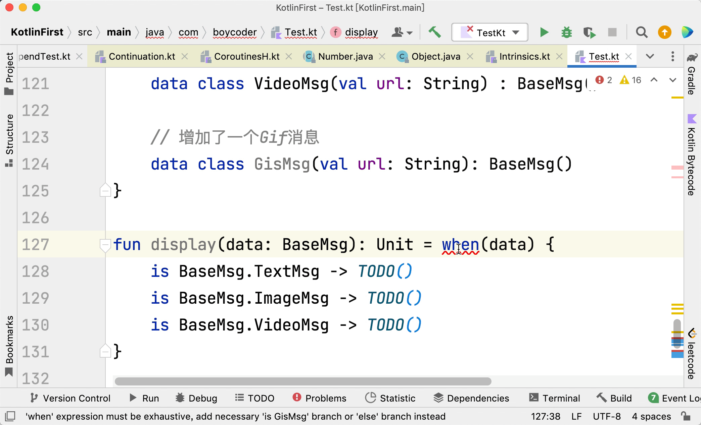

# 答疑（一）-Java和Kotlin到底谁好谁坏？

你好，我是朱涛。

由于咱们课程的设计理念是简单易懂、贴近实际工作，所以我在课程内容的讲述上也会有一些侧重点，进而也会忽略一些细枝末节的知识点。不过，我看到很多同学都在留言区分享了自己的见解，算是对课程内容进行了很好的补充，这里给同学们点个赞，感谢你的仔细思考和认真学习。

另外，我看到不少同学提出的很多问题也都非常有价值，有些问题非常有深度，有些问题非常有实用性，有些问题则非常有代表性，这些问题也值得我们再一起探讨下。因此，这一次，我们来一次集中答疑。

## Java 和 Kotlin 到底谁好谁坏？

很多同学看完开篇词以后，可能会留下一种印象，就是貌似 Java 就是坏的，Kotlin 就是好的。但其实在我看来，语言之间是不存在明确的优劣之分的。“XX 是世界上最好的编程语言”这种说法，也是没有任何意义的。

不过，虽然语言之间没有优劣之分，但在特定场景下，还是会有更优选择的。比如说，站在Android 开发的角度上看，Kotlin 就的确要比 Java 强很多；但如果换一个角度，服务端开发，Kotlin 的优势则并不明显，因为 Spring Boot 之类的框架对 Java 的支持已经足够好了；甚至，如果我们再换一个角度，站在性能、编译期耗时的视角上看，Kotlin 在某些情况下其实是略逊于 Java 的。

如果用发展的眼光来看待这个问题的话，其实这个问题根本不重要。Kotlin 是一门基于 JVM的语言，它更像是站在了巨人的肩膀上。Kotlin 的设计思路就是“扬长避短”。Java 的优点，Kotlin 都可以拿过来；Java 的缺点，Kotlin 尽量都把它扔掉！这就是为什么很多人会说：Kotlin 是一门更好的 Java 语言（Better Java）。

在开篇词里，我曾经提到过 Java 的一些问题：语法表现力差、可读性差，难维护、易出错、并发难。而这并不是说 Java 有多么不好，我想表达的其实是这两点：

- Java 太老了。Java 为了自身的兼容性，它的语法很难发展和演进，这才导致它在几十年后的今天看起来“语法表现力差”。

- 不是 Java 变差了，而是 Kotlin 做得更好了。因为 Kotlin 的理念就是扬长避短，因此，在Java 特别容易出错的领域，Kotlin 做了足够多的优化，比如内部类默认静态，比如不允许隐式的类型转换，比如挂起函数优化异步逻辑，等等。

所以，Kotlin 一定就比 Java 好吗？结论是并不一定。但在大部分场景下，我会愿意选Kotlin。

## Double 类型字面量

在 Java 当中，我们会习惯性使用“1F”代表 Float 类型，“1D”代表 Double 类型。但是这一行为在 Kotlin 当中其实会略有不同，而我发现，很多同学都会下意识地把 Java 当中的经验带入到Kotlin（当然也包括我）。

```
// 代码段1
val i = 1F   // Float 类型
val j = 1.0  // Double 类型
val k = 1D   // 报错！！
```

实际上，在 Kotlin 当中，要代表 Double 类型的字面量，我们只需要在数字末尾加上小数位即可。“1D”这种写法，在 Kotlin 当中是不被支持的，我们需要特别注意一下。

## 逆序区间

在第 1 讲里，我曾提到过：如果我们想要逆序迭代一个区间，不能使用“6…0”这种写法，因为这种写法的区间要求是：右边的数字大于等于左边的数字。

```
// 代码段2
fun main() {
   for (i in 6..0) {
       println(i) // 无法执行
   }
}
```

在我们实际工作中，我们也许不会直接写出类似代码段 2 这样的逻辑，但是，当我们的区间范围变成变量以后，这个问题就没那么容易被发现了。比如我们可以看看下面这个例子：

```
// 代码段3
fun main() {
   val start = calculateStart() // 6
   val end = calculateEnd()     // 0
   for (i in start..end) {
       println(i)
   }
}
```

在这段代码中，如果 end 小于 start，我们就很难通过读代码发现问题了。所以在实际的开发工作中，我们其实应该慎重使用“start…end”的写法。如果我们不管是正序还是逆序都需要迭代的话，这时候，我们可以考虑封装一个全局的顶层函数：

```
// 代码段4
fun main() {
   fun calculateStart(): Int = 6
   fun calculateEnd(): Int = 0
   val start = calculateStart()
   val end = calculateEnd()
   for (i in fromTo(start, end)) {
       println(i) // end 小于start，无法执行
   }
}
fun fromTo(start: Int, end: Int) =
   if (start <= end) start..end else start downTo end
```

在上面的 fromTo() 当中，我们对区间的边界进行了简单的判断，如果左边界小于右边界，我们就使用逆序的方式迭代。

## 密封类优势

在第 2 讲中，有不少同学觉得密封类不是特别好理解。在课程里，我们是拿密封类与枚举类进行对比来说明讲解的。我们知道，所谓枚举，就是一组有限数量的值。枚举的使用场景往往是某种事物的某些状态，比如，电视机有开关的状态，人类有女性和男性，等等。在 Kotlin 当中，同一个枚举，在内存当中是同一份引用。

```
enum class Human {
   MAN, WOMAN
}
fun main() {
   println(Human.MAN == Human.MAN)
   println(Human.MAN === Human.MAN)
}
```

- 输出

```
true
true
```

那么密封类，其实是对枚举的一种补充。枚举类能做的事情，密封类也能做到：

```
sealed class Human {
   object MAN: Human()
   object WOMAN: Human()
}
fun main() {
   println(Human.MAN == Human.MAN)
   println(Human.WOMAN === Human.WOMAN)
}
```

- 输出

```
true
true
```

所以，密封类，也算是用了枚举的思想。但它跟枚举不一样的地方是：同一个父类的所有子类。举个例子，我们在 IM 消息当中，就可以定义一个 BaseMsg，然后剩下的就是具体的消息子类型，比如文字消息 TextMsg、图片消息 ImageMsg、视频消息 VideoMsg，这些子类消息的种类肯定是有限的。

而密封类的好处就在于，对于每一种消息类型，它们都可以携带各自的数据。

```
// 代码段5
sealed class BaseMsg {
   //                密封类可以携带数据
   //                       ↓
   data class TextMsg(val text: String) : BaseMsg()
   data class ImageMsg(val url: String) : BaseMsg()
   data class VideoMsg(val url: String) : BaseMsg()
}
```

所以我们可以说：密封类，就是一组有限数量的子类。针对这里的子类，我们可以让它们创建不同的对象，这一点是枚举类无法做到的。

那么，使用密封类的第一个优势，就是如果我们哪天扩充了密封类的子类数量，所有密封类的使用处都会智能检测到，并且给出报错：

```
// 代码段6
sealed class BaseMsg {
   data class TextMsg(val text: String) : BaseMsg()
   data class ImageMsg(val url: String) : BaseMsg()
   data class VideoMsg(val url: String) : BaseMsg()
   // 增加了一个Gif消息
   data class GisMsg(val url: String): BaseMsg()
}
// 报错！！
fun display(data: BaseMsg): Unit = when(data) {
   is BaseMsg.TextMsg -> TODO()
   is BaseMsg.ImageMsg -> TODO()
   is BaseMsg.VideoMsg -> TODO()
}
```

上面的代码会报错，因为 BaseMsg 已经有 4 种子类型了，而 when 表达式当中只枚举了 3 种情况，所以它会报错。

使用密封类的第二个优势在于，当我们扩充了子类型以后，IDE 可以帮我们快速补充分支类型：



不过，还有一点需要特别注意，那就是 else 分支。一旦我们在枚举密封类的时候使用了 else分支，那我们前面提到的两个密封类的优势就会不复存在！

```
sealed class BaseMsg {
   data class TextMsg(val text: String) : BaseMsg()
   data class ImageMsg(val url: String) : BaseMsg()
   data class VideoMsg(val url: String) : BaseMsg()
   // 增加了一个Gif消息
   data class GisMsg(val url: String): BaseMsg()
}
// 不会报错
fun display(data: BaseMsg): Unit = when(data) {
   is BaseMsg.TextMsg -> TODO()
   is BaseMsg.ImageMsg -> TODO()
   // 注意这里
   else -> TODO()
}
```

请留意这里的 display() 方法，当我们只有三种消息类型的时候，我们可以在枚举了TextMsg、ImageMsg 以后，使得 else 就代表 VideoMsg。不过，一旦后续增加了 GifMsg 消息类型，这里的逻辑就会出错。而且，在这种情况下，我们的编译器还不会提示报错！

因此，在我们使用枚举或者密封类的时候，一定要慎重使用 else 分支。

## 枚举类的 valueOf()

另外，在使用 Kotlin 枚举类的时候，还有一个坑需要我们特别注意。在第 4 讲实现的第一个版本的计算器里，我们使用了 valueOf() 尝试解析了操作符枚举类。而这只是理想状态下的代码，实际上，正确的方式应该使用 2.0 版本当中的方式。

```
val help = """
--------------------------------------
```

- 使用说明：

```
1. 输入 1 + 1，按回车，即可使用计算器；
2. 注意：数字与符号之间要有空格；
3. 想要退出程序，请输入：exit
--------------------------------------""".trimIndent()
fun main() {
   while (true) {
       println(help)
       val input = readLine() ?: continue
       if (input == "exit") exitProcess(0)
       val inputList = input.split(" ")
       val result = calculate(inputList)
       if (result == null) {
           println("输入格式不对")
           continue
       } else {
           println("$input = $result")
       }
   }
}
private fun calculate(inputList: List<String>): Int? {
   if (inputList.size != 3) return null
   val left = inputList[0].toInt()
   //                        注意这里
   //                           ↓
   val operation = Operation.valueOf(inputList[1])?: return null
   val right = inputList[2].toInt()
   return when (operation) {
       Operation.ADD -> left + right
       Operation.MINUS -> left - right
       Operation.MULTI -> left * right
       Operation.DIVI -> left / right
   }
}
enum class Operation(val value: String) {
   ADD("+"),
   MINUS("-"),
   MULTI("*"),
   DIVI("/")
}
```

请留意上面的代码注释，这个 valueOf() 是无法正常工作的。Kotlin 为我们提供的这个方法，并不能为我们解析枚举类的 value。

```
fun main() {
   // 报错
   val wrong = Operation.valueOf("+")
   // 正确
   val right = Operation.valueOf("ADD")
}
```

出现这个问题的原因就在于，Kotlin 提供的 valueOf() 就是用于解析“枚举变量名称”的。

这是一个非常常见的使用误区，不得不说，Kotlin 在这个方法的命名上并不是很好，导致开发者十分容易用错。Kotlin 提供的 valueOf() 还不如说是 nameOf()。

而如果我们希望可以根据 value 解析出枚举的状态，我们就需要自己动手。最简单的办法，就是使用伴生对象。在这里，我们只需要将 2.0 版本当中的逻辑挪进去即可：

```
enum class Operation(val value: String) {
   ADD("+"),
   MINUS("-"),
   MULTI("*"),
   DIVI("/");
   companion object {
       fun realValueOf(value: String): Operation? {
           values().forEach {
               if (value == it.value) {
                   return it
               }
           }
           return null
       }
   }
}
```

对应的，在我们尝试解析操作符的时候，我们就不再使用 Kotlin 提供的 valueOf()，而是使用自定义的 realValueOf() 了：

```
val help = """
--------------------------------------
```

- 使用说明：

```
1. 输入 1 + 1，按回车，即可使用计算器；
2. 注意：数字与符号之间要有空格；
3. 想要退出程序，请输入：exit
--------------------------------------""".trimIndent()
fun main() {
   while (true) {
       println(help)
       val input = readLine() ?: continue
       if (input == "exit") exitProcess(0)
       val inputList = input.split(" ")
       val result = calculate(inputList)
       if (result == null) {
           println("输入格式不对")
           continue
       } else {
           println("$input = $result")
       }
   }
}
private fun calculate(inputList: List<String>): Int? {
   if (inputList.size != 3) return null
   val left = inputList[0].toInt()
   //                        变化在这里
   //                           ↓
   val operation = Operation.realValueOf(inputList[1])?: return null
   val right = inputList[2].toInt()
   return when (operation) {
       Operation.ADD -> left + right
       Operation.MINUS -> left - right
       Operation.MULTI -> left * right
       Operation.DIVI -> left / right
   }
}
```

因此，对于枚举，我们在使用 valueOf() 的时候一定要足够小心！因为它解析的根本就不是value，而是 name。

## 小结

在我看来，专栏是“作者说，读者听”的过程，而留言区则是“读者说，作者听”的过程。这两者结合在一起之后，我们才能形成一个更好的沟通闭环。今天的这节答疑课，就是我在倾听了你的声音后，给到你的回应。

所以，如果你在学习的过程中遇到了什么问题，请一定要提出来，我们一起交流和探讨，共同进步。

## 思考题

请问你在使用 Kotlin 的过程中，还遇到过哪些问题？请在留言区提出来，我们一起交流。
