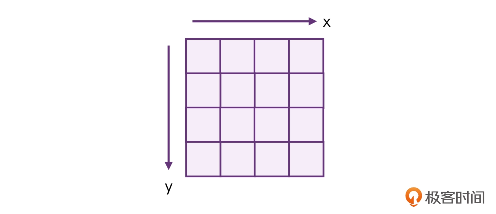
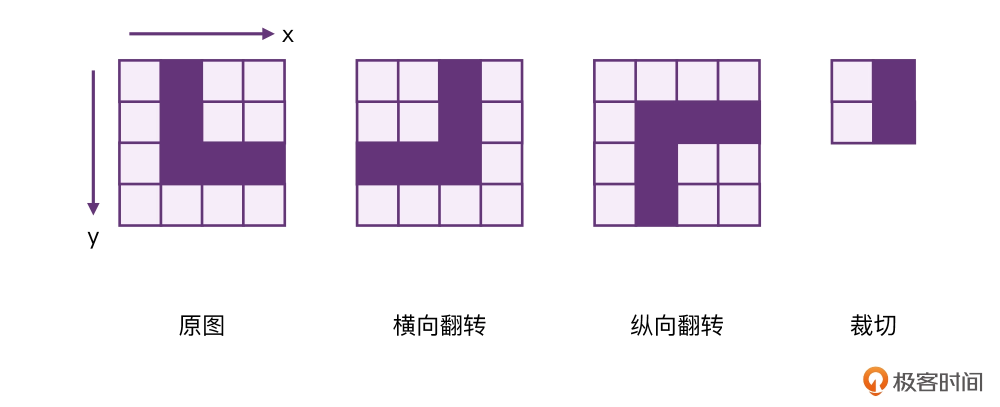
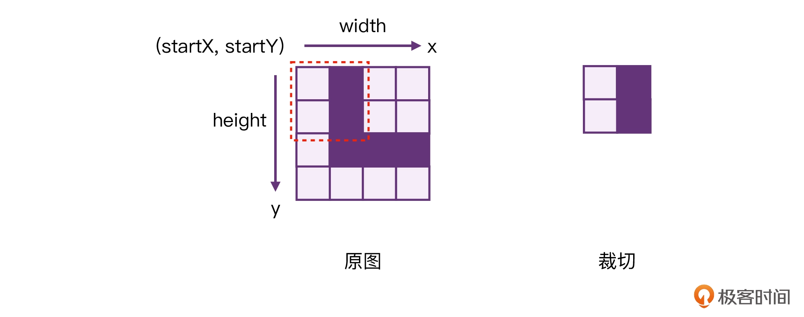
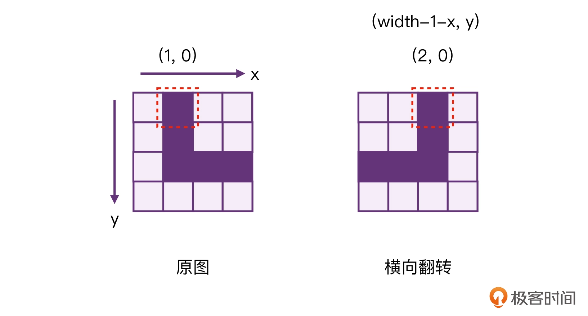
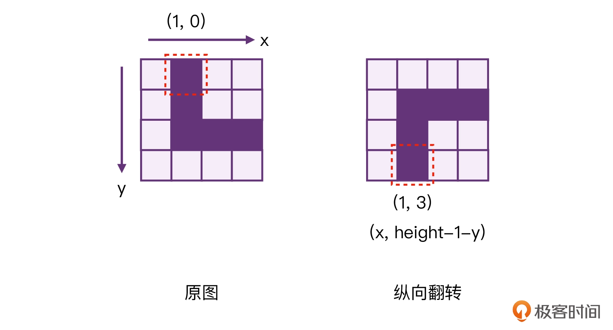
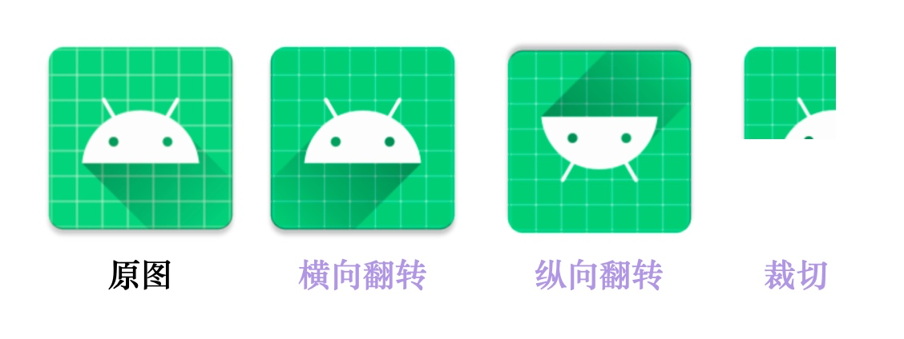
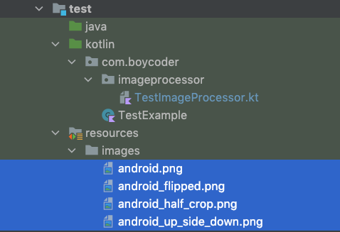
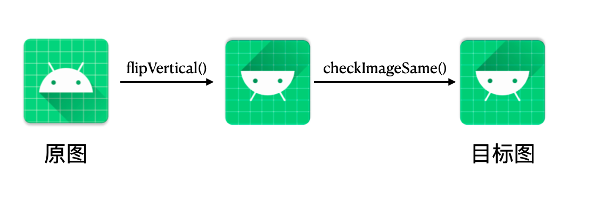

# 题目解答-期中考试版本参考实现

你好，我是朱涛。上节课我给你布置了一份考试题，你完成得怎么样了呢？这节课呢，我会来告诉你我是如何用 Kotlin 来做这个图片处理程序的，供你参考。

由于上节课我们已经做好了前期准备，所以这里我们直接写代码就行了。

## 1.0 版本

对于图片反转和裁切的这个问题，如果一开始你就去想象一个大图片，里面有几万个像素点，那你可能会被吓到。但是，如果你将数据规模缩小，再来分析的话，你会发现这个问题其实很简单。

这里，我们就以一张 4X4 像素的照片为例来分析一下。



这其实就相当于一个抽象的模型，如果我们基于这张 4X4 的照片，继续分析翻转和裁切，就会容易很多。我们可以来画一个简单的图形：



上面这张图，从左到右分别是原图、横向翻转、纵向翻转、裁切。其中，翻转看起来是要复杂一些，而裁切是最简单的。



我们先来处理裁切。对于裁切，其实只需要将图片当中某个部分的像素拷贝到内存，然后存储成为一张新图片就行了。

```
/**
* 图片裁切
*/
fun Image.crop(startY: Int, startX: Int, width: Int, height: Int): Image {
   val pixels = Array(height) { y ->
       Array(width) { x ->
           getPixel(startY + y, startX + x)
       }
   }
   return Image(pixels)
}
```

以上代码中，我们创建了一个新数组 pixels，它的创建方式是通过 Lambda 来实现的，而

```
Lambda 当中最关键的逻辑，就是 getPixel(startY + y, startX + x)，也就是从原
```

图当中取像素点。

这代码是不是比你想象中简单很多？其实，图片的翻转也是一样的。只要我们能找出坐标的对应关系，代码也非常简单。



可以看到，对于原图的 (1, 0) 这个像素点来说，它横向翻转以后就变成了 (2, 0)。所以，对于(x, y) 坐标来说，横向翻转以后，就应该变成 (width-1-x, y)。找到这个对应关系以后，我们就直接抄代码了！

```
/**
* 横向翻转图片
*/
fun Image.flipHorizontal(): Image {
   val pixels = Array(height()) { y ->
       Array(width()) { x ->
           getPixel(y, width() - 1 - x)
       }
   }
   return Image(pixels)
}
```

可见，以上这段代码几乎跟裁切是一模一样的，只是说，裁切要限制宽高，而翻转则是跟原图保持一致。

看到这里，相信你也马上就能想明白纵向翻转的代码该如何写了！



我们还是以 (1, 0) 这个像素点为例，在纵向翻转以后就变成了 (1, 3)，它们的转换规则是 (x,height-1-y)。

```
/**
* 纵向翻转图片
*/
fun Image.flipVertical(): Image {
   val pixels = Array(height()) { y ->
       Array(width()) { x ->
           getPixel(height() - 1 - y, x) // 改动这里
       }
   }
   return Image(pixels)
}
```

所以说，只要我们能找到中间的转换关系，纵向翻转的代码，只需要在横向翻转的基础上，改动一行即可。

### 单元测试

其实针对图像算法的单元测试，我们最好的方式，就是准备一些现有的图片案例。比如说，我们随便找一张图，用其他的软件工具，对它进行翻转、裁切，然后存储起来。比如还是这四张图：



我们可以把处理后的图片保存在单元测试的文件夹下，方便我们写对应的测试用例。



那么，有了这些图片之后，我想你应该就能想到要怎么办了。这时候，你只需要写一个图片像素对比的方法 checkImageSame() 就好办了。

```
private fun checkImageSame(picture: Image, expected: Image) {
   assertEquals(picture.height(), expected.height())
   assertEquals(picture.width(), expected.width())
   for (row in 0 until picture.height()) {
       for (column in 0 until picture.width()) {
           val actualPixel = picture.getPixel(row, column)
           val expectedPixel = expected.getPixel(row, column)
           assertEquals(actualPixel, expectedPixel)
       }
   }
}
```

其实，这个函数的思路也很简单，就是逐个对比两张图片之间的像素，看看它们是不是一样的，如果两张图所有的像素都一样，那肯定就是一样的。

有了这个方法以后，我们就可以快速实现单元测试代码了。整体流程大致如下：



```
@Test
fun testCrop() {
   val image = loadImage(File("${TEST_BASE_PATH}android.png"))
   val height = image.height() / 2
   val width = image.width() / 2
   val target = loadImage(File("${TEST_BASE_PATH}android_half_crop.png"))
   val crop = image.crop(0, 0, width, height)
   checkImageSame(crop, target)
}
@Test
fun testFlipVertical() {
   val origin = loadImage(File("${TEST_BASE_PATH}android.png"))
   val target = loadImage(File("${TEST_BASE_PATH}android_up_side_down.png"))
   val flipped = origin.flipVertical()
   checkImageSame(flipped, target)
}
@Test
fun testFlipHorizontal() {
   val origin = loadImage(File("${TEST_BASE_PATH}android.png"))
   val target = loadImage(File("${TEST_BASE_PATH}android_flipped.png"))
   val flipped = origin.flipHorizontal()
   checkImageSame(flipped, target)
}
```

有了单元测试，我们就再也不用担心以后改代码的时候，不小心改出问题了。

好，那么到这里，1.0 版本就算是完成了。我们接着来看看 2.0 版本。

## 2.0 版本

2.0 版本的任务，我们需要支持下载网络上面的图片，并且还要能够存起来。由于这是一个比较耗时的操作，我们希望它是一个挂起函数。

关于下载 HTTP 的图片，其实，我们借助 OkHttp 就可以简单实现。下面我们来看看代码。

- 补充：为了不偏离主题，我们不考虑 HTTPS 的问题。

```
fun downloadSync() {
   logX("Download start!")
   val okHttpClient = OkHttpClient().newBuilder()
       .connectTimeout(10L, TimeUnit.SECONDS)
       .readTimeout(10L, TimeUnit.SECONDS)
       .build()
   val request = Request.Builder().url(url).build()
   val response = okHttpClient.newCall(request).execute()
   val body = response.body
   val responseCode = response.code
   if (responseCode >= HttpURLConnection.HTTP_OK &&
       responseCode < HttpURLConnection.HTTP_MULT_CHOICE &&
       body != null
   ) {
       // 1， 注意这里
       body.byteStream().apply {
           outputFile.outputStream().use { fileOut ->
               copyTo(fileOut)
           }
       }
   }
   logX("Download finish!")
}
```

以上代码中，有一个地方是需要注意的，我用注释标记了。也就是当我们想要把网络流中的数据存起来的时候，我们可以借助 Kotlin 提供的 IO 扩展函数快速实现，这样不仅方便，而且还不用担心 FileOutputStream 调用 close() 的问题。这个部分的代码，在 Java 当中，是要写一堆模板代码的。

下载本身的功能实现以后，挂起函数的封装也就容易了。

```
suspend fun downloadImage(url: String, outputFile: File): Boolean {
   return withContext(Dispatchers.IO) {
       try {
           downloadSync()
       } catch (e: Exception) {
           println(e)
           // return@withContext  不可省略
           return@withContext false
       }
       // return@withContext 可省略
       return@withContext true
   }
}
```

这里，我们可以直接用 withContext，让下载的任务直接分发到 IO 线程。

代码写到这里，2.0 版本要求的功能基本上就算是完成了。这样一来，我们就可以在 main 函数当中去调用它了。

```
fun main() = runBlocking {
   val url = "http://xxxx.jpg"
   val path = "${BASE_PATH}downloaded.png"
   downloadImage(url, File(path))
   loadImage(File(path))
       .flipVertical()
       .writeToFile(File("${BASE_PATH}download_flip_vertical.png"))
   logX("Done")
}
// 将内存图片保存到硬盘
fun Image.writeToFile(outputFile: File): Boolean {
   return try {
       val width = width()
       val height = height()
       val image = BufferedImage(width, height, BufferedImage.TYPE_INT_RGB)
       for (x in 0 until width) {
           for (y in 0 until height) {
               val awtColor = getPixel(y, x)
               image.setRGB(x, y, awtColor.rgb)
           }
       }
       ImageIO.write(image, "png", outputFile)
       true
   } catch (e: Exception) {
       println(e)
       false
   }
}
/*
```

- 输出结果：

```
================================
Download start!
Thread:DefaultDispatcher-worker-1
================================
================================
Download finish!
Thread:DefaultDispatcher-worker-1
================================
================================
Done
Thread:main
================================
*/
```

通过运行结果，我们会发现图片下载的任务，已经被分发到 IO 线程池了，而其他的代码仍然在主线程之上。

## 小结

其实，课程进行到这里，你就会发现，Kotlin 和 Java、C 之类的语言的编程方式是完全不一样的。Kotlin 提供了丰富的扩展函数，在很多业务场景下，Kotlin 是可以大大减少代码量的。

另外，你也会发现，当你熟悉 Kotlin 协程以后，它的使用一点都不难。对于上面的代码，我们通过 withContext(Dispatchers.IO) 就能切换线程，之后，我们就可以在协程作用域当中随意调用了！

## 思考题

你觉得，我们在 downloadImage() 这个挂起函数内部，直接写死 Dispatchers.IO 的方式好吗？如果换成下面这种写法，会不会更好？为什么？

```
suspend fun downloadImage(
   coroutineContext: CoroutineContext = Dispatchers.IO,
   url: String,
   outputFile: File
): Boolean {
   return withContext(coroutineContext) {
       try {
           downloadSync()
       } catch (e: Exception) {
           println(e)
           return@withContext false
       }
       return@withContext true
   }
}
```
