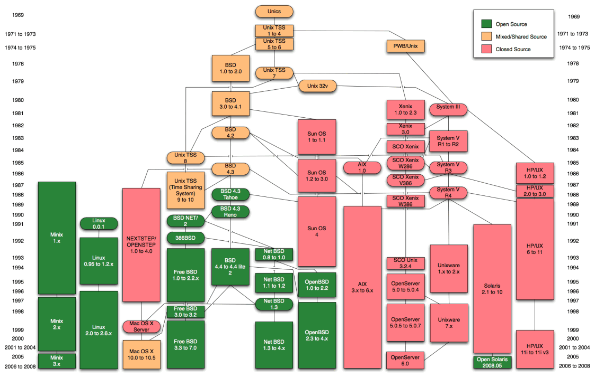

# 大咖助阵 | LMOS：为什么说C语言是一把瑞士军刀？

你好，我是 LMOS。

很高兴受邀来到这个专栏做一期分享。也许这门课的一些同学对我很熟悉，我是极客时间上《操作系统实战 45 讲》这门课的作者，同时也是 LMOS、LMOSEM 这两套操作系统的独立开发者。十几年来，我一直专注于操作系统内核研发，在 C 语言的使用方面有比较深刻的理解，所以想在这里把我的经验、见解分享给你。

操作系统和 C 语言的起源有着千丝万缕的联系，那么今天，我就先从 C 语言的起源和发展历史讲起。然后，我会从 C 语言自身的语法特性出发，向你展示这门古老的语言简单在哪里，又难在哪里。

## C 语言、UNIX 的起源和发展

从英国的剑桥大学到美国的贝尔实验室，C 语言走过了一段不平凡的旅程。从最开始的 CPL语言到 BCPL 语言，再到 B 语言，到最终的 C 语言，一共经历了四次改进。从 20 世纪中叶到 21 世纪初，C 语言以它的灵活、高效、通用、抽象、可移植的特性，在计算机界占据了不可撼动的地位。但是，C 语言是如何产生的？诞生几十年来，它的地位为何一直不可动摇？请往下看。

### C 语言是两位牛人“玩”出来的

1969 年夏天，美国贝尔实验室的肯·汤普森的妻子回了娘家，这位理工男终于有了自己的时间。于是，他以 BCPL 语言为基础，设计出了简单且接近于机器语言的 B 语言（取 BCPL 的首字母）。然后，他又用 B 语言写出了 UNICS 操作系统，这就是后来风靡全世界的 UNIX 操作系统的初级版本。

那么，肯·汤普森为什么要写这个操作系统呢？背后的原因是我们这些凡人想象不到的：为了玩一个叫“Space Travel”的游戏。牛人就是牛人，这个“玩出来”的操作系统成功到让人无法想象。

而肯·汤普森一位同样是牛人的朋友，也疯狂地热爱这款游戏，这个朋友就是 C 语言之父（请注意不是谭浩强老师），丹尼斯·里奇。他为了能早点儿玩上游戏，加入了汤普森的疯狂项目，一起开发 UNIX。他的主要工作是改造 B 语言，使其更加成熟。1972 年，丹尼斯·里奇在 B 语言的基础上设计出了一种新的语言，他取了 BCPL 的第二个字母作为这种语言的名字，这就是C 语言。C 语言实现之后，汤普森和里奇用它重写了 UNIX。

### C 语言和 UNIX 操作系统

听到这儿，你应该可以理解，C 语言和 UNIX 操作系统从诞生时就密切相关。那么，C 语言对UNIX 操作系统的发展具体有什么影响呢？我们先从 C 语言出现之前说起。

在 C 语言出现之前，UNIX 操作系统的初级版本是用汇编语言编写的。用机器语言或者汇编语言开发的程序，是不可能在诸如 X86、Alpha、SPARC、PPC 和 ARM 等机器上任意运行的，想要运行就得重写所有代码。而用 C 语言编写的程序，则可以在任意架构的处理器上运行。只需要有那种架构的处理器对应的 C 语言编译器和库，然后将 C 源代码编译、链接成目标二进制文件，之后即可在该架构的处理器上运行。

正是 C 语言的这种高性能和强大的可移植性，促进了 UNIX 生态的发展。UNIX 诞生后的 40年间，出现的各种操作系统都是和 UNIX 有关系的，或者受其影响。甚至直到 2021 年，各种版本的 UNIX 内核和周边工具仍然使用 C 语言作为最主要的开发语言。

你可以看下这个 UNIX 家谱图（来自维基百科），更直观地感受 UNIX 的发展史：



看到这个庞大的家谱图，不知道你是否吃惊不已？但是我想说的是，这些操作系统内核都是使用 C 语言开发的，无一例外。甚至可以说，C 语言就是开发操作系统的专用语言。也正因如此，C 语言成了计算机史上的一颗明珠，一座灯塔，永远闪耀在计算机历史的长河之上。

## 用一个程序体会 C 语言的简单性

从对 C 语言起源的介绍中，你可以了解到，C 语言最开始是被设计用来开发 UNIX 的，而这造就了它自身的语言特性：

- 要预知程序的运行流程和结果，就需要简单的类型系统和静态编译；

- 需要用 C 语言开发底层核心代码，要求 C 语言能灵活地操控内存和寄存器。

- 需要 C 语言是可以移植的，所以需要提供结构体、函数等抽象的编程机制。

正是这些需求，导致了 C 语言的高效、简单、灵活和可移植性。所以，很多人说 C 语言是一种非常简单的语言。

我写了一个经典的 C 语言程序，Hello World ，你可以从中体会 C 语言的简单性。代码如下所示：

```javascript
#include "stdio.h"
// 定义申明两个全局变量：hellostr、global，类型分别是：char*、int；
char* hellostr = "HelloWorld";
int global = 5;
// 定义一个结构体类型 HW；
struct HW {
 char* str;
 int sum;
 long indx;
};
// 函数；
void show(struct HW* hw, long x) {
 printf("%d %d %s\n", global, x, hellostr);
 printf("%d %d %s\n", hw->sum, hw->indx, hw->str);
}
// 函数；
int main(int argc, char const *argv[]) {
 // 定义三个局部变量：x、parm、ishw，类型分别是：int、log、struct HW;
 int x;
 long parm = 10;
 struct HW ishw;
 // 变量赋值;
 ishw.str = hellostr;
 ishw.sum = global;
 ishw.indx = parm;
 // 调用函数;
 show(&ishw, parm);
 return x;
}
```

这个短短的代码，就几乎包含了 C 语言 90% 的特性，有函数，有变量。其中，变量包括局部变量和全局变量；变量还有类型，用于存放各种类型的数据；还有一种特殊的变量即指针，指针也有类型，用于存放其它变量的地址。

总之一句话，C 语言就是函数 + 变量。函数表示算法操作，变量存放数据，即数据结构，合起来就是程序 = 算法 + 数据结构。

## C 语言难在哪里？

你可以看到，从语言特性上来看，C 语言极其简单。但是，很多程序员却说，C 语言用起来无比困难，这又是为什么呢？

其实你可以这么理解：C 语言就像一把锋利的瑞士军刀，使用起来非常简单，并不像飞机坦克一样难于驾驭；但同时，它对使用者的技巧要求极高，使用时稍有不慎，就会伤及自身。C 语言可操控寄存器和内存的特性，对初级软件开发者极其不友好，很容易导致软件 bug，而且bug 查找起来非常困难。

### 通过汇编代码看 C 语言的本质

而 C 语言使用的困难之处，就要从 C 语言的本质说起了。

我们知道，C 语言的代码是不能直接执行的，需要通过 C 编译器编译。C 编译器首先将 C 代码编译成汇编代码，然后再通过汇编器编译成二进制机器代码。这刚好给了我们一个通过观察汇编代码了解 C 语言本质的机会。接下来，我们就按三个步骤观察下。

第一步，观察 C 语言如何处理全局变量。代码如下：

```
.globl hellostr
.section .rodata
.LC0:
 .string  "HelloWorld"  // 字符变量放在可执行文件的 rodata 段；
 .data
 .align 8
 .type hellostr, @object
 .size hellostr, 8
hellostr:  // 字符指针变量放在可执行文件的 data 段；
 .quad .LC0
 .globl global
 .align 4
 .type global, @object
 .size global, 4
global:
 .long 5  // long 型变量放在可执行文件的 rodata 段；
 .section .rodata
```

我们看到，C 语言对全局变量的处理是放在可执行文件的某个段中的，这些段会被操作系统的程序加载器映射到进程相应的地址空间中，代码通过地址就能访问到它们了。

第二步，观察 C 语言如何处理局部变量。代码如下：

```
main:
.LFB1:
 .cfi_startproc
 pushq %rbp
 .cfi_def_cfa_offset 16
 .cfi_offset 6, -16
 movq %rsp, %rbp
 .cfi_def_cfa_register 6
 subq $64, %rsp  // 在栈中分配局部变量的内存空间；
   // 保存 main 的两个参数；
 movl %edi, -52(%rbp)
 movq %rsi, -64(%rbp)
   // long parm = 10;
 movq $10, -8(%rbp)
 movq hellostr(%rip), %rax
   // ishw.str = hellostr;
 movq %rax, -48(%rbp)
 movl global(%rip), %eax
   // ishw.sum = global;
 movl %eax, -40(%rbp)
 movq -8(%rbp), %rax
   // ishw.indx = parm;
 movq %rax, -32(%rbp)
   // 处理给 show 函数传递的参数；
 movq -8(%rbp), %rdx
 leaq -48(%rbp), %rax
 movq %rdx, %rsi
 movq %rax, %rdi
   // 调用 show 函数；
 call show
 movl -12(%rbp), %eax
 leave
 .cfi_def_cfa 7, 8
   // 返回；
 ret
 .cfi_endproc
```

由上可知，C 语言把局部变量放在栈中。栈也是一块内存空间，数据从栈顶压入，也从栈顶弹出。所以栈的特性是先进后出，栈顶由 RSP 寄存器指向，因此 RSP 也被称为栈指针寄存器。上面的代码对 RSP 减去 64，就是在栈中分配局部变量的空间。

```
还有 call 指令也要用到栈，以上述代码为例：它是把第 31 行的 movl  -12(%rbp), %eax
```

的地址压入栈顶，然后跳转 show 函数的地址，开始运行代码。而在 show 函数的最后，有一

```
条 ret 指令，从栈顶弹出返回地址（ movl -12(%rbp), %eax 的地址）到 RIP（程序指针
```

寄存器），使得程序流程回到 main 函数中继续执行。这样，就完成了函数调用。

第三步，观察 C 语言如何处理函数。代码如下：

```
show:
.LFB0:
 .cfi_startproc
 pushq %rbp
 .cfi_def_cfa_offset 16
 .cfi_offset 6, -16
 movq %rsp, %rbp
 .cfi_def_cfa_register 6
   // 在栈中分配局部变量空间；
 subq $16, %rsp
   // 把 hw 和 x 两个参数变量放在栈空间中；
 movq %rdi, -8(%rbp)
 movq %rsi, -16(%rbp)
   // 处理 printf 函数的参数；
 movq hellostr(%rip), %rcx
 movl global(%rip), %eax
 movq -16(%rbp), %rdx
 movl %eax, %esi
 movl $.LC1, %edi
 movl $0, %eax
   // 调用 printf 函数；
 call printf
 movq -8(%rbp), %rax
 movq (%rax), %rcx
   // -8(%rbp) 指向的内存中放的 hw 指针；
 movq -8(%rbp), %rax
   // 16(%rax) 指向的内存中放的 hw->indx；
 movq 16(%rax), %rdx
 movq -8(%rbp), %rax
   // 8(%rax) 指向的内存中放的 hw->sum；
 movl 8(%rax), %eax
 movl %eax, %esi
   // $.LC1 指向的内存中放的 "HelloWorld"，即 hw->str；
 movl $.LC1, %edi
 movl $0, %eax
   // 调用 printf 函数；
 call printf
 nop
 leave
 .cfi_def_cfa 7, 8
 ret
```

上面的代码清楚地展示了 C 语言编译器是如何编译一个 C 语言函数，如何处理函数参数的。你可以发现，C 语言编译出来的代码和你手写的汇编代码相差无几，有时甚至还要更高效。

因为汇编代码和机器指令直接对应，所以我们通过汇编代码，可以非常直观地观察到 C 语言编译器编译 C 代码的结果，清楚地看到一行 C 代码编译成的机器指令。在这个过程中，我们就可以清楚地知道 C 语言的变量、指针、函数的实现机制是什么，从而达到了解 C 语言本质的目的。

### C 语言指针带来的陷阱

在上面用汇编代码观察 C 语言的时候，我们看到了 C 语言是如何处理指针变量的。而这就是C 语言的灵活之处，也是其难点。C 语言的指针导致 C 语言程序员可以毫无节制地操控内存，这个特性赋予了 C 语言强大、灵活的特点，同时也带来了陷阱。下面我们用几个例子看看，具体有哪些陷阱。

陷阱一：未初始化的指针指针变量中存放的是地址数据，未初始化即为地址数据不明，指向何处也就不清楚。如果你指向了一个关键内存地址，对其进行读写，就会破坏其中的重要数据，从而导致代码逻辑出现问题，而且这样的问题非常难于查找。

你可以观察下面的代码，思考它是不是有问题。

```javascript
int main(int argc, char const *argv[]) {
 int* p;
 int k = *p;
 for (int i = k; i > 100; i++) {
   printf("hello world\n");
 }
 return 0;
}
```

这代码有问题吗？有，p 没有初始化，所以 p 的值是不确定的，可以指向任意地址。而这个地址中的数据也是不确定的，所以问题来了：i 可能大于 100，也可能小于 100，代码的行为是不确定的，所以出问题之后就极其难以查找。

陷阱二：指针越界

我们经常用指针操作一块连续的内存，比如数组。这样的情况下，如果代码逻辑出现问题，很容易导致指针越界，超出指针指向这块内存的边界，从而改写不该操作的内存中的数据。

我们还是来看一个具体的代码：

```javascript
char str[5] = { 0 };
void stringcopy(char* dest, char* src) {
 for(; *src != 0; dest++, src++) {
   *dest = *src;
 }
 return;
}
int main(int argc, char const *argv[]) {
 stringcopy(str, "helloworld");
 return 0;
}
```

从上述代码可以看出，str 只能存放 5 个字符，而 helloworld 是 10 个字符。而 stringcopy 函数的实现是把两个参数作为指针使用，所以这个代码一定会导致指针越界。如果 str[5]后面存放了关键数据，这个关键数据一定会被破坏，从而导致未知 bug，并且这样的 bug 很难查找。

陷阱三：栈破坏

指针可以指向任意的内存，栈也是内存，因此用指针很容易操作栈中的内容。而栈中保存着函数的返回地址和局部变量，其中重要的函数返回地址，经常被黑客作为攻击点。他们通过改写返回地址，使函数返回到自己写好的函数上。下面来看看黑客们是如何操作的。

来看下面的代码，它展示了黑客们攻击时利用的“陷阱”。你可以先试想下这段代码的运行结果。

```
void test() {
 printf("test");
 return;
}
void stackret(long* l) {
*l-- = (long)test;
*l-- = (long)test;
*l-- = (long)test;
*l-- = (long)test;
*l-- = (long)test;
 return;
}
int main(void) {
 int* p;
 long x = 0;
 stackret(&x);
 return 0;
}
```

你一定想不到程序会输出“test”，可是我们明明没有调用 test 函数，这是为什么呢？

我们在 stackret 函数中不小心修改了栈中的内容，用 test 地址覆盖了返回地址。因为 x 变量在栈分配内存，我们传给 stackret 函数的就是 x 的地址，自然就可以修改栈中的内容。这个特性经常被木马程序所利用。

上面，我从三个方面向你展现了指针可能带来的危险。总之，C 语言的指针给开发人员带来了内存的完全可控性，但是也给程序开发带来了困难，稍有不慎，就会坠入万劫不复的深渊。所以在使用指针时要非常小心。

## 重点回顾

今天的分享就到这里了，最后我来给你总结一下。

1. 首先我带你回顾了 C 语言的起源，以及它和 UNIX 操作系统的密切联系。C 语言是牛人们“玩”出来的，而 C 语言和 UNIX 在发展过程中互相成就了对方。

2. C 语言最开始是被设计用来开发 UNIX 的，这导致了 C 语言的高效、简单、灵活和可移植性。我们用一个代码实例了解了 C 语言的简单性。

3. 我们通过观察汇编代码，了解了 C 语言的本质，进而理解了 C 语言指针可能带来的陷阱。

关于 C 语言，我想和你聊的还远不止这些。在“LMOS 说 C 语言”的下篇，我会和你分享 C 语言在工程项目中的应用方式，以及如何用 C 语言来实现面向对象的编程方法，我们到时候见！
