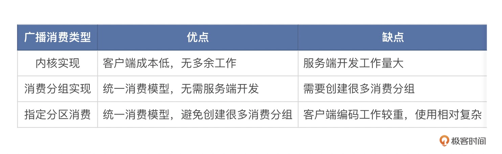

# 08 | 消费端：消费者客户端的SDK有哪些设计要点？（上）

你好，我是文强。上节课我们讲了生产端，这节课我们来讲讲消费端。

从技术上看，消费端 SDK 和生产端 SDK 一样，主要包括客户端基础功能和消费相关功能两部分。客户端基础功能在上一节讲过，我们就不再重复。

从实现来看，消费相关功能包括消费模型、分区消费模式、消费分组（订阅）、消费确认、消费失败处理五个部分。内容比较多，所以本节课我们将会聚焦消费模型的选择和分区消费模式设计这两个部分，下节课会继续完成剩下三个部分的讲解。

## 消费模型的选择

为了满足不同场景的业务需求，从实现机制上来看，主流消息队列一般支持 Pull、Push、Pop三种消费模型。

### Pull 模型

Pull（拉）模型是指客户端通过不断轮询的方式向服务端拉取数据。它是消息队列中使用最广泛和最基本的模型，主流的消息队列都支持这个模型。

它的好处是客户端根据自身的处理速度去拉取数据，不会对客户端和服务端造成额外的风险和负载压力。缺点是可能会出现大量无效返回的 Pull 调用，另外消费及时性不够，无法满足一些需要全链路低耗时的场景。

为了提高消费性能，Pull 模型都会支持批量读，即在客户端指定需要拉取多少条数据或者拉取多大的数据，然后传递给服务端。客户端拉取到数据并处理完成后，再重复拉取数据处理。如前面讲的，这种拉取模式的缺点是可能会出现长时间轮询到空数据的情况，从而浪费通信资源，提高服务端的负载。

来看下图的场景，当 Topic1 数据已经被消费完，此时如果消费者频繁来拉取数据并立即返回结果，客户端就会不停地重复请求服务端。当空数据请求特别多的时候，就会造成资源损耗，不利于提高吞吐，也有可能导致负载问题。

为了解决这个问题，正常的思路是在客户端根据一定策略进行等待和回避。这样做的话，就会出现如何设置等待时间的问题，客户端等待时间设置不合理就会出现消费不及时的情况。

所以为了解决空请求带来的问题，一般服务端会协助处理，有如下两个思路。

1. 服务端 hold 住请求

当客户端根据策略拉取数据时，如果没有足够的数据，就先在服务端等一段时间，等有数据后一起返回给客户端。这种方案的好处是，可以尽量提高吞吐能力，不会有太多的空交互请求。缺点是如果长时间不给客户端回包，会导致客户端请求超时，另外当数据不够时，hold 住请求的时间太长就会提高消费延时。

2. 服务端有数据的时候通知客户端

当服务端不 hold 住请求，立刻返回空数据，客户端收到空数据时则不再发起请求，会等待服务端的通知。当服务端有数据的时候，再主动通知客户端来拉取。这种方案的好处是可以及时通知客户端来拉取数据，从而降低消费延时。缺点是因为客户端和服务端一般是半双工的通信，此时服务端是不能主动向客户端发送消息的。

所以在 Pull 模型中，比较合适的方案是客户端告诉服务端：最多需要多少数据、最少需要多少数据、未达到最小数据时可以等多久三个信息。然后服务端首先判断是否有足够的数据，有的话就立即返回，否则就根据客户端设置的等待时长 hold 住请求，如果超时，无论是否有数据，都会直接给客户端返回当前的结果。

这种策略可以解决频繁不可控的空轮询请求。即使全是空轮询，对单个消费者来说，其 TPS也是可以预估的，即总时间 / 等待时长 = 总轮询次数。而如果需要降低消费延时，可以通过降低最小获取的数据大小和最大等待时长来提高获取的频率，从而尽量降低延时。通过这种方案，我们可以把理想的消费延迟时间降低到两次 Pull 请求之间的时间间隔。

在一些业务消息的场景中，因为应对的场景规模有限，可以将最大等待时长设置为 0，此时消费模型就变成了请求 - 返回的模式，当没数据的时候就会立即返回数据，其余逻辑交给客户端自己处理。

### Push 模型

Push（推）模型是为了解决消费及时性而提出来的。这个模型的本意是指当服务端有数据时会主动推给客户端，让数据的消费更加及时。理想中的思路如下图所示，即当服务端有数据以后，会主动推动给各个消费者。这个思路是非常好的，随着事件模型的发展，为了解决消费的及时性，很多消息队列都希望支持 Push 模型。

在实际的 Push 模型的实现上，一般有 Broker 内置 Push 功能、Broker 外独立实现 Push 功能的组件、在客户端实现伪 Push 功能三种思路。

第一种，Broker 内置 Push 功能是指在 Broker 中内置标准的 Push 的能力，由服务端向客户端主动推送数据。

这种方案的好处是 Broker 自带 Push 能力，无需重复开发和部署。Broker 内部可以感知到数据堆积情况，可以保证消息被及时消费。缺点是当消费者很多时，内核需要主动维护很多与第三方的长连接，并且需要处理各种客户端异常，比如客户端卡住、接收慢、处理慢等情况。这些推送数据、异常处理、连接维护等工作需要消耗很多的系统资源，在性能上容易对 Broker形成反压，导致 Broker 本身的性能和稳定性出现问题。

所以这种方案在主流消息队列中用得较少，比如 RabbitMQ 和某些金融证券领域的消息队列，为了保证消息投递的高效及时（比如全链路的毫秒级耗时），才会采用这种方案。

第二种，Broker 外独立实现 Push 功能的组件是指独立于 Broker 提供一个专门实现推模型的组件。通过先 Pull 数据，再将数据 Push 给客户端，从而简化客户端的使用，提高数据消费的及时性。

这种方案的好处是将 Push 组件独立部署，解决了 Broker 的性能和稳定性问题，也能实现Push 的效果。缺点是虽然实现了 Push 的模型，但其本质还是先 Pull 再 Push，从全链路来看，还是会存在延时较高的问题，并且需要单独开发独立的 Push 组件，开发和运维成本较高。

从实际业务上来讲，这种模型的使用场景较为有限，主要用在回调、事件触发的场景，在实际的流消费场景中用得较少。主要是因为通过第三方组件的 Push 灵活性不够，性能会比 Pull低。

第三种，在客户端实现伪 Push 功能是指在客户端内部维护内存队列，SDK 底层通过 Pull 模型从服务端拉取数据存储到客户端的内存队列中。然后通过回调的方式，触发用户设置的回调函数，将数据推送给应用程序，在使用体验上看就是 Push 的效果。

这种方案的好处在于通过客户端底层的封装，从用户体验看是 Push 模型的效果，解决用户代码层面的不断轮询问题，降低了用户的使用复杂度。缺点是底层依旧是 Pull 模型，还是得通过不断轮询的方式去服务端拉取数据，就会遇到 Pull 模型遇到的问题。

在客户端实现伪 Push，是目前消息队列在实现 Push 模型上常用的实现方案，因为它解决了客户体验上的主动回调触发消费问题。虽然底层会有不断轮询和消费延时的缺点，但是可以通过编码技巧来降低这两个问题的影响。

因为 Push 模型需要先分配分区和消费者的关系，客户端就需要感知分区分配、分区均衡等操作，从而在客户端就需要实现比较重的逻辑。并且当客户端和订阅的分区数较多时，容易出现需要很长的重平衡时间的情况。此时为了解决这个问题，业界提出了 Pop 模型。

### Pop 模型

Pop 模型想解决的是客户端实现较重，重平衡会暂停消费并且可能时间较长，从而出现消费倾斜的问题。

它的思路是客户端不需要感知到分区，直接通过 Pop 模型提供的 get 接口去获取到数据，消费成功后 ACK 数据。就跟我们发起 HTTP 请求去服务端拉取数据一样，不感知服务端的数据分布情况，只需要拉到数据。这种方案的好处是简化了消费模型，同时服务端可以感知到消费的堆积情况，可以根据堆积情况返回那些分区的数据给客户端，这样也简化了消息数据的分配策略。

从实现上来看，它将分区分配的工作移到了服务端，在服务端完成了消费者的分区分配、进度管理，然后暴露出了新的 Pop 和 ACK 接口。客户端调用 Pop 接口去拿取数据，消费成功后调用 ACK 去确认数据。这和 HTTP 的 Request 和 Response 的使用模型一致。

## 分区消费模式的设计

我们知道，消息队列的数据是在 Partition/Queue 维度承载的。所以消费过程中一个重要的工作就是消费者和分区的消费模式问题，即分区的数据能不能被多个消费者并发消费，一条数据能不能被所有消费者消费到，分区的数据能不能被顺序消费等等。

从技术上看，在数据的消费模式上主要有独占消费、共享消费、广播消费、灾备消费四个思路。

独占消费是指一个分区在同一个时间只能被一个消费者消费。在消费者启动时，会分配消费者和分区之间的消费关系。当消费者数量和分区数量都没有变化的情况下，两者之间的分配关系不会变动。当分配关系变动时，一个分组也只能被一个消费者消费，这个消费者可能是当前的，也可能是新的。如果消费者数量大于分区数量，则会有消费者被空置；反之，如果分区数量大于消费者数量，一个消费者则可以同时消费多个分区。

独占消费的好处是可以保证分区维度的消费是有序的。缺点是当数据出现倾斜、单个消费者出现性能问题或 hang 住时，会导致有些分区堆积严重。现在大部分消息队列默认支持的就是独占消费的类型，比如 Kafka、RocketMQ、Pulsar 等。

共享消费是指单个分区的数据可以同时被多个消费者消费。即分区的数据会依次投递给不同的消费者，一条数据只会投递给一个消费者。

这种方式的好处是，可以避免单个消费者的性能和稳定性问题导致分区的数据堆积。缺点是无法保证数据的顺序消费。这种模式一般用在对数据的有序性无要求的场景，比如日志。

广播消费是指一条数据要能够被多个消费者消费到。即分区中的一条数据可以投递给所有的消费者，这种方式是需要广播消费的场景。

实现广播消费一般有内核实现广播消费的模型、使用不同的消费分组消费和指定分区消费三种技术思路。

1. 内核实现广播消费的模型，指在 Broker 内核中的消息投递流程实现广播消费模式，即Broker 投递消息时，可以将一条消息吐给不同的消费者，从而实现广播消费。

2. 使用不同的消费分组对数据进行消费，指通过创建不同的消费者组消费同一个 Topic 或分区，不同的消费分组管理自己的消费进度，消费到同一条消息，从而实现广播消费的效果。

3. 指定分区消费，是指每个消费者指定分区进行消费，在本地记录消费位点，从而实现不同消费者消费同一条数据，达到广播消费的效果。

三种方案的优劣对比如下：

在常见的消息队列产品中，Pulsar 支持的 Share 消费模型就是第一种实现思路。Kafka 和RocketMQ 主要支持第二和第三种实现思路。

灾备消费是独占消费的升级版，在保持独占消费可以支持顺序消费的基础上，同时加入灾备的消费者。当消费者出现问题的时候，灾备消费者加入工作，继续保持独占顺序消费。

好处是既能保持独占顺序消费，又能保证容灾能力。缺点是无法解决消费倾斜的性能问题，另外还需要准备一个消费者来做灾备，使用成本较高。

业界还有一些其他用得比较少的消费模式，如果你有兴趣，可以去研究一下各个主流消息队列（如 Kafka、RocketMQ、Pulsar 等）的实现。

## 总结

在消费端，为了提高消费速度和消息投递的及时性，需要选择合适的消费模型，目前主流有Pull、Push、Pop 三种模型。

这三种模型的应用场景都不一样。目前业界主流消息队列使用的都是 Pull 模型。但为了满足业务需求，很多消息队列也会支持 Push 模型和 Pop 模型。其中，Push 模型的及时性更高，实现较为复杂，限制较多。Pop 模型本质上是 Pull 模型的一种，只是在实现和功能层面上，与 Pull 的实现思路和适用场景不一样。所以在模型的选择上来看，因为场景复杂，三种模型都是需要的。

常用的消费模式一般有独占消费、共享消费、广播消费、灾备消费四种。为了避免堆积，保证消息消费顺序，一般需要选择分区独占的消费模式。从单分区的维度，共享消费的性能是最高的。广播消费主要是通过创建多个消费分组、指定分区消费来实现的。灾备消费的场景用得相对较少。

## 思考题

当 Topic 的消息写入存在倾斜，某些分区消息堆积很多，此时选择哪种分区消费模式可以解决问题？

欢迎分享你的思考，如果觉得有收获，也欢迎你把这节课分享给身边的朋友。我们下节课再见！

## 上节课思考闭环

假设让你从头开始写一个消息队列的某个语言的 SDK，思考步骤是怎样的？

1. 思考客户端的模块组成，比如我们总结部分说到的三层结构。

2. 参考服务端网络模块的实现，进行客户端网络模块的选型开发，比如使用 Netty Client 或者Java Socket Client，然后完成连接管理、心跳检测等网路模块的开发工作。

3. 了解这个消息队列的协议设计的内容，各个接口的请求和返回的协议是什么样子的。

4. 思考如何构建请求，实现构建各个请求相关的逻辑代码实现。

5. 思考序列化模块怎么实现。

6. 完成第一个接口的请求和返回的处理。

7. 根据各个接口的调用参数进行开发。

8. 如果需要支持 SSL，就去参考这个语言官方的 SSL CLient 配置，然后编码实现，其他比如压缩的支持也是类似。
