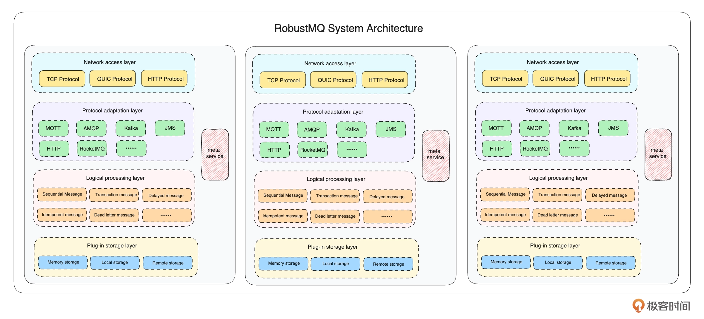

# 2024：关于消息队列未来技术演进的思考

你好，我是文强，很高兴继续和大家探讨消息队列。

过去这一年，消息队列这个领域也不断的有一些新的 Idea 出现。借着这节课，我来分享一下2024 年我对于“消息队列未来的技术演进路线”的一些思考。

## 三个方向：消息、流、MQTT

我们在第 01 讲聊过消息队列两个主要方向：消息和流。在技术的演进方面，本质上消息和流两个方向侧重的点是不一样的。因为：

- 消息：侧重功能、可靠性、稳定性。

- 流：侧重吞吐、性能、成本。

从而导致了在开源社区方面，两个方向都有各自的代表产品，消息方向是 RattibMQ 和RocketMQ，流方向是 Kafka。

因此在选型时，如果业务是侧重吞吐、性能的（比如大数据、日志处理等），我们就应该选择流方向的组件，比如 Kafka。而如果是业务消息，侧重功能、可靠性、稳定性（比如订单 ID的分发），那就应该选择消息方向的组件，比如 RabbitMQ、RocketMQ。

其实，在消息队列领域，一直有一个细分的方向，大家讲得少，那就是 MQTT。MQTT 协议主要是用于物联网的一个协议。因为它的核心能力特征也是 Pub/Sub，所以在大多数场景，它被分类到消息队列这一方向。

MQTT 的功能特点是需要解析标准 MQTT 协议，需要承载大量的 TCP 连接（比如物联网设备），具备双向通信的能力。并且它自身不需要带存储层，内核需要具备类数据集成的能力，将接收到的数据分发到下游的存储组件，比如 Kafka、ES 等等。

目前开源方面，MQTT 成熟的组件代表是 EMQX 和 HiveMQ。

因此 MQTT 在技术方面，侧重的是：对 MQTT 3/4/5 协议的支持程度、对大量连接的处理能力（百万、千万、亿级）、数据集成、分发的能力。

## 向外看：2024 年 MQ 商业化的一些信息

关于这个问题的讨论，消息队列业界的从业者大多都有自己的判断。 我们先从业界商业化的角度来看看 2024 年的一些进展。

1. Redpanda：一个用 C++ 重写的 Kafka，完全兼容 Kafka 的协议，核心竞争力是 C++ 重写带来的性能优势，去掉 ZooKeeper 依赖后的架构简化，合理地使用了分层存储带来的成本优势。Redpanda 商业化效果非常好，到 C 轮融资了 1.65 亿美金。说明它的路径取得了商业上的成功。从侧面佐证了在技术路线上它的价值。

2. WrapStream：一个用 Go 重写的 Kafka，完全兼容 Kafka 的协议。它的核心竞争力是存储层直接基于 S3 这种对象存储来设计实现，从而达到存算分离、存储降本的优势，降低

- Kafka 在扩容时需要 Rebalance 的最大缺陷。WrapStream 在 2024 年被 Kafka 的商业化公司 Confluent 收购。从侧面也佐证了 WrapStream 本身的价值。

3. Pulsar Ursa：Pulsar 的商业化公司推出了一款 Java 实现消息引擎 Ursa。核心思路是完全兼容 Kafka 协议和存算分离架构，存储层也是基于 S3 这种对象存储来存储数据。它有一个特点是存储的数据格式是 LakeHouse 格式。也就是说它的数据是可以被数据湖 (比如Iceberg、Hudi 等直接使用的)，因此数据可以直接转储到数据湖中，从而实现数据直接入湖。这个思路是非常不错的。Ursa 商业化进展应该还处于早期，距离成熟还需要时间。

4. AutoMQ：一个在开源 Apache Kafka 上 Fork 出来的项目，它在 Apache Kafka 代码的基础上，重写了 Kafka 的存储层，基于硬盘（云盘或本地硬盘）和对象存储（S3）来实现存储层，从而实现存算分离，解决 Kakfa 扩容时需要 Rebalance 的缺陷，且降低大规模集群中 Kafka 的存储成本。从技术上来看，AutoMQ 和 WrapStream 的思路是一样的，核心都是通过对象存储来实现存算分离和降低存储成本。最大的区别在于，计算层 AutoMQ 是在Apache Kafka 上改，将 API 的兼容度、计算层的开发工作量降到最低。

5. ApsaraMQ：是阿里云消息队列的团队在当前所有 MQ 产品的基础上，推出的品牌。从技术上看，我个人认为核心是通过 Serverless、存算分离、多级存储等理念推动云上多款 MQ的架构整合，从而达到 All in One 的效果。

从 2024 年消息队列领域比较知名的几款产品，可以看出，消息队列商业化产品的方向主要集中在流的 Kafka 方向，而在消息和 MQTT 方向，基本都是以前的产品在发光发热。

在我看来，有以下几个原因：

1. 流方向主打的是吞吐和大流量，从而在商业化方面更具备规模化的优势。简单说，更容易做大商业化的收入，从而达到商业化的目标。

2. Kafka 协议在流方向，已经成为了这个方向的标准。只要能够支持好 Kafka 协议，并且做出比 Apache Kafka、Confluent Kafka（Kora）有更大的优势，那么客户接受程度是很高的，因为客户的切换成本非常低。Redpanda 就是例子。

3. 消息方向和 MQTT 方向的核心诉求是功能和稳定，一般用在业务的核心链路，用户追求稳定，对成本敏感度低，因此很难接受新的商业化产品，从而阻碍了新产品的孵化。

也可以看到，从技术上看，上面这几款产品的核心思路是：

1. 通过更高性能的开发语言来提升 MQ 本身的性能和稳定性。

2. 通过存算分离的架构来解决弹性扩缩容的缺点，从而实现集群的 Serverless 化。

3. 通过将存储降级到更低成本的存储层（主要是对象存储或者某些公司内部自研的文件系统）中，从而降低整体的成本。

4. 适配当前的标准协议，来降低用户的使用和迁移成本。

从上面四点思路，其实就可以总结出消息队列技术发展的方向：通过高性能的语言，实现一个存算分离、能够兼容多种协议、能够适配多种存储引擎的消息队列。

接下来，我来分享一下我个人对消息队列未来发展的一些判断。仅代表一家之言。

## 个人判断：融合型的消息队列大势所趋

从架构上看，消息队列只是中间件领域的一个垂直分支，它功能其实是非常单一的。我们在第 02 讲列的功能基本就是全集了。并且里面的大多数功能，是大部分用户用不到的，因为大部分用户用的只是最基础的 Pub/Sub 功能。

因此我认为，基于消息队列这种垂直分支的单一性，去做一款能够兼容多种方向的消息队列是可行的。

另外，当前的情况是，不同方向都有其代表的开源产品，而这些开源产品大多已经出现了十几、二十几年了。它们本身架构设计时的局限性，会在近几年 Infra 设计理念（比如云原生、AI）的发展中，慢慢变得突出。不过会因为当前架构和代码的局限，致使其很难做出大的改动。最明显的例子是，Apache Kafka 的存算一体架构导致的 Rebalance 问题，这么多年依旧难以彻底解决。

因此，在我看来，在开源的消息队列中，应该会基于当前优秀的架构理念（比如云原生、存算分离、对象存储等等）、开发语言（比如 Rust），并且吸纳当前产品架构的优劣势，进而演进出一款 All In One 的消息队列。也就是我认为的融合型消息队列。

其实道理很简单，可以参考数据库领域。数据库领域的新产品目前百花齐放，而我认为，作为架构中的必不可少的消息队列，也将会是这个趋势。

这里分享一个我的观点：Infra 软件是不断向前演进的，不会停滞不前。而 MQ 也是如此，不会一直停留在前十年的产品。

那么向前演进的内在驱动力是什么呢？ 我认为是成本和规模。成本分为资源成本、运维成本、人力成本。规模也就是流量。市场需要一款成本更低，且能够承载不同规模流量、不同场景的一款消息队列。因此：

1. 一款能够兼容多协议的消息队列，可以极大地降低公司的研发人力成本、运维成本。

2. 一款高性能且具备 Serverless 能力的消息队列，可以极大地降低资源成本。

因此，我对融合型消息队列的定义是：兼容多种主流消息队列协议+ 架构上具备完整Serveless 能力的消息队列。也就是 All in One 的消息队列。

那么开发这种 All in One 的消息队列可行性怎么样呢？

## All in One 的消息队列的可行性

在我看来，All In One 的消息队列是可行的，且技术上肯定是往这个趋势演进的。我认为主要有下面几个原因：

1. 消息队列三个细分方向不是天然存在的，只是因为技术侧重点的不同，从而在演进路上分叉开的。这样分叉开的好处就是，可以降低软件的复杂性、开发成本，从而加快软件的开发和成熟周期。也就是说，这三个方向并不是不可融合的。

2. 经过了这么多年，随着分布式、云架构、云原生等理念和基础设施的发展和成熟，也为这种融合提供了理论和基础条件的支撑。

3. 不同方向的 MQ 的功能是有大量重复的，消息队列本身垂直功能相对单一、稳定的特性，也让这种融合型消息队列的功能不会很复杂。

4. 业界已经在往 All In One 这个方向走了，比如 RocketMQ、Pulsar，都提出了统一底座、兼容多协议的规划，已经在这条路上向前走了一段距离。

5. 业界的从业者，也大多认为这是后续的一个演进趋势。

即然是可行的，为什么到今天还没有一个真正的 All in One 的消息队列出现呢？我认为有两个原因：

1. 各个方向的消息队列都有成熟的产品可用。

2. All In One 的消息队列研发投入大、周期长、成熟稳定的周期也长。

基于前两个原因，从公司的角度，很难长期投入做一个 All In One 的软件。而现今各个方向成熟的消息队列，基本都是大公司贡献的。路径一般是：大公司有需要，根据需要投入研发，在内部使用成熟后，贡献给社区。

那么还会有 All in One 的消息队列出现吗？我认为会的。

在我看来，今天推动基础技术演进的核心是开源社区，而不是企业。是开源社区一群兴趣相投、有技术理想的开发者，而不是企业的研发团队。在开源社区，我认为只要是正确的方向，那么自然会有一群对技术充满热爱的研发者去推动技术的演进。对所有基础软件如此，对 MQ也是如此。

作为可以长期从事消息队列领域的开发者，我启动了一个叫 RobustMQ 的项目，来验证我自己对消息队列未来技术演进的一些思考。因此，下面我将通过 RobustMQ 来拆解一下我自己对融合型消息队列的定义。

## 融合型消息队列：RobustMQ

RobustMQ 的定义是下一代高性能云原生融合型消息队列（Next generation highperformance cloud-native converged messaging engine）。它的目标是 100% 基于 Rust 构建一个可以兼容多种主流消息队列协议、架构上具备完整 Serveless 能力的消息队列。

它具备以下特点：

1. 支持多种主流消息协议：支持 MQTT 3.1/3.1.1/5.0、AMQP、RocketMQRemoting/gRPC、Kafka Protocol、OpenMessing、JNS、SQS 等主流消息协议。

2. 分层架构：计算层、存储层、调度层独立架构，每一层均具备简单快速的扩缩容能力。

3. 插件式存储：独立插件式的存储层实现，可根据需要选择合适的存储层。兼容传统和云原生架构，支持云、IDC 多种部署形态。

4. 100% 基于 Rust 构建：具备高性能、高可靠性、高稳定能力，无外部组件依赖的高内聚架构。

5. 全功能支持：支持顺序消息、死信消息、事务消息、幂等消息、延时消息等丰富的消息功能。

也就是说，在这个架构上，它使用了高性能的语言 Rust 来构建一个兼容多种协议、具备存算分离架构、底层支持多种存储引擎的消息队列。从而实现一个 All in One 的消息队列。

这里不再详细展开介绍了，如果你对 All in one 的消息队列或 RobustMQ 有兴趣，欢迎到GitHub 了解，链接：https://github.com/robustmq/robustmq。

当然，这些只是愿景，RobustMQ 本身还处于非常早期的阶段。我们要认识到基础软件的开发周期是相当长的，需要几年、甚至十几年的打磨。RobustMQ 当前主要作用是用来探索和验证我对消息队列技术演进方向判断的可行性。同时也希望通过这个项目，能够产生一些想法的碰撞，从而提升自己对基础软件的认知和思考。

## 总结

当前业界的 MQ 因为功能特性的侧重点不同，不同方向其技术实现的方式和路径也不同，从而导致不同的方向都有各自的成熟组件，以及不同的演进方向。

我认为消息队列未来的演进方向是：以成本驱动的、兼容多种主流消息队列协议、架构上具备完整 Serveless 能力的融合型消息队列。也就是 All in One 的消息队列。这和我之前说的，消息和流融合，本质上是一个思路，核心就是能用一个组件来满足多种场景，而不是为了不同的场景，去部署不同的消息队列。

## 思考题

你认为接下来消息队列领域的技术演进方向是什么？

期待你的思考，也欢迎你深入了解我的项目——RobustMQ，—个 100% 用 Rust 实现的云原生融合型消息队列，欢迎贡献代码，成为 Contributor。
