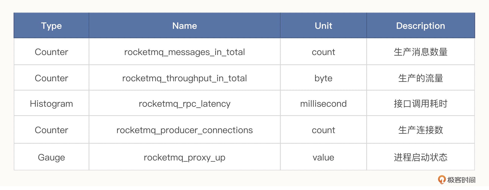
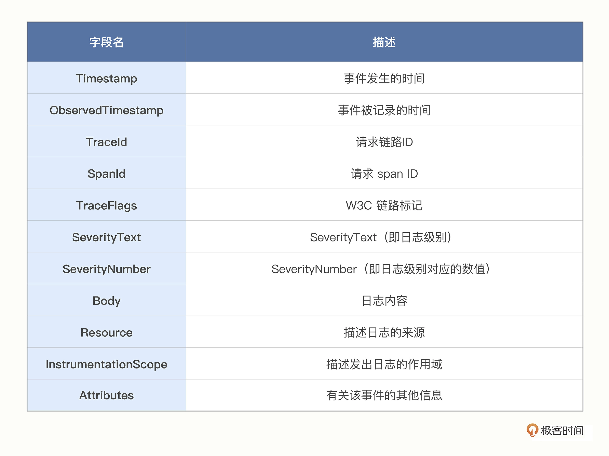

# 21 | 可观测性：如何设计实现一个好用的分布式监控体系？

你好，我是文强。

“可观测性”是近几年技术圈很火的话题，特别是 OpenCensus 和 OpenTracing 合并成立OpenTelemetry 后，可观测性的发展速度越来越快，越来越成熟。

OpenTelemetry 主要是解决可观测性数据的获取规范问题，类似消息队列领域的 AMQP 和OpenMessaging，目的都是打造一个标准化规范。它系统地将可观测性分为指标（Metrics）、日志（Logs）、跟踪（Traces）三个方面。在消息队列领域，可观测性建设主要也是围绕着这三点展开。

今天我们先来聊一聊怎样实现好用的指标和日志模块，以便我们快速定位业务问题出在哪里，下一节讲跟踪（Traces）。

## 指标需要关注哪几个维度？

从技术上看，指标分为单机维度和集群维度。

单机维度的指标主要分为操作系统、语言虚拟机、应用进程三层。


所以，从排查问题的角度来看，我们需要关注对应的三层指标。

- 操作系统：IaaS 层指标的 CPU、内存、网卡、硬盘等等。

- 语言虚拟机：Java 虚拟机的 GC、线程池、堆容量等等。

- 应用进程：进程中的生产消费各阶段耗时、接口的请求数、进程文件句柄数量等等。

集群维度是多个应用进程（节点）构成的集群维度的一些监控指标，比如集群中的 Topic 总数、分区数、Controller 节点的负载等等。

这两个维度讲得有点宽泛，接下来我们就详细讲一下我们需要关注哪些具体的关键指标，以便能快速定位出问题。

## 消息队列有哪些关键指标？

虽然各款消息队列产品的功能、定位、架构的差别很大，指标也是特定于系统的，但是消息队列的几个核心流程都是相似的，比如元数据获取、生产消费流程等逻辑。

所以，所有的消息队列有通用的核心指标，主要有五类：集群（Cluster）、节点（Node/Broker）、主题（Topic）、分区 / 队列（Partiton/Queue）、消费分组 / 订阅（Group/Subscription）。


- 集群

集群指标主要是集群资源数量相关的，比如主题数量、分区数量、节点数量等集群维度的信息，这类信息的影响在于数量。如果某些资源数量过大，有可能影响集群的稳定。

几乎所有的消息队列产品，在主题或分区数量太多的情况下，都会出现性能下降或者不稳定问题。比如，RabbitMQ 的每个节点需要同步缓存全量 Queue 数据，如果 Queue 太多，会导致单机负载变高。Kafka 的分区过多，会加大 Controller 的压力。Pulsar 的分区太多，会对ZooKeeper 造成压力等等。

- 节点

节点指标一般包含节点的生产消费的吞吐量、耗时、消息数，接口的请求数、错误码、耗时，JVM FullGC、YongGC 的次数，节点的 TCP 连接数等等。

节点相关的指标，都是我们需要重点关注的指标。因为消息队列主打高吞吐、低延时，所以耗时和吞吐量是业务最直接感知的指标。比如出现报错时，接口维度的错误码统计就需要重点关注。比如客户端出现耗时高，首先就需要观察各个节点的生产消费的耗时；然后观察是否发生GC、接口调用次数、连接是否有异常；最后关注 IaaS 层指标，如 CPU、内存、网卡等指标是否有异常，不管在什么时候，IaaS 指标和 Java 虚拟机相关的指标都是非常重要的。

- 主题和分区

主题指标一般是主题维度的吞吐量、消息条数、生产和消费耗时数据。当业务反馈只有某些主题异常时，这些指标可以用来定位问题。

分区维度的指标是一样的，只是可以细化到定位分区和队列维度的异常。

- 消费分组和订阅

消费分组 / 订阅的指标一般是消费速度、未消费的消息数量（堆积数）。平时用来观察消费的情况，比如消费速度是否跟得上、是否有堆积等等。或者当消费出现异常的时候，我们可以通过这个指标用来判断消费速度是否有问题，然后结合主题和分区维度的指标，最终确认问题。

结合这五个维度的指标，我们基本可以定位出常见的性能和稳定性问题。

除了通用的指标，不同的产品因为架构实现不一样，会有各自的独特指标。如果需要进一步定位问题，我们就需要结合这些指标去分析。比如 Kafka 的 Controller 和协调器、Pulsar 的Ledger、RabbitMQ 的 Exchange 相关的指标，这部分主要和稳定性相关，需要理解各个组件的架构才能理解指标的含义，我们后面会详细讲。

这些指标，我们从技术上理解，流量或者请求次数应该是一个累加的值，线程池的容量应该是一个可加可减的值，耗时应该是一个包含分布信息的值，线程状态应该是一个瞬时的值。那从编码的角度，我们如何实现记录这些指标呢？

## 如何记录指标？

先来看一个小需求：我们从功能上需要记录 Broker 维度的生产消息数量、生产的流量、接口调用耗时、生产连接数、进程启动状态五个信息。来看一下这五个指标的功能定义：

- 生产消息数量，应该是一个累加的值。

- 生产的流量，也是一个累加的值。

- 接口调用耗时，应该是一个分布的值。

- 生产连接数，应该是一个可加可减的值。

- 进程启动状态，应该是一个瞬时值。

那如果在代码中要记录这些指标，应该怎么实现呢？

### 主流的指标库

从编码实现的角度来看，业界有多种指标的记录方式，如下图所示，比较常见的有以下五种：

- Java Metrics

- Prometheus Metrics

- Kafka 基于 Metrics 实现的自定义 KafkaMetrics

- Golang 的指标库 go-metrics（一般各个语言也会有对应的 Metrics 库）

- 可观测性标准 OpenTelemetry 中的 Metrics


我们接下来主要分析一下 Java Metrics、 Prometheus、OpenTelemetry 支持的指标类型。

Java Metrics 提供了五种指标类型。

- Gauge：提供返回一个变量的瞬时值 / 当前值，可以用来定义指标的当前状态的瞬时值，比如当前集群是否限流。

- Counter：是一种特殊的 Gauge 度量，它提供一个获取可增可减的时刻量，比如线程池的空余容量。

- Meter：用来测量事件发生的频率，也可以统计最近 1 分钟、5 分钟和 15 分钟的频率，比如接口请求的频率。

- Histogram：常用来统计数据的分布，比如最小值、最大值、平均值和中值，还可以进行百分比的分布统计，例如 TP75、TP90 和 TP99 等，接口请求的耗时分布。

- Timer：可以理解为 Meter+Histogram 的合体，需要同时使用 Histograms 和 Meters 功能时，就可以用 Timers。

Prometheus Metrics 提供了四种指标类型。

- Gauge：记录可增可减的时刻量。

- Counter：是一个只增不减的计数器。

- Histogram：直方图，在一段时间范围内对数据进行采样，最后将数据展示为直方图。

- Summary：概要，反映百分位值，例如某 RPC 接口，95% 的请求耗时低于 100ms，99%的请求耗时低于 200ms。

可以看到 Java Metrics 库和 Prometheus 指标类型基本相似，但含义和功能并不完全相同。这也是可观测性标准 OpenTelemetry 中特意强调指标（Metrics）的理由，希望在指标定义方面制定一套统一规范，并提供各个语言的代码库，降低重复开发的成本和使用者理解学习的成本。

OpenTelemetry 主要提供了六种指标类型（详细可参考 OpenTelemetry Metrics 官网文档）。

- Counter：递增的计数器。

- CounterObserver：异步方式的递增计数器。

- UpDownCounter：可增可减的计数器。

- UpDownCounterObserver：异步方式的可增可减计数器。

- Histogram：统计一组数据，如直方图。

- GaugeObserver：异步的方式观测最新数据的计量器。

知道了各个库的指标定义，我们回到上面的需求，看要如何完成记录指标。

### 小需求的实现

假设我们用 Prometheus Metrics 来记录指标。



如上图所示，结合需求和指标类型的功能定义来看，生产消息数量、生产的流量、生产连接数是累加值，可以用 Counter 表示；接口调用耗时是分布值，可以用 Histogram 表示；进程启动状态是瞬时值，可以用 Gauge 表示。

知道了用什么指标类型，那怎么编码实现呢？我们来看下面的 Prometheus Java 代码示例：

```
//counter的使用
Counter requests = Counter.build()
    .name("rocketmq_messages_in_total")
    .help("Rocketmq messages in total").register();
requests.inc();
// gauge的使用
Gauge proxyUp = Gauge.build()
    .name("rocketmq_proxy_up")
    .help("Rocketmq proxy up").register();
proxyUp.inc();
proxyUp.dec();
// histogram的使用
Histogram requestLatency = Histogram.build()
    .name("rocketmq_rpc_latency")
    .help("Rocketmq rpc latency").register();
requestLatency.time(new Runnable() {
     public abstract void run() {
       // Your code here.
     }
   });
```

从上面的示例中，我们知道了代码如何记录。如果想了解更多具体的使用细节，你可以参考Prometheus Java Client 官方文档。

业界主流消息队列指标模块实现，Kafka 是基于 Java Metrics 的，RabbitMQ、Pulsar、RocketMQ 4.0 是基于 Prometheus 的，RocketMQ 5.0 以后是基于 OpenTelemetry 规范的。

现在指标在进程内部已经被记录了，我们必须暴露出来给监控系统集成才有意义。你是不是在想，暴露指标不是很容易嘛，比如将指标定期写入到文件，或者开个 HTTP 端口给其他系统拉取就可以了。

## 如何暴露指标？

指标暴露的目的是让第三方系统简单、规范地获取到指标。接下来我们来看一下主流的指标暴露方案。

### 业界主要指标暴露方案

从技术上看，如下图所示，当前业界主要的指标暴露方案，大致可以分为四种。


- 自定义 TCP/HTTP 接口

自定义 TCP 接口是指通过服务本身暴露四层的 TCP 接口，来暴露服务内的指标数据。这种方式需要先设计私有协议，然后 Client SDK 封装接口来拉取数据。缺点是私有协议访问，不方便被集成，并且添加定义指标需要修改访问协议，工作量很大。

自定义 HTTP 接口指在服务内启动一个 HTTP Server，通过 HTTP 协议暴露指标内容。这种方式相对自定义 TCP 接口来说会更方便点，但是数据量大时在性能层面会有一些瓶颈。

- JMX Service Server

JMX（Java Management Extensions）是 Java 提供的一套标准的代理和服务，通过基于TCP 层的 JMX 协议远程获取数据。早期在 Java 里面用得比较多，近几年用的人相对较少。主要缺点是只能在 Java 里面用，而且只能通过 JMX 私有协议访问。

- Prometheus 标准接口

Prometheus 是在服务内部启动一个 HTTP 服务，然后暴露 /Metrics 接口，供客户端拉取数据。

- OpenTelemetry 上报

OpenTelemetry 它定义了一个接收器 Collector，即指标上报方根据 OpenTelemetry 的规范将数据上报到 Collector 中。跟上面三种不一样，前三种是 Pull 模型，OpenTelmetry 是 Push 的模型。

在早期，Prometheus 还未发展成熟时，前面两种用得比较多，比如 Kafka 用的是 JMXService、RocketMQ 5.0 以前用的是集成在 Admin 里面的自定义 TCP Insterface 方式，RabbitMQ 用的是自定义 HTTP 接口。

随着 Prometheus 和 OpenTelemetry 的发展，这两种方案用的越来越多。接下来我们主要来看这两种方案的使用，先来看一下 Prometheus 方案。

### 标准 Prometheus 方案

从技术上看，Prometheus 采集指标主要有下面两种形式。

第一种是在内核中内置 HTTP Server，然后暴露 /metrics 接口，返回 Prometheus 需要的格式数据。天生就支持集成 Peometheus 监控，使用起来很方便，基本没有缺点。Pulsar、RocketMQ5.0 就是这种形式。RabbitMQ 是通过提供 Prometheus 插件来实现的，也可以算是这一类。


第二种是额外提供 Export 组件。Kafka、RocketMQ 4.0 就是这种形式。为什么有这种形式呢？因为如果要内置 Prometheus Metrics 接口，首先要内置一个 HTTP Server，然后在指标注册时使用 Prometheus 的格式来注册，以确保符合规范。

但是很多组件已经发展了多年，Metrics 模块已经成熟稳定，投入大力气改造的收益不大。所以一般会先开发一个单独的 Export 组件，使用原先的 TCP/HTTP 方式去拉取指标，然后整合成 Prometheus 需要的格式。最后通过自身暴露的 HTTP /metrics 接口，把指标暴露给Prometheus 集成。这样既不用改变原先的代码，又能实现 Prometheus 的集成。


这两种基于 Prometheus 的指标暴露格式，使用起来简单方便、方案成熟，适合中小规模的集群部署。但在一些大企业或者云平台，当集群有几万、几十万节点时，需要实现秒级的指标采集，Prometheus 会有明显的性能瓶颈。

所以，这类平台或者企业都会有自研的分布式指标采集系统，通过定期的 Pull 模型去访问Broker 拉取各种指标，汇总计算。


分布式指标采集系统，解决的是大规模异构集群的指标采集，以及采集中的性能、调度相关的问题。它的实现比较复杂，如果你有兴趣，可以找找课外资料，留言讨论。

### 标准 OpenTelemetry 方案

可观测性规范 OpenTelemetry 推荐的指标暴露方式，需要部署一个 Collector 来传输指标数据。OpenTelemetry 官方和各个云厂商都有提供 Collector 的实现，可以很方便地把数据上报到它们提供的 Collector 中。

你可以把 Collector 理解为一个服务端，专门用来接收数据，它会根据 OpenTelemetry 定义的规范接收数据。你只要是按照 OpenTelemetry 定义的规范，就能成功上报数据，不会有厂商绑定或产品绑定的问题。


上面只是简短的技术思路，没有代码示例。如果需要了解更多具体使用，请你参考Prometheus 官方文档和 OpenTelemetry 官方文档。

从使用上来看，目前用得最多的是 Prometheus 方案，主要原因是成熟且生态已经完整了。OpenTelemetry 作最为一个标准规范，后续估计也会慢慢发展。我个人还是比较习惯用Prometheus 方案，但长期来看，如果是全新的组件，我建议你基于 OpenTelemetry 来设计实现指标模块。

到这里，如何实现好用的监控指标，我们就学完了，接下来我们看看如何印打日志。打印日志听起来很简单，其实学问很多。

## 怎样打印日志?

看日志的时候，我们经常遇到两个问题。

- 出问题的时候，日志太少了，找不到问题。

- 出问题的时候，日志太多了，一下子就刷没了，找不到了。

对于第一个问题，日志太少，我们首先要保证日志内容完整，携带我们需要排查的所有信息。

这也是为什么很多大的开源项目都会把 Logs 模块独立出来。一般情况，独立日志模块有两个好处：一是代码封装，让使用更加方便；二是需要在项目中规范日志的内容或格式，比如统一日志格式（JSON 格式、文本格式），或者内容中默认带上时间戳、带上请求 ID 等等，让日志内容更加完整。

不过完整的日志内容说起来简单，但是因为业务形态、技术体系不同，什么日志格式才能叫完整呢？

说实话，这是没有答案的，就跟一千个人有一千个哈姆雷特是一个道理。但是我们可以参考一下 OpenTelemetry Logs 推荐的标准规范内容，看看日志一般要包含哪些内容。因为OpenTelemetry Logs 的格式是经过社区各个大厂的人员不断讨论出来的，有比较好的参考意义。另外日志的打印，我也建议你使用 OpenTelemetryLogs 组件，它的内容很齐全，集成起来也方便。

Opentelmetry 推荐的日志内容主要包含事件、ID、日志级别、内容、额外信息五部分，跟我们自己定义是类似的，但是它还包含了日志来源、日志作用域等信息，有助于我们确定日志发生的上下文，辅助排查问题。而这些字段我们自己设计的时候很容易忽略，这就是参考标准的意义。



当然对格式的定义，大家肯定会有自己的见解，你可以看社区的讨论 OpenTelemetry LogData Model。

我建议你可以尽量多打印一些打日志。在关键的节点都可以放上日志，比如请求的接收和返回、每条消息进 / 出延时队列、死信队列的时间。

现在第一个问题解决了，但是一旦多打日志，又容易出现第二个问题。日志太多，很难找到需要的日志，这个时候我们需要控制好合适的日志级别。

我们最经常使用的日志级别一般是 Info、Warn、Error，可以多用 Trace、Debug 级别的日志，比如接收请求的时间和内容、请求返回的时间和内容可以定义为 Trace。这里我也给你分享一个技巧，平时你可以设置为 Info 级别，在出问题的时候再调整日志级别，查看更详细的日志。

不过在大部分日志库里，我们修改日志级别是需要重启应用的，或者需要经过特殊的配置，才能实现日志级别的动态修改。所以，为避免在出问题时需要重启进、程调整日志级别，我们需要在应用中配置可动态修改的日志级别（具体如何配置，资料很多，比如使用 SpringBoot 的同学可以根据文档《在 Spring Boot 应用程序中动态修改 Logger 日志级别》配置可动态修改的日志级别）。

另外还要注意日志的保留策略，因为磁盘空间有限，我们通常会配置保留日志的文件数或者大小，比如每个日志文件 1G，保留 50 个文件。在系统异常的时候，可能会产生很多的异常信息，文件可能会被滚动刷没，所以可以动态设置日志保留时间也非常重要。

最后，为了更好地排查问题，我们需要把不同的日志分类，写入不同的文件。

如果在应用启动时，把不同功能、模块的日志都打印到一个文件里面，日志之间会相互穿插，干扰问题的排查。所以一般我们需要把不同的模块、功能的日志单独文件记录，以便问题排查（日志分类的配置方式，你可以参考 Kafka 默认日志配置）。

## 总结

消息队列集群的指标应该关注操作系统、语言虚拟机、应用进程三个维度。其中最需要重点关注应用进程。

应用进程的监控主要分为集群、节点、Topic、分区、消费分组五大模块。另外还需要关注一些消息队列架构特有的指标，比如 RabbitMQ 的 Exchange、Kafka 的 Controller 等等。

从记录指标上来看，业界有多种指标库来记录指标。主要有 Java Metrics、PrometheusMetrics、OpenTelemetry 等库。目前使用最多的是 Prometheus Metrics，OpenTelemetry 作为一个新的规范，我也建议你考虑使用。

从指标暴露的角度来看，主要有 JMX Service Server、自定义 TCP/HTTP 接口、Prometheus标注接口、OpenTelemetry 几种方案。业界主流消息队列集群都有在用。如果是新组件，我比较建议你使用 Prometheus 或 OpenTelemetry 方案。

基于我自己运营开源集群和自研消息队列的经验，我也总结了打印日志时需要关注的四点。

- 日志内容要完整，携带我们需要排查的所有信息。

- 日志内容要做到该打的要打，不该打的不打。

- 能够动态调整日志的级别和保留策略。

- 独立分类的日志文件。

## 思考题

如果让你在当前主要维护的一个服务中实现透明监控，你会怎么做？

期待看到你的留言，鼓励参与讨论，如果觉得有收获，也欢迎你把这节课分享给感兴趣的朋友。我们下节课再见！

## 上节课思考闭环

全局限流 Server 选型的要点是什么？社区有哪些选择？

1. 集群部署、具备横向扩容、自动容灾切换的能力。

2. 最好自带可降级的能力，以降低开发成本。

3. 最好是长连接，这样在数据上报和获取状态的耗时较低。

业界主要有 Redis、Sentinel、ASAS、PolarisMesh 等。
