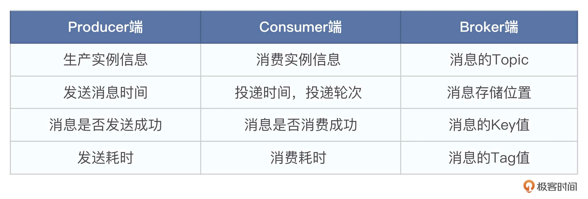
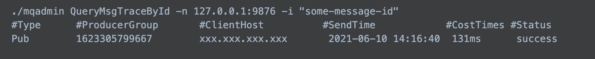

# 24 | 从集群角度拆解RocketMQ的架构设计与实现

你好，我是文强。

上节课我们讲完了 RabbitMQ，今天继续来看看同样是消息方向的 RocketMQ 在集群构建、部署形态、数据可靠性、安全控制、可观测性等五个方面的设计实现。

## 集群构建


首先，我们还是从元数据存储和节点发现两个方面来分析一下 RocketMQ 的集群构建。


在前面的课程中，我们知道 RocketMQ 的元数据是存储在 NameServer 中。严格意义上来说，这个说法是不对的。RocketMQ 的元数据实际是存储在 Broker 上，不是直接存储在NameServer 中。NameServer 本身只是一个缓存服务，没有持久化存储的能力，先来看一张图示。


如上图所示，元数据信息实际存储在每台 Broker 上，每台 Broker 会在本节点维护持久化文件来存储元数据信息。这些元数据信息主要包括节点信息、节点上的 Topic、分区信息等等。在Broker 启动时，会先连接 NameServer 注册节点信息，并将保存的元数据上报到所有NameServer 节点中。此时所有 NameServer 节点就有全量的元数据信息了，从而完成了节点之间的发现。

从原理来看，RocketMQ 是基于第三方组件 NameServer 来完成节点发现的。即通过上报节点信息到一个中央存储，从而发现集群中的其他节点。

Broker 和 NameServer 之间会有保活机制，Broker 会定期和 NameServer 保持心跳探测，来确认节点运行正常。当 Broker 异常时，就会被踢出集群。

跟 RabbitMQ 不同的是，RocketMQ 发展至今，其集群部署形态经历了多次大的升级。为了更

好地理解数据可靠性，我们需要先理解 RocketMQ 的各种部署形态以及它们想解决的问题。主要有 Master/Slave 、DLedger、Controller 三种部署模式。下面我们先来看一下Master/Slave 模式。

## 部署模式

### Master/Slave 模式

Master/Slave 模式就是典型的主从架构，和 MySQL 的主从原理一样。


如上图所示，集群部署时会先配置 Broker 是 Master 节点还是 Slave 节点。Master 负责写入，Slave 负责备份和读取。早期架构是不支持主从切换的，即当 Master 挂了以后，Slave 无法成为 Master。此时会导致一些只能在 Master 上完成的工作无法完成，比如数据写入、Offset 操作、结束事务等等。

所以在创建 Topic 时，会建议在多个 Master 节点上同时创建这个 Topic 及其所有分区，来看下图：


如上图所示，所有的 Master 节点都可以同时为这个 Topic 提供服务。当某个 Master 节点挂了后，其他 Master 节点依旧可以提供同样的服务，不影响新数据的写入。这种方式的好处是当负载过高时，可以通过快速横向添加节点来扩容。缺点是这个模型无法保证生产的消息的有序。节点挂了以后，这个节点上的未消费的数据不能被消费，并且 Topic 和分区数会有放大效应。因为每个节点上都需要创建全量的 Topic 和分区，此时瓶颈就存在单个节点上了。

既然有 Slave 的存在，理论上当 Master 故障后，Slave 就需要接替 Master 继续提供服务。所以为了解决 Master/Slave 的主从切换问题，RocketMQ 引入了 DLedger 来完成这个事情。

### Dledger 模式

DLedger 模式是为了解决分区选主和主从切换问题而引入的。因为如果要实现主从切换，就需要先保证主从之间数据的一致性，所以 DLeger 的核心是通过 Raft 算法实现的 Raft

Commitlog。


如上图所示，Dledger 用基于 Raft 算法实现的 Raft Commitlog 代替了原来的 Commitlog（Commitlog 请参考第 11 讲），使得 Commitlog 具备了选举和切换的能力。

因为是基于 Raft 算法实现的，所以根据 Raft 算法的多数原则，集群最少必须由三个节点来组成。不同节点的 Raft Commitlog 之间会根据 Raft 算法来完成数据同步和选主操作。当 Master发生故障后，会先通过内部协商，然后从 Slave 节点中选出新的 Master，从而完成主从切换。

因为实现方式的原因，Deledger 模式最少需要三个节点，并且无法兼容 RocketMQ 原生的存储和复制能力（比如 Master/Slave 模式），而且这个模式维护较困难。所以为了解决这几个问题，RocketMQ 将 DLedger（Raft）能力进行上移，重新实现了选主组件 DLedger

Controller，这就是 RocketMQ 的 Controller 模式，也叫做 DLedger Controller 模式。

### Controller 模式

DLedger Controller 是一个新的部署形态，它的核心是基于 Raft 算法实现了一个选主组件Controller。Controller 主要用来在副本之间进行 Leader 选举和切换。它是集群部署的，多个Controller 之间是通过 Raft 算法来完成主 Controller 选举的。


如上图所示，Controller 模式跟 Dledger 模式最大的差别在于，Controller 是一个可选的、松耦合的组件，可以选择内嵌在 NameServer 中，也可以独立部署。而且它和底层存储的Commitlog 模块是独立的，即存储模块不一定非得是 Raft Committlog，也可以是Commitlog。所以 Controller 可以用在 Master/Slave 模式中，当部署 DLedger Controller 组件后，原本的 Master-Slave 部署模式下的 Broker 组就拥有了容灾切换能力。

Controller 主要由 Active Controller、Alter SyncStateSet、Elect Master、Replication 四个部分组成。

- Active Controller 是指通过 Raft 算法在多个 Controller 之间选举会选出的主 Controller。

- Alter SyncStateSet 指分区副本中允许选为 Master 的副本集合。

- Elect Master 指分区副本间选主操作。

- Replication 指分区副本间的数据复制的动作。

从运行机制上看，首先会通过 Raft 算法选举出主 Controller。主 Controller 会维护每个分区可用的 SyncStateSet 集合。当节点变动时，Elect Master 会在从 SyncStateSet 集合中选举出新的主节点。主从副本间的数据通过 Replication 模块来完成。

如果你以前有了解过 Kafka，你会发现 RocketMQ 的 Controller 模式和 Kafka 架构是非常像的，都维护了一个分区粒度的可用副本的集合，然后通过 Controller 来完成副本间的选主，通过 Replication 模块来完成数据的同步。

从设计思路上看，RocketMQ 的 Controller 模式跟我们在第 16 讲中提到的独立的 MetadaService 架构是一致的。如下图所示，如果把图中 Broker 上的 Controller 上移，就是RocketMQ Controller 的实现。


了解了 RocketMQ 的三种主要部署模式，接下来我们从副本、选主、数据一致性三个方面来分析一下 RocketMQ 的实现。

## 数据可靠性

RocketMQ 也是通过多副本来提高数据可靠性的。在不同部署模式中，副本机制和数据一致性的具体实现也不一样。这也是我们上面要先讲部署架构的原因。

在 Master/Slave 模式中，RocektMQ 提供了异步复制和同步双写两种模式。


异步复制和同步双写就是对应我们在第 17 讲讲到的同步和异步的复制方式，主要的区别是性能和数据可靠性。

- 性能层面：异步复制 > 同步双写。

- 可靠性层面： 异步复制 < 同步双写。

- 一致性层面：同步双写是强一致，异步复制是最终一致。

在 Dledger 模式中，因为是基于 Raft 算法实现的 Commitlog。所以在数据一致性上，遵循的是 Raft 的多数原则。即数据最少得三副本，同时得多数副本写入成功才算成功。如下图所示，比如总共 3 个副本需要写入 2 个，5 个副本需要写入 3 个。


Dledger 模式副本间数据同步是采用同步写入的方式，即 Master 收到数据后，同步将数据写入到副本，多数副本写入成功后，就算数据写入成功。这个实现方式和 ZooKeeper 是一样的。从一致性上来看，这种方式属于最终一致。

在 Controller 模式中，数据的一致性是可以配置的，可以通过参数 inSyncReplicas 来配置数据写入成功的副本数。比如 3 个副本且 inSyncReplicas 配置为 2，表示写入 2 个副本时算数据写入成功；配置为 1 则表示写入 1 个副本就算数据写入成功，以此类推。同时也提供了allAckInSyncStateSet 参数，来设置要全部写入成功才算成功。

Controller 模式的数据一致性策略和 Pulsar 的策略是一样的，都是通过配置来调整一致性的级别。同样的，Controller 模式副本间的数据同步也是属于同步写入的方式。从一致性上来看，

inSyncReplicas 属于最终一致性，allAckInSyncStateSet 属于强一致。

接下来，我们从传输安全、认证、鉴权展开看看 RocketMQ 的安全控制。

## 安全控制

在传输安全方面，RocketMQ Broker 支持 TLS 加密传输。从技术上看，RocketMQ Broker 也是使用标准 Java Server 集成 TLS 的用法来实现的。代码实现上直接查看相关使用手册即可，你如果有兴趣，可以直接参考这个文档 Implementing TLS in Java。

从配置的角度来看，如果 Broker 端需要启用 TLS 功能，则需要先创建或购买证书，然后在Broker 上配置证书、秘钥、端口等信息。在客户端访问时，配置证书的相关信息即可。下面是一个参考的配置：

```
Broker端配置：
tls.test.mode.enable=false
tls.server.need.client.auth=require
tls.server.keyPath=/opt/certFiles/server.key
tls.server.keyPassword=123456
tls.server.certPath=/opt/certFiles/server.pem
tls.server.authClient=false
tls.server.trustCertPath=/opt/certFiles/ca.pem
```

- 客户端配置：

```
tls.client.keyPath=/opt/certFiles/client.key
tls.client.keyPassword=123456
tls.client.certPath=/opt/certFiles/client.pem
tls.client.authServer=false
tls.client.trustCertPath=/opt/certFiles/ca.pem
```

在认证方面，当前版本的 RocketMQ 只支持一种明文（PLAIN）的用户名 / 密码认证方式。即先从服务端申请 AccessKey（用户名）和 SecretKey（密码），支持动态申请，然后客户端通过配置传递 AccessKey 和 SecretKey 来完成身份认证。同时 RocketMQ 分为管理员账户和普通账户，管理员账户拥有集群的所有权限，普通账户需要经过授权才能进行某些操作。

在鉴权方面，RocketMQ 支持 Topic 和 Group 两种资源的鉴权。权限分为 DENY、ANY、

PUB、SUB 四个类型，分别表示拒绝、全部权限、发送、订阅。同时也支持 IP 白名单的功能，即支持对来源 IP 进行限制。同样的，也支持通过 RocketMQ 的命令行工具 mqadmin 动

态增删用户及相关的权限信息，比如通过 mqadmin 查询 ACL 信息。

```bash
sh mqadmin clusterAclConfigVersion -n 192.168.1.2:9876 -c DefaultCluster
```

从底层实现看，用户和权限信息保存在 Broker 上的文件中，并不是存储在某个中央服务上，比如 NameServer。这个设计也符合当前 RocketMQ 元数据存储的实现思路。当变更信息时，就修改文件的内容，Broker 会监听文件的变化，重新加载全量信息。

最后，我们来看一下 Broker 端执行权限校验的主要步骤。

1. 检查是否命中全局 IP 白名单，如果是，则认为校验通过；否则走 2。

2. 检查是否命中用户 IP 白名单，如果是，则认为校验通过；否则走 3。

3. 校验签名，校验不通过，抛出异常；校验通过，则走 4。

4. 对用户请求所需的权限和用户所拥有的权限进行校验，通过就走后续逻辑，不通过，抛出异常。用户所需权限的校验需要注意以下内容：

- 特殊的请求，例如 UPDATE_AND_CREATE_TOPIC，只能由 Admin 账户进行操作；

- 对于某个资源，如果有显性配置权限，则采用配置的权限，如果没有显性配置权限，则采用默认的权限。

接下来我们主要从指标、日志、消息轨迹三个维度来聊聊 RocketMQ 的可观测性。

## 可观测性

RocketMQ 在指标方面分为 5.0 之前和之后两个版本，两个版本的实现方式都很大的不同。

在 5.0 之前的版本中，指标的定义和记录是依赖一个 Broker 内部自定义实现的指标管理器BrokerStatsManager 来实现的。通过在内存中维护一个 Map 来记录不同的指标，主要支持Broker、Producer、Consumer Groups、Consumer 四个维度的指标。指标暴露方式是通过

RocketMQ Export + RocketMQ Remoting 来实现的。


如上图所示，Export 使用 Admin SDK 通过 Remoting 协议调用 Broker 获取指标数据。Export会不断地从 Broker Pull 数据，然后在内部进行整合，再通过自身的 HTTP Service 的 /Metrics接口暴露给 Prometheus 集成展示。

这种方式主要有 3 个缺点：Broker 指标定义不符合开源规范，难以和其他开源可观测组件搭配使用；大量 RPC 调用会给 Broker 带来额外的压力；拓展性较差，当需要增加或修改指标时，必须先修改 Broker 的 Admin 接口。

为了解决这些问题，RocketMQ 在 5.0 版本重构了指标模块。新版的 RocketMQ 基于OpenTelemtry 规范完全重新设计实现了指标模块。在指标数量方面，新的指标模块在之前版本的基础上，支持了更多维度、更丰富的指标，比如 Broker、Proxy 等。

在指标定义记录方面，选用兼容 Promethues 的 Counter、Guage、Histogram 等类型（这三

种类型请参考第 21 讲）来完成指标的记录，并且遵循 Promethues 推荐的指标命名规范。

在指标暴露方面，新版的指标模块提供了 Pull、Push、Export 兼容三种方式。


如上图所示，Pull 模式主要与 Prometheus 兼容，适合于运维 K8s 和 Promethues 集群的用户。通过在 Broker 内核启动一个 HTTP Server，暴露 /metrics 接口来给 Prometheus 拉取指标数据。

Push 模式是 OpenTelemetry 推荐使用的模式。需要先部署 Collector 来接收传输指标数据。Broker 会主动将指标推送给对应的 Collector，然后通过 Collector 来暴露指标。Collector 是OpenTelemetry 规范推荐的使用方式。

Export 兼容是指兼容了当前 RocketMQ Export 的使用方式。即现在使用 RocketMQ Export 的用户无需变更部署架构即可接入新 Metrics。从实现来看，Export 获取指标数据的方式从早期的通过 Remoting 协议 Pull 数据，换成了 Broker 根据 OpenTelemetry 规范将指标数据 Push给 Export。

RocketMQ 的底层的日志，使用的是 Java 中标准的 Logback 和 SLF4J 日志框架进行日志记

录，因此日志就天然具备日志分级（ERROR、WARN、INFO 等）、日志滚动、按大小时间保留等特性。在日志格式定义方面，RocketMQ 通过独立的日志库来进行封装，属于常见的标准用法。

接下来我们看看消息轨迹。RocketMQ 的消息轨迹，在我看来是消息队列里面支持得最好的了。因为完整的消息轨迹需要包含生产者、Broker、消费者三部分的信息，如果需要支持生产端和消费端的轨迹信息，就需要在客户端 SDK 中集成轨迹信息上报的功能。RocketMQ 在生产端和消费端实现了这个功能，而其他大部分消息队列在 SDK 是没有这个功能的。


如上图所示，RocketMQ 的生产端和消费端的 SDK 集成了轨迹信息上报模块。当数据发送或消费成功时，如果开启轨迹上报，客户端会将轨迹数据上报到集群中的内置 Topic 或者自定义Topic 中。因此 Broker 端就保存有全链路的轨迹信息了。



同时 RocketMQ 会为每条消息赋予一个唯一 ID。当消息发送成功后，可以根据消息 ID 查看轨迹信息。如果需要，还可以把轨迹信息存储到一些第三方系统（比如 Elasticsearch），以便后

续查询。也可以通过命令行工具 mqadmin，根据消息 ID 来查询轨迹信息，如下所示：



## 总结

在集群构建方面，节点发现是依赖 NameServer 完成的。元数据是存储在本地 Broker，在启动时上报到 NameServer 中的。

在部署模式方面，RocketMQ 经历了 Master/Slave、Dledger、Controller 三种模式。其中Controller 模式属于消息队列中常见的架构形式。

在数据可靠性方面，RocketMQ 也是依赖副本来实现数据的高可靠。不同的部署模式的数据一致性支持不一样。在 Master/Slave 架构中，支持最终一致和强一致两种。在 Dledger 架构中，支持多数原则，属于最终一致。在 Controller 中，可以自定义写入成功的副本数，不强制一定是多数原则，也是属于最终一致的一种。

在安全方面，RocketMQ 也是围绕着加密传输、认证、鉴权三个部分展开。依赖 TLS 来实现加密传输。认证方式支持得比较简单，只支持明文的用户名密码认证。主要支持 Topic 和Group 两种资源的鉴权，包含拒绝、全部权限、发送、订阅四种权限，同时也支持 IP 白名单认证。

在可观测性方面，指标的实现分为两个阶段，5.0 之前通过自定义实现的指标记录，通过Remoting 暴露指标，通过 RocketMQ Export 和 Prometheus 来完成监控。5.0 之后遵循OpenTelemetry 的规范重构了指标模块，支持标准的指标定义和统计方式，并在内核支持了Prometheus、OpenTelemetry Collector、RocketMQ Export 三种暴露方式。

在消息轨迹方面，通过在客户端 SDK 支持轨迹上报，RocketMQ 支持了全链路的轨迹记录上报功能。

## 思考题

为什么 RocketMQ 会支持这么多种部署模式，出于什么考虑呢？

期待你的思考，如果觉得有收获，也欢迎你把这节课分享给身边的朋友。我们下节课再见！

## 上节课思考闭环

为什么 RabbitMQ 支持多种节点发现机制，其他的消息队列却不支持？为什么 RabbitMQ 支持手动通过命令行来完成节点发现？

这两个问题的核心都是因为有 Mnesia 的存在。

因为有 Mnesia，RabbitMQ 就不需要依赖第三方组件来完成元数据存储，因此就只需要能找到集群中的其他所有节点就可以了。节点发现就只需要发现节点，而不需要考虑后续的数据存储。因此在开发实现层面会更简单，实现插件机制也更方便。只要能及时发现集群中的节点变更，然后再变更 Mnesia 中的信息就可以了。

因为有 Mnesia，手动操作完节点后，就相当于完成了节点发现，节点信息可以直接保存在Mnesia 数据库中，此时所有的节点就可以在自身的 Mnesia 数据库中看到集群的所有节点，算是另一种形式的节点发现。
