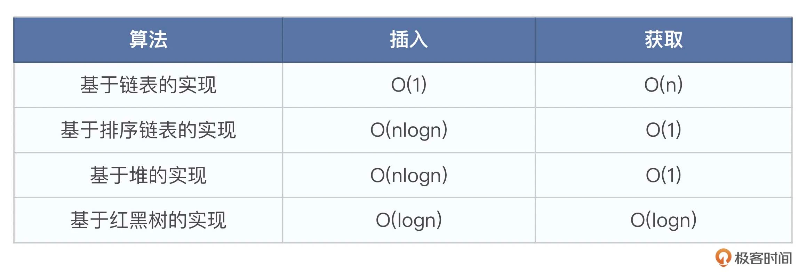
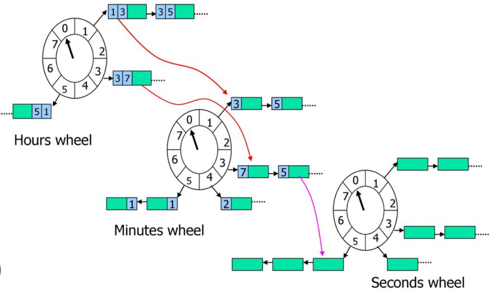

# 29 | 延时消息：如何实现高性能的定时-延时消息？

你好，我是文强。

上节课我们讲完了顺序消息和幂等机制，这节课我们来看看消息队列中的定时和延时消息是如何实现的。在消息队列中，定时和延时消息的底层技术实现是一样的，我们后面统一用延时消息来称呼。下面我们从延时消息的使用场景和定义讲起。

## 延时消息的场景和定义

先来看一个延时消息典型的使用场景。在网上购买商品下单的过程中，有个功能是：下单完成后 30 分钟如果没有完成支付，则这个订单就自动被取消。

如下图所示，从技术上来看，为了实现这个功能，最直观的思路是我们可以将订单数据存在DB 的表中。然后通过定时程序每秒定时去扫描订单数据，判断如果超过 30 分钟则进行后续的处理。


这个方案的问题是，业务方维护成本较高，需要开发维护定时任务并处理扩缩容，以保证数据处理的及时性。当订单数据量很大时，就容易出现性能问题。另外可能无法实现高精度的延时。

因此理想状态是延时逻辑下沉到某个底层的引擎去实现，业务不需要感知任何延时逻辑，正常处理数据即可。在技术体系中，这个底层引擎一般由消息队列来担任。因此只要在类似这种需要定时或者延时触发某个行为的场景，都可以用到延时消息。

从技术上看，消息队列中延时消息的定义是：客户端发送设置了到期时间的消息到 Broker后，该消息在时间到期后能被下游消费到。

从功能表现来看，就是 Broker 接收到客户端发送的延时消息后，将消息设置为不可见，在时间到期后把消息从不可见变为可见，从而让下游可以消费到数据。

接下来我们从技术上来拆解一下延时消息。

## 从技术上拆解延时消息

先通过下面这张图来了解一下延时消息的生命周期。


从使用上来看，假设生产端发送定时 30 分钟后或者明天早上 8 点可见的消息给 Broker，Broker 在接收到延时消息后，会先持久化存储消息，然后标记这个消息不可见。再通过内部实现的定时机制，延时到期后将不可见消息变为可见消息，从而让客户端可以正常消费到这条数据。

所以从技术上来看，消息队列实现延时消息主要包含数据存储、如何让消息可见、定时机制、主动推送四个部分。


因为数据存储和主动推送我们在基础篇详细分析过，这里就不再展开，感兴趣的可以去回顾一下。这节课我们重点讲解“如何让消息可见”和“定时机制”。

### 如何让消息可见

在技术上看，消息队列让消息从不可见变为可见的核心思路都是：先将数据写入到一个临时存储，然后根据一定的机制在数据到期后让消费端可以消费到这条消息。这个临时存储一般有以下 3 种选择：

1. 单独设计的数据结构

2. 独立的 Topic

3. 本地的某个存储引擎（如 RocksDB、Mnesia 等）

为了在延时到期后消费者可以消费到这些消息，从技术上看主要两个实现思路：

1. 定时检测写入

2. 消费时判断数据是否可见

定时检测写入，如下图所示，是指 Broker 收到数据后先将数据存储到某一个存储中（比如某个内置 Topic），同时有独立的线程去判断数据是否到期。如果数据到期，则将数据拉出来写入到实际的 Topic，从而让消费端可以正常消费数据。


这种方案的好处是，对生产消费的主流程改造较小。只需要在写入的时候做一个区分逻辑，然后独立实现定时检测，将到期数据写入到目标 Topic 即可。缺点是在延时消息量大的时候，到期时间不会那么精准。

消费时判断数据是否可见，是指每次消费时判断是否有到期的延时消息，是的话就从第三方存储拉取延时消息返回给消费者，从而实现消息从不可见到可见。


如上图所示，生产端在写入数据的时候也会将数据写入到第三方存储。但是和前一种方案不同的是，每次消费时会主动去判断第三方存储中是否有消息到期，有的话就把到期数据返回给客户端。

这种方案的好处是省去了定时线程的检测写入逻辑，流程简单许多。但是因为消费操作的QPS 一般很高，在设计这个第三方存储的时候，需要尽量提高获取操作的性能，并降低对内存的占用。另外每次都去检测是否有延时消息，可能会出现性能问题。

从业界具体实现来看，大多都是选择定时检测写入的方式。因为消费是客户端发起的，频率不可控，每次消费都去检查是否有延时消息，可能会对集群的性能造成影响。

接下来我们来看看定时机制的实现思路。

### 定时机制的实现

直观上来看，定时机制的核心逻辑是：随着时间的推进，拿出到期的延时消息进行处理。所以从技术上看，定时机制可以拆解为定时器和延时消息定位处理两部分。

定时器指按照时间向前推进，比如毫秒、秒级、分钟级向前推进。下面是一个最简单的定时器实现：

```
while (true){
   //todo
   Thread.sleep(10L); //单位ms
}
```

在各个语言中，也会封装一些高级的定时器或定制机制，比如 Java 语言中的定时器 Timer 和TimerTask，延时队列 DelayQueue，Go 中的 Timer、Ticker 等等。

延时消息定位处理指的是随着定时器推进，在每个时间刻度可以高效定位，获得需要处理的延时消息列表。即需要重点关注添加、获取的时间复杂度。

我们用一张图来讲一下这两个概念，下图是一个最大延时 5 秒的延时功能。


从延时消息的生命周期来看，主要分为 3 步：

1. 初始化数据结构，来存储数据。

2. 添加延时事件，根据延时的时间，将数据挂到图中对应的刻度下。

3. 获取延时事件，当时间刻度往前走，延时到期时将图中这个刻度下的数据都取出来处理。

在这个示例中我们可以用一个二维数组来存储数据，即：

```
int arr=new int [5][10] //表示5个刻度，每个刻度中最多放10条延时消息
```

不过这个示例的局限性很大，真实的延时消息一般需要满足下面 6 点要求：

1. 需要支持任意的延时精度，比如秒级，甚至毫秒级。

2. 需要支持尽可能长的延时消息，比如一个月、一年。

3. 可支持的延时消息的数量应该很大，比如十万级或者百万级。

4. 添加、获取延时事件的时间复杂度要尽量低。

5. 延时消息要保证可靠不丢失。

6. 在实现时需要尽量控制对内存的占用。

为了满足以上要求，下面我们来看看延时消息的两种主流技术方案。

## 延时消息的技术方案

延时消息的实现主要有基于轮询检测机制的实现和基于时间轮机制的实现两种方案。

### 基于轮询检测机制的实现

该方案的核心思路是：将延时消息写入到独立的存储中，利用类似 while + sleep 的定时器，来推进时间，通过独立线程检测数据是否到期，然后从第三方存储中取出到期的数据进行处理。

该方案由定时线程和第三方存储两部分组成。


如上图所示，该方案不需要维护时间刻度，只要设计合适的数据结构来存储延时消息列表，以达到精度和性能的要求即可。从操作上看，主要由插入和获取两个操作组成，此时需要关注的是插入和获取的时间复杂度。我们追求的目标是这两个操作的时间复杂度尽量低，因此关键的工作是选择合适的底层存储结构。

下面我们先整理了一下常用的数据结构在插入和获取方面的时间复杂度。



简单解释下表格中的内容：

- 链表的插入的时间复杂度是 O(1)， 获取的时间复杂度是 O(n)。因为插入只需要插入到链表的尾部，此时时间复杂度为 O(1)。而获取是需要遍历整个链表，此时时间复杂度就是O(n)。

- 排序链表和堆的插入的时间复杂度是 O(nlogn)，此时插入的时候需要将链表排序，目前主流稳定的排序算法的时间复杂度最小为 O(nlogn)。因为已经排序完成，所以获取的时间复杂度为 O(1)。

- 红黑树是平衡树的一种扩展，插入和获取的时间复杂度都是 O(logn)。

由表格数据可以知道，如果更关注插入的性能，那么就得选择红黑树和链表。如果更关注获取的性能，则可以选择排序链表和堆。因为插入和获取的时间复杂度不全是 O(1)，所以当某个Topic 的数据量很大时，还是会出现性能问题。

我们可以通过分治的思想来缓解性能并提高精度。

如下图所示，我们可以将原来的每个 Topic 一个存储结构，拆分为多个存储结构。比如可以根据时间进行拆分，如 1 小时、6 小时、12 小时、1 天、大于 1 天等 5 个维度。从而降低每个存储结构的长度，在一定程度上解决性能问题。


这种方案的优点是实现相对简单，开发成本较低。缺点是延时的精度太粗，无法做到精准的延时。但是从实际业务上来看，因为大部分业务不需要非常精准的延时消息，也允许在延时消息的场景中有一定的性能下降。所以这种方案基本能够满足大部分延时消息的需求，这也是业界很多主流消息队列都采用的方案。

接下来我们再看看基于时间轮机制的实现。

### 基于时间轮机制的实现

该方案的核心思路也是：将延时消息写入到独立的存储中，然后通过构建多级时间轮，在每个时间刻度上挂载需要处理的延时消息的索引列表。再依赖时间轮的推进，获取到需要处理的延时消息列表，进行后续的处理。


本质上看，时间轮和基于轮询检测的思路是一样的。区别在于，基于时间轮机制可以达到以下4 个效果：

1. 插入和获取的时间复杂度都是 O(1)

2. 可以支持任意时间精度的延时消息

3. 可以支持任何时长的延时消息

4. 每个时间刻度都可以支持任意多的元素

那它是怎么实现这 4 个效果的呢？我们简单看一下时间轮算法的设计思想。

时间轮是一个很成熟的算法，分为单级时间轮和多级时间轮，多级时间轮是单级时间轮的扩展。它的核心思想是：

1. 先设定好最小的时间精度，然后将时间划分为多个维度，比如年、月、日、时、分、秒。通过多级的时间轮来表示时间。

2. 在每个刻度上挂上一个待处理的延时消息链表，链表的元素存储了延时消息的索引信息。

3. 添加延时消息时，找到刻度对应的链表，在链表最后加上该元素，所以时间复杂度为O(1)。

4. 获取延时消息时，找到刻度对应的链表，把这个刻度对应的链表都拿出来处理，时间复杂度也是 O(1)。

这里不太好理解，我们通过一张图来了解一下多级时间轮。



- 图片来源：https://slideplayer.com/slide/13145705/

如上图所示，这是包含 Seconds、Minutes、Hours 三个级别的时间轮，每一个时间轮的最大刻度为 8，上一级时间轮最小刻度等于下一级时间轮刻度的总和。当我们设定好时间精度和时间轮的维度后，如果是添加延时消息，则在多级时间轮上找到对应时间的延时消息列表，把消息插入到列表中。如果是获取到期的延时消息，也是根据时间轮找到当前时间的延时消息列表，然后把整个列表拿出来处理即可。对时间轮算法细节有兴趣的同学，可以研究一下官方论文。

在我看来，时间轮算法的核心思路比较好理解，难的是在工程实现方面。它的核心是：对于内存使用量的控制和状态持久化两个方面。即在实现多级时间轮的功能的基础上，要尽量减少这个时间轮对内存资源的占用。对于时间轮的工程实现，这里就不展开了，建议你去研究一下Kafka 的延时机制，Kakfa 的延时机制底层就是时间轮算法，它的实现在性能和空间占用方面的表现都非常好。

从理论上看，基于时间轮算法来实现延时消息是一个更好的方案。但是在编码实现上的挑战，就比基于轮询检测的方案大很多。需要重点考虑以下 4 点：

1. 如何通过合适的数据结构，使插入和获取的时间复杂度都为 O(1)？

2. 如何尽量降低对于内存的消耗？

3. 如何完成时间轮信息的持久化和多节点间的同步？

4. 在代码实现层面，如何低成本实现时间轮？

基于这个信息，你大概可以理解为什么大部分消息队列会基于轮询检测的方案来实现延时消息了吧。

最后我们简单来看一下主流消息队列在延时方面的实现思路。

## 主流消息队列的延时机制实现

### RocketMQ 延时消息的设计思路

社区版本的 RocketMQ，不支持任意时间的延迟，它提供了 18 个级别的延时消息，分别是：

```
1s 5s 10s 30s 1m 2m 3m 4m 5m 6m 7m 8m 9m 10m 20m 30m 1h 2h
```

从原理来看，RocketMQ 的延时消息是基于轮询检测机制的思路来实现的。


如上图所示，RocketMQ 在内核定义了名为 SCHEDULE_TOPIC_XXXX 的 Topic 来存储延迟消息。该 Topic 包含 18 个队列，每个队列对应一个延迟级别。比如队列 0 就代表延迟 1s 的队列，队列 1 就代表延迟 5s 的队列。

生产者把延迟消息发送到 Broker 之后，Broker 会根据生产者定义的延迟级别放到对应的队列中。而消息原本应该去的 Topic 和队列，会暂时存放在消息的属性（property）中。

在 RocketMQ 中，会有专门的线程池去处理延迟消息。比如 18 个延迟级别，就会生成 18 个定时任务，每个任务对应一个队列。这个任务每隔 100 毫秒就会去查看对应队列中的消息，判断消息的执行时间。如果到了执行时间，那么就会把消息发送到其本该投递的 Topic 中，这样消费者就能消费到消息了。

### RabbitMQ 延时消息的设计思路

RabbitMQ 的延迟消息有基于死信队列和集成延迟插件两种实现方案。

基于死信队列是指使用两个队列，一个队列接收消息不消费，然后等待指定时间过后消息过期，再由该队列绑定的死信 Exchange 机制再次将其路由到另一个队列提供业务消费。实际流程如下所示：


集成延迟插件（rabbitmq-delayed-message-exchange）是指延时消息不直接投递到队列中，而是先转储到本地 Mnesia 数据库中，然后定时器在消息到期后再将其投递到队列中。实际流程如下所示：


从根本上看，RabbitMQ 的这两种方案也属于是基于轮询检测机制的一种。

### Pulsar 延时消息的设计思路

Pulsar 实现延迟消息的思路是比较特殊，也比较取巧，没有独立线程来检测消息到期，而是在消费的时候通过消费动作来触发检测。


如上图所示，延迟投递的消息会先保存到一个叫做 Delayed Message Tracker 的数据结构中。Delayed Message Tracker 在堆外内存维护一个 delayed index 优先级队列，这个优先级队列会根据延迟时间进行堆排序，延迟时间最短的会放在队列的头部，时间越长越靠近队列尾部。

消费者消费时，会先去 Delayed Message Tracker 检查，是否有到期需要投递的消息。如果有到期的消息，则从 Tracker 中拿出对应的 index，找到对应的消息进行消费。如果没有到期的消息，则直接消费正常的消息。如果集群出现 Broker 宕机或者 Topic 的 Leader 切换，Pulsar会重建 delayed index 队列，来保证延迟投递的消息能够正常工作。

从根本上来看，Pulsar 的方案也是基于轮询检测机制的一种，只是用来检测的线程是消费线程而已。

### Kafka 延时机制的设计思路

kafka 本身不支持延时消息，但是支持延时机制，用于延时回包、延时确认的场景。

从技术上看，Kafka 的延时机制是典型的基于时间轮算法来实现的。它的实现核心是多级时间轮以及使用 Java 的 DelayQueue 来保存延时数据和推进时间，整体实现性能和实现方案是非常优雅的。这块网上的资料很多，就不展开讲细节了，有兴趣的话可以自己去研究下。

## 总结

消息队列的延时消息，解决的是客户端发送的消息在一定时间后可以被消费端消费到的问题。从技术上拆解，可以分为数据存储、如何让消息可见、定时机制、主动推送四个部分。其中如何让消息可见和定时机制是这节课重点解决的问题。

如何让消息可见，从技术上来看，有定时检测写入和消费时判断数据是否可见两个思路。两种方案都是先将数据写入到一个独立的存储。区别在于，前一种方案会有独立线程定时检测数据是否到期，然后将到期的数据写入到实际的 Topic。后一种方案是指每次消费时都去检查一下是否有消息到期，有的话就直接返回给消费者，省去了写入原 Topic 的步骤。个人推荐前一种方案。

定时机制的核心逻辑是随着时间的推进，能够精准高效获得到期的延时消息进行处理。从技术上看，可以拆解为定时器和延时消息定位处理两部分。定时器负责推进时间，延时消息定位处理是指设计合适的数据结构，来高效完成延时消息的定位和取出。

在延时消息的整体技术方案层面，主要有基于轮询检测机制的实现和基于时间轮机制的实现两种方案。目前主流消息队列主要采用前一种方案，原因是时间轮的方案实现较为复杂，实现成本较高。从技术合理性来看，时间轮是一种更好的方案。

主流消息队列中，RocketMQ、RabbitMQ、Pulsar 都实现了延时消息，Kafka 没有实现延时消息，但是支持延时机制。RocketMQ、RabbitMQ、Pulsar 的设计思路都是基于轮询检测机制的实现，Kafka 的延时机制是经典的时间轮实现，支持毫秒级的任意时长的延时机制。

## 思考题

我们知道消息队列是 Topic 和分区模型，此时有个问题是：在存储引擎选择层面，是每个Topic 或分区独享存储结构，还是 Broker 上所有的 Topic 共享存储结构？

期待你的思考，如果觉得有收获，也欢迎你把这节课分享给身边的朋友。我们下节课再见！

## 上节课思考闭环

前面我们讲过，排序的另外一个思路是查询时的重排序，这里我问一个 MySQL 排序的问题，来和消息队列顺序消息的实现方案做对比，让你有一个借鉴的效果。从技术上看，MySQL 如何实现数据的有序？

MySQL 中的 ORDER BY 子句用于根据指定的列对查询结果进行排序，排序可以是升序（默认）或降序。ORDER BY 的实现原理主要包括以下步骤：

1. 解析：当查询包含 ORDER BY 子句时，MySQL 解析器会识别出这里需要进行排序操作。

2. 查询优化：对于 ORDER BY, 优化器在这阶段将尝试通过索引进行优化，如果可以利用索引进行排序，将大大提高性能。例如，当查询中的排序条件与某个索引的顺序相匹配时，优化器可能选择通过索引扫描来优化执行计划。

3. 排序：在返回查询结果之前，MySQL 需要对数据进行排序，常见的排序方法有两种。

排序缓冲区（Sort Buffer）：MySQL 会使用一个名为“排序缓冲区”的内部数据结构来保存排序过程中的中间结果。通过调整 sort_buffer_size 和 max_sort_length 配置参数，可以控制排序缓冲区的大小，从而影响排序性能。

文件排序（Filesort）：当待排序的数据无法完全放入排序缓冲区时，MySQL 会使用一种名为“文件排序”的算法。算法先将数据分成不同的块，对每一块进行排序，然后将已排序的块两两合并并递归进行归并排序。

4. 数据返回：排序完成后，MySQL 会将按照指定的顺序排列的结果集返回给客户端。

以上操作需要注意的是，排序操作对于查询性能的影响较大，因此建议在需要使用 ORDERBY 时，尽量使用索引进行优化，以提高查询性能。
