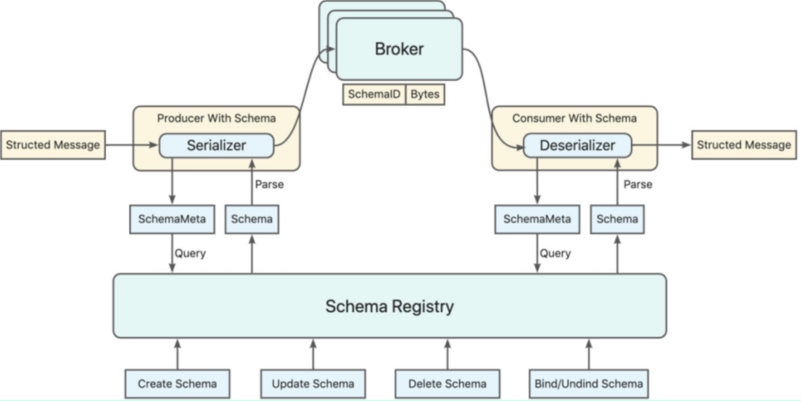
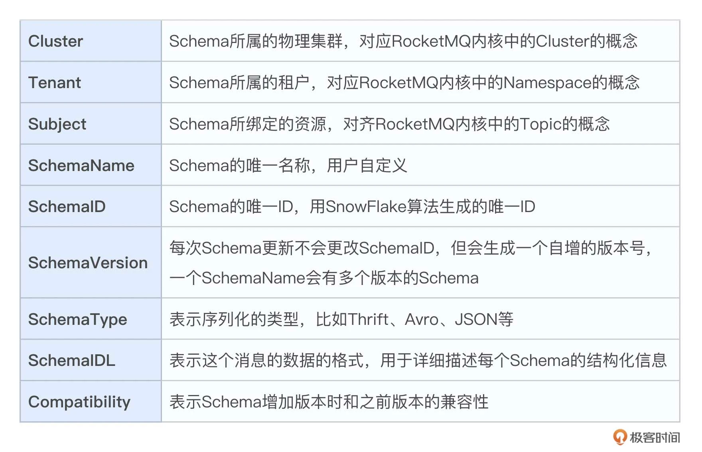
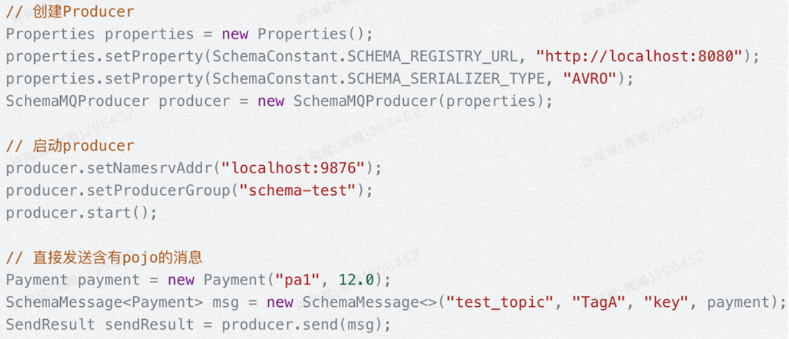
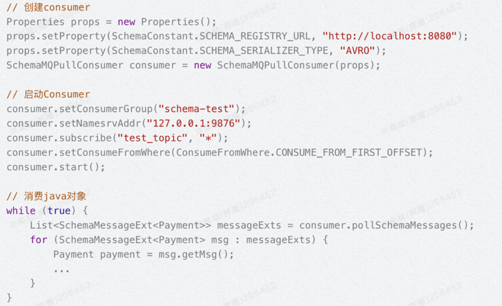

# 33 | Schema：如何设计实现Schema模块？

你好，我是文强。

这节课我们来看看消息队列中的 Schema 模块。看到 Schema 这个词，你可能会有点陌生，从而产生一些疑问。比如 Schema 是什么？它有什么用？什么时候可以用到它？这节课我们就重点解决这三个问题。

## Schema 是什么

Schema 翻译过来是“模式”的意思。它表示的是数据结构定义，即定义数据是什么格式的。

如下图所示，默认情况下消息数据在生产者、Broker、Consumer 的全流程中，代码层面没有对消息内容格式进行限制或校验。


因此存在的问题是：消费者和生产者需要线下对齐数据格式，然后消费者根据约定的消息格式编写相应的处理逻辑。当生产端的数据格式或者某个字段的数据类型发生变化时，如果没有及时通知下游消费者，消费者就会无法解析数据，导致数据消费异常。

Schema 就是用来解决全流程中的数据格式的规范定义问题，即保证上下游数据在传递过程中，消息可以根据指定的格式和定义进行传递。

举个例子，在订单场景中，一般通过消息管道传递订单数据，实现系统解耦。因此每个订单数据必须包含订单 ID（OrderID）字段，否则下游就无法处理。此时就可以启用 Schema，在生产端规范数据传递，在 Broker 端进行数据校验，在消费端根据指定的格式进行数据解析。

那 Schema 具体是一个什么形式呢？其本质就是一个字符串，用来定义数据是什么样子的。然后客户端和服务端会根据定义的这个格式，组装、校验、解析消息数据，从而规范数据的传递。

你可以通过 MySQL 中表的 Schema，来理解消息队列中的 Schema。它们都是表达这批数据有几个字段、这个字段是什么类型、长度是多长这些信息。

看一段代码示例，比如我们需要接收包含名字和地域两个字段的数据，此时通过 MySQLSchema 和消息队列 Schema 分别如下表示：

```sql
MySQL 表的Schema：
CREATE TABLE IF person(
  id INT NOT NULL AUTO_INCREMENT,
  name VARCHAR(100) NOT NULL,
  region VARCHAR(40) NOT NULL
);
消息队列数据的Schema：
[
     {
       "name":"name",
       "type":"string",
       "maxLength":100
     },
      {
       "name":"region",
       "type":"string",
       "maxLength":40
     }
]
```

那如何在消息队列的架构中支持 Schema 特性呢？我们继续来看一下。

## Schema 技术方案设计

先来分析一下需求，我们知道整体的需求是：需要规范生产到消费的数据的格式化传递。所以拆解需求后，可以分为以下五点：

1. Scehma 信息是如何存储的？

2. 客户端、Broker 如何获取到 Schema 信息？

3. Schema 是在什么维度生效的？比如 Topic 维度、集群维度、命名空间维度、消息维度等等。

4. Schema 信息可以变更吗？变更后生产者、Broker、消费者如何处理？

5. 生产者、Broker、消费者如何使用 Schema？

带着这五个问题，我们来看一张架构图。


从图中可以看到，在当前消息队列架构的基础上，我们引入了一个新的组件：SchemaRegister，即 Schema 注册中心。SchemaRegister 的作用是持久化保存具体的 Schema 信息，并提供接口给客户端增删改查 Scheme 信息。

在消息全生命周期中，Scheme 的使用可以拆解为五个步骤。

1. 生产者或消费者可以自动调用 SchemaRegister 创建 Schema 信息，也可以通过运营端增加 Schema 的信息。

2. 一旦开启了 Schema，生产者、消费者初始化时需要配置 SchemaRegister 的访问地址。启动的时候，从 SchemaRegister 获取所需的 Schema 信息，并缓存起来。

3. 生产者启动时会配置好本次需要发送的数据的 Schema。此时 SDK 会根据客户端配置的Schema 信息判断这个 Schema 是否存在。如果存在就正常发送，如果不存在则判断集群是否允许自动注册 Schema。如果允许自动注册，则调用 SchemaRegister 提供的CreateSchema 接口进行注册。SchemaRegister 会为每个 Schema 分配唯一的 ID，生产者会将这个 ID 写入到消息的属性中。

4. Broker 启动时会从 Schema 注册中心获取全量的 Schema 信息，缓存到本地。当接收到消息数据后，拿出消息中的 SchemaID，获取到具体的 Schema 信息，然后使用这个

- Schema 信息对数据进行校验。

5. 消费端启动时也会加载 Schema 信息，获取到数据后，根据消息 ID 及其对应的 Schema去解析、处理数据。如果不符合格式的数据，就丢弃或者报错。

讲完了整体的运行过程，接下来我们来详细看一下 Schema Register 的实现。

### Schema Register

Schema Register 也称为 Schema 注册中心。它的功能是存储数据，并提供增、删、改、查的功能接口来管理 Schema 信息。

所以，Schema Register 本质上是一个 Server，由计算逻辑层和存储层两部分组成。计算逻辑层负责提供增删改查的接口支持对 Schema 信息的操作，持久层负责分布式、持久化存储Schema 信息。


从技术上看，Schema Register 有独立部署和 Broker 内核集成两种实现形态。

独立部署是指 Schema Register 独立成一个 Server 进行部署，比如它可以是一个 HTTPServer，通过 MySQL 存储 Schema 信息，暴露 Restful 接口提供服务。

这种方案是目前主流消息队列用得最多的方案，业界 Kafka、RocketMQ、Pulsar 用的都是这种方案。它最大的好处是：独立部署的 Schema 服务可以给多套消息队列集群使用。比如一个公司只需要部署一套 Schema Register 即可，毕竟一套消息队列集群独立部署一个 SchemaRegister 太浪费了。

从代码实现上来看，独立的 Schema Register 开发复杂度不高。一般基于 Spring Boot +MySQL 就可以实现。 但是这里有一个点，引入 MySQL 当作存储的话，相当于需要多部署一个 MySQL，会增加系统部署运维的复杂度。所以我们一般会把数据存储在消息队列的Topic，因为 Topic 也是分布式的可靠存储，从而避免引入 MySQL。

但是在某些私有部署场景，独立部署的 Schema Register 就会增加部署运维的复杂度。那有没有可能把 Schema Register 集成在 Broker 内核中呢？

Broker 内核集成是指在 Broker 内核实现 Schema Register。如下图所示，即在 Broker 上提供四层或七层的接口来满足 Schema 信息的增删改查等操作，同时集群内部创建一个内部Topic 来保存 Schema 信息。


所以这种方案的技术实现思路大致如下：

1. 创建一个内部的 Topic（比如 __schema）来存储 Schema 信息。

2. 在 Broker 中实现 Schema CRUD 接口，来支持增删改查等操作。接口是四层 TCP 还是七层 HTTP，区别不大，主要是根据架构的实际情况来决定。

3. 接口的逻辑就主要是对 __schema 中的内容进行操作。

这种方案的好处跟第一种刚好是相反的，是通过增加内核的复杂度来降低部署的复杂度。这种方案的最大缺点是，Schema Register 修改都需要更新内核版本，成本太高了。因为 SchemaRegister 本质上是一个独立的服务，单独部署维护的技术合理性更高。这也是业界主流消息队列都使用第一种方案的原因。

接下来我们来看一下 Scehma 的格式是什么样子的。

### Schema 格式设计

前面讲到，Schema 格式可以简单理解为 MySQL 的表的结构。我们还是基于上面的例子进行扩展说明。

因为 Schema 是和具体的消息队列集群绑定的，所以 Schema 信息应该包含集群信息。进一步，如果有租户的概念，那么 Schema 信息也需要包含租户的信息。从技术上看，Schema 都是和 Topic 进行绑定的，即表示当前这个 Topic 允许接收什么格式的数据。所以，Schema 信息也需要包含 Topic 信息。

除了这些基础信息，最关键的是要标识这个消息数据的格式，即需要表达出以下两个信息：

1. 包含 name、region 两个字段。

2. name 的类型是字符串，最大的长度是 100；region 的类型也是字符串，最大的长度是40。

基于上面的需求，我们可以用 JSON 格式来表示 Schema，具体如下所示：

```json
{
   "id":"kjdsjfudfd",
   "version":1,
   "cluster":"cluster1",
   "tenant":"tenant1",
   "topic":"topic1",
   "name": "schema1",
   "properties": [
     {
       "name":"name",
       "type":"string",
       "maxLength":100
     },
      {
       "name":"region",
       "type":"string",
       "maxLength":40
     }
   ]
}
```

在上面的 Schema 中：

```
id 是这个 Schema 的唯一标识，后续的变更、查询、删除都是根据这个唯一 ID 来的。
version 表示这个 id 对应的版本。因为每个 Schema 会经过多次修改，所以一个唯一 ID
会存在多个版本的 Schema。严格来说，id + version 才能唯一标识一个 Schema。
cluster、tenant、topic、name 分别表示集群、租户、Topic 和 Schema 的名称。
properties 是 Schema 的重点内容，表示这个消息的数据的格式。它是一个 JSON 数
```

- 组，里面有多个元素，用来表示这个 Schema 应该包含哪些字段以及每个字段的信息。比如上面的 name 是字符串型，最大长度是 100，region 也是 string 型，最大长度是 40。

所以如下图所示，一个 Schema 的具体结构可以是这样的。


当然这个 Schema 格式只是一个基础，实际场景中还需要更多的字段来表达更多信息。所以在实现上，还需要进行一定的扩展。

刚刚说到，Schema 一般是跟 Topic 绑定的，所以拉长时间周期来看，Topic 的 Schema 肯定变更。可能是从一个 Schema 换成了另外一个 Schema，或者在当前的基础上添加、删除字段，修改字段类型等等。

所以如下图所示，Topic 中肯定会存在前后数据的 Schema 不一样的情况。


那么当生产者发送消息时，每条消息就需要携带所属的 SchemaID 和 Version 标记。此时：

- 当 Broker 收到数据，会根据 SchemaID 和 Version 去找到对应的 Schema 详情，进行数据校验。

- 当消费端收到数据时，会根据 SchemaID 和 Version 去找到对应的 Schema 详情，进行数据解析处理。

所以，在消息的协议结构中，就需要增加 SchemaID 和 SchemaVersion 两个字段。


下面我们来看一下 Broker 端是如何集成 Schema 的。

### 服务端集成 Schema

先来回顾一下上面的那张架构图。

从 Broker 的角度来看，它对 Schema 的支持主要分为以下四个部分：

1. 添加 Schema Register 相关配置，比如 Schema Register 的地址。

2. 启动时从 Schema Register 加载本集群的 Schema 信息，缓存在本地。

3. 判断是否开启 Schema，或者在什么维度（比如集群维度、租户维度、Topic 维度）开启Schema。

4. 接收到数据时，从消息中解析出 SchemaID，根据 ID 找到对应的 Schema 对数据进行校验。

所以整体来看，Broker 端集成 Schema 的工作量并不大。接下来我们再看看客户端是如何集成 Schema 的。

### 客户端集成 Schema

先来看一段 Pulsar 生产端和消费端使用 Schema 特性的代码示例。

```
static class SchemaDemo { //定义一个Schema
  public String name;
  public int age;
}
Producer<SchemaDemo> producer = pulsarClient
      .newProducer(Schema.JSON(SchemaDemo.class)) //生产使用Schema
      .topic("my-topic")
      .create();
Consumer<SchemaDemo> consumer = pulsarClient
      .newConsumer(Schema.JSON(SchemaDemo.class)) // 消费使用Schema
      .topic("my-topic")
      .subscriptionName("my-sub")
      .subscribe();
// 生产
SchemaDemo schemaDemo = new SchemaDemo();
schemaDemo.name = "puslar";
schemaDemo.age = 20;
producer.newMessage().value(schemaDemo).send();
// 消费
Message<SchemaDemo> message = consumer.receive(5, TimeUnit.SECONDS);
```

上面的核心流程是，定义了一个数据结构 SchemaDemo，然后在生产端使用这个数据结构发送数据，在消费端使用这个数据结构来解析数据。在生产端，集成 Schema 后的主要流程如下：

1. 生产端加上 Schema Register 相关配置。

2. 生产端启动时，从 Schema Register 加载相关的 Schema 信息，比如本次发送的集群、Topic 等。

3. 定义好要发送的数据格式，并构建数据。

4. 在发送服务端之前，SDK 会根据客户端配置的 Schema 信息判断这个 Schema 是否存在。如果存在就正常发送，如果不存在则判断集群是否允许自动注册 Schema。如果允许自动注册，则调用 SchemaRegister 提供的 CreateSchema 接口进行注册。SchemaRegister 会为每个 Schema 分配唯一的 ID，生产者会将这个 ID 写入到消息的属性中。

消费端集成 Schema 的流程和生产端基本类似，具体如下：

1. 消费端加上 Schema Register 相关配置。

2. 消费端启动时，从 Schema Register 加载相关的 Schema 信息，比如本次消费的集群、Topic 等。

3. 同时也会把消费端设置的 Schema 和 Topic 与实际的 Schema 进行比对，然后判断是否使用还是自动注册这个 Schema，流程和生产的第四步是一样的。

4. 拿到数据，先判断是否携带 SchemaID，然后判断是否是有效的 Schema，再解析处理。

不过，此时有个问题是，消息内容数据是以什么格式发送的呢？

### 序列化和反序列化

这个问题想问的是，比如我们需要发送 name 和 region 两个信息，那这个消息内容是以什么格式序列化和反序列化后发送呢？这里一定要约定好使用的格式，否则下游就不知道如何解析数据了。

目前业界主要支持 Avro、JSON、Protobuf、Thrift 等多种数据格式。即消息发送时，数据是以 Avro、JSON、Protobuf 等格式来编码的。

在消息队列中，编解码一般是在生产端和消费端配置的，比如 Kakfa 的配置如下：

```
// 生产使用avro格式来编码
props.put(ProducerConfig.VALUE_SERIALIZER_CLASS_CONFIG,
              KafkaAvroSerializer.class.getName());
// 消费avroJson格式来编码
props.put(ConsumerConfig.VALUE_DESERIALIZER_CLASS_CONFIG,
"org.apache.kafka.common.serialization.ByteArraySerializer");
```

目前主流消息队列 Kafka、RocketMQ、Pulsar 在内核都支持了 Schema。从技术的角度来看，RocketMQ、Kakfa、Pulsar 在 Schema 上的技术方案基本一致。一方面是因为场景和需求都是一样的，另一方面也是相互借鉴参考导致的。

接下来我们就主要分析一下 RocketMQ Schema 的详细实现。

## RocketMQ Schema 的实现

来看下面这张架构图：



- 图片来源：https://github.com/apache/rocketmq-schema-registry

如图所示，可以看到 RocketMQ 在原先架构中引入了 Schema Registry 用于保存 Schema 信息，也可以看到 Schema Registry 和 Broker 是分开部署的。

Schema Registry 通过 SpingBoot 开发了 HTTP 服务，提供了 Restful 接口支持创建、更新、删除、绑定等操作。当前支持使用内置的 Compact Topic 来存储 Schema 信息，未来规划引入 MySQL 等 DB 型存储。

RocketMQ 的 Schema 格式如下：



```
下面我们来看一下 SchemaIDL 的内容示例，可以看到，它包含 name 和 id 两个字段，
name 和 id 都是字符串类型，id 的默认值为 0。
{
   "type": "record",
   "name": "SchemaName",
   "namespace": "rocketmq.schema.example",
   "fields": [
       {
           "name": "name",
           "type": "string"
       },
       {
           "name": "id",
           "type": "string",
           "default": "0"
       }
   ]
}
```

如果生产者和消费者每一次收发消息都要与 Registy 交互，name 就会非常影响性能和稳定性。因此 RocketMQ 在客户端缓存了 Schema 信息，从而让 Schema 更新频率比较低。

下面我们再来看一个 RocketMQ 客户端使用 Schema 的实例，先来看一下底层的客户端和服务端是如何集成 Schema 的。

先来看生产者示例：



- 图片来源：https://www.alibabacloud.com/blog/rocketmq-schema-make-messages-streaming-structured-data_600001

可以看到，在生产者启动时，配置了 SchemaRegister 的访问地址，并配置了序列化方式为Avro。然后可以看到发送的数据是结构体 Payment，而不是普通的字符串。此时会解析Schema 并检查其是否符合 Topic Sc​hema 兼容性要求。如果通过，生产者将序列化数据，并为其添加 SchemaID 等信息；如果验证失败，发送请求将被拒绝。

在 Broker 端，Broker 通过 RocksDB 做了一层 Schema 的缓存，避免频繁对 SchemaRegister 的访问。当接收到数据后，再从消息里面解析出 SchemaID，对数据进行校验。

再来看看消费者示例：



- 图片来源：https://www.alibabacloud.com/blog/rocketmq-schema-make-messages-streaming-structured-data_600001

消费端创建时，同样需要指定 Registry URL 和序列化类型，然后通过 getMessage 方法直接获取泛型或实际对象。此时如果消费到的数据类型不是我们需要的类型，就会报错。

## 总结

Schema 是数据结构定义的意思，即定义数据是什么格式的。消息队列中的 Schema 用来保证上下游数据在传递过程中，消息根据指定的格式和定义进行传递，从而解决上游的数据变更所导致的下游消费失败问题。

消息队列 Schema 的核心是：客户端按照指定的数据格式发送数据，Broker 按照配置的数据格式进行校验，消费者根据指定的格式解析数据。

Schema Register，即 Schema 注册中心，它是 Schema 特性的核心模块。它一般是一个独立的服务，用来保存 Schema 信息，并提供管理 Schema 的增删改查接口。大部分情况下，都会将 Schema 信息存储在消息队列中的 Topic，以避免引入其他存储组件，增加复杂度。

因为 Schema Register 一般会给多个物理集群使用，所以存储时需要明确 Schema 属于哪个集群、哪个租户、哪个 Topic。因此 Schema 存储时会携带集群、租户、Topic 等信息。每个Schema 会有一个唯一 ID 来标识，因为一个 Schema 可能有多个版本，所以一般也会有一个Version 字段。

Schema 最重要的是数据的 DDL 的定义，即这个数据包含哪些字段、字段的类型是什么样子的。

Broker 和客户端在启动时都需要配置 Schema Register 的地址，然后存储 Schema 信息。生产端发送时会对发送的数据进行校验，Broker 也会对收到的数据进行校验，消费者消费到数据时也会进行比对，从而保证链路的数据是符合规范的。

## 思考题

这节课的作业我们包含两个任务，一个是做思考题，一个是学习任务。

1. 既然 Schema Register 都是独立部署的，业界的 RocketMQ、Kafka、Pulsar 都分别实现了独立的 Schema Register，那么实现一个统一通用的 Schema Register 有意义吗？有什么好处或者难点？

2. Pulsar 的社区版本也支持 Schema 特性，Kakfa 的商业化公司 Confluent 的商业化版本Kafka 也支持了 Schema，请你去官网学习一下它们的实现，然后对比一下这节课的所学。

欢迎分享你的思考，如果觉得有收获，也欢迎你把这节课分享给身边的朋友。我们下节课再见！

## 上节课思考闭环

在消息轨迹的场景中，我们是把轨迹信息存在 Topic 中的。此时结合我们这节课说到的查询能力，请你思考一下，在内核中我们是如何实现消息轨迹的存储和查询的？大致流程是怎样的？

1. 客户端将客户端的轨迹数据上报到内置 Topic 存储。

2. Broker 将服务端的轨迹数据页写入到内置 Topic 中。

3. 因为轨迹数据一般需要一个唯一标识来串联，在前面的课程讲过，这个标识一般是消息ID。

4. 因此我们可以基于消息 ID 来查找到存储在 Topic 中的多条轨迹信息。

5. 最后读取轨迹信息，返回给查询方。
