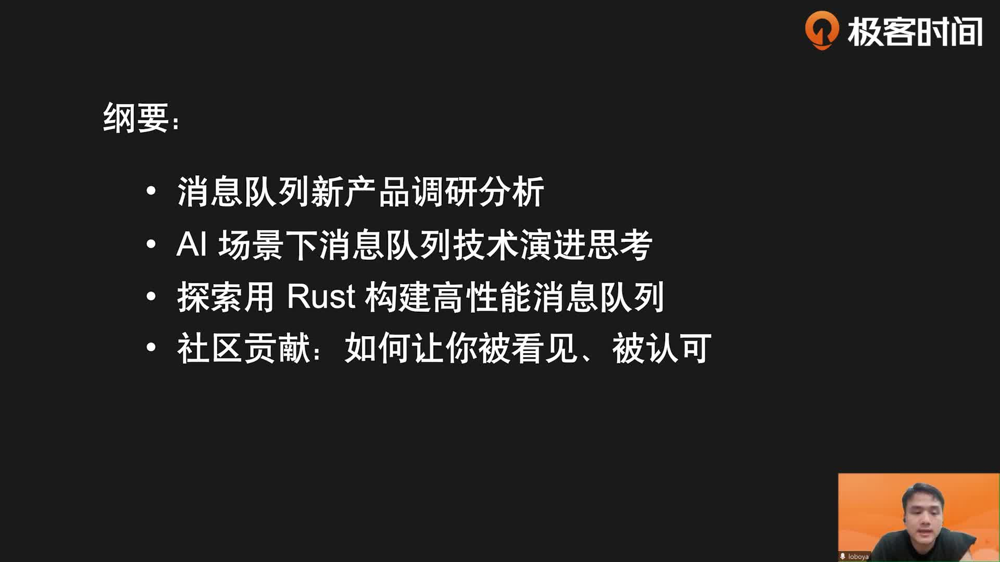

# 加餐 | AI驱动下，消息队列系统架构如何演进？

直播回放：

直播介绍：

随着 AI 大模型应用进入生产化阶段，消息队列作为贯穿训练到推理全流程的关键基础组件，其重要性日益凸显。在 AI 大模型推理、数据密集型训练任务、流处理与在线服务深度融合等场景中，传统消息队列架构正面临新的挑战。 吞吐 vs 延迟、存算解耦 vs 实时一致性、流批统一 vs 多租隔离，诸如此类的架构议题被频繁提及。

在这个背景下，我们希望探索下一代消息队列的技术趋势。通过整合多协议、高性能和分布式弹性设计，减少架构复杂度的同时提升了系统性能和可靠性。从而在模型微服务编排、边缘AI、异构数据管道、在线离线融合等场景下，展现出消息队列的优势和创新价值。

本次直播将深度聚焦 AI 应用场景对消息队列提出的新要求，从主流系统分析到新技术路径，全面展开技术洞察。底层基础设施正在重构，下一代 MQ 也正在重写。如果你想站在技术演进的潮头，这是一场你不该错过的直播！

你将获得：

AI 场景下的主流消息队列的对比分析

下一代消息队列的技术演进趋势判断

如何从零构建一款 100% 用 Rust 实现的高性能消息队列

社区贡献：如何让的技术能力被看见、被认可？
