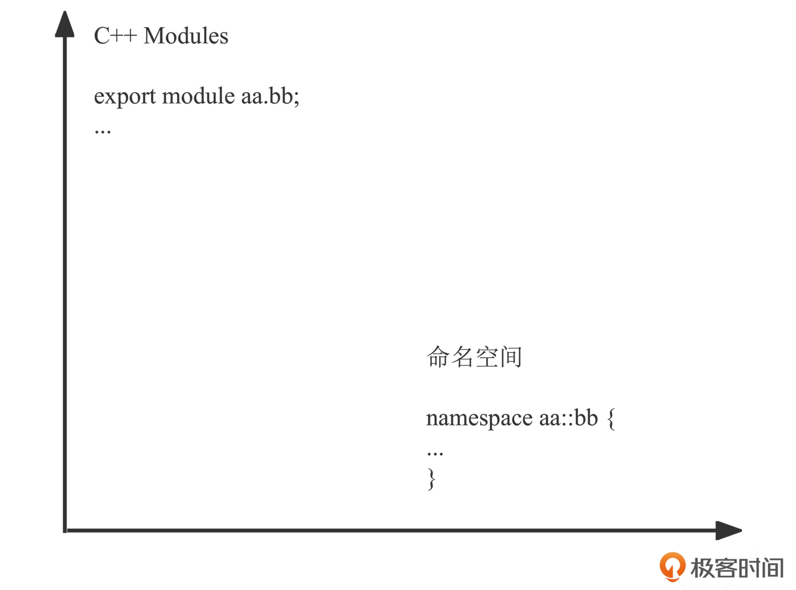
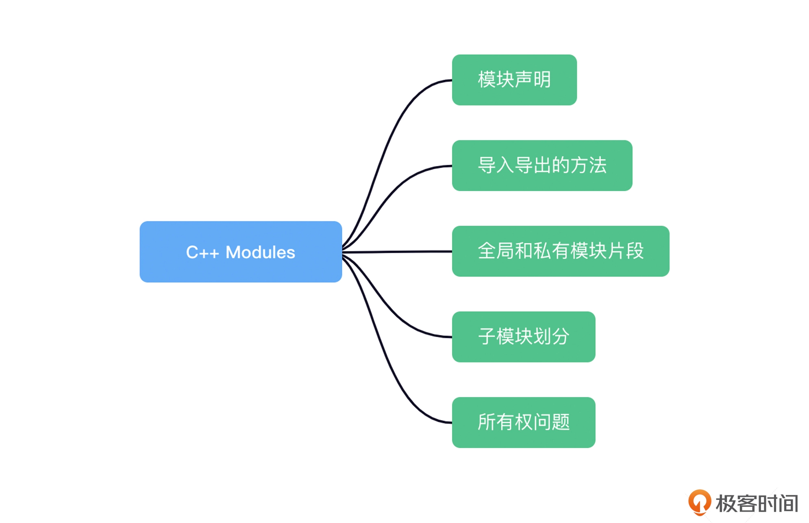
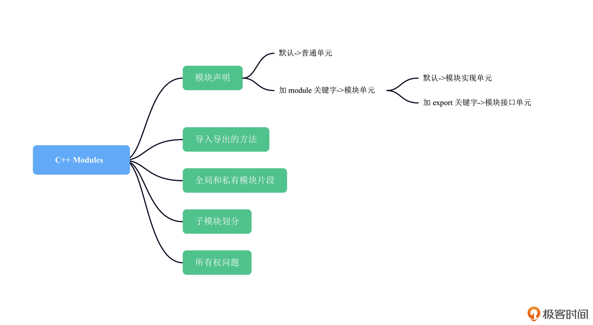
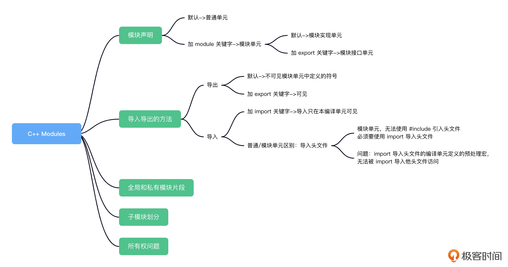
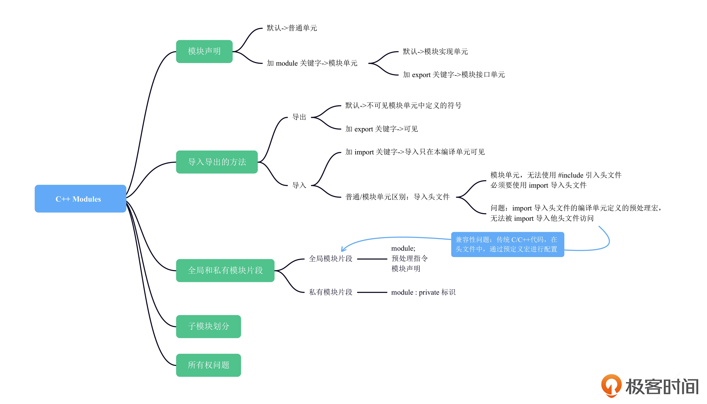
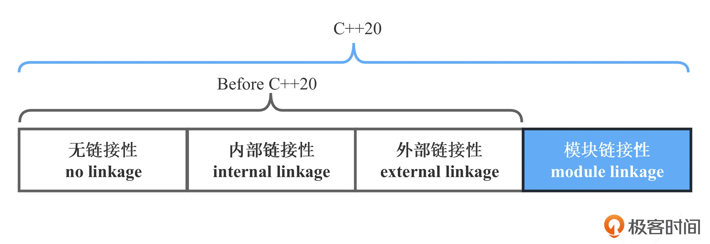
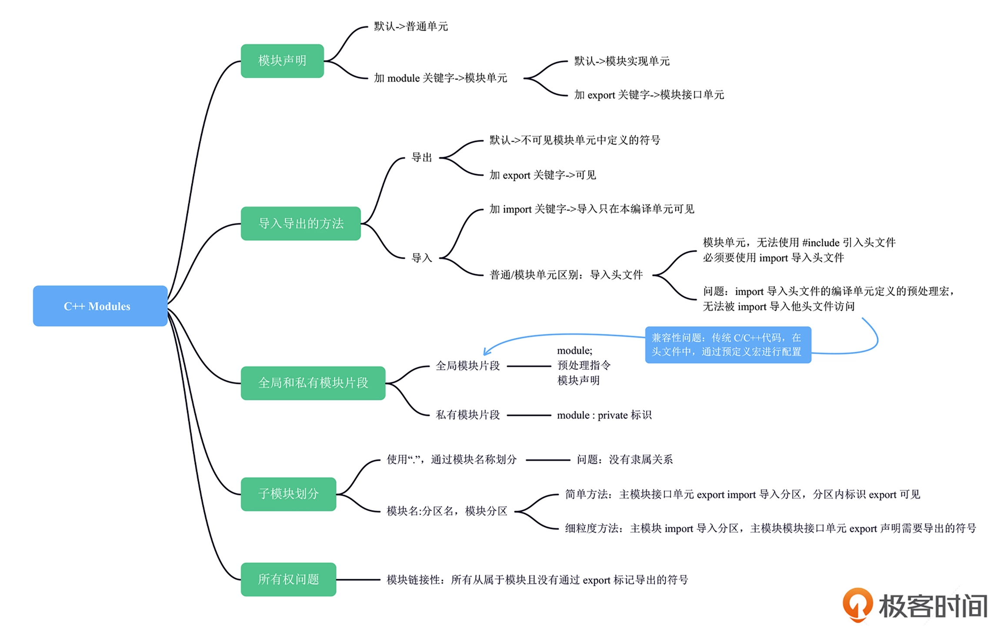
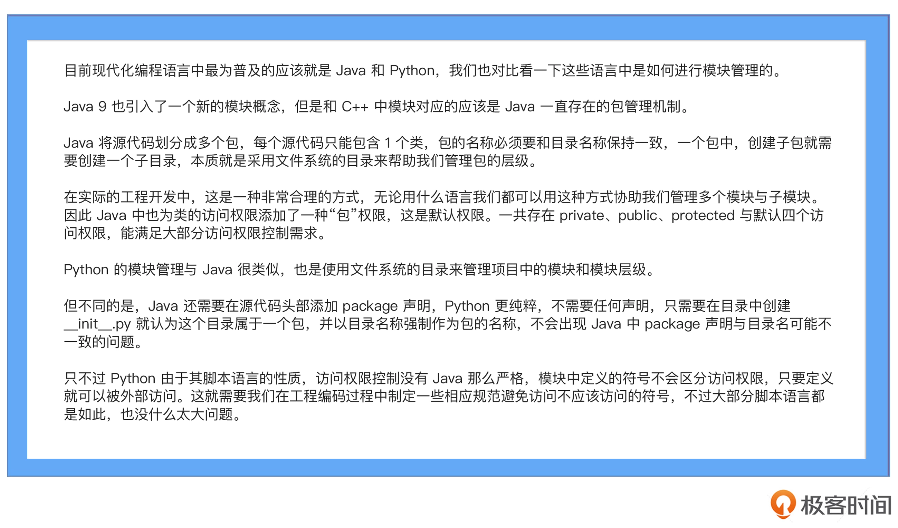

# 02 | Modules（中）：解决编译性能和符号隔离的银弹

你好，我是卢誉声。

上一讲我们聊到开发者为了业务逻辑划分和代码复用，需要模块化代码。但随着现代 C++ 编程语言的演进，现代 C++ 项目的规模越来越大，即便是最佳实践方法，在不牺牲编译性能的情况下，也没有完全解决符号可见性和符号名称隔离的问题。

如果从技术的本质来探究“模块”这个概念，其实模块主要解决的就是符号的可见性问题。而控制符号可见性的灵活程度和粒度，决定了一门编程语言能否很好地支持现代化、标准化和模块化的程序开发。一般，模块技术需要实现以下几个必要特性。

- 每个模块使用模块名称进行标识。

- 模块可以不断划分为更多的子模块，便于大规模代码组织。

- 模块内部符号仅对模块内部可见，对模块外部不可见。

- 模块可以定义外部接口，外部接口中的符号对模块外部可见。

- 模块可以相互引用，并调用被引用模块的外部接口（也就是符号）。

我们在上一讲中仔细讲解了 include 头文件机制，虽然它在一定程度上解决了同一组件内相同符号定义冲突的符号可见性问题，但头文件代码这种技术方式实现非常“低级”，仍无法避免两个编译单元的重复符号的符号名称隔离问题。我们迫切需要一种更加现代的、为未来编程场景提供完备支持的解决方案。

而今天的主角——C++ Modules，在满足上述特性的基础上，针对 C++ 的特性将提供一种解决符号隔离问题的全新思路。我们一起进入今天的学习，看看如何使用 C++ Modules 解决旧世界的问题？

课程配套代码点击这里获取。

## 基本用法

首先我们了解一下什么是 C++ Modules。

作为一种共享符号声明与定义的技术，C++ Modules 目的是替代头文件的一些使用场景，也就是现代编程的模块化场景。前面说过，模块解决的是模块之间符号的可见性控制问题，不解决模块之间的符号名称隔离问题，因此 C++ Modules 与 C++ 标准中的命名空间（namespace）在设计上是正交的，不会产生冲突。



与其他现代化编程语言不同，C++ 包含一个预处理阶段来处理预处理指令，然后生成每个编译单元的最终代码。因此 C++ Modules 的设计必须考虑如何处理预处理指令，并在预处理阶段支持 C++ Modules。目前，C++ Modules 支持通过 import 导入 C++ 的头文件并使用头文件中定义的预处理指令。

总之，在现代化的编程模式与编程习惯下，如果我们采用了 C++ Modules，基本可以完全抛弃 #include，而且大部分场景下，在不对遗留代码进行更改的情况下仍可以使用过去的头文件。

了解了基本概念，我们接着来看 C++ Modules 的具体细节，包括模块声明、导入导出的方法、全局和私有模块的划分、模块分区以及所有权问题。这些细节是掌握 C++ Modules 的关键，当然了也不是什么难题，毕竟对于核心语言特性的变更和设计哲学来说，“易用”是首要目标，也是重中之重。



从每一个设定的引入中，你将看到如何通过 C++ Modules 提供的新特性方便地声明模块、引用模块、使用模块提供的接口，并更好地组织模块代码，学会使用新的特性替代传统的模块管理方式，编写更易于维护的代码。

### 模块声明

在引入 C++ Modules 后，编译单元会被分为“模块单元”和“普通单元”两种类型。普通单元除了可以有限引用“模块”以外，和传统的 C++ 编译单元没有任何区别，这也实现了对历史代码的向下兼容。只有“模块单元”才能用于定义模块并实现模块中的符号。

如果想要将编译单元设置成“模块单元”，需要在编译单元的源代码头部（除了包含全局模块片段的情况下）采用 module 关键字，比如我们现在如果要声明一个“模块单元”属于模块helloworld，需要采用如下方式声明。

```
module helloworld;
```

“模块单元”会被分为“模块接口单元（Module Interface Unit）”和“模块实现单元（ModuleImplementation Unit）”。

- 模块接口单元用于定义模块的对外接口，也就是控制哪些符号对外可见，作用类似于传统方案中的头文件。

- 模块实现单元用于实现模块接口模块中的符号，作用类似于传统方案中与头文件配套的编译单元。

模块单元默认是模块实现单元，如果想要将模块单元定义成模块接口单元，需要在 module 前添加 export 关键字。

```bash
export module helloworld;
```

在构建过程中多个编译单元声明为同名的模块单元，只要同名，这些编译单元的符号也就内部相互可见，也就是模块声明相同的编译单元都属于同一个模块。

这里有个例外需要注意，整个项目中，每个模块只能有一个模块接口单元，换言之，模块接口单元的模块名称是不能重复的，否则就会出错。



### 导出声明

与传统的编译单元不同，一个模块单元中定义的符号对模块外部默认是不可见的。比如下面这段代码中，我们定义的 private_hello 函数就是对模块外部不可见的。

```bash
export module helloworld;
void private_hello() {
   std::cout << "Hello world!" << std::endl;
}
```

如果想要定义对模块外部可见的函数，我们需要使用 export 关键字，比如下面这段代码中我们定义了一个对模块外部可见的 hello 函数。

```bash
export module helloworld;
void private_hello() {
   std::cout << "Hello world!" << std::endl;
}
export void hello() {
   std::cout << "Hello world!" << std::endl;
}
```

前面说过，C++ Modules 与传统的命名空间（namespace）是保持正交设计的。因此我们可以在模块单元中导出命名空间。

```bash
export module helloworld;
export namespace hname {
   int32_t getNumber() {
       return 10;
   }
}
```

这里定义了一个对外可见的命名空间 hname，包含一个 getNumber 函数。我们就可以在其他模块通过 hname::getNumber 调用这个函数，也就是 hname::getNumber 这个符号对外部可见。

不过你需要知道的是，这样其实让该 namespace 中包含的所有符号对外可见了，因此也可以这样编码。

```bash
export module helloworld;
namespace hname {
   export int32_t getNumber() {
       return 10;
   }
}
```

这和前面的代码是等价的，只是如果 namespace 不标注 export，我们可以在 namespace 内部通过 export 关键字更细粒度地标记符号的对外可见性，因此在编码实践上一般不建议直接在 namespace 上使用 export，当然特定场景除外（比如定义一个 namespace 作为对外接口）。

### 导入模块

我们可以在其他编译单元中通过 import 关键字导入模块，而且，无论是模块单元还是普通单元都可以导入模块，比如编写 main.cpp，使用了前面 helloworld 模块中定义的外部符号。

```python
#include <iostream>
import helloworld;
int main() {
   hello();
   std::cout << "Hello " << hname::getNumber() << std::endl;
   return 0;
}
```

关键字 import 导入模块，实际其实是让被引用的模块中的符号对本编译单元可见，也就是将被导入模块中的符号直接暴露在本编译单元中，这就类似于传统 C++ 技术中的 usingnamespace。

我们说过 C++ Modules 并不解决符号名称隔离问题，也就是如果通过 import 导入了一个模块，并且被导入模块中有符号与本编译单元可见符号的名称冲突了，还是会产生命名空间污染。如果想避免污染，就需要结合使用 namespace 进行编码。

需要注意的是，通过 import 导入的模块符号只在本编译单元可见，其他的编译单元是无法使用被导入的模块符号的。同时，如果模块 A 通过 import 导入了模块 B 的符号，然后模块 B 通过 import 导入了模块 C 的符号，模块 A 中是无法直接使用模块 C 的符号的。毕竟模块系统就是为了严格规范符号可见性。

如果想要把通过 import 导入的符号对外导出，就需要在 import 前加上 export 来将导入的模块中的符号全部对外导出。比如：

```bash
export import bye;
```

就可以将 bye 模块的所有符号再对外导出。

接下来我们看看怎样直接在 main.cpp 中使用函数 goodbye()。我们首先定义一个模块 bye，编写 bye.cpp。

```bash
export module bye;
import <iostream>;
export void goodbye() {
   std::cout << "Goodbye" << std::endl;
}
```

然后修改 helloworld.cpp 的定义。

```bash
export module helloworld;
export import bye;
void private_hello() {
   std::cout << "Hello world!" << std::endl;
}
export void hello() {
   std::cout << "Hello world!" << std::endl;
}
```

最后，编写 main.cpp。

```python
import helloworld;
int main() {
   hello();
   goodbye();
   return 0;
}
```

由于模块 helloworld 导出了 bye 模块的符号，我们可以在 main.cpp 中直接使用 bye 模块中的函数 goodbye()。

### 导入头文件

既然普通单元和模块单元都可以通过 import 导入模块，那么普通单元和模块单元的 import 的区别是什么呢？

事实上，最大的区别就是模块单元无法使用 #include 引入头文件，必须要使用 import 导入头文件。比如说，我们定义一个头文件 h1.h。

```
#pragma once
#define H1 (1)
```

然后在 helloworld.cpp 中通过 import 引入这个头文件。

```bash
export module helloworld;
import <iostream>;
import "h1.h";
export void hello() {
   std::cout << "Hello world!" << std::endl;
   std::cout << "Hello2 " << H1 << std::endl;
}
```

我们就可以在 helloworld.cpp 中使用 h1.h 中定义的 H1 这个符号。

发现了吗？通过 import 导入头文件的兼容性是经过精心设计的，从设计上来说，你依然可以认为 import 头文件是简单的文本操作，也就是将头文件的文本复制到编译单元中。

所以我们可以利用头文件的这种特性。比如编写一个 h2.h。

```
#pragma once
#define H2 (H1 + 1)
```

然后修改一下 helloworld.cpp，通过 import 导入这个新的头文件。

```bash
export module helloworld;
import <iostream>;
import "h1.h";
import "h2.h";
export void hello() {
   std::cout << "Hello world!" << std::endl;
   std::cout << "Hello2 " << H1 << std::endl;
   std::cout << "Hello2 " << H2 << std::endl;
}
```

可以看到，这里引用 h2.h 中的 H2，而 h2.h 中也使用了 h1.h 中的 H1。以此得知，通过import 导入头文件依然可以实现原本预处理指令的效果，这是因为 C++ Modules 也规定了在预处理阶段对 import 的处理要求，所以 import 在预处理和编译阶段都会有对应的效果。

虽然我们可以通过 import 来导入头文件，但是 import 和以前的 #include 还是存在区别的。

区别就是，通过 import 导入头文件的编译单元定义的预处理宏，是无法被 import 导入的文件访问的，比如这样的代码就会出现编译错误。

```bash
export module helloworld;
import <iostream>;
#define H1 (1)
import "h2.h";
export void hello() {
   std::cout << "Hello world!" << std::endl;
   std::cout << "Hello2 " << H1 << std::endl;
   std::cout << "Hello2 " << H2 << std::endl;
}
```

这是因为 H1 是在编译单元中定义的，而编译单元本身是一个模块单元，因此 h2.h 中无法访问到这个编译单元中定义的 H1。

但是在传统的 C/C++ 代码中，很多头文件经常会要求用户通过定义预定义宏进行配置，比如这段代码就会影响头文件的行为。

```
#define _POSIX_C_SOURCE 200809L
#include <stdlib.h>
```

那么，在新的模块单元中我们要如何实现这种特性呢？这就需要“模块片段”来帮忙。



## 模块片段

模块片段又可以分为全局模块片段和私有模块片段。对于前面的问题，我们需要的是全局模块片段。

### 全局模块片段

全局模块片段（global module fragment）是实现向下兼容性的关键特性，当无法通过 import导入传统的头文件实现 #include 指令的效果时，就要使用全局模块片段来导入头文件。

全局模块片段是一个模块单元的一部分，需要定义在模块单元的模块声明之前，声明语法如下。

```
module;
```

- 预处理指令模块声明

如果需要在模块单元中定义全局模块片段，文件必须以 modules; 声明开头，表示这是一个模块单元的全局模块片段；接着就是全局模块片段的定义，内容只能包含预处理指令；编写完模块片段定义之后需要加上模块单元的模块声明，也就是 export module 或 module 声明。

比如我们可以修改一下前文中有问题的 helloworld.cpp，解决无法通过 import 导入头文件的问题。

```bash
module;
#define H1 (1)
#include "h2.h"
export module helloworld;
import <iostream>;
export void hello() {
   std::cout << "Hello world!" << std::endl;
   std::cout << "Hello2 " << H1 << std::endl;
   std::cout << "Hello2 " << H2 << std::endl;
}
```

在全局模块片段中先定义了宏 H1，然后再通过 #include 而非 import 包含头文件 h2.h，这样h2.h 就会以传统的预处理模式被包含在本模块单元内，这样我们就可以在模块单元中使用h2.h 中的宏 H2 了。

### 私有模块片段

除了可以在模块单元的模块定义前添加全局模块片段，在接口模块单元的模块单元接口定义后，我们还可以定义私有模块片段作为模块的内部实现。

如果我们想要编写一个单文件模块，就可以采用这个特性。在模块接口单元中定义“接口”部分和“实现”部分，也就是在模块单元定义中编写接口，在私有模块片段内编写实现。我们修改一下之前的 helloworld.cpp，在代码尾部添加私有模块片段，如下所示。

```bash
export module helloworld;
import <iostream>;
export void hello()；
module : private;
void hiddenHello();
void hello() {
   std::cout << "Hello world!" << std::endl;
   std::cout << "Hello2 " << H1 << std::endl;
   std::cout << "Hello2 " << H2 << std::endl;
   hiddenHello();
}
void hiddenHello() {
   std::cout << "Hidden Hello!" << std::endl;
}
```

私有代码片段需要使用 module : private 标识，然后定义我们需要实现的代码。在私有代码片段中定义了函数 hello() 和 hiddenHello()，并在模块单元代码中通过 export 导出这个符号。这里由于函数 hiddenHello() 定义在了函数 hello() 之后，因此需要在 hello 之前前置声明。

所以 module : private 就是提供了一种在单文件模块中标记接口部分和实现部分的手段，由于我们可能更倾向于使用模块接口单元和模块实现单元来组织模块，因此这种方式可能是使用较少的。



## 模块分区

模块的一个关键特性是可以划分为更多的子模块。在 C++ Modules 中，子模块主要有两种实现方式：通过模块名称进行区分、利用模块分区特性。

先看第一个方式，通过模块名称进行区分。

C++ Modules 的模块名称除了可以使用 C++ 标识符字符以外，还可以使用“.”这个符号，比如有一个名为 utils 的模块，如果需要定义一个 utils 中的图像处理子模块 image，可以声明一个名为 utils.image 的模块，将其作为 utils 的子模块。这种子模块的模块名组织方式和其他现代编程语言更类似，所以使用起来也很简单易懂。

但这种方式存在一个问题：C++ 中并没有提供标注两个模块隶属关系的方法，所以子模块和父模块之间其实没有什么隶属关系，本质上通过这种方法进行模块分层，只是一种基于名称的约定，父模块使用子模块和其他模块使用子模块没区别。

因此有了第二种方式，C++ Modules 提供“模块分区”作为一种划分子模块的方法。

模块分区的声明方法是将一个模块单元的名称命名为“模块名: 分区名”，如果我们需要定义一个 helloworld 的分区 B，可以创建一个名为 helloworld_b.cpp 的文件，并在文件开头使用如下方式声明模块。

```
module helloworld:B;
```

然后就可以像其他的模块单元一样定义模块的内容，比如定义一个函数 helloworldB，完整代码如下所示。

```bash
export module helloworld:B;
import <iostream>;
void helloworldB() {
   std::cout << "HelloworldB" << std::endl;
}
```

模块分区单元也可以分为“模块分区接口单元”和“模块分区实现单元”，模块分区接口单元也就是在模块声明前追加 export 关键词。比如我们定义 helloworld 的分区 A，文件名是helloworld_a.cpp。

```bash
export module helloworld:A;
export void helloworldA();
import <iostream>;
void helloworldA() {
   std::cout << "HelloworldA" << std::endl;
}
```

接下来就可以在 helloworld 模块中通过 import 导入这两个分区，并调用这两个函数。

```bash
export module helloworld;
import <iostream>;
export import :A;
import :B;
void hello() {
   std::cout << "Hello world!" << std::endl;
   helloworldA();
   helloworldB();
}
```

在模块中通过 import 导入分区的时候，需要直接指定分区名称，不需要指定模块名称，这样就可以导入本模块的不同分区。分区导入到本模块后，分区内部的符号也就对整个模块可见了，因此，分区内部是否将符号标识为 export，并不影响分区内部符号对模块内部的可见性。

那么模块分区内部的 export 有什么作用呢？

作用是允许“模块接口单元”通过 export，来控制是否将一个分区内导入的符号导出给其他模块，有两种方法。

1. 在主模块的模块接口单元通过 export import 导入分区，分区内标识为 export 的符号就对其他模块可见。

2. 在主模块中通过 import 导入分区，并在主模块的模块接口单元中通过 export 声明需要导出的符号。

第一种方式比较简单方便，第二种方式的控制粒度比较细，各有优劣，需要我们在实际应用中根据实际情况选择处理方案。

使用模块分区后有一个很重要的特点，模块分区单元中的符号，必须通过主模块的接口单元控制对外可见性，因为一个模块无法通过 import 导入一个模块的分区。这就为模块的开发者提供了控制子模块符号可见性的有效工具。

## 模块所有权

我们在使用模块的时候需要注意符号声明的所有权问题，这个会影响两个方面，一个是符号的实现位置，另一个是符号的“链接性（linkage）”。

在模块单元的模块声明中出现的符号声明，属于（attached）这个模块。所有属于一个模块的符号声明，必须在这个模块的编译单元内实现，我们不能在模块之外的编译单元中实现这些符号。

模块所有权也会引发符号的链接性发生变化。在传统的 C++ 中链接性分为无链接性（nolinkage）、内部链接性（internal linkage）、外部链接性（external linkage）。

- 无链接性的符号只能在其声明作用域中使用。

- 内部链接性的符号可以在声明的编译单元内使用。

- 外部链接性的符号可以在其他的编译单元使用。



在 C++ 支持 Modules 之后，新增了一种链接性叫做模块链接性（module linkage）。所有从属于模块而且没有通过 export 标记导出的符号就具备这种链接性。具备模块链接性的符号可以在属于这个模块的编译单元中使用。

模块中的符号如果满足下面两种情况，就不属于声明所在模块。

1. 具备外部链接性的 namespace。

2. 使用“链接性指示符”修改符号的链接性。

我们用一段非常简单的代码来展示一下。

```bash
export module lib;
namespace hello {
   extern "C++" int32_t f();
   extern "C" int32_t g();
   int32_t x();
   export int32_t z();
}
```

定义模块 lib，包含了 5 个符号，分别是命名空间 hello、函数 hello::f、hello::g、hello::x 和hello::z，我们逐一分析一下这些符号的链接性与所有权。

- hello 是命名空间，所以不从属于模块 lib。

- 函数 hello::f 使用了 extern “C++”指示符，说明这个符号是外部链接性，并采用 C++ 的方式生成符号，所以不从属于模块 lib。

- 函数 hello::g 使用了 extern “C”指示符，说明这个符号是外部链接性，但采用了 C 的方式生成符号，所以不从属于模块 lib。

- 函数 hello::x 是属于模块 lib 的符号，只不过符号本身是模块链接性，只能被相同模块的编译单元引用。

- 函数 hello::z 是属于模块 lib 的符号，并且添加了 export，因此符号是外部链接性，可以被其他模块的编译单元引用。

其中 hello、f、g 都不从属于模块 lib，因此这些符号都可以在其他模块中实现，而 x 和 z 只能在模块 lib 中实现。

## 总结

使用 C++ Modules，我们可以切实有效地提升构建性能，从语言层面，这不仅是为我们开发者提供了规范的模块化工具，更是解决了一个鱼与熊掌不可兼得的关键问题，即传统头文件编译范式，在编译性能和符号隔离之间二选一的难题。



这里我们对 Modules 的基础概念简单总结一下。

- 使用 module 声明，可以将编译单元设置为模块单元，如果声明前包含 export 则为模块接口单元，否则就是模块实现单元。一个模块只能包含一个模块接口单元。

- 在 module 中声明的符号默认具有模块链接性，只能在模块内部使用，可以通过 export 将符号设置为对其他模块可见。

- 使用 import，可以将其他模块的符号引入到一个模块中，被引用模块的符号对本编译单元可见。也可以使用 import 导入传统头文件，相对于 #include 会有一些限制。

- 模块支持定义分区。模块分区只能被本模块导入，不能被其他模块导入。模块分区内符号对其他模块的可见性需要通过主模块的接口模块控制。

- 在模块单元中通过 modules; 定义全局模块片段，通过 module : private; 定义私有模块片段，可以在特定场景中使用这些特性解决问题。

- 模块中声明的符号，归属权一般是模块本身，只能在相同模块实现。但是具备外部链接性的namespace 和采用“链接性指示符”修改了链接性的符号是例外。

下一讲，我们将学习如何使用 C++ Modules 来组织实际的项目代码，敬请期待！

## 课后思考

在这一讲中，我们讲解了 C++ Modules 带来的极大便利性以及当前仍旧存在的功能限制。你能否举出在日常使用 C++ 过程中碰到的有关于符号的编译、链接问题？可以分享一下你的解决方法。

欢迎留言和我分享你的想法，我们一同交流！


