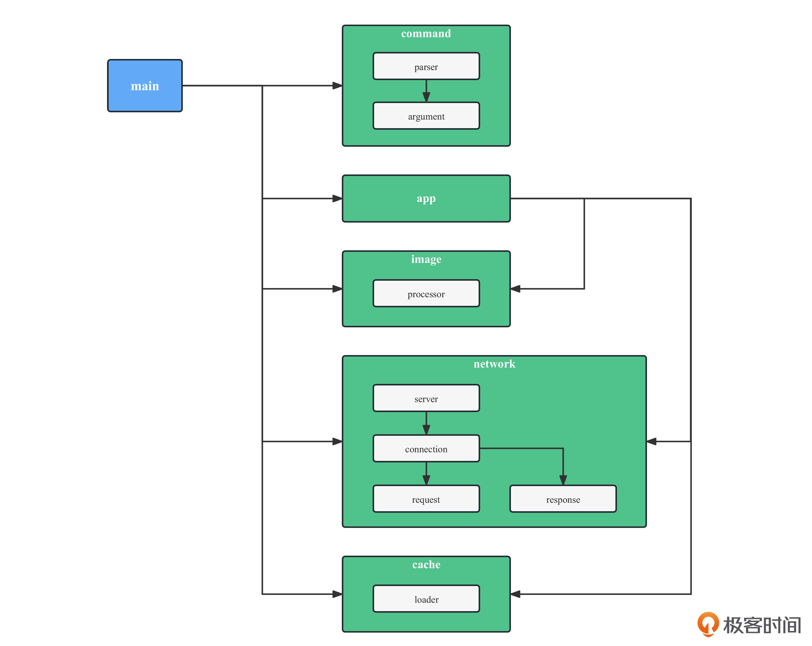
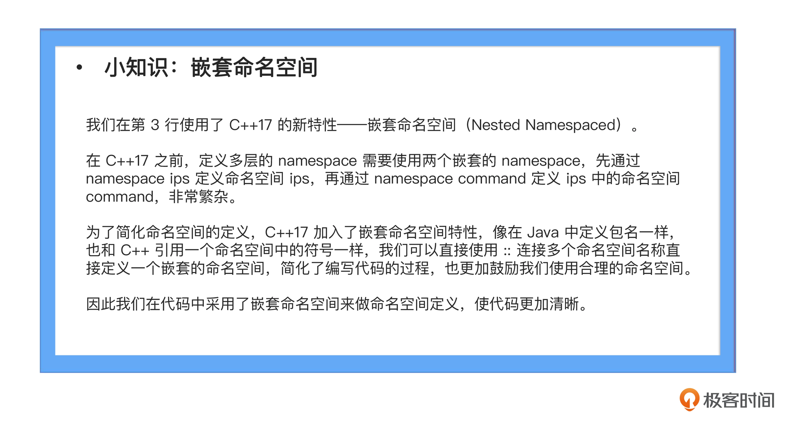
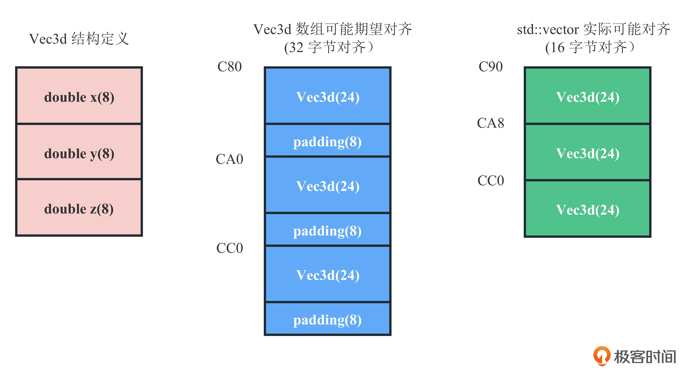
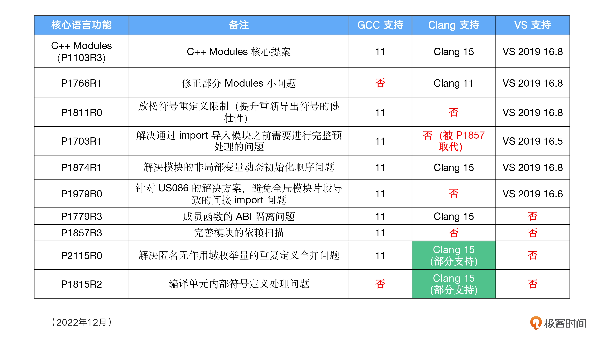

# 03 | Modules（下）：实战写个多模块图像处理服务

你好，我是卢誉声。

通过前面的学习，我们掌握了模块的基本概念。这节课，我们会一起学习，怎样使用 C++Modules 来组织实际的项目代码。相信你在动手实战后，就能进一步理解应该如何使用 C++Modules 和 namespace 来解决现实问题。

掌握了基本概念和使用要点之后，我们也会站在语言设计者的角度，整体讨论一下 C++Modules 能解决什么问题，不能解决什么问题。

好，话不多说，我们马上进入今天的学习。课程配套代码，点击这里获取。

## 面向图像的对象存储系统

要写的实例是一个常见的面向图像的对象存储系统，核心功能是将图片存储在本地空间，用户通过 HTTP 请求获取相应的图片，而这个系统的特点是用户除了可以获取原始图片，还可以通过参数获取经过处理的图片，比如图像缩放、图像压缩等。

想实现这样的功能，需要哪些模块呢？

我们画一张系统的模块架构图，可以清晰地看到系统模块以及模块内部分区的依赖关系。



首先我们需要创建项目，项目包括 5 个子模块，分别是 app、cache、command、image、network，其中 app 是业务应用模块，cache 是本地缓存模块，command 是命令行解析模块，image 是图像处理模块，network 是网络服务模块，每个模块分别创建对应的目录存储模块内的源代码。

对于这样一个多模块的项目，我们的目的是学习如何灵活使用 C++ Modules 来组织程序中的几个模块，所以接下来我们不对这个项目做具体实现，主要看看如何编写接口。

### 命令行解析模块

command/argument.cpp 模块定义了 Argument 类，用于描述命令行参数。

- 第 1 行通过 export module 声明了这个文件属于 ips.command 模块的 argument 分区，并用 export 表明这是一个模块接口编译单元。

- 第 4 行定义了 Arugment 类，并通过 export 将其标志为外部链接性，对其他模块可见。



```bash
export module ips.command:argument;
import <string>;
namespace ips::command {
   export class Argument {
   public:
       Argument(
           const std::string& flag,
           const std::string& name,
           const std::string& helpMessage = "",
           bool required = false
       ) :
           _flag(flag),
           _name(name),
           _helpMessage(helpMessage),
           _required(required) {}
       const std::string& getFlag() const {
           return _flag;
       }
       void setFlag(const std::string& flag) {
           _flag = flag;
       }
       const std::string& getHelpMessage() const {
           return _helpMessage;
       }
       void setHelpMessage(const std::string& helpMessage) {
           _helpMessage = helpMessage;
       }
       bool isRequired() const {
           return _required;
       }
       void setRequired(bool required) {
           _required = required;
       }
   private:
       std::string _flag;
       std::string _name;
       std::string _helpMessage;
       bool _required;
   };
}
```

command/parser.cpp

本模块定义了 Parser 类，用于解析命令行参数。

- 第 1 行通过 export module 声明了这个文件属于 ips.command 模块的 parser 分区，并用export 表明这是一个模块接口编译单元。

- 第 11 行定义了 Parser 类，并通过 export 将其标志为外部链接性，对其他模块可见。

```bash
export module ips.command:parser;
import <string>;
import <map>;
import <vector>;
import <functional>;
import :argument;
namespace ips::command {
   export class Parser {
   public:
       Parser& addArgument(const Argument& argument) {
           _arguments.push_back(argument);
           return *this;
       }
       std::map<std::string, std::string> parseArgs() {
           return _parsedArgs;
       }
       std::string getNamedArgument(const std::string& name) {
           std::string value = _parsedArgs[name];
           value;
       }
       template <class T>
       T getNamedArgument(const std::string& name, std::function<T(const std::st
           std::string value = _parsedArgs[name];
           return converter(value);
       }
   private:
       std::vector<Argument> _arguments;
       std::map<std::string, std::string> _parsedArgs;
   };
}
```

command/command.cpp 模块是整个 ips.command 模块的外部接口。在第 3 行和第 4 行通过 export import 导入并重新导出了:parser 和:argument 分区，这样我们可以将一个模块下的不同类分别在不同分区中实现，并在主模块接口单元中导入再导出，便于我们维护代码。

```bash
export module ips.command;
export import :parser;
export import :argument;
```

### 网络服务接口模块

network/request.cpp 模块定义了 Request 类，用于描述 HTTP 网络请求。

- 第 1 行通过 export module 声明了这个文件属于 ips.network 模块的 request 分区，并用export 表明这是一个模块接口编译单元。

- 第 7 行定义了 Request 类，并通过 export 将其标志为外部链接性，对其他模块可见。

```bash
export module ips.network:request;
import <string>;
import <map>;
namespace ips::network {
   export class Request {
   public:
       Request() {}
       void setPath(const std::string& path) {
           _path = path;
       }
       const std::string& getPath() {
           return _path;
       }
       void setQuery(const std::map<std::string, std::string>& query) {
           _query = query;
       }
       const std::map<std::string, std::string>& getQuery() {
           return _query;
       }
       std::string&& getBody() {
           return "";
       }
   private:
       std::string _path;
       std::map<std::string, std::string> _query;
   };
}
```

network/response.cpp 模块定义了 Response 类，用于描述 HTTP 网络响应。

- 第 1 行通过 export module 声明了这个文件属于 ips.network 模块的 response 分区，并用export 表明这是一个模块接口编译单元。

- 第 7 行定义了 Response 类，并通过 export 将其标志为外部链接性，对其他模块可见。

```bash
export module ips.network:response;
import <string>;
import <iostream>;
namespace ips::network {
   export class Response {
   public:
       Response() {}
       void send(const std::string& data) {
           std::cout << "Sent data" << data.size() << std::endl;
       }
   };
}
}
```

network/connection.cpp 模块定义了 Connection 类，用于描述 HTTP 网络连接。

- 第 1 行通过 export module 声明了这个文件属于 ips.network 模块的 connection 分区，并用 export 表明这是一个模块接口编译单元。

- 第 11 行使用 using 定义了类型别名 RequestPtr，表示请求对象指针，并通过 export 将该符号导出。

- 第 12 行使用 using 定义了类型别名 ResponsePtr，表示响应对象指针，并通过 export 将该符号导出。

- 第 14 行使用 using 定义了类型别名 OnRequestHandler，表示请求处理函数，并通过export 将该符号导出。

- 第 16 行定义了 Connection 类，并通过 export 将其标志为外部链接性，对其他模块可见。

```bash
export module ips.network:connection;
import <functional>;
import <memory>;
import <vector>;
import :request;
import :response;
namespace ips::network {
   export using RequestPtr = std::shared_ptr<Request>;
   export using ResponsePtr = std::shared_ptr<Response>;
   export using OnRequestHandler = std::function<void(RequestPtr, ResponsePtr)>;
   export class Connection {
   public:
       Connection() {}
       void onRequest(OnRequestHandler requestHandler) {
           _requestHandlers.push_back(requestHandler);
       }
   private:
       std::vector<OnRequestHandler> _requestHandlers;
   };
}
```

network/server.cpp 模块定义了 Server 类，用于实现 HTTP 服务器。

- 第 1 行通过 export module 声明了这个文件属于 ips.network 模块的 sever 分区，并用export 表明这是一个模块接口编译单元。

- 第 13 行使用 using 定义了类型别名 ConnectionPtr，表示连接对象指针，并通过 export 将该符号导出。

- 第 14 行使用 using 定义了类型别名 OnConnectionHandler，表示连接处理函数，并通过export 将该符号导出。

- 第 16 行定义了 Server 类，并通过 export 将其标志为外部链接性，对其他模块可见。

```bash
export module ips.network:server;
import <string>;
import <cstdint>;
import <functional>;
import <vector>;
import <memory>;
import <iostream>;
import :connection;
namespace ips::network {
   export using ConnectionPtr = std::shared_ptr<Connection>;
   export using OnConnectionHandler = std::function<void(ConnectionPtr)>;
   export class Server {
   public:
       Server(const std::string& host, int32_t port) :
           _host(host), _port(port) {}
       void setHost(const std::string& host) {
           _host = host;
       }
       const std::string& getHost() const {
           return _host;
       }
       void setPort(int32_t port) {
           _port = port;
       }
       int32_t getPort() const {
           return _port;
       }
       void startListen() {
           std::cout << "Start listened at " << _host << ":" << _port << std::en
       }
       void onConnection(OnConnectionHandler handler) {
           _handlers.push_back(handler);
       }
   private:
       std::string _host;
       int32_t _port;
       std::vector<OnConnectionHandler> _handlers;
   };
}
```

network/network.cpp

本模块是整个 ips.network 模块的外部接口。导入并导出了 ips.network 下的所有分区。

```bash
export module ips.network;
export import :server;
export import :request;
export import :response;
export import :connection;
```

### 图像处理模块

images/processor.cpp 模块定义了 Processor 类，用户实现图像处理。

- 第 1 行通过 export module 声明了这个文件属于 ips.image 模块的 processor 分区，并用export 表明这是一个模块接口编译单元。

- 第 7 行定义了 Processor 类，并通过 export 将其标志为外部链接性，对其他模块可见。

```bash
export module ips.image:processor;
import <string>;
import <cstdint>;
namespace ips::image {
   export class Processor {
   public:
       void setWidth(int32_t width) {
           _width = width;
       }
       int32_t getWidth() const {
           return _width;
       }
       void setHeight(int32_t height) {
           _height = height;
       }
       int32_t getHeight() const {
           return _height;
       }
       void setQuality(int32_t quality) {
           _quality = quality;
       }
       int32_t getQuality() const {
           return _quality;
       }
       void setMode(const std::string& mode) {
           _mode = mode;
       }
       const std::string& getMode() const {
           return _mode;
       }
       std::string&& processImage(const std::string& data) {
           return "";
       }
   private:
       int32_t _width;
       int32_t _height;
       int32_t _quality;
       std::string _mode;
   };
}
```

images/image.cpp

本模块是整个 ips.image 模块的外部接口。导入并导出了 ips.image 下的所有分区。

```bash
export module ips.image;
export import :processor;
```

### 本地缓存模块

cache/loader.cpp 模块定义了 Loader 类，用户实现缓存加载。

- 第 1 行通过 export module 声明了这个文件属于 ips.cache 模块的 loader 分区，并用export 表明这是一个模块接口编译单元。

- 第 6 行定义了 CacheLoader 类，并通过 export 将其标志为外部链接性，对其他模块可见。

```bash
export module ips.cache:loader;
import <string>;
namespace ips::cache {
   export class CacheLoader {
   public:
       CacheLoader(const std::string& basePath) :
           _basePath(basePath) {}
       bool loadCacheFile(const std::string& key, std::string* cacheFileData) {
           return false;
       }
   private:
       std::string _basePath;
   };
}
```

cache/cache.cpp 模块是整个 ips.cache 模块的外部接口。导入并导出了 ips.cache 下的所有分区。

```bash
export module ips.cache;
export import :loader;
```

### 业务应用模块

app/app.cpp 这个模块是整个 ips.app 模块的外部接口。由于比较简单，只定义了一个processRequest 函数，因此没有定义其他的分区。

- 第 1 行通过 export module 声明了这个文件为 ips.app 模块，并用 export 表明这是一个模块接口编译单元。

- 第 23 行定义了 processRequest 类，并通过 export 将其标志为外部链接性，对其他模块可见。

```bash
export module ips.app;
import <string>;
import <map>;
import ips.network;
import ips.image;
import ips.cache;
namespace ips::app {
   export void processRequest(
       ips::cache::CacheLoader* cacheLoader,
       ips::network::RequestPtr request,
       ips::network::ResponsePtr response
   ) {
       const std::string& path = request->getPath();
       const std::map<std::string, std::string>& query = request->getQuery();
       std::string data = request->getBody();
       ips::image::Processor imageProcessor;
       std::string cacheKey = path;
       auto widthIterator = query.find("width");
       if (widthIterator != query.cend()) {
           imageProcessor.setWidth(std::stoi(widthIterator->second));
           cacheKey += "&width=" + widthIterator->second;
       }
       auto heighIterator = query.find("height");
       if (heighIterator != query.cend()) {
           imageProcessor.setHeight(std::stoi(heighIterator->second));
           cacheKey += "&height=" + heighIterator->second;
       }
       auto qualityIterator = query.find("quality");
       if (qualityIterator != query.cend()) {
           imageProcessor.setQuality(std::stoi(qualityIterator->second));
           cacheKey += "&quality=" + qualityIterator->second;
       }
       auto modeIterator = query.find("mode");
       if (modeIterator != query.cend()) {
           imageProcessor.setMode(modeIterator->second);
           cacheKey += "&mode=" + modeIterator->second;
       }
       std::string processedImageData;
       bool hasCache = cacheLoader->loadCacheFile(cacheKey, &processedImageData)
       if (hasCache) {
           response->send(processedImageData);
           return;
       }
       processedImageData = imageProcessor.processImage(data);
       response->send(processedImageData);
   }
}
```

### 主程序调用

main.cpp 是整个程序的调用的模块，首先创建命令行解析器，对命令行进行解析，接着创建HTTP 服务器和缓存加载器，最后注册连接处理函数和请求处理函数，并启动监听，进入事件循环。

- 第 1 到 3 行，通过 import 导入 C++ 标准库的头文件。

- 第 5-9 行，通过 import 导入项目内部的各个模块，后面就能使用这些模块内的符号了。

```python
import <iostream>;
import <string>;
import <functional>;
import ips.command;
import ips.network;
import ips.image;
import ips.app;
import ips.cache;
int main() {
   std::cout << "Image Processor" << std::endl;
   ips::command::Parser parser;
   parser.addArgument(ips::command::Argument("--host", "host"));
   parser.addArgument(ips::command::Argument("--port", "port"));
   parser.addArgument(ips::command::Argument("--cache", "cachePath"));
   parser.parseArgs();
   std::string cachePath = parser.getNamedArgument("cachePath");
   ips::cache::CacheLoader cacheLoader(cachePath);
   std::string host = parser.getNamedArgument("host");
   int port = parser.getNamedArgument<int32_t>("port", [](const std::string& val
       return std::stoi(value);
   });
   ips::network::Server server(host, port);
   server.onConnection([&cacheLoader](ips::network::ConnectionPtr connection) ->
       connection->onRequest(std::bind(
           ips::app::processRequest,
           &cacheLoader,
           std::placeholders::_1,
           std::placeholders::_2
       ));
   });
   server.startListen();
   return 0;
}
```

相对于传统的方法，我们不需要关心头文件和符号实现的各种细节，C++ Modules 规定我们将接口和实现都组织在通过模块关联的代码文件中，虽然灵活性相对较低，但在一般的工程实践中，这样的代码组织更加合理，也能降低模块开发者和使用者的心智负担。

## 深入理解 C++ Modules

掌握了 C++ Modules 的基础概念，也通过实例体会了 C++ Modules 的用法和好处，我们再回过头来，站在语言设计者的角度，讨论一下 C++ Modules 中一些深层次问题，C++ Modules核心语言特性变更到底能为我们带来什么？它能解决什么，同时又不能解决什么问题？

### Modules 能解决什么

首先需要理解 Modules 到底帮助我们解决了什么问题？在 C++ Modules 的基本概念介绍中，我们说过了 Modules 解决的是符号可见性问题。

在传统的 C++ 解决方案中，处理符号可见性，需要我们充分理解 C++ 的“编译 - 链接”原理，甚至很多的实现技术细节。

由于 C++ 中的各个编译单元需要独立编译，同时在链接中通过检索符号填补缺失的符号，我们不仅要在实现符号的编译单元中编写实现，还要在引用的编译单元中，通过书写符号声明，来告知编译器这些符号会在链接过程中存在。所以，我们需要通过头文件来为模块调用的编译单元提供这些必要的前置符号声明。

这就出现了一个问题：模块之间的符号引用，因为这种“编译 - 链接”机制被硬生生拆分成两个阶段。哪怕能通过编译，也可能在链接时产生错误，而这种错误也很难被编译器和 IDE 在编译阶段提前侦测到，更多的问题将链接时才暴露出来。

只有经验丰富的 C++ 工程师，在了解基本的“编译 - 链接”原理后，才能熟练排查这些因为两阶段的不一致性导致的链接问题，并找到方法尝试解决。因此传统的符号可见性解决方案，对C++ 初学者不友好。

新的 C++ Modules 方法，本质上抛弃了“头文件”这种 C/C++ 中的重要组成部分，将头文件转换成了模块接口文件，也为 C++ 提供了一种在编译期检测声明实现不一致的方法，也为 IDE的智能提示提供了新的可靠方法。

另外，C++ Modules 也部分抛弃了 C/C++ 原本通过简单的文本处理为编译单元引入声明的方式，使得编译器可以为模块编译单元生成二进制的编译缓存，为加快编译过程提供了一个新的契机。

所以简单来说，C++ Modules 给我们带来了一种更为现代化的，更简单的符号可见性控制方案，同时又能加快编译速度。

### Modules 不能解决什么

那么，Modules 不能解决什么呢？

第一，Modules 不能解决符号命名冲突的问题。

在实例中，你会发现我们在代码中同时使用了命名空间和 Modules，通过 Modules 来控制符号可见性，然后使用命名空间来避免符号命名冲突。

符号命名冲突，可能因为两个不同的模块使用了相同名称的函数、类、全局变量等，并将其export 出来，如果这两个模块同时 import 到同一个编译单元中，就会出现问题，因为编译器并不知道我们使用的是哪个模块中的符号。因此在不同的模块中，我们仍习惯使用不同的命名空间，确保一个编译单元导入两个模块的时候不会出现模块冲突。

这就是我们一直所说的，模块只解决符号可见性问题，而命名冲突问题依然需要通过namespace 解决，这就是 Modules 和 namespace 是保持正交设计的。

第二，目前 Modules 不能用来解决二进制库分发的问题。

现阶段，编译器在编译模块编译单元的过程中，会为每个模块编译单元生成对应的二进制缓存，无论是模块接口单元还是模块实现单元都会生成，甚至通过 import 导入 iostream 这种标准库，也会为 iostream 生成二进制缓存。

这些二进制缓存，不仅包括编译后生成的中间码、机器码，还包括源代码之类的 meta 数据，这样，其他编译模块在通过 import 导入模块的时候，编译器将会直接读取二进制缓存，不需要在预处理阶段做文本替换，再在各个编译单元的编译过程中进行编译，可以加快编译速度。

但我们要注意的是，在生成的静态链接库或者动态链接库中，标准并没有定义需将这些缓存中的 meta 数据加入到库中。

因此，目前通过 Modules 编写的代码，在进行二进制分发时，会面临很多问题，只有 VisualC++（自 Visual Studio 2022 起）通过标头单元来实现通过 import 导入（可以读取编译器自动生成的二进制缓存 ifc 文件，ifc 文件是 VC 编译单元生成的标头单元二进制缓存文件格式），其他的编译器只支持通过源代码分发的方式来使用 import。

第三，STL 内存布局问题。

在使用 STL 的过程中，我们会遇到 ABI 与内存布局的很多问题。比如一些 SIMD 的计算场景，需要调用 CPU 的加速指令，而这些加速指令对数据的内存地址对齐都有严格要求，因此我们可能需要可以预期的内存对齐结果。但是，实际上内存对齐会受到编译器和体系结构影响，如下图。



自己管理内存，可以产生我们预期的内存对齐效果，但如果使用 STL，则需要依赖编译器和体系结构，可能无法产生我们所预期的内存对齐。这只是 STL 内存布局问题的冰山一角。

现阶段的 Modules 暂时无法解决各编译器之间 ABI，尤其是使用模板后的问题。

目前，编译和链接还是会依赖编译器和体系结构定义的 ABI，所以，如果 A 编译器生成的二进制符号格式，不同于 B 编译器的二进制符号格式，那么 B 编译器也就无法使用 A 编译器生成的库（无论是动态链接库还是静态链接库），更不用说不同编译器生成的二进制缓存文件了。

我们了解 C++ Modules 能做什么，不能做什么，就知道该在什么场景如何使用 C++ Modules了。总的来说，目前 C++ Modules 的支持还不够完善，不同的 C++ 编译器，对现代 C++ 新标准的支持情况各不相同，这里也给出当下主流编译器对新特性的支持情况。



随着编译器支持越来越成熟，相信会带来更多的编译性能提升，就像编译器对头文件支持的性能提升一样。

## 总结

自 C++20 标准开始，C++ Modules 给我们带来了一种更为现代化的、更简单的符号可见性控制方案，同时又能加快编译速度。

总体上看，C++ Modules 很好地提供了解决符号可见性问题的方案。在传统的 C++ 解决方案中，处理符号可见性，需要在充分理解 C++ 的“编译 - 链接”原理甚至很多实现技术细节，而现在，我们可以更简单地掌控符号的可见性，并在不牺牲编译性能的情况下使用 C++ 进行编码。

但是目前 C++ Modules 并不是完美的。

1. 不能解决符号命名冲突的问题。

2. 不能用来解决二进制库分发的问题。

3. 现阶段的 Modules 暂时无法解决各编译器之间 ABI，尤其是使用模板之后带来的问题。

随着现代 C++ 标准化进程的稳步推进，我们期待着这些问题能够在未来得到标准和编译器的统一支持。C++ Modules 已经逐渐成为解决编译性能和符号隔离的银弹，但我们让这枚子弹“再飞一会儿”。

## 课后思考

这节课，我们了解到，C++ Modules 带来了极大的便利性，不过当前也仍然存在一些功能限制，你能否举出在日常使用 C++ 过程中碰到的有关于符号的编译、链接问题，并给出你的解决方法。

欢迎留言和我分享你的想法，我们一同交流！
