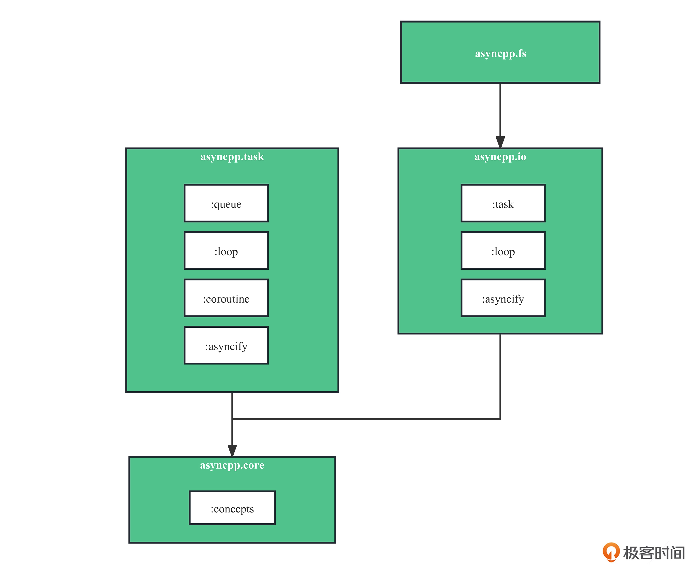
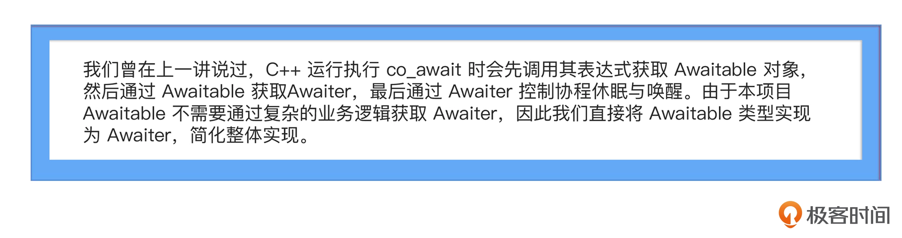
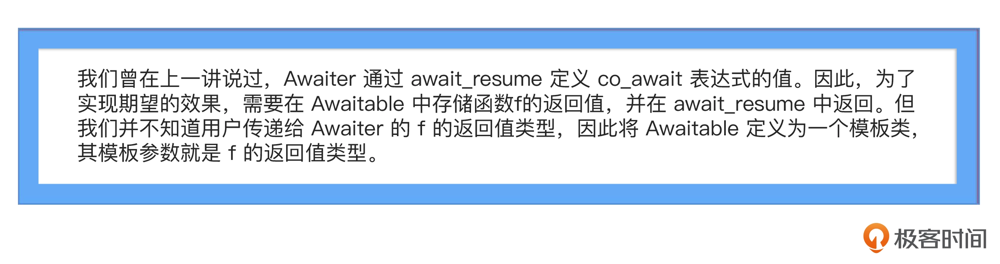
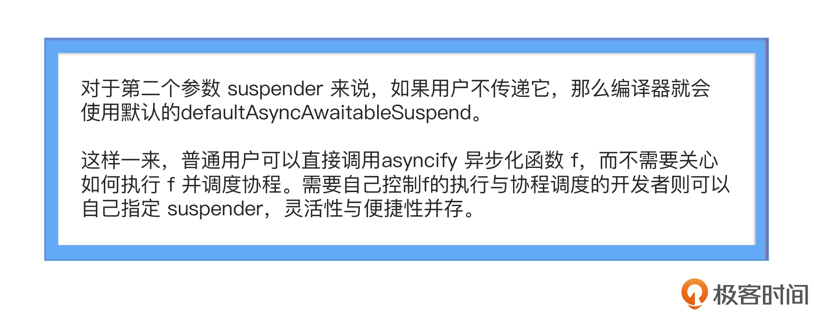

# 09 | Coroutines实战（一）：异步文件操作库

你好，我是卢誉声。

在上一讲中，我们掌握了 C++20 标准下需要实现的协程接口约定。就目前来说，在没有标准库支持的情况下，这些约定我们都需要自己实现。

但是，仅通过阅读标准文档或参考代码，编写满足 C++ 协程约定的程序比较困难。因此，我安排了两讲内容带你实战演练一下，以一个异步文件系统操作库为例，学习如何编写满足 C++协程约定的程序。

这一讲我们先明确模块架构，完成基础类型模块和任务调度模块，为后面实现基于协程的异步I/O 调度打好基础，今天的重点内容是任务调度模块。

好，话不多说，就让我们从模块架构开始，一步步实现任务调度模块（（课程配套代码，点击这里即可获取））。

## 模块组织方式

由于这是一个用 C++ 实现的异步文件操作库，我们就将它命名为 asyncpp，取 async（即异步 asynchronous 这一单词的缩写）和 cpp 的组合。这个基于 C++ 协程的库支持通用异步任务、I/O 异步任务以及异步文件系统操作，主要用于 I/O 等任务而非计算任务。

整个项目的模块架构图如下。



我们用 C++ Modules 组装整个库，我先带你了解一下里面的模块有哪些。

- asyncpp.core：核心的基础类型模块，主要用来定义基础的类型与 concepts。

- asyncpp.task：通用异步任务模块，实现了主线程内的异步任务框架，包括 queue、loop、coroutine 和 asyncify 几个分区。

- asyncpp.io：异步 I/O 模块，实现了独立的异步 I/O 线程和任务处理框架，用于独立异步处理 I/O，包括 task、loop 和 asyncify 几个分区。

- asyncpp.fs：异步文件系统模块，基于 asyncpp.io 模块实现了异步的文件系统处理函数。

对照示意图从下往上看，所有模块都是基于 asyncpp.core 这个基础类型模块实现的。而asyncpp.task 是库的核心模块，asyncpp.io 在该核心模块的基础上提供了异步 I/O 的支持。

有了清晰的模块划分，我们先从基础类型模块——asyncpp.core 开始编写。

## 基础类型模块

基础类型模块提供了库中使用的基本类型的 Concepts，因此我们重点关注这个 concepts 分区，实现在 core/Concepts.cpp 中。

```bash
export module asyncpp.core:concepts;
import <type_traits>;
namespace asyncpp::core {
   export template <typename T>
   concept Invocable = std::is_invocable_v<T>;
}
```

在这段代码中，我们定义了 Invocable 这个 concept，用于判定 T 是否是可调用的。

这个 concept 定义的约束为 std::is_invocable_v，用于判定 T() 这个函数调用表达式是否合法。由于用户传入的类型可能是普通函数、成员函数、函数对象或者 lambda 表达式，因此这里不能用 std::is_function_v，因为这个 traits 只支持普通函数，不支持其他的可作为函数调用的类型。

接下来我们还要定义基础类型模块的导出模块，代码在 core/Core.cpp 中。我们可以看到，代码中导入并重新导出了所有的分区。

```bash
export module asyncpp.core;
export import :concepts;
```

基础类型模块的工作告一段落，接下来要实现的所有模块，我们都会直接或间接使用基础类型模块中的 Concepts。

## 任务调度模块

接下来就到了重头戏——完成任务调度模块，这是库的核心模块。为了让你更直接地了解C++20 以后可以怎么使用协程，接下来我们基于协程约定，实现异步任务的定义与调用。同时，你也会看到，协程的调度细节隐藏在封装的接口实现中，这样可以降低协程的使用门槛。

先说说设计思路。因为 asyncpp 主要用于 I/O 等任务而非计算任务，所以我们模仿了 NodeJS的实现——在主线程中实现任务循环，所有的异步任务都会放入这个任务循环中执行，并通过循环实现协程的调度。

如果要实现真正的异步，需要结合另外的工作线程来执行需要异步化的任务，task 模块中提供了异步任务的提交接口，提交后的实现我们在后续的 I/O 调度模块中完成。

现在，我们来实现任务调度模块的各个分区。

### queue 分区

首先我们看一下 queue 分区 task/AsyncTaskQueue.cpp，这是一个任务队列的实现。

```sql
export module asyncpp.task:queue;
import <functional>;
import <mutex>;
import <vector>;
namespace asyncpp::task {
export struct AsyncTask {
   // 异步任务处理函数类型
   using Handler = std::function<void()>;
   // 异步任务处理函数
   Handler handler;
};
export class AsyncTaskQueue {
public:
   static AsyncTaskQueue& getInstance();
   void enqueue(const AsyncTask& item) {
       std::lock_guard<std::mutex> guard(_queueMutex);
       _queue.push_back(item);
   }
   bool dequeue(AsyncTask* item) {
       std::lock_guard<std::mutex> guard(_queueMutex);
       if (_queue.size() == 0) {
           return false;
       }
       *item = _queue.back();
       _queue.pop_back();
       return true;
   }
   size_t getSize() const {
       return _queue.size();
   }
private:
   // 支持单例模式，通过default修饰符说明构造函数使用默认版本
   AsyncTaskQueue() = default;
   // 支持单例模式，通过delete修饰符说明拷贝构造函数不可调用
   AsyncTaskQueue(const AsyncTaskQueue&) = delete;
   // 支持单例模式，通过delete修饰符说明赋值操作符不可调用
   AsyncTaskQueue& operator=(const AsyncTaskQueue&) = delete;
   // 异步任务队列
   std::vector<AsyncTask> _queue;
   // 异步任务队列互斥锁，用于实现线程同步，确保队列操作的线程安全
   std::mutex _queueMutex;
};
AsyncTaskQueue& AsyncTaskQueue::getInstance() {
   static AsyncTaskQueue queue;
   return queue;
}
}
```

这段代码的核心部分是 AsyncTaskQueue 类，主要实现了 enqueue 函数和 dequeue 函数。

enqueue 函数负责将任务添加到任务队列尾部，这里我们用到了互斥锁来实现线程同步。

dequeue 则是从任务队列头部获取任务，取出任务后会将任务数据从队列中清理掉，防止重复执行任务。这里同样用了互斥锁来实现线程同步，如果任务不存在会返回 false；如果任务存在会将任务写入到参数传入的指针中并返回 true。

### loop 分区

接下来是 loop 分区 task/AsyncTaskLoop.cpp，实现了消息循环，我们会在 loop 分区使用刚才实现的 queue 分区，用作消息循环中的任务队列。后面是具体代码。

```sql
export module asyncpp.task:loop;
import :queue;
import <cstdint>;
import <chrono>;
namespace asyncpp::task {
export class AsyncTaskLoop {
public:
   // 常量，定义了任务循环的等待间隔时间（单位为毫秒）
   static const int32_t SLEEP_MS = 1000;
   static AsyncTaskLoop& getInstance();
   static void start() {
       getInstance().startLoop();
   }
private:
   // 支持单例模式，通过default修饰符说明构造函数使用默认版本
   AsyncTaskLoop() = default;
   // 支持单例模式，通过delete修饰符说明拷贝构造函数不可调用
   AsyncTaskLoop(const AsyncTaskLoop&) = delete;
   // 支持单例模式，通过delete修饰符说明赋值操作符不可调用
   AsyncTaskLoop& operator=(const AsyncTaskLoop&) = delete;
   void startLoop() {
       while (true) {
           loopExecution();
           std::this_thread::sleep_for(std::chrono::milliseconds(SLEEP_MS));
       }
   }
   void loopExecution() {
       AsyncTask asyncEvent;
       if (!AsyncTaskQueue::getInstance().dequeue(&asyncEvent)) {
           return;
       }
       asyncEvent.handler();
   }
};
AsyncTaskLoop& AsyncTaskLoop::getInstance() {
   static AsyncTaskLoop eventLoop;
   return eventLoop;
}
}
```

这段代码的核心是 AsyncTaskLoop 类，主要实现了 start、startLoop 和 loopExecution 这三个成员函数，我们依次来看看这些函数的作用。

start 用于在当前线程启动任务循环，实现是调用 startLoop，调用后当前线程会阻塞，直到出现需要执行的任务。

startLoop 用来启动任务循环，其实现是一个循环，每次循环会调用 loopExecution 成员函数，然后通过 this_thread 的 sleep 睡眠等待一段时间，给其他线程让出 CPU。

如果你足够细心，刚才看代码时可能已经注意到了，这里的时间定义成了一个常量。在真实的开发场景里，这个时间会很短，我们这里为了演示任务调度过程，特意将时间设置为1000ms，这样输出过程会更加明显。

loopExecution 用来执行任务，其实现是从任务队列 AsyncTaskQueue 实例中获取最早的任务，如果任务不存在就直接返回。

### coroutine 分区

接下来是 coroutine 分区 task/Coroutine.cpp，实现了 C++ 协程约定的几个类型与相关接口，为使用协程进行任务调度提供关键支持。代码如下所示。

```bash
export module asyncpp.task:coroutine;
import <coroutine>;
import <functional>;
namespace asyncpp::task {
   // 协程类
   export struct Coroutine {
       // 协程Promise定义
       struct promise_type {
           Coroutine get_return_object() {
               return {
                   ._handle = std::coroutine_handle<promise_type>::from_promise(
               };
           }
           std::suspend_never initial_suspend() { return {}; }
           std::suspend_never final_suspend() noexcept { return {}; }
           void return_void() {}
           void unhandled_exception() {}
       };
       // 协程的句柄，可用于构建Coroutine类，并在业务代码中调用接口进行相关操作
       std::coroutine_handle<promise_type> _handle;
   };
   // AsyncTaskSuspender类型声明
   export template <typename ResultType>
   struct Awaitable;
   export using AsyncTaskResumer = std::function<void()>;
   export using CoroutineHandle = std::coroutine_handle<Coroutine::promise_type>
   export template <typename ResultType>
   using AsyncTaskSuspender = std::function<void(
       Awaitable<ResultType>*, AsyncTaskResumer, CoroutineHandle&
   )>;
   // Awaitable类型定义（当任务函数返回类型不为void时）
   export template <typename ResultType>
   struct Awaitable {
       // co_await时需要执行的任务，开发者可以在suspend实现中调用该函数执行用户期望的任务
       std::function<ResultType()> _taskHandler;
       // 存储任务执行的结果，会在await_resume中作为co_await表达式的值返回
       ResultType _taskResult;
       // 存储开发者自定义的await_suspend实现，会在await_suspend中调用
       AsyncTaskSuspender<ResultType> _suspender;
       bool await_ready() { return false; }
       void await_suspend(CoroutineHandle h) {
           _suspender(this, [h] { h.resume(); }, h);
       }
       ResultType await_resume() {
           return _taskResult;
       }
   };
   // Awaitable类型定义（当任务函数返回类型为void时）
   export template <>
   struct Awaitable<void> {
       // co_await时需要执行的任务，开发者可以在suspend实现中调用该函数执行用户期望的任务
       std::function<void()> _taskHandler;
       // 存储开发者自定义的await_suspend实现，会在await_suspend中调用
       AsyncTaskSuspender<void> _suspender;
       bool await_ready() { return false; }
       void await_suspend(CoroutineHandle h) {
           _suspender(this, [h] { h.resume(); }, h);
       }
       void await_resume() {}
   };
}
```

在这段代码中，我们定义了 C++ 协程支持的几个关键类型。首先，是协程类型 Coroutine，协程调用者一般需要通过该类型操作 coroutine_handle，来实现协程的调度，该定义包含了嵌套类型 promise_type 和协程句柄变量 _handle。

接着，在 Coroutine 中定义了 Promise 类型，该对象在协程生命周期中一直存在，因此可以在不同的线程或者函数之间传递协程的各类数据与状态。

类型中的大多数接口没有特殊行为，所以都用了默认实现（空函数）。其中比较特殊的是get_return_object，我们在上一讲说过，协程调用者调用协程时获取到的返回值就是该函数的返回值。

这里我们通过 coroutine_handle 的 from_promise 函数获取到 promise 对象对应的协程句柄，调用 Coroutine 的构造函数生成 Coroutine 对象并返回，因此协程函数的调用者获取到该对象后，可以根据业务控制调度协程。

接着，我们定义了 CoroutineHandle 类型，这是 std::coroutine_handle 的别名，也就是协程的句柄。

协程句柄是 C++ 提供的唯一的协程标准类型，指向一次协程调用生成的协程帧，因此可以访问到存储在协程帧上的 Promise 对象。协程句柄提供了协程调度的标准函数，是协程调用者进行协程调度的基础。

由于该类型是一个泛型类（模板参数是 Promise 的类型），而且会在后续代码中频繁使用，为了方便，我们为 std::coroutine_handle<Coroutine:promise_type> 定义了一个别名CoroutineHandle。

最后，我们定义了 Awaitable 类型，在协程中使用 co_await 进行休眠时需要该类型支持。



Awaitable 对于实现协程调度至关重要，其中 await_resume 和 await_suspend 的实现是重点。我们在此做出进一步分析。

首先，是 await_resume 的实现。假设用户需要通过 co_await 异步执行函数 f，并在 f 结束后获取到 f 的返回值作为 co_await 表达式的值，也就是我们希望实现的效果是：

```
auto result = co_await Awaitable(f);
```

当 f 执行结束后协程会被唤醒，并将 f 的返回值赋给 result。



另外，考虑到函数 f 的返回类型为 void 的情况（相当于没有返回值），它与“返回值类型不为void”时的实现完全不同，不需要存储函数 f 的返回值。

因此，我在这里定义了一个 Awaitable 的特化版本——当函数 f 的返回类型为 void 时，会使用该版本的 Awaitable 类。在该版本中，不会存储函数 f 的返回值，await_resume 的返回类型固定为 void，并且不会返回任何值。

接着，是 await_suspend 的实现，通过它，我们就能控制在“何时、何处”唤醒被 co_await 休眠的协程。

这里允许开发者通过 AsyncTaskSuspender 来实现 await_suspend 的具体行为。await_suspend 中会调用开发者实现的函数，来唤醒休眠的协程。

AsyncTaskSuspender 包含后面这三个参数，开发者可以利用这些参数实现不同的调度机制。

1. Awaiter 对象指针：Awaitable*。

2. 协程的唤醒函数：AsyncTaskResumer。

3. 协程的句柄：CoroutineHandle&。

### asyncify 分区

接下来是 asyncify 分区 task/Asyncify.cpp，该分区实现了 asyncify 工具函数，用于将一个普通的函数 f 转换成一个返回 Awaitable 对象的函数 asyncF。通过这个分区实现的工具，可以让库的用户更容易使用我们在上一节实现的 Coroutine。

开发者通过 co_await 调用 asyncF，就可以实现函数 f 的异步调用，并在 f 执行完成后，重新唤醒协程。如果你了解过 JavaScript，可以将其类比成 ES6 中的 promsify。后面是代码实现。

```bash
export module asyncpp.task:asyncify;
export import :queue;
export import :loop;
export import :coroutine;
import asyncpp.core;
namespace asyncpp::task {
   using asyncpp::core::Invocable;
   // 默认的AsyncTaskSuspender（当任务函数返回类型不为void时）
   template <typename ResultType>
   void defaultAsyncAwaitableSuspend(
       Awaitable<ResultType>* awaitable,
       AsyncTaskResumer resumer,
       CoroutineHandle& h
   ) {
       auto& asyncTaskQueue = AsyncTaskQueue::getInstance();
       asyncTaskQueue.enqueue({
           .handler = [resumer, awaitable] {
               awaitable->_taskResult = awaitable->_taskHandler();
               resumer();
           }
       });
   }
   /* 默认的AsyncTaskSuspender（当任务函数返回类型为void时的特化版本）
    *
    * 当f的返回类型为void时，函数f没有返回值。因此，我们定义了一个函数返回类型为void的特化版本
    * 在该版本中构造的AsyncTask对象的handler调用用户函数f后，直接调用resumer唤醒协程，
    * 不会将f的返回值存储到Awaitable对象中。
   */
   template <>
   void defaultAsyncAwaitableSuspend<void>(
       Awaitable<void>* awaitable,
       AsyncTaskResumer resumer,
       CoroutineHandle& h
   ) {
       auto& asyncTaskQueue = AsyncTaskQueue::getInstance();
       asyncTaskQueue.enqueue({
           .handler = [resumer, awaitable] {
               awaitable->_taskHandler();
               resumer();
           }
       });
   }
   // 异步化工具函数，支持将普通函数f异步化
   export template <Invocable T>
   auto asyncify(
       T taskHandler,
       AsyncTaskSuspender<std::invoke_result_t<T>> suspender =
           defaultAsyncAwaitableSuspend<std::invoke_result_t<T>>
   ) {
       return Awaitable<std::invoke_result_t<T>> {
           ._taskHandler = taskHandler,
               ._suspender = suspender
       };
   }
}
```

在这段代码中，我定义了两个版本的 defaultAsyncAwaitableSuspend 函数，它就是 Coroutine模块中 Awaitable 类型所需的 AsyncTaskSuspender 函数，该函数的作用是在 co_await 休眠协程后，执行用户函数 f 和唤醒协程。

我们的实现其实很简单，就是构造一个 AsyncTask 对象并添加到 AsyncTaskQueue 中。AsyncTask 对象的 handler 会执行用户函数 f，将 f 的返回值存储到 awaitable 对象中，最后调用 resumer 唤醒协程。

接着，我们定义了 asyncify 模版函数，模板参数 T 必须符合 Invocable 约束，也就是必须可调用，对应了用户函数 f 的类型。该函数包含两个参数。

1. taskHandler：期望异步执行的函数 f。

2. suspender：Awaitable 中用户可以自己设置的 AsyncTaskSuspender 函数。



## 总结

为了帮你解决难题，熟悉怎样编写满足 C++ 协程约定的程序，我们实现了一个异步文件系统操作库中的任务调度模块。其中 coroutine 分区实现了 C++ 协程约定的几个类型与相关接口，为使用协程进行任务调度提供关键支持。

一般来说，提供异步调用的库的底层实现各有不同，但是它们的目标是一致的，就是在某个消息循环上提供异步调用的基础设施。而我们选择使用 C++ Coroutines 来实现高性能异步调度能力。

在下一讲，我们将继续编程实战，使用这一讲实现的任务调度模块，继续实现基于协程的异步I/O 调度。

## 课后思考

在目前的设计中，我们只支持 co_await 去等待函数执行完成，然后恢复执行。那么，在co_await 表达式中，是否可以执行并等待另一个协程执行结束？如果不可以，该如何修改代码来实现这一功能呢？

不妨在这里分享你的答案，我们一同交流。下一讲见！
