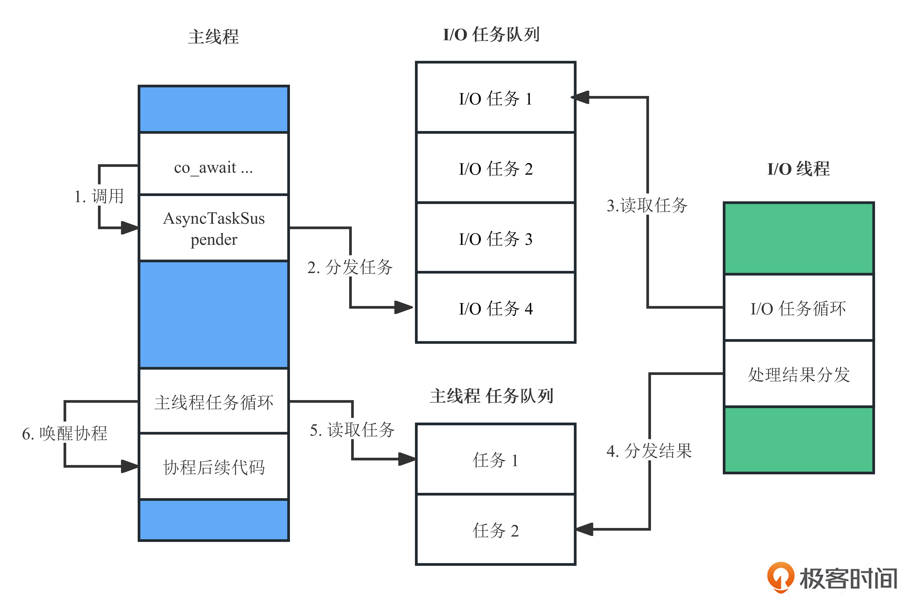
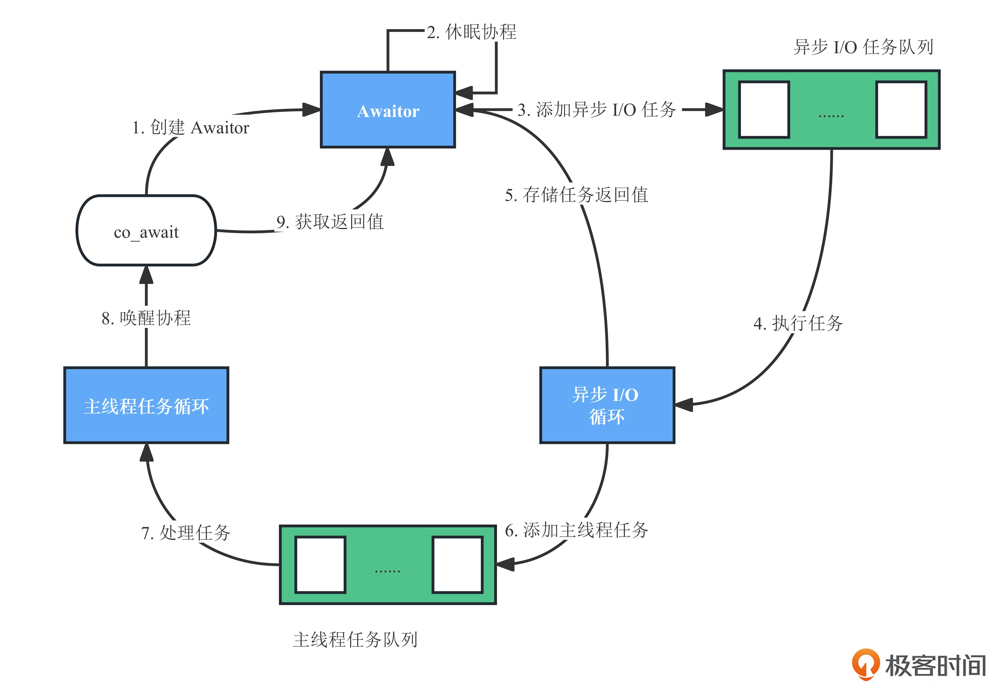

# 10 | Coroutines实战（二）：异步文件操作库

你好，我是卢誉声。

今天，我们继续上一讲的工作，实现基于协程调度的异步文件系统操作库。同时，在这一讲中，我们还要探讨一个重要话题，即实现所有调度线程全异步化的理想异步模型。

上一讲的最后，我们已经实现了任务调度模块，这意味着我们搭建好了基于协程的任务调度框架。但是，目前 task 模块是运行在主线程上的。因此，只有当主线程没有其他任务执行时，task 模块才会从消息循环中获取任务执行，并唤醒协程。

这不是一个理想的异步框架模型，我们更希望实现的是主线程和 I/O 调度全异步化。那么，这要如何实现呢？

项目的完整代码，你可以这里获取。

## I/O 调度模块

其实，task 模块中预留的 AsyncTaskSuspender 函数，就是为了实现自定义任务的处理与唤醒机制。为此，我们继续讨论异步 I/O 的实现——基于 task 模块的任务调度框架，实现基于协程的异步 I/O 调度。

我们的基本思路是下图这样。



首先，我们要为 I/O 任务创建独立的任务队列。然后，AsyncTaskSuspender 中的主线程，负责将任务与协程的唤醒函数分发到 I/O 任务队列中。

接下来还要创建一个有独立任务循环的新线程，读取 I/O 任务队列，用于处理 I/O 任务。最后，处理完 I/O 任务后，将任务的返回值和协程唤醒函数分发到主线程的任务队列中。根据主线程的任务循环机制，当主线程空闲时，唤醒协程。

接下来，看一下这个思路的具体实现，我们从 task 分区的实现开始。

### task 分区

第一步，我们来看看 io 模块的 task 分区 task/AsyncIoTask.cpp。该分区实现了 I/O 任务队列，后面是具体代码。

```bash
export module asyncpp.io:task;
import asyncpp.core;
import asyncpp.task;
import <functional>;
import <vector>;
import <mutex>;
namespace asyncpp::io {
export struct AsyncIoTask {
   using ResumeHandler = std::function<void()>;
   using TaskHandler = std::function<void()>;
   // 协程唤醒函数
   ResumeHandler resumeHandler;
   // I/O任务函数
   TaskHandler taskHandler;
};
export class AsyncIoTaskQueue {
public:
   static AsyncIoTaskQueue& getInstance();
   void enqueue(const AsyncIoTask& item) {
       std::lock_guard<std::mutex> guard(_queueMutex);
       _queue.push_back(item);
   }
   bool dequeue(AsyncIoTask* item) {
       std::lock_guard<std::mutex> guard(_queueMutex);
       if (_queue.size() == 0) {
           return false;
       }
       *item = _queue.back();
       _queue.pop_back();
       return true;
   }
   size_t getSize() const {
       return _queue.size();
   }
private:
   // I/O任务队列
   std::vector<AsyncIoTask> _queue;
   // I/O任务队列互斥锁，用于实现线程同步，确保队列操作的线程安全
   std::mutex _queueMutex;
};
AsyncIoTaskQueue& AsyncIoTaskQueue::getInstance() {
   static AsyncIoTaskQueue queue;
   return queue;
}
}
```

在这段代码中，AsyncIoTaskQueue 的实现和 AsyncTaskQueue 类非常类似，不同之处就是AsyncIoTask 的定义除了任务处理函数，还包含一个用于唤醒协程的处理函数resumeHandler。

### loop 分区

接下来，我们看一下 io 模块的 loop 分区 task/AsyncIoLoop.cpp。该分区定义了异步 I/O 循环的实现，代码如下。

```bash
export module asyncpp.io:loop;
import :task;
import asyncpp.task;
import <thread>;
import <chrono>;
import <thread>;
import <functional>;
namespace asyncpp::io {
   export class AsyncIoLoop {
   public:
       static AsyncIoLoop& start();
   private:
       AsyncIoLoop() {
           _thread = std::jthread(std::bind(&AsyncIoLoop::loopMain, this));
       }
       void loopExecution() {
           AsyncIoTask opItem;
           if (!AsyncIoTaskQueue::getInstance().dequeue(&opItem)) {
               return;
           }
           opItem.taskHandler();
           auto& asyncEventQueue = asyncpp::task::AsyncTaskQueue::getInstance();
           asyncEventQueue.enqueue({
               .handler = opItem.resumeHandler
           });
       }
       void loopMain() {
           while (true) {
               loopExecution();
               std::this_thread::sleep_for(std::chrono::milliseconds(1000));
           }
       }
       std::jthread _thread;
   };
   AsyncIoLoop& AsyncIoLoop::start() {
       static AsyncIoLoop ioLoop;
       return ioLoop;
   }
}
```

在这段代码中，AsyncIoLoop 的主体实现和之前的 AsyncTaskLoop 非常类似，所以这里我们只讨论两个特别之处。

从代码里可以看到 AsyncTaskLoop 是直接在调用线程里执行的，而 AsyncIoLoop 类包含一个std::jthread 对象（我们会在第十五讲中详细介绍 jthread）。构造函数中会创建线程对象，并将loopMain 作为线程的入口函数，用于启动一个线程来处理消息循环。

另一个特别的地方是，在任务循环的处理中，taskHandler 执行结束之后，会将任务的resumeHandler 添加到主线程 AsyncTaskQueue 中。根据主线程的任务循环机制，在主线程空闲之后，就会立刻执行 resumeHandler 唤醒协程。

### asyncify 分区

接下来，看一下 io 模块的 asyncify 分区 task/AsyncIoAsyncify.cpp。代码实现如下。

```bash
export module asyncpp.io:asyncify;
import <coroutine>;
import <type_traits>;
import asyncpp.core;
import asyncpp.task;
import :task;
namespace asyncpp::io {
   using asyncpp::core::Invocable;
   using asyncpp::task::Awaitable;
   using asyncpp::task::AsyncTaskResumer;
   using asyncpp::task::variantAsyncify;
   using asyncpp::task::AsyncTaskSuspender;
   using asyncpp::task::CoroutineHandle;
   template <typename ResultType>
   void ioAsyncAwaitableSuspend(
       Awaitable<ResultType>* awaitable,
       AsyncTaskResumer resumer,
       CoroutineHandle& h
   ) {
       asyncpp::io::AsyncIoTask operationItem{
           .resumeHandler = [h] {
               h.resume();
           },
           .taskHandler = [awaitable]() {
               awaitable->_taskResult = awaitable->_taskHandler();
           }
       };
       asyncpp::io::AsyncIoTaskQueue::getInstance().enqueue(operationItem);
   }
   template <>
   void ioAsyncAwaitableSuspend<void>(
       Awaitable<void>* awaitable,
       AsyncTaskResumer resumer,
       CoroutineHandle& h
   ) {
       asyncpp::io::AsyncIoTask operationItem{
           .resumeHandler = [h] {
               h.resume();
           },
           .taskHandler = [awaitable]() {
               awaitable->_taskHandler();
           }
       };
       asyncpp::io::AsyncIoTaskQueue::getInstance().enqueue(operationItem);
   }
   export template <Invocable T>
   auto ioAsyncify(T taskHandler) {
       using ResultType = std::invoke_result_t<T>;
       AsyncTaskSuspender<ResultType> suspender = ioAsyncAwaitableSuspend<Result
       return variantAsyncify(taskHandler, suspender);
   }
}
```

在这段代码中，我们调用 asyncpp.task 中的 asyncify，将用户传递的 taskHandler 作为任务处理函数，将 ioAsyncAwaitableSuspend 作为 suspend 处理函数，这样我们就可以实现后面这样的异步 I/O 处理流程。



1. 在 co_await 时将当前协程休眠，并在异步 I/O 任务队列中添加一个任务。

2. 异步 I/O 任务循环获取任务，处理任务后将任务的返回值记录到 Awaiter 对象中，并将协程唤醒作为任务函数，添加到主线程的任务队列中。

3. 主线程的任务循环在空闲时获取异步 I/O 任务的协程唤醒任务，执行后唤醒休眠的协程。

4. 休眠的协程被唤醒后，通过 co_await 和 Awaiter 对象获取到任务处理的返回结果，协程继续执行。

这样，我们就可以在协程中实现 I/O 任务处理的异步化，同时也屏蔽了所有的实现细节。用户可以简单地将普通函数变为支持在协程中异步执行的函数。

多么美妙啊！我们在几乎不增加任何运行时开销的前提下，通过协程实现了异步 I/O 的异步处理与任务调度。

## 文件系统模块

在完成任务调度模块和 I/O 调度模块后，我们来简单看一下文件系统操作模块fs/FileSystem.cpp。代码是后面这样。

```bash
export module asyncpp.fs;
import asyncpp.io;
import <string>;
import <filesystem>;
import <functional>;
import <iostream>;
namespace asyncpp::fs {
   using asyncpp::io::ioAsyncify;
   namespace fs = std::filesystem;
   export auto createDirectories(const std::string& directoryPath) {
       return ioAsyncify([directoryPath]() {
           return fs::create_directories(directoryPath);
       });
   }
   export auto exists(const std::string& directoryPath) {
       return ioAsyncify([directoryPath]() {
           return fs::exists(directoryPath);
       });
   }
   export auto removeAll(const std::string& directoryPath) {
       return ioAsyncify([directoryPath]() {
           return fs::remove_all(directoryPath);
       });
   }
}
```

这段代码的封装方法非常简单，调用 ioAsyncify 将一个普通函数转换成“可以通过 co_await 调用”的异步任务函数，这跟 ES6 中的 promisify 一样简单！

## 调用示例

现在我们终于实现了所有关键模块。最后，我们来看看如何定义协程，并在协程中使用我们封装的函数。

我们还是对照代码来理解。

```python
import asyncpp.core;
import asyncpp.task;
import asyncpp.io;
import asyncpp.fs;
#include <iostream>
using asyncpp::task::asyncify;
using asyncpp::task::AsyncTaskLoop;
using asyncpp::task::Coroutine;
using asyncpp::fs::createDirectories;
using asyncpp::fs::exists;
using asyncpp::fs::removeAll;
using asyncpp::fs::voidFsFunction;
using asyncpp::io::AsyncIoLoop;
/*
* 用于演示如何在协程中通过co_await调用异步化的文件系统操作函数
*  - co_await会自动控制协程的休眠和唤醒，调用者无需关心其实现细节
*/
Coroutine asyncF() {
   std::string dirPath = "dir1/a/b/c";
   // 创建目录
   std::string cmd = "createDirectories";
   std::cout << "[AWAIT] Before: " << cmd << std::endl;
   auto createResult = co_await createDirectories(dirPath);
   std::cout << "[AWAIT] After: " << cmd << ": " << std::boolalpha << createResu
   // 判断路径是否存在
   cmd = "exists1";
   std::cout << "[AWAIT] Before: " << cmd << std::endl;
   auto existsResult1 = co_await exists(dirPath);
   std::cout << "[AWAIT] After: " << cmd << ": " << std::boolalpha << existsResu
   // 删除目录
   cmd = "removeAll";
   std::cout << "[AWAIT] Before: " << cmd << std::endl;
   auto removeResult = co_await removeAll(dirPath);
   std::cout << "[AWAIT] After: " << cmd << ": " << std::boolalpha << removeResu
   // 判断路径是否存在
   cmd = "exists2";
   std::cout << "[AWAIT] Before: " << cmd << std::endl;
   auto existsResult2 = co_await exists(dirPath);
   std::cout << "[AWAIT] After: " << cmd << ": " << std::boolalpha << existsResu
}
void hello() {
   std::cout << "<HELLO>" << std::endl;
}
auto asyncHello() {
   return asyncify(hello);
}
/*
* 用于演示如何调用asyncify来将一个普通的void函数异步化
*  - asyncHello的返回值推荐使用auto让编译器诊断其类型，
*。  如果不使用auto，这里需要写明其返回类型为asyncpp::task::Awaitable<void>
*  - 在协程中就可以直接通过co_await调用asyncHello即可
*/
asyncpp::task::Coroutine testVoid() {
   // void函数封装示例
   co_await asyncHello();
}
int main() {
   // 启动异步I/O任务线程
   AsyncIoLoop::start();
   // 调用协程（协程会并发执行）
   asyncF();
   testVoid();
   // 启动主线程任务循环（一定要最后调用，这里会阻塞）
   AsyncTaskLoop::start();
   return 0;
}
```

我们在 main 函数中，首先调用 AsyncIoLoop::start 启动异步 I/O 任务线程，接着调用 asyncF和 testVoid。

在调用 asyncF 时遇到 co_await createDirectories 时会先休眠，此时控制权会交还给 main 函数，然后 main 函数就会马上调用 testVoid 这个协程，testVoid 遇到 co_await asyncHello 后会休眠再回到 main 函数，然后启动主线程循环。

因此，程序会先输出[AWAIT] Before…，然后输出。因为是异步的，我们其实无法准确得知运行时的具体顺序，所以，程序的控制台输出可能是后面截图里展示的这样。


## 深入理解 Coroutines

看完编程实战后，你是不是对异步的概念和基于协程的异步实现有了新的体会。现在，我们回到 C++ Coroutines 的概念上，并做一些更深入的讨论，把协程调度的细节再梳理一下。

首先，协程是一个与线程独立的概念，协程的核心是让调用者和被调用的协程具备一种协同调度的能力：协程可以通过 co_await 暂时休眠并将控制权交还给调用者，调用者可以通过协程句柄的 resume 重新唤醒协程。

其次，协程通过较为复杂的约定为开发者提供了更细粒度控制协程调度的能力。我们一定要实现的类型是 Coroutine、Promise，如果想要自定义 co_await 的行为，还需要实现 Awaitable和 Awaiter 类型。

- Coroutine 类型可以将协程的句柄作为自己的成员变量，并以协程句柄为基础为协程调用者提供调度协程的接口。

- Promise 类型可以在协程帧中存储更多的自定义数据，实现协程的各种元数据以及自定义状态的存储与传递。

- Awaitable 和 Awaiter 可以控制 co_await 的各种行为，包括 co_await 后协程是否休眠，休眠后何时重新唤醒协程等。

在细粒度实现协程调度时还可以细分成两种情况，让我们分别看一下。

针对调用者的协程调度，我们需要关注 Coroutine 和 Promise 的实现细节。Promise 中可以通过 get_return_object 控制调用协程的返回值类型，一般返回类型就是 Coroutine。而在Coroutine 类型中，我们需要定义为调用者提供的各种调度控制函数，根据实际业务需求实现相关的接口。

针对协程的内部调度，C++ 是通过 co_await 实现的，我们需要关注 Awaitable 和 Awaiter 的实现细节。

为了真正实现协程的异步执行，我们可以在 Awaiter 的 await_suspend 中将协程的相关信息，包括 Awaiter 对象、协程句柄传递给其他的线程，在其他线程中执行任务函数并恢复协程执行。为了确保线程安全，我们甚至可以在一些应用中，当任务函数执行完后，将协程的相关数据传回主线程，让主线程自己唤醒协程。

因此，只要符合与 C++ 协程接口的约定，我们就可以根据实际需求，定义整个协程的执行与调度过程。只要了解整个协程的执行机制和线程的切换机制，就可以通过协程实现各式各样的异步任务执行与调度。

## 总结

虽然就目前来说，C++20 提供的协程看起来很粗糙——它仅提供了语言层面的支持，缺乏标准库的支持。因此，就目前来说入门门槛还相对比较高，但是我们已经能够实现足够灵活的异步调度、实现我们自己的协程框架，并满足各式各样的任务调度需求。

C++ Coroutines 可以在几乎零开销的情况下，大幅降低 C++ 中实现异步调度的复杂度。实现基于 C++20 中的协程，就是去实现标准中针对协程的一整套约定，包含定义 promise_type 类型和 Awaitable 类型。其中，Awaitable 的实现决定了协程休眠的具体行为。

同时，我们在代码中设计了 asyncify 和 ioAsyncify 函数，使用这两个函数可以在不修改原有接口的情况下简单包装，以非侵入式的方式生成为协程提供的异步函数。与调用原函数相比，在协程中调用生成的包装函数只需要加上 co_await 即可，其他地方没有任何区别。

我们也需要关注，协程只是一种调度框架或者说是调度机制，协程和线程分别是独立的概念，甚至在实现具体协程机制的时候，往往也离不开线程技术，就像我们的实现一样。但是一旦实现了协程框架，就能降低调用者的异步编程门槛，这正是协程的价值所在。

我们期待更加成熟的支持会在 C++26 或后续演进标准中到来。可以预见，在未来 C++ 标准支持协程是光明的。

## 课后思考

在目前的设计中，异步 I/O 运行在一个独立线程上。由于所有的 I/O 任务都需要顺序执行，所以效率较低。请你尝试使用 std::thread 和 std::mutex，基于线程池来实现更好性能的并发。

不妨在这里分享你的答案，我们一同交流。下一讲见！
