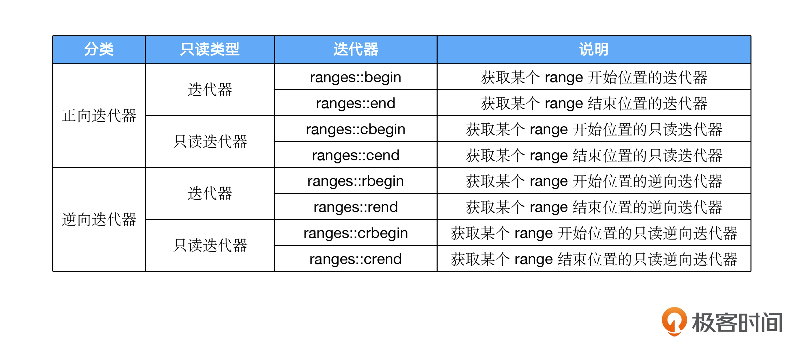
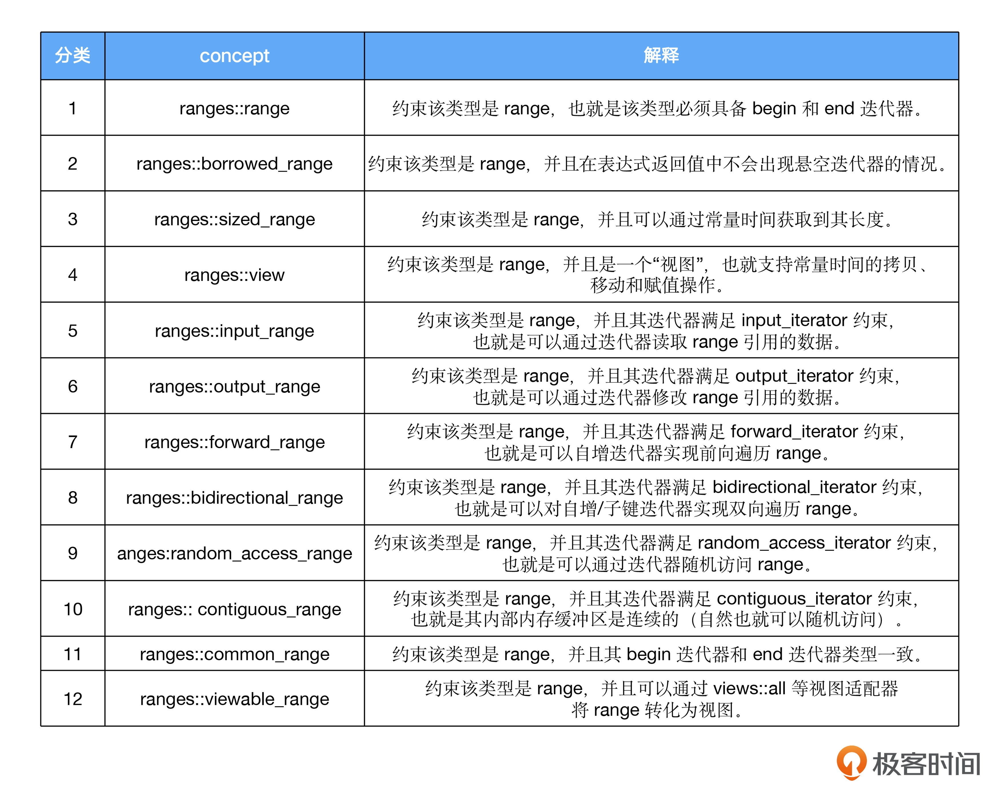

# 11 | Ranges（一）：数据序列处理的新工具

你好，我是卢誉声。

第一章，我们详细了解了 C++20 支持的三大核心语言特性变更——Modules、Concepts 和Coroutines。但是通常意义上所讲的 C++，其实是由核心语言特性和标准库（C++ StandardLibrary）共同构成的。

对标准库来说，标准模板库 STL（Standard Template Library）作为标准库的子集，是标准库的重要组成部分，是 C++ 中存储数据、访问数据和执行计算的重要基础设施。我们可以通过它简化代码编写，避免重新造轮子。

不过标准模板库不是完美的，它也在不断演进。原本的标准模板库，并没有给大规模、复杂数据的处理方面提供很好的支持。这是因为，C++ 在语言和库的设计上，让 C++ 函数式编程变得复杂且冗长。为了解决这个问题，从 C++20 开始支持了 Ranges——这是 C++ 支持函数式编程的一个巨大飞跃。

特别是 C++ 在运行时性能方面的绝对优势，Ranges 让 C++ 逐渐成为了处理大规模复杂数据的新贵。所以，我们更有必要掌握它，我相信在学完 Ranges 后，你会爱上这种便利的数据处理方式！

好了，话不多说，就让我们从 C++ 函数式编程开始今天的学习吧（项目的完整代码，你可以这里获取）。

## 前置知识

如果你对函数式编程并没有清晰的概念，建议先简单了解一下后面的前置知识，如果已经清楚了，可以直接跳过，从“函数式编程之困”开始看。

我们先说说函数式编程的主要思路——把所有的运算过程尽量写成 z=f(g(x)) 这种嵌套函数的形式，而最简化的形式自然就是 y=f(x)。这里函数嵌套可以不只有一层，每个函数的参数数量也能灵活调整，甚至可以完全使用“数学函数”来描述整个计算过程。

函数式编程众多特性中，最重要的就是“数据不可变性”与“高阶函数”。

数据不可变性也叫“无副作用”，也就是在计算过程中永远不会修改参数，也不会产生不必要的外部状态变化。我们都知道数学中函数参数不可修改，且具有幂等性，函数式编程自然也就要保持这些性质。

并行计算的性能瓶颈往往在于“竞争”，而竞争的原因就是程序执行中产生的“副作用”，无副作用的程序往往才能将并行计算的优势最大化。我们熟知的 MapReduce，正是函数式编程思路在分布式计算中的一种实现。

再来说说“高阶函数”的意思。函数式编程的参数可以是另一个函数表达式，在函数的实现中可以通过调用参数来调用函数，假设 f(x,g) 的定义为 g(x)，那么 g 就是一个高阶函数。函数式编程中将函数作为“一等公民”，所以这种特性自然也就不足为奇。

## 函数式编程之困

了解了函数式编程的含义，我们讨论一下在 C++20 之前，在 C++ 中实现函数式编程到底遇到了什么困境？

事实上，STL 从一开始就为函数式编程提供了支持。首先，STL 中最重要的三个概念是容器、迭代器和算法，分别用于解决数据存储、访问和计算问题。我们可以通过模板参数来指定它们的数据元素类型。

STL 要求数据元素类型具备“可拷贝”性（copyable）。也就是说，STL 中的所有操作（包括数据的赋值和计算）都需要数据类型支持拷贝，这种可拷贝性自然也就从设计上保证了函数式编程的“不可变性”。

STL 的算法函数都可以使用函数指针或仿函数（functor）来处理迭代器指向的数据元素，其本质也就是函数式编程中的高阶函数。同时，在 C++11 引入 Lambda 表达式之后，使用高阶函数变得方便一些。

不过，使用 STL 进行函数式编程仍然非常痛苦，我们经常需要将数据的处理流程拆分成多个计算步骤，而这些计算步骤之间是相互依赖的（也就是前一步的输出都是后一步的输入）。

为了让你更直观地感受这点，我们来看一个采用 C++ STL 的传统函数式编程案例。

```
#include <iostream>
#include <vector>
#include <algorithm>
#include <cstdint>
int main() {
   std::vector<int32_t> numbers{
       1, 2, 3, 4, 5
   };
   std::vector<int32_t> doubledNumbers;
   std::transform(
       numbers.begin(), numbers.end(), std::back_inserter(doubledNumbers),
       [](int32_t number) { return number * 2; }
   );
   std::vector<int32_t> filteredNumbers;
   std::copy_if(
       doubledNumbers.begin(), doubledNumbers.end(), std::back_inserter(filtered
       [](int32_t number) { return number < 5; }
   );
   std::for_each(filteredNumbers.begin(), filteredNumbers.end(), [](int32_t numb
       std::cout << number << std::endl;
   });
   return 0;
}
```

看过代码我们不难发现，在 C++ 中，我们需要定义大量变量，来存储每一步的计算结果，然后将其作为下一步计算的输入。而且 C++ 算法函数需要使用“迭代器”作为参数，每次调用C++ 算法时，都需要指定容器的 begin 和 end。STL 也不会检查迭代器的合法性，我们不得不编写很多错误处理代码，所以使用 STL 的代码变得更加复杂冗长。

为了彻底解决 C++ 中函数式编程的障碍，从 C++20 开始提出了 Ranges——这是一套可扩展且泛用的算法与迭代接口，开发者可以更方便地组合这些接口。相比传统 STL 算法，Ranges更健壮，不易引发错误。

我们用 Ranges 把上面的案例改写一下。

```
#include <iostream>
#include <vector>
#include <algorithm>
#include <cstdint>
#include <ranges>
int main() {
   namespace ranges = std::ranges;
   namespace views = std::views;
   std::vector<int32_t> numbers{
       1, 2, 3, 4, 5
   };
   ranges::for_each(numbers |
       views::transform([](int32_t number) { return number * 2; }) |
       views::filter([](int32_t number) { return number < 5; }),
       [](int32_t number) {
           std::cout << number << std::endl;
       }
   );
   return 0;
}
```

这段代码的具体含义我先卖个关子，等后面学习完 Ranges 后，你可以回顾一下这段代码，到时候就能理解了。但无论如何，你都能发现采用 Ranges 改写后代码明显变得简洁清晰了。

接下来，就让我们继续探索，看看 Ranges 是如何实现这种变化的吧！

## Ranges

Ranges 的核心概念就是 range。Ranges 库将 range 定义为一个 concept，你可以把 range简单理解成一个具备 begin 迭代器和 end 迭代器的对象，相当于是传统 STL 容器对象的一种泛化。

Ranges 提供了一些工具函数，用于访问传统 STL 容器和 Ranges 视图的数据。接下来，我们就来详细介绍 Ranges 的这些工具函数。

### 获取迭代器

首先，range 本身是一个 concept。因此，Ranges 提供了通用函数，来获取 range 对象的迭代器，包括所有满足 range 约束的对象的迭代器。为了帮你更好地理解，我们结合一段示例代码看一看。

```
#include <vector>
#include <algorithm>
#include <ranges>
#include <iostream>
int main() {
   namespace ranges = std::ranges;
   // 首先，调用ranges::begin和ranges::end函数获取容器的迭代器
   // 接着，通过迭代器访问数据中的元素
   std::vector<int> v = { 3, 1, 4, 1, 5, 9, 2, 6 };
   auto start = ranges::begin(v);
   std::cout << "[0]: " << *start << std::endl;
   auto curr = start;
   curr++;
   std::cout << "[1]: " << *curr << std::endl;
   std::cout << "[4]: " << *(curr + 3) << std::endl;
   auto stop = ranges::end(v);
   std::sort(start, stop);
   // 最后，调用ranges::cbegin和ranges::cend循环输出排序后的数据
   for (auto it = ranges::cbegin(v);
       it != ranges::cend(v);
       ++it
   ) {
       std::cout << *it << " ";
   }
   std::cout << std::endl;
   return 0;
}
```

从这段代码中可以看出，ranges 迭代器的操作和 STL 的标准迭代器操作是一样的。我在这里列出 Ranges 中的所有迭代器函数。你可以发现，这些迭代器跟传统 STL 中的迭代器并无二致。



### 获取长度

Ranges 也提供了获取 range 长度的函数——ranges::size 和 ranges::ssize。它们都可以获取某个 range 的长度，不过前者返回值是无符号整数，后者返回值是有符号整数。

我写了一段简单的示例代码，供你参考。

```
#include <vector>
#include <ranges>
#include <iostream>
int main() {
   namespace ranges = std::ranges;
   std::vector<int> v = { 3, 1, 4, 1, 5, 9, 2, 6 };
   std::cout << ranges::size(v) << std::endl;
   std::cout << ranges::ssize(v) << std::endl;
   return 0;
}
```

### 获取数据指针

事实上，我们在使用 range 时会发现，有些 range 是支持获取内部数据缓冲区的，这在操纵std::vector 这样的容器时非常有帮助。针对这类 range，Ranges 提供了下列函数用于获取其内部数据缓冲区指针。

- ranges::data：获取某个 range 的连续数据缓冲区。

- ranges::cdata：上述函数的只读版本。

我同样附上了示例代码。

```
#include <vector>
#include <ranges>
#include <iostream>
int main() {
   namespace ranges = std::ranges;
   std::vector<int> v = { 3, 1, 4, 1, 5, 9, 2, 6 };
   auto data = ranges::data(v);
   std::cout << "[1]" << data[1] << std::endl;
   data[2] = 10;
   auto cdata = ranges::cdata(v);
   std::cout << "[2]" << cdata[2] << std::endl;
   return 0;
}
```

在这段代码中，我们通过 ranges::data 获取了内部缓冲区，并通过 data 修改了数据。最后，通过 cdata 获取只读缓冲区并输出了修改后的数据。

### 悬空迭代器

不同于传统 STL，ranges 为了保证代码的健壮性，特意提供了编译时对悬空迭代器的检测，主要的工具就是 ranges::dangling 这一类型。

那么什么是悬空迭代器呢？我们来看一下这段代码。你可以暂停一下，自己推测一下这段代码能不能成功编译。

```
#include <vector>
#include <algorithm>
#include <ranges>
#include <iostream>
int main() {
   namespace ranges = std::ranges;
   auto getArray = [] { return std::vector{ 0, 1, 0, 1 }; };
   // 编译成功
   auto start = std::find(getArray().begin(), getArray().end(), 1);
   std::cout << *start << std::endl;
   // 编译失败
   auto rangeStart = ranges::find(getArray(), 1);
   std::cout << *rangeStart << std::endl;
   return 0;
}
```

这段代码最终会编译失败。原因是调用 getArray() 返回的 vector 对象是函数调用返回的右值（rvalue），我们没有将它赋值给任何一个变量，也没有通过引用来延长它的生命周期。

因此，vector 对象在 ranges::find 函数执行后，生命周期就已经结束了。此时 find 函数返回的迭代器指向的数据区域其实已经被释放，导致迭代器变成了“悬空”状态——类似于指向被释放缓冲区的悬空指针。

但是，通过传统的 find 算法访问迭代器是不会报编译错误的。不过运行时会出问题，毕竟数据已经被释放了。

这就是 Ranges 的独特之处，可以在编译时提前检查可能出现悬空引用的问题，提高代码的健壮性。

那么，错误检测的原理到底是什么呢？

这得益于从 C++20 开始支持的 concepts。所有 Ranges 的算法针对不满足 borrowed_range约束的对象，会直接返回 ranges::dangling——该类型是一个空对象，表示悬空迭代器。

所以说，下面的代码可以用于主动检测 range 的悬空迭代器。

```
#include <vector>
#include <ranges>
#include <iostream>
#include <type_traits>
int main() {
   namespace ranges = std::ranges;
   auto getArray = [] { return std::vector{ 0, 1, 0, 1 }; };
   auto rangeStart = ranges::find(getArray(), 1);
   // 通过type_traits在运行时检测返回的迭代器是否为悬空迭代器（不会引发编译错误）
   std::cout << std::is_same_v<ranges::dangling, decltype(rangeStart)> << std::e
   // 通过static_assert主动提供容易理解的编译期错误（会引发编译错误！！！）
   static_assert(!std::is_same_v<ranges::dangling, decltype(rangeStart)>, "range
   return 0;
}
```

在这段代码中，我们通过 is_same_v 来检测返回迭代器的类型，查看它是否为悬空迭代器。同时，这段代码还演示了怎么使用 static_assert 来实现编译时错误检测，我们可以借助于它来提供易于理解的编译时错误信息。

## 总结

在 Ranges 出现之前，C++ 里用 STL 进行函数式编程非常痛苦，主要原因是代码复杂冗长。为了彻底解决这种障碍，从 C++20 开始提出了 Ranges。

Ranges 库提供了 range 这个新的 concept，作为传统容器的一种泛化。在这个基础上，Ranges 库为 range 提供了传统迭代器和算法的支持，让开发者可以像传统容器一样使用range，甚至在使用为 range 提供的 constraint algorithm 时，比传统算法更加方便。

Ranges 本质上是一套可扩展且泛用的算法与迭代接口，它更加健壮，不容易引发错误。Ranges 库充分利用了 C++20 提供的 concepts，用于描述不同类型的 range 的约束。你可以参考后面的表格详细了解。



这些 concepts 对我们的后续讨论非常重要。下一讲，我们还会讨论具体约束，到时你不妨再看看这份表格，回顾一下里面对各种约束表达式的解释，加深记忆和理解。

## 思考题

Ranges 提供了以往 C++ 中不存在的数据迭代特性，特别是越界这种错误检测。那么在你平时的工作中使用 C++ 时，会采用哪些实践方法来避免越界？

另外，我们提到了 range 是一个 concept，那么这个 concept 要如何定义呢？你可以参考以下提示，根据我们之前所讲的 C++ Concepts 来实现一下你的版本。

1. 可以通过 std::ranges::begin 获取到该类型对象的 begin 迭代器。

2. 可以通过 std::ranges::end 获取到该类型对象的 end 迭代器。

欢迎说出你的看法，与大家一起分享。我们一同交流。下一讲见！
