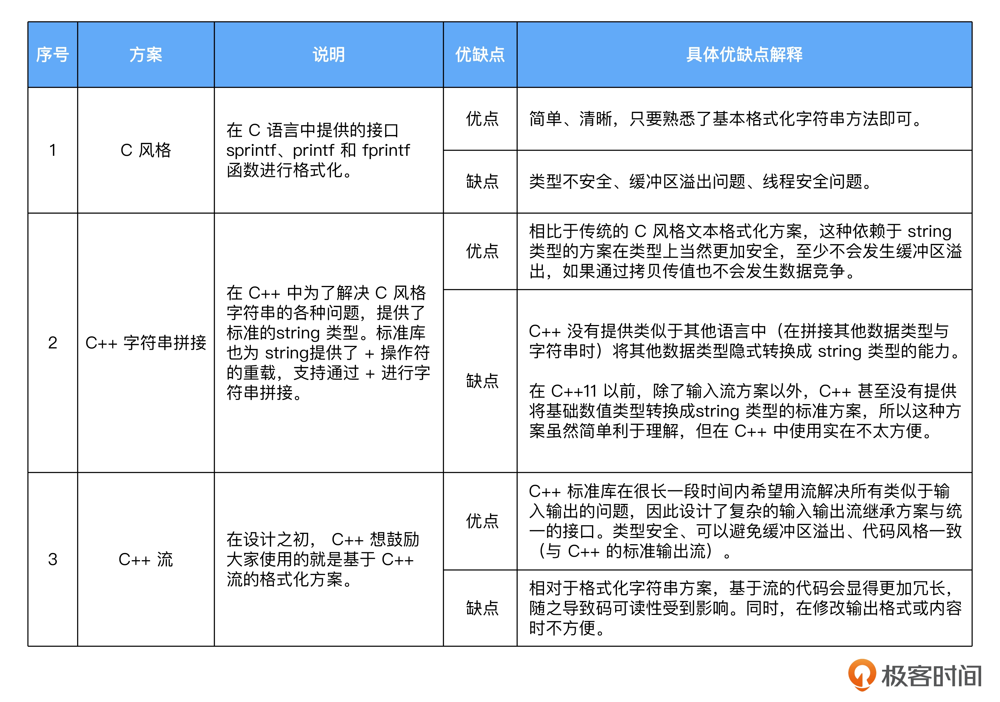
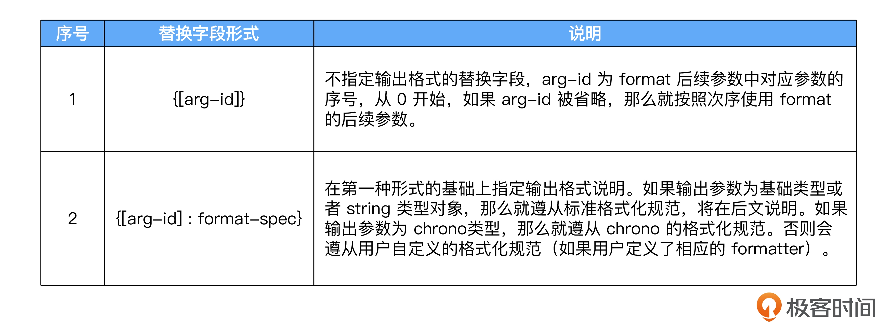
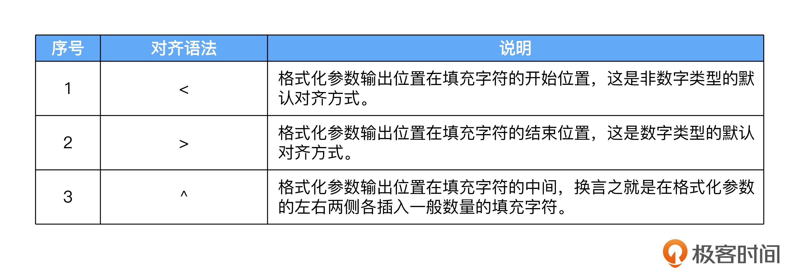
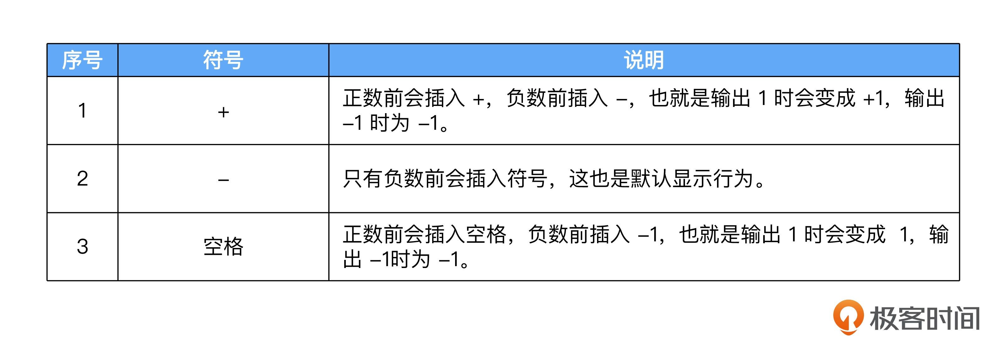
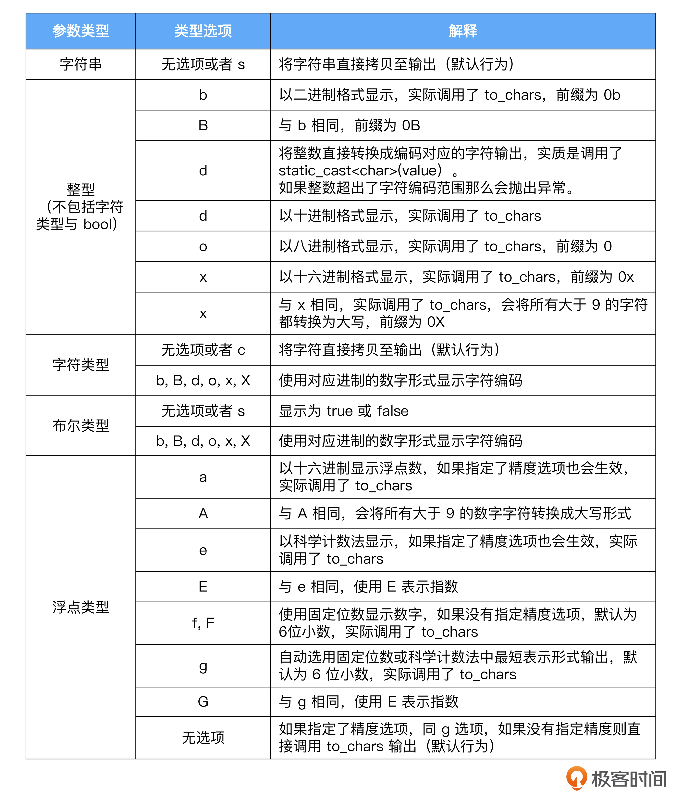

# 14 | Formatting：千呼万唤始出来的新format标准

你好，我是卢誉声。

在 C++ 中，我们经常讨论一个看似简单的问题——如何实现格式化字符串和格式化输出？

这个问题核心在于字符串格式化，考虑到 C++ 向下兼容的问题，想做出一个能让大家满意的字符串格式化标准方案，其实并不容易。在过去的标准中，C++ 标准委员会一直通过各种修修补补，尝试提供一些格式化的辅助方案，但始终没有一个风格一致的标准化方案。

好在 C++20 及其后续演进中，终于出现了满足我们要求的格式化方案。因此，在这一讲中，我们就聚焦于讲解这个新的字符串格式化方案。

好，话不多说，就让我们开始今天的内容吧 (课程配套代码可以从这里获取)。

## 复杂的文本格式化方案

首先，我们要弄明白什么是“文本格式化”。

下面一个常见的 HTTP 服务的日志输出，我们结合这个典型例子来讲解。

```
www     | [2023-01-16T19:04:19] [INFO] 127.0.0.1 - "GET /api/v1/info HTTP/1.0" 20
```

可以看到，日志输出中包含了一些固定字符、需要根据实际情况替换的值。输出类似内容的这种需求就被称为“文本格式化”。

事实上，许多现代编程语言都提供了便利、安全的格式化方案。

但遗憾的是，在 C++20 以前虽然也有文本化格式方案，但都存在着这样那样的缺陷，而且不够现代化。

甚至就此出现了一些临时拼凑的方案，接下来，我们通过一个表格来回顾一下，在 C++20 以前的文本格式化方案。



看完表格，你应该也发现了。在 C++20 出现以前，各种文本格式化方案都存在一些较为明显的缺点，无论是本身的安全性问题，还是编码层面的易用性方面。这导致了，C++ 开发者在选择文本格式化方案的时候难以抉择。

幸运的是，C++20 终于提出了标准化的文本格式化方案——这就是 Formatting 库。

## Formatting

Formatting 库提供了类似于其他现代化编程语言的文本格式化接口，而且这些接口设计足够完美、便于使用。同时，它还提供了足够灵活的框架。因此，我们可以轻松地对其进行扩展，支持更多的数据类型与格式。

想要了解 Formatting 库，我们循序渐进。先从最基础的格式化函数 format 开始，其定义是后面这样。

```
template<class... Args>
std::string format(std::format_string<Args...> fmt, Args&&... args);
```

该函数的第一个参数是格式化字符串，描述文本格式，后续参数就是需要被格式化的其他参数。

关于 std::format_string<Args…> 这个类型，我们在后面深入理解 Formatting 中再具体讨论，现在你只需要知道，这是用格式描述的字符串即可。

下面是使用 format 函数编写的日志输出代码。

```javascript
#include <iostream>
#include <format>
#include <string>
#include <cstdint>
#include <chrono>
// 使用 std::chrono 来打印日志的时间
using TimePoint = std::chrono::time_point<std::chrono::system_clock>;
struct HttpLogParams {
   std::string user;
   TimePoint requestTime; // C++20 提供了chrono对format的支持
   std::string level;
   std::string ip;
   std::string method;
   std::string path;
   std::string httpVersion;
   int32_t statusCode;
   int32_t bodySize;
   std::string refer;
   std::string agent;
};
void formatOutputParams(const HttpLogParams& params);
int main() {
   HttpLogParams logParams = {
       .user = "www",
       .requestTime = std::chrono::system_clock::now(),
       .level = "INFO",
       .ip = "127.0.0.1",
       .method = "GET",
       .path = "/api/v1/info",
       .httpVersion = "HTTP/1.0",
       .statusCode = 200,
       .bodySize = 6934,
       .refer = "http://127.0.0.1/index.hmtl",
       .agent = "Mozilla/5.0 (Windows NT 10.0; Win64; x64; rv:108.0) Gecko/20100
   };
   formatOutputParams(logParams);
   return 0;
}
void formatOutputParams(const HttpLogParams& params) {
   std::string logLine = std::format("{0:<16}|{1:%Y-%m-%d}T{1:%H:%M:%OS}Z {2} {3
       params.user,
       params.requestTime,
       params.level,
       params.ip,
       params.method,
       params.path,
       params.httpVersion,
       params.statusCode,
       params.bodySize,
       params.refer,
       params.agent
   );
   std::cout << logLine << std::endl;
}
```

C++20 在 C++11 的基础上，为 chrono 库提供了完善的 format 支持，我们再也不需要使用旧的 C 风格时间格式化函数了（见代码第 12 行）。

这里简单说明一下 format 的格式化字符串格式。格式化字符串由以下三类元素组成。

- 普通字符（除了 { 和 } 以外），这些字符会被直接拷贝到输出中，不会做任何更改。

- 转义序列，包括 &#123;&#123; 和 &#125;&#125;，在输出中分别会被替换成&#123;和&#125;。

- 替换字段，由 { … } 构成，这些替换字段会替换成 format 后续参数中对应的参数，并根据格式控制描述生成输出。

对于替换字段的两种形式，你可以参考后面这张表格。



如果你了解过 Python，就会发现 format 函数的格式化字符串格式，其实类似于 Python 的格式化规范。不得不承认的是，C++20 标准借鉴了相应的规范。

除了最简单的 format 参数，C++20 还提供了三个有用的工具函数，作为扩展功能。

1. format_to

2. format_to_n

3. formatted_size

你可以参考下面的示例代码，来看看它们的具体用法。

```
#include <iostream>
#include <format>
#include <string>
int main() {
   // format_to
   // 将生成的文本输出到一个输出迭代器中，
   // 其他与format一致，这样可以兼容标准STL算法函数的风格，
   // 也便于将文本输出到其他的流中或者自建的字符串类中。
   std::string resultLine1;
   std::format_to(std::back_inserter(resultLine1), "{} + {} = {}", 1, 2, 1 + 2);
   std::cout << resultLine1 << std::endl;
   // format_to_n
   // 将生成的文本输出到一个输出迭代器中，同时指定输出的最大字符数量。
   // 其他与format一致，相当于format_to的扩展版本，
   // 在输出目标有字符限制的时候非常有效。
   std::string resultLine2(5, ' ');
   std::format_to_n(resultLine2.begin(), 5, "{} + {} = {}", 1, 2, 1 + 2);
   std::cout << resultLine2 << std::endl;
   // formatted_sizes
   // 获取生成文本的长度，参数与format完全一致。
   //
   auto resultSize = std::formatted_size("{} + {} = {}", 1, 2, 1 + 2);
   std::cout << resultSize << std::endl;
   std::string resultLine3(resultSize, ' ');
   std::format_to(resultLine3.begin(), "{} + {} = {}", 1, 2, 1 + 2);
   std::cout << resultLine3 << std::endl;
}
```

可以看出，这三个函数使用方法基本和 format 没有太大区别。

这里我们重点留意一下 formatted_size。如果部分场景需要生成特定长度的输出缓冲区，那么我们就可以先通过 formatted_size 获取输出长度，然后分配特定长度缓冲区，最后再输出。除此以外，在只需要获取字符数量的场景中，也可以使用这个函数。

从上面案例可以看到，format 函数的基本用法简单易懂。接下来，我们进一步讨论有关format 的具体细节，先从格式化参数包开始。

## 格式化参数包

format 函数，可以直接以函数参数形式进行传递。此外，C++20 还提供了 format_args 相关接口，可以把“待格式化的参数”合并成一个集合，通过 vformat 函数进行文本格式化。

你可以结合后面的代码来理解。

```
#include <iostream>
#include <format>
#include <string>
#include <cstdint>
int main() {
   std::string resultLine1 = std::vformat("{} * {} = {}", std::make_format_args(
       3, 4, 3 * 4
   ));
   std::cout << resultLine1 << std::endl;
   std::format_args args = std::make_format_args(
       3, 4, 3 * 4
   );
   std::string resultLine2;
   std::vformat_to(std::back_inserter(resultLine2), "{} * {} = {}", args);
   std::cout << resultLine2 << std::endl;
}
```

针对上述代码中用到的类型和函数，我依次为你解释一下。

第一，format_args 类型，表示一个待格式化的参数集合，可以包装任意类型的待格式化参数。这里需要注意的是 format_args 中包装的参数是引用语义，也就是并不会拷贝或者扩展包装参数的生命周期，所以开发者需要确保被包装参数的生命周期。所以一般来说，format_args 也就用于格式化函数的参数，不建议用于其他用途。

第二，make_format_args 函数，用于通过一系列参数构建一个 format_args 对象。类似地，需要注意返回的 format_args 的引用语义。

第三，vformat 函数。包含两个参数，分别是格式化字符串（具体规范与 format 函数完全一致）和 format_args 对象。该函数会根据格式化字符串定义去 format_args 对象中获取相关参数并进行格式化输出，其他与 format 函数没有差异。

第四，vformat_to 函数。该函数与 format_to 类似，都是通过一个输出迭代器进行输出的。差异在于，该函数接收的“待格式化参数”，需要通过 format_args 对象进行包装。因此，vformat 可以在某些场景下替代 format。至于具体使用哪个，你可以根据自己的喜好进行选择。

## 深入理解 Formatting

在了解了 Formatting 的基本用法后，我们有必要深入 Formatting 的细节，了解如何基于Formatting 库进行扩展，来满足我们的复杂业务需求。

首先，Formatting 库的核心是 formatter 类，对于所有希望使用 format 进行格式化的参数类型来说，都需要按照约定实现 formatter 类的特化版本。

formatter 类主要完成的工作就是：格式化字符串的解析、数据的实际格式化输出。C++20 为基础类型与 string 类型定义了标准的 formatter。此外，我们还可以通过特化的 formatter 来实现其他类型、自定义类型的格式化输出。

下面，我们先看一下标准 formatter 的格式化标准，然后在此基础上实现自定义 formatter。

### 标准格式化规范

C++ Formatting 的标准格式化规范，是以 Python 的格式化规范为基础的。基本语法是后面这样。

```
填充与对齐   符号   #   0   宽度   精度L   类型
```

这里的每个参数都是可选参数，我们解释一下这些参数。

第一，填充与对齐，用于设置填充字符与对齐规则。

该参数包含两部分，第一部分为填充字符，如果没有设定，默认使用空格作为填充。第二部分为填充数量与对齐方式，填充数量就是指定输出的填充字符数量，对齐方式指的是待格式化参数输出时相对于填充字符的位置。

目前 C++ 支持三种对齐方式，你可以参考后面的表格。



第二，“符号” “#” 和“0”，用于设定数值类型的前缀显示方式。我们分别来看看。

“符号”可以设置数字前缀的正负号显示规则。需要注意的是，“符号”也会影响 inf 和 nan 的显示方式。后面的表格包含了这三种情况。



“#” 会对整数和浮点数有不同显示行为。

如果被格式化参数为整数，并且将整数输出设定为二进制、八进制或十六进制时会在数字前添加进制前缀，也就是 0b、0 和 0x。 如果被格式化参数为浮点数，那么即使浮点数没有小数位数，也会强制在数字后面追加一个小数点。

“0” 用于为数值输出填充 0，并支持设置填充位数。比如 04 就会填充 4 个 0。

第三，宽度与精度。

宽度用于设置字段输出的最小宽度，可以使用一个十进制数，也可以通过 {} 引用一个参数。

精度是一个以 . 符号开头的非负十进制数，也可以通过{}引用一个参数。对于浮点数，该字段可以设置小数点的显示位数。对于字符串，可以限制字符串的字符输出数量。

宽度与精度都支持通过 {} 引用参数，此时如果参数不是一个非负整数，在执行 format 时就会抛出异常。

第四，L 与类型。

L 用于指定参数以特定语言环境（locale）方式输出参数。如果感兴趣的话，你可以参考标准文档来查询有关语言环境的具体说明。参考标准文档足以涵盖语言环境的问题，因此不是我们讨论的重点。

类型选项用于设置参数的显示方式，我同样准备了表格，为你梳理了 C++20 支持的所有参数类型选项。



### 自定义 formatter

Formatting 库中的 formatter 类型对各种类型的格式化输出毕竟是有限的——它不可能覆盖所有的场景，特别是我们的自定义类型。

因此，它也支持开发者对 formatter 进行特化，实现自定义的格式化输出。现在，让我们来看看如何自定义 formatter。

我们先看一个最简单的自定义 formatter 案例。

```javascript
#include <format>
#include <iostream>
#include <vector>
#include <cstdint>
template<class CharT>
struct std::formatter<std::vector<int32_t>, CharT> : std::formatter<int32_t, Char
   template<class FormatContext>
   auto format(std::vector<int32_t> t, FormatContext& fc) const {
       auto it = std::formatter<int32_t, CharT>::format(t.size(), fc);
       for (int32_t v : t) {
           *it = ' ';
           it++;
           it = std::formatter<int32_t, CharT>::format(v, fc);
       }
       return it;
   }
};
int main() {
   std::vector<int32_t> v = { 1, 2, 3, 4 };
   // 首先，调用format输出vector的长度，
   // 然后遍历vector，每次输出一个空格后再调用format输出数字。
   std::cout << std::format("{:#x}", v);
}
```

在这段代码中，实现了格式化显示 vector<int32_t> 类型的对象的功能。我们重点关注的是第7 行实现的 formatter 特化——std::formatter<std::vector<int32_t>, CharT>。

其中，CharT 表示字符类型，它可以根据用户的实际情况替换成 char 或者 wchar_t 等。

通过代码你会发现，我们重载了 format 成员函数，该函数用于控制格式化显示。该函数包含两个参数。

1. t: std::vector<int32_t>: 被传入的待格式化参数。

2. fc: FormatContext&: 描述格式化的上下文。

作为延伸阅读，你可以参考 std::basic_format_context 这个类型的定义，了解格式化的上下文中具体包含的信息。当然了，在编码过程中，IDE 也会在使用它时给出提示。

format 函数返回一个迭代器，表示下一个用于输出的位置，我们通过控制这个迭代器，就可以输出自己想要的格式化字符了。

示例没有实现 parse 来解析格式化字符串，如果你有兴趣的话，课后可以自行了解相关细节。

## 总结

传统的文本格式化方案包括基于 C 接口的格式化输出、C++ 字符串拼接或 C++ 流这几种方式。它们各有优劣，但往往难以解决类型安全、缓冲区溢出、线程安全等问题。

C++20 的推出改变了这一局面，我们可以利用 Formatting 库和 formatter 类型高度灵活地实现格式化文本输出。其中 formatter 支持特化，因此我们可以通过这个全新的方式，解决长久以来缺乏标准化的文本格式化的问题。

对于 formatter 的特化实现，我们记住两个重点即可。

1. 重载 format 函数，实现输出自己想要的格式化文本。

2. 重载 parse 函数，实现自定义格式化文本解析。

## 课后思考

我们在这一讲中展示了如何通过重载 formatter 中的 format 函数，实现了自定义输出格式化文本。那么，你能否进一步拓展这一案例，通过重载 parse 来实现解析格式化字符串？

欢迎给出你的代码方案。我们一同交流。下一讲见！
