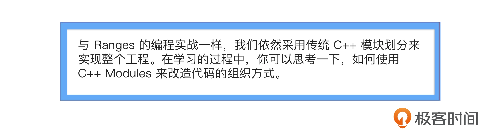
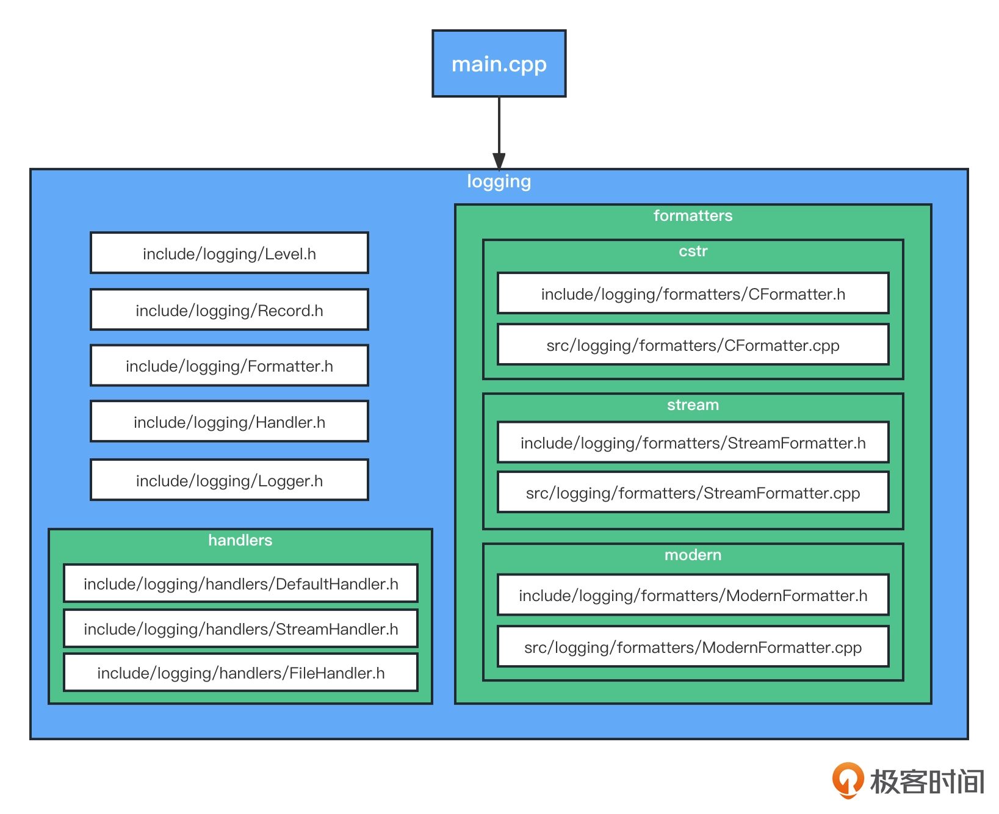
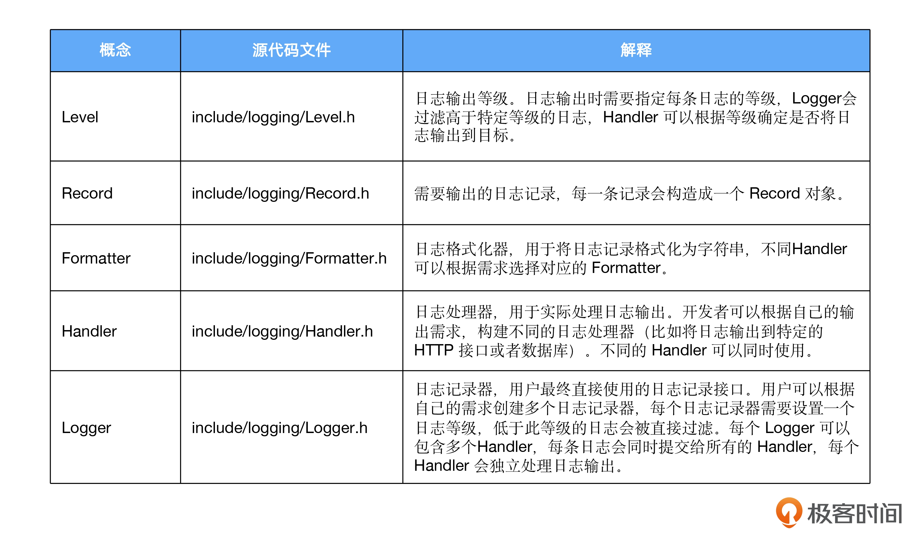
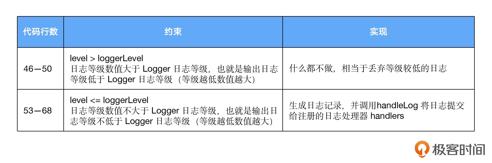
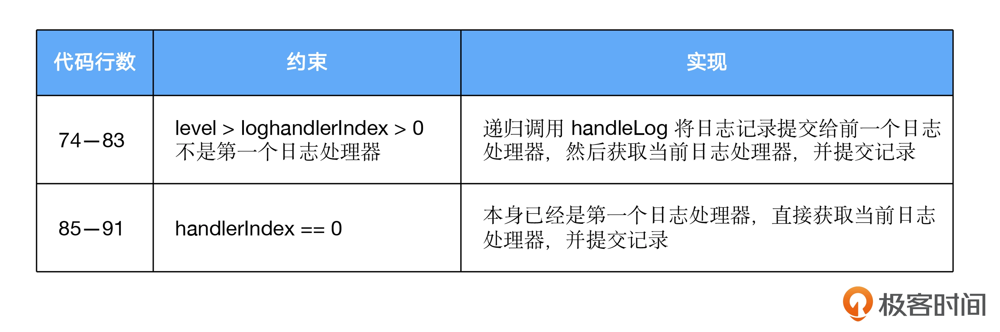
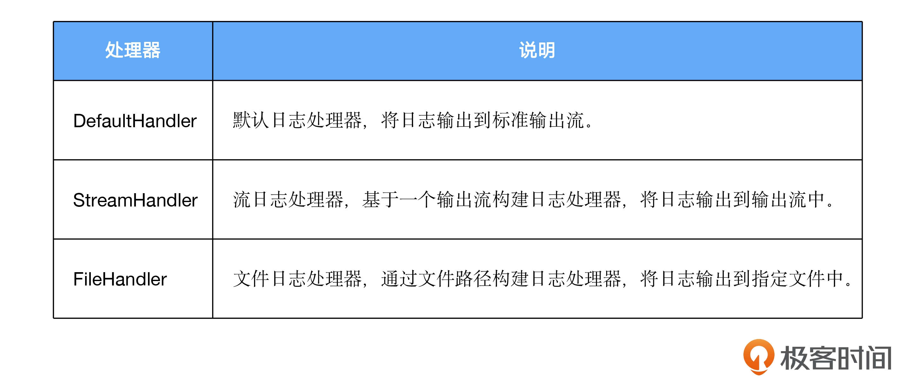

# 15 | Formatting实战：如何构建一个数据流处理实例？

你好，我是卢誉声。

C++20 为我们带来了重要的文本格式化标准库支持。通过 Formatting 库和 formatter 类型，我们可以实现高度灵活的文本格式化方案。那么，我们该如何在实际工程项目中使用它呢？

日志输出在实际工程项目中是一个常见需求，无论是运行过程记录，还是错误记录与异常跟踪，都需要用到日志。

在这一讲中，我们会基于新标准实现一个日志库。你可以重点关注特化 formatter 类型的方法，实现高度灵活的标准化定制。

好，话不多说，我们就从架构设计开始，一步步实现这个日志库（课程配套代码可以从这里获取）。

## 日志库架构设计

事实上，实现一个足够灵活的日志库并不容易。在实际工程项目中，日志输出不仅需要支持自定义日志的输出格式，还需要支持不同的输出目标。比如，输出到控制台、文件，甚至是网络流或者数据库等。

Python 和 Java 这类现代语言都有成熟的日志库与标准接口。C++ Formatting 的正式提出，让我们能使用简洁的方式实现日志库。

同时，Python 的 logging 模块设计比较优雅。因此，我们参照它的架构，设计了基于 C++20的日志架构。



项目的模块图是后面这样。



对照图片可以看到，logging 模块是工程的核心，包含核心框架、handlers 和 formatters 三个子模块。

其中，核心框架包括 Level、Record、Formatter、Handler 与 Logger 的定义。由于我们使用了模版，因此核心框架的声明实现都在头文件中。具体含义你可以参考后面这张表。



由于我们关注的重点在于如何使用 Formatting 库和如何特化 formatter 类型。因此，对于核心框架的定义和实现，你可以参考完整的工程代码。

## 日志格式化器模块

从模块图中可以看出，我们在 formatters 模块中实现了三组不同的日志格式化器。我们来比较一下。

首先是 CFormatter，它是 C⻛格格式化的日志输出。实现较为简单，但是如果阅读了代码，你就发现这种实现方式难以避免类型和缓冲区安全问题。

StreamFormatter 则是 C++ 流⻛格的日志输出。基于 C++ 流的实现相对于 C 的实现更加注重类型安全，并能完全避免缓冲区溢出。但是，这么做编码复杂，也会影响整体代码的可读性。

最后就是 ModernFormatter，即 C++20 format 的日志输出。基于 C++ Formatting 库和特化formatter 实现。

接下来，我们具体来看 ModernFormatter。接口定义在include/logging/formatters/ModernFormatter.h 中，代码是后面这样。

```python
#pragma once
#include <string>
namespace logging {
   class Record;
   namespace formatters::modern {
       // formatRecord函数用于格式化日志记录对象
       std::string formatRecord(const logging::Record& record);
   }
}
```

具体实现在 src/logging/formatters/ModernFormatter.cpp 中。

```javascript
#include "logging/formatters/ModernFormatter.h"
#include "logging/Record.h"
namespace logging::formatters::modern {
   // formatRecord：将Record对象格式化为字符串
   std::string formatRecord(const Record& record) {
       try {
           return std::format(
               "{0:<16}| [{1}] {2:%Y-%m-%d}T{2:%H:%M:%OS}Z - {3}",
               record.name,
               record.getLevelName(),
               record.time,
               record.message
           );
       } catch (std::exception& e) {
           std::cerr << "Error in format: " << e.what() << std::endl;
           return "";
       }
   }
}
```

这种方案具有三个优点。

第一，format 内置对 C++11 的时间点对象的直接格式化。在 C++20 中，由于 chrono 提供了针对 time_point 类型的 formatter。因此，相比其他的方案，这种方案对时间的格式化要简单清晰得多。

第二，format 不需要像 C 方案那样提前分配缓冲区，因此可以避免缓冲区溢出。

第三，format 可以自动根据函数参数类型，确定格式化的参数类型。它不需要完全根据格式化字符串判定参数类型，如果格式化字符串中的类型与实际参数类型不同，也能在运行时检查出来并抛出异常。我们在代码中捕获了相关异常，发生错误时，你可以根据具体需求来处理异常。

总之，采用 C++ Formatting 实现的文本格式化器非常简单。不过话说回来，格式化文本这件事本来就该如此轻松惬意，不是吗？

## 日志记录器模块

现在，我们来看另一个重点——日志记录器模块。日志记录器是提供给用户的接口，用户可以通过日志记录器提交日志。你可以先看看代码实现，再听我讲解。

```sql
#pragma once
#include <iostream>
#include <string>
#include <tuple>
#include <memory>
#include "logging/Level.h"
#include "logging/Handler.h"
#include "logging/handlers/DefaultHandler.h"
namespace logging {
   // Logger类定义
   // Level是日志记录器的日志等级
   // HandlerTypes是所有注册的日志处理器，必须满足Handler约束
   // 通过requires要求每个Logger类必须注册至少一个日志处理器
   template <Level loggerLevel, Handler... HandlerTypes>
       requires(sizeof...(HandlerTypes) > 0)
   class Logger {
   public:
       // HandlerCount：日志记录器数量，通过sizeof...获取模板参数中不定参数的数量
       static constexpr int32_t HandlerCount = sizeof...(HandlerTypes);
       // LoggerLevel：Logger的日志等级
       static constexpr Level LoggerLevel = loggerLevel;
       // 构造函数：name为日志记录器名称，attachedHandlers是需要注册到Logger对象中的日志处
       // 由于日志处理器也不允许拷贝，只允许移动，所以这里采用的是元组的移动构造函数
       Logger(const std::string& name, std::tuple<HandlerTypes...>&& attachedHan
           // 调用std::forward转发右值引用
           _name(name), _attachedHandlers(std::forward<std::tuple<HandlerTypes..
       }
       // 不允许拷贝
       Logger(const Logger&) = delete;
       // 不允许赋值
       Logger& operator=(const Logger&) = delete;
       // 移动构造函数：允许日志记录器对象之间移动
       Logger(Logger&& rhs) :
           _name(std::move(rhs._name)), _attachedHandlers(std::move(rhs._attache
       }
       // log：通用日志输出接口
       // 需要通过模板参数指定输出的日志等级
       // 通过requires约束丢弃比日志记录器设定等级要低的日志
       // 避免运行时通过if判断
       template <Level level>
           requires (level > loggerLevel)
       Logger& log(const std::string& message) {
           return *this;
       }
       // 通过requires约束提交等级为日志记录器设定等级及以上的日志
       template <Level level>
           requires (level <= loggerLevel)
       Logger& log(const std::string& message) {
           // 构造Record对象
           Record record{
               .name = _name,
               .level = level,
               .time = std::chrono::system_clock::now(),
               .message = message,
           };
           // 调用handleLog实际处理日志输出
           handleLog<level, HandlerCount - 1>(record);
           return *this;
       }
       // handleLog：将日志记录提交给所有注册的日志处理器
       // messageLevel为提交的日志等级
       // handlerIndex为日志处理器的注册序号
       // 通过requires约束当handlerIndex > 0时会递归调用handleLog将消息同时提交给前一个
       template <Level messageLevel, int32_t handlerIndex>
           requires (handlerIndex > 0)
       void handleLog(const Record& record) {
           // 递归调用handleLog将消息同时提交给前一个日志处理器
           handleLog<messageLevel, handlerIndex - 1>(record);
           // 获取当前日志处理器并提交消息
           auto& handler = std::get<handlerIndex>(_attachedHandlers);
           handler.emit<messageLevel>(record);
       }
       template <Level messageLevel, int32_t handlerIndex>
           requires (handlerIndex == 0)
       void handleLog(const Record& record) {
           // 获取当前日志处理器并提交消息
           auto& handler = std::get<handlerIndex>(_attachedHandlers);
           handler.emit<messageLevel>(record);
       }
       // 提交严重错误信息（log的包装）
       Logger& critical(const std::string& message) {
           return log<Level::Critical>(message);
       }
       // 提交一般错误信息（log的包装）
       Logger& error(const std::string& message) {
           return log<Level::Error>(message);
       }
       // 提交警告信息（log的包装）
       Logger& warning(const std::string& message) {
           return log<Level::Warning>(message);
       }
       // 提交普通信息（log的包装）
       Logger& info(const std::string& message) {
           return log<Level::Info>(message);
       }
       // 提交调试信息（log的包装）
       Logger& debug(const std::string& message) {
           return log<Level::Debug>(message);
       }
       // 提交程序跟踪信息（log的包装）
       Logger& trace(const std::string& message) {
           return log<Level::Trace>(message);
       }
   private:
       // 日志记录器名称
       std::string _name;
       // 注册的日志处理器，由于日志处理器的类型与数量不定，因此这里使用元组而非数组
       std::tuple<HandlerTypes...> _attachedHandlers;
   };
   // 日志记录器生成工厂
   template <Level level = Level::Warning>
   class LoggerFactory {
   public:
       // 创建日志记录器，指定名称与处理器
       template <Handler... HandlerTypes>
       static Logger<level, HandlerTypes...> createLogger(const std::string& nam
           return Logger<level, HandlerTypes...>(name, std::forward<std::tuple<H
       }
       // 创建日志记录器，指定名称，处理器采用默认处理器（DefaultHandler）
       template <Handler... HandlerTypes>
       static Logger<level, handlers::DefaultHandler<level>> createLogger(const
           return Logger<level, handlers::DefaultHandler<level>>(name, std::make
       }
   };
}
```

日志记录器 Logger 是一个模板类。与其他日志记录器不同，这里设计的日志框架，是一个“静态”框架，也就是日志输出的配置都必须在代码中编码，而非读取外部配置或运行时修改。

这么做的初衷在于，通过 C++ 模板能力直接生成固化的代码，避免运行时进行逻辑判断——这样效率更高。因此，日志记录器的等级 Level 和需要注册到日志记录器的处理器类型，都需要通过模板参数注册到 Logger 中。

先来看一下构造函数。构造函数中包含两个参数。

- name 为日志记录器名称。

- attachedHandlers 是需要注册到 Logger 对象中的日志处理器。

你可能已经注意到了，日志处理器的类型 HandlerTypes 是一个模板不定参数，唯一要求是每个参数都必须满足 Handler 约束的类型。这个 concept 表示合法的日志处理器，具体实现，我们会在接下来的“日志处理器模块”里讨论。

由于每个日志处理器的类型都不一样。因此，所有的日志处理器都按指定顺序存储在一个tuple 中。由于日志处理器也不允许拷贝，只允许移动。所以，这里采用的是元组的移动构造函数，也可以确保较高的运行效率。

接着，看一下成员函数 log，该函数是通用的日志输出接口，可以按照指定日志等级输出任意内容的日志。Logger 的使用者需要调用该函数输出日志，该函数包含两个参数。

- level：输出日志等级，通过模板参数传递。

- message：表示日志内容，通过函数参数传递。

为了在编译时就确定 Logger 是否应该接收这个日志，避免运行时的额外判断，我们将 level特意定义成模板参数，并利用 requires 为 log 定义了两个重载版本，你可以参考这张表格。



接着，我们看一下成员函数 handleLog 的实现，该函数可以将日志提交给 Logger 中注册的所有日志处理器，包含 3 个参数。

- messageLevel：消息日志等级，需要通过模板参数传递。

- handlerIndex：处理器在 Logger 中的注册序号，需要通过模板参数传递。

- record：提交给处理器的日志记录，需要通过函数参数传递。

由于 handler 的类型不一定相同。因此，我们无法通过循环将日志记录提交给所有的日志处理器，需要采用递归的方式。

在具体实现时，messageLevel 和 handlerIndex 均为模板参数，handlerIndex 从最后一个日志处理器开始（这解释了在成员函数 log 中，调用 handleLog 时传递的是 HandlerCount - 1），最终递归调用到 handlerIndex 为 0 时终止。

由于 Logger 一般不会支持太多的输出目标（一般来说，也就是将日志输出到控制台，或者输出到文件），递归层数不会太深，因此为了在编译时生成确定的调用链条，为 C++ 提供递归函数内联调用优化的可能性，我们将 messageLevel 和 handlerIndex 特意定义成模板参数，并利用 requires 为 handleLog 定义了两个重载版本，就像后面这样。



好，我们接着往下看代码。从 94—121 行，为不同日志等级定义了包装接口，便于 Logger 用户直接输出特定等级的日志，减少编码。

由于 Logger 必须要指定日志处理器，而且多个日志处理器类型不同，因此创建 Logger 对象时必须指明所有处理器的类型。

为此，我们定义了一个工厂类 LoggerFactory，将日志等级作为类的模板参数，用户调用createLogger 函数创建 Logger 对象时，编译器可以根据函数参数列表，自动推导HandlerTypes 的具体类型，降低编程工作量。

## 日志处理器模块

最后，我们看一下日志处理器模块以及常见的日志输出处理实现。

### 接口设计

在 logging/Handler.h 中定义了和日志处理器有关的接口。

```sql
#pragma once
#include "logging/Formatter.h"
#include "logging/Level.h"
#include "logging/Record.h"
#include <string>
#include <memory>
#include <type_traits>
#include <concepts>
namespace logging {
   // Handler Concept
   // 不强制所有Handler都继承BaseHandler，只需要满足特定的接口，因此定义Concept
   template <class HandlerType>
   concept Handler = requires (HandlerType handler, const Record & record, Level
       // 要求有emit成员函数
       handler.emit;
       // 要求有format函数，可以将Record对象格式化为string类型的字符串
       { handler.format(record) } -> std::same_as<std::string>;
       // 要求有移动构造函数，无拷贝构造函数
   }&& std::move_constructible<HandlerType> && !std::copy_constructible<HandlerT
   // BaseHandler类定义
   // HandlerLevel是日志处理器的日志等级
   // 自己实现Handler时可以继承BaseHandler然后实现emit
   template <Level HandlerLevel = Level::Warning>
   class BaseHandler {
   public:
       // 构造函数：formatter为日志处理器的格式化器
       BaseHandler(Formatter formatter) : _formatter(formatter) {}
       // 不允许拷贝
       BaseHandler(const BaseHandler&) = delete;
       // 不允许赋值
       BaseHandler& operator=(const BaseHandler&) = delete;
       // 移动构造函数：允许日志处理器对象之间移动
       BaseHandler(BaseHandler&& rhs) noexcept : _formatter(std::move(rhs._forma
       // 析构函数，考虑到会被继承，避免析构时发生资源泄露
       virtual ~BaseHandler() {}
       // getForamtter：获取formatter
       Formatter getForamtter() const {
           return _formatter;
       }
       // setForamtter：修改formatter
       void setForamtter(Formatter formatter) {
           _formatter = formatter;
       }
       // format：调用格式化器将record转换成文本字符串
       std::string format(const Record& record) {
           return _formatter(record);
       }
   private:
       // 日志处理器的格式化器
       Formatter _formatter;
   };
}
```

Handler 是一个 concept。出于性能考虑，我们并没有强制要求所有日志处理器都继承一个标准基类，然后通过标准基类调用实现。我们的做法是，定义一个 concept 来约束 Handler 的接口。

日志处理器的约束包括：

- 提供 emit 接口用于提交日志记录。

- 提供 format 函数，参数为日志记录对象，返回类型为 std::string。

- 提供移动构造函数。

- 不可拷贝（禁用拷贝构造函数）。

BaseHandler 是为其他日志处理器类提供的基类。虽然我们不强制所有的日志处理器继承一个标准基类，但还是提供了一个基类实现，这样可以降低具体实现的编码工作量。

### 具体实现

日志处理器具体怎么实现呢？我们以 DefaultHandler 为例看一看，DefaultHandler 是默认日志处理器，负责将日志输出到标准输出流。

DefaultHandler 实现在 logging/handlers/DefaultHandler.h 中。

```sql
#pragma once
#include "logging/Handler.h"
namespace logging::handlers {
   // 默认日志处理器
   template <Level HandlerLevel = Level::Warning>
   // 继承BaseHandler
   class DefaultHandler : public BaseHandler<HandlerLevel> {
   public:
       // 构造函数，需要指定格式化器，默认格式化器为defaultFormatter
       DefaultHandler(Formatter formatter = defaultFormatter) : BaseHandler<Hand
       // 禁止拷贝构造函数
       DefaultHandler(const DefaultHandler&) = delete;
       // 定义移动构造函数
       DefaultHandler(const DefaultHandler&& rhs) noexcept : BaseHandler<Handler
       // emit用于提交日志记录
       // emitLevel > HandlerLevel的日志会被丢弃
       template <Level emitLevel>
           requires (emitLevel > HandlerLevel)
       void emit(const Record& record) {
       }
       // emitLevel <= HandlerLevel的日志会被输出到标准输出流中
       template <Level emitLevel>
           requires (emitLevel <= HandlerLevel)
       void emit(const Record& record) {
           // 调用format将日志记录对象格式化成文本字符串
           std::cout << this->format(record) << std::endl;
       }
   };
}
```

DefaultHandler 按照日志处理器的 concept 定义了相关接口。需要注意的是，emit 成员函数通过 requires，将输出日志等级较低的日志记录直接丢弃了。因此，只有当满足要求的日志输出时，才会输出到标准输出流中——这和 Logger 的 log 函数丢弃日志的原理一样。

StreamHandler 和 FileHandler 的实现与 DefaultHandler 类似，只不过是将日志输出到不同的目标，它们的分工你可以参考下表。

你可以通过课程配套代码，了解它们的具体实现细节。



## 总结

在使用 C++ Formatting 库和 formatter 类型时，我们往往会利用模板和 concept 来消解运行时性能损耗，以实现更好的性能。

对于日志处理这样一个典型的应用场景来说，约束条件通常包含以下几点。

- 提供 emit 接口用于提交日志记录。

- 提供 format 函数，参数为日志记录对象，返回类型为 std::string。

- 提供移动构造函数。

- 不可拷贝（禁用拷贝构造函数）。

总的来说，运行时性能是我们首要考虑的问题。这是一种新的实践范式——在现代 C++ 编程体系中，尽可能让计算发生在编译时，而非运行时。

## 课后思考

我们在第 11 讲中，编写了基于 Ranges 的工程，其中包含了一些控制台输出日志。请你尝试编译今天这一讲的代码，替换 Ranges 工程中的所有输出，包括控制台输出和日志。

欢迎分享你的问题以及日志库的改进意见。我们一同交流。下一讲见！
