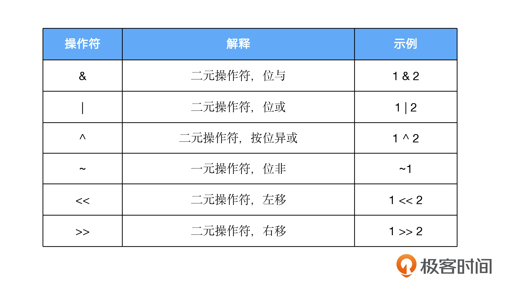
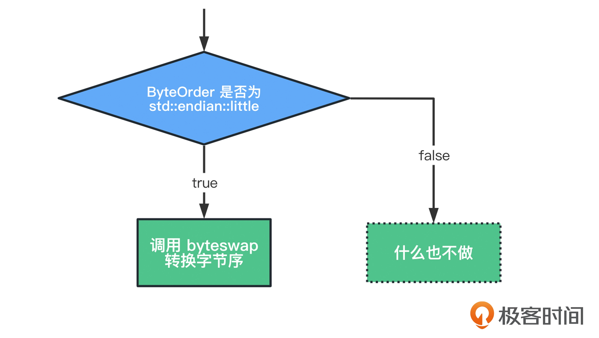
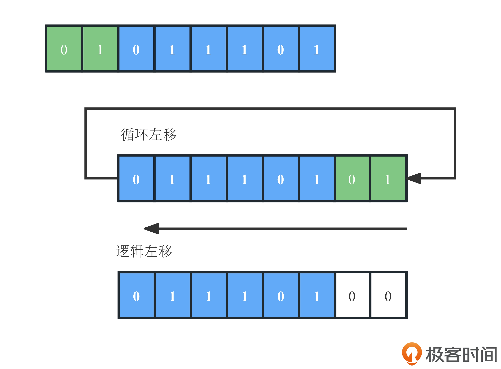
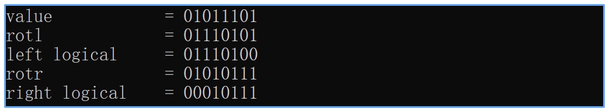
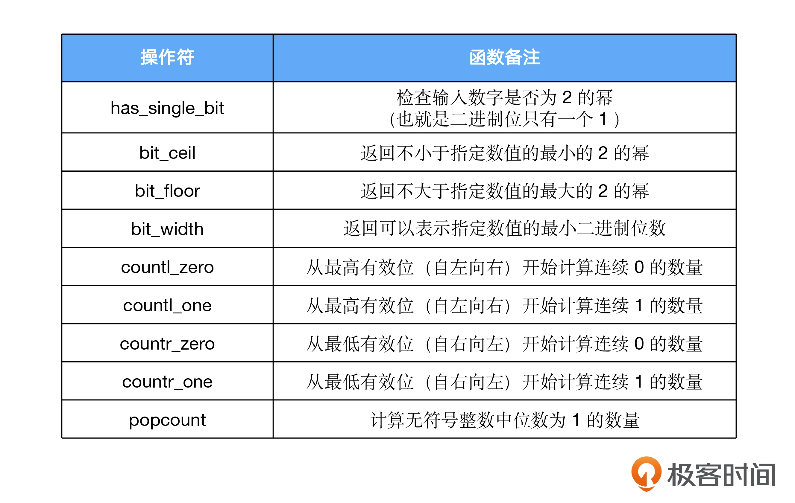
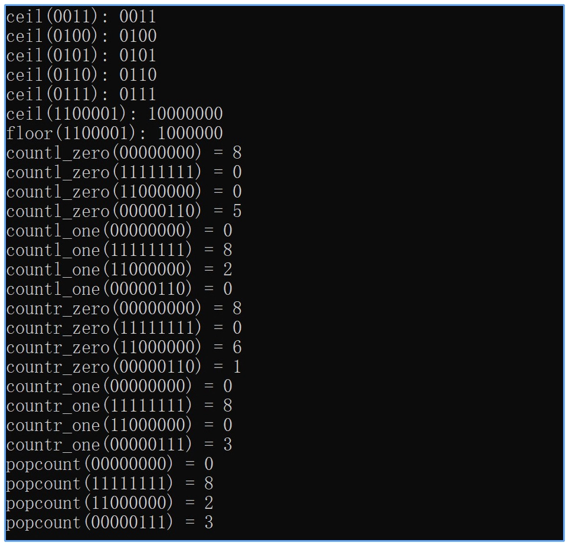

# 16 | Bitlibrary（一）：如何利用新bit操作库释放编程生产力？

你好，我是卢誉声。

我们都知道，C++ 继承了 C 语言所有的底层操作能力，其中最重要的两个特性就是指针和位操作。对于指针，现代 C++ 标准已经通过智能指针提出了较好的解决方案。

但是在 C++20 之前，C++ 的位操作支持还是很“基础”的。它缺乏安全性，而且不够灵活。因此，我们就围绕 C++20 对位操作能力的扩展这个话题，讨论一下全新的 Bit library。

好，话不多说，就让我们从基本的 C++ 位操作开始讲起（课程配套代码可以从这里获取）。

## C++ 位操作技术与不足

C++ 提供的基础位操作技术与 C 语言一脉相承，主要通过位操作符对整数进行位操作。我对这些基本操作做了一个总结，你可以参考后面的表格回顾一下。



相比 C 语言，C++ 一直为 C 的底层能力提供一些高层次的安全化包装，比如为了解决裸指针的各种安全缺陷，提出了各类智能指针。

基于这种思路，C++ 也通过标准库提供了 bitset，对二进制位串进行包装，可以在整数和bitset 以及其字符串表示之间进行转换，并支持表格中的几个基础的位操作符。

但在 C++20 之前，C++ 的位操作支持还是很“基础”的，我们重点讨论几个比较明显的问题。

首先，没有提供字节序的检测和转换能力。基于位进行二进制数据解析的时候，最大的问题就是不同 CPU 的大小端设计（比如 x86 体系结构是小端字节序，arm 支持采用大小端字节序任选其一）。

这就导致在不同体系结构下，编写位操作可能产生各种兼容性问题。C++ 不仅没有提供编译目标架构的字节序检测能力，也没有提供不同字节序之间的转换能力，所以这些基础设施我们只能自行实现。

其次，缺乏安全的强制类型转换手段。一些场景，比如对浮点类型的数值进行位操作需要先将浮点类型转换成对应宽度的无符号整数，就经常需要将一些数据强制转换为另一个类型，而不改变其二进制位的值。

C++ 仅提供了 reinterpret_cast，执行指针类型的强制转换，但没有提供值的强制类型转换能力。虽然我们可以通过 memcpy 等手段实现，但这样也不够安全——编译器无法检测到可能发生的任何问题。

最后，是移位操作问题。C++ 把移位的具体含义交给了具体实现。具体来说，就是移位操作分为“算术移位”和“逻辑移位”，算术移位需要考虑到有符号整数的符号问题，逻辑移位是直接补零，C++ 并没有定义有符号整数的具体实现方式，除了有符号整数的移位问题，C++ 和 C 一样，并没有提供循环移位的手段。

## C++20 位操作库

既然位操作的潜在问题这么多，C++ 是怎么解决的呢？

在 C++20，C++ 标准终于开始思考解决这些基本的位操作问题了。为此提供了位操作库，具体实现在 <bit> 头文件中，我们分别来看看。

### 字节序处理

C++20 提供了枚举类 endian（这早就该标准化了嘛😄），用来定义字节序的大小端。具体定义如下所示：

```
enum class endian {
   little,
   big,
   native // = little/big
};
```

这里着重强调 endian::native 这一枚举值，它由编译器根据编译目标体系结构自动确定——这可太棒了！

我们结合实际例子来体会一下用法。

```
#include <iostream>
#include <bit>
#include <cstdint>
#include <concepts>
template <std::integral T>
T byteswap(T src) {
   T dest = 0;
   for (uint8_t* pSrcByte = reinterpret_cast<uint8_t*>(&src),
       *pDestByte = reinterpret_cast<uint8_t*>(&dest) + sizeof(T) - 1;
       pSrcByte != reinterpret_cast<uint8_t*>(&src) + sizeof(T);
       ++pSrcByte, --pDestByte) {
       *pDestByte = *pSrcByte;
   }
   return dest;
}
template <std::integral T, std::endian ByteOrder = std::endian::native>
   requires (ByteOrder == std::endian::little)
T consumeBigEndian(T src) {
   return byteswap(src);
}
template <std::integral T, std::endian ByteOrder = std::endian::native>
   requires (ByteOrder == std::endian::big)
T consumeBigEndian(T src) {
   return src;
}
int main() {
   uint8_t networkBuffer[] {
       1, 2
   };
   // 将从网络数据流中获取的值直接转换成uint16_t
   uint16_t networkValue = *(reinterpret_cast<uint16_t*>(networkBuffer));
   std::cout << "Original value: " << networkValue << std::endl;
   // 无论如何都转换字节序
   uint16_t swappedValue = byteswap(networkValue);
   std::cout << "Swaped value: " << swappedValue << std::endl;
   // 仅对字节序为大端的平台转换字节序
   uint16_t checkedValue = consumeBigEndian(networkValue);
   std::cout << "Checked value: " << checkedValue << std::endl;
   return 0;
}
```

这段代码的作用是检测目标平台的字节序，并将一个大端数据转换成小端数据。如果目标平台本身字节序就是大端，那么什么都不会执行。

C++23 提供了 byteswap 帮助我们执行字节序转换，但 C++20 没有提供该特性，所以我们只能自己实现一个版本。



这段代码定义了两个版本的 consumeBigEndian，通过 requires 在编译时检测std::endian::native 是否为 std::endian::little，如果是就会通过 byteswap 转换字节序，否则返回原始值。

### 强制类型转换

事实上，C 语言提供的强制类型转换有很多潜在的类型安全问题，为了避免大家使用 C 风格的强制类型转换，C++ 提供了 static_cast、const_cast 和 reinterpret_cast，为不同场景的类型转换服务。

这些类型转换符都有自己的约束与类型安全检测，迫使开发者在进行类型转换时，要先弄清楚自己真的需要哪种转换。但是，它们都解决不了一个常见的场景——将一个值转换成二进制位数相同的另一个值。

为此，C++20 通过 <bit> 头文件提供了 bit_cast 这个函数。后面是一段示例代码。

```
#include <iostream>
#include <bit>
#include <cstdint>
int main() {
   float f32v = 784.513f;
   uint32_t u32v = std::bit_cast<uint32_t>(f32v);
   std::cout << "f32v: " << f32v << std::endl;
   std::cout << "u32v: " << u32v << std::endl;
   double f64v = 1123.11f;
   uint64_t u64v = std::bit_cast<uint64_t>(f64v);
   std::cout << "f64v: " << f64v << std::endl;
   std::cout << "u64v: " << u64v << std::endl;
   // 编译错误
   uint16_t u64v = std::bit_cast<uint16_t>(f64v);
   return 0;
}
```

在这段代码中，我们通过 bit_cast 将一个 float 类型变量转换为 uint32_t，并将一个 uint64_t类型变量转换为 double，但是无法将 float 类型转换为 uint16_t。

这样一来，我们就多了一个类型转换工具，还可以确保特定的类型安全，降低滥用 C 类型转换带来的风险。

### 循环移位

循环移位是另一个常见需求，循环移位与普通移位差别在于移位后的补位规则。举个例子，下图是对 8 位的二进制串，分别循环左移与逻辑左移 2 位的结果。



逻辑左移会对“由移动产生”的位直接补零，而循环左移则会将移出的位串，直接循环移动到新值的末尾，形成一个循环。

C++20 提供了用于循环左移的 std::rotl，还有用于循环右移的 std::rotr。后面是示例代码。

```
#include <iostream>
#include <bit>
#include <bitset>
#include <cstdint>
#include <iomanip>
int main() {
   uint8_t value = 0b01011101;
   std::cout << std::setw(16) << std::left << "value" << " = " << std::bitset<8>
   std::cout << std::setw(16) << std::left << "rotl" << " = " << std::bitset<8>(
   std::cout << std::setw(16) << std::left << "left logical" << " = " << std::bi
   std::cout << std::setw(16) << std::left << "rotr" << " = " << std::bitset<8>(
   std::cout << std::setw(16) << std::left << "right logical" << " = " << std::b
   return 0;
}
```

在这段代码中，我们调用了 rotl 和 rotr 执行循环移位，同时调用了 << 和 >>。我们可以从执行结果中看出不同的移位方式之间的差别。



### 其他位运算

除了上述位操作支持，C++20 还提供了一些其他简单的位操作函数，我用表格进行了总结。



我为你简单演示一下这些函数的用法，代码是后面这样。

```javascript
#include <iostream>
#include <bit>
#include <bitset>
#include <cstdint>
#include <format>
// 测试has_single_bit
void testHasSingleBit() {
   for (uint32_t value = 0; value < 8u; ++value) {
       std::cout << std::format("has_single_bit({}): {}",
           std::bitset<3>(value).to_string(),
           std::has_single_bit(value)
       ) << std::endl;
   }
}
// 测试bit_ceil与bit_floor
void testCeilFloor() {
   for (uint32_t value = 0; value < 8u; ++value) {
       std::cout << std::format("ceil({}): {}",
           std::bitset<4>(value).to_string(),
           std::bitset<4>(std::ceil(value)).to_string()
       ) << std::endl;
   }
   for (uint32_t value = 0; value < 8u; ++value) {
       std::cout << std::format("ceil({}): {}",
           std::bitset<4>(value).to_string(),
           std::bitset<4>(std::floor(value)).to_string()
       ) << std::endl;
   }
}
// 利用constexpr和bit_width自动计算bitset的模板参数
template <std::uint64_t value>
std::bitset<std::bit_width(value)> wbitset() {
   constexpr int bitWidth = std::bit_width(value);
   return std::bitset<bitWidth>(value);
}
// 测试bit_width
void testBitWidth() {
   constexpr uint32_t value = 97u;
   constexpr uint32_t ceilValue = std::bit_ceil(value);
   constexpr uint32_t floorValue = std::bit_floor(value);
   std::cout << std::format("ceil({}): {}\nfloor({}): {}",
       std::bitset<std::bit_width(value)>(value).to_string(),
       std::bitset<std::bit_width(ceilValue)>(ceilValue).to_string(),
       wbitset<value>().to_string(),
       wbitset<floorValue>().to_string()
   ) << std::endl;
}
// 测试coutl_zero, countl_one, countr_zero, countr_one, popcount
void testCounts() {
   for (const std::uint8_t value : { 0, 0b11111111, 0b11000000, 0b00000110 }) {
       std::cout << std::format("countl_zero({}) = {}",
           std::bitset<8>(value).to_string(),
           std::countl_zero(value)
       ) << std::endl;
   }
   for (const std::uint8_t value : { 0, 0b11111111, 0b11000000, 0b00000110 }) {
       std::cout << std::format("countl_one({}) = {}",
           std::bitset<8>(value).to_string(),
           std::countl_one(value)
       ) << std::endl;
   }
   for (const std::uint8_t value : { 0, 0b11111111, 0b11000000, 0b00000110 }) {
       std::cout << std::format("countr_zero({}) = {}",
           std::bitset<8>(value).to_string(),
           std::countr_zero(value)
       ) << std::endl;
   }
   for (const std::uint8_t value : { 0, 0b11111111, 0b11000000, 0b00000111 }) {
       std::cout << std::format("countr_one({}) = {}",
           std::bitset<8>(value).to_string(),
           std::countr_one(value)
       ) << std::endl;
   }
   for (const std::uint8_t value : { 0, 0b11111111, 0b11000000, 0b00000111 }) {
       std::cout << std::format("popcount({}) = {}",
           std::bitset<8>(value).to_string(),
           std::popcount(value)
       ) << std::endl;
   }
}
int main() {
   testHasSingleBit();
   testCeilFloor();
   testBitWidth();
   testCounts();
   return 0;
}
```

这些都是简单的函数示例。下图是运行时输出，供你参考。



其中，36-41 行的 wbitset 函数是一个比较巧妙的实现，我们一起做个分析。

bitset 类型可以帮助我们快速将一个整数转换为二进制串，并将其转换为字符串。但是 bitset需要通过模板参数指定位串的位数。因此，这种情况下我们需要自己来计算 bitset 的位数到底是多少——这太麻烦了。

为了解决这个问题，我们使用 std::bit_width 计算表示模板参数 value 的最小位数。由于bit_width 是 constexpr 函数，因此，如果它的参数是编译时常量，那么就能直接用在模板参数里！这样就能确定 bitset 的最小位数了。

## 总结

C++20 作为一个里程碑式的重要标准，终于开始解决基本的位操作问题，这其中包括：

1. 字节序的检测和转换能力。

2. 补充完善的安全的强制类型转换工具。

3. 增强的移位操作。

这些新工具为我们实现位操作提供了更加完备的支持。同时，也为实现序列化和反序列化提供了标准化支持。

那么，新的位操作库到底是怎么帮助我们释放编程生产力的呢（特别是在序列化和反序列化方面）？下一讲，我将为你娓娓道来…

## 课后思考

C++20 位操作库提供的函数，其实我们也能自己实现，请你思考 bit_width 和 bit_floor 这两个函数如何实现，可以把你能想到的最简洁的实现方式贴出来。

欢迎将你的方案与大家一起分享。我们一同交流。下一讲见！
