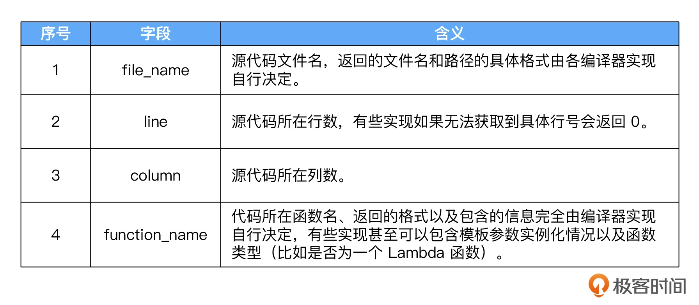
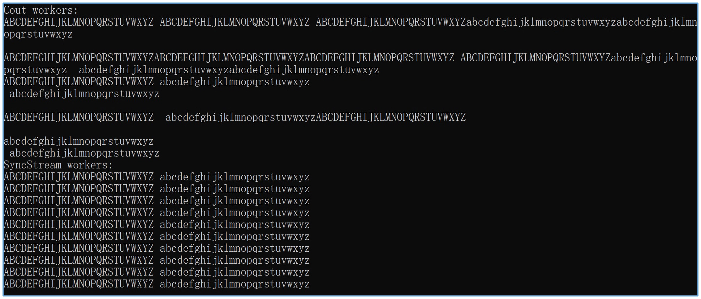
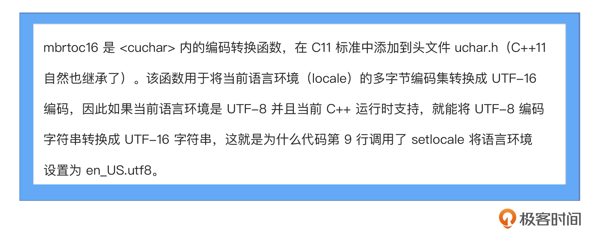
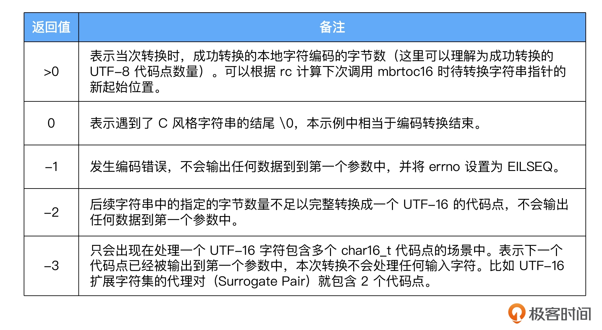

# 18 | 其他重要标准库特性：还有哪些库变更值得关注？

你好，我是卢誉声。

在第二章的开头，我们曾提到过，通常意义上所讲的 C++，其实是由核心语言特性和标准库（C++ Standard Library）共同构成的。

在学习了 Ranges 库和 Formatting 库之后，还有一些比较重要的标准库变更值得我们关注，包括 jthread、source location、Sync stream 和 u8string。今天，我会带你了解它们的用法和注意事项。

好，话不多说，就让我们从 jthread 开始今天的学习之旅吧（课程配套代码可以从这里获取）。

## jthread

长久以来，在 C++ 中实现多线程都需要借助于操作系统 API 或者第三方库。好在这一情况在C++11 中得以扭转，C++11 为标准库带来了并发库，即标准的 thread 类。

但是，我们在工程中使用 C++11 的 thread 类，仍然存在一些问题。

首先是线程运行时默认行为不够灵活。thread 的内部线程是进程的子线程，当 thread 还关联着一个活动线程时，C++ 运行时会调用 terminate() 中断整个程序的执行，这种行为对于很多没有认真管理线程资源的程序，不但非常危险，而且难以追踪。

另外，thread 类还缺乏强制取消或通知取消线程的功能，在很多使用线程的场景中，这都是经常需要使用到的功能。还记得么？在第七讲至第十讲中讨论 C++ coroutines 的时候，我们就不得不自己实现了请求取消线程特性。

那时候我们的实现非常粗糙。比如说，没有考虑确保请求线程的线程安全，也无法告知请求方是否成功发送请求。如果要实现这些特性需要考虑很多边界条件，还真不容易。

由于这些问题的存在，我们在实际开发过程中使用 C++11 标准 thread 类时，就需要非常小心谨慎，说白了就是不但难用，而且容易出错。为此，C++20 终于增加了 jthread 类来解决这些问题。

我们先结合后面这段示例代码，对 jthread 建立初步的认识。

```javascript
#include <iostream>
#include <thread>
#include <chrono>
#include <cstdint>
#include <string>
void simpleSleep() {
   using namespace std::literals::chrono_literals;
   std::cout << "[SIMPLE] Before simple sleep" << std::endl;
   std::this_thread::sleep_for(2000ms);
   std::cout << "[SIMPLE] After simple sleep" << std::endl;
}
// jthread的工作函数可以通过第一个类型为stop_token的参数获取线程中断请求
void stopTokenSleep(std::stop_token stoken, std::string workerName) {
   using namespace std::literals::chrono_literals;
   std::cout << "Worker name: " << workerName << std::endl;
   while (true) {
       std::cout << "[STOP_TOKEN] Before sleep" << std::endl;
       std::this_thread::sleep_for(100ms);
       std::cout << "[STOP_TOKEN] After sleep" << std::endl;
       // 调用stop_requested可以得知是否有其他线程请求中断本线程
       if (stoken.stop_requested()) {
           std::cout << "[STOP_TOKEN] Received stop request" << std::endl;
           return;
       }
   }
}
int main() {
   // ms等自定义文字量定义在std::literals::chrono_literals名称空间中
   using namespace std::literals::chrono_literals;
   std::cout << "[MAIN] Before create simple thread" << std::endl;
   // 创建线程
   std::jthread simpleWorker(simpleSleep);
   std::cout << "[MAIN] After create simple thread" << std::endl;
   std::cout << "[MAIN] Before create stop token thread" << std::endl;
   // 创建线程
   std::jthread stopTokenWorker(stopTokenSleep, "Worker1");
   // 注册request_stop成功后的回调
   std::stop_callback callback(stopTokenWorker.get_stop_token(), [] {
       std::cout << "[MAIN] Called after thread stop requested" << std::endl;
   });
   std::cout << "[MAIN] After create stop token thread" << std::endl;
   std::this_thread::sleep_for(500ms);
   std::cout << "[MAIN] Request stop" << std::endl;
   stopTokenWorker.request_stop();
   std::cout << "[MAIN] Main function exited" << std::endl;
   return 0;
}
```

在这段代码中，我们没有使用 thread 类，而是通过 jthread 类来创建线程。

代码中创建了两个子线程，从第 39 行到 42 行创建了第 1 个子线程对象 simpleWorker，从第44 到 56 行创建了第 2 个子线程对象 stopTokenWorker。

这里我们并没有像 thread 类一样，调用 join 主动等待线程结束。但是，程序会自动等待所有线程停止后才会退出，这是如何实现的呢？

这一切的玄机，都在 jthread 类的析构函数中！

在 jthread 对象析构时，如果 jthread 依然关联了活动线程（线程为 joinable），会自动调用关联线程的 request_stop，并调用 join 等待线程结束。线程结束后才会继续执行析构。

现在回到我们的代码，main 函数在 return 前，会自动依次调用两个 jthread 对象的析构函数，销毁线程对象。这时主线程就会自动 join 这两个线程，确保线程对象销毁之前，子线程已经结束。这种默认行为可以确保主线程结束前，子线程必定都已经结束，不会引发不可预期的错误。

如果不希望 jthread 自动 join，可以不在栈上直接创建 jthread 对象、或者直接调用 detach 解除线程与 jthread 对象的关联。从 C++20 开始支持的 jthread，既保留了灵活性，又确保了默认行为的安全性，更符合一般使用线程的场景。

另外，stopTokenWorker 演示了 jthread 的第二个重要特性—— stop_token。

每个 jthread 的工作函数的第一个参数，都可以定义为 std::stop_token 类型。这时，其他线程可以调用该 jthread 对象的 request_stop 成员函数，向 jthread 绑定的线程发送中断请求。

实际上 request_stop 并不会真的中断线程，而是将 stop_token 对象的 stop_requested 设置为 true。jthread 绑定的线程可以通过 stop_requested 获知是否有线程通知其中断，并自行决定是否结束线程。

按照标准规定，调用 request_stop 的过程是线程安全的——只有一个线程可以成功发送请求，一个线程发送请求成功后，其他线程调用 request_token 会失败，但不会引发异常。还有一个作用相同的类型是 stop_source，如果你感兴趣，可以自己阅读相关文档了解如何使用。

代码的第 48 到 50 行还演示了 stop_callback 的用法，该类用于在一个 jthread 上注册一个成功调用 request_stop 后的回调函数——如果其他线程已经成功 request_stop 了一个 jthread线程，那么，这个线程调用 request_stop 是不会触发本线程注册的回调函数的。

另外我们需要注意的是，一个线程可以注册多个 stop_callback，标准只能保证所有的stop_callback 会被同步依次调用，不能保证 stop_callback 的调用顺序（也就是并不一定按照注册顺序调用）。

综上所述，我们可以看到 jthread 提供了安全的默认行为，具备线程中断机制，可以根据实际情况调整具体行为，在确保安全的前提下支持灵活调用，在大多数场景中是更符合实际需求的设计。

## source location

了解了 jthread 后，我们继续了解下一个相当重要的标准库变更——source location。

在 C++ 中，如果我们希望获取当前行的源代码位置，一直都需要使用 C 预处理指令中预设的__FILE__ 和 __LINE__ 两个宏。

但在 C++ 中，这两个宏并不足以支持我们对程序跟踪调试的需求。

- __LINE__ 无法自动包含函数名等关键信息，需要采用 #line 指令手动控制输出的标记。

- __FILE__ 和 __LINE__ 都会在预处理阶段被替换为特定的字符串。但是，对于 C++ 中使用的模板函数来说，只有在编译阶段，才能获知当前行所在函数的参数实例化信息。因此，使用 __LINE__ 也无法获取所在行的模板实例化情况。

C++20 终于提出了 source_location 这个标准类，可以获取当前行更完整的源代码信息。我们结合这段示例代码来看看。

```javascript
#include <iostream>
#include <source_location>
#include <string>
void logInnerLocation(const std::string& message);
void logLocation(
   const std::string& message,
   std::source_location location = std::source_location::current()
);
int main() {
   logInnerLocation("Inner location message");
   // 通过默认参数通过current获取source_location对象
   // 这时source_location包含的信息就是在main内
   logLocation("Location message");
   return 0;
}
void logInnerLocation(const std::string& message) {
   // 在logInnerLocation内部通过current获取source_location对象
   // 这时source_location包含的信息就是在logInnerLocation内
   std::source_location location = std::source_location::current();
   std::cerr << message << std::endl <<
       "  [" <<
       location.file_name() << "(" <<
       location.line() << ":" <<
       location.column() << ")@" <<
       location.function_name() << "]" << std::endl;
}
void logLocation(
   const std::string& message,
   std::source_location location
) {
   std::cerr << message << std::endl <<
       "  [" <<
       location.file_name() << "(" <<
       location.line() << ":" <<
       location.column() << ")@" <<
       location.function_name() << "]" << std::endl;
}
```

代码中通过 source_location 的静态成员函数 current，获取了当前位置的源代码信息。其中，获取到的信息包含 file_name、line、column 和 function_name 这几个字段，每个字段的含义你可以参考下表。



可以看到，source_location 这一标准类，能为我们提供精确的编译时源代码信息，涵盖了普通函数调用和模板函数所有使用场景。这对于发布用于调试的程序极为有用。

## sync stream

在多线程场景中，使用 C++ 传统输出流接口会存在一个问题：多个线程直接向同一个输出流对象输出内容时，会得到无法预估的错乱输出。

因此，我们一般需要自己通过互斥锁等方式，实现输出的线程同步。这种方式虽然能够解决问题，但是编程效率低下，运行时也会有潜在的性能问题。

C++20 提出的 sync stream 解决了这个问题。先来看一段代码。

```javascript
#include <iostream>
#include <string>
#include <syncstream>
#include <thread>
#include <vector>
#include <cstdint>
namespace chrono = std::chrono;
// 普通stream版本
void coutPrinter(const std::string message1, const std::string message2);
// syncstream版本
void syncStreamPrinter(const std::string message1, const std::string message2);
int main() {
   std::cout << "Cout workers:" << std::endl;
   // 创建多个thread
   std::vector<std::thread> coutWorkers;
   for (int32_t workerIndex = 0; workerIndex < 10; ++workerIndex) {
       std::thread coutWorker(coutPrinter,
           "ABCDEFGHIJKLMNOPQRSTUVWXYZ",
           "abcdefghijklmnopqrstuvwxyz"
       );
       coutWorkers.push_back(std::move(coutWorker));
   }
   // 普通thread需要手动join
   for (auto& worker : coutWorkers) {
       if (worker.joinable()) {
           worker.join();
       }
   }
   std::cout << "SyncStream workers:" << std::endl;
   // 创建多个jthread，会在析构时自动join
   std::vector<std::jthread> syncStreamWorkers;
   for (int32_t workerIndex = 0; workerIndex < 10; ++workerIndex) {
       std::jthread syncStreamWorker(
           syncStreamPrinter,
           "ABCDEFGHIJKLMNOPQRSTUVWXYZ",
           "abcdefghijklmnopqrstuvwxyz"
       );
       syncStreamWorkers.push_back(std::move(syncStreamWorker));
   }
   return 0;
}
void coutPrinter(const std::string message1, const std::string message2) {
   std::cout << message1 << " " << message2 << std::endl;
}
void syncStreamPrinter(const std::string message1, const std::string message2) {
   // 使用std::osyncstream包装输出流对象即可
   std::osyncstream(std::cout) << message1 << " " << message2 << std::endl;
}
```

我们在代码 18 到 32 行，创建了多个 thread 对象，并以 coutPrinter 为入口函数，创建线程后逐个调用 join 等待线程完成。coutPrinter 中直接调用 cout 输出字符串，这样可以方便我们看到，同时调用相同的输出流对象输出时会发生什么。

在代码 36 到 44 行，创建了多个 jthread 对象，并以 syncStreamPrinter 为入口函数。由于jthread 会在析构时自动 join，因此，这里就不需要手动等待线程完成了。syncStreamPrinter中调用 std::osyncstream 将 cout 包装成一个 syncstream，然后将字符串输出到 osyncstream对象中。

运行这段程序，你可能会看到下图这样的输出。



很明显，并发输出到 cout 时出现了无法预期的混乱输出。然而，输出到 osyncstream 时没有出现直接使用 cout 输出时的混乱。为什么会出现这样的情况呢？

这是因为 osyncstream 会包装输出流对象的内部缓冲区，确保通过 osyncstream 输出时每次输出都具备原子性，因此也就不会出现错乱的输出了。

## u8string

在 C++11 中，引入了 std::u16string 和 std::u32string，用于描述 utf-16 和 utf-32 的字符串。它们分别使用 char16_t 和 char32_t 两个新的字符类型，描述 UTF-16 与 UTF-32 代码点。但奇怪的是，标准始终没有提供对 utf-8 字符描述方式。

好在 C++20 中终于引入了 u8string，用于描述 UTF-8 字符串。在引入 u8string 的同时，C++20 还定义了一个新的字符类型 char8_t，用于描述 UTF-8 的代码点。u8string 就是类型为char8_t 的序列。

但是这里有一个问题，为什么 C++20 要引入新的字符类型，而不是用 char 呢？

这是因为，C++ 标准定义的 char 存在两个比较大的坑。

首先，与其他整数类型不同，标准没有定义 char 是 signed char 还是 unsigned char，有无符号具体由实现决定。

其次，标准只为 char 定义了最小长度为 8 位，实际长度也由实现决定（虽然事实标准的确是8 位），这就导致我们无法严格采用 char 来描述 UTF-8 的代码点（UTF-8 代码点固定为 8位）。

因此，标准必须引入 char8_t 这个新类型。不过需要注意的是，char8_t 和 char 是无法直接隐式转换的，而标准库的很多标准函数都是基于 char 这个类型定义的，如果需要转换，必须要强制类型转换。

后面这段代码演示了如何定义 u8string，以及如何处理输出与转码。

```javascript
#include <fstream>
#include <string>
#include <iostream>
#include <clocale>
#include <cuchar>
#include <cstdint>
int main() {
   std::setlocale(LC_ALL, "en_US.utf8");
   // 使用u8创建u8string字面量
   std::u8string utf8String = u8"你好，这是UTF-8";
   // 调用size()获取UTF-8代码点数量
   std::cout << "Processing " << utf8String.size() << " bytes: [ " << std::showb
   for (char8_t c : utf8String) {
       std::cout << std::hex << +c << ' ';
   }
   std::cout << "]\n";
   // 获取UTF-8代码点序列的起始位置与结束位置
   const char* utf8Current = reinterpret_cast<char*>(&utf8String[0]);
   const char* utf8End = reinterpret_cast<char*>(&utf8String[0] + utf8String.siz
   char16_t c16;
   std::mbstate_t convertState{};
   // 定义UTF-16字符串
   std::u16string utf16String;
   // 调用mbrtoc16执行转码
   while (std::size_t rc = std::mbrtoc16(&c16, utf8Current, utf8End - utf8Curren
       std::cout << "Next UTF-16 char: " << std::hex
           << static_cast<int32_t>(c16) << " obtained from ";
       if (rc == (std::size_t)-3)
           std::cout << "earlier surrogate pair\n";
       else if (rc == (std::size_t)-2)
           break;
       else if (rc == (std::size_t)-1)
           break;
       else {
           std::cout << std::dec << rc << " bytes [ ";
           for (std::size_t n = 0; n < rc; ++n)
               std::cout << std::hex << +static_cast<unsigned char>(utf8Current[
           std::cout << "]\n";
           utf8Current += rc;
           utf16String.push_back(c16);
       }
   }
   // 输出UTF-8编码字符串
   std::ofstream u8OutputFile("out.utf8.txt", std::ios::binary);
   u8OutputFile.write(reinterpret_cast<char*>(utf8String.data()), utf8String.siz
   // 输出UTF-16编码字符串
   std::cout << std::dec << utf16String.size() << std::endl;
   std::ofstream u16OutputFile("out.utf16.txt", std::ios::binary);
   u16OutputFile.write(reinterpret_cast<char*>(utf16String.data()), utf16String.
   return 0;
}
```

在代码第 12 行使用了 u8 创建 u8string 的字面量字符串。

在代码 14 到 18 行，首先输出了 u8string 的代码点数量，然后使用十六进制输出了 u8string内的代码点数量。我们处理 UTF-8 字符串的时候，必须要知道 UTF-8 是变长编码，所以一个真正的字符可能包含不同数量的代码点，就像代码中字符串包含 10 个字符，但是包含 20 个代码点。

在代码第 29 到 47 行，我们演示如何调用 mbrtoc16 函数，完成 UTF-8 编码向 UTF-16 编码的转换。



由于 UTF-8 是变长编码集，因此我们需要多次调用 mbrtoc16 将 UTF-8 的字符逐个转换成UTF-16 的代码点。

每次调用时，会将第二个参数（类型为 const char*，这里相当于 UTF-8 字符串的开始位置）开始的特定数量代码点，转换成一个 UTF-16 中对应的代码点，写入到该函数的第一个参数中（类型为 char16_t*）。

这里需要注意 mbrtoc16 的返回值 rc，我画了一张表，帮你梳理了 rc 可能的返回值。



遗憾的是，这种标准库支持的编码转换方式依赖于 C 的 locale。但是，C 的 locale 实现支持完全取决于具体的 C/C++ 运行时环境（也会进一步依赖于操作系统）。

因此，我们的代码虽然可以运行在主流系统与运行时环境中，但不能保证兼容性。

另外，C 的 locale 还有 C 标准库经常遇到的多线程环境问题，因为 setlocale 是全局的，所以在一个线程中 setlocale 对其他线程中行为的影响是未知的。也就是说，setlocale 并非线程隔离，也不是线程安全的，所以在多线程程序中使用 C 的 locale，我们需要慎之又慎。

因此，在大部分场景下，我还是建议你使用 iconv 之类的第三方编码转换库执行编码转换。希望 C++ 能在日后标准中，进一步脱离 C 的 locale，然后彻底解决编码问题吧。

此外，与 C++11 加入的 u16string 一样，C++20 的 u8string 也缺乏输入输出流的直接支持（根本原因是 C++17 废弃了 codecvt 的具体实现）。因此，在代码 50 到 56 行中，我们不得不使用二进制的方式将其输出到文件中。

不得不说，C++ 针对语言编码的支持，依然任重而道远！我们期待着在后续演进标准中逐步解决这些问题。

## 总结

我们在这一讲中，进一步补充了 C++20 标准中重要的库变更，包括它们的用法和注意事项。

jthread 是自 C++11 之后对标准的并发编程的一次重要补充，它支持了安全的默认行为，具备线程中断机制，可以根据实际情况调整具体行为，在确保安全的前提下支持灵活的调整，在大多数场景中是更符合实际需求的设计。

source location 对输出代码的准确位置提供了有力支撑，同时解决了模板函数中长久以来存在的问题——无法输出准确代码执行位置。这为调试复杂程序和输出信息提供了新工具。

另外，我们还讨论了 u8string，以及 C++ 针对语言编码支持的问题。标准库支持的编码转换方式仍然依赖于 C 的 locale，我们期待着在后续演进标准中逐步解决这些问题。

## 思考题

请你结合 char 的宽度问题，思考一下 u8string 转换示例代码中可能还会出现什么兼容性问题。

欢迎说出你的看法，与大家一起分享。我们一同交流。下一讲见！
