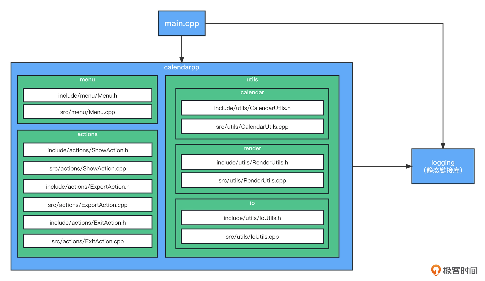
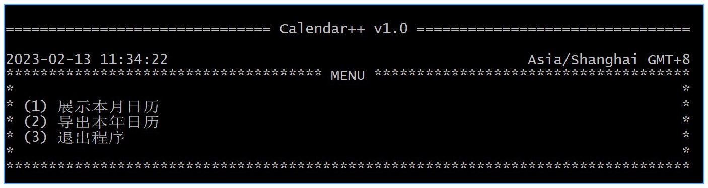
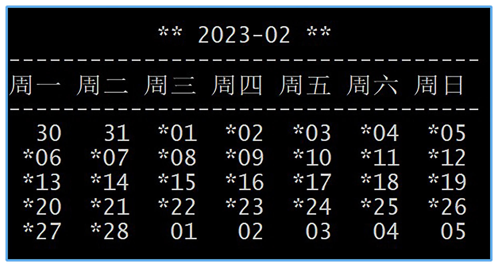

# 19 | 其他重要标准库特性实战：利用日历应用熟悉新特性

你好，我是卢誉声。

我们想要提升 C++ 的编程效率，就需要对重要标准库的变更保持关注。在第 18 讲已经涵盖了绝大多数 C++20 带来的重要库变更。不过，我当时有意忽略了其中一个，就是我们今天的主角——C++20 Calendar、Timzone。

它们是对现有 chrono 库的重要补充。Calendar 提供了日历的表示与计算工具。而 Timezone提供了标准的时区定义，可以构建包含时区信息的 zoned_time。

今天，我会围绕 C++20 Calendar、Timzone 带你进行编程实战，并结合上一讲涵盖的特性：jthread、source location、sync stream 和 u8string，实现一个使用新标准实现的日历程序。

哦，对了，我们还会在这一讲中使用 C++ 20 Formatting 库，帮你进一步加深对这个特性的理解。好，话不多说，就让我们从模块设计开始今天的内容（课程配套代码可以从这里获取）。

## 模块设计

我们准备构建的命令行日历应用，具备以下特性。

- 使用 C++20 chrono：支持显示本月日历，显示日期和星期信息。

- 使用 u8string：支持导出本年的全年日历到文本文件，编码为 UTF-8。

我们依然采用传统 C++ 模块结构设计，整体模块设计如下图所示。



该工程包含两个子项目，一个是可执行文件 calendarpp，另一个是静态链接库 logging。从图中可以看到，calendarpp 的入口是 main.cpp，其他实现都在 calendarpp 模块下，包括后面这几个模块。

- menu：主菜单实现，包括菜单定义与菜单交互。

- actions：各个菜单项的具体实现，完成具体的功能。

- utils：具体的底层实现模块，包括日历计算模块 calendar、文本渲染模块 render 和输入输出模块 io。

我们沿用了第 15 讲中的实现，即日志框架来构建并包装成了 logging 库，并利用第 18 讲中讲过的部分特性进行了改造。沿着这条路线，我们先从改造日志框架开始看。

## 改造日志框架

日志框架的所有代码文件都在 projects/logging 下，你可以结合代码来理解如何集成日志框架，并用它来记录系统运行日志。我们来看看，使用 C++20 的特性，可以在原有的框架基础上做出哪些改造。

之前的 Handler 在多线程场景下使用时，因为没有采用线程同步方案，导致输出时可能会产生错乱的问题，因此我们改造了 Handler。

比如 DefaultHandler 的实现改造是后面这样。

```sql
#pragma once
#include "logging/Handler.h"
#include <syncstream>
namespace logging::handlers {
   // 默认日志处理器
   template <Level HandlerLevel = Level::Warning>
   // 继承BaseHandler
   class DefaultHandler : public BaseHandler<HandlerLevel> {
   public:
       // 构造函数，需要指定格式化器，默认格式化器为defaultFormatter
       DefaultHandler(Formatter formatter = defaultFormatter) : BaseHandler<Hand
       // 禁止拷贝构造函数
       DefaultHandler(const DefaultHandler&) = delete;
       // 定义移动构造函数
       DefaultHandler(const DefaultHandler&& rhs) noexcept : BaseHandler<Handler
       // emit用于提交日志记录
       // emitLevel > HandlerLevel的日志会被丢弃
       template <Level emitLevel>
           requires (emitLevel > HandlerLevel)
       void emit(const Record& record) {
       }
       // emitLevel <= HandlerLevel的日志会被输出到标准输出流中
       template <Level emitLevel>
           requires (emitLevel <= HandlerLevel)
       void emit(const Record& record) {
           // 调用format将日志记录对象格式化成文本字符串
           std::osyncstream(std::cout) << this->format(record) << std::endl;
       }
   };
}
```

代码中的改动在第 31 行，通过 std::osyncstream 包装了 std::cout，然后通过包装后的输出流进行输出，这样就能完成输出的线程同步控制（详细讲解，你可以回顾上一讲 “syncstream” 这部分）。

日志框架的第二个改动在于，它通过 source location 记录了输出日志的源代码位置信息。实现在 Record.h 下，后面展示的是重点代码。

```python
class Record {
public:
   // Logger名称
   std::string name;
   // 日志等级
   Level level;
   // 日志时间
   TimePoint time;
   // 日志消息
   std::string message;
   std::source_location sourceLocation;
   // getLevelName：获取日志等级文本
   const std::string& getLevelName() const {
       // 调用toLevelName获取日志等级文本
       return toLevelName(level);
   }
};
```

通过代码可以看到，Record 定义增加了 sourceLocation 用于记录源代码位置。

接着，我们还要修改 Logger 定义，增加记录源代码位置信息的功能。具体实现在 Logger.h下，我们将 log 的定义改为以下形式。

```javascript
template <Level level>
   requires (level > loggerLevel)
Logger& log(const std::string& message, std::source_location sourceLocation = std
   return *this;
}
// 通过requires约束提交等级为日志记录器设定等级及以上的日志
template <Level level>
   requires (level <= loggerLevel)
Logger & log(const std::string& message, std::source_location sourceLocation = st
   // 构造Record对象
   Record record{
       .name = _name,
       .level = level,
       .time = std::chrono::system_clock::now(),
       .message = message,
       // 记录源代码位置
       .sourceLocation = sourceLocation
   };
   // 调用handleLog实际处理日志输出
   handleLog<level, HandlerCount - 1>(record);
   return *this;
}
```

可以看到，我增加了 source_location 定义，并通过默认参数自动记录调用者的所在位置，调用者也可以自己指定需要记录的 source_location。

我们同时修改了几个级别的相关接口，比如 debug 成员函数改造。

```javascript
// 提交调试信息（log的包装）
Logger& debug(const std::string& message, std::source_location sourceLocation = s
   return log<Level::Debug>(message, sourceLocation);
}
```

其他的几个成员函数都和 debug 一样，这里就不展示出来了。

最后，我还修改了 format 函数输出 sourceLocation 中的信息。具体实现，我们以ModernFormatter.cpp 的修改为例来看看。

```bash
#include "logging/formatters/ModernFormatter.h"
#include "logging/Record.h"
namespace logging::formatters::modern {
   // formatRecord：将Record对象格式化为字符串
   std::string formatRecord(const Record& record) {
       const auto& sourceLocation = record.sourceLocation;
       try {
           return std::format(
               "{0:<16}| [{1}] {2:%Y-%m-%d}T{2:%H:%M:%OS}Z - <{3}:{4} [{5}]> - {
               record.name,
               record.getLevelName(),
               record.time,
               sourceLocation.file_name(),
               sourceLocation.line(),
               sourceLocation.function_name(),
               record.message
           );
       }
       catch (std::exception& e) {
           std::cerr << "Error in format: " << e.what() << std::endl;
           return "";
       }
   }
}
```

代码中 format 的部分加入了 sourceLocation 信息，其他部分相较于之前则没有变化。

## 主程序与菜单

在了解了日志框架的改造后，我们继续看如何通过 C++20 Formatting 库实现主程序和菜单。

主程序定义非常简单，在 main.cpp 中，代码是后面这样。

```
#include "menu/Menu.h"
#include <iostream>
#include <format>
int main() {
   while (true) {
       // 展示菜单
       calendarpp::menu::showMenu();
       // 读取并执行菜单项
       calendarpp::menu::readAction();
   }
   return 0;
}
```

代码整体是一个 while 循环，首先展示菜单，然后读取用户输入并执行菜单项。所以只有用户选择退出程序时，整个程序才会退出。

菜单实现在 menu/Menu.cpp 中，代码是后面这样。

```go
#include "menu/Menu.h"
#include "actions/ShowAction.h"
#include "actions/ExportAction.h"
#include "actions/ExitAction.h"
#include "utils/RenderUtils.h"
#include <iostream>
#include <string>
#include <vector>
#include <cstdint>
#include <format>
#include <algorithm>
namespace calendarpp::menu {
   // 菜单项类型
   struct MenuItem {
       std::string title;
       Action action;
   };
   // 所有菜单
   static const std::vector<MenuItem> MenuItems = {
       std::vector<MenuItem> {
           {
               .title = "展示本月日历",
               .action = actions::showCurrentMonth
           },
           {
               .title = "导出本年日历",
               .action = actions::exportCurrentYear
           },
           {
               .title = "退出程序",
               .action = actions::exitApp
           }
       }
   };
   // 菜单选项范围
   static const int32_t MinActionNumber = 1;
   static const int32_t MaxActionNumber = MenuItems.size();
   // 展示菜单
   void showMenu() {
       // 输出系统标题
       std::cout << std::format("\n{:=^80}\n", " Calendar++ v1.0 ") << std::endl
       // 输出当前时间与本地时区信息
       std::cout << utils::renderNow() << std::endl;
       // 输出所有菜单
       std::cout << std::format("{:*^80}\n", " MENU ");
       std::cout << std::format("*{: ^78}*\n", "");
       std::int32_t menuIndex = 0;
       for (const auto& menuItem : MenuItems) {
           menuIndex += 1;
           // 输出菜单序号与菜单名称
           std::string menuLine = std::format("({}) {}", menuIndex, menuItem.tit
           std::cout << std::format("* {: <76} *", menuLine) << std::endl;
       }
       std::cout << std::format("*{: ^78}*\n", "");
       std::cout << std::format("{:*^80}\n", "");
       // 提示用户输入菜单编号
       std::cout << std::format("\n请输入菜单编号({}-{}):", 1, menuIndex);
   }
   // 读取用户输入并执行动作
   void readAction() {
       std::string actionNumberString;
       // 读取用户输入
       std::getline(std::cin, actionNumberString);
       try {
           // 解析用户输入
           int32_t actionNumber = std::stoi(actionNumberString);
           if (actionNumber < MinActionNumber || actionNumber > MaxActionNumber)
               std::cerr << std::format("菜单编号超出范围({}-{})\n", MinActionNumbe
           }
           // 执行相应菜单项的action
           int32_t actionIndex = std::max(actionNumber - 1, 0);
           const auto& action = MenuItems[actionIndex].action;
           action();
           return;
       }
       catch (const std::exception& e) {
           std::cerr << e.what() << std::endl;
       }
       std::cerr << "无法识别用户输入" << std::endl;
   }
}
```

这段代码中值得注意的部分是 showMenu 函数，它用于展示菜单。该函数输出标题后，会遍历所有的 MenuItems 并输出菜单内容。发现了么？这段代码通过 format 完成了大量的文本格式化工作。

最后我们还定义了 readAction 函数，用于读取用户输入的菜单编号并执行对应的菜单动作。这里使用了 C++11 引入的 std::stoi 函数将字符串转换成对应的整型数字。

菜单的展示效果是后面这样。



需要注意的是，本项目代码采用了 UTF-8 编码，因此如果你在 Windows 下执行，需要在支持UTF-8 编码输出的控制台下使用（比如 MinGW 的 bash）。

## 展示日历

接下来，我们看一下该如何展示本月日历。在 actions 中定义了菜单项的函数实现，代码实现在 src/actions/ShowAction.cpp 中。

```
#include "actions/ShowAction.h"
#include "utils/RenderUtils.h"
#include <chrono>
#include <iostream>
#include <format>
namespace chrono = std::chrono;
namespace calendarpp::actions {
   void showCurrentMonth() {
       // 获取当前时间
       chrono::time_point now{ chrono::system_clock::now() };
       // 将时间转换为year_month_day
       chrono::year_month_day ymd{ chrono::floor<chrono::days>(now) };
       // 获取当前年月（类型为year_month）
       chrono::year_month currentYearMonth = ymd.year() / ymd.month();
       // 调用渲染模块渲染当月日历
       std::cout << std::endl;
       std::cout << utils::renderMonth(currentYearMonth);
   }
}
```

代码中定义了 showCurrentMonth 函数，该函数首先调用了 chrono 的 Calendar 获取当日所在的日期和月份。

Calendar 是 C++20 引入到 chrono 中新的库特性，提供了标准的格里高利历（Gregoriancalendar）实现。

这里简单介绍一下 year_month_day，用于描述一个完整日期（年月日），该类型支持多种构造方法，这里使用 chrono::system_clock::now() 获取系统本地时间，然后采用chrono::floor<chrono::days> 将时间转换为以日为单位的时间，最后调用 year_month_day 得到当日的日期。

year_month_day 支持通过 year 和 month 成员函数获取当日的年份与月份，代码 17 行就调用了 year / month 这种形式构造了一个 year_month 对象，表示某年的某个月，这里最后得到的就是本日所在的当月。/ 是 Calendar 的一个操作符重载，是创建日期类型对象的一个语法糖。

代码最后调用 renderMonth 渲染了当月日历并将其输出到控制台，该函数定义在src/utils/RenderUtils.cpp 中，属于渲染模块，我们分析一下相关代码。

首先定义了 Weekdays 常量，包含了周一到周日的所有星期几的定义。

```
// 定义一周七天的weekday常量
static std::vector<chrono::weekday> Weekdays = {
   chrono::Monday,
   chrono::Tuesday,
   chrono::Wednesday,
   chrono::Thursday,
   chrono::Friday,
   chrono::Saturday,
   chrono::Sunday,
};
```

该数组的元素类型为 chrono::weekday，这是 chrono 的标准类型，用来表示周几，其中Monday 到 Sunday 都是 chrono 定义的常量，表示周一到周日。

```javascript
// 渲染某个月份的日历，返回string
std::string renderMonth(chrono::year_month yearMonth) {
   std::ostringstream os;
   // 获取当月的所有周
   auto monthWeeks = utils::buildMonthWeeks(yearMonth);
   // 获取当月第一天
   const auto firstDay = yearMonth / 1d;
   // 获取当月最后一天
   const auto lastDay = chrono::year_month_day(yearMonth / chrono::last);
   // 输出格式化的标题（年份与月份）
   std::string titleLine = std::format("** {:%Y-%m} **", yearMonth);
   os << std::format("{:^35}", titleLine) << std::endl;
   os << std::format("{:->35}", "") << std::endl;
   // 输出日历表头（从周一到周日）
   std::vector<std::string> headerLineParts;
   for (const auto& weekday : Weekdays) {
       headerLineParts.push_back(std::format(ZhCNLocale, "{:L%a}", weekday));
   }
   // 利用renderWeekLine生成格式化的表头（控制7个元素的位置与宽度）
   std::string headerLine = renderWeekLine(headerLineParts);
   os << headerLine << std::endl;
   os << std::format("{:->35}", "") << std::endl;
   // 遍历monthWeeks，调用renderWeek生成日历中的每一行
   for (const auto& currentWeek : monthWeeks) {
       std::string weekLine = renderWeek(currentWeek, yearMonth);
       os << weekLine << std::endl;
   }
   // 返回渲染的字符串
   return os.str();
}
// 渲染日历中的某一周
std::string renderWeek(const std::vector<chrono::year_month_day> week, chrono::ye
   // 获取当月第一天
   const auto firstDay = yearMonth / 1d;
   // 获取当月最后一天
   const auto lastDay = chrono::year_month_day(yearMonth / chrono::last);
   // 生成本周的所有日期
   std::vector<std::string> weekLine;
   for (const auto& currentDay : week) {
       std::string inCurrentMonthFlag = currentDay >= firstDay && currentDay <=
       weekLine.push_back(std::format("{}{:>2}", inCurrentMonthFlag, currentDay.
   }
   // 利用renderWeekLine生成格式化的本周日期
   return renderWeekLine(weekLine);
}
// 生成某一周的格式化输出
std::string renderWeekLine(const std::vector<std::string>& weekLine) {
   std::string renderResult;
   for (const auto& weekLineItem : weekLine) {
       // 所有内容按照宽度为4右对齐
       renderResult.append(std::format("{:>4} ", weekLineItem));
   }
   return renderResult;
}
```

代码中的注释已经比较详细了，所以后面我们只讨论一些重点实现。

代码第 5 行，作用是获取当月的所有周的数组，utils::buildMonthWeeks 属于日历计算模块，我们后面详细解释其实现。

在代码第 8 行，用 yearMonth / 1d 生成当月的第一天，返回的类型就是 year_month_day。其中 1d 是一个自定义文字量，定义在名称空间 std::literals::chrono_literals 中，相当于chrono::days(1) 的语法糖，表示某个月 1 号。yearMonth / 1d 中的 / 是 yearMonth 的操作符重载，表示当月第一天。

在代码第 10 行，用 yearMonth / chrono::last 表示当月最后一天。其中，chrono::last 是C++20 中引入的，用来表示一个时间序列末尾的标记。最后，我们调用chrono::year_month_day 转换成 year_month_day。

代码第 18 到 25 行，调用了 renderWeekLine 帮助我们生成格式化的标题，因为输出的日历需要将一周七天按照一定的布局输出到控制台上，该函数可以帮助我们完成渲染布局。代码第20 行利用了 locale 输出中文，有兴趣可以自己看 RenderUtils.cpp 中的定义以及 locale 相关内容。

在代码第 28 到 31 行，生成日历的内容。由于日历里每周输出到一行中，因此这里遍历当月所有周，调用 renderWeek 完成一周的布局输出。

renderWeekLine 函数实现也会比较简单，输入参数是一个包含 N 个字符串的数组，数组元素就是在日历中的每一个格子中需要输出的内容（比如表头的周几或者日期），这里主要通过format 将每一格内容的输出宽度限制在 4，确保布局工整。

渲染出来的效果如下图所示。



最后，我们看一下 utils::buildMonthWeeks 的实现，代码实现在 src/utils/CalendarUtils.cpp中。

```javascript
#include "utils/CalendarUtils.h"
#include <format>
namespace chrono = std::chrono;
using namespace std::literals::chrono_literals;
static uint32_t MaxWeekdayIndex = 6;
namespace calendarpp::utils {
   std::vector<std::vector<std::chrono::year_month_day>> buildMonthWeeks(std::ch
       // 获取当月第一天
       const auto firstDay = yearMonth / 1d;
       // 获取当月最后一天
       const auto lastDay = chrono::year_month_day(yearMonth / chrono::last);
       std::vector<std::vector<chrono::year_month_day>> monthWeeks;
       // 将当月第一天设定为当日
       auto currentDay = firstDay;
       // 当每周当日超出当月最后一天时中止循环
       while (currentDay <= lastDay) {
           // 每次循环都计算出当日所在周的7天（周一到周日）
           std::vector<chrono::year_month_day> currentMonthWeek;
           // 通过weekday获取某一天是周几
           auto currentWeekday = chrono::weekday{ std::chrono::sys_days{ current
           // 通过iso_encoding获取周几的编码（1-7）
           auto currentWeekdayIndex = currentWeekday.iso_encoding() - 1;
           // 计算本周第一天
           auto firstDayOfWeek = chrono::year_month_day{
               std::chrono::sys_days{ currentDay } - chrono::days(currentWeekday
           };
           currentDay = firstDayOfWeek;
           // 计算出本周的所有日期并添加到currentMonthWeek中
           for (uint32_t weekdayIndex = 0; weekdayIndex <= MaxWeekdayIndex; ++we
               currentMonthWeek.push_back(currentDay);
               currentDay = chrono::year_month_day{
                   std::chrono::sys_days{ currentDay } + chrono::days(1)
               };
           }
           // 将计算好的当前周添加到monthWeeks中
           monthWeeks.push_back(currentMonthWeek);
       }
       return monthWeeks;
   }
}
```

在这段代码中，我们会生成当月的所有周，通过 Calendar 完成了大量的日期计算，相比自己实现格里高利历要方便不少。

## 导出日历

除了展示日历，我们继续讨论序列化日历的实现。在 src/actions/ExportAction.cpp 中定义了导出菜单项的代码实现。

```
#include "actions/ExportAction.h"
#include "utils/RenderUtils.h"
#include "utils/IOUtils.h"
#include <chrono>
#include <iostream>
#include <string>
namespace chrono = std::chrono;
namespace calendarpp::actions {
   void exportCurrentYear() {
       // 获取当前时间
       chrono::time_point now{ chrono::system_clock::now() };
       // 将时间转换为year_month_day
       chrono::year_month_day ymd{ chrono::floor<chrono::days>(now) };
       // 获取当前年份
       chrono::year currentYear = ymd.year();
       // 提示并读取用户输入
       std::cout << "请输入导出文件路径: ";
       std::string filePath;
       std::getline(std::cin, filePath);
       // 调用IO模块将renderYear的渲染结果输出到文件中
       utils::writeFile(filePath, utils::renderYear(currentYear));
       std::cout << std::format("已将日历导出到文件中: {}", filePath) << std::endl;
       std::cout << std::endl;
   }
}
```

这段代码非常简单，核心是通过 renderYear 渲染当年的日历，然后通过 writeFile 以 UTF-8 编码写入到文件中。

函数 renderYear 实现在 src/utils/RenderUtils.cpp 中，相关代码如下所示。

```go
// 定义一年12个月的month常量
static std::vector<chrono::month> Months = {
   chrono::January,
   chrono::February,
   chrono::March,
   chrono::April,
   chrono::May,
   chrono::June,
   chrono::July,
   chrono::August,
   chrono::September,
   chrono::October,
   chrono::November,
   chrono::December,
};
std::string renderYear(std::chrono::year year) {
   std::ostringstream os;
   // 输出格式化的标题（年份）
   std::string titleLine = std::format("**** {:%Y}年 ****", year);
   os << std::format("{:^35}", titleLine) << std::endl;
   os << std::format("{:=^35}\n", "") << std::endl;
   // 调用renderYearMonths并行生成12个月的日历
   std::vector<std::string> renderedMonths(Months.size(), "");
   renderYearMonths(renderedMonths, year);
   // 将12个月的日历输入到输出流中
   for (const std::string& renderedMonth : renderedMonths) {
       os << renderedMonth;
       os << std::endl;
   }
   // 返回渲染好的字符串
   return os.str();
}
static void renderYearMonths(std::vector<std::string>& renderedMonths, chrono::ye
   std::vector<std::jthread> renderThreads;
   int32_t monthIndex = 0;
   for (const auto& currentMonth : Months) {
       auto currentYearMonth = year / currentMonth;
       auto& renderedMonth = renderedMonths[monthIndex];
       // 创建jthread对象，开启计算线程，每个线程负责生成一个月的日历
       renderThreads.push_back(std::jthread([currentYearMonth, &renderedMonth] {
           renderedMonth = renderMonth(currentYearMonth);
       }));
       ++monthIndex;
   }
   // 退出函数时，所有jthread对象会自动等待计算完成然后退出
}
```

我们重点看一下 renderYearMonths 函数的实现。

该函数定义了一个 jthread 数组，然后循环创建了 12 个线程，用于分别调用 renderMonth 渲染各自月份的日历。由于 jthread 会在析构时自动等待本线程完成。因此，我们并不需要去join 这些线程，在退出 renderYearMonths 之前，所有的工作线程肯定能结束任务。

最后看一下 writeFile 的实现，代码在 src/utils/IOUtils.cpp 中。

```javascript
#include "utils/IOUtils.h"
#include "Logger.h"
#include <filesystem>
#include <format>
#include <iostream>
namespace fs = std::filesystem;
namespace calendarpp::utils {
   void writeFile(const std::string& filePath, const std::string& fileContent) {
       auto& logger = getLogger();
       // 检测文件是否存在
       if (fs::exists(filePath)) {
           logger.warning(std::format("Override existed file: {}", filePath));
       }
       // 由于源代码使用UTF-8，生成的字符串就是UTF-8，因此可以直接强制类型转换构建u8string
       std::u8string utf8FileContent(reinterpret_cast<const char8_t*>(fileConten
       // 将u8string以二进制形式写入到文件中
       std::ofstream outputFile(filePath, std::ios::binary);
       outputFile.write(reinterpret_cast<char*>(utf8FileContent.data()), utf8Fil
   }
}
```

在这段代码中，首先通过文件系统库中的 std::filsystem::exists 检测文件是否存在，如果存在则提示用户会覆盖原有文件。

接着，将字符串转换成 u8string，由于源代码使用 UTF-8，生成的字符串就是 UTF-8。因此，我们可以直接强制类型转换构建 u8string。

最后，将 u8string 的 data 强制类型转换为 char*，并通过二进制形式写入到文件中。

## 总结

在这一讲中，我们通过一个工程，串讲了一系列 C++20 带来的重要库变更。我们在原有的日志框架基础上，追加了 source_location，用于记录打印日志时代码的所在位置。除此之外，将传统的输出流替换成 sync stream，就可以轻松实现输出的线程同步控制。

在实现的过程中，我们还使用了 TimeZone 获取带时区的本地时间，并通过使用 Calendar 完成日历计算。这些针对 chrono 的标准库补充，大大降低了时间处理的复杂度。

最后，我们利用 u8string，轻松实现了 UTF-8 编码的文本导出。

通过这些案例，我们可以感受到，现代 C++ 的库变更建立在新的核心语言特性基础上，为我们日常编程工作提供了极大的便利。避免造轮子，提升编程效率——这些对于库的核心变更来说是核心议题，所以我们应该保持对标准库演进的持续关注。

## 课后思考

现在日历中显示的时间是包含时区信息的本地时间，如果我们希望日历中显示的当前时间是UTC 时间（日历显示依然按照本地时间计算，不需要变化），我们要对代码做什么改动？

欢迎给出你的方案，与大家一起分享。我们一同交流。下一讲见！
