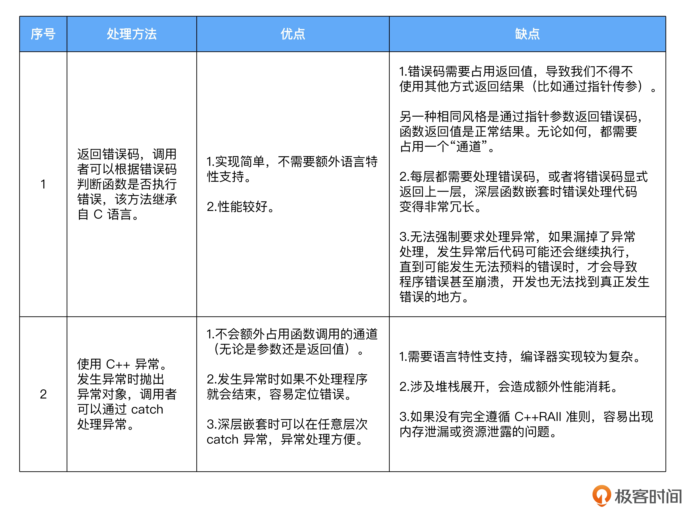
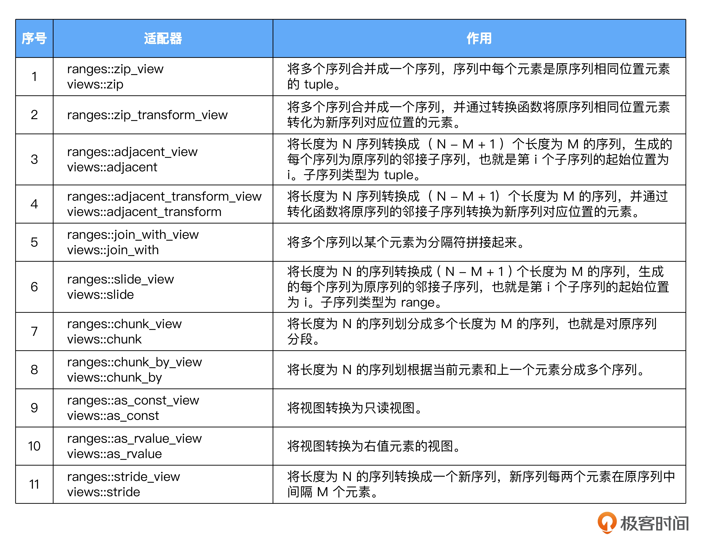

# 20 | 漫游C++23：更好的C++20

你好，我是卢誉声。

到现在为止，我们应该已经发现，C++20 这个版本的规模和 C++11 等同，甚至更加庞大。一方面，它变得更加现代、健壮和安全。另一方面，自然也存在很多不足之处。

因此，就像 C++14/17 改进、修复 C++11 那样，C++23 必然会进一步改进 C++20 中“遗留”的问题。令人高兴的是，C++23 标准已经于 22 年特性冻结。除了作为 C++20 的补丁，它还引入了大量新特性（主要是标准库部分），成为了一个至少中等规模的版本更新。

既然 C++23 的特性已经冻结，年底发布的正式标准最多只是标准文本的细节差异，现在正是一个了解 C++23 主要变更的好时机。

给你一点提示，现阶段各个编译器尚未针对 C++23 提供完善的支持。因此，对于这一讲涉及的代码，主要是讲解性质，暂时无法保证能够编译执行。

接下来，就让我们从语言特性变更、标准库变更两个角度，开始漫游 C++23 吧。

## 语言特性变更

C++23 的语言特性变更真的不多，不过即使如此，也有一些非常亮眼的特性变更，比如我们即将了解的几个新特性。

### 显式 this 参数

要明白这个语言特性变更，得先弄清楚什么是显式 this 参数。

让我们来看一下这段代码。

```python
#include <iostream>
#include <cstdint>
class Counter {
public:
   Counter(int32_t count) : _count(count) {}
   Counter& increment(this Counter& self) {
       self._count++;
       return self;
   }
   template <typename Self>
   auto& getCount(this Self& self) {
       return self._count;
   }
private:
   int32_t _count;
};
int main() {
   Counter counter(10);
   std::cout << counter.getCount() << std::endl;
   counter.increment().increment();
   std::cout << counter.getCount() << std::endl;
   const Counter& counterRef = counter;
   std::cout << counterRef.getCount() << std::endl;
   return 0;
}
```

诶？！看完代码你是不是有些奇怪，为什么 this 关键字会出现在上面的函数参数列表中？其实，这就是所谓的显式 this。现在我就来解释一下。

我们第一次学习 C++ 和 Java 时可能有一个疑问，为什么访问成员变量或成员函数时会出现一个没有定义过的指针—— this。众所周知，在一门强类型静态语言中任何符号都需要提前定义，那么这个 this 是什么？又是从哪里来的呢？

没错，这的确是一个 C++ 引入的和自身哲学非常不匹配的特性，而且持续至今，也进一步影响了 Java、C# 和 JavaScript 等现代语言（当然 JS 的 this 更加诡异），影响不可谓不大。

但在同样的一些语言中——比如 Python，成员方法必须要在函数列表中显式写出来，这也就是 C++ 中引入显式 this 参数的目的，让所有的使用到的符号都需要提前定义。比如前面代码里的第 8 到 12 行，如果在 C++23 之前，我们应该这样写。

```
Counter& increment() {
 _count++;
 return *this;
}
```

看完之后，你可能更加疑惑了，这样不是让代码变得更复杂了吗？毕竟我们都已经习惯了使用隐式的 this。

那么从前面代码 14 到 17 行，我们就可以看到显式 this 的价值了——通过模板让代码变得更简单。这段代码这样写的目的是替代以前的传统写法，后面是它的等价实现。

```javascript
const int32_t& getCount() const {
 return _count;
}
int32_t& getCount() {
 return _count;
}
```

我们在需要返回内部引用时，即使代码的实现一模一样，也经常需要定义一个 const 版本和非const 版本。这种情况下，显式 this 的确帮助我们解决了一个问题——因为模板函数可以根据传入的参数自动匹配参数类型。

同时，使用显式 this 还可以实现递归 Lambda 函数。我们还是结合代码来理解。

```
#include <iostream>
#include <cstdint>
int main(){
 auto fibonacci = [](this auto self, int32_t value) {
   if (value == 0) {
     return 0;
   }
   if (value <= 2) {
     return 1;
   }
   return self(value-1) + self(value-2);
 };
 auto result = fibonacci(10);
 std::cout << result << std::endl;
 return 0;
}
```

可以看到，显式 this 让原本很多繁琐的工作变得更加简单了。相信你现在也体会到了，这是一个重要的特性变更。

### 多元 operator[]

多元 operator 是为了支持标准中引入的多维数组类型而提出的，比如后面这段示例，就采用了多元 operator[]实现多维数组。

```python
#include <iostream>
#include <cstdint>
#include <vector>
#include <initializer_list>
#include <concepts>
#include <ranges>
#include <algorithm>
#include <format>
namespace views = std::views;
namespace ranges = std::ranges;
template <typename Element>
class MArray {
public:
   MArray(const std::initializer_list<std::size_t>& dims): _dims(dims), _size(0)
       if (!dims.size()) {
           return;
       }
       std::size_t prevDimSize = 1;
       std::vector<std::size_t> dimSizes;
       for (auto dim : views::reverse(_dims)) {
           dimSizes.push_back(prevDimSize);
           prevDimSize *= dim;
       }
       ranges::copy(views::reverse(dimSizes), std::back_inserter(_dimSizes));
       _size = prevDimSize;
       _elements.resize(_size);
   }
   template <typename Self, std::integral... Indexes>
   auto& operator[](this Self& self, Indexes... remainingIndexes) {
       std::size_t acutalIndex = self.calcIndex(0, remainingIndexes...);
       return self._elements[acutalIndex];
   }
   template <std::integral Index>
   std::size_t calcIndex(std::size_t dimIndex, Index firstIndex) {
       return static_cast<std::size_t>(firstIndex) * _dimSizes[dimIndex];
   }
   template <std::integral Index, std::integral... Indexes>
   std::size_t calcIndex(std::size_t dimIndex, Index currentIndex, Indexes... re
       return static_cast<std::size_t>(currentIndex) * _dimSizes[dimIndex] + cal
   }
   std::size_t size() const {
       return _size;
   }
   std::vector<Element>& elements() {
       return _elements;
   }
private:
   std::vector<Element> _elements;
   std::vector<std::size_t> _dims;
   std::vector<std::size_t> _dimSizes;
   std::size_t _size;
};
int main() {
   MArray<int32_t> array {2, 3, 4, 5};
   auto& elements = array.elements();
   for (std::size_t index = 0; index != array.size(); ++index) {
       elements[index] = static_cast<int32_t>(index * 2);
   }
   auto a1 = array[1];
   std::cout << a1 << std::endl;
   auto a2 = array[1, 2];
   std::cout << a2 << std::endl;
   auto a3 = array[1, 2, 3];
   std::cout << a3 << std::endl;
   auto a4 = array[1, 2, 3, 4];
   std::cout << a4 << std::endl;
   return 0;
}
```

这段代码其他部分很好理解，你可以重点留意代码 35 到 40 行，就是一个多参数的 operator[]定义。与以往不同，C++23 中 operator 可以定义任意数量的参数，我们同时使用了显式 this简化了对 const 的处理。因此，我们可以像 75—85 行一样通过[]访问某个元素。

这对访问多维数组来说极为方便，语法也就和 Python 的 NumPy 中下标访问更像了，在数值计算和向量计算中会有大量应用。

## 标准库特性变更

相比于语言特性变更，C++23 中更多的是标准库级别的变更，接下来，我会带你深入了解几个重要的标准库特性变更。

### 标准模块：std 与 std.compact

第一个必须提及的变更就是 std 这个标准 Module。

C++ Module 是 C++20 中引入的最为重要的特性，但我们也知道，C++20 中的标准库并非设计成简单的 Module，而且不同编译器的支持完善程度也相差甚多（比如 gcc 模块嵌套层次深了之后标准库的 import 就失效了），这导致在 Module 中使用标准库并不是很方便，不过标准对此不做强制要求。

但在 C++23 中就明确设定了名为 std 的模块，该模块会将标准库中所有的符号全部引入当前模块！

这样一来，在使用标准库的时候就会非常方便了，我们终于再也不用去记忆，什么函数在什么库中了。同时，所有继承自 C 标准库的符号，都被放到了 std.compact 模块中，在使用std::memcpy 等函数的时候就需要 import 这个模块。

虽然直接引入 std 和 std.compact 会导入很多的模块，但因为编译器实现一定会针对这些标准库模块提供二进制缓存。其实，最后的编译速度，可能比现在 #include 某个标准库头文件还快得多。

因此，在 C++23 中使用 C++ Module 会惬意不少——当然，前提是编译器能够提供良好支持。

### expected 与异常处理

在了解 C++23 Expected 前，我们先看一下传统 C++ 的异常处理方式。一般来说有两种，你可以参考后面的表格。



可以看出传统的两种异常处理方式，不难发现它们的缺点都非常明显，比如错误码导致代码冗余，容易忽略掉错误处理，而通过 try/catch 处理异常又有致命的性能和资源管理问题（甚至导致 Google 不提倡采用 try/catch），那么是否有更现代化的异常处理方式呢？

C++23 终于仿照 Rust 等语言，提出了 expected 类型，并通过 Monadic interfaces 实现新的异常处理风格。后面这段代码，就演示了如何使用 expected 处理异常。

```javascript
#include <iostream>
#include <cstdint>
#include <expected>
#include <fstream>
#include <vector>
#include <string>
#include <filesystem>
#include <numeric>
namespace fs = std::filesystem;
std::expected<std::vector<std::string>, std::errc> readListFile(const std::string
std::expected<std::vector<std::uintmax_t>, std::errc> getFileSizes(const std::vec
std::expected<std::uintmax_t, std::errc> sumFileSize(const std::vector<std::uintm
int main() {
   auto result = readListFile("ObjectList.txt")
       .and_then(getFileSizes)
       .and_then(sumFileSize)
       .or_else([](auto e) {
           std::cout << "Error!" << std::endl;
           return std::unexpected(e);
       });
   if (result) {
       std::cout << "Result: " << result << std::endl;
   }
   return 0;
}
std::expected<std::vector<std::string>, std::errc> readListFile(const std::string
   std::ifstream inputFile(filePath.c_str());
   if (!inputFile.is_open()) {
       return std::unexpected(std::errc::io_error);
   }
   std::vector<std::string> lines;
   while (inputFile) {
       std::string line;
       if (std::getline(inputFile, line)) {
           lines.push_back(line);
       }
   }
   return lines;
}
std::expected<std::vector<std::uintmax_t>, std::errc> getFileSizes(const std::vec
   std::vector<std::uintmax_t> fileSizes;
   for (const auto& filePath : fileList) {
       if (!fs::exists(filePath)) {
           return std::unexpected(std::errc::no_such_file_or_directory);
       }
       fileSizes.push_back(fs::file_size(filePath));
   }
   return fileSizes;
}
std::expected<std::uintmax_t, std::errc> sumFileSize(const std::vector<std::uintm
   return std::accumulate(fileSizes.begin(), fileSizes.end(), static_cast<std::u
}
```

看完代码我们发现，所有函数的返回类型都变成了 expected，这个类型类似于 optional，是一个模板类。它包含两个模板参数，一个是正常情况的返回值类型，另一个是错误码类型。

错误码类型类似于 optional，包含一个成员函数 has_value 用于判断对象是否包含正常的返回值，只不过约定了第二个类型作为错误码。

另外，expected 类型还提供了 and_then 与 or_else 成员函数。

成员函数 and_then 的参数是下一个处理函数，该函数一般也会返回 expected 类型。如果expected 对象正常返回，那么就会调用 and_then，否则调用 or_else。

此外，expected 的 and_then 可以像 17 到 24 行这样链式调用，执行多个业务逻辑时会非常有用。最后的结果包含正常的值，就可以调用 value 成员函数获取内部包含的值（如代码 27行）。

这种风格的异常处理类似于 Rust 等现代语言。其优点是异常处理逻辑清晰，可以将异常处理集中在调用链的某些节点，实现业务处理和异常处理关注点分离。

缺点是缺乏处理分支逻辑的手段，同时因为 and_then 等函数采用模板函数实现，会造成生成代码膨胀等问题。但无论如何，我们的确有了一种现代化的新异常处理手段，在数据流的处理场景非常实用。

### Ranges 扩展

Ranges 是 C++20 的一大特性，但通过前面课程的学习，我们也发现了使用 Ranges 的一些问题。

1. 适配器依然不够丰富。

2. 只有标准库内的适配器闭包对象支持通过视图管道连接，开发者自定义的符合适配器闭包对象的类型无法支持视图管道连接，需要采用变通的方案。

3. 无法将 ranges 简单转换成某种类型的 STL 容器。

C++ 标准委员会也非常清楚这些问题，因此在 C++23 中对 Ranges 补充了大量支持。

首先 Ranges 增加了大量适配器，我把它们用表格的方式做了梳理，供你参考。



有了这些适配器，可以让我们的编码变得更加便捷。接着，C++23 允许使用视图管道，连接自定义的符合适配器闭包对象的类型，不需要再通过变通方法来实现。

最后，C++23 提供了一个非常实用的转换函数 to，它允许我们将视图转换成任意类型的标准容器，这其中包括多层嵌套的 range 对象。比如说，下面这段代码里，我们就将 range 转换成了 vector 数组。

```python
#include <iostream>
#include <vector>
#include <string>
#include <ranges>
#include <cstdint>
class Article {
public:
   std::string title;
   std::vector<std::string> paragraphs;
};
std::vector<Article> getArticles();
namespace views = std::views;
namespace ranges = std::ranges;
int main() {
   auto paragraphCounts = getArticles() |
       // 筛选多于3个段落的文章
       views::filter([](const auto& article) { return article.paragraphs.size()
       // 将文章转换为段落
       views::transform([](const auto& article) { return article.paragraphs | vi
       // 统计段落长度
       views::transform([](const auto& paragraphs) {
           return paragraphs | views::transform(
               [](const std::string& paragraph) {
                   return paragraph.size();
               }
           ) | ranges::to<std::vector>();
       })
       // 转换为vector
       | ranges::to<std::vector>()
       // 使用join合并
       | views::join;
   for (const auto& paragraphCount : paragraphCounts) {
       std::cout << paragraphCount << std::endl;
   }
   return 0;
}
```

在这段代码中，我们只需要指定类型，to 会帮助我们完成繁杂的转换工作。而且由于 to 本身可以是一个适配器闭包对象，因此可以使用视图管道连接，使得代码更加赏心悦目。

### 多维数组视图

事实上，C++ 标准库一直在解决有关数组的各类问题。比如，在 C++11 中引入了静态长度的std::array。再比如，在 C++20 中引入了 span 作为一维数组视图，支持动态长度。在不使用std::array 的时候，我们也能引用数组并存储数组的长度信息，完成边界检查。

为了便于理解，我写了一段代码，我们先来看看。

```
#include <iostream>
#include <span>
#include <cstdint>
int main() {
   int32_t array1[] { 1, 2, 3, 4, 5, 6, 7, 8, 9, 10 };
   std::span<int32_t> span1 = std::span(array1);
   std::span<int32_t, 10> span2 = std::span(array1);
   // 等同于std::span<int, 10>
   auto span3 = std::span(array1);
   // 如果模板参数不包含长度，只能在运行时获取长度
   //static_assert(span1.size() == 10);
   std::cout << span1.size() << std::endl;
   // 如果在模板参数指定长度，可以在编译器获取长度
   static_assert(span2.size() == 10);
   static_assert(span3.size() == 10);
   return 0;
}
```

相较于 C++11 和 C++20，C++23 引入了 mdspan 作为多维数组视图。那么，我们为什么需要多维数组视图呢？

这是因为，C++ 中的多维数组支持一直不够完善，比如不支持边界检查，只能通过 C99 的VLA 语法指定第一维长度，后续维度无法动态扩展等等。如果使用多层指针（比如 int***），则需要自己循环创建每一层的动态数组，还会遇到释放内存的问题。为此，我们甚至不得不经常使用一维数组来模拟多维数组，比如下面这段代码。

```
#include <iostream>
#include <cstdint>
int main() {
   int32_t array1[]{ 1, 2, 3, 4, 5, 6, 7, 8, 9, 10 };
   for (std::size_t row = 0; row != 2; ++row) {
       for (std::size_t col = 0; col != 5; ++col) {
           // 可以通过C++23的多元operator[]自动计算索引访问到元素
           std::cout << array1[row * 5 + col] << " ";
       }
       std::cout << std::endl;
   }
   return 0;
}
```

C++23 提出了 mdspan 后，就不需要我们自己手动通过一维数组模拟多维数组了。

后面这段代码，演示了如何使用 mdspan 包装一维数组来模拟二维数组，你可以结合代码体会一下。

```
#include <iostream>
#include <span>
#include <mdspan>
#include <cstdint>
int main() {
   int32_t array1[] { 1, 2, 3, 4, 5, 6, 7, 8, 9, 10 };
   // mdspan可以设定多个维度，相当于array[2][5]
   auto mdspan1 = std::mdspan(array1, 2, 5);
   for (std::size_t row = 0; row != 2; ++row) {
       for (std::size_t col = 0; col != 5; ++col) {
           // 可以通过C++23的多元operator[]自动计算索引访问到元素
           std::cout << mdspan1[row, col] << " ";
       }
       std::cout << std::endl;
   }
   return 0;
}
```

其实 C++23 的 mdspan 还具备更多的特性，包括设置动态长度，修改数组内存布局（也就是元素不一定需要连续存储），也支持控制元素访问（比如如何检查边界，支持原子访问）。

### print 与 format

在 C++20 中引入的 format 虽然只是一个库特性，但是它对解决 C++20 之前的文本格式化问题很有帮助。

不过，format 只能将文本格式化到字符串中，这导致在实际输出时，我们还是需要通过 C++的输出流，来输出字符串——这有些不方便。对于很多其他的高级编程语言来说，它们基本都已经支持直接在输出函数中进行文本格式化了，这显得 C++ 实在有些不够“现代”。

不过在 C++23 中，终于引入了 print 和 println，接口基本和 Rust 的 print/println 函数一样，代码如下所示。

```
#include <print>
#include <cstdint>
#include <iostream>
int main() {
   std::print("{}: {}\n", "Name", "S1");
   std::println("{}: {}", "Name", "S2");
   std::println(std::cerr, "{}: {}", "Name", "S3");
   return 0;
}
```

这个函数的本质是调用 format 生成文本，然后将文本直接输出到输出流中。print 和 println 默认会将文本输出到标准输出流 std::cout 中，我们可以将其修改为其他的输出流，比如 std:cerr或者 ofstream 等其他的输出流对象中。

虽然这个特性看起来很简单，但我觉得还是有必要专门了解一下。这是因为，这从一定程度上会改变我们输出内容的习惯——也许在十年之后，我们就很少能在新的 C++ 代码中看到使用<< 输出文本的行为了。

### 堆栈跟踪

最后一个特性，是 C++23 提供的堆栈跟踪库——它终于来了！

C++ 从一开始就提出了“异常”，这是一种替代 C 语言错误码的异常处理机制。但遗憾的是，C++ 的异常处理能力其实一直有很多缺憾，包括后面这三个问题。

1. 如果顶层没有 try/catch 程序会直接崩溃，可能无法获知任何的异常信息。

2. 在 catch 中无法通过 exception 获取抛出异常处的调用堆栈。

3. 没有提供现代语言的 finally 等特性，需要利用 C++ 的 RAII 机制实现类似行为，还是有点不便。

C++20 中提出的 source_location 可以帮助我们部分解决第二个问题：抛出异常的函数可以在异常中包装 source_location 对象，这样 catch 时就可以获取到抛出异常的位置。

不过问题在于，source_location 只包含抛出异常所在点的信息，无法获取调用堆栈信息，了解程序是通过什么路径调用到函数的。

因此 C++23 中终于提供了 stacktrace 库，补充了 source_location 不足之处。因此，现在我们可以像下面的代码一样抛出异常并 catch 异常。

```bash
#include <stacktrace>
#include <iostream>
#include <vector>
#include <cstdint>
#include <format>
class StacktraceException : public std::exception {
public:
   // 通过默认构造函数获取创建异常时的堆栈
   StacktraceException(const char* message, std::stacktrace stacktrace = std::st
       std::exception(message), _stacktrace(stacktrace) {}
   const std::stacktrace& getStacktrace() const {
       return _stacktrace;
   }
private:
   std::stacktrace _stacktrace;
};
int32_t visitVector(const std::vector<int32_t>& values, std::size_t index) {
   // 如果索引越界那么抛出异常
   if (index >= values.size()) {
       throw StacktraceException("out_of_range");
   }
   return values[index];
}
int main() {
   try {
       std::vector<int32_t> values{ 1, 2, 3 };
       std::cout << visitVector(values, 1) << std::endl;
       std::cout << visitVector(values, 3) << std::endl;
   }
   catch (const StacktraceException& e) {
       std::cerr << std::format("Error: {}\n", e.what()) << std::endl;
       // 通过标准输出流直接输出堆栈（标准格式，由标准库实现自行决定）
       std::cerr << "Standard Stacktrace: \n" << e.getStacktrace() << std::endl;
       std::cerr << "Custom Stacktrace: \n";
       // 自定义输出格式
       std::size_t index = 0;
       for (const auto& stacktraceEntry : e.getStacktrace()) {
           std::cerr << std::format(
               "{}. {}:{} -> {}",
               index,
               stacktraceEntry.source_file(),
               stacktraceEntry.source_line(),
               stacktraceEntry.description()
           ) << std::endl;
       }
   }
   catch (...) {
       const auto& e = std::current_exception();
       std::cerr << "Unexpected exception" << std::endl;
   }
   return 0;
}
```

在这段代码中，我们可以看出，stacktrace 类似于 source_location，必须我们自己手动构造。stacktrace 可以视为 stacktrace_entry 的一个序列，我们不仅可以通过标准输出流输出stacktrace，也可以通过 stacktrace_entry 的成员函数获取到我们想要获取的信息。

不过现在我们必须手动构造一个 exception 类，包装 stacktrace_entry，还无法在标准的exception 中获取堆栈。如果想要直接通过 exception 获取调用堆栈，可能要等到 C++26 中的补充了（已有相关提案）。

如果 C++26 能够完善这一点，那么 C++ 的异常处理，大概就真的满足一个现代编程语言应该具备的特性了。

## 总结

今天这一讲，我带你漫游了 C++23 标准，并从语言特性和标准库特性两个方面介绍了 C++23中比较重要的一些变化。

C++23 重要的语言特性变更乏善可陈，我们着重学习了会给编码习惯带来较大变化的“显式this 参数”和“多元 operator[]”，还了解了它们的使用场景。

我们按重要程度，梳理一下 C++23 中的重要库的变更，包括以下几类。

- 极为重大的变更：标准的 std 与 std.compact 模块。

- 重要的变更：expected、多维数组视图、print、堆栈跟踪。

- 对 C++20 的补充：Ranges 扩展。

由于 C++23 标准 23 年底才会正式发布，因此现有编译器对 C++23 尚未提供完善的支持。现在你可以先做了解，在接下来的 2 到 3 年，我们或许就能用上较为稳定的、支持 C++23 的编译器，享受 C++23 带来的改变了，让我们拭目以待。

## 课后思考

在 C++23 的标准固化后，具体细节被总结在了这里。那么，请你阅读浏览一下这篇文章，分享你所期待的 C++23 特性吧！

欢迎说出你的看法，与大家一起分享。我们一同交流。下一讲见！
