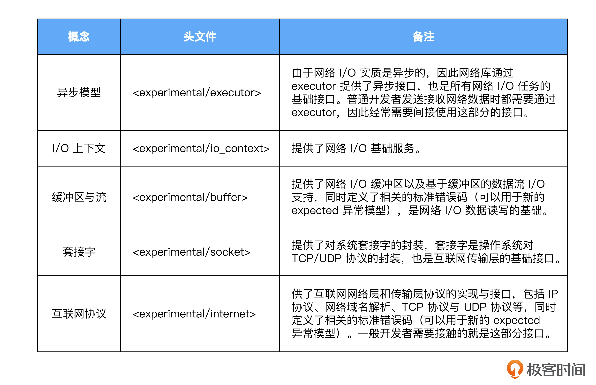

# 21 | 重大变更（一）：关于C++26的十大猜想

你好，我是卢誉声。

在上一讲中，我们讨论了 C++23 带来的变化。由于 C++23 已经是冻结特性，所以我们讨论得非常具体。C++23 作为“更好的 C++20”，其本质是针对 C++20 进行改进和修补，所以涵盖的内容比较有限。

但是，作为继 C++20 之后的又一重大标准变更，C++26 及其后续演进将会给我们带来诸多重量级特性。为了更好地理解 C++ 标准的演进思路、掌握 C++ 标准演进的底层逻辑，并一窥未来的变化，这一讲中，我们把视角转向 C++26 及其后续演进。

不过，由于 C++26 还处在提案阶段。所以，我们只能预测一下那些“大概率会进入 C++26”的特性，也许其中一些特性会被推迟或发生改变，但并不影响我们分析 C++ 标准演进的底层逻辑和未来。

好，就让我们从静态反射开始今天的内容。

## 静态反射

静态反射（static reflection），很有可能是 C++26 中即将引入的最为重量级的特性。但凡是了解何为反射机制，同时熟悉 C++ 的人，看到这个特性时，估计会虎躯一震——什么？C++ 要支持反射？

但是我们需要冷静一下，这个特性的定语很重要，这个反射是“静态的”（static）。

对于反射的概念，还是很容易理解的，就是编程语言提供一套机制，帮助开发者在代码中获取类型的相关信息，比如类型名称、大小、类的成员、函数参数信息等等。它允许开发者在代码中，根据反射信息执行相应的操作，这让语言变得更加“动态”——也就是根据反射信息来确定代码如何执行。

其实早在 C++98 标准，在引入 dynamic_cast 和 RTTI 时，C++ 就允许开发者获取有限的运行时类型信息。但是，这些运行时类型信息非常贫乏，除了支持类型转换以外，并没有什么其他用处。而且，即便是这些有限的功能，也特别耗费 C++ 的运行时资源，与 C++ 自身的设计理念有些偏差。

不过，C++ 新提出的静态反射则大不相同。这个特性秉持了现代 C++ 一以贯之的理念，在编译时获取并确定所有信息。所以说，这个静态反射也就和 C++11 之后引入的 type_traits 一样，可以在编译时获取所有的信息。并在编译时，通过模板和 constexpr 等方式完成相关计算。

静态反射标准的特性尚处于讨论阶段，不过已经有相关的 TS（Technical specifications，即技术规范）。因此，我们来了解一下，在 TS 中是如何使用静态反射的？

首先，C++ 会提供一个新的关键字——reflexpr，用于获取一个符号的“元数据”。我们可以结合后面这个例子来理解。

```
#include <cstdint>
#include <experimental/reflect>
int main() {
   int32_t num = 0;
   using NumMeta = reflexpr(num);
   return 0;
}
```

你不用尝试运行这个例子——目前暂时还没有编译器支持它。我们关注点就在代码第 7 行，通过 reflexpr 获取了 num 的元数据。

我们需要知道，reflexpr 返回的元数据并不是一个变量，而是一个类型，所以要用 using 或者typedef 来为其定义一个别名，这样才能在后面使用。

那么获取到的类型别名要如何使用呢？我们继续看代码。

```
#include <string>
#include <iostream>
#include <experimental/reflect>
int main() {
   using Type1 = reflexpr(std::string);
   using Type2 = reflexpr(std::u8string);
   std::cout << std::experimental::reflect::get_name_v<Type2> << std::endl;
   static_assert(Type1 == "basic_string");
   std::cout << std::experimental::reflect::reflects_same_v<Type1, Type2> << std
   return 0;
}
```

获取到类型别名后，我们就可以使用 C++ 提供的 reflect 工具函数，静态地获取关于类型别名的一切信息，比如代码第 9 行通过 get_name_v 获取了 Type2 的类型名称，第 12 行通过reflects_same_v 判断两个类型是否相同。

由于静态反射的类型信息都存储在类型中，因此，reflect 的工具都可以实现成工具类型或constexpr 函数。所以，我们也可以在 static_assert 和模板参数中，配合 C++ Concepts 特性，通过模板实现针对不同类型细节执行不同的操作逻辑。

事实上，正是因为静态反射需要基于 constexpr、static_assert 和 concept 实现。因此，直到C++26 之后，静态反射才可能成为备选的提案。

基于这些基础设施，C++ 的编译时计算会变得前所未有的强大。

此外，静态反射的 TS 还提供了面向反射元数据类型的一系列 concept，这样我们就可以通过定义模板函数，完成更多的反射元数据的计算与判断。

可以说，如果 C++26 及其后续演进真的实现了静态反射 TS，C++ 的编译器“动态”特性就基本完美了。

## 异步任务框架

从 C++11 开始，现代 C++ 一直在试图扩展、完善并发任务管理，从基础的 thread 支持，到future、promise、async、并行算法，到 C++20 的协程，都在逐步完善 C++ 标准库的并发任务支持。

C++11 提供的 thread 解决了基于线程的并发任务的基础设置，通过 atomic 解决了细粒度的原子操作问题，通过 mutex 和信号量解决了线程同步问题，通过 promise、future 和 async 解决了并发任务的创建与基本调度问题。

但直到 C++20 为止，我们依然需要关注很多并发任务执行的细节问题，无法通过标准库解决并发任务的高层调度问题。比如后面这些问题。

- 如何控制同时执行的并发任务数量。

- 如何解决任务的错误重试机制。

- 如何处理多个异步任务之间的串行、并行甚至条件调度。

- 如何更方便地在两个并发任务中发送接收消息等等。

C++ Executors 的目标就是解决这些问题，我们这就来说说 executors 中的概念与提供的能力。

第一个概念就是 executor。

executor 本质是一个 concept，表示可以被 execute 和 schedule 等调度函数调用的类型，它可以是一个函数、仿函数，也可以是一个 Lambda 函数。

对于其他调度函数，它们通过调用 executor 来提交并发任务。假如说，我们需要通过线程池来执行任务，那么可以创建一个线程池对象，并从线程池对象中获取一个 executor。

```
#include <string>
#include <iostream>
#include <execution>
int main() {
   using namespace std::execution;
   std::static_thread_pool pool(4);
   executor auto poolExecutor = pool.executor();
   execute(poolExecutor, [] { std::cout << "这是一个在线程池中执行的任务"; });
   return 0;
}
```

在代码第 8 行，定义了一个大小为 4 的线程池。接着，通过 executor 成员函数获取了一个可以在线程池中执行并发任务的 executor。然后，调用 execute 函数，execute 会调用poolExecutor 将这个 Lamba 函数提交到线程池中执行。

这种情况下，executor 帮我们屏蔽了提交并发任务的所有细节，为其他的任务调度函数提供通用的调度接口。当然 executor 只是一个抽象，所以底层实现并不一定是线程——我们同样可以将 coroutine 包装成 executor，因此 executor 是一个通用的并发任务接口。

第二个重要的概念是 sender/receiver。

虽然标准定义了通用的 executor。但是，用于调用 executor 执行任务的 execute 函数，它的返回类型为 void。因此，我们无法通过链式调用的形式将多个并发任务串联在一起执行，就更不用说完成一些更高级的并发任务连接了。

为此，标准提出了 sender 和 receiver。sender 是一个创建之后不会自动执行的调度任务，需要等到在它后面连接一个 receiver 之后，才会开始执行。当 sender 执行完成后，就会调用receiver 约定的接口将数据传递给 receiver，并开始执行 receiver，标准中将 receiver 连接到sender 后的函数就是 connect，伪代码如下所示。

```
#include <string>
#include <iostream>
#include <execution>
int main() {
   sender auto snd = create_sender();
   receiver auto rec = create_receiver();
   std::execution::connect(snd, src);
   return 0;
}
```

那我们要如何实现链式调用呢？这时就需要引入通用异步算法这个概念了。

所谓通用异步算法，就是一个接收用户自定义任务作为 sender 的函数，该函数会调用connect 将该 sender 与算法内部的一个 receiver 连接，然后包装成一个新的 sender 返回给调用方，这样调用方就可以将这个 sender 传给下一个通用算法或者 connect 其他的计算任务，最终形成链式调用。标准库中 future/promise 的 then 就是通过这种方式实现的。

最后一个重要的概念是 scheduler。

我们可能经常会碰到一种情况，就是有多个并发任务，使用相同的 sender。如果直接链接sender 对象和多个任务。很有可能会产生竞争问题。

为此，C++ 标准提出了 scheduler。它主要通过 schedule 函数返回，该函数会返回一个新的sender 作为内部 sender 的工厂，这样即使将同一个 scheduler 连接到多个 receiver，也不会引发数据竞争问题。

## 网络库

接下来，我为你介绍一个“有些可能”推出的标准网络库——networking。我为什么说“有些可能”呢？这是因为标准网络库已经在标准中，被推迟了无数次😂。不过，我还是希望它能出现在C++26。

在实际工程项目中，网络编程已经是不可或缺的一部分。但非常可惜，C++ 一直没有将网络支持标准化。

事实上，C++ 一直将 networking 安排在标准化的进程中，原定应该在 C++17 和 C++20 之间添加到标准库中，不过因为各种原因现在也就延迟到至少 C++26 了。

目前网络库的整体设计基于 Boost 实现的 ASIO 库，我为你梳理了一张表格，方便你了解C++ 网络库的整体设计。



从表格中可以看出，每个概念都定义在对应的头文件中，最终被包含在 <experimental/net>中。等到网络库完全标准化后，就会被移出 experiment 成为正式的头文件。Boost ASIO 已经非常成熟，网络库的更多细节已经具备大量资料，如果你想了解更多，课后可以自行搜索。

虽然网络库的设计基于 Boost 的 ASIO，但由于现代 C++ 已经提供了大量的基础设施，包括算法、并发模型、I/O 流、协程等，这也是为什么网络库的标准化时间在不断延迟，毕竟它的基础设施的标准化优先级肯定是更高的。

最后，我们只能期望网络库不要再延期了，这样对于 C++ 的新开发者来说，在处理网络编程时可以大幅度降低门槛和编程复杂度。

## Freestanding 支持

最后，我们再聊聊 Freestanding 库。众所周知，C++ 可能运用于嵌入式等环境开发，在这些环境中可以运用的资源可能非常少，而如果完整实现 C++ 的标准库可能需要许多系统调用或者资源支撑，这在很多嵌入式环境中是不可能满足要求的。

因此，C++ 提出了 Freestanding 库，也就是在无需操作系统调用和存储空间消耗的前提下，需要实现的标准库最小子集。

从 C++11 到 C++26 中标准库有了大幅更新，那么自然 C++26 中 Freestanding 库的要求也就会有极大补充，估计这不是大多数人需要关心的问题，这里就不展开了。如果你感兴趣，可以课后自行搜索了解更多细节。

## 总结

这一讲中，我们一起讨论了 C++26 及其后续演进的前四个猜想，最重要的是下面列出的这三个。

- 静态反射：配合 constexpr、static_assert 和 concept 一起，成为静态反射的核心基础设施，让编译时计算成为主流技术的关键补充。

- 异步任务框架：通过 executor、sender/receiver 和 scheduler，控制同时执行的并发任务数量、解决任务的错误重试机制、处理多个异步任务之间的串行、并行甚至条件调度，更方便地在两个并发任务中发送接收消息。

- 网络库：在标准中推迟数次的库变更。在处理网络编程时，可以大幅度降低门槛和编程复杂度。

下一讲，我们继续畅想 C++ 的未来变化，敬请期待。

## 课后思考

我们在这一讲中反复提到一个词，即 TS 技术规范。请你阅读有关技术规范方面的定义，尝试理解 C++ 标准委员会是如何使用技术规范将主要特性变更和标准制定过程“解耦合”的。

欢迎聊聊你的想法，并与大家一起分享。我们一同交流，下一讲见！
