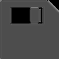
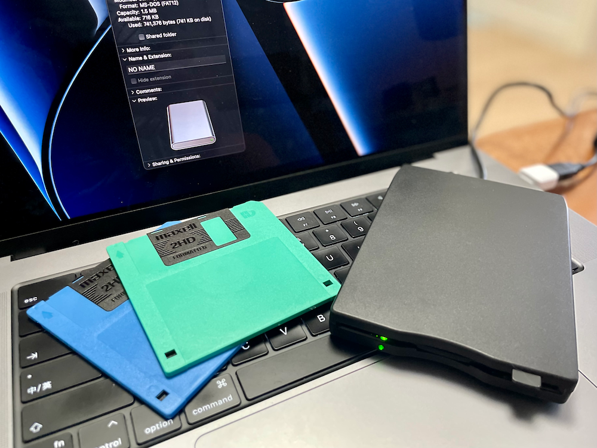
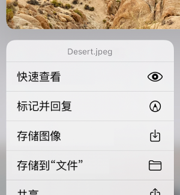
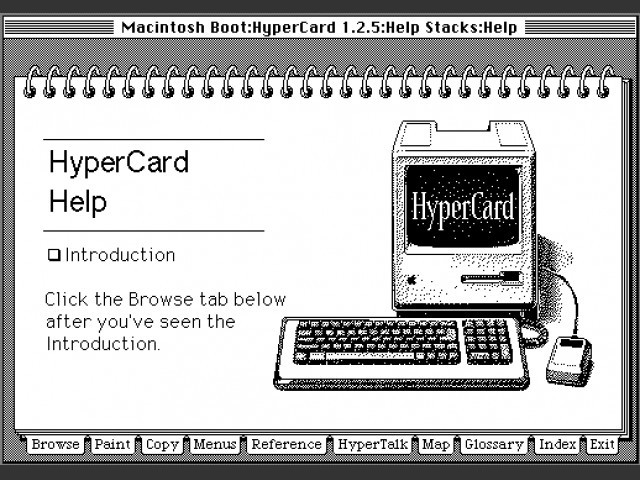

# 01 | 身为Web前端工程师，我都在开发什么？

你好，我是宋一玮。

前端技术日新月异，尤其 Web 前端技术的能力和应用领域不断增多，Web 前端开发工作的广度和深度也随之日益提升，这就要求 Web 前端工程师必须扩展自己的知识技能体系。

而不少前端开发者吐槽，这些技术更新太快了：刚刚学习了新语言、新框架、新组件库，没多久就变成了老技术，然后又要赶着去学习新技术；加上紧张的工作生活挤压自己的学习时间，一轮一轮下来，觉得自己没沉淀下来什么。

那么，如何在学习和实践前端技术中有所沉淀？

首先，前端技术不只是技术。学习 Web 前端技术的目的是将其应用于实际前端开发工作，要对自己为之工作的前端应用有更全面、立体的了解，才能更有效地总结、归纳技术点，真正成为自己的知识。

其次，掌握技术的广度和深度一样重要。把一项技术钻研到极致，是很受人敬佩的，但在实际工作中也有可能反而限制了思路，正如常说的“拿了把顺手的锤子，就觉得哪里都是钉子”。当掌握多项技术后，技术与技术之间的联系和差异，就会在你脑海中形成一张知识图谱。这样再有新技术来，你就已经有准备了。

在这节课里，我会简要介绍前端应用的历史，提炼出一些前端的领域知识，并从中找到一些不曾改变的规律和原理。然后作为论据，我会比较 20 年前的 Java Web 技术和近年来浏览器端的 JS 前端技术。希望这些内容会帮你触碰到前端应用开发的本质。

## 前端开发工作历史悠久

我们从事开发的 Web 前端是一种图形用户界面，即 GUI。

GUI 在 1984 年 Apple 发布 Macintosh 时首次进入大众的视野。我首次接触个人电脑是在DOS 流行的年代，主要交互方式还是命令行，当时的国产软件金山 WPS 文字处理系统让我大开眼界，进入 UCDOS，运行 WPS，整个屏幕就进入了支持鼠标操作的图形界面。

很久以后我才知道在 DOS 上开发 GUI，纯靠应用软件厂商自己设计开发。

之后随着微软 Windows 系统的崛起，GUI 成为计算机人机交互的主流。开发者们利用Windows 的 MFC、macOS 的 Cocoa、跨平台的 GTK、Qt 等框架，构建了不计其数的 GUI应用。

分布式计算引入了 C/S（客户端 - 服务器）架构。上世纪 90 年代起，互联网开始兴起，网站作为 GUI 更加灵活、丰富，更易分发，这让浏览器一跃成为最普及的客户端。早期的网站或Web 应用以静态网页加服务器端页面技术为主，如 CGI、ASP、PHP、JSP、Ruby onRails、ASP.NET 等。

2004 年，谷歌发布了一款基于 AJAX 技术开发的，标志性的 Web 应用——Gmail，从此 B/S（浏览器 - 服务器）架构一发不可收拾，成为 C/S 架构中的主流。在 B/S 架构的早期，除了JavaScript，还有一众基于浏览器扩展的 RIA 技术试图收复失地，如 Java Applet、AdobeFlash/Flex、MS Silverlight。

而 2010 年，Apple 创始人乔布斯老爷子公开抨击 Flash、力挺 HTML5，这导致 Flex 等 RIA技术的消亡，Web 应用迎来 HTML5 的时代。浏览器领域 Firefox 和 Chrome 先后打破 IE 的垄断，尤其是 V8 JS 引擎的横空出世，也打消了开发者对 JS 性能的顾虑。

浏览器们卷了起来，也带动了 JS 语言本身和 Web API 的标准化。JS 框架从早期的jQueryUI、Dojo Toolkit、ExtJS，演进到后来的 Backbone.js、Ember.js，一直到现在的React、Vue、Angular 三大框架。

历史的车轮会一直向前，但技术的轮子会时不时往回滚。例如，移动互联网时代，在移动设备算力有限的条件下，iOS、Android 移动端的原生 App 要比 Web 应用更普及。又如，基于浏览器端 JS Web 应用为主流的今天，同构 JS 应用、SSR 服务器端渲染、SSG 静态网站生成又开始在行业中有了一席之地，如 Next.js、Nuxt.js。

前端开发历史悠久，前端技术实践有着丰富的积累，很多现今的问题，在历史中都能找到答案。

## 前端是界面也是接口

前面介绍了 GUI 开发技术的历史，现在我们把关注点放在前端开发者，也就是“你”身上。

GUI 是 Graphical User Interface 的缩写，其中的 Interface 我们一般翻译成“界面”，而 API 中的“I”同样是 Interface，我们一般翻译成“接口”。类比一下编程语言里接口的特性，使用者只关注接口，而无需关注接口对应的内部实现。

前端界面也是这样，用户只关注与应用界面的交互，而不需要关注界面后面对应的程序是怎么实现的。作为前端开发者，你是这类“接口”的负责人，你自然是接口的实现者，用户是接口的使用者，但他们不会提出接口该怎样设计（不过他们会抱怨“这界面怎么这么难用”），所以你同时也是接口设计的把关人。

和编程接口有着一系列设计模式类似，GUI 作为接口也有它特有的设计准则。

1. 可用性：“别让我思考（Steve Krug，2000）。”一个优秀的 GUI 是能够自解释的，用户不需要向导或仅需极少向导即可学会如何与之交互。

2. 一致性：“单一界面标准，能够通过提高产出和减少错误，改善用户学习界面的能力和提高生产率（Jakob Nielsen，1993）。”“除非有真正出众的替代方案，否则还是遵循标准（《软件观念革命——交互设计精髓》Alan Cooper，2005）。”

3. 遵循用户心智模型，避免实现模型：比如前端界面上有个颜色选择器，比起一个 RGB 数字值输入框，把可用的颜色块列举出来备选对普通用户更友好。

4. 最小惊讶原则（Principle Of Least Astonishment/Surprise）：是的，就是编程时常见的那个最小惊讶原则，同样适用于前端交互领域。

5. 及时反馈：用户点了提交按钮，我们需要让他知道是否成功，如果在成功前后端需要一些时间计算，那么我们需要显示一个进度条，告诉用户后端在努力了，很快了；任何场景下都要避免 GUI 冻结而无法做任何操作的情况。

作为前端工程师，你可能会有疑问，上面这些不都是 PM、设计师和交互设计师的工作吗？我只要写代码就好了（最好我连切图都不需要做）。那有点冒犯地说，你可能被大公司惯坏了。

无论国内国外，在具有活力的创业公司，你都能找到一些优秀的前端开发者，他们在前端代码之外，也负责交互设计，分担一部分 PM 工作，甚至还必须自己兼任设计师。

当然，并不是每个人都会选择创业公司，也不否定大公司或其他非创业公司一样会有全能型的选手，只是需要知道在成为优秀的前端开发者的路上，程序代码以外的知识和技能必然会成为你的助力。

例如，当开发零售电商网站时，你知道从商品促销页到详情页、到购物车、再到结算、下单最终支付成功，转化率是呈漏斗形下跌的，优化关键流程和关键交互可以有效提高各环节转化率。

再如，当开发面向欧洲客户的网站时，你知道需要针对欧盟的 GDPR 开展合规工作，页面上使用 Cookie 时必须明确提示用户，Cookie 中保存了哪些数据，网站会怎样使用这些数据，以及数据会与哪些第三方分享等等。这些本身并不是前端程序代码，但却决定了前端软件产品的质量和效果。

其实这与其他工程师并没有本质区别。一位优秀的后端工程师，除了编写后端代码，也需要深入了解业务需求，真正吃透业务才能开发出可伸缩、可扩展、可维护的后端服务。一位优秀的算法工程师，也不能只一味的去套用最先进的算法模型，而更需要分析业务，针对业务建模、设计适合的算法、实现并落地。

即便不限定行业或场景，前端开发也有着自己的领域知识。这里举两个例子。

一是交互设计。面向用户的交互设计需要用到多种多样的图形化元素，按钮图标是其中一种。随着行业和前端技术的发展，图标在拟物化到抽象化、立体化到扁平化这些风格间反复横跳。

比如这个“保存”图标，拟物化版本：


扁平化版本：



用户们会因为一致性，而对不同应用中的类似图标有相同的预期，认为点击这个按钮将会保存现有的工作。但这一预期是由其演化历史保证的，最初的拟物化版本来自于真实的3.5 英寸软盘：



每个版本之间都有一定的连贯性，这样经历过这些版本的用户才能准确判断新版图标是干什么的。话说回来，我有采访过一些 00 后的同学，他们完全没见过软盘这种物体，那么这一图标的共识就被打破了。随后我们需要建立新的共识，比如 iOS 里的保存图标：



二是 Web 浏览器。前端开发者在设计开发一个 Web 应用之前，需要清楚浏览器能做什么、不能做什么、有什么限制、有什么 workaround，才能做到胸有成竹，不会答应某位 PM 提出的“根据用户电脑外壳颜色自动改变网页颜色”这样异想天开的需求。

```
浏览器会提供基本的可交互组件供开发者使用，如 <input type="checkbox" />单选
框、 <textarea /> 多行文本框这样的表单元素，现代浏览器也终于支持了 <dialog />
```

对话框。然而看下面截图底部的组件：



- 来源于网络

历史上第一个使用标签页（或称“页签”，英文为 Tabs）的软件产品是 Apple 的 HyperCard，截图是它的帮助界面。而它首次出现的时间是 1987 年。

标签页也是 Web 应用最常见的布局方式之一。然而，时至今日，众多浏览器都没有在HTML、JS 里内建对标签页的支持。以至于前端开发者要反复为 Web 应用开发标签页这个轮子。这样的现状有什么历史原因我也不清楚，但开发者在知道类似这样的限制以后，就会在估算开发周期时把开发轮子的时间也纳入进来。

## 前端领域的变与不变

纵观历史，前端技术一直在发展，但同时也有一些技术原理是没有太大变化的。了解这些不变的东西，可以帮你在面对新技术时更从容。在这里我想以本世纪初企业级 B/S 应用主流的JSP 技术作为参照物，与近些年的 Web 前端技术栈做个对比。

### 模版

JSP 应用的开发是这样演化的：最初是简单的 JSP 文件，里面混写了一段 Java 代码，通过JDBC 连接数据库，SQL 查询到数据，然后直接在同一文件的 HTML 模版里混入 Java 变量展现出来。这样的 JSP 只要拷贝到 Tomcat Web Container 的 ROOT 目录中就可以工作了。

```xml
// index.jsp
<html>
<body>
<%!
int getCount() {
 // JDBC ...
 int count = /* ... */;
 return count;
}
%>
 <p>图书数量：<%= getCount() %></p>
</body>
</html>
React也可以把逻辑和视图写在一个文件里。
// main.jsx
import React from 'react';
import ReactDOM from 'react-dom';
const App = () => {
 const [count, setCount] = React.useState();
 React.useEffect(() => {
   (async () => {
     const res = await fetch('/book/count');
     // ...
     setCount(data);
   })();
 }, []);
 return (
   <p>图书数量：{ count }</p>
 );
};
ReactDOM.render(<App />, document.getElementById('app'));
```

单从代码上看，两者在 HTML 模版方面异曲同工。

### 模版的条件和循环

JSP 页面模版上有条件或者循环逻辑时，也是可以通过混写 Java 代码来实现。但考虑到代码

```xml
的可读性和可维护性，JSP 引入了标签库，如下面的 JSTL 。
// index.jsp
<%@ taglib uri="http://java.sun.com/jsp/jstl/core" prefix="c" %>
<%
// ...
%>
<ul>
<c:forEach var="book" items="${books}" >
 <li>
   书名：${book.title}
   <c:if test="${book.isSoldOut}">
     （已售空）
   </c:if>
 </li>
</c:forEach>
</ul>
与 React 并驾齐驱的 Vue.js 框架，模版包含了v-if 、 v-for 指令，可以在模版中实现条件
```

和循环。

```xml
// main.vue
<script>
// ...
</script>
<template>
 <ul>
   <li v-for="book in books">
     书名：{{ book.title }}
     <span v-if="book.isSoldOut">
       （已售空）
     </span>
   </li>
 </ul>
</template>
```

### 代码分层

当业务变得复杂后，把控制逻辑和页面展现都写在同一个 JSP 文件中已经无法满足项目增长的需要。这时就引入了 MVC 架构，JSP 作为纯粹的视图，Servlet 作为控制器，加上 JavaBean 对象作为模型。这样就解耦了三种代码，提高了可维护性和可扩展性。

```java
// BookBean.java (Model)
public class BookBean {
 // ...
}
// BookController.java (Controller)
public class ControllerServlet extends HttpServlet {
   @Override
   protected void doGet(HttpServletRequest request, HttpServletResponse response
           throws ServletException, IOException {
       String isbn = request.getParameter("isbn");
       BookBean book = new BookBean();
       // JDBC ...
       request.setAttribute("book", book);
       RequestDispatcher dispatcher = request.getRequestDispatcher("book.jsp");
       rd.forward(request, response);
   }
}
// book.jsp (View)
<%@page import="BookBean"%>
<html>
<body>
<%! BookBean book = (BookBean) request.getAttribute("book"); %>
 <p>书名：<%= book.getTitle() %></p>
</body>
</html>
```

再来看三大 Web 前端框架的 Angular 是如何以 MVVM 架构拆分代码文件的。数据模型、HTML 视图与 JSP 在概念上是相似的，而 View-model 视图模型则取代了上面 JSP 中控制器的地位。

```bash
// book.ts (Model)
export default class Book {
 // ...
}
// book.component.ts (View-model)
import { Component, OnInit } from '@angular/core';
import Book from './book.ts';
@Component({
 selector: 'book-detail',
 templateUrl: './book.component.html',
 styleUrls: ['./book.component.css']
})
export class BookComponent implements OnInit {
 title: string;
 ngOnInit() {
   const book = new Book();
   // ...
   this.title = book.title;
 }
}
// book.component.html (View)
<p>书名：{{title}}</p>
```

当然，MVC 和 MVVM 架构本是平台无关的，Java Web 领域也有 MVVM 框架，JS 前端领域也有 MVC 框架。

### 软件分发

```
当 JSP 项目包含 .java 源文件时，需要编译并与 JSP 文件一起打包成 .war 包，再部署到
```

Tomcat 里就可以提供服务了。

虽然目标不同，但 React、Vue.js、Angular 项目一般而言也需要先通过 Webpack、Vite 等工具构建，生成若干 bundle 后再部署到 CDN 上，即可投入使用。

### 项目依赖管理

Java 的技术生态是极为丰富的，可以借助第三方开源库（或闭源库）实现很多功能。JSP 项

```
目中也常会引入很多这样的依赖。在最早期，这些依赖是通过拷贝 .jar包到项目中引入的。
```

当依赖项增多，依赖关系变得复杂后，Java 引入了 Maven 工具。Maven 其中一项职能就是定义、管理依赖。

```xml
<!-- pom.xml -->
<project>
 <groupId>com.example.book</groupId>
 <artifactId>bookProject</artifactId>
 <version>${project1Version}</version>
 <packaging>jar</packaging>
 <dependencies>
   <dependency>
     <groupId>log4j</groupId>
     <artifactId>log4j</artifactId>
   </dependency>
 </dependencies>
</project>
```

在项目构建时，Maven 会从中心仓库里下载预编译好的 log4j 作为项目依赖。JS 项目的

```
package.json 与上面的 XML 有类似的作用：
// package.json
{
 "name": "react_test",
 "version": "0.1.0",
 "private": true,
 "dependencies": {
   "react": "^18.1.0",
   "react-dom": "^18.1.0"
 }
}
代码的dependencies字段表示，在执行npm install的时候，会从 npm 仓库中下载 react
```

和 react-dom 的 NPM 包，作为项目依赖。

## 小结

从上面各项对比已经可以看出，前端在这数十年中，沉淀下来的各种概念、原理、最佳实践，都会在新的前端技术中继续发扬光大。所以没有所谓“学了白学”，读书讲究“开卷有益”，学习前端技术的每个知识点、每次实践都帮你踏出坚实的一步。

下一节，我们将延续本节的思路，具体看一看 React 对之前的各类前端技术如何扬弃，React凭什么成为三大前端框架之首（根据 NPM 下载量数据）。

## 思考与互动

这节课中间提到，用户体验是前端开发的领域知识之一。你在使用别人开发的前端应用时，有没有遇到过一些奇葩的用户体验，让你吐槽难用后，还暗自下定决心：“如果是我，肯定不会开发出这么蠢的前端”？

欢迎把你的思考和想法分享在留言区，也欢迎把课程分享给你的朋友或同事，我们下节课见！
