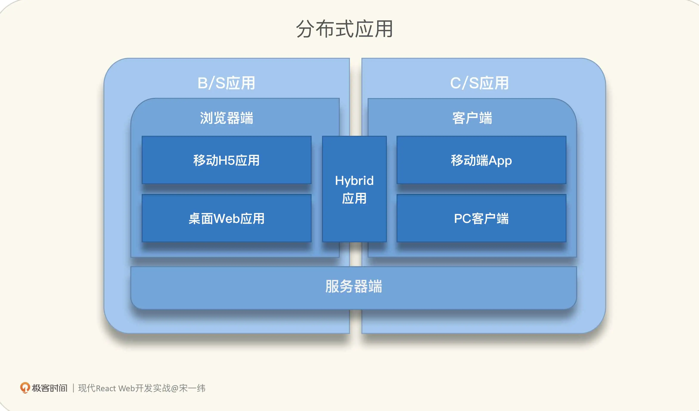
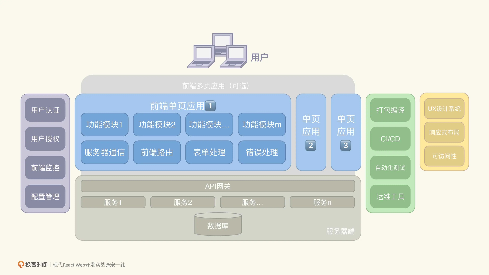
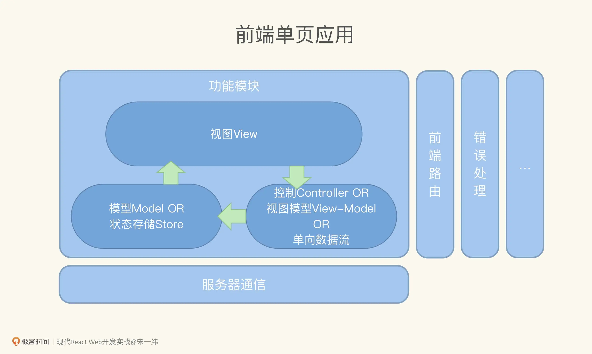

# 02 | 开发前端有哪些要点？React框架是如何应对的？

你好，我是宋一玮，欢迎回到 React 组件的学习。

在上节课，我们简单回顾了一下前端开发的历史，指出前端开发领域一直在积累特有的领域知识；提出了 GUI 图形用户界面也是一种接口，跟后端 API 开发类似，前端“接口”也有自己的设计准则。然后把本世纪初的 Java Web 技术当作参照物，列举了前端开发领域的变与不变。希望能帮助开发者坚定持续学习的信心。

再看现状，现代前端框架有很多，前端项目的技术选型令人头疼。这时前端开发者就希望能有一些方法帮助自己做出选择，不仅是为项目选择，也为了确定自己的学习目标而选择。

React 框架在诸多前端技术排行榜上均位列第一，其生态也是最丰富最活跃的。你可能会好奇：

- React 框架凭什么这么火？

- 是不是因为 React 火，所以我才要学它？

- 是不是因为 React 火，每个项目都无脑选它就对了？

在这节课，让我们回归到前端开发的本源，即模版、数据建模、交互、数据传输等等这些要点。我认为正是 React 在这些要点上具有优秀的设计、实践或生态，才造就了它今天的地位。

当你理解这些要点，再结合具体前端项目的需要，就可以更有信心地做出是否选型 React 的判断了。

## “跳伞”+“跑圈”

你看到这个标题想到了什么？《PUBG》还是《和平精英》？啊？你从不打游戏啊，那打扰了。在玩生存类游戏时：

- 高手的流程为开局跳伞、落地跑圈、大吉大利；

- 菜鸟的流程为开局跳伞、落地成盒、重开一局。

当然，这节课肯定不是要教你打游戏，我只是想用游戏中的概念类比一下前端开发。游戏里选用的策略和装备，基本可以体现出你是不是高手；前端开发中选择怎样的架构和技术选型，很大程度上决定了你能不能“大吉大利”。

接下来就让我们看看 React 在全程都起到了什么作用。

## “跳伞”：从前端架构到实现

“跳伞”是一个从高空接近地面的过程，地面的目标由远及近、由粗到细，跳伞玩家也可以控制自己目标落地区域。软件从架构设计到具体实现跟这个过程有很多相似，单是软件架构就可以有所谓三万英尺视图（30000-Foot View）、一千英尺视图（1000-Foot View）等不同粒度的设计。

顺便提一下，三万英尺视图本来是商业战略中的概念，后被《97 Things Every SoftwareArchitect Should Know》这本合著引入到软件架构设计领域。这门课程专注于前端，所以我们跳过系统架构、软件架构等不那么“前端”的概念。

### 前端应用分类

我们先试着从最高空鸟瞰前端应用，目前主流的包含 GUI 的分布式应用，基本可以分成：

- B/S 应用

- 浏览器端

- 移动 H5 应用

- 桌面 Web 应用

- 服务器端

- C/S 应用

- 客户端

- 移动端 App

- PC 客户端

- 服务器端

近年来客户端也开始拥抱 Web，衍生出基于 Webview 的 Hybrid 混合应用。

它们之间的关联关系如下图：



看到这样的地图，结合第一节的内容，你在“跳伞”的第一时间，基本就能确定自己要往哪里跳了。是的，你的目标区域是浏览器端，这也是 React 框架最擅长的领域。

我们这门课主要针对浏览器端，特别是桌面浏览器。之所以定位到桌面浏览器，是考虑到相关开发调试工具更加丰富，有利于在实践中学习。课程的绝大部分内容也适用于移动端 H5 应用。

### 前端逻辑架构

当你跳出机舱，下降了三分之一高度时，会看清浏览器端 Web 应用的一部分结构。这些结构仍在逻辑层面，相对抽象，强调各个模块的层次结构和相互关系，还不涉及到技术实现。这在软件架构设计中一般被称为逻辑架构。

前端的逻辑架构，设计的重点自然是前端应用。以用户体验较好的 SPA 单页应用（SinglePage Application）为例，下图是一张用于参考的逻辑架构图，注意这张架构图并不是通用的、四海皆准的，我们只是用它作为例子：



在上图中，作为前端的 SPA 会包含若干业务功能模块，和服务器通信、前端路由、表单处理、错误处理等多种通用功能模块。通过服务器通信模块，前端会请求服务器端接口，获取或修改业务数据。服务器端即后端，一般包含入口的 API 网关（Gateway）、若干个后端服务，底层是数据库存储。

在架构图的两侧，展示了部分支持性质的模块。在设计阶段定义的设计系统（DesignSystem）、响应式布局、可访问性等用户体验领域知识会支持整个前端应用的开发。在部署上线阶段，打包编译、CI/CD、自动化测试、运维工具等基础设施，会保证开发者辛辛苦苦开发的应用最终可以为用户所见、被用户使用。在运行时，用户认证（Authentication）、授权（Authorization）、前端监控、配置管理等通用模块可以支撑应用的正常运行。

你如果仔细观察会发现，这些模块在图上呈现的高度并不一致，与前端应用层也没有完全对齐。请你放心，我在画图上有些强迫症，这里是故意这么画的：

- 最右边的用户体验领域设计，是纯前端的支持模块，所以高度与前端一致，并在纵向上与前端对齐；

- 左右两侧的部署上线基础设施和运行时模块，基本同时涵盖了前端后端，所以它们的底边都延长到与后端平齐。

你如果追问为什么后端底边比其他模块更低？纯粹是为了美术上的构图平衡，让图更顺眼些。

其实在业界实践中，一个相对复杂的前端应用可能会同时包含多个 SPA，最终以 MPA 多页应用（Multi-Page Application）的形式提供给用户。当然，这并不是必须的。

### 前端应用架构

别忘了，你还在“跳伞”过程中。经过刚才的观察，你已经搞清了前端应用从逻辑上都有哪些模块。我希望你一边继续下降，一边调整方向对准 SPA 单页应用区域。

已经下降了三分之二高度，这时你可以看清 SPA 内部的一些技术细节了。这些细节更加贴近技术，但还是相对抽象的，不限定技术实现方式。这在软件架构设计中属于应用架构。

下图是典型的 MVC（Model-View-Controller）应用架构的变体：



一个“纯粹”的 MVC 架构，视图会触发控制器，控制器修改模型，模型再触发视图更新。常见的 MVC 变体，包括 MVVM（Model-View-ViewModel）、MVP（Model-View-Presenter）、MVI（Model-View-Intent）。其中 MVI 架构最接近 React 社区里提倡的单向数据流。

既然是“跳伞”，那可别忘了开伞，现在是时候了。

## “跑圈”：前端技术选型与 React

好了，“跳伞”的你顺利落地了。现在开始“跑圈”。跑圈是指在有限的地面范围有目的地持续移动，造访多个目标地点、获取装备、采取各类行动；之后随着时间的推进，地面范围会逐渐缩小，你的行动也将更具挑战，之前实现的目标和积累的装备会成为你的助力，最终获胜。

软件开发中的技术选型和实现与这一过程异曲同工。软件架构要落地，其中一个重要环节就是技术选型。在前端领域，技术选型尤为重要。一般而言，前端开发交付的产品最终会运行在一个受限环境中，如浏览器、智能手机平台、Webview 等，反过来就会要求前端框架也要迎合运行环境的特性，否则它有可能帮倒忙。

举个例子，浏览器里支持的脚本语言是 JavaScript，但你在技术选型时第一时间选择了 Go 语言，那将很难开发浏览器端的交互逻辑（啊？你说 Go 代码编译成 WebAssembly，那没事了）。

先根据“跳伞”时看到的各种模块，确定一下需要选型的前端技术点：

1. 开发语言

2. MVC 或类 MVC 框架

3. 服务器通信

4. 表单处理

5. 错误处理

6. 前端路由

7. 打包编译工具

8. 自动化测试框架

暂时只列这么多。实践中根据具体应用需求不同，还会有很多其他技术点需要考虑。

下面请你跟随我，结合以上选型技术点，看 React 框架如何满足前端应用开发的需要。

### 开发语言

无论框架怎么选，先得选好开发语言。浏览器原生支持的语言包括：文档语言 HTML、样式语言 CSS 和脚本语言 JavaScript。2019 年底 WebAssembly 正式进入 W3C 标准，成为浏览器的第四种原生支持语言，不过这门课程不会涉及 WebAssembly。

除了这些原生支持的语言，开发者还可以使用其他语言开发，然后编译成原生语言在浏览器中执行。如 JS 的超集 TypeScript，语法与 JS 相近，支持类型系统，通过编译器编译成浏览器可执行的 JS，尤其适合开发大型 Web 应用。再如 LESS、SaSS，扩展了 CSS 的语法，更方便模块化，通过编译器可以编译成浏览器可解析的 CSS。

关于 JS，还有一个值得提的点，在浏览器 JS 演进过程中，厂商和技术社区合作推出了标准化的 ECMAScript（简称 ES），从 ES6 即 ES2015 开始，每年 ES 会推出一个包含少量新语法或新接口的新版本。

```
其中 ES2015 包含的新特性是最多的，随后 ES2017 的 Async/Await 、ES2018 的对象展开
语法（...）、ES2020 的可选链操作符（?.）都是改变 JS 开发者编程习惯的重要特性。然
```

而并不是所有浏览器的所有版本都支持最新的 ECMAScript。

为了兼容用户的老浏览器，但又能充分利用新语法带来的好处，可以用 Babel 这样的编译器将高版本的 ES 代码转译成更多浏览器支持的低版本，如为了（不得不）支持已经退出历史舞台的 IE11，将 ES2020 的代码转译成 ES5。

这门课程中的样例代码将以 ES2020 编写。

### React 对应技术点

React 框架是 Meta 公司前身 Facebook（下称 FB）于 2013 年开源的，声明式、组件化的前端开发框架。

首先从开发语言看，React 支持 ES2015 以上的版本。虽然也支持 ES5，但并不推荐，如果必须要支持老浏览器，那就利用 Babel 转译吧。同时，React 对 TypeScript 也有很好的支持，提供了完整的类型定义。所以打算用 React 时，你不用担心语言支持的问题。

然后，我们不妨把 React 直接拉进我们的技术选型里，看看 React 涵盖了哪些技术点。

第一，MVC 或类 MVC 框架。

React 为视图层带来了声明式的 JSX 语法，这种语法是模版的同时又是 JS 语言本身，易学性、灵活性和性能远超其他模版引擎。

在视图之外，React 设计了一套单向数据流机制进行应用状态管理。从视图事件触发状态变更，状态变更的结果汇总在一起，通过不可变数据传递给关心这些数据的视图，视图根据传入的数据决定是否重新渲染。

开发者将视图和相关逻辑声明成一个个 React 组件，React 底层实现了一套虚拟 DOM 模型，它比浏览器 DOM 更为轻量，React 靠比对新旧两个虚拟 DOM 来实现低成本的渲染。

这里提到的 JSX 语法、React 组件、虚拟 DOM、单向数据流，在后续课程中会一一讲解。

说句题外话，虚拟 DOM 作为一种抽象，并不与浏览器直接绑定，理论上可以用于其他平台。于是 2015 年 FB 开源了 React Native 框架，开发者们可以用 JS 语言，加上与 React 基本相同的 API 开发 iOS 和 Android 的原生应用。

与 Hybrid 应用不同，React Native 的 JSX 会被渲染成目标平台的原生组件，进而提高性能、提升体验，这在当时也给 React 挣足了面子。但不像 React，React Native 在后来发展中经历过一些波折，被 Google 推出的跨端框架 Flutter 迎头赶上。

第二，表单处理。

React 框架本身并没有提供高度抽象的表单处理组件或者接口。但在 React 开发者可以将HTML 表单元素声明为受控组件（Controlled Components），并基于受控组件的状态数据进行表单处理。

第三，错误处理。

React 没有内建处理全局错误的机制，但提供了错误边界（Error Boundaries）API，可以在组

```
件树中实现类似try...catch 的功能。
```

受控组件、错误边界在后续的课程中会涉及到。

### React 生态

你可能会吐槽，React 的功能怎么这么少？隔壁 Angular 可是内置了服务器通信模块和路由模块啊！

我个人认为所谓的“功能少”反而是 React 流行的重要原因之一。一个大而全的框架难免会落入一个窘境：学起来更累，用起来更重，定制起来也更受限。

React 做好了属于自己卖点的部分：声明式、组件化、单向数据流，以及后来的 Hooks，其他领域则留给第三方。用 React 的人越多，为 React 开发的第三方开源库越多；React 生态越丰富，用 React 的人越多。这就形成了 React 的马太效应。

列举一些 React 生态：

```
类 MVC 框架：早期的 React 侧重于视图，并没有内置 dispatch 和 reducer 相关的接
```

- 口，但开源社区为 React 设计的应用状态管理框架如雨后春笋，百家争鸣，如 FB 的Flux、开源的 Redux、MobX 等等；

```
服务器通信：浏览器标准的fetch API，以及更强的 React Query 框架；
```

- 表单处理：Formik 框架、React Hook Form 框架；

```
前端路由：事实标准的 react-router 框架；
组件样式：诸多 CSS-in-JS 框架，如 emotion ；
```

- 打包编译工具：Webpack、Babel，以及包含了前者的 Create-React-App 脚手架；

- 自动化测试框架：Jest、React Testing Library。

此外还有大批高质量的可复用组件库，如 AntD、Material-UI 等。这些第三方框架和工具，为React 补足了开发现代 Web 应用缺少的功能。有些组合固定出现，以至于被开发者戏称为“React 全家桶”。

## 小结

这节课我们借用“跳伞”+“跑圈”的比喻，将这门课程的范围设定在桌面 Web 应用，从架构层面分析了前端开发的组成部分，包括逻辑架构的 SPA、业务功能模块、通用功能模块和应用架构的类 MVC 模式。

然后聊了技术选型阶段面对的技术点，将 ES2020 指定为这门课程的开发语言，也简要介绍了React 框架本身和 React 生态的分工。

下节课我们会快速进入实践环节，请你跟着我写一个简单的 React 应用。

## 思考与互动

“跳伞”过程中你看到了前端逻辑架构和应用架构，里面定义的不少模块在各类前端框架中都很常见。可否请你选择一个你熟悉或者完全不熟悉的、React 以外的前端框架，对照着这个框架的文档，看看框架都涵盖了哪些模块？

欢迎把你的思考和想法分享在留言区，也欢迎把课程分享给你的朋友或同事，我们下节课见！
