# 03 | 看板应用：从零开始快速搭建一个React项目

你好，我是宋一玮。从这节课开始，我们就进入到 React Web 应用开发的学习。

作为前端开发者，在学习一门新技术时最常用的方法是什么？Linux 操作系统的创始人 Linus大神有句名言：“口说无凭，放码过来。”没错儿，上手写代码确实是最有效的方式之一。

然而我也听到过不少吐槽：

- 前端开发不应该是一边写代码，一边刷新浏览器就够了吗？

- 为什么只想写几行代码，要配置一天的开发环境？

- 代码在别人那里跑的好好的，为什么我这里跑不起来了？

- 我改了几行代码，为什么页面没反应 / 就挂了？

我们需要了解一个现状，那就是现代前端开发早已结束了刀耕火种的时代，逐步向其他软件开发领域看齐。比如常被一起提到的后端开发领域，开发者们也常会抱怨配置开发环境又复杂又耗时间，同样的代码换个环境编译就会挂，等等。

现代前端的编译构建、依赖管理、CI/CD 等工程化实践一应俱全，正如第 1 讲提到的，前端应用功能日益丰富、强大，这样的变化也是为了应对开发复杂度的攀升，但同时也带来了类似的痛点。我们即将要创建的 React 项目，就需要用到一系列工具链。不过这些技术，对于初学者来说确实有一定的门槛。

这时你可能会问到：“那我什么时候才可以上手写 React 代码？”

答案是“立刻”。

近十年的软件开发框架比起本世纪初那些更易于上手，其中一个重要原因是，优秀的框架会提供一些脚手架或者样板工程帮助开发者快速开始。有不少 React 开发者——不止初学者，更包括一些进阶者——是从 Facebook（后面的课程中简称为 FB）官方开源的 Create React App（CRA）入手的。

所以在这一讲，在需要了解最少概念的前提下，我们会先快速搭建一个小型 React 项目跑起来。然后在第 4-11 讲，我们会“肢解”这个项目，将拆解出来的部分从浅到深排序，一一为你讲解，并做一些必要的实验。在第 12 讲结尾，你将有足够的知识从零开始，选择略有不同的技术栈，将这个 React 项目定制成另一个版本。从此你就可以作为“独狼”（褒义）React 工程师，开展各类实践了。

现在，就让我们来开发一个 React 看板应用。这里的“看板”是敏捷开发里的看板（Kanban），如下图所示，是一个简单的原型图：

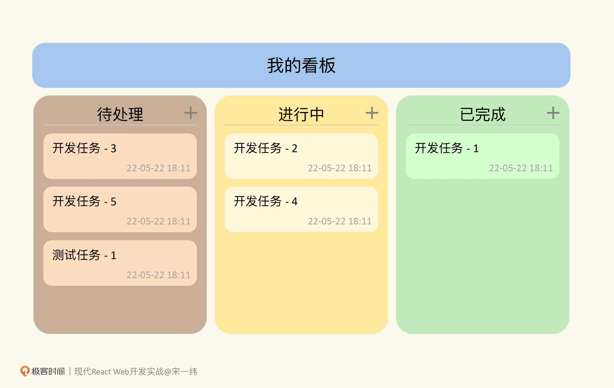

## 搭建环境

你大概会怀疑自己上当了：“不是说‘立刻’吗？”

虽说脚手架工具可以帮我们省去大部分工作，但前端最基础的开发环境，Node.js 还是要有的。当然，如果你的电脑里已经安装过 Node.js，大可以跳过这一步，那自然就是“立刻”了。

因为 Node.js 的版本升级非常快，所以在安装时最好用一个 Node 版本管理工具，最主流的当然是 nvm，nvm 是基于 shell 开发的，在 macOS 和 Linux 上工作的很好，只可惜不支持Windows。而我最近比较喜欢以 Rust 开发的、跨平台的fnm。

fnm 功能与 nvm 类似，都可以在一套环境里安装多个版本的 Node，随时按需切换，也可以根

```
据具体项目的配置（支持 nvm 的  .nvmrc  ），半自动地切换版本。比起 nvm，fnm 执行效率
```

更高，而且跨平台。无论你的开发机是 macOS、Linux 还是 Windows，都可以在这个地址

```
下载到对应的版本，加到 PATH中即可。
```

当然，对于 macOS 和 Linux，更方便的方式还是打开命令行。在 Mac 上执行：

```
brew install fnm
安装成功后在你的 .bashrc 或 .zshrc 中加入以下命令，保存并重启命令行窗口：
eval "$(fnm env --use-on-cd)"
```

安装 fnm 后，用它安装 Node 最新的 LTS（Long Term Support 长期支持）版本：

```
fnm install --lts
```

装好 Node.js 后，建议你再安装一个针对前端开发的 IDE。我推荐微软的VSCode，它为JavaScript 和 TypeScript 提供了强大的 Language Server，在语法检查、代码补全等方面十分出众，丰富的插件生态也为 React 前端开发提供了助力。

```
接着，我建议把 VSCode 加到命令行环境里，在 VSCode 菜单上点击 View-> Command
Palette ... -> 输入install code -> 选择提示的Shell Command: Install
'code' command in PATH 回车，这样在命令行里就可以通过code
/path/to/my/project 的方式打开 VSCode 了。
```

需要提前说明的是，以下内容均以 macOS 为主，绝大部分操作都是兼容 Windows 的。

## 搭建项目

在 Node.js 环境下，就可以搭建 React 项目了。首先，我们需要在命令行创建一个工作目录，然后执行 CRA 命令：

```bash
mkdir /Users/geektime/workspaces
cd /Users/geektime/workspaces
npx create-react-app oh-my-kanban
```

在看到如下提示时，React 项目就顺利生成了。

```bash
npx: installed 67 in 7.669s
Creating a new React app in /Users/geektime/workspaces/oh-my-kanban.
Installing packages. This might take a couple of minutes.
...
Success! Created oh-my-kanban at /Users/geektime/workspaces/oh-my-kanban
Inside that directory, you can run several commands:
 npm start
   Starts the development server.
 npm run build
   Bundles the app into static files for production.
 npm test
   Starts the test runner.
 npm run eject
   Removes this tool and copies build dependencies, configuration files
   and scripts into the app directory. If you do this, you can’t go back!
We suggest that you begin by typing:
 cd oh-my-kanban
 npm start
Happy hacking!
```

这时用 VSCode 打开这个项目，再回到命令行中执行启动命令：

```bash
cd oh-my-kanban
code .
npm start
```

在看到如下提示信息时，浏览器会自动弹出来，展示 CRA 的例子页面：

```
Compiled successfully!
You can now view oh-my-kanban in the browser.
 Local:            http://localhost:3000
 On Your Network:  http://192.168.0.3:3000
Note that the development build is not optimized.
To create a production build, use npm run build.
webpack compiled successfully
```

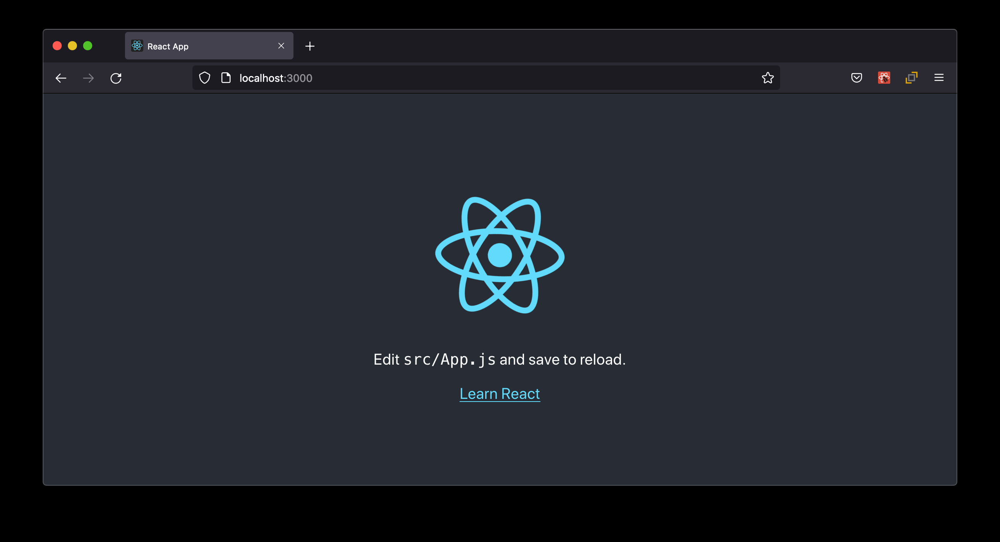

```
这时切换到 IDE，可以看到 src/App.js的代码与目前页面内容是相符的。
```

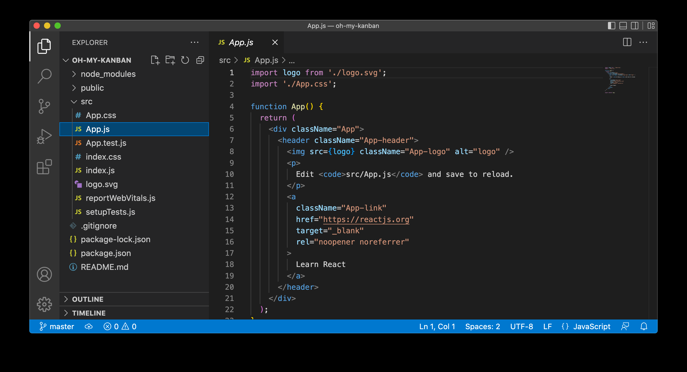

在此基础上，如果你对源文件稍作修改：

```xml
function App() {
  return (
    <div className="App">
      <header className="App-header">
+        <h1>我的看板</h1>
        
        <p>
```

这时你不需要主动刷新浏览器，页面会自动更新。

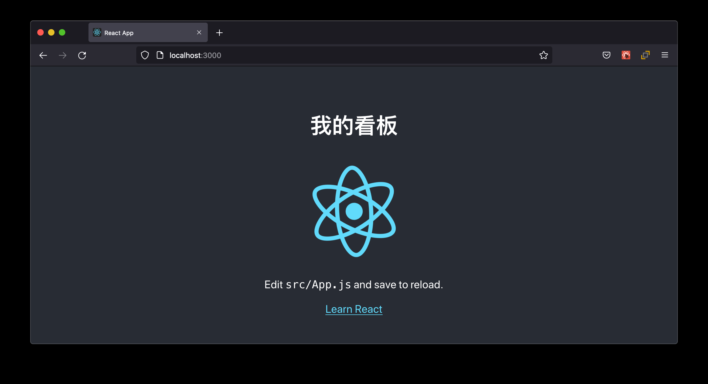

相比其他软件开发领域，前端开发本身会为开发者提供即时的正反馈。这就是说你每次修改一段源码，（一般而言）都能以视觉的方式验证软件的变化。你用 CRA 搭建的这套 React 环境就符合这一特征。

## 添砖加瓦

目前的项目大部分文件都是 CRA 自动生成的，我们暂时不去追究这些文件和代码都是干什么

```
的，而是先聚焦到 src/App.js 和 src/App.css  这两个源文件。
```

有一些初级前端开发者拿到一个原型稿或视觉稿后，会先手足无措，不知道从哪里开始；当瞄准了某个功能点，又会一下子陷入到细节里面去，反而忽视了整体。

如果你也有这样的困惑，我会建议你回忆一下上学时做考试卷的场景，拿到卷子，先整体看一下有多少选择题填空题、多少大题，各分配多少时间，如果答题时间不够了哪些战略性放弃，哪些直接靠猜（笑）。

对于 React 应用开发，也可以用类似的思路：从整体到局部，从简单到复杂，从视图到交互，从数据到逻辑。

依照这个思路，第一步是从整体入手，搭建视图。你首先需要增加一些布局元素。从前面的原型图可以看到，oh-my-kanban 的主界面是上导航下内容、内容为横向三栏的典型布局。这种布局用 CSS 的 Flexbox 可以轻易实现。

```bash
为了应用 Flexbox，需要调整一下 DOM 结构，直接将src/App.js 替换为以下代码：
import logo from './logo.svg';
import './App.css';
function App() {
 return (
   <div className="App">
     <header className="App-header">
       <h1>我的看板</h1>
       
     </header>
     <main className="kanban-board">
       <section className="kanban-column"></section>
       <section className="kanban-column"></section>
       <section className="kanban-column"></section>
     </main>
   </div>
     );
   }
export default App;
同时，我们还需要修改src/App.css  ，加入 flex 布局属性：
.App {
+  displ ay: flex;
+  flex-direction: column;
+  gap: 1rem;
+  height: 100vh;
  text-align: center;
}
.App-logo {
-  height: 40vmin;
+  height: 80%;
  pointer-events: none;
}
@media (prefers-reduced-motion: no-preference) {
  .App-logo {
    animation: App-logo-spin infinite 20s linear;
  }
}
.App-header {
+  flex: 1;
+  margin: 1rem 1rem 0;
+  border-radius: 1rem;
  background-color: #282c34;
-  min-height: 100vh;
+  min-height: 5rem;
  display: flex;
-  flex-direction: row-reverse;
+  flex-direction: row-reverse;
  align-items: center;
  justify-content: center;
  font-size: calc(10px + 2vmin);
  color: white;
}
并在 src/App.css 中追加“看板”、“看板列”两个类样式：
.kanban-board {
 flex: 10;
 display: flex;
 flex-direction: row;
 gap: 1rem;
 margin: 0 1rem 1rem;
}
.kanban-column {
 flex: 1 1;
 border: 1px solid gray;
 border-radius: 1rem;
}
```

这时浏览器内的页面会自动更新，布局有了雏形：

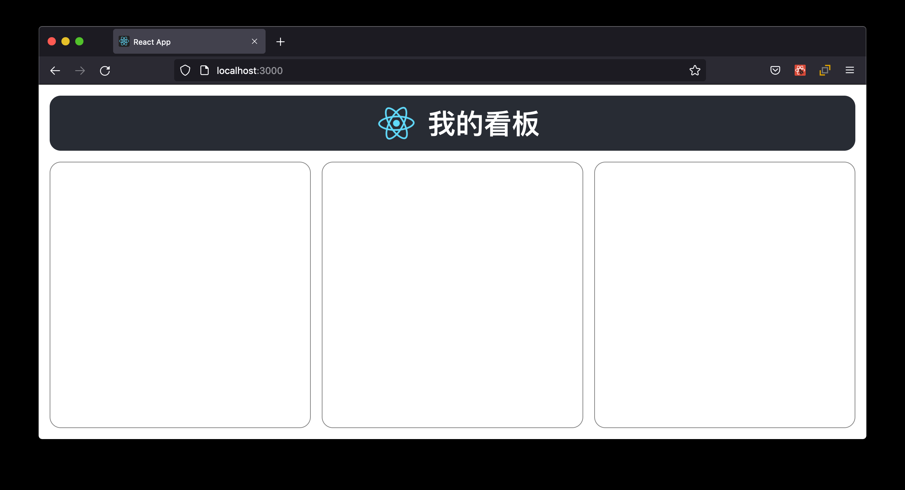

```xml
根据原型图定义，三个看板列有不同的样式代表不同的含义。那需要继续修改src/App.js：
      </header>
      <main className="kanban-board">
-        <section className="kanban-column"></section>
+        <section className="kanban-column column-todo">
+          <h2>待处理</h2>
+        </section>
-        <section className="kanban-column"></section>
+        <section className="kanban-column column-ongoing">
+          <h2>进行中</h2>
+        </section>
-        <section className="kanban-column"></section>
+        <section className="kanban-column column-done">
+          <h2>已完成</h2>
+        </section>
      </main>
    </div>
同时在src/App.css末尾，为三个看板列分别加入不同的背景色样式：
.kanban-column > h2 {
 margin: 0.6rem 1rem;
 padding-bottom: 0.6rem;
 border-bottom: 1px solid gray;
}
.column-todo {
 background-color: #C9AF97;
}
.column-ongoing {
 background-color: #FFE799;
}
.column-done {
 background-color: #C0E8BA;
}
```

保存文件后，页面会更新：

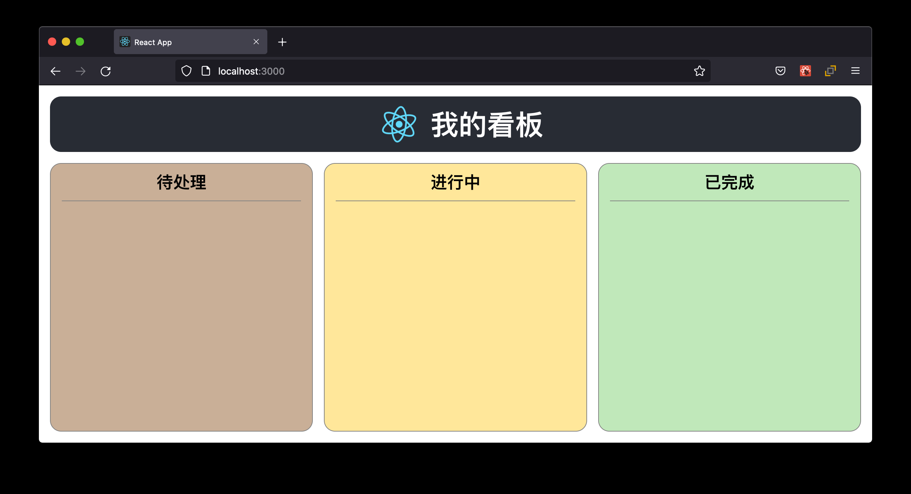

```
接下来要在看板列里加入卡片了。先从“待处理”入手，在src/App.js的看板列中加入一个无
```

序列表：

```xml
<section className="kanban-column column-todo">
     <h2>待处理</h2>
     <ul>
       <li className="kanban-card">
         <div className="card-title">开发任务-1</div>
         <div className="card-status">22-05-22 18:15</div>
       </li>
     </ul>
   </section>
在 src/App.css 中加入对应的 CSS，让它看起来更像卡片：
.kanban-column {
 flex: 1 1;
 display: flex;
 flex-direction: column;
 border: 1px solid gray;
 border-radius: 1rem;
}
.kanban-column > ul {
 flex: 1;
 flex-basis: 0;
 margin: 1rem;
 padding: 0;
 overflow: auto;
}
.kanban-card {
 margin-bottom: 1rem;
 padding: 0.6rem 1rem;
 border: 1px solid gray;
 border-radius: 1rem;
 list-style: none;
 background-color: rgba(255, 255, 255, 0.4);
 text-align: left;
}
.card-title {
 min-height: 3rem;
}
.card-status {
 text-align: right;
 font-size: 0.8rem;
 color: #333;
}
```

基本符合原型图：

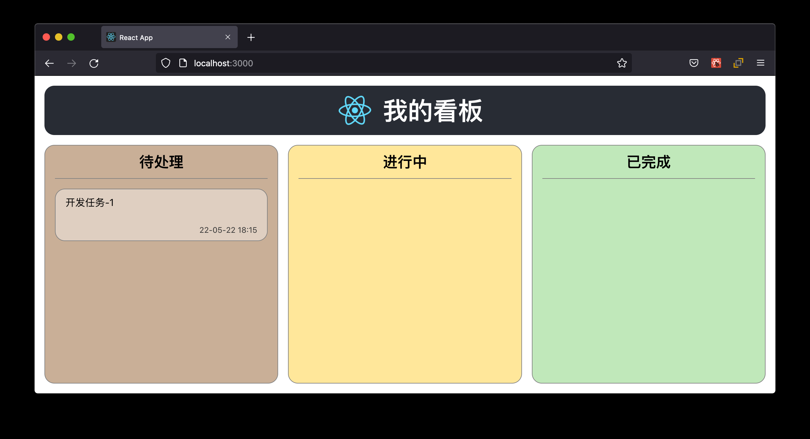

## 循环渲染

```xml
对照原型图，待处理列是有多张卡片的。这时有人祭出了复制粘贴大法，靠手工加入多个<li
className="kanban-card">标签：
<section className="kanban-column column-todo">
 <h2>待处理</h2>
 <ul>
   <li className="kanban-card">
     <div className="card-title">开发任务-1</div>
     <div className="card-status">22-05-22 18:15</div>
   </li>
   <li className="kanban-card">
     <div className="card-title">开发任务-2</div>
     <div className="card-status">22-05-22 18:15</div>
   </li>
   <li className="kanban-card">
     <div className="card-title">开发任务-3</div>
     <div className="card-status">22-05-22 18:15</div>
   </li>
   <!-- ... (省略) -->
 </ul>
</section>
```

从页面显示结果来看确实有效，但你一定也发现了不对劲的地方。

1. 增加更多的卡片就要复制粘贴更多次吗？

2. 如果卡片的设计有任何改动，要把每张卡片的代码都修改一遍吗？

3. 我在开发阶段怎么会知道最终用户在运行时会创建多少张卡片呢？

是的，这样的写法违背了编程的 DRY（Don’t Repeat Yourself）原则，降低了代码的可延展性、可读性。这时你可以使用循环渲染，把前面的卡片代码更新为：

```xml
<section className="kanban-column column-todo">
     <h2>待处理</h2>
     <ul>
       {
         new Array(10).fill('').map(item => (
           <li className="kanban-card">
             <div className="card-title">开发任务-1</div>
             <div className="card-status">22-05-22 18:15</div>
           </li>
         ))
       }
     </ul>
   </section>
这段代码里 { /* ... */ } 中间的部分可以混写 JS 表达式。new
Array(10).fill('') 是出于演示目的用空字符串填充一个包含 10 个元素的数组，数组的
map() 方法返回一个新的数组，这样就是一个有效的表达式。虽然这个表达式是一个循环，
但你却不能混写 for...of 这样的循环语句。
```

修改后，页面更新为：

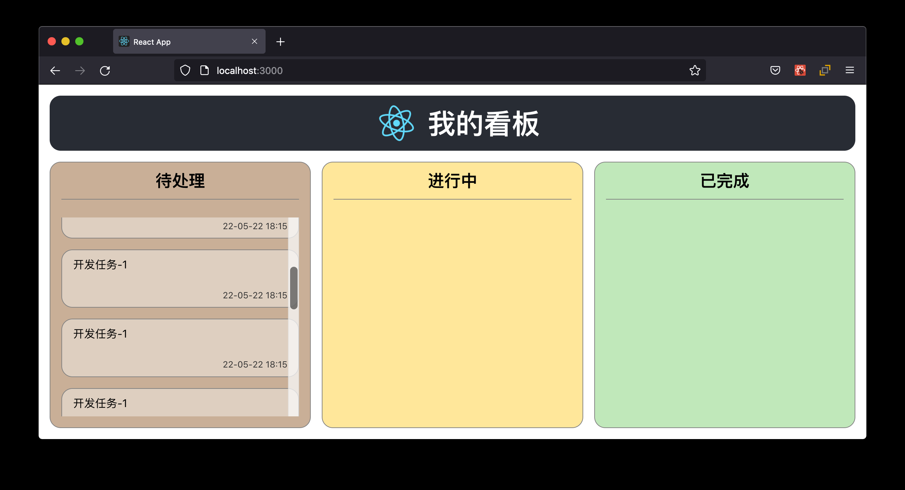

接下来要同时实现两个需求：

- 10 个待处理卡片的数据应该是不同的；

- “进行中”和“已完成”看板列也需要展示卡片。

```xml
这就需要将数据与展示进行拆分。在src/App.js头部加入三组数据和一个组件。
const todoList = [
 { title: '开发任务-1', status: '22-05-22 18:15' },
 { title: '开发任务-3', status: '22-05-22 18:15' },
 { title: '开发任务-5', status: '22-05-22 18:15' },
 { title: '测试任务-3', status: '22-05-22 18:15' }
];
const ongoingList = [
 { title: '开发任务-4', status: '22-05-22 18:15' },
 { title: '开发任务-6', status: '22-05-22 18:15' },
 { title: '测试任务-2', status: '22-05-22 18:15' }
];
const doneList = [
 { title: '开发任务-2', status: '22-05-22 18:15' },
 { title: '测试任务-1', status: '22-05-22 18:15' }
];
  const KanbanCard = ({ title, status }) => {
 return (
   <li className="kanban-card">
     <div className="card-title">{title}</div>
     <div className="card-status">{status}</div>
   </li>
 );
};
```

继续修改之前的看板列代码，消费这三组数据和一个组件：

```xml
<main className="kanban-board">
   <section className="kanban-column column-todo">
     <h2>待处理</h2>
     <ul>
       { todoList.map(props => <KanbanCard {...props} />) }
     </ul>
   </section>
   <section className="kanban-column column-ongoing">
     <h2>进行中</h2>
     <ul>
       { ongoingList.map(props => <KanbanCard {...props} />) }
     </ul>
   </section>
   <section className="kanban-column column-done">
     <h2>已完成</h2>
     <ul>
       { doneList.map(props => <KanbanCard {...props} />) }
     </ul>
   </section>
 </main>
```

```
其中{ todoList.map(props => <KanbanCard {...props} />) } 表达式的值是一
个组件的数组，React 会对这样的组件数组做循环渲染。因为 App 组件内部使用了
KanbanCard 组件，从而形成了组件层级结构（Hierarchy），我们可以称 App 是
KanbanCard 的父组件， KanbanCard 是 App 的子组件。
```

这时的页面是这样子的：

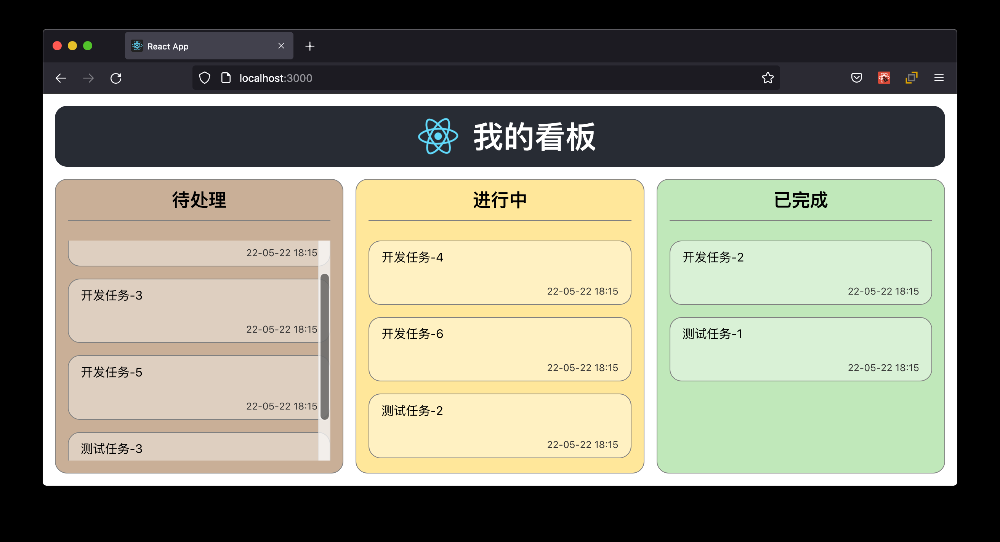

```
前面看板列的 CSS .kanban-column > ul { flex: 1; flex-basis: 0;
overflow: auto; }，保证了卡片增减不会改变页面高度，而是自动出现滚动条。
```

## 处理交互和条件渲染

到目前为止，你已经搭建好了待处理、进行中、已完成三个看板列，并利用循环渲染在每个看板列中都加入了一些看板卡片。现在该加入一些交互了。最基础的交互是为看板添加新卡片。

```xml
在src/App.js中 KanbanCard的后边插入一个新组件：
const KanbanNewCard = () => {
 return (
   <li className="kanban-card">
     <h3>添加新卡片</h3>
     <div className="card-title">
       <input type="text" />
     </div>
   </li>
 );
};
```

在待处理看板列的代码中插入这个组件，同时在顶部加入一个“添加新卡片”按钮：

```xml
<section className="kanban-column column-todo">
 <h2>待处理<button>&#8853; 添加新卡片</button></h2>
 <ul>
   <KanbanNewCard />
   { todoList.map(props => <KanbanCard {...props} />) }
 </ul>
</section>
在 src/App.css 中加入对应的 CSS：
.kanban-column > h2 > button {
 float: right;
 margin-top: 0.2rem;
 padding: 0.2rem 0.5rem;
 border: 0;
 border-radius: 1rem;
 height: 1.8rem;
 line-height: 1rem;
 font-size: 1rem;
}
.card-title > input[type="text"] {
 width: 80%;
}
```

这时页面会更新为：

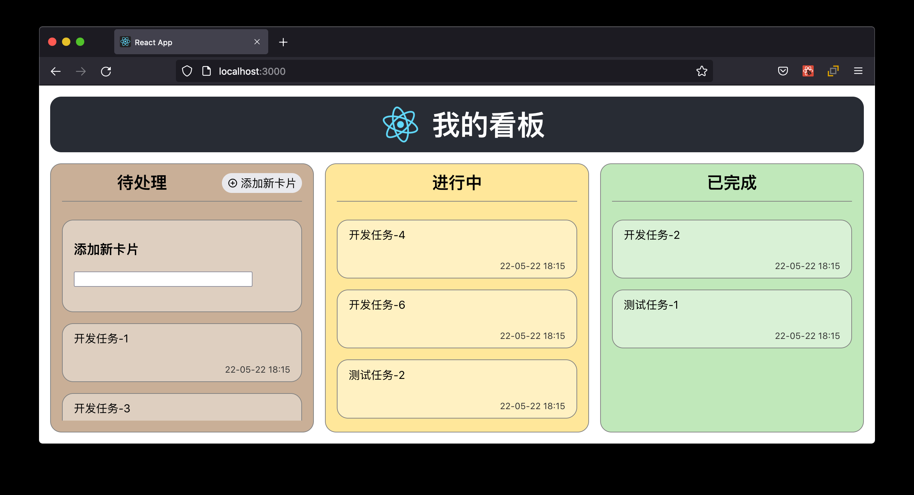

这里我要带着你增加几个小交互：

1. 默认不显示“添加新卡片”卡片；

2. 点击顶部“添加新卡片”按钮，“添加新卡片”卡片才会出现；

3. 在出现的文本框中输入卡片标题，按回车即在待处理看板列顶部新插入一张卡片，这张卡片的标题为刚才文本框的输入；

4. 在新卡片插入同时，“添加新卡片”卡片消失，回到 1 的状态。

```xml
你可以先修改 App 组件的代码实现 1 和 2 ：
  +import React, { useState } from 'react';
    //... (省略)
    function App() {
   +  const [showAdd, setShowAdd] = useState(false);
   +  const handleAdd = (evt) => {
   +    setShowAdd(true);
   +  };
   +
      return (
        <div className="App">
          <header className="App-header">
            <h1>我的看板</h1>
            
          </header>
          <main className="kanban-board">
            <section className="kanban-column column-todo">
   -          <h2>待处理<button>&#8853; 添加新卡片</button></h2>
   +          <h2>待处理<button onClick={handleAdd}
   +            disabled={showAdd}>&#8853; 添加新卡片</button></h2>
              <ul>
   -            <KanbanNewCard />
   +            { showAdd && <KanbanNewCard /> }
                { todoList.map(props => <KanbanCard {...props} />) }
              </ul>
            </section>
这里使用了条件渲染，  { showAdd && <KanbanNewCard /> }  是一个简化的条件表达
式，当showAdd 的值为 false 时，表达式会短路直接返回 false ，React 不会渲染这个
值，当showAdd 的值为 true 时，子组件 <KanbanNewCard />  则会渲染出来。
那么showAdd 的值什么情况下会改变呢？答案是用户点击，onClick={handleAdd}为按钮
增加了点击事件处理，点击按钮时会把状态 showAdd 的值由默认的 false 修改为 true 。
```

这里提到的状态特指 React 的 state，是一种存在于 React 组件内部数据，而创建状态 state

```
时使用的 useState() 是 React 的基本 Hooks 之一，这些概念和 API 这节我们暂不展开。
```

代码生效后，交互 1 和 2 就实现了：

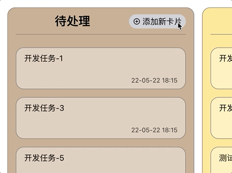

```xml
接下来你要实现交互 3 和 4。先在 KanbanNewCard 组件中加些代码，让它成为“受控组件”：
-const KanbanNewCard = () => {
+const KanbanNewCard = ({ onSubmit }) => {
+  const [title, setTitle] = useState('');
+  const handleChange = (evt) => {
+    setTitle(evt.target.value);
+  };
+  const handleKeyDown = (evt) => {
+    if (evt.key === 'Enter') {
+      onSubmit(title);
+    }
+  };
+
  return (
    <li className="kanban-card">
      <h3>添加新卡片</h3>
      <div className="card-title">
-        <input type="text" />
+        <input type="text" value={title}
+          onChange={handleChange} onKeyDown={handleKeyDown} />
      </div>
    </li>
  );
};
其中 onChange 事件处理函数将 <input> 的输入值随时更新到状态 title 里，
onKeyDown 事件处理函数会监听回车键，当用户在文本框中敲击回车时，title 的值会传
给 onSubmit 函数。你可能会急着问，这个onSubmit 函数是哪来的？答案在下面的代码
里，它来自于父组件 App：
function App() {
  const [showAdd, setShowAdd] = useState(false);
  const handleAdd = (evt) => {
    setShowAdd(true);
  };
+  const handleSubmit = (title) => {
+    todoList.unshift({ title, status: new Date().toDateString() });
+    setShowAdd(false);
+  };
  return (
    <div className="App">
     <header className="App-header">
       <h1>我的看板</h1>
       
     </header>
      <main className="kanban-board">
        <section className="kanban-column column-todo">
          <h2>待处理<button onClick={handleAdd}
            disabled={showAdd}>&#8853; 添加新卡片</button></h2>
          <ul>
-            { showAdd && <KanbanNewCard /> }
+            { showAdd && <KanbanNewCard onSubmit={handleSubmit} /> }
            { todoList.map(props => <KanbanCard {...props} />) }
          </ul>
刚才onSubmit 函数是从父组件通过 props 属性传递给KanbanNewCard 组件的。这里提到
```

的属性 props 是 React 组件对外的数据接口，可以传入多种数据类型，包括函数，至于 props的概念本节暂不展开。

```
父组件把一个回调函数 handleSubmit 通过子组件的onSubmit 属性传给子组件。父组件并
```

不需要知道子组件里面发生了什么，只需要知道一旦回调函数被调用，函数参数中就能拿到用

```
户输入的title 值。这时回调函数会根据title 的值在待处理看板列的数组开头插入一个新
卡片数据，并将控制着“添加新卡片”卡片是否显示的showAdd 状态值设置为 false 。
```

至此，前面定义的交互 1 至 4 均已实现。效果如下：

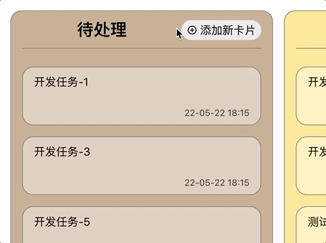

## 数据驱动

至此，我们利用组件事件处理和条件渲染手法，为看板列增加了一个核心交互功能：“添加新卡片”。

```
现在回忆一下循环渲染和条件渲染里用到的两种数据，前者 todoList 数组存在所有组件的
外边，而后者 showAdd 是在组件内部由useState() 创建的。那么我替你提出一个问题：
```

既然两种数据都可以用于显示，也都可以被修改，为什么 React 还要专门提供状态 state？

请你用现在的代码做个小实验。

你面前来了一位来自互联网行业的资深 PM，他向你提出把前面的交互 4 需求改成：“在新卡片插入同时，‘添加新卡片’卡片并不消失”。“至于这次修改上线的时间点嘛，3 分钟内可以吗？” 开个玩笑，没有 PM、没有时限，只要实现需求就好。

你很快就定位到，只要把这句注释掉，应该就可以了。代码如下：

```javascript
function App() {
  const [showAdd, setShowAdd] = useState(false);
  const handleAdd = (evt) => {
    setShowAdd(true);
  };
  const handleSubmit = (title) => {
    todoList.unshift({ title, status: new Date().toDateString() });
-    setShowAdd(false);
+    // setShowAdd(false);
  };
```

咦，什么情况？为什么敲完标题回车页面没变化？本来预期是插入新卡片，但这却没有发生。

其实这是 React 正常的行为，用一个不太严谨但很方便的说法：在组件内部改变 state 会让组件重新渲染，细节我们暂时不展开。前面数组的改变之所以能体现在页面上，完全是因为正巧在更新完数组后，同一组件的 state 有所变化，致使组件重新渲染，数组的变化搭了顺风车。

```
知道了这一点，你大概就知道如何修复刚改出来的 Bug 了。把组件外面的todoList 数组改
```

为 state 转移到组件内部：

```javascript
function App() {
  const [showAdd, setShowAdd] = useState(false);
+  const [todoList, setTodoList] = useState([
+    { title: '开发任务-1', status: '22-05-22 18:15' },
+    { title: '开发任务-3', status: '22-05-22 18:15' },
+    { title: '开发任务-5', status: '22-05-22 18:15' },
+    { title: '测试任务-3', status: '22-05-22 18:15' }
+  ]);
  const handleAdd = (evt) => {
    setShowAdd(true);
  };
  const handleSubmit = (title) => {
-    todoList.unshift({ title, status: new Date().toDateString() });
+    setTodoList(currentTodoList => [
+      { title, status: new Date().toDateString() },
+      ...currentTodoList
+    ]);
   // setShowAdd(false);
 };
至于为什么不能沿用之前 todoList.unshift() 的写法，我们以后的课程中会重点涉及。
既然把数据转移到组件内部了，那外部的 const todoList = [/* ... */]; 就可以删掉
了。接着你可以自行对 ongoingList 和 doneList 做相同的转移。
```

至此，你的 oh-my-kanban 有了一个基础版本。如下图所示：

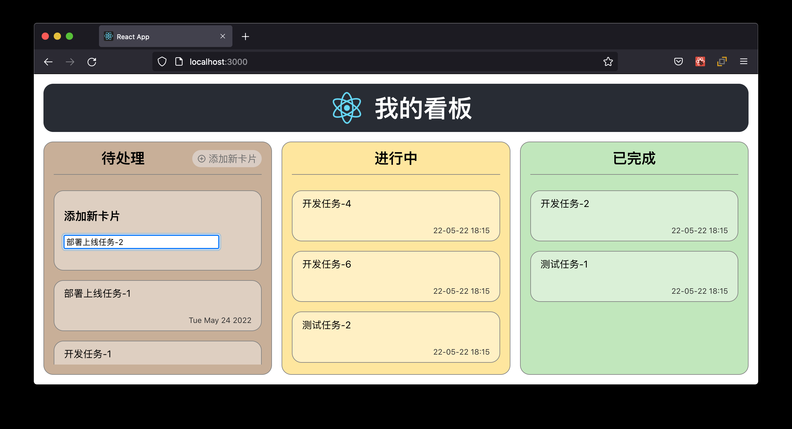

在三个看板列间，还有进一步的交互：

1. 对于任意看板列里的任意卡片，可以用鼠标拖拽到其他的看板列；

2. 在释放拖拽时，被拖拽的卡片插入到目标看板列，并从原看板列中移除。

你可以独立思考一下上面的需求。目前仅仅从这一个小项目中积累的知识，大概还不足以实现。但没关系，后续我们会补上。

## 小结

在这节课，我们学到了如何利用 Create React App 脚手架工具快速搭建一套 React 项目。并从零开始，你实现了一个并不完整的、简易的看板应用。中间涉及到 React 的语法、循环渲染、条件渲染和交互事件处理，也让你对 props 和 state 有一个初步的印象。

对这个 React 项目有了感性的认识后，现在我们可以回应这节课一开始的吐槽：

- 在搭建好项目工具链后，React 前端开发确实是一边写代码，一边刷新浏览器，而且是自动刷新；

- 正因为有 CRA 这样优秀的脚手架工具，React 的开发环境搭建起来几乎不费什么时间；

- 代码在别人那里跑的好好的，在你这里跑不起来，首先要排查开发环境和项目搭建的问题；

- 你改了 React 代码但页面没变化，有可能是你的修改没能触发 React 的重新渲染，这需要进一步学习 React 中的核心概念。

当然，这个看板应用的代码是比较简单甚至简陋的。在接下来的课程里，我会对这个基于CRA 的项目进行解构，为你讲解其中所包含的 React 技术点、设计开发方法、工具链以及一些最佳实践，同时也会带着你动手实践一些关键代码。力求在这一部分课程结尾，让你有足够的知识，独立设计开发小型的 React Web 应用。

最后附上项目的源代码，供你学习与参考：https://gitee.com/evisong/geektime-column-oh-my-kanban

我们下节课再见！

## 思考题

1. 好不容易写的代码，保存到你最喜欢的代码仓库吧。之后我们会做不少实验，手一抖删错代码是难免的，这时能访问到代码的历史就方便很多。

2. 在你的浏览器中安装 FB 官方的 React Developer Tools 扩展（Chrome 下载地址 /Firefox 下载地址），打开浏览器开发者工具，切换到组件页签，观察你的代码改动与组件树之间的联系。

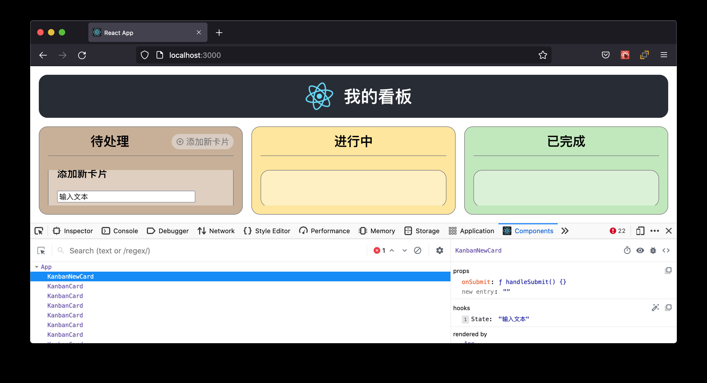

欢迎把你的思考和想法分享在留言区，也欢迎把课程分享给你的朋友或同事，我们下节课见！
