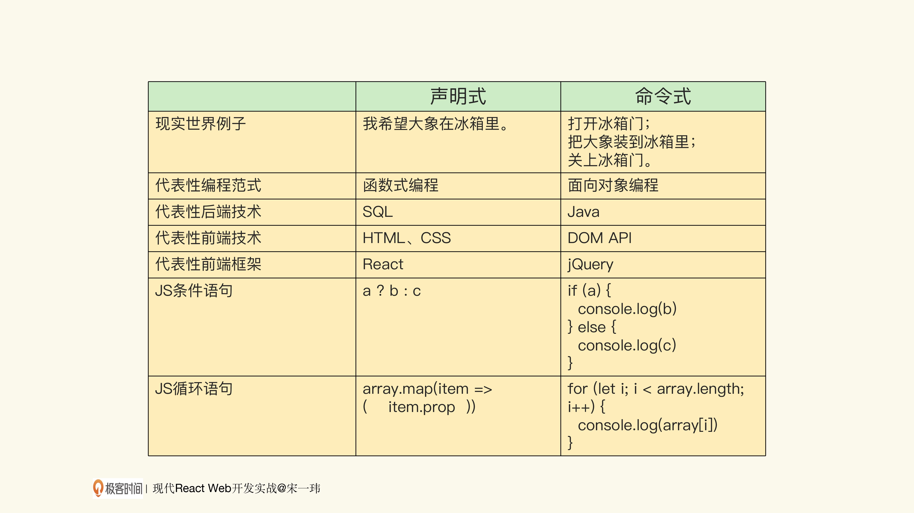

# 04 | JSX：如何理解这种声明式语法糖？

你好，我是宋一玮。上节课我们利用 Create React App（CRA）脚手架工具创建了一个 React项目，并在项目中部分实现了一个简单的看板应用。在接下来的课程里，我们会把看板应用抽丝剥茧，逐一认识学习项目里涉及到的 React 概念和 API。很自然地，我们这节课会讲到 JSX语法和 React 组件。

有不少初学者对 React 的第一印象就是 JSX 语法，以至于会有这样的误解：

- JSX 就是 React？

- JSX 就是 React 组件？

- JSX 就是另一种 HTML？

- JSX 既能声明视图，又能混入 JS 表达式，那是不是可以把所有逻辑都写在 JSX 里？

这些误解常会导致开发时遇到各种问题：

- 写出连续超百行、甚至近千行的 JSX 代码，既冗长又难维护；

- 在 JSX 的标签上添加了 HTML 属性却不生效；

- JSX 混入 JS 表达式后，页面一直报错。

其实只要理清了 JSX 和 React 组件的关系，这些问题自然不在话下。

总的来说，React 是一套声明式的、组件化的前端框架。顾名思义，声明（动词）组件是React 前端开发工作最重要的组成部分。在声明组件的代码中使用了 JSX 语法，JSX 不是HTML，也不是组件的全部。

接下来，我们就详细展开介绍 JSX 和 React 组件。

## JSX 是语法糖

Web 应用日益复杂，其视图中往往包含很多的控制逻辑，比如条件、循环等。以声明式开发视图，就需要把控制逻辑代码也加入到声明语句中去。而这样的代码，就对可读性、可维护性提出了挑战。

在 JSX 之前，前端领域有各种视图模版技术，JSP、Struts、Handlebars、Pug 等，都在用各自的方法满足这些需求。那么 JSX 语法与其他声明式模版语法有什么异同？不用 JSX 可以写React 吗？

我们在这节课开始时提到了 React 组件，组件是 React 开发的基本单位。在组件中，需要被

```
渲染的内容是用 React.createElement(component, props, ...children) 声明
的，而 JSX 正是createElement函数的语法糖。浏览器本身不支持 JSX，所以在应用发布
上线前，JSX 源码需要工具编译成由若干createElement函数组成的 JS 代码，然后才能在
```

浏览器中正常执行。至于编译工具，我们在后面的课程会有所涉及。

例如，上节课看板组件的部分 JSX：

```xml
<header className="App-header">
 <h1>我的看板</h1>
</header>
```

编译成 JS 就会变成：

```
React.createElement("header", {className: "App-header"},
 React.createElement("h1", null, "我的看板")
);
```

当然你也可以选择不用 JSX，而是自己手写这些 JS 代码。这样做最显著的好处就是，这部分代码不需要针对 JSX 做编译，直接可以作用于浏览器。但当元素或者元素的嵌套层级比较多

```
时，JS 代码的右括号会越来越多。当你看到成篇的 )))))))); 时，你的代码和内心会有一
```

个先崩溃。就算 IDE 帮忙自动格式化，对应层级缩进，也没法减少括号嵌套的数量。

也许是因为先入为主，在 Web 领域，类 HTML 语法天生就更受欢迎。JSX 提供的类HTML/XML 的语法会让声明代码更加直观，在 IDE 的支持下，语法高亮更醒目，比起纯 JS也更容易维护。相比 JSX 带来的开发效率的提升，编译 JSX 的成本基本可以忽略不计。

如果光看 JSX 中“X”的部分，还不足以让它和其他 HTML/XML 模版技术区别开来，这里还要强调一下 JSX 中“JS”的部分。请你回忆一下我们在上节课写的 JSX 代码，以里面的条件渲染为例：

```
 { showAdd && <KanbanNewCard onSubmit={handleSubmit} /> }
```

我们来对比一下 Java SSH（Spring+Struts2+Hibernate）技术栈里 Struts2 模版的写法：

```xml
 <s:if test="showAdd">
       <div>KanbanNewCard ...</div>
   </s:if>
```

可以发现两者判断条件的语义是相同的，区别是 Struts2 用 XML 定义了一套名为标签库的

```
DSL（Domain-Specific Language，领域特定语言），由标签库提供的 <s:if></s:if>做条
```

件渲染；而 JSX 则直接利用了 JS 语句。很明显，JS 表达式能做的，JSX 都能做，不需要开发者再去学习一套新的 DSL。

也正是因为 JSX 作为语法糖足够“甜”，我们才能得到这样的结论：JSX 是前端视图领域“最JS”的声明式语法，它为 React 的推广和流行起了至关重要的作用。

## 前端开发中的声明式与命令式

既然刚才提到了声明式（Declarative），就一定要提一下命令式（Imperative）。这两种编程范式的 PK 存在于软件开发的各个领域。下面的表格呢，从（非）现实世界用例、各领域代表性技术、具体 JS 语句三个方面，将声明式和命令式做了一个对比。



React 是声明式的前端技术，这一点首先就体现在创建组件的视图上，无论是使用 JSX 语法

```
还是直接利用React.createElement() 函数，都是在描述开发者期待的视图状态。开发者
```

只需关心渲染结果，而 React 框架内部会实现具体的渲染过程，最终调用浏览器 DOM API。

你可能会感兴趣：“除了 jQuery，还有其他的前端框架是命令式的吗？”肯定是有的，但很明显，声明式才是主流。目前的三大主流前端框架，React、Vue、Angular 都是声明式的。包括Flutter 这样的新兴跨端框架也类似，都采用了典型的声明式 API，以下是 Flutter 的官方例子：

```javascript
Widget titleSection = Container(
 padding: const EdgeInsets.all(32),
 child: Row(
   children: [
     Expanded(
       child: Column(
         crossAxisAlignment: CrossAxisAlignment.start,
         children: [
           Container(
             padding: const EdgeInsets.only(bottom: 8),
             child: const Text('Oeschinen Lake Campground'),
           ),
           Text('Kandersteg, Switzerland'),
         ],
       ),
     ),
     Icon(
       Icons.star,
       color: Colors.red[500],
     ),
     const Text('41'),
   ],
 ),
);
```

多少有点眼熟吧。很有意思的是，从 2017 年开始，每年都有 Flutter 用户在社区中呼吁引入JSX 语法（#11609、#15922、#70928），但这一愿望都没有实现。这又一次彰显了JSX 这种语法糖的吸引力。

```
理解了 JSX 是语法糖，其真实身份是声明式的React.createElement() 函数，接下来我
```

们来看看它的具体写法。

## JSX 的写法和常见坑

先回到一个简单的问题上，JSX 是哪几个单词的缩写？是的，JavaScript XML，即在 JS 语言里加入类 XML 的语法扩展。这样我们就可以把 JSX 一分为二：先介绍 X 的部分，即标签的命名规则，支持的元素类型、子元素类型；然后是 JS 的部分，即 JSX 中都有哪里可以加入JS 表达式、规则是什么，进一步回顾上节课的条件渲染和循环渲染表达式。

### JSX 的基本写法

```xml
请你回顾一下上节课 src/App.js的内容，我们将以App 组件为例，串讲一下 JSX 的常规写
法和写 JSX 时常踩的坑。为了方便参考，我会在这里贴一部分App 组件的源码。
function App() {
 const [showAdd, setShowAdd] = useState(false);
 const [todoList, setTodoList] = useState([]);
 const handleAdd = (evt) => {
   setShowAdd(true);
 };
 const handleSubmit = (title) => {
   setTodoList(currentTodoList => [
     { title, status: new Date().toDateString() },
     ...currentTodoList
   ]);
   setShowAdd(false);
 };
return (
   <div className="App">
     <header className="App-header">
       <h1>我的看板</h1>
       
     </header>
     <main className="kanban-board">
       <section className="kanban-column column-todo">
         <h2>待处理<button onClick={handleAdd}
           disabled={showAdd}>&#8853; 添加新卡片</button></h2>
         <ul>
           { showAdd && <KanbanNewCard onSubmit={handleSubmit} /> }
           { todoList.map(props => <KanbanCard {...props} />) }
         </ul>
       </section>
       {/* ...省略 */}
     </main>
   </div>
 );
}
虽然在写 JSX 时并不需要时时惦记着编译出来的React.createElement() 语句，但在学
习时还是很有帮助的。我们来看一下 JSX 各个组成部分与React.createElement() 函数
```

各参数的对应关系，代码如下：

```
React.createElement(type)
React.createElement(type, props)
React.createElement(type, props, ...children)
其中 type 参数是必须的，props 可选，当参数数量大于等于 3 时，可以有一个或多个
```

children。

以下是一个具体例子：

```xml
  <li className="kanban-card">
<!-- ^^ ^^^^^^^^^ ^^^^^^^^^^^^^
 type  props-key  props-value                                  -->
     <div className="card-title">{title}</div>   <!-- children -->
     <div className="card-status">{status}</div> <!-- ____|    -->
   </li>
把 children 中的一个成员单独来看，也是对应一条createElement() 语句的：
```

```xml
  <div className="card-title">{title}</div>
<!-- ^^^ ^^^^^^^^^ ^^^^^^^^^^^^ ^^^^^^^
type
props-key props-value
children -->
```

你可以在这个在线 Babel 编译器中做各种实验。

```
这里额外说一个大坑。当App 代码 return 语句返回 JSX 时，将 JSX 包在了一对括号 ( )
```

里，这是为了避免踏入 JS 自动加分号的陷阱。例如：

```xml
function Component() {
 return
   <div>{/*假设这行JSX语句很长，为了提升一些代码可读性才特地换行*/}</div>;
}
```

放到编译器里会生成：

```javascript
function Component() {
 return;
 React.createElement("div", null);
}
整个函数短路了！根本不会执行到React.createElement() 语句。为了修正这个问题，我
```

们需要为 JSX 加上括号：

```xml
function Component() {
 return (
   <div>{/*假设这行JSX语句很长，为了提升一些代码可读性，特地换行*/}</div>
 );
}
```

再次编译：

```javascript
function Component() {
 return React.createElement("div", null);
}
```

终于对了。

```
你能想象当年我和同事找 Bug 找了一整天，最后发现只是 ( ) 两个字符的问题吗？ “一朝被
```

蛇咬，十年怕井绳。”自此，我养成了为 JSX 最外层加括号的习惯，甚至连单行 return 都会加上括号。毕竟在改老代码时，单行 return 有可能会改成多行，留下忘加括号的隐患。

### 命名规则

俗话说“无规矩不以成方圆”，学习 JSX，就让我们从命名规则开始。

自定义 React 组件时，组件本身采用的变量名或者函数名，需要以大写字母开头。

```xml
function MyApp() {
//_______^
 return (<div></div>);
}
const KanbanCard = () => (
//____^
 <div></div>
);
```

在 JSX 中编写标签时，HTML 元素名称均为小写字母，自定义组件首字母务必大写。

```xml
  <h1>我的看板</h1>
<!-- ^________全小写 -->
   
<!-- ^^^______全小写 -->
   <button onClick={handleAdd} disabled={showAdd}>添加新卡片</button>
<!-- ^^^^^^___全小写 -->
   <KanbanCard />
<!-- ^_____首字母大写 -->
```

如果你很坚持自定义组件也要全小写，那我鼓励你亲手试一下，比如

```xml
<camelCaseComponent />。在浏览器开发者工具中定位到这个元素，你会发现 React 把
```

它当成了一个不规范的 HTML 标签直接丢给了浏览器，而浏览器也不认识它，直接解析成

```xml
<camelcasecomponent></camelcasecomponent>。这也算是 React 的一种约定大于配
```

置（Convention Over Configuration）了。

```xml
至于 props 属性名称，在 React 中使用驼峰命名（camelCase），且区分大小写，比如在
<FileCard filename="文件名" fileName="另一个文件名" /> 中，你可以同时传两个
```

字母相同但大小写不同的属性 ，这与传统的 HTML 属性不同。

### JSX 元素类型

从前面的源码来看，我们在代表组件的函数里，返回了一整段 JSX。JSX 产生的每个节点都称作 React 元素，它是 React 应用的最小单元。React 元素有三种基本类型：

```
React 封装的 DOM 元素，如 <div></div>、  ，这部分元素会最终被渲染为真
```

- 实的 DOM；

```
React 组件渲染的元素，如<KanbanCard /> ，这部分元素会调用对应组件的渲染方法；
React Fragment 元素，<React.Fragment></React.Fragment> 或者简写成 <>
</>，这一元素没有业务意义，也不会产生额外的 DOM，主要用来将多个子元素分组。
```

其他还有 Portal、Suspense 等类型，这节课我们先不展开。

我们会为 JSX 元素加入 props，不同类型元素的 props 有所区别。

React 封装的 DOM 元素将浏览器 DOM 整体做了一次面向 React 的标准化，比如在 HTML 中

```
很容易引起混淆的readonly="true" ，它的 W3C 标准应该是 readonly="readonly"
，而常被误用的readonly="false" 其实是无用的（谐音梗），在 React JSX 中就统一为
readOnly={true} 或 readOnly={false} ，更贴近 JS 的开发习惯。
至于前面反复出现的 className="kanban-card" ，更多是因为 HTML 标签里的class 是
```

JS 里的保留字，需要避开。

React 组件渲染的元素，JSX 中的 props 应该与自定义组件定义中的 props 对应起来；如果没有特别处理，没有对应的 props 会被忽略掉。这也是开发 JSX 时偶尔会犯的错误，在组件定义中改了 props 的属性名，但忘了改对应的 JSX 元素中的 props，导致子组件拿不到属性值。

至于 Fragment 元素，没有 props。

### JSX 子元素类型

JSX 元素可以指定子元素。在之后的课程里你会看到很多子组件的概念，这里先留一个印象：子元素不一定是子组件，子组件一定是子元素。

子元素的类型包括：

1. 字符串，最终会被渲染成 HTML 标签里的字符串；

2. 另一段 JSX，会嵌套渲染；

3. JS 表达式，会在渲染过程中执行，并让返回值参与到渲染过程中；

4. 布尔值、null 值、undefined 值，不会被渲染出来；

5. 以上各种类型组成的数组。

### JSX 中的 JS 表达式

```
在 JSX 中可以插入 JS 表达式，特征是用大括号 { } 包起来，主要有两个地方：
作为 props 值，如 <button disabled={showAdd}>添加新卡片</button>；
作为 JSX 元素的子元素，如 <div className="card-title">{title}</div>。
这些表达式可以简单到原始数据类型 {true} 、{123} ，也可以复杂到一大串 Lambda 组成
的函数表达式 { todoList.filter(card =>
card.title.startsWith('TODO:')).map(props => <KanbanCard {...props}
/>) } ，只要确保最终的返回值符合 props 值或者 JSX 子元素的要求，就是有效的表达式。
前面也讲到，JSX 是声明式的，所以它的内部不应该出现命令式的语句，如 if ... else
...。当你拿不准自己写到 JSX { } 里的代码到底是不是表达式，可以试着把这部分代码直
```

接赋值给一个 JS 变量。如果这个赋值能成功，说明它确实是表达式；如果赋值不成功，可以从如下四个方面进行检查：

- 是否有语法错误；

```
是否使用了for...of的声明式变体array.forEach ，这个中招几率比较高；
```

- 是否没有返回值；

- 是否有返回值，但不符合 props 或者子元素的要求。

```
另外有个 props 表达式的特殊用法：属性展开， <KanbanCard {...props} /> 利用 JS
... 语法把 props 这个对象中的所有属性都传给 KanbanCard 组件。
对了，如果你想在 JSX 里加注释，会发现 HTML 注释 根本没法通过编译，这时需要改用 {/*
*/} 来加注释，编译时它会被识别成 JS 注释然后抛弃掉。
```

### 回顾条件渲染和循环渲染

有了上面的知识，我请你再回顾一下上节课中的条件渲染和循环渲染：

```
{ showAdd && <KanbanNewCard onSubmit={handleSubmit} /> }
上面是一个典型的条件表达式，如果showAdd 为 true 时，会返回后面的 JSX，渲染《新建
看板卡片》组件；否则会返回 showAdd 的值，即 false 。根据子元素类型中描述的，
false 值并不会被渲染出来，《新建看板卡片》组件就不会被渲染了。
{ todoList.map(props => <KanbanCard {...props} />) }
上面是一个典型的数组转换表达式。当 todoList 为空数组时，表达式返回一个新的空数
组，不会渲染出来；而当todoList 包含 1 个或更多个项目时，会返回一个 JSX 的数组，相
```

当于：

```xml
{[
 <KanbanCard title="开发任务-1" status="22-05-22 18:15" />,
 <KanbanCard title="开发任务-2" status="22-05-22 18:15" />
]}
```

## JSX 与 React 组件的关系

你终于忍不住问出这个问题：“前面课里反复提到 React 组件，为啥一个普普通通的

```javascript
function App() {} 函数就成组件了？”
```

这是个好问题！

鲁迅笔下的名人孔乙己曾说过“回字有四样写法”，巧了，React 组件也是。React 组件最初不是这么精简的。目前 React 的版本是 v18，7 年前的 2015 年 React 发布了两个大版本 v0.13和 v0.14（你可以理解成 v13 和 v14），当时 React 组件的主流写法是：

```javascript
const KanbanCard = React.createClass({
 render: function() {
   return (<div>KanbanCard ...</div>);
 }
});
```

FB 官方在 v0.13 中开始推广ES6 class的写法：

```python
class KanbanCard extends React.Component {
 render() {
   return (<div>KanbanCard {this.props.title}</div>);
 }
}
用这两种方式定义组件时，最核心的就是实现 render() 方法。render() 方法的返回值可
```

以是一段 JSX（或对应的 React 元素）、原始数据类型（注：该方法在 React v18 以前的版本

```
不可以返回undefined，否则会报错） 、其他 React 数据类型或者是这几种类型的数组。
除了render() 方法，这两种写法还能加入其他属性和方法，完整实现 React 组件具有的状
```

态管理、生命周期、事件处理等功能，这些功能我们放在后续的课程里，在这里暂时不展开。所以说 JSX 只是 React 组件的一部分，这就澄清了“JSX 就是 React 组件”这个误解。

除了前面两种写法，在 v0.14，React 新加入了一种更为简化的无状态函数组件（StatelessFunction Component）：

```xml
// ES6箭头函数
const KanbanCard = (props) => {
 var title = props.title;
 return (<div>KanbanCard {title}</div>);
};
// 更简单的箭头函数+参数解构
const KanbanCard = ({title}) => (
 <div>KanbanCard {title}</div>
);
函数的参数就是 props，函数的返回值与前面两种写法中render()方法的返回值相同。这种
```

函数组件在 React Hooks 尚未发布时，还不能自己处理 state 状态，需要在它的父组件提供状态，并通过 props 传递给它。虽然函数组件功能受限，但它贵在简单，受到了开发者的广泛欢迎。以至于开源社区开发了各种支持库，用诸如高阶组件的方式补足函数组件缺失的功能。

当时最出名的库莫过于recompose，举个简单的例子：

```xml
import { withState } from 'recompose';
const enhance = withState('showAdd', 'setShowAdd', false);
const KanbanColumn = enhance(({ showAdd, setShowAdd }) => (
 <section className="kanban-column column-todo">
   <h2>
     待处理
     <button onClick={() => setShowAdd(true)}>添加新卡片</button>
   </h2>
   <ul>
     { showAdd && <KanbanNewCard /> }
   </ul>
 </section>
));
其中可以看到 KanbanColumn 组件的主体是 enhance 参数的箭头函数组件。前面
recompose 的withState(stateName, stateUpdaterName, initialState) 函数
会创建一个单一功能的高阶组件（高阶组件后面课程会讲到），它会创建名为 showAdd 的
```

state，并通过 props 传递给作为子组件的函数组件，父子组件结合在一起，形成一个功能完整的 React 组件。顺便一提，后来 recompose 的作者还加入了 React 官方开发组。

到了 React v16.8，Hooks 正式发布，函数组件取代类组件成为了 React 组件的 C 位。题外话，对于 React 函数组件的流行，我在当年是有点意外的。我本人是 ES6 class 的死忠粉，但后来先后上手了 recompose 和官方的 Hooks，真香。

当然，介绍这段历史并不是为了吃瓜，最重要的还是回答你刚才的问题“为啥一个普普通通的函数就成组件了” 。

简单总结一下，函数组件上位的原因包括：

```
React 的哲学 UI=f(state) ；
```

- 更彻底的关注点分离（Separation Of Concerns）；

- 函数式编程的影响；

- React 内部实现的不断优化；

- 开源社区的反哺。

## 小结

这节课我们学习了 JSX 的概念和写法，同时也引出了 React 声明式的特性，也初步聊了一下React 组件。

这时我相信你已经不会再有这节课开头的误解了：

- JSX 就是 React？

```
不是。JSX 只是 React 其中一个 API，createElement 函数的语法糖。
```

- JSX 就是 React 组件？

- 不是。JSX 是 React 组件渲染方法返回值的一部分，React 组件还有其他的功能。

- JSX 就是另一种 HTML？

- 不是。JSX 本质还是 JS，只是在最终渲染时才创建修改 DOM。

- JSX 既能声明视图，又能混入 JS 表达式，那是不是可以把所有逻辑都写在 JSX 里？

- 可以是可以，但毕竟不能在 JSX 里使用命令式语句，能做的事情很有限。

运用好 JSX，可以很大程度提高你的 React 开发效率和效果。

下一讲，我们将趁热打铁，继续探讨 React 组件，从比 React 元素颗粒度更大的层面，认识React 渲染的机制。同时也学习如何从业务和技术两方面入手，将一份原始的需求拆解为若干React 组件。

## 思考题

这一讲中间举过一个 Flutter 的例子，提到用户希望将 JSX 语法引入 Flutter。想请你按这个思路思考如下两个问题：

1. JSX 一定得是 React 吗？React 以外的技术能不能使用 JSX？

2. JSX 一定得生成 HTML 吗？可以用 JSX 生成其他模版吗？

欢迎把你的想法分享在留言区，我会和你交流。相信经过你的深度思考，学习效果会更好！我们下节课再见！
