# 07 | 组件样式：聊聊CSS-in-JS的特点和典型使用场景

你好，我是宋一玮，欢迎回到 React 组件的学习。

上节课我们稍微深入了解了 React 组件的渲染机制，讲到虚拟 DOM 是真实 DOM 的抽象，React 开发者通过 JSX 等 API 声明组件树，React 内部则会生成对应的虚拟 DOM；组件props、state、context 有变化时会触发协调过程，通过 Diffing 算法比对新旧虚拟 DOM，最终只针对差异部分调用 DOM API 改变页面。

这节课我们来学习一项比较轻松的内容：组件样式。Web 前端需要 CSS 来定义样式，应用拆分成组件后，CSS 也需要组件化。

```
在 oh-my-kanban 项目中，你已经见识到了在 JS（JSX）文件中导入 CSS 文件，你可能会
```

好奇，一个 JSX 文件对应一个 CSS 文件，这不就是 CSS 的组件化了吗？其实这还远不够。

CSS 与 JS 天生就是异构的，对于 React 的组件层次结构，CSS 很难做到一一对应。此外，不同组件中样式的隔离也是必须的。

那么我们就有下面这些问题需要解决：

- 如何为 React 组件定义样式，才能做到样式与组件的共生？

- 如何防止不同组件的 CSS 互相影响？

- 如何在 CSS 里使用 props 或 state 值？

前端尤其是 React 社区，先后推出了许多 CSS-in-JS 框架来解决这些问题。在这节课我会以

```
流行度较高的 emotion 为例，介绍 CSS-in-JS 的特点和使用中的注意事项。
```

## 什么是 CSS-in-JS？

CSS 从一开始就是 Web 技术的三驾马车之一，与 HTML 和 JS 平起平坐，也和后者一样因为浏览器兼容性问题薅掉了老中青三代程序员的头发。近年来 CSS 越来越标准化，功能也越来越强，实乃前端开发者之幸。

你可能要问了，既然 CSS 这么好，那为什么还要 JS 帮它？还要有 CSS-in-JS 这类技术？

这是个好问题，说白了，领域不同，CSS（截止到目前标准化的）尚不具备现代前端组件化开发所需要的部分领域知识和能力，所以需要其他技术来补足。这些知识和能力主要包括四个方面：

- 组件样式的作用域需要控制在组件级别；

- 组件样式与组件需要在源码和构建层面建立更强的关联；

- 组件样式需要响应组件数据变化；

- 组件样式需要有以组件为单位的复用和扩展能力。

```
这四点能力待会儿会详细介绍。而这里提到的“其他技术”基本就在指 JS 了，CSS-in-JS 就
```

是这样一种 JS 技术，它扛起了补足 CSS 组件化能力的重任。

从字面上看，CSS-in-JS 就是在 JS 里写 CSS，反过来说 CSS 需要 JS 才能起作用。原生的JS 操作 CSS 无外乎下面五种方式：

```
通过 DOM API 设置元素的 style 属性，为元素加入内联（Inline）样式；
通过 DOM API 设置元素的 className 属性，为元素关联现有的类（Class）样式；
通过 DOM API 在页面文档中动态插入包含 CSS 规则文本的 <style> 标签；
第 3 条的变体：通过 CSSOM 的 CSSStyleSheet 对象动态修改页面中的 CSS 规则；
```

5. 非运行时方案：在编译阶段把 JS 中的 CSS 通过 AST（Abstract Syntax Tree，抽象语法树）剥离出来，生成静态 CSS 文件并在页面中引用。

开源社区里常见的 CSS-in-JS 框架，它们的内部实现最终都会落地于以上五种方式之一或组合。

## emotion框架

如果把活跃的 CSS-in-JS 框架都列出来的话，估计可以单开一个专栏了。这节课里，我们选

```
择了emotion 框架（官网），根据我的经验，这个框架比起其他框架更注重开发者体验
```

（Developer Experience），功能相对完整，也比其他一些专注于用 JS、TS 语法写样式的框架更“CSS”一些。

```
下面我就带着你用 emotion 框架，改写oh-my-kanban项目的组件样式。在改写过程中，你
```

会学到 emotion 的基本用法、嵌套选择器、样式组合与复用、伪类选择器，以及在样式中使用组件数据，基本上涵盖了 CSS-in-JS 的典型使用场景。

### 安装和基本用法

```
回到我们的oh-my-kanban项目，在命令行运行如下命令安装 emotion ：
npm install @emotion/react
```

注意这个是直接依赖项，在应用运行时（Runtime）中会被调用，而不是开发依赖项，所以不

```
能加-D或--save-dev参数。
回到 VSCode 中，在src/App.js文件开头加入一行JSX Pragma（编译指示），告诉 JS 编
译器使用@emotion/react包来替代 React 原生的jsx 运行时 ：
```

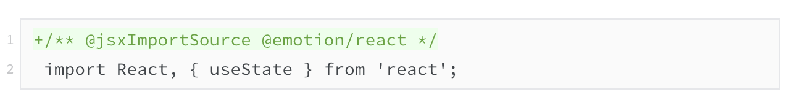

```
接下来就要对我们第一眼看到的组件 KanbanBoard 开刀。首先从 @emotion/react 包导
入css函数，然后将 <main> 标签的 className 属性替换成 css 属性，属性值为调用 css
函数的返回值，把 src/App.css 里 .kanban-board 的内容完整搬过来作为 css 函数的
```

参数：

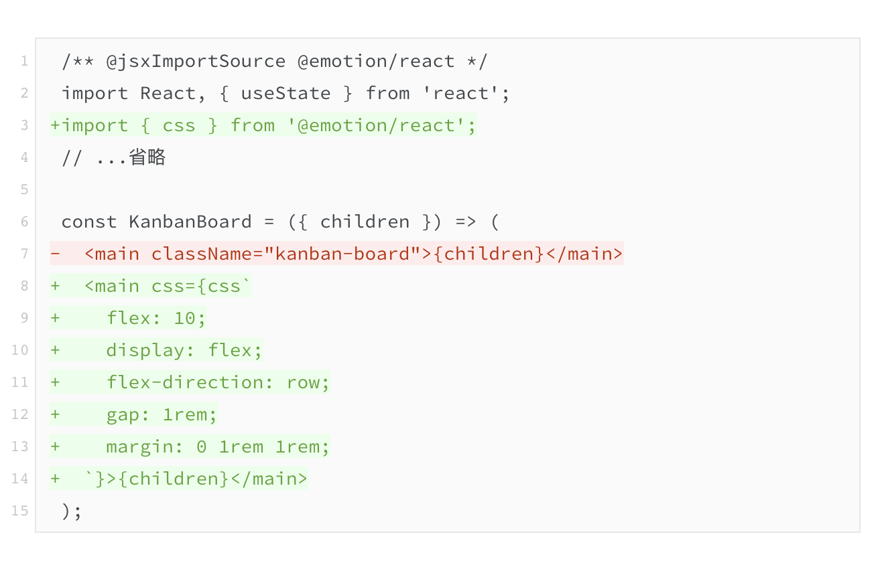

你可能对 css `args` 这样的函数写法感到陌生，将` `定义的模板字面量（TemplateLiterals）直接拼在函数名后面是 ES6 里新加入的语法，称作带标签的模版字符串（TaggedTemplates）。

```
你可以打开浏览器的控制台，输入如下 IIFE（立即调用函数表达式）代码，就可以清楚地看
```

出模版字面量和函数参数的对应关系。

```
((...args) => console.log(JSON.stringify(args)))`我说${false}你说${true}`;
// 回车后控制台会打印
[["我说","你说",""],false,true]
接下来运行 npm start 启动项目，可以看到应用的样式与之前并无差异。打开 React
Developer Tools 会看到组件树中，原有KanbanBoard和KanbanColumn之间插入了一层名
为 EmotionCssPropInternal 的组件，与 KanbanColumn 平级还插入了一个
Insertion 组件，如下图：
```

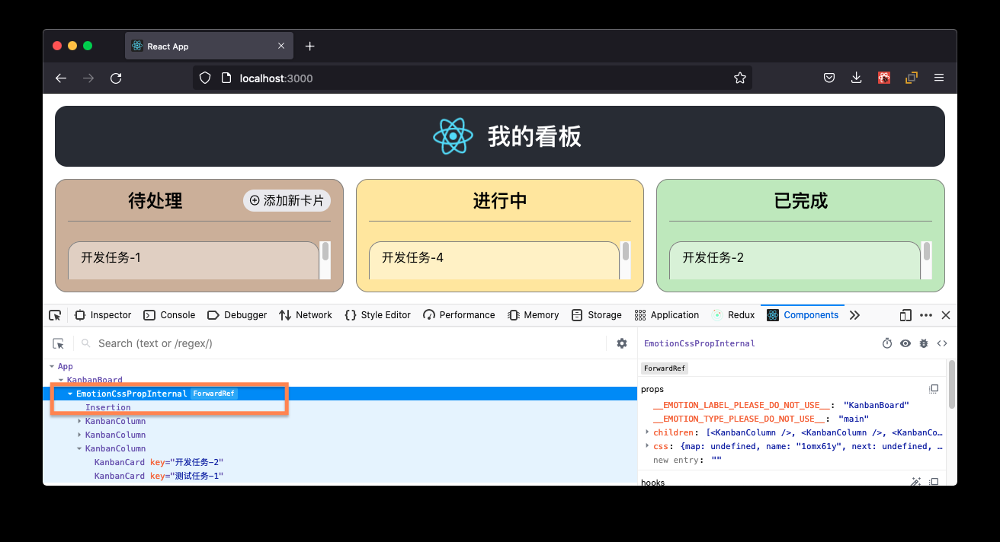

我们暂时不去深究这两个新组件是什么，但需要关注一下 emotion 框架为我们做了什么。把开

```
发者工具切换到检查器页签，可以看到 <main> 标签的 class 属性值变成了一个貌似没有意
义的类名 css-130tiw0-KanbanBoard，而这个 CSS 类是在 HTML 文档的 <head> 里动
态插入的 <style> 标签中定义的。
```

如下图所示：

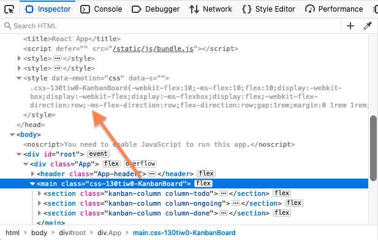

```
类名中的 130tiw0 是个哈希值，用来保证类名在不同组件间的唯一性，这自然就避免了一个
```

组件的样式污染另一个组件。

你不妨将类样式代码格式化，会得到如下片段：

```
.css-130tiw0-KanbanBoard {
 -webkit-flex: 10;
 -ms-flex: 10;
 flex: 10;
 display: -webkit-box;
 display: -webkit-flex;
 display: -ms-flexbox;
 display: flex;
 -webkit-flex-direction: row;
 -ms-flex-direction: row;
 flex-direction: row;
 gap: 1rem;
 margin: 0 1rem 1rem;
}
貌似比一开始手写的代码增加了几行？是的，增加的这几行中，-webkit-、 -ms- 这样的前
```

缀称作Vendor Prefix 浏览器引擎前缀，浏览器厂商用这种方式来引入尚未标准化的、实验性的 CSS 属性或属性值。

为了提高浏览器兼容性，emotion 框架会自动为较新的 CSS 标准加入带有前缀的副本，不认识这些前缀的浏览器会忽略这些副本，而老版本浏览器会各取所需，这样只需按最新标准编写一次 CSS，就可以自动支持新老浏览器。

由于写在组件内部的 CSS 已经脱离了 CSS 文件的上下文，VSCode 并不能为它提供语法高亮和自动代码补全。这可难不倒新时代的开发者们，VSCode 有丰富的扩展插件。

你兴致勃勃地打开 VSCode 的扩展（Extensions）视图，在搜索框中输入了“emotionsyntax”。等等，这都列出来些什么啊？C++ 语法扩展、Haskell 语法高亮扩展……来吧，换个关键字“styled”，从搜索结果中找到 vscode-styled-components 语法高亮扩展，安装它。

```
这不是对家 styled-components（另一款流行的 CSS-in-JS 框架）的扩展吗？别问，问就
```

是世界大同。这下 css 属性里写 CSS 的语法高亮、自动代码补全都有了。

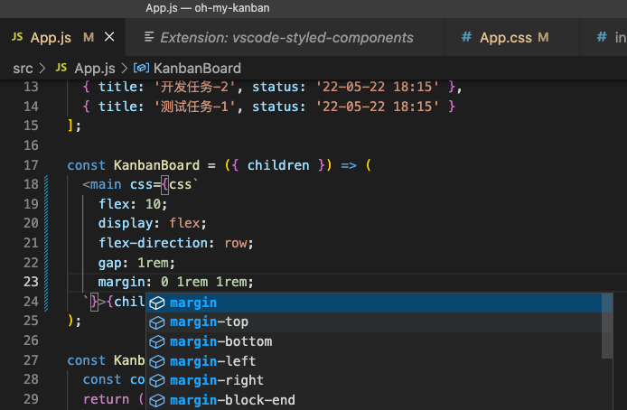

```
对了，记得把 src/App.css 中的 .kanban-board 代码删掉，原生 CSS 可没有死代码消
```

除（Dead Code Elimination）的能力。

### 嵌套选择器

```
前面我们利用 emotion 提供的 css API，顺利地将 KanbanBoard 的样式从独立的 CSS 文
```

件中移到了组件代码中。

```
接下来轮到 KanbanColumn 了。请你仿照前面的例子，把它的类样式 .kanban-column 从
CSS 文件移到组件中，对于组件中原有 className 的处理暂时忽略。代码如下：
```

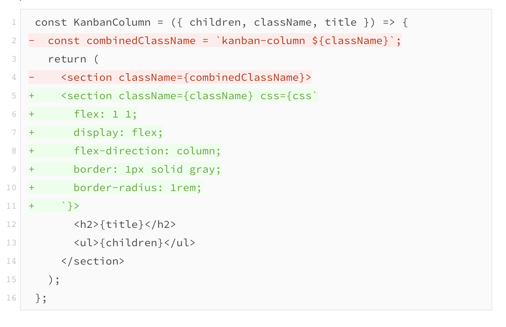

```
保存代码后，你会发现页面上少了些样式，原本以 .kanban-column 开头的几个子选择器定
义的样式失效了，比如 .kanban-column > h2。
从组件 JSX 来看，<h2>、<ul> 是当前组件的组成部分，理应把子选择器的样式也移过来。
最直接的写法当然是为 <h2> 、<ul> 也分别加一个css属性，但这不是唯一写法，我们来尝
```

试一下嵌套样式。

```
在 section 的 css 属性的模版字面量里加入 .kanban-column > h2 和 .kanban-column
> ul 的样式，并把样式选择器里的 .kanban-column 替换成嵌套选择器 & ，代码如下：
```

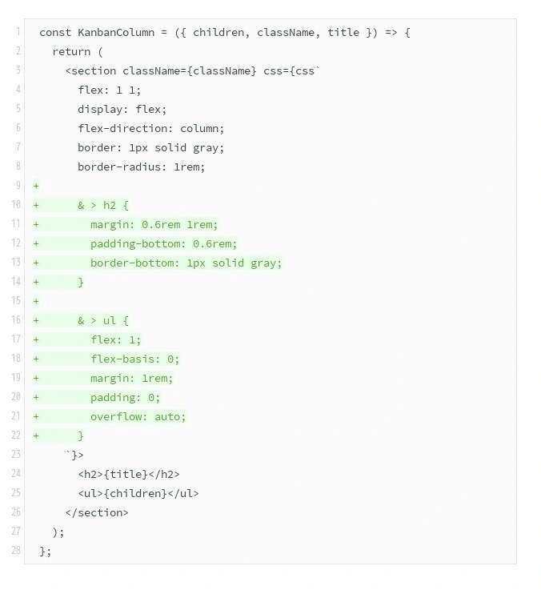

```
至于 .kanban-column > h2 > button，则可以直接插入到 & > h2 里，选择器改写成
& > button，形成多层嵌套：
```

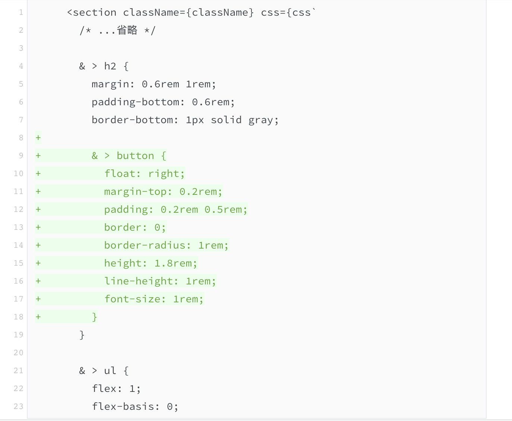

```
保存文件，在浏览器中可以看到样式得到完整复现，emotion 生成的 <style> 标签如图：
```

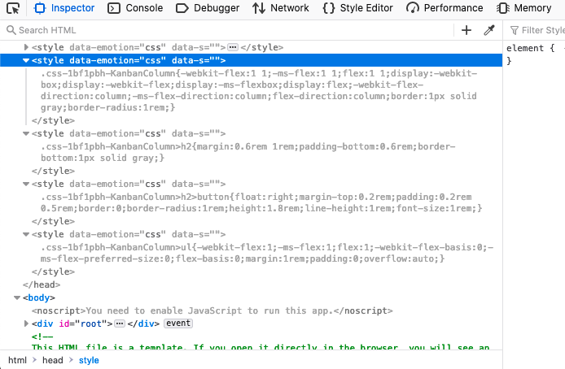

嵌套选择器 & 其实并不是 emotion 独创的语法，早期在LESS、SASS等 CSS 预处理器中就已经广受好评。以至于 Web 标准化组织 W3c 将其吸纳，形成了CSS Nesting标准草案，虽然截止到 2022 年中还没有受到浏览器的正式支持，但 CSS-in-JS 框架中普遍加入了这一语法。

```
另外强调一点，子选择器> 对于 KanbanColumn 组件是必要的。如果去掉 > ，仅保留空格，
```

上面三个子选择器就变成了后代选择器，无论在 DOM 树中的深度如何，只要是

```
KanbanColumn 的子孙 <h2>、<button>、<ul>就会被应用上面的样式，这就会污染传入
的 children 子组件的样式，偏离了我们样式隔离的目标。
```

### 样式组合与复用

```
刚才我们把 KanbanColumn 的样式从 CSS 文件移到了组件中，并利用嵌套选择器把 CSS 代
码都集中在了组件代码的同一位置。再接下来，我们会把 KanbanCard 的样式也移过来。
```

```
细心的你应该发现了，.kanban-card 、.card-title 不止被 KanbanCard 使用，还被
KanbanNewCard 使用。如果直接用 css 属性的方式写，那是不是会产生重复代码呢？这时
```

我们可以看一下在 emotion 里该如何复用样式。

```
最直接的复用方式，就是在两个组件外部声明一个值为 css 函数执行结果的常量，然后赋给
HTML 元素的 css 属性，如下面代码所示：
```

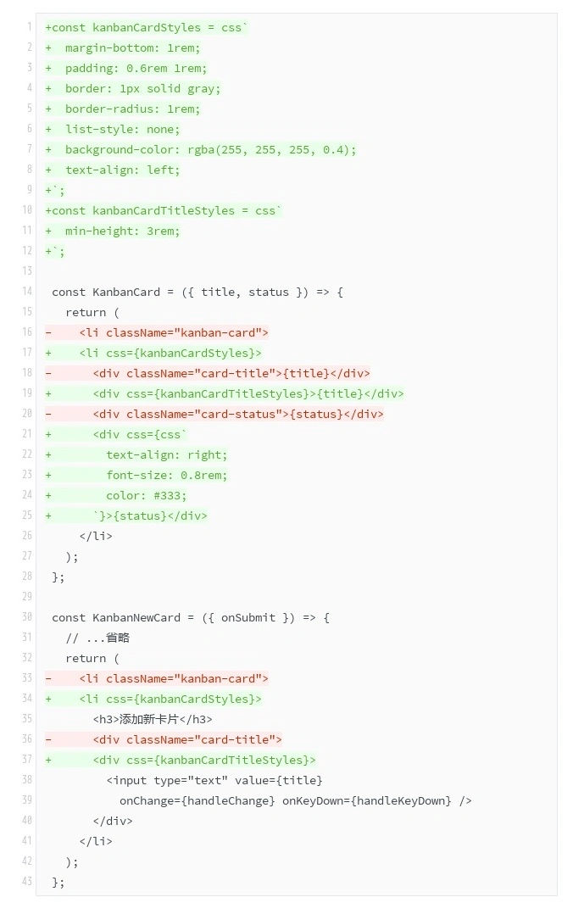

```
不过《添加新卡片》组件还缺一个子选择器 .card-title > input[type="text"] 的样
式，没关系，你可以把这部分样式直接嵌套在 kanbanCardTitleStyles里，当然也可以选
```

择更加灵活的样式组合：

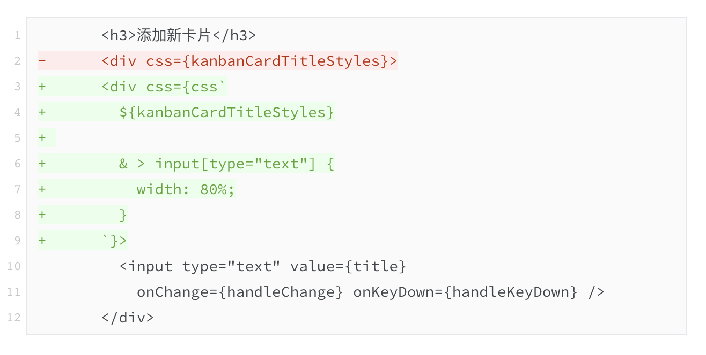

```xml
如果要组合两个或更多 css 函数返回值的变量，还可以用数组的写法，如果其中有重复的
CSS 属性（如color: red和color: blue），那么后面的会覆盖前面的：
<div css={[style1, style2, style3]}>...</div>
到目前为止，KanbanBoard 、KanbanColumn 、KanbanCard 的样式都被完整地转移到了
组件代码中。提醒一下，src/App.css 中的.kanban-column 、.kanban-card 开头的
```

样式都可以删掉了。

### 伪类选择器

对 CSS 选择器选定的元素，开发者经常要用到伪类（Pseudo-classes）来进一步选定它的特

```
殊状态，比如 :hover 代表鼠标悬停的状态。emotion 也支持了这一语法。这部分我们不展开
```

讲，只做个小改动作为例子。

```
目前的页面是不是有点单调？让我们来为 KanbanCard 加上鼠标悬停效果：
```

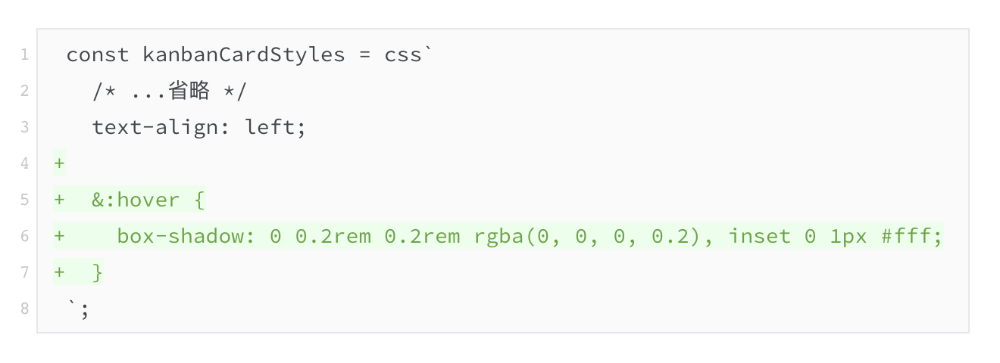

保存文件，在浏览器看看效果：

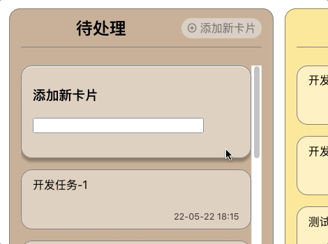

### 在样式中使用组件数据

```
你可能已经注意到了，既然处理 CSS 样式的 css 函数是个 JS 函数，那么参数里加入些 JS
变量也是可能的吧？是的，当你用 @emotion/react 的 css 属性写组件样式时，从框架设
```

计上你可以把 React 内外的变量都插进样式代码里，包括 React 组件的 props、state 和context。

```
如果你还记得，前面转移 KanbanColumn 样式时，我忽略了用于区别三个不同看板列的
className 属性的处理逻辑。但有趣的是，即使这样它还能照常工作，三个看板列的背景色
```

确实是不同的。你感兴趣的话，可以研究一下原因。不过现在我打算改掉这个属性，作为样式中使用组件 props 的例子。

```
先把 KanbanColumn 组件的 className 属性改成 bgColor 属性，然后在 css 的模版字
```

面量中使用它：

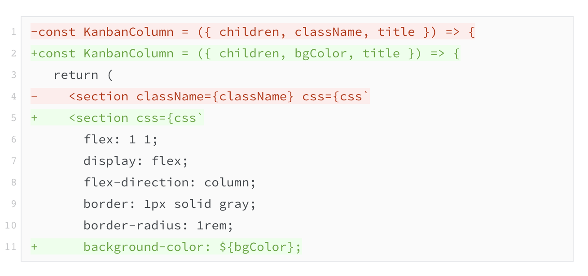

```
接下来由 App 组件来传入 bgColor 的值：
```

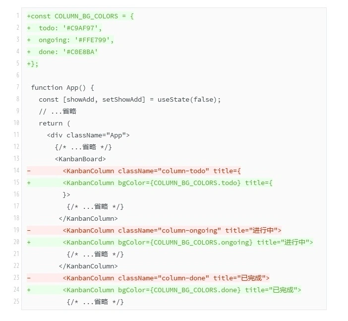

保存文件，浏览器查看，三个看板列背景色正常。收工！

最后多补充一句。往 CSS 里传 JS 数据，很多时候确实很方便，但会导致 emotion 在运行时

```
创建大量的<style>标签，有可能影响页面性能，所以不宜多用。
```

## CSS-in-JS 的其他选择

在用 emotion 写 CSS 的时候，除了可以用模版字面量，还可以选择 Object Styles 的方式，

```xml
即用 JS 对象的属性名和属性值来写 CSS。属性名要从 CSS 标准的 kebab-case（烤串式）
命名改为 camelCase（驼峰）命名。例如：
<div css={{
 color: 'blue',
 backgroundColor: 'green'
}}>
 ...
</div>
这个写法看似与 React 早期常见的 Inline styles（如 <div style={{color: 'blue',
backgroundColor: 'green'}}>...</div> ）很相似，但在运行时，emotion 依旧会创
建独立的<style> 标签，说明这个机制的性能要优于 Inline styles。
在 emotion 以外， Styled-components （官网）是前端开源社区另一个热门的 CSS-in-
```

JS 框架，它不依赖于编译，本身就提供了组件化的 API。以下代码修改来自官方的例子：

```xml
import styled from 'styled-components'；
const Button = styled.button`
 background: transparent;
 border-radius: 3px;
 border: 2px solid blue;
 color: blue;
`;
const Component = () => (
 <Button>Normal Button</Button>
);
CSS-in-JS 还有一个老前辈 CSS Modules ，它不算是个框架，但它在各种前端编译工具中
```

都有支持，它做的事情很专一，就是做 CSS 样式的隔离。在下面这个例子中，CSS 文件与一般无异：

```
/* Component.module.css */
.container {
 width: 100px;
 background-color: blue;
}
```

JSX 文件将 CSS 文件作为一个对象导入进来，然后在 JSX 代码中把对象的属性赋值给

```xml
className ：
// Component.jsx
import Styles from './Component.module.css';
const Component = () => (
 <div className={Styles.container}>Test</div>
);
```

经过编译后，最终的代码中会保证类名的唯一性：

```xml
<div class="component-module__Component--zTpG1">Test</div>
```

到这里，我们可以发现各个 CSS-in-JS 方案都有一定的共同点。

## 小结

在这节课，我们了解到在组件化开发中，CSS-in-JS 技术能帮我们做到样式隔离、提升组件样式的可维护性、可复用性。

```
然后通过在 oh-my-kanban 项目中的实践，学习了具代表性的 CSS-in-JS ——  emotion
```

框架的安装和基本使用，也用实际的例子讲解了 emotion 支持的嵌套选择器、伪类选择器，还有如何复用组件样式，以及如何在组件样式中使用组件的 props 数据。

这节课中完成的 emotion 代码比较基础，与原来的写法相比优势并不明显，但随着项目规模的增长，样式代码越来越多、越来越复杂，emotion 或者说 CSS-in-JS 对于样式组件化的重要作用就会体现出来。

最后也附上本节课所涉及的源代码：https://gitee.com/evisong/geektime-column-oh-my-kanban/releases/tag/v0.7.1

下节课，我们会回到 React 组件本身，探索一下 React 组件的生命周期。

## 思考题

1. 本节课提到 CSS-in-JS 的主要功能之一是组件间样式的隔离，你还能想到哪些其他 CSS 样式隔离的办法？

```
本节课末尾提到生成独立 <style> 标签的性能要优于 Inline styles，有什么办法可以证
```

- 明吗？

欢迎把你的思考和想法分享在留言区，我们一起交流讨论，下节课再见！
