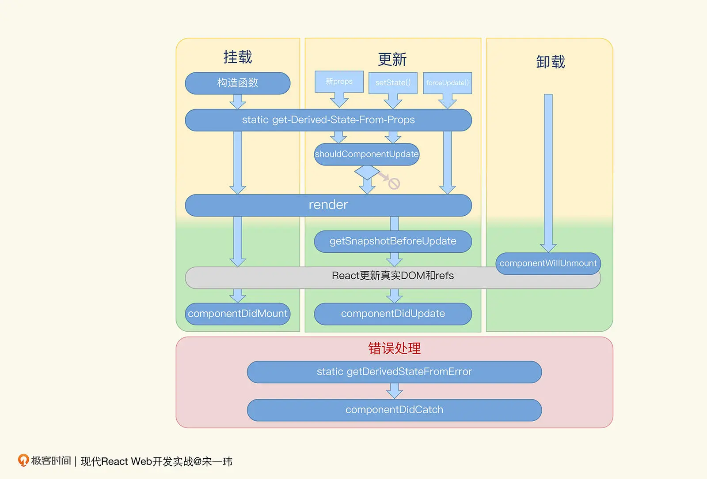
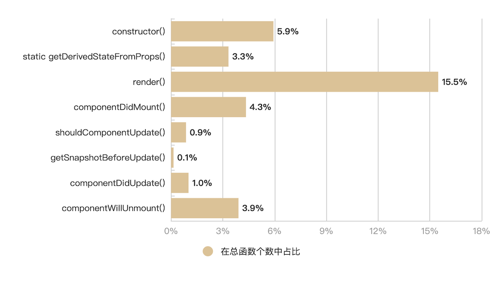
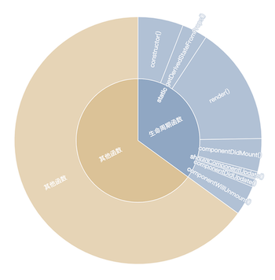
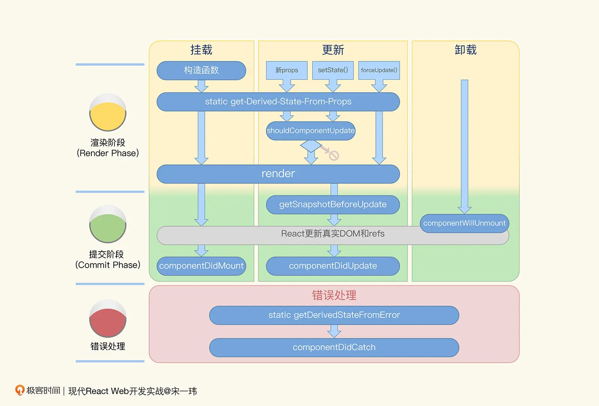
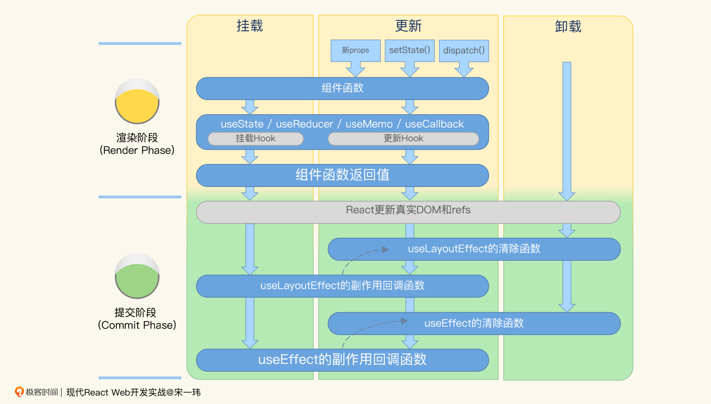
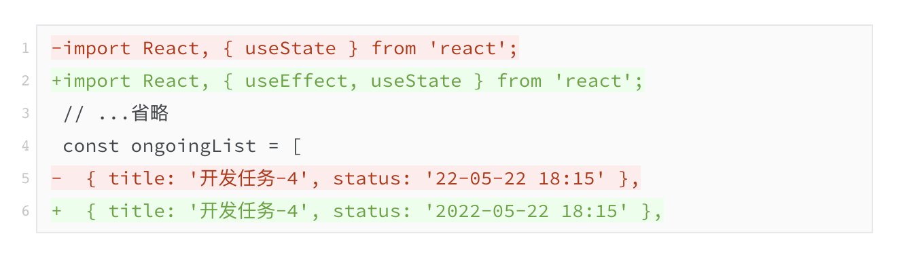
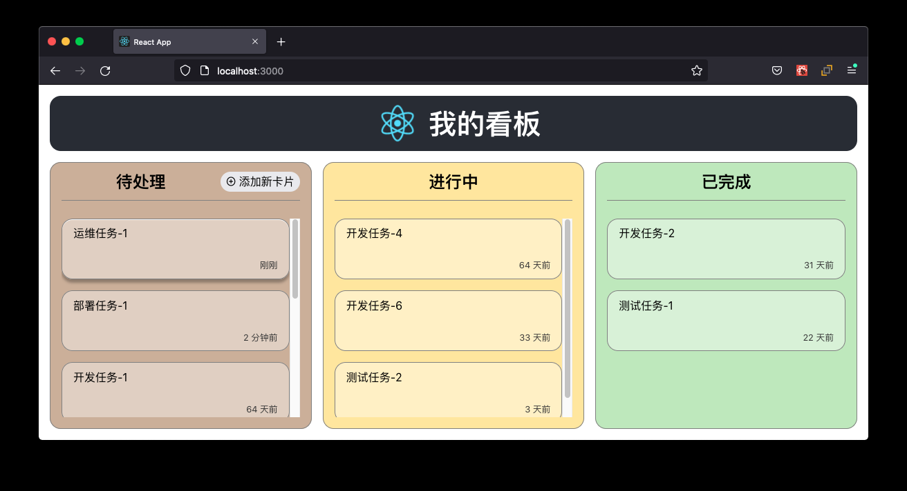

# 08 | 组件生命周期：React新老版本中生命周期的演化

你好，我是宋一玮，欢迎回到 React 组件的学习。

```
上节课我们暂时跳出 React 的核心概念，了解了如何利用 CSS-in-JS 技术将 React 组件的
CSS 样式也组件化，并以 emotion 框架为例，一起改写了 oh-my-kanban 项目的部分
```

CSS。

到这里，对于组件的结构和样式，我们已经给予了足够充分的学习和关注。那么接下来我们将用六节课的时间，来学习如何为组件编写逻辑。

组件的逻辑代码应该写在哪里呢？不妨参考一下开源项目 React 组件库 AntD。根据在 AntD的 v3.26.20 版本源代码中统计函数个数，至少有 35%的函数是React 生命周期方法。这就引出了这节课的主题，组件生命周期。

可以说，生命周期一直都是前端技术中的核心概念，React 也不例外。在 React 这里，尤其需要注意的是，组件生命周期并不等同于类组件的生命周期方法。

组件生命周期首先是一组抽象概念，类组件生命周期方法和 Hooks API 都可以看作是这组概念的对外接口。因此，无论是选择函数组件加 Hooks，还是在类组件上一条路走到黑，都要学习组件生命周期。

那么这节课我们就先从类组件入手，通过介绍类组件的生命周期方法，带你了解背后的 React组件生命周期，然后再从实际出发，讲解对应的 Hooks 用法。

## 类组件生命周期方法

总体来看，一个类组件生命周期包含挂载（Mounting）、更新（Updating）、卸载（Unmounting）三个阶段，此外还有一个错误处理（Error Handling）阶段。类组件在这四个

```
阶段分别提供了一些生命周期方法，类组件最重要的 render() 方法也是一个生命周期方
```

法。

```
虽然目前在 oh-my-kanban 项目中不会用到，但这里为了方便你理解，还是贴一段并不完整
```

的类组件代码：

```python
class LegacyKanbanCard extends React.Component {
 constructor(props) {
   super(props);
   // ...省略
 }
 componentDidMount() {
   // ...省略
 }
 // ...其他生命周期方法
 componentWillUnmount() {
   // ...省略
 }
 render() {
   return (<div>KanbanCard {this.props.title}</div>);
 }
}
```

这些方法之间的先后关系如下图所示：



我们先来看挂载阶段。当组件首次被加入到虚拟 DOM 时，类组件会被实例化，接着会触发挂载阶段的生命周期方法，包括如下四种。

```
组件构造函数。如果你需要为类组件的 state 设置初始值，或者将类方法的 this 绑定到类
```

- 实例上，那么你可以为类组件定义构造函数；如果不需要设置或绑定的话，就可以省略掉构造函数。

```
static getDerivedStateFromProps 。如果类组件定义了这个静态方法，在组件挂载
```

- 过程中，React 会调用这个方法，根据返回值来设置 state。

```
render ，类组件必须要实现这个方法。通常在返回值中会使用 JSX 语法，React 在挂载
过程中会调用 render 方法获得组件的元素树。根据元素树，React 最终会生成对应的
```

- DOM 树。

```
componentDidMount 。当 React 首次完成对应 DOM 树的创建，会调用这个生命周期方
法。你可以在里面访问真实 DOM 元素，也可以调用 this.setState() 触发再次渲染，
```

- 但要注意避免性能问题。

```
然后是更新阶段。当组件接收到新 props，或者内部调用 setState() 修改了状态，组件会
```

进入更新阶段，触发更新阶段的生命周期方法，包括如下五种。

```
static getDerivedStateFromProps 。这个静态方法不仅会在挂载时被调用，也会在
```

- 更新时调用，而且无论组件 props 是否有更改，只要渲染组件，都会调用这个方法。这个特性有可能造成组件内部的 state 被意外覆盖，根据 React 官方的建议，应谨慎使用这个方法。

```
shouldComponentUpdate 。如果类组件定义了这个方法且返回值是 false ，则组件在
```

- 这一次更新阶段不会重新渲染，后续的 render 等方法也不会被执行，直到下一次更新。这在 React 早期版本是最常见的性能优化方法之一，也是最常写出 Bug 的 API 之一。为了尽量避免跳过必要更新，应优先使用 React 的PureComponent 组件。

```
render。是的，只要没有被前面 shouldComponentUpdate 方法返回 false 所取消，
render 方法在更新阶段也会被调用，调用的返回值会形成新的 DOM 树。
getSnapshotBeforeUpdate 。在本次更新真实 DOM 之前，你有一次访问原始 DOM 树
```

- 的机会，就是这个生命周期方法，不过不常用。

```
componentDidUpdate 。组件完成更新时会调用这个方法，你可以在这里操作 DOM，也
```

- 可以处理网络请求，但要注意，你需要通过比对新旧 props 或 state 来避免死循环。

```
此外，显式调用 forceUpdate() 也可以令组件更新。但很明显，这个接口更偏向命令式，
```

与 React 声明式的开发方式有所区别，因此要尽量减少使用。

再接着是卸载阶段。当组件即将被从虚拟 DOM 中移除时，会触发卸载阶段的生命周期方法，

```
仅包括componentWillUnmount 。组件即将被卸载时，React 会调用它的
componentWillUnmount 方法，你可以在这个方法中清理定时器、取消不受 React 管理的
```

事件订阅等。

用好这个方法，对避免类似内存泄露这样严重的 Bug 很有帮助。

```
其实在上面三个阶段中，还有一些名字以 UNSAFE_componentWill* 开头的生命周期方
```

法，它们即将在未来 React 版本中被弃用，我们在这里不再展开。

最后是错误处理阶段。当组件在渲染时、执行其他生命周期方法时、或者是执行 Hooks 时发生错误，则进入错误处理阶段。

```
如果组件本身定义了 static getDerivedStateFromError 和 componentDidCatch 这
```

两个生命周期方法中的一个，或者两个都定义了，这个组件就成为了错误边界（ErrorBoundary），这两个方法会被 React 调用来处理错误。

如果当前组件不是错误边界，React 就会去找父组件；如果父组件也不是，就会继续往上，直到根组件；如果谁都没接住，应用就挂了。注意，截止到 React v18.2.0，只有类组件才能成为错误边界，函数组件是不行的。

```
以上所有这些生命周期方法里，只有 render() 是必须实现的，其他均为可选。
```

为了让你对这些方法的使用频率有一个感性认识，我们从来看一个粗略的统计。

AntD 即 Ant Design，是非常著名的 React 组件库（官网）。在 AndD 的 v3.26.20 版本源代

```
码中（包含components/**/*.{ts,tsx,js,jsx} 并排除__tests__ ），统计函数个数
（搜索正则表达式[\w\d]+\(.*\) ?\{） ，至少有 35% 的函数是 React 生命周期方法。
```

我根据从 React 官方下载的源码做了一些统计，结果如下图：



- 统计结果来源于｜现代React Web开发实战@宋一玮



- 统计结果来源于｜现代React Web开发实战@宋一玮

```
从这两张图可以看出，除了 render 和构造函数，出现最多的依次是 componentDidMount
、 componentWillUnmount 、 getDerivedStateFromProps 。
```

以上统计数据也可以作为你学习组件生命周期的参考。

## 渲染阶段与提交阶段

再回到这节课开头那张图，我将在左侧新加入的渲染（Render）和提交（Commit）两个阶段，这两个阶段与前面介绍的挂载、更新、卸载阶段是重合叠加的关系。

```
比如组件挂载时调用的构造函数、 render 发生在渲染阶段，而 componentDidMount 发生
在提交阶段。类似的，组件更新的 shouldComponentUpdate 、 render 也发生在渲染阶
段， componentDidUpdate 发生在提交阶段。
```

我在画这张图时，突然想到可以用交通信号灯来做类比，便用黄灯来表示渲染阶段、绿灯表示提交阶段，红灯表示错误处理。右侧组件生命周期方法的背景色黄、绿、红，跟左侧信号灯的颜色也是一一对应的。

成图如下图所示：



需要强调的是，渲染阶段和提交阶段不仅是组件的生命周期，更是整个 React 运行的生命周期。

贸然引入这两个阶段会让人困惑，这里先要介绍一下它们的来由。如果你还记得第 6 讲中提到的，React v16 引入的 Fiber 协调引擎，那请你继续回忆一下，这个引擎比起老版本最大的特点是什么呢？

对了，为了提高协调效率，减少页面交互卡顿，React 的 Fiber 引擎把协调从同步过程改进成了异步过程。

我们在这里不展开介绍算法和底层实现，只提出结论：

```
渲染阶段是异步过程，主要负责更新虚拟 DOM（ FiberNode ）树，而不会操作真实
```

- DOM，这一过程可能会被 React 暂停和恢复，甚至并发处理，因此要求渲染阶段的生命周期方法必须是没有任何副作用（Side-effect）的纯函数（Pure Function）；

- 提交阶段是同步过程，根据渲染阶段的比对结果修改真实 DOM，这一阶段的生命周期方法可以包含副作用。

这么看来，是不是用黄灯代表渲染阶段，和用绿灯代表提交阶段还挺合适的？黄灯亮起，React 为组件们规划好发车顺序和行车路线，一旦绿灯亮起，组件们一个个冲出起点，争先恐后来到用户面前，当然也有一些组件原地打转，还有一些被原地拆除……

不过要强调一点，与现实中黄灯时间短、绿灯时间长不同，React 的提交阶段一般会很快，但渲染阶段有可能会很慢，这也正是将它异步化的原因。

## 用 Hooks 定义函数组件生命周期

前面我们介绍了类组件的生命周期方法，并用 AntD 的源代码做了一个粗略的统计，这样你对这些方法应该多少有了一些好感。

然而在 AntD 的 v4.x 版本就没办法做这样的统计了，因为 v4.x 之后，AntD 源代码开始混用类组件和函数组件，生命周期方法的比例降低了，转而大量使用 Hooks，从 v4.0.0 到 v4.21.6函数组件中调用 React Hooks 的个数更是增加了 4 倍。

这样的变化也很正常。正如这节课开始时提到的，生命周期方法不等同于组件生命周期，虽然减少了生命周期方法的使用，但实现组件的功能，在很大程度上还是要依靠组件生命周期。React 函数组件与类组件存在替代关系，而相对应地，Hooks 也与类组件生命周期方法存在一定的替代关系，所以组件生命周期就由 Hooks 来补位了。

接下来我们看一下 Hooks 里有哪些 API 与组件生命周期有关，以及它们跟类组件生命周期方法是如何对应的。

请看下面这张图，乍一看跟类组件的生命周期还蛮像的，尤其是渲染阶段和提交阶段，但仔细看右侧，细节差别还是比较大的：



```
挂载阶段。React 会执行组件函数，在函数执行过程中遇到的 useState 、 useMemo 等
```

- Hooks 依次挂载到 FiberNode 上，useEffect 其实也会被挂载，但它包含的副作用（Side-effect，在 Fiber 引擎中称为 Effect）会保留到提交阶段。

组件函数的返回值通常会使用 JSX 语法，React 在渲染阶段根据返回值创建 FiberNode 树。在提交阶段，React 更新真实 DOM 之前会依次执行前面定义的 Effect。

```
更新阶段。当组件接收到新 props，调用 useState 返回的 setter 或者 useReducer
返回的 dispatch 修改了状态，组件会进入更新阶段。组件函数本身会被再次执行，
```

- Hooks 会依次与 FiberNode 上已经挂载的 Hooks 一一匹配，并根据需要更新。组件函数的返回值用来更新 FiberNode 树。

进入提交阶段，React 会更新真实 DOM。随后 React 会先执行上一轮 Effect 的清除函数，然

```
后再次执行 Effect。这里的 Effect 包括 useEffect 与useLayoutEffect ，两者特性很相
像。其中useLayoutEffect 的 Effect 是在更新真实 DOM 之后同步执行的，与类组件的
componentDidMount、componentDidUpdate 更相似一些；而 useEffect 的 Effect 是
异步执行的，一般晚于 useLayoutEffect 。
```

3. 卸载阶段。主要是执行 Effect 的清除函数。

函数组件也有错误处理阶段，但没有对应的生命周期 Hooks，错误处理依赖于父组件或祖先组件提供的错误边界。

从内部实现来看，类组件和函数组件的生命周期已经有了比较大的区别。我们在下节课，会展开聊一下类组件生命周期方法和 Hooks 的相互对应关系。

## 生命周期的常见使用场景

前面讲解了这么多生命周期概念和 API，那么具体该用在什么场景下呢？其实在前面介绍单个生命周期方法或者是 Hooks 时，都介绍了它们各自典型的使用场景。而在实际开发中，还有一些组合多个生命周期阶段的模式。

```
比如“在组件挂载时 XXX，卸载时 YYY”模式。现在请你跟着我，利用这个模式为 oh-my-
kanban 项目增加一个小功能：
```

- 目前看板列的卡片右下角显示了卡片的创建时间，为突出看板作为实时协作工具的特性，需要把创建时间改为相对时间，即：“刚刚”、“1 分钟前”、“1 小时前”、“1 天前”；

- 看板在无人操作的状态下，随着时间的流逝，卡片上的相对时间应自动刷新。

你虽然在心里吐槽“难道没有其他更重要的需求了吗”，但还是认真地做起了需求分析。这是一个典型的定时器需求，每固定间隔会设置一次 state。可以选择为每张卡片创建一个定时器，也可以为所有卡片创建一个共享的定时器。我们这里选择前者。

```
代码如下，先导入 useEffect 函数，顺便修正一下之前的日期字符串格式，否则 Date 认不
```

出来：



```
在KanbanCard 组件内定义一个名为 displayTime 的 state。而作为 useEffect 第一个
```

参数的回调函数，在组件首次挂载时会被调用。此外，这个函数的内容是根据卡片创建时间计

```
算相对时间，并每分钟一次设置到 displayTime 上，卡片随即更新。
这个回调函数的返回值是另一个 cleanup 函数，负责在组件被卸载时清除定时器。代码如
```

下：

```xml
const MINUTE = 60 * 1000;
const HOUR = 60 * MINUTE;
const DAY = 24 * HOUR;
const UPDATE_INTERVAL = MINUTE;
const KanbanCard = ({ title, status }) => {
 const [displayTime, setDisplayTime] = useState(status);
 useEffect(() => {
   const updateDisplayTime = () => {
     const timePassed = new Date() - new Date(status);
     let relativeTime = '刚刚';
     if (MINUTE <= timePassed && timePassed < HOUR) {
       relativeTime = `${Math.ceil(timePassed / MINUTE)} 分钟前`;
     } else if (HOUR <= timePassed && timePassed < DAY) {
       relativeTime = `${Math.ceil(timePassed / HOUR)} 小时前`;
     } else if (DAY <= timePassed) {
       relativeTime = `${Math.ceil(timePassed / DAY)} 天前`;
     }
     setDisplayTime(relativeTime);
   };
   const intervalId = setInterval(updateDisplayTime, UPDATE_INTERVAL);
   updateDisplayTime();
   return function cleanup() {
     clearInterval(intervalId);
   };
 }, [status]);
 return (
   <li css={kanbanCardStyles}>
     <div css={kanbanCardTitleStyles}>{title}</div>
     <div css={css`/*省略*/`} title={status}>{displayTime}</div>
   </li>
 );
};
运行 npm start ，浏览器中效果如下图：
```



```
你可以留意一下，上面代码中 useEffect 还有第二个参数，是一个包含 status 属性值的
```

数组，这个参数的用途我们会在下节课讲解。

## 小结

这节课我们学习了组件的生命周期。无论是传统的类组件，还是后来居上的函数组件加Hooks，都提供了与生命周期相关的 API，开发者可以利用这些 API 为组件编写交互或者业务逻辑。

我们从类组件的生命周期方法入手，讲解了组件的挂载、更新、卸载、错误处理四个阶段，又结合 Fiber 协调引擎的特点，介绍了更高层次的渲染和提交两个阶段。然后我们延续这个思路，分析了函数组件和 Hooks 的生命周期。作为实例，你利用组件生命周期和定时器，为

```
oh-my-kanban 项目加入了一个显示相对时间的小功能。
```

下节课，我们将来到令人兴奋的 Hooks，在学习几个常用 Hooks API 的同时，看看为什么Hooks 加函数组件，能替代类组件成为 React 开发的主流方案。

最后也附上本节课所涉及的项目源代码：https://gitee.com/evisong/geektime-column-oh-my-kanban/releases/tag/v0.8.0

## 思考题

前面的课程中我们一直提到组件树，这节课又了解了组件的生命周期，那在组件树中，子组件的生命周期是怎样的？父组件和子组件的各个生命周期的发生顺序又是怎样的？

欢迎把你的想法分享在评论区，相信经过思考和输出，你的学习效果会更好。我们下节课再见！
