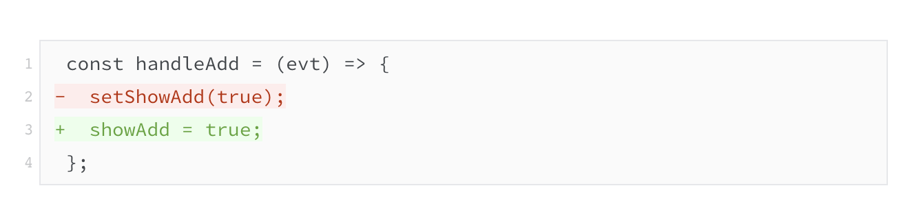
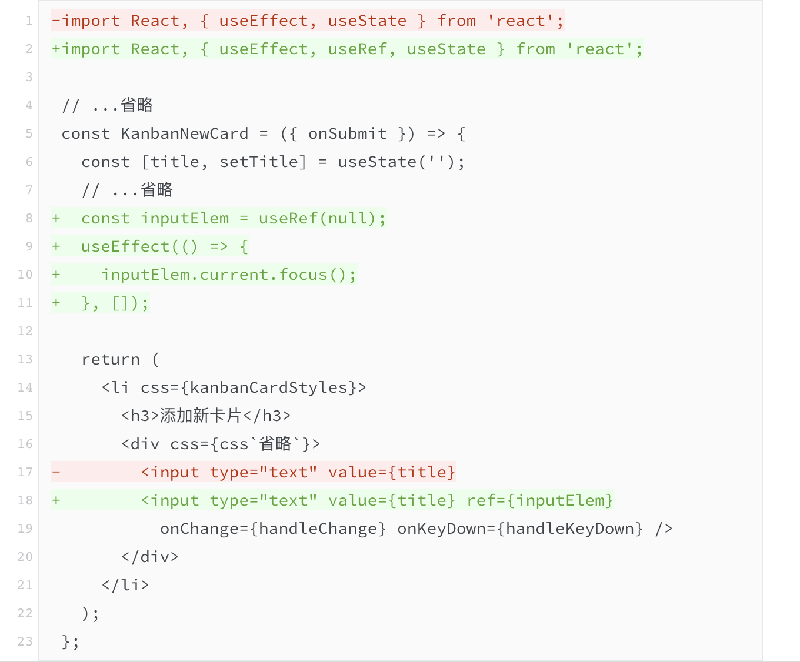
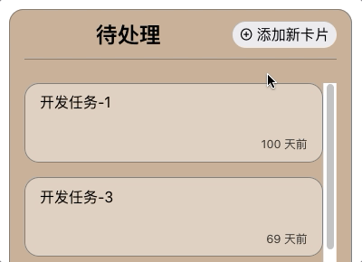

# 09 | ReactHooks（上）：为什么说在React中函数组件和Hooks是绝配？

你好，我是宋一玮，欢迎回到 React 应用开发的学习。

上节课我们学习了 React 组件的生命周期，包括组件层面的挂载、更新、卸载、错误处理四个阶段，以及框架层面的渲染和提交这两个阶段。

```
在这些阶段中，我们列举了类组件的 render、componentDidMount、
componentWillUnmount 等生命周期方法，以及这些方法执行的先后顺序，也对比了函数
组件中的 Hooks 是如何参与组件生命周期的。最后，我们利用 useEffect Hooks 函数，为
oh-my-kanban 项目新加了一个定时更新卡片显示时间的功能。
```

敏锐的你可能发现了，上节课中你只为函数组件写了 Hooks 代码，而类组件的生命周期方法

```
仅是介绍而已。还有就是截止目前，oh-my-kanban项目里只有函数组件，一个类组件都没
```

有——同样是组件，类组件怎么就被区别对待了呢？其实不是类组件掉了链子，只是函数组件加 Hooks 这对黄金搭档后来居上，抢了类组件的风头。

接下来你可能还会有疑问：

- Hooks 到底是什么？怎么用？

- 函数组件加 Hooks 可以完全替代类组件吗？

- 还有必要学习类组件吗？

这节课和下节课，我们将学习 React 自 v16.8.0 版本加入的 Hooks API。当你完成这两节课的学习，相信在掌握 Hooks 使用的同时，也会对函数组件和类组件在今后 React 应用开发中的地位，拥有自己的独立判断。

## 什么是 Hooks？

Hooks 是 React 实现组件逻辑的重要方式，可以用来操作 state，定义副作用，更支持开发者自定义 Hooks。Hooks 借鉴自函数式编程，但同时在使用上也有一些限制。

接下来，我们不妨借助函数式编程中纯函数和副作用这两个概念，来理解什么是 Hooks。

```
React 对 UI 的理想模型是 UI=f(state)，其中 UI 是视图，state 是应用状态，f 则是渲染
```

过程。比起类组件，函数组件更加贴近这一模型，但从功能来看，早期的函数组件功能与类组件仍有不小差距。

在 React v0.14、v15、v16（v16.8.0 之前）版本时，先后有 mix-in、高阶组件、recompose框架被用来弥补这个差距。直到官方在 v16.8.0 推出 Hooks，函数组件所缺少的一块拼图终于补齐了。

这里提一下纯函数（Pure Function）的概念。当一个函数满足如下条件时，就可以被认为是纯函数：

1. 函数无论被调用多少次，只要参数相同，返回值就一定相同，这一过程不受外部状态或者IO 操作的影响；

2. 函数被调用时不会产生副作用（Side Effect），即不会修改传入的引用参数，不会修改外部状态，不会触发 IO 操作，也不会调用其他会产生副作用的函数。

```javascript
下面这段 JS 代码就是一个最简单的纯函数，对于给定的 a 和 b，返回值永远是两者之和：
const func = (a, b) => {
 return a + b;
};
用纯函数的概念来分析下面的 React 函数组件，对于给定的 props a和b，每次渲染时都会返
```

回相同的无序列表元素：

```xml
const Component = ({ a, b }) => {
 return (
   <ul>
     <li>{a}</li>
     <li>{b}</li>
   </ul>
 );
};
```

虽然 React 官方并没有类似的提法，但为了方便理解，我们姑且把这样用纯函数的方式编写的React 组件称作“纯函数组件”。编写纯函数组件，可以最直观地展示输入的 props 与输出的渲染元素之间的关系，非常利于开发者把握组件的层次结构和样式。

但需要知道，这样的纯函数组件除了 props、JSX 外，几乎不能使用 React 组件的所有其他特性——对于纯函数组件来说，这些其他特性全部都是外部状态或副作用。

反过来说，若想让函数组件使用这些其他特性，只要让它以某种方式，显式地访问函数的外部状态（应限制在 React 框架的范围以内，所以对 React 而言是内部状态），或者执行副作用就好了。

Hooks 就是这样一套为函数组件设计的，用于访问 React 内部状态或执行副作用操作，以函数形式存在的 React API。注意，这里提到的“React 内部状态”是比组件 state 更广义的统称，除了 state 外，还包括后面课程中会详细讲解的 context、memo、ref 等。

```
作为例子，我们在上面的“纯函数组件”代码中加入 Hooks。useState 这一 Hook 会读取或存
```

储组件的 state，加入它，让函数组件具有了操作 state 的能力：

```xml
const Component = ({ a, b }) => {
 const [m, setM] = useState(a); // 一个Hook
 const [n, setN] = useState(b); // 另一个Hook
 return (
   <ul>
     <li>{m}<button onClick={() => setM(m + 1)}>+</button></li>
     <li>{n}<button onClick={() => setN(n + 1)}>+</button></li>
   </ul>
 );
};
```

要注意一点，组件的 state 并不是绑定在组件的函数上的，而是组件渲染产生的虚拟 DOM 节

```
点，也就是 FiberNode 上的。所以在上面的函数中调用 useState ，意味着函数将访问函
```

数本身以外、React 以内的状态，这就让函数产生了副作用，导致函数不再是纯函数，也意味着函数组件不再是“纯函数组件”。

但我们从来没有强求过组件函数必须是纯函数，不是吗？加入 Hooks 的函数组件不再纯粹，但更强大，变得可以使用包含 state 在内的、React 的大部分特性。纯函数、外部状态和副作用这些概念，可以成为我们学习使用 Hooks 的参照物，也更方便我们理解、分析 React 组件。

此外多提一下，在 React 里有个概念叫“纯组件”，但我们却不能把上面的“纯函数组件”等同于“纯组件”。因为在 React 里，纯组件 PureComponent 是一个主要用于性能优化的独立 API：当组件的 props 和 state 没有变化时，将跳过这次渲染，直接沿用上次渲染的结果。

而上面的函数组件，每次在渲染阶段都会被执行，如果返回的元素树经过协调引擎比对后，与前一次的没有差异，则在提交阶段不会更新对应的真实 DOM。

## React Hooks 有哪些？

了解了什么是 Hooks，我们再来看看都有哪些 Hooks。React v18.2.0 提供的基础 Hooks 包括三个：

1. useState

2. useEffect

3. useContext

其他 Hooks，有些是上面基础 Hooks 的变体，有些虽然用途不同，但与基础 Hooks 共享底层实现。包括十个：

1. useReducer

2. useMemo

3. useCallback

4. useRef

5. useImperativeHandle

6. useLayoutEffect

7. useDebugValue

8. useDeferredValue

9. useTransition

10. useId

```
此外还有为第三方库作者提供的 useSyncExternalStore 和 useInsertionEffect 。虽
```

然 React API 中提供了这么多 Hooks，但并不意味着你每个 Hook 都要精通。

```
我的建议是，首先精通三个基础 Hooks，也就是 useState 、 useEffect 和
useContext。然后在此基础上：
掌握 useRef 的一般用法；
当需要优化性能，减少不必要的渲染时，学习掌握 useMemo 和 useCallback ；
当需要在大中型 React 项目中处理复杂 state 时，学习掌握 useReducer ；
当需要封装组件，对外提供命令式接口时，学习掌握 useRef 加
useImperativeHandle；
```

5. 当页面上用户操作直接相关的紧急更新（Urgent Updates，如输入文字、点击、拖拽等），

```
受到异步渲染拖累而产生卡顿，需要优化时，学习掌握 useDeferredValue 和
useTransition 。
其中基础 Hooks 的 useState 和 useEffect ，我们分别会在这节课和下节课详细讲解，
useContext 涉及到 Context，我们留到 12～13 节课再展开。
基础 Hooks 之外，useRef 也是用来操作数据的，而且相对独立，我们放在这节课末尾来
讲。useMemo 和 useCallback 在接口形式上与 useEffect 有相似之处，一并放到下节课介
```

绍。

课程篇幅有限，一些不常用或者过于新的 Hooks 我们暂不涉及，你如果感兴趣的话请参考

```
React 官方 Hooks 文档。下面我们先来学习 useState 和它的伙伴们。
```

## 状态 Hooks

```
在上面列举的 Hooks 中，操作 state 的 Hook 包括基础的 useState 和它的变体
useReducer ，我们马上会学习到。多提一下，其中 useState 是所有 Hooks 中最常用的
```

（没有之一，遥遥领先），之所以说最常用，是因为开发者经常在一个组件里写多个

```
useState 来操作多个 state。
```

我们下面将会讲解的 React 18 加入的自动批处理多个 state 更新的功能，也印证了 React 官方是鼓励这种用例。

### useState

```
如果你还有印象，我们这个课程里第一次出现 useState 是在第三节课，回忆一下那个不太
```

严谨但很方便的说法：在组件内部改变 state 会让组件重新渲染。

```python
是的，useState 就是用来操作组件 state 的 Hook。oh-my-kanban项目 App 组件的代码中
第一句就是在创建名为 showAdd 的 state：
import React, { useState } from 'react';
// ...省略
function App() {
 const [showAdd, setShowAdd] = useState(false);
 //     -------  ----------             -----
 //        ^         ^                    ^
 //        |         |                    |
 //    state变量  state更新函数           state初始值
 const [todoList, setTodoList] = useState([/* ...省略 */]);
在组件挂载时，组件内会创建一个新的 state，初始值为 false。useState 函数的返回值是
一个包含两个成员的数组，通过 ES2015 的数组解构语法（ [ ] ）可以得到一个变量和一个
```

函数。

```
组件代码可以通过 showAdd 变量读取这个 state，当需要更新这个 state 时，则调用
setShowAdd 函数，如 setShowAdd(true) 。每次组件更新，在渲染阶段都会再次调用这
个useState 函数，但它不会再重新初始化 state，而是保证 showAdd 值是最新的。
上面组件的第二行语句创建了另一个名为 todoList 的 state，调用 setTodoList 更新
state 只会更新 todoList ，不会影响到前面的 showAdd。
```

```
其实无论 showAdd 还是 todoList，都只是单纯的变量名而已，真正决定它们是两个相互独
立的 state 的，是 useState 的调用次数和顺序。你可以自行决定 state 变量名和 state 更新
函数名，xxx 和 setXxx 只是个约定俗成的命名法。
上面提到每次组件更新都会调用useState ，这其实是有性能隐患的。你可能好奇，
useState(false)  得调用多少次才能影响到性能啊？而且，不是说它不会再重新初始化
```

state 吗？

```
确实，框架提供的 useState 本身不会这么弱的。不过，useState 的参数就不一定了。现
```

在的参数是一个简单的布尔值，但如果它是一个复杂的表达式呢？每次组件更新执行渲染时，

```
即使这个表达式的值不会被 useState 再次使用，但表达式本身还是会被执行的。
```

不妨请你写个简单的斐波那契数列递归函数，然后把执行结果当作参数：

```
useState(fibonacci(40)) ，然后性能肉眼可见地变差了，表达式执行的成本太高了
（当然你可以优化函数本身的算法）。但没关系，useState 还有另一种设置默认值的方法，
就是传一个函数作为参数，useState 内部只在组件挂载时执行一次这个函数，此后组件更
```

新时不会再执行。

```
于是刚才的斐波那契初始值就可以这样写：useState(() => fibonacci(40))  。
有意思的是，state 更新函数，即 setShowAdd 也可以传函数作为参数。一般情况下，是调用
```

state 更新函数后组件会更新，而不是反过来。所以 state 更新函数的调用频率没那么高，传函数参数也并不是为了优化性能。

这里先给一个背景，调用 state 更新函数后，组件的更新是异步的，不会马上执行；在 React18 里，更是为更新 state 加入了自动批处理功能，多个 state 更新函数调用会被合并到一次重新渲染中。

这个功能从框架上就保证了 state 变化触发渲染时的性能，但也带来一个问题，只有在下次渲染时 state 变量才会更新为最新值，如果希望每次更新 state 时都要基于当前 state 值做计算，那么这个计算的基准值有可能已经过时了，如：

```
setShowAdd(!showAdd);
setTodoList([...todoList, aNewTodoItem]);
```

这时函数参数的作用就体现出来了，只要改为下面的方式，就可以保证更新函数使用最新的state 来计算新 state 值：

```
setShowAdd(prevState => !prevState);
setTodoList(prevState => {
 return [...prevState, aNewTodoItem];
});
useState 是 React 最常用的 Hook，理解这个 Hook 对理解其他 Hooks 很有帮助。
```

### useReducer

```javascript
这个小节的标题是“状态 Hooks”，之所以有个“s”，是因为 useState 还有一个马甲
useReducer ，如果用 useReducer 来改写上面的 useState ，可以写成这样：
function reducer(state, action) {
 switch (action.type) {
   case 'show':
     return true;
   case 'hide':
   default:
     return false;
 }
}
function App() {
 const [showAdd, dispatch] = useReducer(reducer, false);
 // ...省略
 dispatch({ type: 'show' });
这么写代码好像变多了？这是因为 useReducer 比起 useState 增加了额外的抽象，引入了
dispatch 、action 、reducer 概念。这与著名应用状态管理框架 Redux 基本是对应
```

的。

```
说到马甲，其实 useState 底层就是基于 useReducer 实现的，useState 才是马甲。
useReducer 适用于抽象封装复杂逻辑，对于现在的 oh-my-kanban 项目是没必要的。
我们在后面项目篇的课程中会设计更复杂的 state，那时就轮到 useReducer 施展拳脚了，届
```

时我们会详细讲这个 Hook。

### 更新 state 的自动批处理

```xml
前面提到更新 state 的批处理，为什么需要批量更新 state 呢？我们先回顾一下 oh-my-
kanban 中，添加新卡片按回车键后发生的事情。
可以看到，在事件处理函数中先后更新了 todoList 和 showAdd 两个 state 值：
function App() {
 const [showAdd, setShowAdd] = useState(false);
 const [todoList, setTodoList] = useState([/*省略*/]);
 // ...省略
 const handleSubmit = (title) => {
   setTodoList(currentTodoList => [
     { title, status: new Date().toString() },
     ...currentTodoList
   ]);
   setShowAdd(false);
 };
 // ...省略
 return (
   <div className="App">
     {/*省略*/}
     {showAdd && <KanbanNewCard onSubmit={handleSubmit} />}
     {/*省略*/}
   </div>
 );
}
```

组件内的 state 被更新了，组件就会重新渲染。那么接连更新两个 state，组件会重新渲染几次呢？答案是，在上面的代码中，组件只会重新渲染一次，而且这次渲染使用了两个 state 分别的最新值。这就是 React对多个 state 更新的自动批处理。

我们可以想象一下，假设没有批处理功能的话，这两个 state 更新会触发两次间隔非常近的重新渲染，那前面的这次重新渲染对于用户来说，很有可能是一闪而过的，既没有产生实际交互，也没有业务意义。在此基础上，如果再加上前面这次渲染的成本比较高，那就更是一种浪费了。

所以可以说，state 更新的自动批处理是 React 确保组件基础性能的重要功能。

然而需要注意的是，自动批处理功能在 React 18 版本以前，只在 React 事件处理函数中生效。如果 state 更新语句所在的区域稍有不同，比如将两个 state 更新写在异步请求的回调函数中，自动批处理就失效了。

用下面的代码举个例子。在点击搜索按钮后，会向服务器端发起搜索请求，当返回结果时，需要先后更新两个 state：

```xml
const Search = () => {
 const [province, setProvince] = useState(null);
 const [cities, setCities] = useState([]);
 const handleSearchClick = () => {
   // 模拟调用服务器端接口搜索"吉林"
   setTimeout(() => {
     setProvince('吉林');
     setCities(['长春', '吉林']);
   }, 1000);
 };
 return (
   <>
     <button onClick={handleSearchClick}>搜索</button>
     <ul>
       <li>{province}<ul>
         {cities.map(city => (
           <li>{city}</li>
         ))}
       </ul></li>
     </ul>
   </>
 );
};
看起来写法与 oh-my-kanban 的 handleSubmit 区别不是很大，但在 React 18 以前的版
```

本中，这两个 state 更新会触发两次重新渲染。

```
而从 React 18 版本起，无论是在事件处理函数、异步回调，还是 setTimeout 里的多个
```

state 更新，默认都会被自动批处理，只触发一次重新渲染。

## 在组件内使用可变值：useRef

```
前面讲到更新 state 值时，需要使用 state 更新函数。你也许会好奇，既然 useState 返回了
```

state 变量，直接给 state 变量赋值不行吗？

```
请你做个小实验吧，在 App 组件函数内，修改 handleAdd 函数：
```



点击添加新卡片按钮，浏览器马上就报错：

```javascript
Uncaught TypeError: invalid assignment to const 'showAdd'
   handleAdd App.js:204
```

这正如在第 6 节课提到的：props 和 state 都是不可变的（Immutable）。

```
那么，如果需要在 React 组件中使用可变值该怎么办？答案是，我们可以使用 useRef 这个
```

Hook。下面我们结合一个典型用例，也就是在 React 组件中访问真实 DOM 元素，来介绍

```
useRef 的用法。
请你为 oh-my-kanban 加入一个提升用户体验的小功能，当打开“添加新卡片”卡片时，自动
```

将其中的文本输入框设置为页面焦点。该功能需求和以下代码来自于第 3 节课一位名为“coder”的学员留言，在此表示感谢：



在浏览器内可以看到，上面的代码实现了我们期待的交互，效果展示如下：



```javascript
上面的代码包含了三个 React 特性，useRef  Hook、HTML 元素的 ref 属性，以及
useEffect  Hook。先说 useRef ：
const Component = () => {
 const myRef = useRef(null);
 //    -----          ----
 //      ^              ^
 //      |              |
 //   可变ref对象     可变ref对象current属性初始值
 // 读取可变值
 const value = myRef.current;
 // 更新可变值
 myRef.current = newValue;
 return (<div></div>);
};
调用 useRef 会返回一个可变 ref 对象，而且会保证组件每次重新渲染过程中，同一个
useRef Hook 返回的可变 ref 对象都是同一个对象。
可变 ref 对象有一个可供读写的 current 属性，组件重新渲染本身不会影响 current 属性
的值；反过来，变更 current 属性值也不会触发组件的重新渲染。在第 12-13 节课中，我们
```

会展开介绍可变值的使用场景。

```
然后是 HTML 元素的 ref 属性。这个属性是 React 特有的，不会传递给真实 DOM。当 ref
```

属性的值是一个可变 ref 对象时，组件在挂载阶段，会在 HTML 元素对应的真实 DOM 元素创

```
建后，将它赋值给可变 ref 对象的 current 属性，即 inputElem.current；在组件卸
载，真实 DOM 销毁之前，也会把 current 属性设置为 null。
再接下来就是 useEffect(func, []) ，这种使用方法会保证 func 只在组件挂载的提交阶
```

段执行一次，接下来的组件更新时不会再执行。

```
这三个特性串起来，就让 KanbanNewCard 组件在挂载时，将 <input> 的真实 DOM 节点
赋值给 inputElem.current，然后在处理副作用时从 inputElem.current 拿到这个真
实 DOM 节点，命令式地执行它的 focus() 方法设置焦点。
```

## 小结

这节课我们借助函数式编程领域的纯函数和副作用的概念，通过类比的方式介绍了什么是Hooks，也同时强调了 Hooks 与函数组件的紧密联系。

然后我们列举了 React 18 版本 API 中提供的基础 Hooks 和扩展 Hooks，并给出了学习建

```
议。在后半段，我们深入学习了 useState 这个 Hook，也遇到了 React 对于多个 state 更新
```

的自动批处理功能。

```
最后，通过为 oh-my-kanban 增加一个小功能，熟悉了 useRef 的一个常见用例。
下节课我们会继续 Hooks 的学习，在掌握作为最重要的基础 Hooks 的 useEffect 同时，也
了解 React 如何处理副作用。然后会介绍主要用于性能优化的 useMemo 和 useCallback
```

，也会强调所有 Hooks 共通的使用限制。最后会回答为什么要优先学习函数组件加 Hooks，以及学习了 Hooks 还是否需要学习类组件的问题。

最后也附上本节课所涉及的项目源代码：https://gitee.com/evisong/geektime-column-oh-my-kanban/releases/tag/v0.9.0。

## 思考题

```
这节课的学习了 useState ，从表面上看，这不就是一个 JS 函数吗？其实不然。我想请
```

- 你做几个实验，观察一下 Hook 在使用中都会有哪些限制：

```
在函数组件之外的一个普通函数中调用 useState；
在函数组件内部加一个 if 条件语句，在满足条件时才去调用 useState；
在函数组件内部定义一个函数，在这个函数内部调用 useState，再在函数组件内调用这
```

- 个函数。

```
这节课末尾也学习了useRef 可以用来保存和读取可变值，貌似很自由的样子，那请你
根据它的特性来推断一下，可以用 useRef 来代替 useState 吗？
```

欢迎将你的思考和答案放在留言区，我会跟你交流。我们下节课再见！
