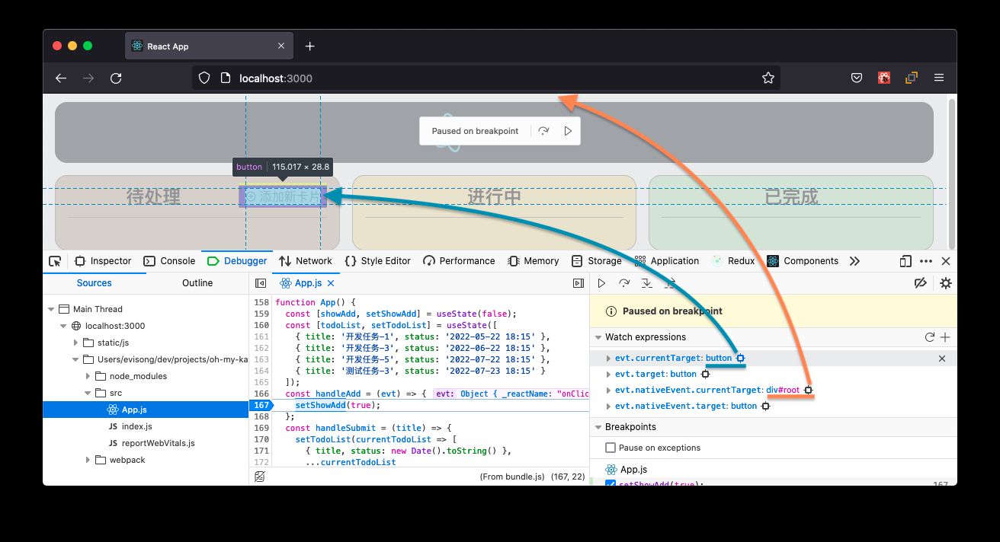
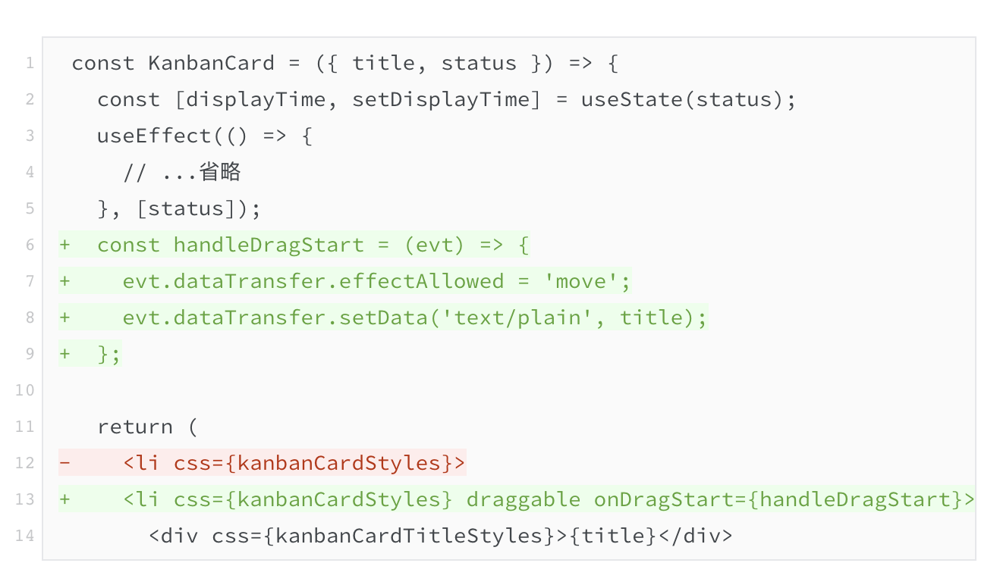
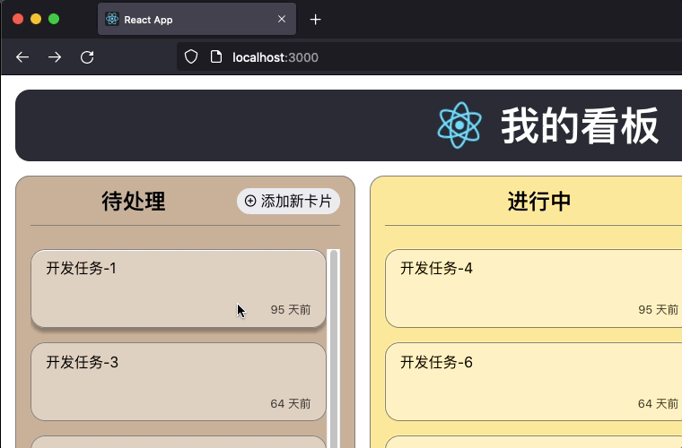
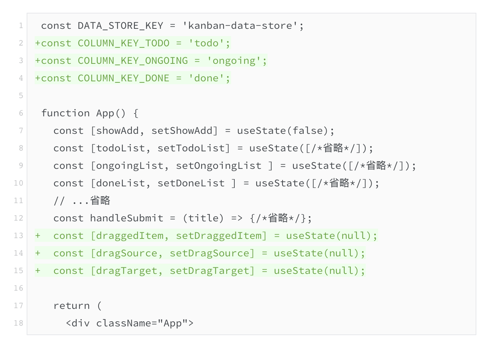
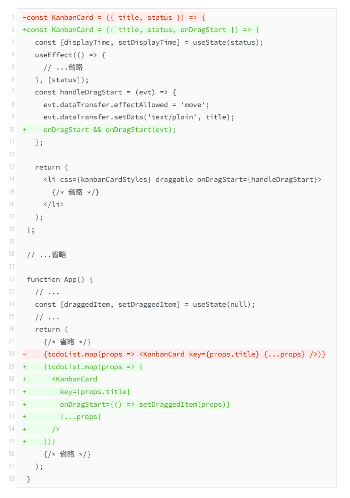
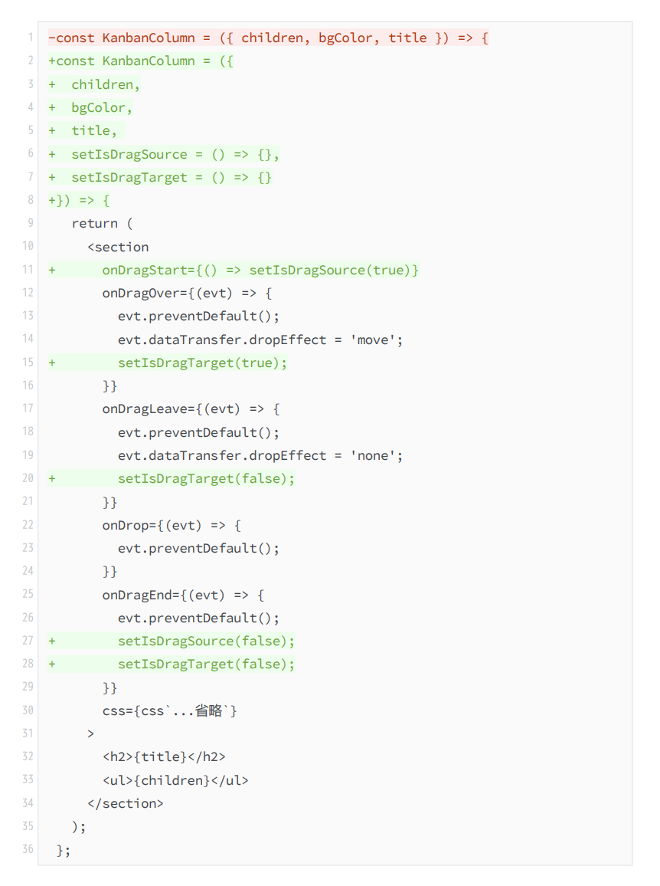
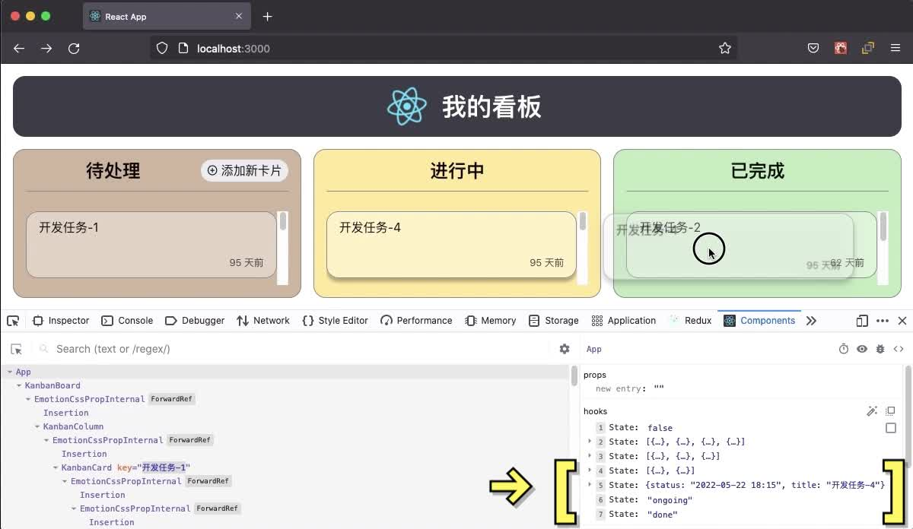
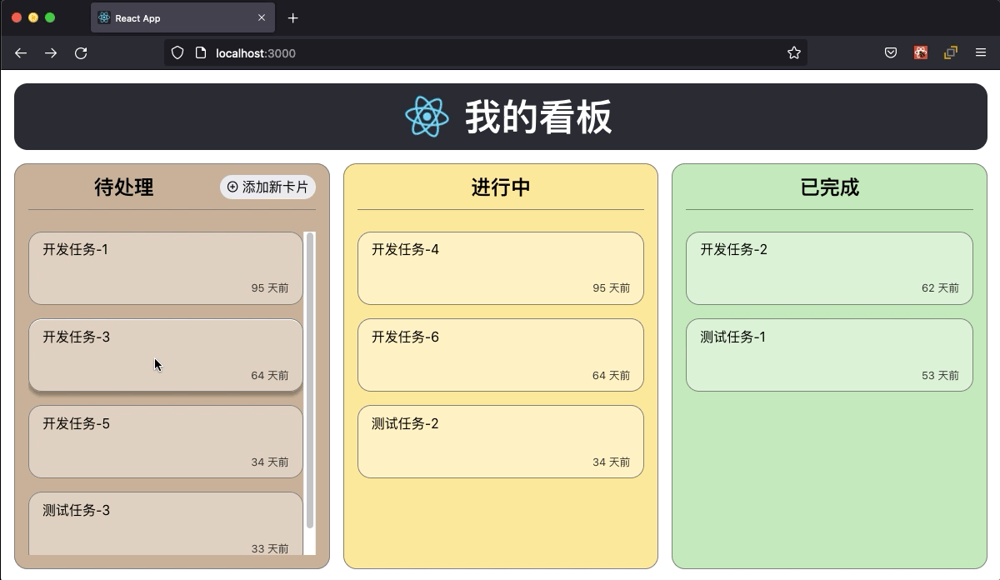
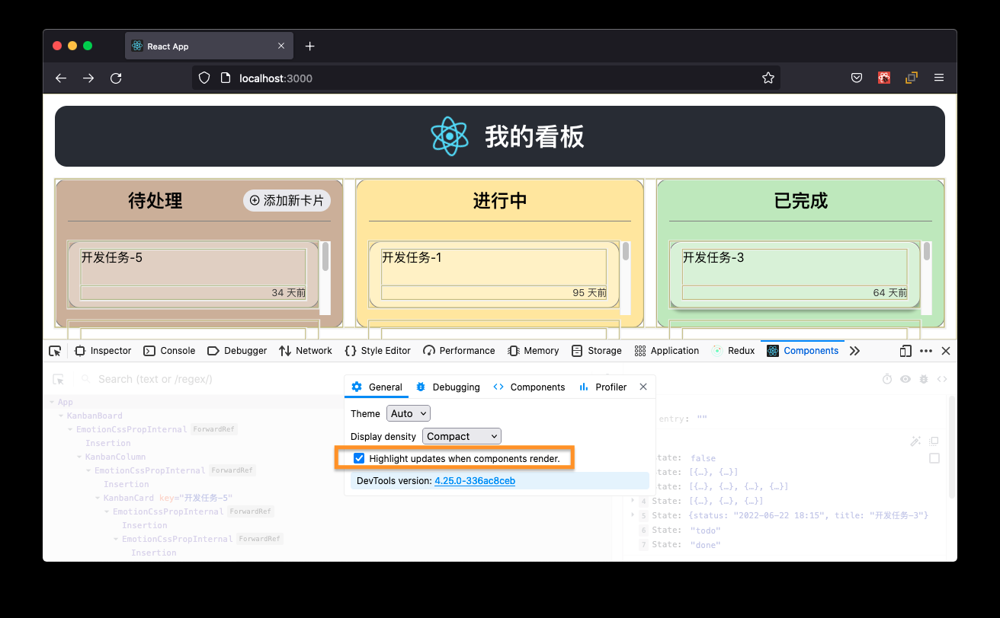

# 11 | 事件处理：React合成事件是什么？为什么不用原生DOM事件？

你好，我是宋一玮，欢迎回到 React 应用开发的学习。

前面两节课我们学习了 React Hooks，加上前面第 8 节课学到的组件生命周期方法，这些 API都可以用来编写组件逻辑。不过到目前为止，我们讲到的组件逻辑以展示为主，与用户的交互是偏单向的，而在实际项目中，Web 应用也包含很多双向交互。实现双向交互的一个重要途径，就是事件处理。

在浏览器中，事件处理不是一个新鲜的概念。标准的 DOM API 中，有完整的 DOM 事件体系。利用 DOM 事件，尤其是其捕获和冒泡机制，网页可以实现很多复杂交互。

React 里内建了一套名为合成事件（SyntheticEvent）的事件系统，和 DOM 事件有所区别。不过第一次接触到合成事件概念的开发者，常会有以下疑问：

- 什么是 React 合成事件？

- 为什么要用合成事件而不直接用原生 DOM 事件？

- 合成事件有哪些使用场景？

- 有哪些场景下需要使用原生 DOM 事件？

经过这节课的学习，你将了解到合成事件的底层仍然是 DOM 事件，但隐藏了很多复杂性和跨

```
浏览器时的不一致性，更易于在 React 框架中使用。在 oh-my-kanban 出现过的受控组件，
```

就是合成事件的重要使用场景之一。此外，我们还会利用其他合成事件为看板卡片加入拖拽功能，顺便了解一下合成事件的冒泡捕获机制。最后，我会介绍一些在 React 中使用原生 DOM事件的场景。

## 什么是 React 合成事件？

如果你很熟悉原生 DOM 事件的使用，那你应该很熟悉这种写法：

```xml
<!-- 这是HTML不是JSX -->
<button onclick="handleClick()">按钮</button>
<input type="text" onkeydown="handleKeyDown(event)" />
在 React 中，HTML 元素也有类似的、以 on* 开头的事件处理属性。最直接的不同是，这些
属性的命名方式遵循驼峰格式（camelCase），如onClick、onKeyDown。在 JSX 中使用这
```

些属性时，需要传入函数，而不能是字符串：

```xml
const Component = () => {
 const handleClick = () => {/* ...省略 */};
 const handleKeyDown = evt => {/* ...省略 */};
 return (
   <>
     {/* 这次是JSX了 */}
     <button onClick={handleClick}>按钮</button>
     <input type="text" onKeyDown={evt => handleKeyDown(evt)} />
   </>
 );
};
以上面的 button 为例，开发者将 handleClick 函数传入 onClick 属性。在浏览器中，
当用户点击按钮时，handleClick 会被调用，无论开发者是否需要，React 都会传入一个描
```

述点击事件的对象作为函数的第一个参数。而这个对象就是 React 中的合成事件（SyntheticEvent）。

合成事件是原生 DOM 事件的一种包装，它与原生事件的接口相同，根据 W3c 规范，React内部规范化（Normalize）了这些接口在不同浏览器之间的行为，开发者不用再担心事件处理的浏览器兼容性问题。

## 合成事件与原生 DOM 事件的区别

包括刚才提到的，对事件接口在不同浏览器行为的规范化，合成事件与原生 DOM 事件之间也有着一系列的区别。

### 注册事件监听函数的方式不同

监听原生 DOM 事件基本有三种方式。

1. 与 React 合成事件类似的，以内联方式写在 HTML 标签中：

```xml
<button id="btn" onclick="handleClick()">按钮</button>
```

2. 在 JS 中赋值给 DOM 元素的事件处理属性：

```
document.getElementById('btn').onclick = handleClick;
```

```javascript
在 JS 中调用 DOM 元素的 addEventListener 方法（需要在合适时机调用
removeEventListener 以防内存泄漏）：
document.getElementById('btn').addEventListener('click', handleClick);
而合成事件不能通过 addEventListener 方法监听，它的 JSX 写法等同于 JS 写法：
const Button = () => (<button onClick={handleClick}>按钮</button>);
// 编译为
const Button = () => React.createElement('button', {
 onClick: handleClick
}, '按钮');
有时我们需要以捕获方式监听事件，在原生事件中以addEventListener 方法加入第三个参
```

数：

```
div.addEventListener('click', handleClick, true);
而在 React 合成事件中，则需要用在事件属性后面加一个 Capture 后缀：
() => (<div onClickCapture={handleClick}>...</div>);
```

### 特定事件的行为不同

React 合成事件规范化了一些在各个浏览器间行为不一致，甚至是在不同元素上行为不一致的

```sql
事件，其中有代表性的是 onChange 。
在 Chrome 或 Firefox 中，一个文本框 <input type="text" /> 的 change 事件发生在
文本框内容被改变、然后失去焦点的时候。不过，对一个下拉框<select> 的change 事
```

件，Chrome 和老版本 Firefox（v63 以前）就有分歧了，前者每次按下键盘箭头键都会触发

```sql
change 事件，但后者只有下拉框失去焦点时才会触发。
而在 React 中，<input> 、<textarea> 和 <select> 三种表单元素的onChange 合成事
```

件被规范成了一致的行为：在不会导致显示抖动的前提下，表单元素值的改变会尽可能及时地触发这一事件。

```
以文本框为例，同样是输入一句话，合成 change 事件发生的次数要多于原生的次数，在
onChange 事件处理函数被调用时，传入的事件对象参数提供的表单元素值也尽可能是最新
```

的。

```
顺便提一下，原生 change 事件行为的不一致，只是前端领域浏览器兼容性问题的冰山一
```

角。React 这样的框架为我们屏蔽了这些疑难杂症，我们在享受便利的同时，也需要知道框架们在负重前行。

```
除了 onChange ，合成事件也规范化了 onBeforeInput 、 onMouseEnter 、
onMouseLeave 、 onSelect 。
```

### 实际注册的目标 DOM 元素不同

这一点其实并不影响合成事件处理接口的使用，更多是在讲底层实现。

```
对于下面这个原生 DOM 事件，它的当前目标（ event.currentTarget ）是很明确的，就
是 ID 为 btn 的按钮：
document.getElementById('btn').addEventListener('click', handleClick);
```

但合成事件就不一样了！

```
我们在 oh-my-kanban 的代码，“添加新卡片”的 onClick 事件处理函数 handleAdd 中设
个断点，传入的 evt 参数就是一个合成事件，已知通过 evt.nativeEvent 属性，可以得到
```

这个合成事件所包装的原生事件。

看一下这几个值：

```
evt.currentTarget
evt.target
evt.nativeEvent.currentTarget
evt.nativeEvent.target
可以看到，不出意外地，两种事件的 target 都是按钮元素本身，合成事件的
currentTarget 也是按钮元素，这是符合 W3c 规范的；但原生事件的 currentTarget
不再是按钮，而是 React 应用的根容器 DOM 元素 <div id="root"></div> ：
```



```
这是因为 React 使用了事件代理模式。React 在创建根（ createRoot ）的时候，会在容器
```

上监听所有自己支持的原生 DOM 事件。当原生事件被触发时，React 会根据事件的类型和目标元素，找到对应的 FiberNode 和事件处理函数，创建相应的合成事件并调用事件处理函数。

从表层接口上看，合成事件的属性是符合 W3C 事件规范的，这就屏蔽了不同浏览器原生DOM 事件可能产生的不一致。

## 受控组件与表单

```xml
表单处理是前端领域一个常见需求，在 React 中也是一个重要场景。我们看一下目前 oh-my-
kanban 项目中唯一的表单代码（省略了部分代码）：
const KanbanNewCard = ({ onSubmit }) => {
 const [title, setTitle] = useState('');
 const handleChange = (evt) => {
   setTitle(evt.target.value);
 };
 // ...省略
 return (
   <li>
     <h3>添加新卡片</h3>
     <div>
       <input type="text" value={title} onChange={handleChange} />
     </div>
   </li>
 );
};
用户在文本框中输入文本时，会触发 onChange 合成事件，调用 handleChange(evt) 函
数，handleChange 函数又会将文本框变更后的值保存在组件 state title 中，state 的变化
导致组件重新渲染，文本框的当前值会更新成 title ，与刚才的更新值保持一致。
```

可以看出，这一过程形成了一个闭环。这种以 React state 为单一事实来源（Single Sourceof Truth），并用 React 合成事件处理用户交互的组件，被称为“受控组件”。

除了文本框之外，大部分表单元素，包括单选框、多选框、下拉框等都可以做成受控组件。当这些元素组合成一个表单时，开发者可以很容易获取到任一时刻的表单数据，然后进一步做验证、提交到服务器端等操作。

```xml
其实看板新卡片组件里文本框的 onKeyDown ，可以看作是提交表单。用户按回车后，
handleKeyDown 函数会通过 onSubmit 属性将表单值传给父组件：
const KanbanNewCard = ({ onSubmit }) => {
 const [title, setTitle] = useState('');
 const handleChange = (evt) => {
   setTitle(evt.target.value);
 };
 const handleKeyDown = (evt) => {
   if (evt.key === 'Enter') {
     onSubmit(title);
   }
 };
 return (
   <li>
     <h3>添加新卡片</h3>
     <div>
       <input type="text" value={title}
         onChange={handleChange} onKeyDown={handleKeyDown} />
     </div>
   </li>
 );
};
你也可以选择显式地将这些表单元素集中在一个 <form> 表单里，这样你就可以利用表单的
onSubmit 事件来规范提交表单的时机。但要注意，这里需要禁用掉表单提交事件的默认行
```

为：

```xml
const Form = () => {
 // ...省略
 const handleSubmit(evt) {
   console.log('表单元素state');
   evt.preventDefault();
 }
 return (
   <form onSubmit={handleSubmit}>
     {/* 省略 */}
     <input type="submit" value="提交" />
   </form>
 );
};
```

后续课程中还会多次涉及到受控组件和表单处理，我们在此暂不继续展开。

## 合成事件的冒泡与捕获

```
接下来，我们就利用刚学到的 React 事件处理，上手继续为 oh-my-kanban 添加功能，其间
```

也会涵盖合成事件的冒泡和捕获机制。

如果你对第 3 节课末尾提出的需求还有印象，这个坑我们终于要填了。

- 在三个看板列间，还有进一步的交互。1.对于任意看板列里的任意卡片，可以用鼠标拖拽到其他的看板列；

- 2.在释放拖拽时，被拖拽的卡片插入到目标看板列，并从原看板列中移除。

我们简单分析一下这个需求。将被拖拽的项目是看板卡片，有效的放置目标是看板列，放置成功时会移动这张卡片。这样的交互对应的数据逻辑如下：

- 被拖拽的卡片对应的数据，是待处理、进行中或已完成数组的其中一个成员；

- 放置成功时，该成员会从源头数组中移除，同时会添加到目标数组中。

那基本上就可以确定这个需求的实现方法了：

- 在看板列和看板卡片组件元素上，需要分别监听拖拽事件；

- 在组件状态中应记录当前被拖拽卡片的数据，以及哪个看板列对应的的数组是拖拽源头，哪个是放置目标。

```
现在来到 oh-my-kanban 的  src/App.js 文件，让我们先为看板卡片 KanbanCard 组件
的 <li> 元素添加 draggable 和  onDragStart 属性：
```



```xml
然后为看板列 KanbanColumn 组件的 <section> 元素添加 onDragOver 、
onDragLeave、onDrop 、onDragEnd 属性：
const KanbanColumn = ({ children, bgColor, title }) => {
 return (
   <section
     onDragOver={(evt) => {
       evt.preventDefault();
       evt.dataTransfer.dropEffect = 'move';
     }}
     onDragLeave={(evt) => {
       evt.preventDefault();
       evt.dataTransfer.dropEffect = 'none';
     }}
     onDrop={(evt) => {
       evt.preventDefault();
     }}
     onDragEnd={(evt) => {
       evt.preventDefault();
     }}
     css={css`...省略`}
   >
     <h2>{title}</h2>
     <ul>{children}</ul>
   </section>
 );
};
```

这时在浏览器里已经可以拖拽卡片了，但放置时貌似没什么反应，动图展示如下：



```
接下来，需要在根部的 App 组件里创建三个新的 state，分别是 draggedItem 、
dragSource 、 dragTarget ，以及作为dragSource 和 dragTarget 枚举值的三个
COLUMN_KEY_* 常量：
```



```
这时我们需要在看板卡片 KanbanCard 组件 onDragStart 事件中更新 draggedItem 状态的
```

值，但这个 state 是在 App 组件中维护的，那么如何才能让 KanbanCard 修改它呢？

是的，跟之前的 onSubmit 一样，将更新函数通过 props 传给 KanbanCard，KanbanCard 会在内部的 onDragStart 中调用它：



上面代码只展示了 todoList，另外两个组件列，也就是 ongoingList 和 doneList 也要做相同处理，你可以自己上手试一试。

```
然后来看，如何在看板列 KanbanColumn 中设置dragSource 和 dragTarget 。
为了让 KanbanColumn 内部的逻辑更清晰些，我没有把dragSource 和 dragTarget 直接
```

传给 KanbanColumn，而是为它添加了两个修改布尔值的函数 props，也就是setIsDragSource 和 setIsDragTarget：



```
上面的 KanbanCard 的代码中，<li> 已经监听过 onDragStart 事件，在 KanbanColumn
的 <section> 中是第二次出现了。在运行时，由于 HTML 元素的onDragStart 事件在触
```

发后会冒泡（Event Bubbling）到祖先元素，所以这两个事件处理函数都会执行。

对应的，在 App 组件中需要设置这些 props：

```javascript
const DATA_STORE_KEY = 'kanban-data-store';
const COLUMN_KEY_TODO = 'todo';
const COLUMN_KEY_ONGOING = 'ongoing';
const COLUMN_KEY_DONE = 'done';
function App() {
  // ...省略
  const [draggedItem, setDraggedItem] = useState(null);
  const [dragSource, setDragSource] = useState(null);
  const [dragTarget, setDragTarget] = useState(null);
  return (
    {/* 省略 */}
-    <KanbanColumn bgColor={COLUMN_BG_COLORS.todo} title={
      /* ... */
-    }>
+    <KanbanColumn
+      bgColor={COLUMN_BG_COLORS.todo}
+      title={
        /* ... */
+      }
+      setIsDragSource={(isSrc) => setDragSource(isSrc ? COLUMN_KEY_TODO : null)}
+      setIsDragTarget={(isTgt) => setDragTarget(isTgt ? COLUMN_KEY_TODO : null)}
+    >
```

以上的代码只展示了待处理列的改法，进行中和已完成两列分别对应常量COLUMN_KEY_ONGOING 和 COLUMN_KEY_DONE，需要请你补全它们的setIsDragSource 和 setIsDragTarget。

这时我们借助 React Developer Tools 看看拖拽是如何修改 state 的，动图效果展示如下：



赞，符合预期。好了，最后也是最重要的一步，是加入 onDrop 的数据处理逻辑。首先是KanbanColumn 追加一个 onDrop 属性：

```xml
const KanbanColumn = ({
  children,
  bgColor,
  title,
  setIsDragSource = () => {},
  setIsDragTarget = () => {},
+  onDrop
}) => {
  return (
    <section
      onDragStart={() => setIsDragSource(true)}
      onDragOver={(evt) => {
        evt.preventDefault();
        evt.dataTransfer.dropEffect = 'move';
        setIsDragTarget(true);
      }}
      onDragLeave={(evt) => {
        evt.preventDefault();
        evt.dataTransfer.dropEffect = 'none';
        setIsDragTarget(false);
      }}
      onDrop={(evt) => {
        evt.preventDefault();
+        onDrop && onDrop(evt);
      }}
      onDragEnd={(evt) => {
        evt.preventDefault();
        setIsDragSource(false);
        setIsDragTarget(false);
      }}
      css={css`...省略`}
    >
      <h2>{title}</h2>
      <ul>{children}</ul>
    </section>
  );
};
```

然后在 App 组件中定义 handleDrop 函数，当前面的三个 state 满足条件时，修改源数组和目标数组，通过 onDrop 属性把同一个函数分别传递给三个 KanbanColumn。

在这里，为了减少代码重复，我在函数内部给三个数组的更新函数套了一个索引对象：

```xml
const COLUMN_KEY_TODO = 'todo';
const COLUMN_KEY_ONGOING = 'ongoing';
const COLUMN_KEY_DONE = 'done';
function App() {
 const [showAdd, setShowAdd] = useState(false);
 const [todoList, setTodoList] = useState([/*省略*/]);
 const [ongoingList, setOngoingList ] = useState([/*省略*/]);
 const [doneList, setDoneList ] = useState([/*省略*/]);
 // 省略
 const handleSubmit = (title) => {/*省略*/};
 const [draggedItem, setDraggedItem] = useState(null);
 const [dragSource, setDragSource] = useState(null);
 const [dragTarget, setDragTarget] = useState(null);
 const handleDrop = (evt) => {
   if (!draggedItem || !dragSource || !dragTarget || dragSource === dragTarget)
     return;
   }
   const updaters = {
     [COLUMN_KEY_TODO]: setTodoList,
     [COLUMN_KEY_ONGOING]: setOngoingList,
     [COLUMN_KEY_DONE]: setDoneList
   }
   if (dragSource) {
     updaters[dragSource]((currentStat) =>
       currentStat.filter((item) => !Object.is(item, draggedItem))
     );
   }
   if (dragTarget) {
     updaters[dragTarget]((currentStat) => [draggedItem, ...currentStat]);
   }
 };
 return (
   <div className="App">
     {/* 省略 */}
     <KanbanColumn
       bgColor={COLUMN_BG_COLORS.ongoing}
       title="进行中"
       setIsDragSource={(isDragSource) => setDragSource(isDragSource ? COLUMN_KE
       setIsDragTarget={(isDragTarget) => setDragTarget(isDragTarget ? COLUMN_KE
       onDrop={handleDrop}
     >
     {/* 省略 */}
   </div>
 );
}
```

现在让我们在浏览器中看看效果，动态展示如下：



恭喜你，大功告成！到目前为止，这个看板的功能总算是形成一个闭环了。这么重要的里程碑，请你务必提交到你的代码仓库里（也欢迎把你的代码链接分享在留言区）。

不过，刚才我们提到了合成事件的事件冒泡，你可能会问，那有事件捕获（Event Capture）

```
的例子吗？你可以把 src/App.js 文件中的 onDragStart 全局替换成
onDragStartCapture ，然后看看效果。
```

其实从交互上看不出区别，只是两个组件对应的事件处理函数的执行顺序颠倒了过来。关于事件冒泡和事件捕获的使用场景，后续的课程中还会涉及到。

## 什么时候使用原生 DOM 事件？

一般情况下，React 的合成事件已经能满足你的大部分需求了，有两种情况例外。

1. 需要监听 React 组件树之外的 DOM 节点的事件，这也包括了 window 和 document 对象的事件。注意注意的是，在组件里监听原生 DOM 事件，属于典型的副作用，所以请务必在useEffect 中监听，并在清除函数中及时取消监听。如：

```javascript
useEffect(() => {
 window.addEventListener('resize', handleResize);
 return function cleanup() {
   window.removeEventListener('resize', handleResize);
 };
}, []);
```

2. 很多第三方框架，尤其是与 React 异构的框架，在运行时会生成额外的 DOM 节点。在React 应用中整合这类框架时，常会有非 React 的 DOM 侵入 React 渲染的 DOM 树中。当需要监听这类框架的事件时，要监听原生 DOM 事件，而不是 React 合成事件。这同样也是 useEffect 或 useLayoutEffect 的领域。当然，只要你知道原理，也完全可以用原生 DOM 事件加上一些特殊处理来替代合成事件，但这种做法就没那么“React”了。

## 小结

这节课我们介绍了 React 合成事件，知道了合成事件是原生 DOM 事件的一种规范化的封装，也了解了它在注册监听方式、onChange 等特定事件的行为、实际注册的目标 DOM 这三个方面与原生 DOM 事件的区别。

然后在 oh-my-kanban 代码基础上，我们进一步学习了受控组件和表单处理，也上手为看板加入了卡片拖拽的功能，并顺路实践了合成事件的事件冒泡和事件捕获。

最后，我们还列举了一些合成事件力不能及，必须监听原生 DOM 事件的场景。按照老规矩，这里我也附上本节课所涉及的项目源代码：https://gitee.com/evisong/geektime-column-oh-my-kanban/releases/tag/v0.11.0

下节课我们将迎来组件逻辑开发的重头戏——单向数据流，了解数据如何在 React 组件中流转，学习如何设计和操控 React 应用的数据流。

## 思考题

1. 这节课我们讲到了合成事件的事件冒泡和事件捕获，我想请你设计一些实验，来验证事件处理函数在父子组件间的执行顺序。另外，我们也提到了在事件处理函数中可以通过调用

```
event.stopPropogation() 来阻止事件进一步冒泡或捕获，请你思考一下什么场景下
```

- 会用到。

2. 我们时不时也回来关注一下性能，我想请你在 React Developer Tools 中打开“组件渲染时高亮变化”。然后观察一下在拖拽操作期间，都有哪些组件做了无谓的渲染。



欢迎把你的思考和想法分享在评论区，我们下节课再见！
