# 13 | 组件表与里（下）：用接口的思路设计开发React组件

你好，我是宋一玮，欢迎回到 React 应用开发的学习。

上节课一开始就提到了，我们会用两节课的时间学习组件的“面子”和“里子”。那你可能会问了，上节课讲到的 React 单向数据流算是“面子”还是“里子”呢？我先卖个关子，学完这节课你就有答案了。

在面向对象编程实践中，接口就是天然的“面子”，接口实现就是“面子”后面的“里子”。那么这节课，我们就要借鉴面向接口编程的思路，一边探讨在 React 应用开发中接口会以什么形式存

```
在，一边继续上节课的 oh-my-kanban 大重构。在这节课的后半段，我们还会为 oh-my-
kanban 加入基础的管理员功能。
```

当学习完这节课，你会对 React 组件的分工和交互有更深入的理解，同时也会收获一个好用的看板应用。

下面我们开始这节课的内容。

## 面向接口编程

现代软件编程的一大最佳实践是面向接口编程。所谓软件接口（Software Interface），就是两个或多个模块间用来交换信息的一个共享的边界。

前端组件也有接口的概念，不同框架对接口的定义和使用都有所不同。这里举三个例子。

第一个例子，Angular 里的 Form，是一个命令式接口，开发者一般不需要自己实现它，因为Angular 框架里已经内置了实现：

```
interface Form {
 addControl(dir: NgControl): void
 removeControl(dir: NgControl): void
 getControl(dir: NgControl): FormControl
 addFormGroup(dir: AbstractFormGroupDirective): void
 removeFormGroup(dir: AbstractFormGroupDirective): void
 getFormGroup(dir: AbstractFormGroupDirective): FormGroup
 updateModel(dir: NgControl, value: any): void
}
```

第二个例子，Android 里的 ExpandableListAdapter，用于数据绑定：

```java
public interface ExpandableListAdapter {
 Object getChild(int groupPosition, int childPosition);
 View getChildView(int groupPosition, int childPosition, boolean isLastChild, Vi
 Object getGroup(int groupPosition);
 View getGroupView(int groupPosition, boolean isExpanded, View convertView, View
 void onGroupCollapsed(int groupPosition);
 void onGroupExpanded(int groupPosition);
 void registerDataSetObserver(DataSetObserver observer);
 void unregisterDataSetObserver(DataSetObserver observer);
}
```

第三个例子，Fultter 里甚至每个 class 默认都有一个隐式的 interface。

然而 React 从编程语言和框架层面都没有接口这个概念，那我们为什么还要把面向接口编程拉进这节课呢？

是的，我们不需要继承、多态，不需要去模拟 JS 语言里本没有的 interface 语法，也不用去纠结 TypeScript 的 interface 只能在编译阶段工作。我们需要的，只是面向接口的编程思想。可以用以下三点来概括这种编程思想。

第一，接口是抽象。《C++ 程序设计语言（第四版）》开篇就引用了计算机科学家戴维·韦勒（David Wheeler）的名言：“在计算机科学里，所有问题都可以通过引入一个新的抽象层来解决，除了抽象层过多这个问题本身”。从接口的角度，我们可以这样理解这句名言：

- 接口用途广泛；

- 接口容易被滥用；

- 接口即使有被滥用的风险，但它的重要性依然是不可替代的。

第二，接口是边界。“任何一个优雅的接口后面，都有一堆龌龊的实现。”这个段子多少有点极端，但很好地强调了以下几点：

- 接口是为外部设计的；

- 接口对外部隐藏了内部实现；

- 接口的调用者只需要知道接口的用法，不需要关注内部实现；

- 接口的实现者在开发内部实现时，与外部环境的交互应集中体现在接口上。

第三，接口是契约。现代 JS 开发很依赖于第三方库，不知道你有没有遇到过一种悲剧，本来用得好好的库，版本更新时引入了破坏性更新，然后你的应用也跟着被破坏了。这就好比，你花了大价钱办了游泳池的年卡，游了半年，有一天它突然改建成健身房了，老板狡辩说一样是强身健体，但现实是，你的自由泳还没学会呢！这就体现了契约的重要性：

- 越是广泛使用的接口，它就越是一种契约；

- 设计接口时，应考虑哪些功能是不会轻易改变的，哪些是有可能修改的；

- 实现者应该在保持接口不变的情况下更新内部实现；

- 接口的实现者破坏契约，可能会给调用者带来成倍的风险或损失。

好吧，抽象、边界、契约，接口确实很重要。但这与 React 又有什么关系呢？别急，下面马上揭晓。

## React 组件的接口

做个问卷调查，当你拿到一个开源组件库中的 React 组件，你会怎样使用它？现在你有三个选择：

1. 读文档；

2. 读源码；

3. 根据 IDE 的代码提示直接试写代码。

据我了解，最常见的方式还是读文档。比如AntD 的 Button 按钮 API 文档，里面会详细列举组件 props 的用法，其他开源 React 组件库也是类似的做法。这正说明了，props 就是一个React 组件的对外接口。了解了组件的 props，就了解了如何使用这个组件。

另外，子组件 children 也是一种 prop，可以成为接口的一部分。这也包括之前学过的真·子组件。有许多其他 JS 前端框架还提供了事件接口，但在 React 中是没有的，取而代之的是通过 props 传递事件处理回调函数。

这里要注意一下 context。如果组件内部消费了某个 context，那这个 context 就成为了组件的另一个输入，可以认为它是组件的隐式接口。

虽然我们大部分时候是在为自己的 React 应用开发组件，并没有在开发公共 React 组件库，但依旧可以用接口的概念去指导组件 props 的设计和使用。

## React 组件的接口实现

到这节课为止，我们学习的所有 React 概念都可以是 React 组件的接口实现，包括 props、state、context、事件处理、Hooks、子组件、组件样式等。

在设计一个 React 组件时，开发者需要斟酌外部接口和内部实现的关系，这包括但不限于：

- 哪些字段作为 props 暴露出来？

- 哪些抽取为 context 从全局获取？

- 哪些数据实现为组件内部的 state？

```
这些问题我们在接下来的 oh-my-kanban 大重构第二步中一一揭晓。
```

## 重构第二步：将逻辑转移到各组件中

这是上节课大重构第一步的后续。在重构第二步，我们会把 KanbanCard 逻辑转移到KanbanColumn 中，把 KanbanColumn 逻辑转移到 KanbanBoard 中。

### 2.1 将 KanbanCard 逻辑转移到 KanbanColumn 中

首先，我们重新审视一下 KanbanColumn 的职责。

目前 KanbanColumn 是一个具有样式的容器，能显示标题和列表，能处理拖拽事件。但有一个尴尬的现实，KanbanColumn 自身并没有限定它必须展示 KanbanCard 的列表，也没有限定拖拽对象必须是 KanbanCard。

这意味着 KanbanColumn 和 KanbanCard 是极为松耦合的，将 KanbanColumn 和KanbanCard 组合在一起，就成了它父组件的职责。

假设我们从产品经理那里拿到了一个《需求文档 v11.5. 最终. 绝对不改. 就改两张图.docx》，从目前的产品需求来看，KanbanColumn 与 KanbanCard 是强包含关系，在 KanbanColumn中封装 KanbanCard 的逻辑更有利于降低 KanbanColumn 父组件的复杂度，父组件甚至并不需要知道 KanbanCard 的存在，只需要关注 KanbanColumn 的接口即可。

那么在重构的这一步，我们就需要把 KanbanCard 相关的逻辑从 App 转移到 KanbanColumn中。

VSCode 的自动重构功能没有那么智能，因此接下来的步骤要请你手工进行了。手工重构不出错的一个小技巧是“少吃多餐”，即把一个大的重构任务分解成若干小的步骤，确保每个步骤是

```
可验证的。重构开始前，建议你提前在命令行中运行 npm start ，每当源码有改动，浏览器
```

中的页面会自动热更新，为你提供实时反馈。

先来到 src/KanbanColumn.js，为 KanbanColumn 组件增加一个 cardList 属性，默认值为空数组，用来接收卡片列表数据。

然后导入 KanbanCard 组件，从 App 组件中拷过来与之相关的 JSX 代码，循环渲染 cardList数组中的每条卡片数据。

注意，KanbanCard 用到了 setDraggedItem 函数，先别急着把拖拽卡片的逻辑移过来，现在把 setDraggedItem 从 KanbanColumn 的 props 传进来就好。添加新卡片的逻辑也不着急，暂时保留 children 属性。代码如下：

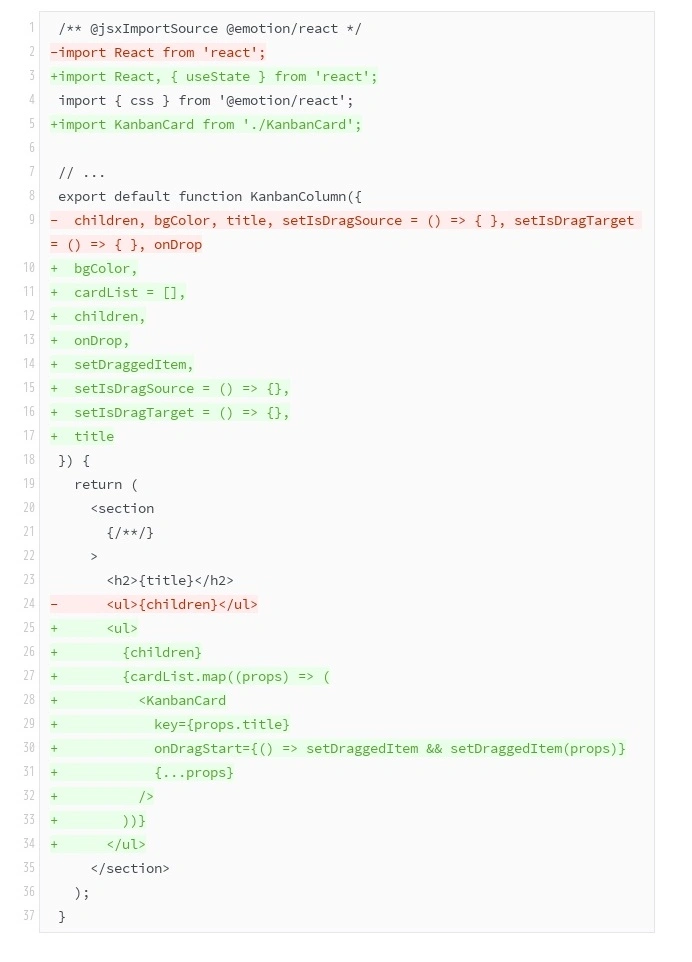

再来到 src/App.js 中。KanbanColumn 的接口变了，在 App 中的调用方式当然也要跟着变，记得在这边的 JSX 中删除 todoList 循环渲染的代码：

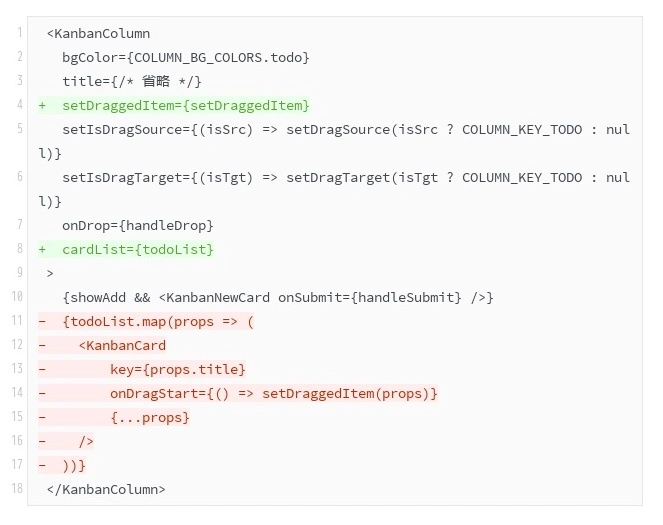

看一下浏览器中的页面，一切正常。那我们继续，把 src/App.js 中另外两个看板列也更新成新的 props：

```xml
return (
 <KanbanBoard>
   {/**/}
   <KanbanColumn
     bgColor={COLUMN_BG_COLORS.ongoing}
     title="进行中"
     setDraggedItem={setDraggedItem}
     setIsDragSource={(isSrc) => setDragSource(isSrc ? COLUMN_KEY_ONGOING : null
     setIsDragTarget={(isTgt) => setDragTarget(isTgt ? COLUMN_KEY_ONGOING : null
     onDrop={handleDrop}
     cardList={ongoingList}
   />
   <KanbanColumn
     bgColor={COLUMN_BG_COLORS.done}
     title="已完成"
     setDraggedItem={setDraggedItem}
     setIsDragSource={(isSrc) => setDragSource(isSrc ? COLUMN_KEY_DONE : null)}
     setIsDragTarget={(isTgt) => setDragTarget(isTgt ? COLUMN_KEY_DONE : null)}
     onDrop={handleDrop}
     cardList={doneList}
   />
 </KanbanBoard>
);
```

这样就把 KanbanCard 的逻辑都转移到了 KanbanColumn 中。接下来，还要继续转移添加新卡片的逻辑。我们依旧把各个看板列看作是同一种组件，把“添加新卡片”抽象为KanbanColumn 的一个可选功能。

回到 src/KanbanColumn.js，为 KanbanColumn 添加一个 canAddNew 属性，默认值为false。

当 canAddNew 设为 true 时，KanbanColumn 将展示“添加新卡片”按钮，点击这个按钮的后续操作也由 KanbanColumn 完成。导入 KanbanNewCard 组件，这样我们就可以把 showAdd这个 state，handleAdd、handleSubmit 函数，和“添加新卡片”按钮、条件渲染KanbanNewCard 的 JSX 代码都拷过来。

有一个例外，handleSubmit 中需要一段向卡片列表添加数据的逻辑，我们还是希望从外面传进来，为此我们需要再加入一个 onAdd 属性。这时 children 属性就没用了，我们可以放心删掉它。代码如下：

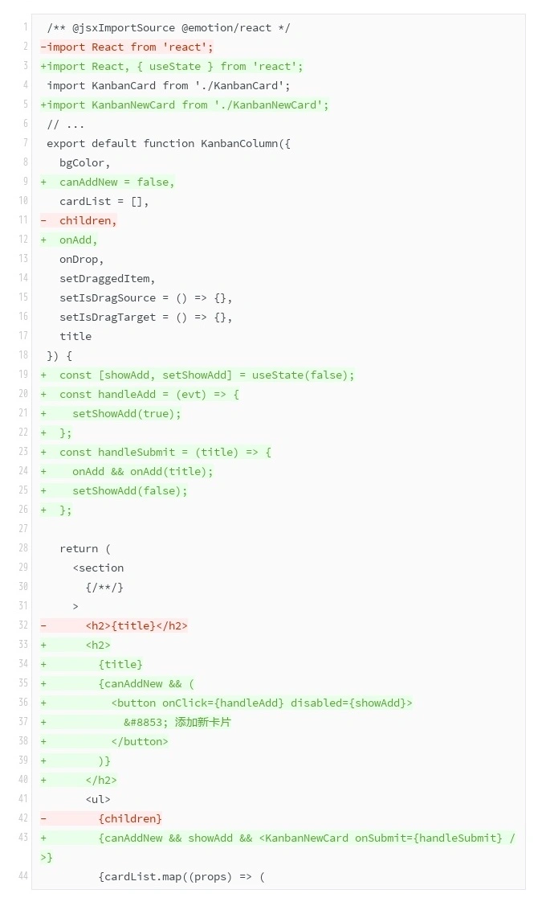

在 src/App.js 中删掉刚才已经封装到 KanbanColumn 中的逻辑，只为“待处理”看板列设置canAddNew 为 true，并传入所需的 onAdd 回调函数：

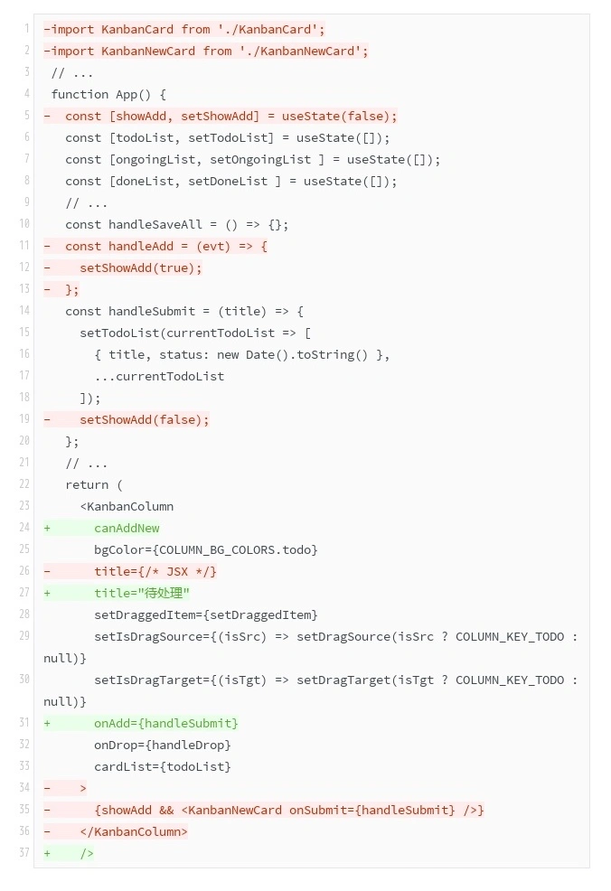

好了，目前只有 KanbanColumn 具有 KanbanCard、KanbanNewCard 的知识了，App 不再关心看板卡片组件，只需要把数据和回调函数通过 props 传给三个 KanbanColumn 即可。“读取中”看板列比较特殊，没有数据传入，所以也不会展示卡片列表。

### 2.2 将 KanbanColumn 逻辑转移到 KanbanBoard 中

在上一步，KanbanColumn 与 KanbanCard 的强包含关系为重构提供了正当的理由。相比之下，KanbanBoard 与 KanbanColumn 之间的关系好像没有那么强，但我们可以换个角度考虑。

目前一共有四种 KanbanColumn，它们之间虽然是平级关系，但互相的逻辑关联还是比较强的，这包括读取状态、代表步骤、拖拽起点和放置目标，这些逻辑比起 App，放在KanbanBoard 中内聚性更强些。

说干就干，这一步的重构，我们会把 KanbanColumn 相关的逻辑从 App 转移到KanbanBoard 中。

在正式开始这一步重构之前，容我先做一个小改动。把创建单个卡片数据对象的职责从 App一路转移到 KanbanNewCard 中，这样 App 就只负责更改看板列数组。

来到 src/App.js，为了代码清晰些，姑且给 handleSubmit 函数改个名：

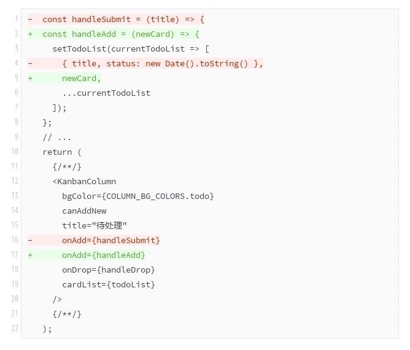

再是 src/KanbanColumn.js：

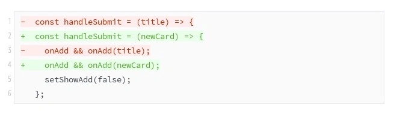

最后来到 src/KanbanNewCard.js，在这里创建新卡片数据对象：

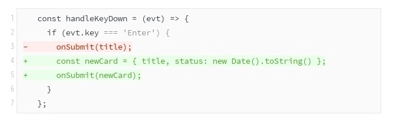

现在查看浏览器，页面应该依然可以正常工作。

来到 src/KanbanBoard.js，我们对 KanbanBoard 组件直接做一次大改动，把 4 个KanbanColumn，以及拖拽的逻辑都拷进来。KanbanBoard 的 props 里删去 children，增加isLoading、三个看板列分别的数组数据，onAdd、onDrop 直接透传进来：

```bash
import KanbanColumn from './KanbanColumn';
// ...
const COLUMN_BG_COLORS = {
 loading: '#E3E3E3',
 todo: '#C9AF97',
 ongoing: '#FFE799',
 done: '#C0E8BA'
};
const COLUMN_KEY_TODO = 'todo';
const COLUMN_KEY_ONGOING = 'ongoing';
const COLUMN_KEY_DONE = 'done';
export default function KanbanBoard({
 isLoading = true,
 todoList,
 ongoingList,
 doneList,
 onAdd,
 onDrop
}) {
 const [draggedItem, setDraggedItem] = useState(null);
 const [dragSource, setDragSource] = useState(null);
 const [dragTarget, setDragTarget] = useState(null);
 return (
   <main css={kanbanBoardStyles}>
     {isLoading ? (
       <KanbanColumn title="读取中..." bgColor={COLUMN_BG_COLORS.loading} />
     ) : (<>
       <KanbanColumn
         canAddNew
         bgColor={COLUMN_BG_COLORS.todo}
         title="待处理"
         setDraggedItem={setDraggedItem}
         setIsDragSource={(isSrc) => setDragSource(isSrc ? COLUMN_KEY_TODO : nul
         setIsDragTarget={(isTgt) => setDragTarget(isTgt ? COLUMN_KEY_TODO : nul
         onAdd={onAdd}
         onDrop={onDrop}
         cardList={todoList}
       />
       <KanbanColumn
         bgColor={COLUMN_BG_COLORS.ongoing}
         title="进行中"
         {/**/}
         onDrop={onDrop}
         cardList={ongoingList}
       />
       <KanbanColumn
         bgColor={COLUMN_BG_COLORS.done}
         title="已完成"
         {/**/}
         onDrop={onDrop}
         cardList={doneList}
       />
     </>)}
   </main>
 );
}
```

在 src/App.js 中移除相关代码，handleDrop 函数因为访问不到那三个与拖拽相关的 state 了，暂时先替换成一个空函数传给 onDrop：

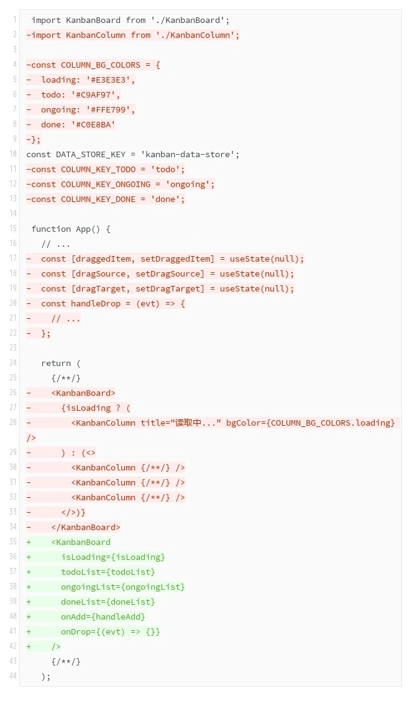

这时查看浏览器，应用除了拖拽卡片不能生效，其他功能依旧正常。

好，我们继续修复拖拽功能。在 src/KanbanBoard.js 的 KanbanBoard 组件上加一个onRemove 属性，用来从源看板列中移除卡片数据；再复用 onAdd 属性，调整一下回调函数的参数个数，用来向目标看板列中添加卡片数据。

这时就可以把原来的 handleDrop 函数拿进来了：

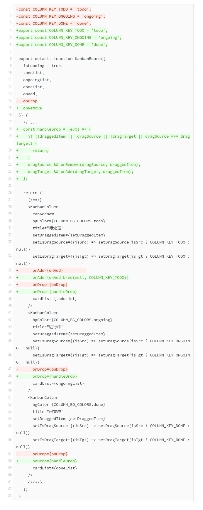

回到 src/App.js，删除 KanbanColumn 相关的代码。这下 App 组件只需要把三个看板列的数据，以及修改数据的回调函数传给 KanbanBoard，其他就不用管了。KanbanBoard 具有所有KanbanColumn 的知识，只要拿到 props，就能展示 KanbanColumn，并提供卡片拖拽功能了。

目前 src/App.js 的完整代码如下：

```bash
/** @jsxImportSource @emotion/react */
import React, { useEffect, useState } from 'react';
// ...
import KanbanBoard, {
 COLUMN_KEY_DONE,
 COLUMN_KEY_ONGOING,
 COLUMN_KEY_TODO,
} from './KanbanBoard';
const DATA_STORE_KEY = 'kanban-data-store';
function App() {
 const [todoList, setTodoList] = useState([/**/]);
 const [ongoingList, setOngoingList ] = useState([/**/]);
 const [doneList, setDoneList ] = useState([/**/]);
 const [isLoading, setIsLoading] = useState(true);
 // ...
 const updaters = {
   [COLUMN_KEY_TODO]: setTodoList,
   [COLUMN_KEY_ONGOING]: setOngoingList,
   [COLUMN_KEY_DONE]: setDoneList
 };
 const handleAdd = (column, newCard) => {
   updaters[column]((currentStat) => [newCard, ...currentStat]);
 };
 const handleRemove = (column, cardToRemove) => {
   updaters[column]((currentStat) =>
     currentStat.filter((item) => !Object.is(item, cardToRemove))
   );
 };
 return (
   <div className="App">
     <header className="App-header">
       {/**/}
     </header>
     <KanbanBoard
       isLoading={isLoading}
       todoList={todoList}
       ongoingList={ongoingList}
       doneList={doneList}
       onAdd={handleAdd}
       onRemove={handleRemove}
     />
   </div>
 );
}
export default App;
```

恭喜你！截至目前，oh-my-kanban 的各个组件边界清晰、各司其职，已经是合格的接口了！当这些组件在一起工作时，数据流向也更显著了。你可以把第 12 节课以前的代码与现在的代码做个对比，回味一下完成重构（折腾）的喜悦。

重构到这里就告一段落了，接下来我们需要回顾整个过程，看看我们在其中学到的新技巧，以及解决了什么问题。

## 状态提升

事实上我们还可以继续重构，但是也应该知道重构其实是没有尽头的，一般而言达到重构目标就该收手了。

这里罗列一下 oh-my-kanban 现有组件中的 state。

```
App
- todoList
- ongoingList
- doneList
- isLoading
KanbanBoard
- draggedItem
- dragSource
- dragTarget
KanbanColumn
- showAdd
KanbanCard
- displayTime
KanbanNewCard
- title
```

前面提到过，state 是组件的内部实现。这么一看，KanbanColumn、KanbanCard、KanbanNewCard 还挺符合的。KanbanBoard 的 draggedItem 稍有特殊，它的 state 更新函数 setDraggedItem 是通过 props 传递给 KanbanColumn 调用的。

App 的情况又有不同。它的四个 state 都通过 props 传给了 KanbanBoard，同时它还把三个看板列数组的 state 更新函数做了封装，把 Add 和 Remove 的回调函数下放给了KanbanBoard 和 KanbanColumn。

重构上头的你跃跃欲试：“能把 App 的四个 state 转移到 KanbanBoard 里吗？”

如果这样做，就意味着你需要把读写 localStorage 的逻辑也移到 KanbanBoard 里。这引出了一个问题，“保存所有卡片”的按钮是放在 App 标题栏的，总不能把标题栏也移到KanbanBoard 里吧？毕竟逻辑上太不相关了。

这时我们就认为，这四个 state 是 App 标题栏和 KanbanBoard 的共享应用状态，需要放在App 标题栏和 KanbanBoard 共同的父组件中（虽然我们没有把 App 标题栏抽取成独立的组件，但逻辑上是一样的）。

这个过程被称作状态提升（Lifting State Up），也是我们在做 React 组件设计开发时会经常用到的一个技巧。

## 用 context 解决属性钻取问题

产品经理过来泼冷水了：“目前的看板卡片支持的操作只有添加新卡片，以及在不同看板列中移动；不能修改也就算了，还不能删除。”

然后我们心如死灰地从他 / 她手里拿到了新文档《需求文档 v13.0.docx》，里面新加入了管理员功能和删除卡片功能：

1. 用户可以在标题栏中启用管理员模式，默认禁用；

2. 启用管理员模式时，每张看板卡片显示删除按钮；

3. 用户点击删除按钮时，卡片从看板列中消失，卡片数据被删除；

4. 禁用管理员模式时，隐藏看板卡片中的删除按钮。

我们先看管理员模式，基本上可以认为是一个布尔值，先作为 state 放在 App 里，然后：

1. App 通过 props 传递给 KanbanBoard；

2. KanbanBoard 通过 props 传递给 KanbanColumn；

3. KanbanColumn 再通过 props 传递给 KanbanCard。

这一层一层传有点累吧？也没有什么额外逻辑，就是透传。这个现象就被称作属性钻取（Props Drilling）。虽然显式的传递一目了然，但给开发过程还是带来了些许繁琐，我们看看该怎么解决这个问题。

React 为这个场景设计了 context 上下文，我们在上节课讲到了 context 的概念和用法，现在就来实际在 oh-my-kanban 中使用它。

新建一个文件，src/context/AdminContext.js，代码如下：

```bash
import React from 'react';
const AdminContext = React.createContext(false);
export default AdminContext;
```

在 src/App.js 中使用这个 context，顺便微调一下 handleRemove 的实现，让它只判断卡片标题相等：

```xml
import AdminContext from './context/AdminContext';
// ...
function App() {
 // ...
 const handleRemove = (column, cardToRemove) => {
   updaters[column]((currentStat) =>
     currentStat.filter((item) => item.title !== cardToRemove.title)
   );
 };
 const [isAdmin, setIsAdmin] = useState(false);
 const handleToggleAdmin = (evt) => {
   setIsAdmin(!isAdmin);
 };
 return (
   <div className="App">
     <header className="App-header">
       <h1>
         我的看板
         <button onClick={handleSaveAll}>保存所有卡片</button>
         <label>
           <input type="checkbox" value={isAdmin} onChange={handleToggleAdmin} /
           管理员模式
         </label>
       </h1>
       
     </header>
     <AdminContext.Provider value={isAdmin}>
       <KanbanBoard
         isLoading={isLoading}
         todoList={todoList}
         ongoingList={ongoingList}
         doneList={doneList}
         onAdd={handleAdd}
         onRemove={handleRemove}
       />
     </AdminContext.Provider>
   </div>
 );
}
```

样式也微调一下，在 src/App.css 中加入如下代码：

```
.App-header > h1 > * {
 margin-left: 1rem;
}
.App-header > h1 > label {
 font-size: initial;
 font-weight: initial;
}
```

在 src/KanbanCard.js 中消费这个 context，条件渲染一个删除按钮，按钮点击直接调用onRemove：

```bash
export default function KanbanCard({ title, status, onDragStart, onRemove }) {
 // ...
 const isAdmin = useContext(AdminContext);
 return (
   <li css={kanbanCardStyles} draggable onDragStart={handleDragStart}>
     <div css={kanbanCardTitleStyles}>{title}</div>
     <div css={css`
     `} title={status}>{displayTime} {isAdmin && onRemove && (
       <button onClick={() => onRemove({title})}>X</button>
     )}</div>
   </li>
 );
}
最后，记得在 src/KanbanBoard.js 和 src/KanbanColumn.js 中，把 onRemove 通过
属性钻取传给 KanbanCard：
<KanbanColumn
 bgColor={COLUMN_BG_COLORS.done}
 title="已完成"
 {/**/}
 onDrop={handleDrop}
 onRemove={onRemove.bind(null, COLUMN_KEY_DONE)}
 cardList={doneList}
/>
```

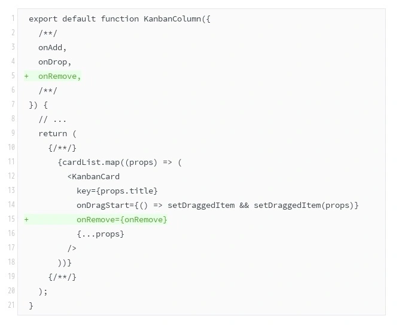

好了，App 的 isAdmin 和 handleRemove 分别通过 context 和 props 两条路径在KanbanCard 顺利会师。

回到浏览器看看效果。有了，勾选管理员模式，看板卡片就会显示出删除按钮。

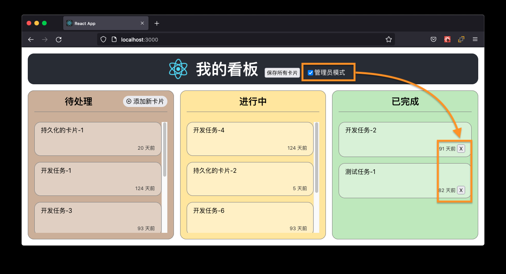

删除功能是可用的：

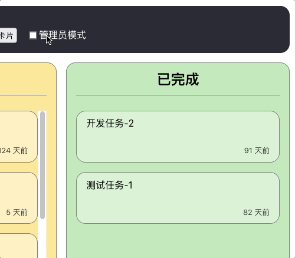

需求完成！单从功能看，我们的 oh-my-kanban 产品已经基本可以上线了。当然距离实际的上线标准，我们还有很多工作要做，在后续课程会陆续展开。

在实现这个需求的过程中，我们看到了属性钻取的真实场景，也展示了如何用 context 解决这个痛点。

## 小结

这节课我们学习了怎么用面向接口编程的思维来设计开发 React 组件，也就是把 React 组件的 props 和 context 看作是接口，用 state、context、事件处理、Hooks、子组件、组件样式等技术实现组件接口。

然后我们继续了上节课开始的 oh-my-kanban 大重构，把 App 组件中的大部分逻辑都分散转移到了 KanbanBoard、KanbanColumn 中。同时也介绍了状态提升这个技巧，并在 oh-my-kanban 首次加入了 context 代码，解决了一个属性钻取问题。

除了收获一个基本可用的 oh-my-kanban 应用，也借着这次重构验证了面向接口编程的好处，进一步掌握了 React 组件的“面子”和“里子”。

下节课，我会带着你扔掉 CRA，自己从零搭建一个 React 项目，把 oh-my-kanban 的代码迁移进去，并顺带复习从第 3 节课开始学习到的所有内容。

最后附上这节课的源码：https://gitee.com/evisong/geektime-column-oh-my-kanban/releases/tag/v0.13.0

## 思考题

1. 上节课和这节课学习了单向数据流，也在 oh-my-kanban 项目有了实际的应用。你能描述一下 oh-my-kanban 中都有哪些数据流吗？

2. 对于现代 JS 前端框架，一提到组件树，总离不了组件间通信这个概念。已知 React 的组件间通信是通过单向数据流实现的，你能归纳出父组件与子组件、子组件与子组件之间通信的模式吗？

好了，这节课的内容就到这里。如果你学完之后有动手实践，可以在留言区回复一个“M”，和我分享这份重构的喜悦。我们下节课再见。
