# 14 | 现代化React：现代工程化技术下的React项目

你好，我是宋一玮，欢迎回到 React 应用开发的学习。

在第12、13节课，我们学习了 React 的单向数据流，以及怎么用面向接口编程的思想指导组件设计开发。同时我们一起为 oh-my-kanban 做了一次大重构，实践了刚学到的概念和方法。可以说，我们在学习写 React 应用代码方面，已经获得了阶段性进展。

```
但也需要知道，写出来的源码毕竟还不能用来上线，还得经过 npm run build 打包构建出
```

生产环境代码，然后才能上线。你可能会好奇，这个命令都做了什么？这个命令是 CRA，由Create React App 脚手架工具提供，它的内部对开发者而言是个黑盒。要想了解它，我们得先把黑盒打开，或者，用更好的方式：自己搭一个白盒出来。

还记得在上节课末尾的预告吗？这节课我会带着你，不依赖 CRA，用现代的工程化技术重新搭建一个 React 项目，然后把 oh-my-kanban 的代码迁移过来，让它真正成为你自己的项目。

好的，现在开始这节课的内容。

## CRA 为我们做了什么？

在第 3 节课，我们用 FB 官方提供的 CRA 脚手架工具创建了 oh-my-kanban 项目，在这之后我们就一直专注于代码开发，再也没有关注过项目配置了。现在 oh-my-kanban 项目开发已经步入正轨，是时候回过头来看看 CRA 为我们做了哪些事情。

在项目根目录 package.json 文件的 scripts 节点下，有四个 NPM 命令。

```
最先接触的 npm start ，你对它的使用应该已经比较熟悉了。这个命令启动了一个开发服务
```

器（Dev Server），内置了开发环境构建（Development Build）、监听文件变化（Watch）、增量构建（Incremental Build）、模块热替换（Hot Module Replacement）等功能。其实这些功能你在前面的开发实践中都用到了。

与这个命令对应的还有生产环境构建。

### 生产环境构建

```
我想请你在 oh-my-kanban 项目根目录运行一遍 npm run build ，它会打包构建出生产环
```

境的代码。现在只看生成的 JS/CSS 文件：

```
build/static
├── css
│   ├── main.9411d92b.css            1.2K
│   └── main.9411d92b.css.map
├── js
│   ├── 787.4ea3479b.chunk.js        4.5K
│   ├── 787.4ea3479b.chunk.js.map
│   ├── main.7ed853e1.js             166K
│   ├── main.7ed853e1.js.LICENSE.txt
│   └── main.7ed853e1.js.map
└── media
   └── logo.6ce24c58023cc2f8fd88fe9d219db6c6.svg
如果你的项目源码是跟课程的代码仓库同步的，请你运行 git checkout a70667e ，检出
第 3 节课刚初始化 CRA 项目时的代码，再跑一次 npm run build ，你会发现构建结果
```

的文件个数和大小都大同小异：

```
build/static
├── css
│   ├── main.073c9b0a.css             1.0K
│   └── main.073c9b0a.css.map
├── js
│   ├── 787.4ea3479b.chunk.js         4.5K
│   ├── 787.4ea3479b.chunk.js.map
│   ├── main.be7e86b0.js              140K
│   ├── main.be7e86b0.js.LICENSE.txt
│   └── main.be7e86b0.js.map
└── media
   └── logo.6ce24c58023cc2f8fd88fe9d219db6c6.svg
```

你从第 3 节课到13 节课写的代码，为生产环境代码增加了 26.2KB，这包括了运行时依赖项 emotion。这些生产环境代码是可以用于上线的。

```
下一个是 npm test，用于执行 Jest 自动化测试。我们会在后面的第 20～22 节详细介绍
```

React 自动化测试，这里暂时先跳过。

### 从 CRA 下车

```
最后来到 npm run eject 。相信你已经把之前的代码都提交到代码仓库了吧？那放心执行
它，遇到确认提示直接敲回车，直到你看到 Ejected successfully! 就成功了。你发现
```

项目突然多了十来个新文件，纳闷地问这个命令是什么意思？

Eject 的字面意思是弹出，比如飞行员从战斗机中紧急弹出就是这个词。执行了这个命令，就代表你从 CRA 下车了：这个项目不再依赖 CRA，CRA 封装的各种工程化功能，都被打散加入到这个项目的代码中，你可以根据需要做深度定制。

根据打散出来的文件，可以看到 CRA 包含的基本功能：

- 基于 Webpack 的开发服务器和生产环境构建；

- 用 Babel 做代码转译（Transpile）；

- 基于 Jest 和 @testing-library/react 的自动化测试框架；

- ESLint 代码静态检查；

- 以 PostCSS 为首的 CSS 后处理器。

前端框架与脚手架工具之间是相辅相成的关系，一般而言后者比前者更有倾向性（Opinionated）。工具（或框架）具有倾向性，意味着它对你的使用场景做了假设和限定，为你提供了它认为是最有效或是最佳实践的默认配置。

当你和这样的工具一拍即合时，它会简化你需要解决的问题，提升你的开发效率；但当你有深度自定义的需求时，它能提供的灵活性往往是有限的，这时你就需要重新考虑是否仍要采用这个工具了。

其实到目前我们对 CRA 还没有什么不满。不过出于学习目的，我们暂时从 CRA 下车，然后开始自己搭建一套现代化的 React 项目。

## 搭建一个新项目

既然决定不依赖脚手架工具，那么就需要自己一边做技术选型，一边分步骤搭建一个新项目。我们已经确定的技术栈包括：

- Node.js v16 LTS；

- NPM v8 包管理器；

- React v18.2.0；

- Emotion CSS-in-JS 库；

- 浏览器 Web 技术。

至于其他技术栈，我们一边搭建一边引入。

```bash
创建前端项目没什么需要注意的，先起个新的项目名吧，yeah-my-kanban 怎么样：
mkdir yeah-my-kanban && cd yeah-my-kanban
git init
npm init -y
接着，在刚创建的 package.json 里加入一行 "private": true, ，预防不小心把项目作
```

为 NPM 包发布出去。

```
然后，在项目根目录加入 .nvmrc 文件用于约定 Node.js 版本。fnm 、 nvm 工具都能可以识
```

别这个文件名，文件内容只有一行：

```
16.17.1
同时把 oh-my-kanban 的 .gitignore 文件直接拷贝过来，这个文件可以避免把不必要的
```

文件提交到 git 代码仓库中。

在开始迁移 oh-my-kanban 源码之前，需要先为项目配置构建工具。

### 安装构建工具 Vite

在直播时我们曾讨论过，无论是软件工程化还是前端工程化，都是为了解决在开发中存在的痛点，提升开发效率效果。构建（Build）也是前端工程化领域最重要的话题之一。

Webpack 是前端领域最流行的静态模块打包器（Bundler），前面的 CRA 脚手架选用Webpack 作为基础，以插件的形式加入代码转译、CSS 后处理、整合图片资源等功能，这样就可以支持完整的前端构建过程了。

Bundler+ 插件之所以能成为前端构建工具的主流，很大程度上是因为浏览器技术的限制。现代 JS 应用开发动辄数十个依赖项、上百个源文件、上万行源代码，而传统浏览器由于 JS 引擎功能和网络性能等限制，无法直接消费这些 JS，所以就需要 Bundler 来打包并优化交付给浏览器的产物。这其实也是一种对 JS 开发过程和浏览器环境适配的关注点分离（SeparationOf Concerns)。

然而这个限制正在慢慢被放宽，现代浏览器开始支持 HTTP/2、ECMAScript Modules 标准，一些新兴的前端构建工具已经开始利用这些新功能。我们基于这个趋势，选择了 Vite（官

```
网）作为yeah-my-kanban 的构建工具。
```

Vite 为开发环境和生产环境提供了不同的方案，在开发时，Vite 提供了基于 ESBuild 的开发服务器，平均构建速度远超 Webpack；为生产环境，Vite 提供了基于 Rollup 的构建命令和预设配置集，构建出的产物，能达到与 Webpack 相当的优化程度和兼容性。

Vite 官方也提供了 create-vite 脚手架工具，但我们很倔强地不用，直接安装 Vite：

```xml
npm install -D vite
在package.json 里加入两个新的命令：
 "scripts": {
   "start": "vite dev --open",
   "build": "vite build",
再在项目根目录添加一个入口 HTML 文件 index.html ：
<!DOCTYPE html>
<html lang="en">
 <head>
   <meta charset="utf-8" />
   <meta name="viewport" content="width=device-width, initial-scale=1" />
   <title>React App</title>
 </head>
 <body>
   <noscript>You need to enable JavaScript to run this app.</noscript>
   <div id="root"></div>
 </body>
</html>
运行 npm start ，好的，浏览器自动打开页面，虽然里面什么内容都没有。
```

### 配置 React 插件

安装 react，顺便安装 Vite 的 React 插件：

```bash
npm install react react-dom
npm install -D @vitejs/plugin-react
加入一个配置文件 vite.config.js ：
import { defineConfig } from 'vite';
import react from '@vitejs/plugin-react';
export default defineConfig({
 plugins: [react()]
});
运行 npm start ：
```

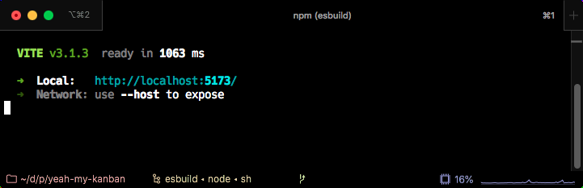

```
把 oh-my-kanban 的 src/index.js 文件拷过来，改名为 src/index.jsx，暂时注释掉一部分内
```

容：

```xml
import React from 'react';
import ReactDOM from 'react-dom/client';
// import './index.css';
// import App from './App';
const root = ReactDOM.createRoot(document.getElementById('root'));
root.render(
 <React.StrictMode>
   {/* <App /> */}
   <div>Yeah My Kanban</div>
 </React.StrictMode>
);
```

```
回到 Vite 的入口文件 index.html ，在 <body> 封闭标签最后加入一行特殊的 <script>
```

标签：

```xml
   <script type="module" src="./src/index.jsx"></script>
```

Vite 自动构建：

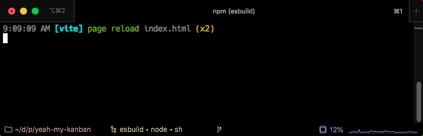

浏览器页面自动更新，显示出“Yeah My Kanban”字样了：

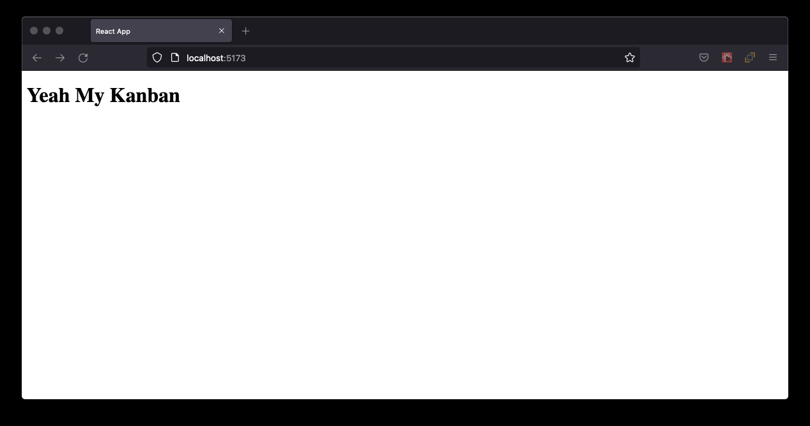

### 配置 Emotion

```bash
在 Vite 里配置 emotion 会稍微啰嗦些。安装 emotion 时需要额外安装一个开发依赖项：
npm install @emotion/react
npm install -D @emotion/babel-plugin
修改配置文件vite.config.js ，利用 emotion 的 Babel 插件为 JSX 加入 css 属性，这
样也不需要在每个 JSX 文件开头写 JSX Pragma 了：
export default defineConfig({
 plugins: [
   react({
     jsxImportSource: '@emotion/react',
     babel: {
       plugins: ['@emotion/babel-plugin'],
     },
   }),
 ],
});
好了，准备工作完成，可以开始把 oh-my-kanban 的源码迁移至 yeah-my-kanban 了。
```

## 迁移项目源码

```xml
首先，把除了 oh-my-kanban/src/index.js 的组件文件、样式文件和 context 文件，一
股脑地拷贝到 yeah-my-kanban/src/components 下。
再把里面的 context 文件移动到  src/context/AdminContext.js ，这时 VSCode 会提
示是否更新它在其他文件中的导入路径，选择“是”。然后把所有的组件文件扩展名改成 .jsx
，否则 Vite 不认。目前 yeah-my-kanban 的源码应该是这样的：
src
├── components
│   ├── App.css
│   ├── App.jsx
│   ├── KanbanBoard.jsx
│   ├── KanbanCard.jsx
│   ├── KanbanColumn.jsx
│   ├── KanbanNewCard.jsx
│   └── logo.svg
├── context
│   └── AdminContext.js
├── index.css
└── index.jsx
所有.jsx 文件第一行的 /** @jsxImportSource @emotion/react */ 可以删掉了。
把 yeah-my-kanban/src/index.jsx 的注释代码还原，注意 App 的导入路径变了：
import React from 'react';
import ReactDOM from 'react-dom/client';
import './index.css';
import App from './components/App';
const root = ReactDOM.createRoot(document.getElementById('root'));
root.render(
 <React.StrictMode>
   <App />
 </React.StrictMode>
);
完成。运行 npm start ，浏览器中出现了熟悉的页面：
```

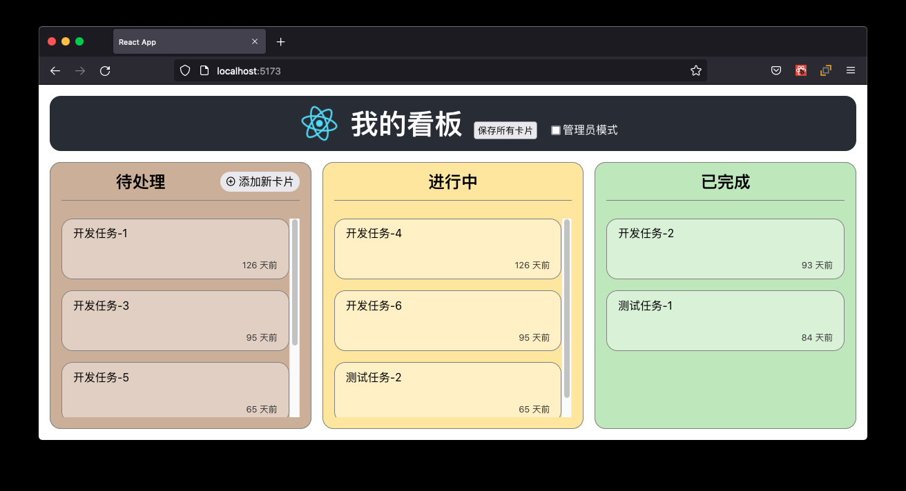

```
这时你也会发现，Vite 的开发服务器启动和初次构建都明显比 Webpack 快。对于yeah-my-
kanban 这样体量很小的项目，这种速度提升不算明显。不过随着项目规模提升，Vite 构建的
```

速度优势就体现出来了。

好了，迁移完成！也许你原本以为还需要很多步骤，但其实到这里我们的源码迁移已经成功完

```
成了。你可以把yeah-my-kanban 项目的源码也提交到代码仓库里。
```

## 为编写代码保驾护航

接下来是与源码开发相关的工程化实践，包括代码自动补全、代码静态检查、单元测试、GitHook。其中单元测试，我们留到后面第 20～22 节课详细介绍，这里暂时先跳过。

### 代码自动补全

```
现代 JS 开发是很幸福的，自从有了 TypeScript 生态，基本上常用的开源库都会以 *.d.ts
```

形式提供 Types 定义，IDE 读取这些定义，可以提供精准的代码自动补全列表；有不少库还同时提供了丰富的 JSDoc 或 TSDoc 文档，IDE 可以在代码提示中内嵌展示出来。

可以在安装 React 的 Types：

```
npm install -D @types/react @types/react-dom
```

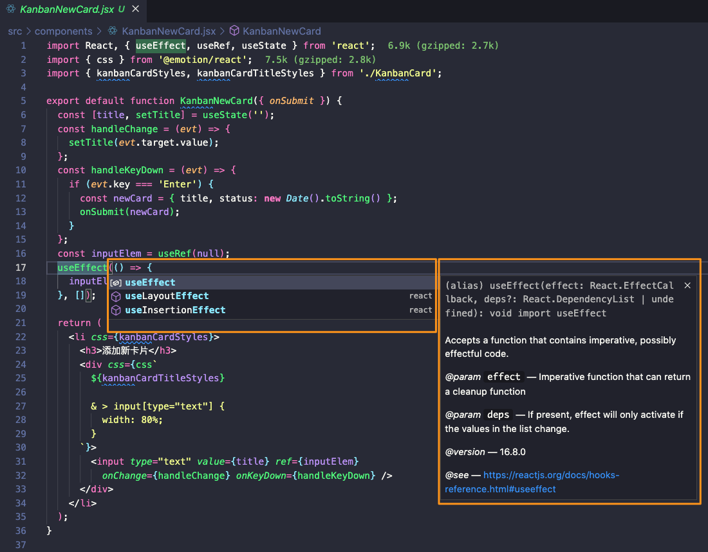

如果你在 VSCode 中发现你什么都还没做，就能有 React API 的代码自动补全，那是因为它已经提前内置了。

### 代码静态检查

代码毕竟还是人编写的，人一定会犯错，这点不用避讳。代码静态检查（Linting）是通过静态代码分析，为开发者指出代码中可能的编程错误和代码风格问题，并提出修改建议，达到提升代码质量的目的。因此代码静态检查器（Linter），就是开发者的好伙伴。

在 JS 生态中，目前最强大使用最广泛的是 ESLint（官网）。

安装 ESLint：

```
npm init @eslint/config -y
```

安装命令会依次问几个问题，大部分用默认值就行。其中需要注意，对于“你打算怎样使用ESLint？”这个问题，请选择第三项“检查语法，寻找错误，规范代码风格”：

```
? How would you like to use ESLint? …
 To check syntax only
 To check syntax and find problems
❯ To check syntax, find problems, and enforce code style
```

后面还有一个问题，“你打算怎样定义项目的代码风格？”，请选择第一项“选择一个流行的代码风格指南”，随后我推荐选择 Airbnb 的代码风格：

```
? How would you like to define a style for your project? …
❯ Use a popular style guide
 Answer questions about your style
? Which style guide do you want to follow? …
❯ Airbnb: https://github.com/airbnb/javascript
 Standard: https://github.com/standard/standard
 Google: https://github.com/google/eslint-config-google
 XO: https://github.com/xojs/eslint-config-xo
```

运行完命令行会提示：

```
✔ How would you like to use ESLint? · style
✔ What type of modules does your project use? · esm
✔ Which framework does your project use? · react
✔ Does your project use TypeScript? · No / Yes
✔ Where does your code run? · browser
✔ How would you like to define a style for your project? · guide
✔ Which style guide do you want to follow? · airbnb
✔ What format do you want your config file to be in? · JavaScript
Checking peerDependencies of eslint-config-airbnb@latest
Local ESLint installation not found.
The config that you've selected requires the following dependencies:
eslint-plugin-react@^7.28.0 eslint-config-airbnb@latest eslint@^7.32.0 || ^8.2.0
✔ Would you like to install them now? · No / Yes
✔ Which package manager do you want to use? · npm
Installing eslint-plugin-react@^7.28.0, eslint-config-airbnb@latest, eslint@^7.32
安装完成，项目根目录多了一个 .eslintrc.js 配置文件。
你已经等不急要体验一下 ESLint 的功能了。在package.json 中增加一个 NPM 命令：
```

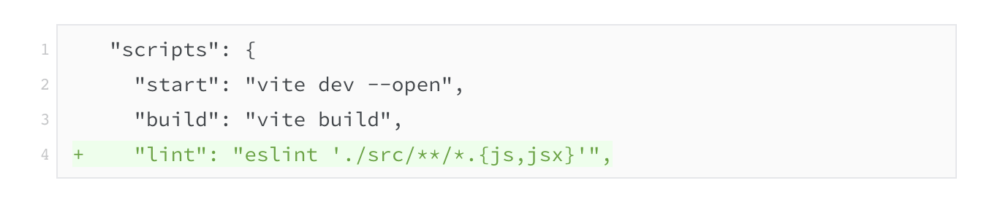

```
为了避免误伤，在 vite.config.js 顶部插入一行：
/* eslint-disable import/no-extraneous-dependencies */
好了，执行 npm run lint ，结果如下：
```

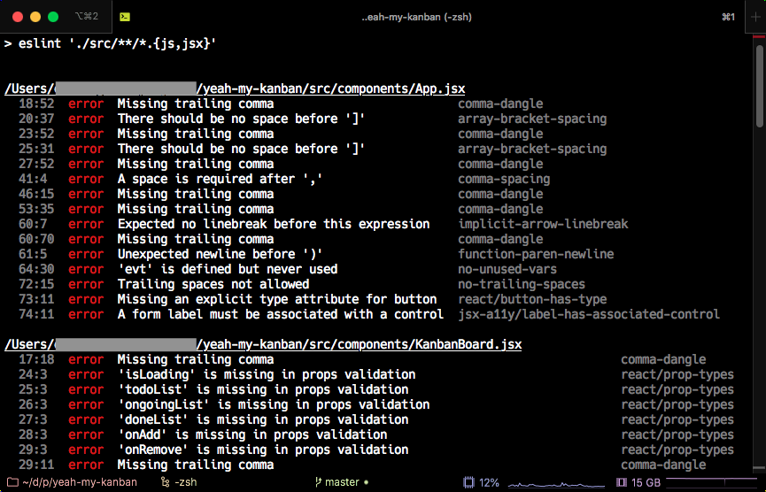

```
✖ 86 problems (86 errors, 0 warnings)
 37 errors and 0 warnings potentially fixable with the `--fix` option.
```

居然检查出这么多错误？别担心，大部分都是代码格式的报错，反正代码提交过了，我们可以

```
放心使用自动修正功能。运行 npm run lint -- --fix ，ESLint 自动修正了一部分错
```

误，还剩 50 多个错误。接下来，让我们看看还剩下哪些典型的错误。

### Lint 规则：禁止不被使用的表达式

对应的规则说明在这里：https://eslint.org/docs/latest/rules/no-unused-expressions。

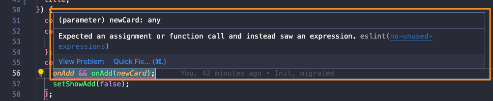

上面代码中的表达式，在 JS 中有个专门的称呼：短路表达式（Short-Circuit Expression），在

```
前端开发中还是很常用的。我们在 .eslintrc.js 的 rules 字段中加入如下一行规则，为
```

它开个绿灯：

```
 rules: {
   'no-unused-expressions': ['error', { allowShortCircuit: true }],
 },
```

### Lint 规则：禁止在函数内部修改函数参数

对应的规则说明在这里：https://eslint.org/docs/latest/rules/no-param-reassign。

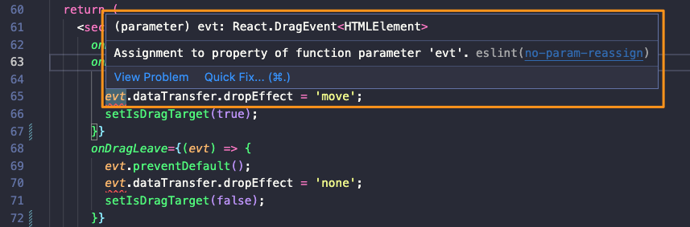

```
这个规则是非常有用的，可以避免很多编程问题。但 dropEffect 算是特例，我们加条规则
```

排除掉它：

```
'no-param-reassign': ['error', { props: true, ignorePropertyModificationsFor: ['e
```

### Lint 规则：React 组件的 props 需要定义 PropTypes

对应的规则说明在这里：https://github.com/jsx-eslint/eslint-plugin-react/blob/master/docs/rules/prop-types.md。

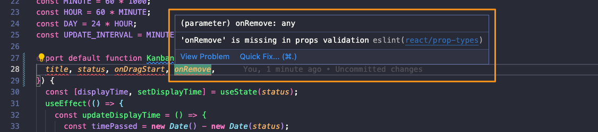

```
我们后面第 17 节课会讲到 PropTyps，所以现在先无视它。在 .eslintrc.js 的 rules 字
段中加入如下一行规则，以覆盖 plugin:react/recommended 规则集中的默认值：
'react/prop-types': ['error', { skipUndeclared: true }],
```

### Lint 规则：React 组件禁止使用未知的 DOM 属性

对应的规则说明在这里：https://github.com/jsx-eslint/eslint-plugin-react/blob/master/docs/rules/no-unknown-property.md。

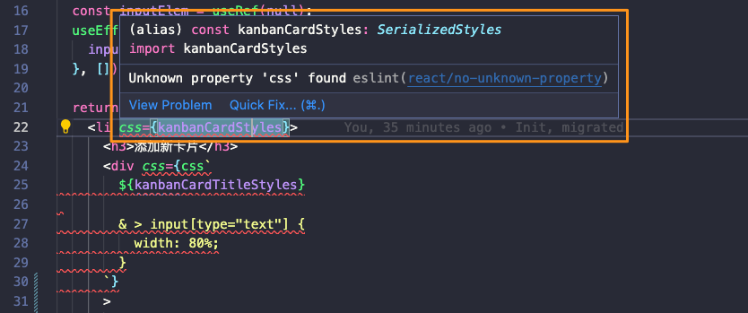

```
这个属于误伤，plugin:react/recommended 并不知道 emotion 框架的存在。加一行配置
```

忽略它：

```
'react/no-unknown-property': ['error', { ignore: ['css'] }],
再跑一次 npm run lint ，还剩 11 个错误。你可以尝试自己修正或者忽略它们。
```

### Lint 规则：检查 React Hooks 的使用规则

等一下还没完，请你回忆第 10 节课学习的 React Hooks 的使用规则，ESLint 能帮上忙吗？故

```
意用错 Hooks 试试看。需要先修改 .eslintrc.js ，启用 Airbnb 代码规则集里 Hooks 的部
```

分：

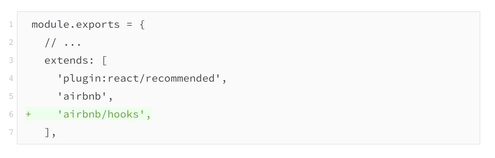

然后故意写个 Bug：

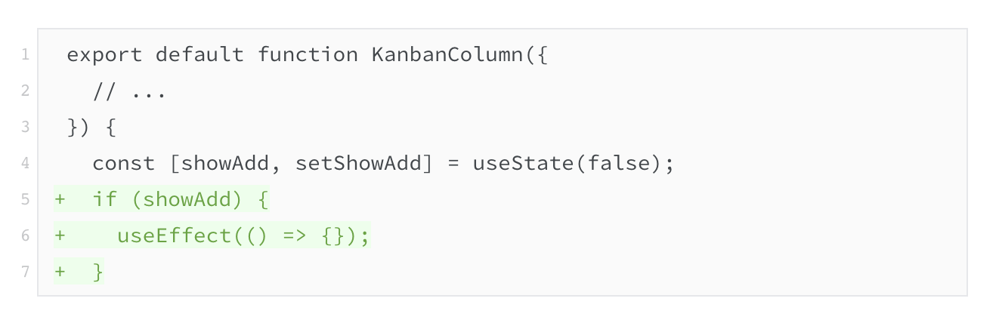

还没运行 lint 命令，VSCode 里就根据 ESLint 规则报错了：

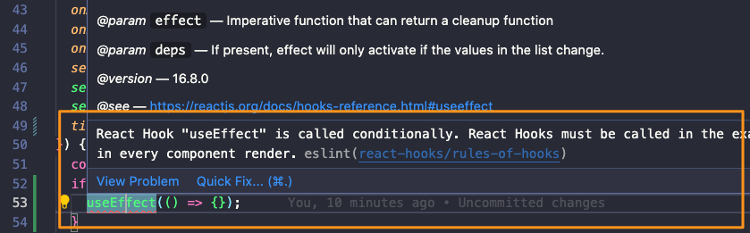

对应的规则说明：https://zh-hans.reactjs.org/docs/hooks-rules.html。靠谱儿。

### Git Hook

“今日事今日毕”。你开发工作忙碌一天，下班前最后一件事是什么？加班？不不，我是指提交本地代码到代码仓库，所谓“落袋为安”。就在这个提交代码过程中，你也有机会用更高标准要求自己：今天新写的代码必须通过 Lint 和 Test，否则禁止提交。

```
第一步，安装 Git Hook 工具 husky ：
npx husky-init && npm install
在 package.json 中额外加入一个 lint-staged 命令：
```

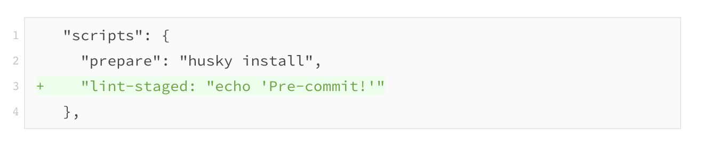

```
在新加入的 .husky/pre-commit 中把默认的 npm test 改为  npm run lint-
staged，这样之后加 Git Hook 只要改 package.json 就可以了。
来，测试一下，命令行打印 Pre-commit! 就成功了：
git add .
git commit -m "Husky"
第二步，安装 lint-staged ，这个工具会保证只检查需要提交的文件，而不是所有文件：
npm install -D lint-staged
在 package.json 中调用 lint-staged ：
```

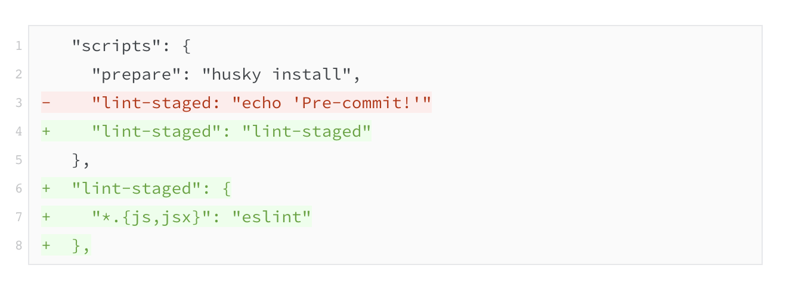

随便在哪个 JSX 文件中加个空格，尝试提交，怎么样？你被拦住了吧（得意状）？

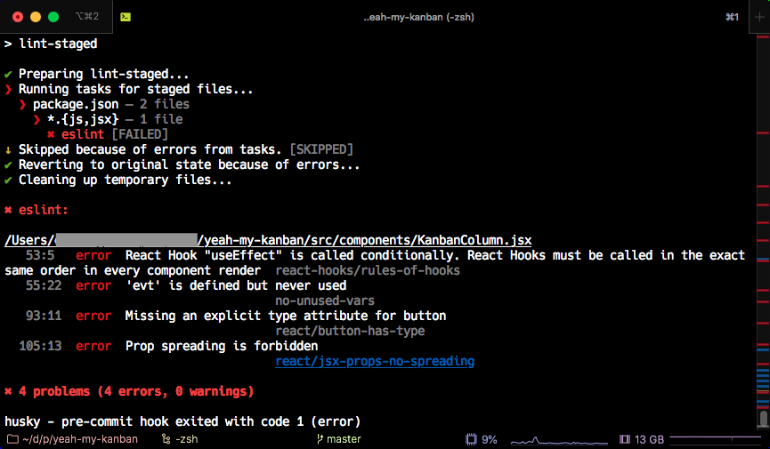

```
也不用担心，只要修好就能提交成功了。我常说 lint-staged 是个“自律”工具，可以逼迫自
```

己提高代码质量。

## 小结

这节课我们不再依赖 CRA，而是选用更高效的工程化工具 Vite，从零开始，亲手搭建了一个新的 React 项目 yeah-my-kanban。并且不费吹灰之力，把 oh-my-kanban 的代码迁移了过来，熟悉了与 React 应用代码直接相关的工程化概念和工具。其中我们也重点介绍了代码静态检查工具的用法和部分规则，以及 Git Hook 这种“自律”工具。

到此为止，你已经学习了 React 开发的基础内容，相信你已经有能力成为一位 React 开发的“独狼”工程师了。

从下节课开始，我们将进入新的模块，学习一些中型、大型 React 项目中会用到的技术和最佳实践，尤其是介绍当你融入一个前端开发团队时，需要的开发工作思路和方式的转变，这会帮你更从容应地对中大型 React 应用项目。

## 思考题

我曾强调过，前端工程化不是凭空出现的，而一定是为了解决在开发中存在的痛点，提升开发效率效果。你在前端开发过程中，尤其是第 3 节课到 13 节课期间的实践中，遇到过哪些痛点？你自己都是怎么解决的？你知道在前端技术社区有什么对应的工程化实践吗？

好了，这节课内容就是这些。“独狼”React 工程师，我们下节课不见不散！
